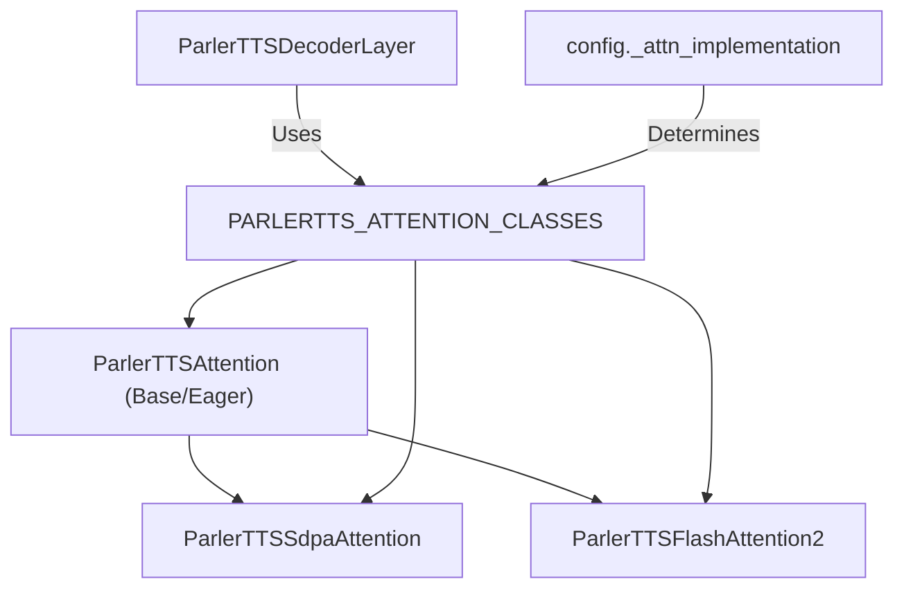
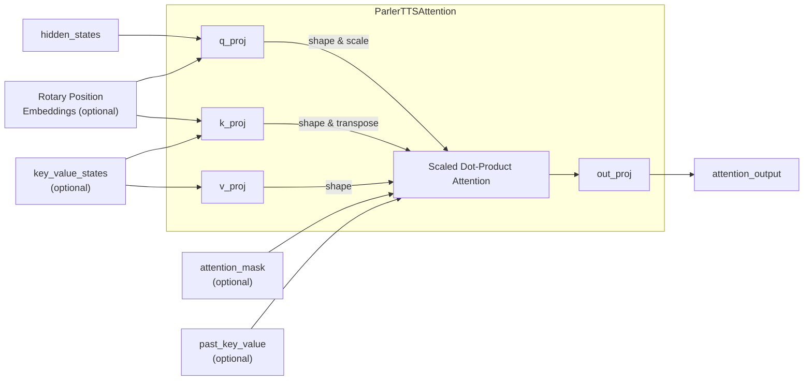
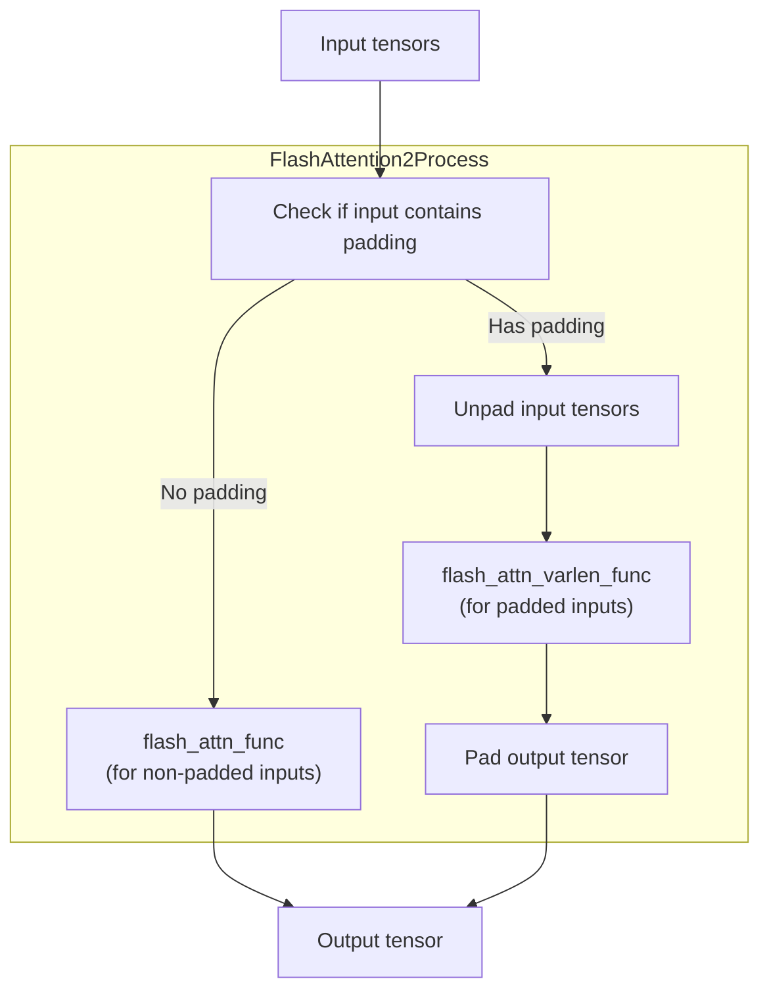
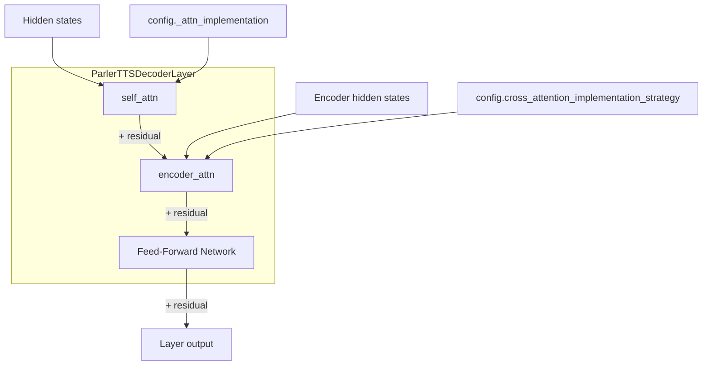

<!-- source: DeepWiki mcp.deepwiki.com · repo huggingface/parler-tts · page 2.4 Attention Mechanisms · fetched 2026-10-26 -->

# Attention Mechanisms

<details>
<summary>Relevant source files</summary>

The following files were used as context for generating this wiki page:

- [INFERENCE.md](INFERENCE.md)
- [parler_tts/modeling_parler_tts.py](parler_tts/modeling_parler_tts.py)
- [parler_tts/streamer.py](parler_tts/streamer.py)

</details>


This page documents the different attention mechanism implementations available in Parler-TTS. Attention is a core component of the transformer architecture that enables the model to focus on relevant parts of input sequences when generating audio. For information about the overall model architecture, see [Architecture](#1.1).

## Attention Implementation Overview

Parler-TTS provides three attention implementation variants, each offering different performance characteristics:



Sources: [parler_tts/modeling_parler_tts.py:933-937]()

## Base Attention Implementation

The foundational attention implementation is `ParlerTTSAttention`, which uses eager computation and serves as the parent class for the optimized implementations.

### Key Features

- Multi-head attention with support for Group Query Attention (GQA)
- Separate number of heads for queries vs. keys/values
- Support for rotary positional embeddings (RoPE)
- Key-value caching for efficient autoregressive generation
- Support for cross-attention (when `key_value_states` are provided)



Sources: [parler_tts/modeling_parler_tts.py:439-584]()

### Attention Computation Flow

The attention computation in `ParlerTTSAttention` follows these steps:

1. Project hidden states to queries, keys, and values
2. Apply rotary position embeddings if enabled
3. Reuse cached key/values if provided, otherwise compute new ones
4. Repeat key/value heads if using GQA (Group Query Attention)
5. Compute attention weights via matrix multiplication
6. Apply attention mask if provided
7. Apply softmax and dropout
8. Compute weighted values and project to output dimension

## Optimized Attention Implementations

Parler-TTS includes two optimized attention mechanisms that inherit from the base implementation but replace the core attention computation with more efficient algorithms.

### SDPA Attention

`ParlerTTSSdpaAttention` uses PyTorch's native `torch.nn.functional.scaled_dot_product_attention` function, which provides optimized kernels for different hardware:

```python
attn_output = torch.nn.functional.scaled_dot_product_attention(
    query_states,
    key_states,
    value_states,
    attn_mask=causal_mask,
    dropout_p=self.dropout if self.training else 0.0,
    is_causal=is_causal,
)
```

Key benefits:
- Up to 1.4x speedup over eager attention
- Uses optimized CUDA kernels on NVIDIA GPUs
- Falls back to the base implementation when `output_attentions=True`

Sources: [parler_tts/modeling_parler_tts.py:818-930](), [INFERENCE.md:12-33]()

### Flash Attention 2

`ParlerTTSFlashAttention2` integrates the Flash Attention 2 library for maximum efficiency, particularly with long sequences:



Key benefits:
- Memory-efficient attention computation
- Higher performance on long sequences
- Special handling for padding tokens

Limitations:
- Requires the Flash Attention 2 library
- Not compatible with static cache implementation
- Does not support output attentions

Sources: [parler_tts/modeling_parler_tts.py:600-814](), [INFERENCE.md:12-33]()

## Attention Selection Mechanism

The attention implementation is selected through a dictionary mapping:

```python
PARLERTTS_ATTENTION_CLASSES = {
    "eager": ParlerTTSAttention,
    "sdpa": ParlerTTSSdpaAttention,
    "flash_attention_2": ParlerTTSFlashAttention2,
}
```

This mapping is used in the `ParlerTTSDecoderLayer` constructor to create the appropriate attention modules:

```python
self.self_attn = PARLERTTS_ATTENTION_CLASSES[config._attn_implementation](
    embed_dim=self.embed_dim,
    num_heads=config.num_attention_heads,
    num_key_value_heads=config.num_key_value_heads,
    dropout=config.attention_dropout,
    is_decoder=True,
    is_causal=True,
    # ...other parameters
)
```

Sources: [parler_tts/modeling_parler_tts.py:933-937](), [parler_tts/modeling_parler_tts.py:940-977]()

## Integration with Decoder Layers

Within each `ParlerTTSDecoderLayer`, there are two attention mechanisms:

1. **Self-attention** - Uses the specified attention implementation from the config
2. **Cross-attention** - Can use a different implementation based on the `cross_attention_implementation_strategy`



The cross-attention implementation can be configured separately:

```python
cross_attn_implementation = config._attn_implementation
if config.cross_attention_implementation_strategy == "always_eager":
    cross_attn_implementation = "eager"
elif config.cross_attention_implementation_strategy == "always_sdpa":
    cross_attn_implementation = "sdpa"
```

Sources: [parler_tts/modeling_parler_tts.py:940-1075]()

## Using Different Attention Implementations

You can specify which attention implementation to use when loading a Parler-TTS model:

```python
from parler_tts import ParlerTTSForConditionalGeneration
import torch

model = ParlerTTSForConditionalGeneration.from_pretrained(
    "parler-tts/parler-tts-mini-v1",
    attn_implementation="sdpa"  # Options: "eager", "sdpa", "flash_attention_2"
).to("cuda", dtype=torch.bfloat16)
```

SDPA is used by default and offers a good balance of performance and compatibility. For maximum performance, Flash Attention 2 is recommended if your hardware supports it.

Sources: [INFERENCE.md:12-33]()

## Performance Comparison

| Implementation | Speed Improvement | Hardware Support | Notes |
|----------------|-------------------|------------------|-------|
| eager          | Baseline          | All              | Default implementation, supports all features |
| sdpa           | Up to 1.4x        | Modern GPUs      | Default in Parler-TTS, good balance of compatibility and speed |
| flash_attention_2 | Up to 3x      | NVIDIA GPUs with Flash Attention 2 | Best for long sequences, requires additional library |

For maximum inference speed, using Flash Attention 2 combined with model compilation can provide significant performance improvements. See [Optimized Inference](#4.1) for more information on compilation techniques.

Sources: [INFERENCE.md:12-33](), [INFERENCE.md:35-78]()

## Caching for Efficient Generation

All attention implementations support key-value caching for efficient autoregressive generation. This allows the model to reuse previously computed key and value states, reducing computation during inference.

The following cache implementations are supported:
- `DynamicCache` - Default cache implementation that grows with the sequence
- `StaticCache` - Pre-allocated cache with fixed maximum length
- `SlidingWindowCache` - Cache that only keeps a sliding window of past keys/values

Flash Attention 2 is not compatible with the static cache implementation.

Sources: [parler_tts/modeling_parler_tts.py:97-97](), [parler_tts/modeling_parler_tts.py:630-633]()

---

