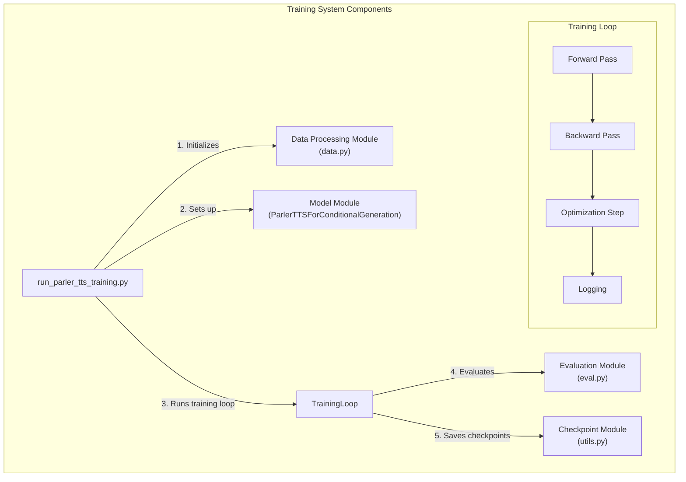
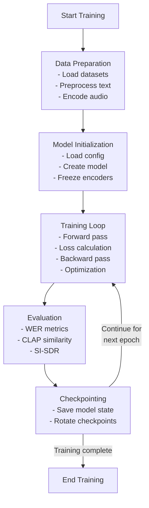
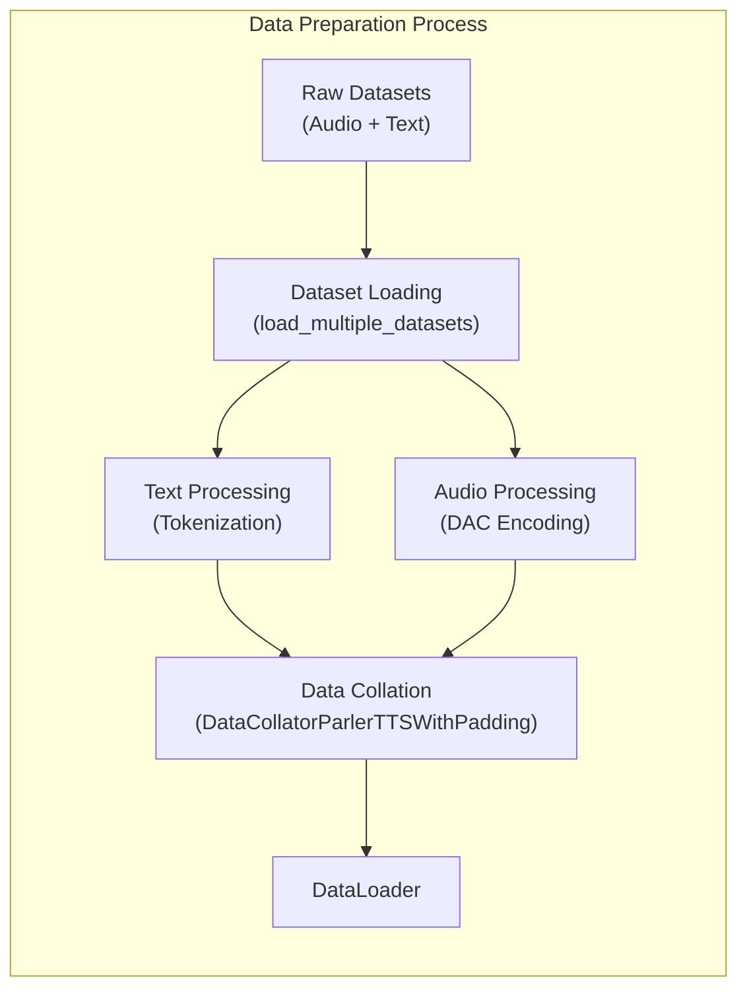
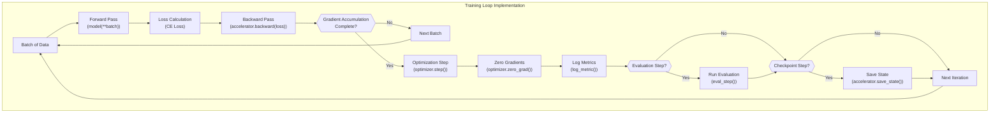
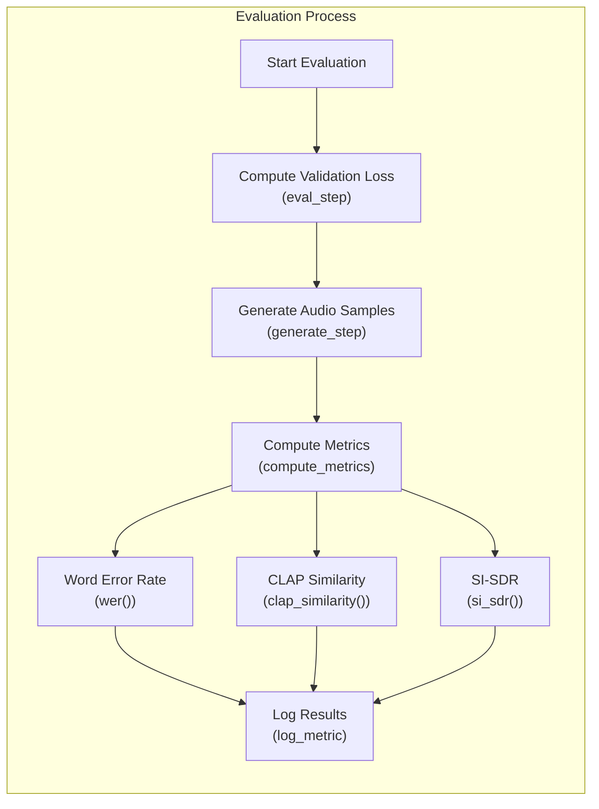
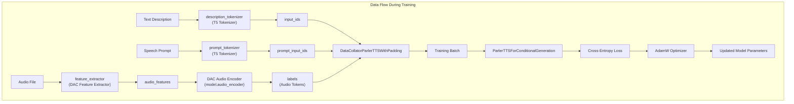

<!-- source: DeepWiki mcp.deepwiki.com · repo huggingface/parler-tts · page 3 Training · fetched 2026-10-26 -->

# Training

<details>
<summary>Relevant source files</summary>

The following files were used as context for generating this wiki page:

- [README.md](README.md)
- [training/README.md](training/README.md)
- [training/run_parler_tts_training.py](training/run_parler_tts_training.py)

</details>


This page provides an overview of the training process for Parler-TTS models. It covers the high-level architecture of the training system, the key components involved, and how they interact during the training process. For more specific details about individual aspects of training, please refer to the following pages:

- [Training Pipeline](3.1) - Detailed explanation of the training pipeline components
- [Data Preparation and Loading](3.2) - How data is processed for training
- [Evaluation Metrics](3.3) - Metrics used to evaluate model performance
- [Checkpointing and Utilities](3.4) - How model checkpoints are managed
- [Model Initialization](3.5) - How to initialize models of different sizes

## Training System Architecture

The training system in Parler-TTS is designed to facilitate the end-to-end training of text-to-speech models. It handles everything from data preprocessing to model evaluation and checkpoint management.



Sources: [training/run_parler_tts_training.py:65-246](), [README.md:122-142]()

## Training Process Flow

The training process follows a structured flow from data preparation to model evaluation and checkpoint saving.



Sources: [training/run_parler_tts_training.py:73-1246](), [training/README.md:113-117]()

## Key Components of the Training System

### Data Preparation and Loading

Before training can begin, Parler-TTS requires preprocessing of both text and audio data:

1. **Dataset Loading**: Multiple datasets can be loaded and merged using the `load_multiple_datasets` function
2. **Text Processing**: Text descriptions and prompts are tokenized using their respective tokenizers
3. **Audio Encoding**: Audio is encoded using the DAC (Descript Audio Codec) to create the discrete tokens used for training



Sources: [training/run_parler_tts_training.py:226-636](), [training/data.py]()

### Model Configuration and Initialization

The model is configured and initialized with appropriate parameters before training:

1. **Config Loading**: The ParlerTTSConfig is loaded or created
2. **Model Creation**: The ParlerTTSForConditionalGeneration model is instantiated
3. **Encoder Freezing**: Text encoder can be optionally frozen to save compute resources

Key configuration options include:
- Model size (number of parameters)
- Cross-attention implementation strategy
- Attention mechanism (SDPA, Flash Attention 2)
- Data types (bfloat16, float16, float32)

Sources: [training/run_parler_tts_training.py:303-345](), [training/README.md:76-92]()

### Training Loop

The training loop handles the core training process:

1. **Forward Pass**: Process batches of data through the model
2. **Loss Calculation**: Compute cross-entropy loss for predicted audio tokens
3. **Backward Pass**: Calculate gradients with respect to the loss
4. **Optimization**: Update model parameters using AdamW optimizer
5. **Logging**: Record metrics and performance data

The training loop is designed to be flexible, supporting:
- Gradient accumulation for larger effective batch sizes
- Mixed precision training (float16/bfloat16)
- Distributed training across multiple GPUs



Sources: [training/run_parler_tts_training.py:784-1243](), [training/run_parler_tts_training.py:880-926]()

### Evaluation

During training, the model is periodically evaluated to track its performance:

1. **Loss Calculation**: Compute validation loss on evaluation dataset
2. **Audio Generation**: Generate audio samples from text descriptions
3. **Metric Computation**:
   - Word Error Rate (WER): Measures transcription accuracy
   - CLAP Similarity: Measures alignment between text description and generated audio
   - SI-SDR: Measures signal-to-distortion ratio



Sources: [training/run_parler_tts_training.py:668-707](), [training/eval.py]()

### Checkpointing

To ensure training progress is not lost and to enable model sharing, the system includes robust checkpoint management:

1. **Regular Saving**: Checkpoints are saved at configurable intervals
2. **Checkpoint Rotation**: Older checkpoints are removed to save disk space
3. **Resumption**: Training can be resumed from saved checkpoints
4. **Hugging Face Hub Integration**: Models can be pushed directly to the Hugging Face Hub

Sources: [training/run_parler_tts_training.py:1077-1100](), [training/utils.py]()

## Configuration and Parameters

Training in Parler-TTS is highly configurable through command-line arguments or a JSON configuration file. Key parameters are organized into three categories:

### Model Arguments
Control the model architecture and behavior:
- `model_name_or_path`: Path to pretrained model or model identifier
- `freeze_text_encoder`: Whether to freeze the text encoder during training
- `attn_implementation`: Attention mechanism to use (eager, sdpa, flash_attention_2)
- `temperature`: Temperature for generation sampling

### Data Arguments
Control data processing and dataset handling:
- `train_dataset_name`: Name of the training dataset(s)
- `eval_dataset_name`: Name of the evaluation dataset(s)
- `max_duration_in_seconds`: Maximum duration of audio files
- `description_column_name`: Column name for speaker descriptions
- `prompt_column_name`: Column name for speech transcriptions

### Training Arguments
Control the training process itself:
- `per_device_train_batch_size`: Batch size per GPU for training
- `gradient_accumulation_steps`: Number of steps to accumulate gradients
- `learning_rate`: Learning rate for the optimizer
- `num_train_epochs`: Number of training epochs
- `eval_steps`: Steps between evaluations
- `save_steps`: Steps between saving checkpoints

Table of important training parameters:

| Parameter | Purpose | Typical Value |
|-----------|---------|---------------|
| `learning_rate` | Controls the size of parameter updates | 0.0001 - 0.001 |
| `num_train_epochs` | Number of passes through the dataset | 3 - 5 |
| `per_device_train_batch_size` | Batch size on each GPU | 2 - 8 |
| `gradient_accumulation_steps` | Batches before parameter update | 4 - 16 |
| `dtype` | Data type for model computations | "bfloat16" or "float16" |
| `freeze_text_encoder` | Whether to freeze text encoder | true |
| `max_duration_in_seconds` | Maximum audio clip duration | 10 - 30 |

Sources: [training/run_parler_tts_training.py:64-187](), [training/arguments.py](), [training/README.md:118-174]()

## Example Training Flow

This diagram shows how data flows through the system during training:



Sources: [training/run_parler_tts_training.py:880-927](), [training/data.py]()

## Running a Training Job

To start training a Parler-TTS model, you can use the `run_parler_tts_training.py` script with either command-line arguments or a JSON configuration file:

### Using a JSON configuration file:

```
accelerate launch ./training/run_parler_tts_training.py ./helpers/training_configs/starting_point_v1.json
```

### Using command-line arguments:

```
accelerate launch ./training/run_parler_tts_training.py \
    --model_name_or_path "parler-tts/parler-tts-mini-v1" \
    --feature_extractor_name "parler-tts/dac_44khZ_8kbps" \
    --description_tokenizer_name "google/flan-t5-large" \
    --train_dataset_name "your_dataset" \
    --description_column_name "text_description" \
    --prompt_column_name "text" \
    --target_audio_column_name "audio" \
    --per_device_train_batch_size 4 \
    --learning_rate 0.0001 \
    --num_train_epochs 3 \
    --save_steps 5000 \
    --output_dir "./output_dir"
```

For distributed training across multiple GPUs, just configure Accelerate with `accelerate config` and the script will automatically utilize all available resources.

Sources: [training/README.md:118-189](), [README.md:123-142]()

## Monitoring Training Progress

Training progress can be monitored through:

1. **Terminal Logs**: Basic metrics are printed to the console
2. **Weights & Biases**: Detailed metrics and generated audio samples can be viewed if `--report_to "wandb"` is specified
3. **Checkpoint Files**: Stored in the output directory at regular intervals

Key metrics to monitor include:
- Training and validation loss
- Word Error Rate (WER)
- CLAP similarity score
- SI-SDR (Signal-to-Distortion Ratio)

Sources: [training/run_parler_tts_training.py:1039-1074](), [training/run_parler_tts_training.py:1214-1223]()

---

