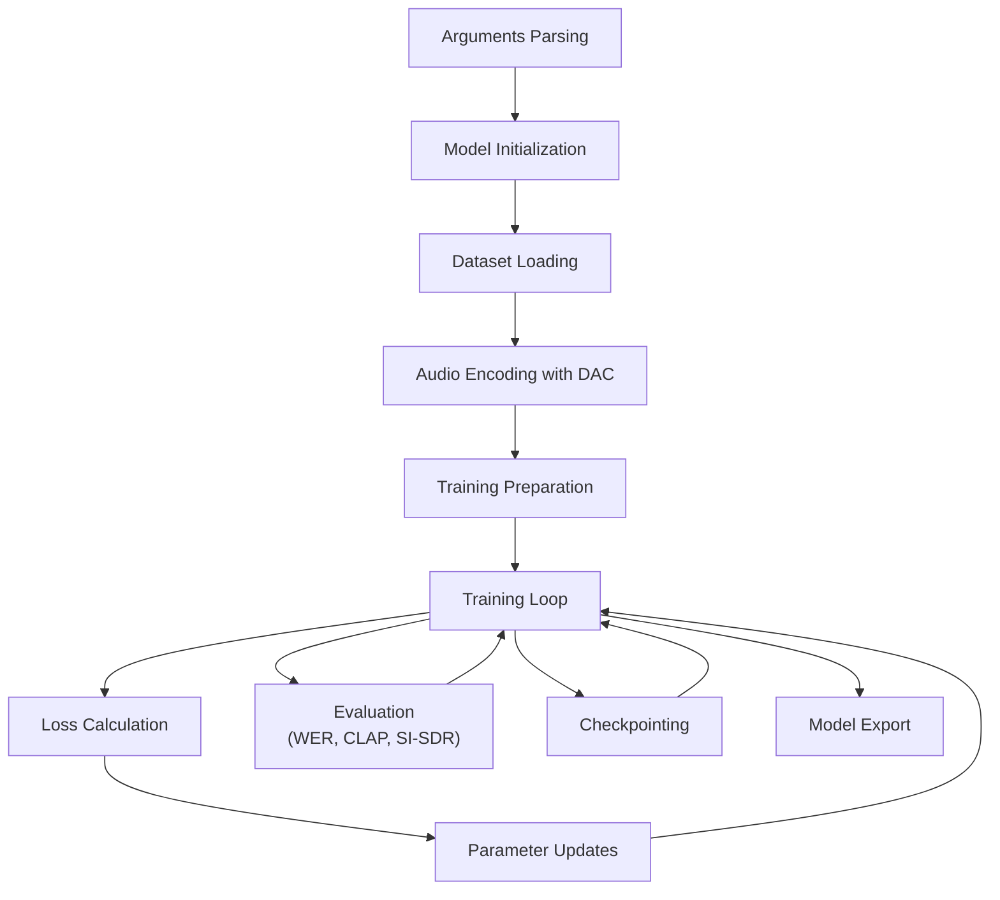
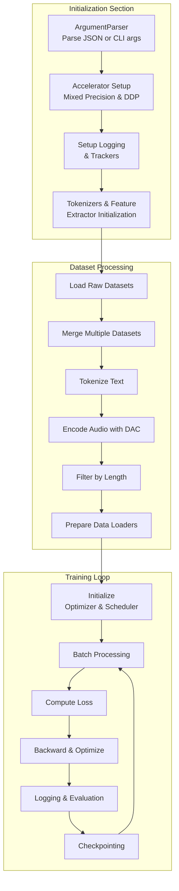
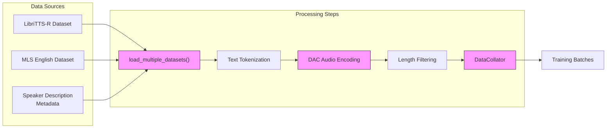
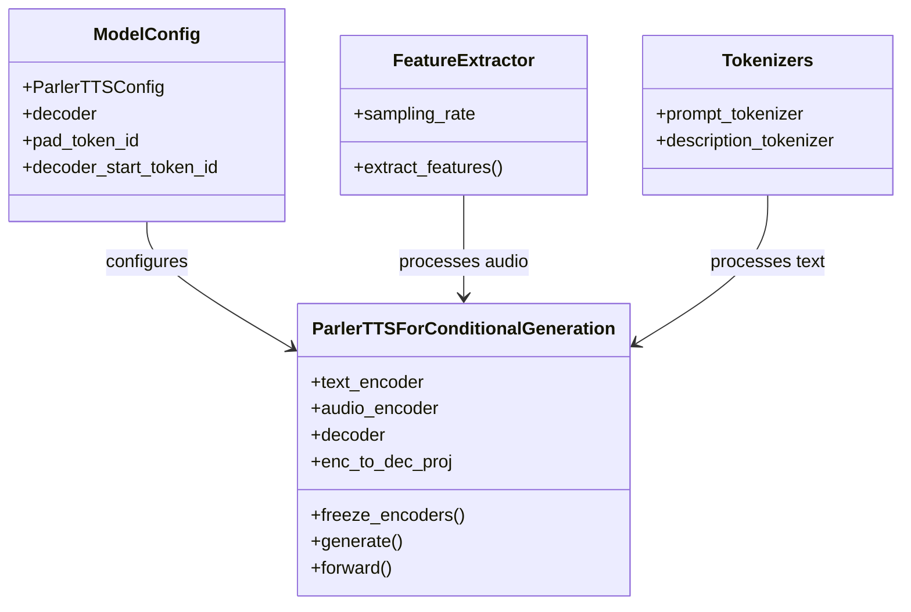
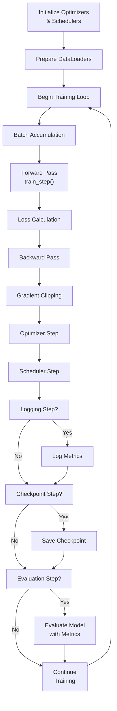
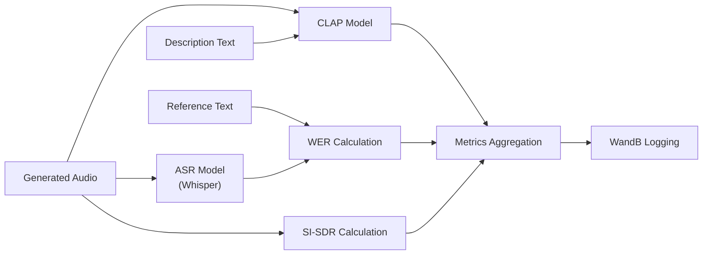

<!-- source: DeepWiki mcp.deepwiki.com · repo huggingface/parler-tts · page 3.1 Training Pipeline · fetched 2026-10-26 -->

# Training Pipeline

<details>
<summary>Relevant source files</summary>

The following files were used as context for generating this wiki page:

- [README.md](README.md)
- [training/README.md](training/README.md)
- [training/arguments.py](training/arguments.py)
- [training/run_parler_tts_training.py](training/run_parler_tts_training.py)

</details>


This page documents the Parler-TTS training pipeline, which provides an end-to-end framework for training high-quality text-to-speech models conditioned on text prompts and speaker descriptions. We cover the workflow, components, and configuration options of the training system.

For information about the model architecture itself, see [Architecture](#1.1), and for details on data preparation, see [Data Preparation and Loading](#3.2).

## Pipeline Overview

The Parler-TTS training pipeline is orchestrated by a single script that handles the entire workflow from data loading to model evaluation. The pipeline:

1. Processes command-line arguments or configuration files
2. Loads and initializes model components (tokenizers, encoders, decoder)
3. Prepares datasets, including preprocessing and audio encoding
4. Sets up training (optimizer, scheduler, data collation)
5. Executes the training loop with periodic evaluation
6. Checkpoints models and exports the final trained model



Sources: [training/run_parler_tts_training.py:73-1249]()

## Training Script Components

The main training script (`run_parler_tts_training.py`) is organized into several logical sections that handle different aspects of the training process:



Sources: [training/run_parler_tts_training.py:111-142](), [training/run_parler_tts_training.py:226-608](), [training/run_parler_tts_training.py:744-1244]()

## Command Line Arguments

The training pipeline uses three main argument classes to control every aspect of training:

| Argument Category | Purpose | Key Arguments |
|-------------------|---------|---------------|
| **ModelArguments** | Controls model architecture | `model_name_or_path`, `freeze_text_encoder`, `attn_implementation` |
| **DataTrainingArguments** | Controls dataset handling | `train_dataset_name`, `description_column_name`, `max_duration_in_seconds` |
| **ParlerTTSTrainingArguments** | Controls training behavior | `learning_rate`, `per_device_train_batch_size`, `gradient_accumulation_steps` |

These arguments can be specified either in a JSON configuration file or directly on the command line:

```
accelerate launch ./training/run_parler_tts_training.py ./helpers/training_configs/starting_point_v1.json
```

Sources: [training/arguments.py:1-375](), [training/run_parler_tts_training.py:77-84]()

## Dataset Processing Pipeline

One of the most complex parts of the training pipeline is dataset handling, which includes several stages:



Key features of dataset processing:

1. **Multiple Dataset Loading**: Supports concatenating multiple datasets with the `+` separator in configuration
2. **Audio Encoding**: Pre-computes audio tokens using DAC to save computation during training
3. **Caching**: Can save processed datasets to disk to avoid repeating preprocessing
4. **Filtering**: Removes samples based on duration and token length criteria
5. **Batch Creation**: Custom data collator with support for different padding strategies

Sources: [training/run_parler_tts_training.py:226-313](), [training/run_parler_tts_training.py:413-565]()

## Model Initialization

The training script initializes all components of the Parler-TTS model:



The model initialization handles:
- Loading pre-trained weights if continuing from a checkpoint
- Setting up the feature extractor for audio processing
- Configuring tokenizers for both prompt text and description text
- Optionally freezing the text encoder for more efficient training

Sources: [training/run_parler_tts_training.py:191-218](), [training/run_parler_tts_training.py:304-368]()

## Training Loop

The core training loop implements:



Key functions in the training loop:
- `train_step()`: Performs forward pass and calculates loss
- `eval_step()`: Evaluates model on validation data
- `generate_step()`: Generates audio for evaluation metrics
- `compute_metrics()`: Calculates WER, CLAP similarity, and SI-SDR

Sources: [training/run_parler_tts_training.py:880-985](), [training/run_parler_tts_training.py:988-1244]()

## Evaluation Metrics

During training, the pipeline periodically evaluates the model using several metrics:

| Metric | Description | Implementation |
|--------|-------------|----------------|
| **WER (Word Error Rate)** | Measures transcription accuracy using ASR | Uses Whisper to transcribe generated audio, then compares to ground truth |
| **CLAP Similarity** | Audio-text similarity score | Uses CLAP model to compute similarity between description and generated audio |
| **SI-SDR** | Signal-to-distortion ratio | Measures audio quality and noise level |

The evaluation process:



Sources: [training/run_parler_tts_training.py:668-709](), [training/run_parler_tts_training.py:1167-1205]()

## Optimization Features

The training pipeline incorporates several optimization techniques to improve training efficiency:

1. **Mixed Precision Training**: Supports fp16 and bf16 for faster computation
   ```python
   # Configured through training_args.dtype
   mixed_precision = "fp16" if training_args.dtype == "float16" else "bf16" if training_args.dtype == "bfloat16" else "no"
   ```

2. **Distributed Training**: Uses Accelerate for multi-GPU training
   ```python
   # Handled through Accelerate
   accelerator = Accelerator(
       gradient_accumulation_steps=training_args.gradient_accumulation_steps,
       mixed_precision=mixed_precision,
       ...
   )
   ```

3. **Gradient Accumulation**: Accumulates gradients across multiple batches for larger effective batch sizes
   ```python
   # Loop through batches
   for i,batch in enumerate(batch_samples):
       with ctx():
           loss, train_metric = train_step(batch, accelerator, autocast_kwargs, num_items_in_batch, gradient_accumulation_steps)
           accelerator.backward(loss)
   ```

4. **Attention Implementations**: Supports efficient attention mechanisms
   ```python
   # Configurable attention implementation
   model = ParlerTTSForConditionalGeneration.from_pretrained(
       ...,
       attn_implementation={"decoder": model_args.attn_implementation, "text_encoder": "eager"},
   )
   ```

Sources: [training/run_parler_tts_training.py:90-98](), [training/run_parler_tts_training.py:114-120](), [training/run_parler_tts_training.py:1039-1046](), [training/run_parler_tts_training.py:333-340]()

## Memory Optimization

The training pipeline implements several memory optimizations:

1. **Audio Pre-encoding**: Encodes audio only once at the start of training
2. **Gradient Checkpointing**: Optional memory-computation tradeoff
3. **Dataset Caching**: Saves processed datasets to avoid repetitive work
4. **Progressive Batch Processing**: Processes batches one by one in gradient accumulation
5. **Memory Release**: Explicitly releases memory after evaluation

Sources: [training/run_parler_tts_training.py:343-344](), [training/run_parler_tts_training.py:413-565](), [training/run_parler_tts_training.py:1039-1046](), [training/run_parler_tts_training.py:1225-1229]()

## Using the Training Pipeline

To train a Parler-TTS model, you can use the provided JSON configuration or command line arguments:

1. **Using a JSON config**:
   ```bash
   accelerate launch ./training/run_parler_tts_training.py ./helpers/training_configs/starting_point_v1.json
   ```

2. **Using command line arguments**:
   ```bash
   accelerate launch ./training/run_parler_tts_training.py \
       --model_name_or_path "./parler-tts-untrained-600M/" \
       --feature_extractor_name "parler-tts/dac_44khZ_8kbps" \
       --description_tokenizer_name "google/flan-t5-large" \
       --train_dataset_name "parler-tts/libritts_r_filtered" \
       --target_audio_column_name "audio" \
       --description_column_name "text_description" \
       --prompt_column_name "text" \
       --max_duration_in_seconds 30 \
       --do_train true \
       --per_device_train_batch_size 4 \
       --gradient_accumulation_steps 6
   ```

3. **Multiple datasets with metadata**:
   You can specify multiple datasets by separating them with `+`:
   ```
   --train_dataset_name "dataset1+dataset2+dataset3" \
   --train_metadata_dataset_name "metadata1+metadata2+metadata3" \
   --train_dataset_config_name "config1+config2+config3"
   ```

Sources: [training/README.md:119-175](), [training/run_parler_tts_training.py:78-84]()

## Best Practices

Based on the implementation, here are some best practices for training Parler-TTS models:

1. **Dataset Preprocessing**: Use `--preprocessing_only` and `--save_to_disk` for large datasets to precompute everything once
2. **Mixed Precision**: Use `--dtype "bfloat16"` on A100 GPUs and `--dtype "float16"` on V100 GPUs
3. **Text Encoder**: Enable `--freeze_text_encoder` to save compute resources
4. **Logging**: Enable WandB tracking with `--report_to "wandb"` for comprehensive metrics
5. **Batch Size**: Use a combination of `--per_device_train_batch_size` and `--gradient_accumulation_steps` for optimal memory usage
6. **Checkpoint Management**: Set appropriate `--save_steps` and `--eval_steps` for regular evaluation

Sources: [training/README.md:186-212](), [training/run_parler_tts_training.py:1077-1100]()

## Conclusion

The Parler-TTS training pipeline provides a comprehensive system for training high-quality text-to-speech models. It handles the entire workflow from data preparation to model evaluation, with extensive configuration options for optimizing training for different hardware and dataset requirements.

For information about the trained model components, see [ParlerTTS Model](#2.1). For details on evaluation metrics, see [Evaluation Metrics](#3.3).

---

