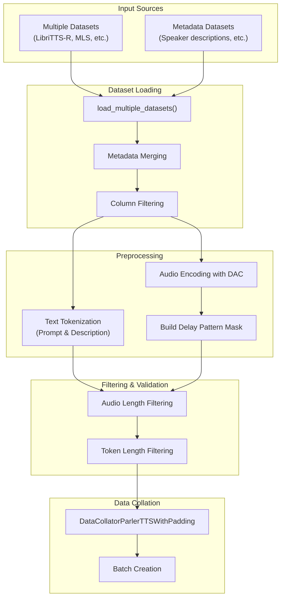
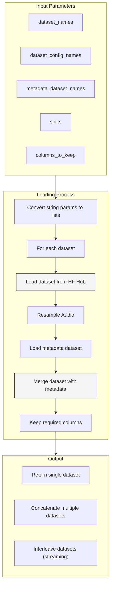
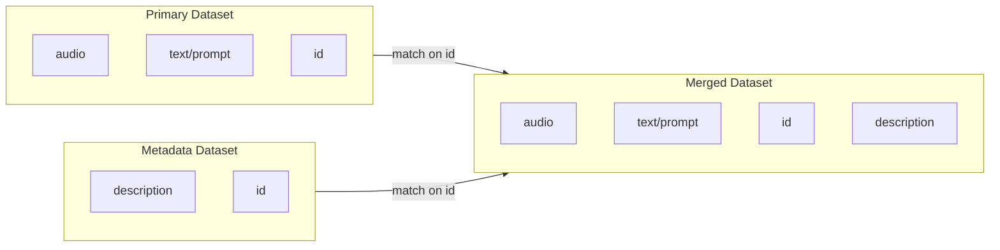
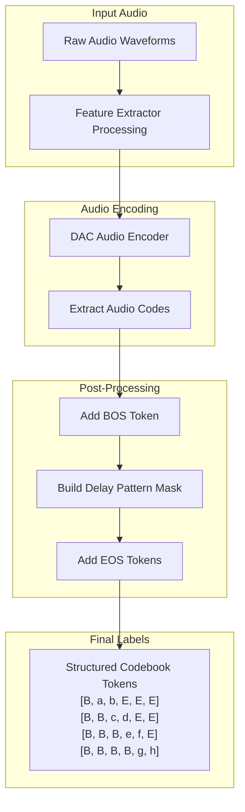
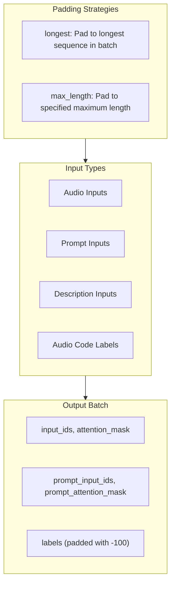
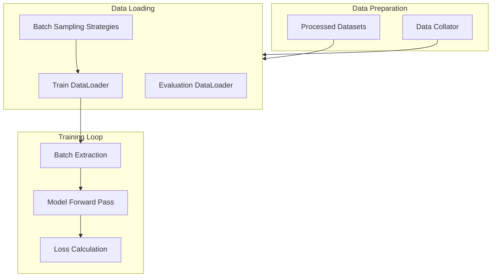

<!-- source: DeepWiki mcp.deepwiki.com · repo huggingface/parler-tts · page 3.2 Data Preparation and Loading · fetched 2026-10-26 -->

# Data Preparation and Loading

Relevant source files

The following files were used as context for generating this wiki page:

- [training/data.py](training/data.py)
- [training/run_parler_tts_training.py](training/run_parler_tts_training.py)

This page details the data preparation and loading process for training Parler-TTS models. Proper data preparation is critical for training high-quality text-to-speech models, as it involves processing multiple datasets, handling text and audio inputs, and preparing them in the format required by the model architecture.

For information about the training pipeline that uses this data, see [Training Pipeline](#3.1).

## Overview of Data Preparation Flow

The data preparation process in Parler-TTS involves several key steps, from loading raw datasets to creating batched, tokenized inputs ready for model training.

Sources: [training/data.py:175-311](), [training/run_parler_tts_training.py:227-308](), [training/run_parler_tts_training.py:410-565]()

## Dataset Loading

The dataset loading process handles multiple datasets from various sources, optionally merging them with metadata datasets that contain additional information (such as speaker descriptions).

### Loading Multiple Datasets

Parler-TTS uses the `load_multiple_datasets` function to load and combine multiple datasets:

Sources: [training/data.py:175-311](), [training/run_parler_tts_training.py:227-308]()

The dataset loading function supports:

- Loading from multiple dataset sources
- Automatic audio resampling to the target sampling rate
- Merging with metadata datasets
- Filtering to keep only required columns
- Concatenating or interleaving datasets

### Dataset and Metadata Merging

A key feature of the data pipeline is the ability to merge primary datasets (containing audio) with metadata datasets (containing descriptions):

Sources: [training/data.py:222-271](), [training/run_parler_tts_training.py:260-272]()

The merging process:
1. Loads the metadata dataset with the same configuration and split as the primary dataset
2. Renames the ID column in the metadata dataset to avoid conflicts
3. Removes columns that exist in both datasets to prevent duplicates
4. Concatenates the datasets along the column axis
5. Optionally verifies that the IDs match between the two datasets

## Audio Processing 

Audio processing is a critical part of the data preparation pipeline, involving resampling, encoding, and preparing for the model's decoder architecture.

### Audio Encoding Process

The Parler-TTS model uses the DAC (Descript Audio Codec) to encode audio into discrete codes:

Sources: [training/run_parler_tts_training.py:413-486]()

The audio encoding process:
1. Raw audio waveforms are processed by the feature extractor
2. The DAC encoder converts audio into discrete codes
3. BOS (beginning of sequence) tokens are added
4. A delay pattern mask is applied to create the staggered codebook structure
5. EOS (end of sequence) tokens are added to pad the sequences

### Delay Pattern Mask

The delay pattern mask is a unique feature of Parler-TTS that creates a staggered pattern for multi-codebook generation:

```mermaid
flowchart LR
    subgraph InputCodes["Input Audio Codes"]
        Codebook1["Codebook 1: [a, b]"]
        Codebook2["Codebook 2: [c, d]"]
        Codebook3["Codebook 3: [e, f]"]
        Codebook4["Codebook 4: [g, h]"]
    end

    subgraph ProcessedLabels["Processed Training Labels"]
        Sequence1["Row 1: [B, a, b, E, E, E, E]"]
        Sequence2["Row 2: [B, B, c, d, E, E, E]"]
        Sequence3["Row 3: [B, B, B, e, f, E, E]"]
        Sequence4["Row 4: [B, B, B, B, g, h, E]"]
    end

    InputCodes --> ProcessedLabels
    
    style Sequence1 fill:#f5f5f5,stroke:#333,stroke-width:1px
    style Sequence2 fill:#f5f5f5,stroke:#333,stroke-width:1px
    style Sequence3 fill:#f5f5f5,stroke:#333,stroke-width:1px
    style Sequence4 fill:#f5f5f5,stroke:#333,stroke-width:1px
```

Sources: [training/run_parler_tts_training.py:466-485]()

The delay pattern:
- Each codebook's tokens are offset by one position
- BOS tokens (B) are added at the beginning of each sequence
- EOS tokens (E) are added at the end of each sequence
- This structure enables the autoregressive generation of multiple codebooks

## Data Filtering and Validation

After processing, the datasets undergo several filtering steps to ensure quality and compatibility with the model:

| Filter Type | Purpose | Implementation |
|-------------|---------|----------------|
| Audio Length | Remove audio samples that are too short or too long | Filter based on `min_target_length` and `max_target_length` |
| Description Token Length | Ensure text descriptions don't exceed maximum token length | Filter based on `max_description_token_length` |
| Prompt Token Length | Ensure prompts don't exceed maximum token length | Filter based on `max_prompt_token_length` |

Sources: [training/run_parler_tts_training.py:569-600](), [training/run_parler_tts_training.py:622-638]()

The filtering process ensures that:
1. Audio samples are within the appropriate length range (based on sampling rate and duration)
2. Text descriptions and prompts don't exceed the maximum token lengths
3. All samples can be effectively processed by the model

## Data Collation

Data collation is the final step in the data preparation process, preparing batches of data for model training.

### Collator Classes

Parler-TTS uses two main collator classes:

1. **DataCollatorEncodecWithPadding**: Handles audio collation for encoding with the DAC model
   - Pads audio inputs to the same length within a batch
   - Prepares inputs for the feature extractor
   - Tracks original audio lengths

2. **DataCollatorParlerTTSWithPadding**: Handles collation for model training
   - Pads text inputs (prompts and descriptions) using the respective tokenizers
   - Pads audio labels with appropriate padding values
   - Creates batches with the required structure for model training

Sources: [training/data.py:14-114]()

### Padding Strategies

The collators support different padding strategies:

Sources: [training/data.py:68-114](), [training/run_parler_tts_training.py:109-110]()

Key features of the padding process:
- Audio labels are padded with `-100` (ignored in loss calculation)
- Text inputs are padded with the tokenizer's pad token
- Optional padding to a multiple of a specified value for hardware optimization

## Integration with Training Pipeline

The data preparation process integrates with the training pipeline through data loaders and iterators:

Sources: [training/run_parler_tts_training.py:997-1005](), [training/run_parler_tts_training.py:1115-1125]()

The data loading integration features:
- Support for length-based grouping of samples
- Optional shuffling of datasets for each epoch
- Configurable batch sizes for training and evaluation
- Options for multi-processing data loading with `num_workers`

## Supported Datasets and Formats

Parler-TTS supports various datasets from the Hugging Face Hub, with particular focus on:

| Dataset | Description | Use Case |
|---------|-------------|----------|
| LibriTTS-R | Read speech from audiobooks | General speech synthesis |
| MLS (Multilingual LibriSpeech) | Multilingual read speech | Cross-lingual synthesis |
| Custom datasets | User-provided datasets | Specialized use cases |

Sources: [training/run_parler_tts_training.py:227-295]()

Dataset requirements:
- Audio column with waveform data
- Prompt column with transcription text
- Optional description column for speaker/style information
- Optional ID column for metadata matching

## Caching and Optimization

The data preparation pipeline includes several optimizations to improve training efficiency:

1. **Dataset Caching**: Processed datasets can be saved to disk to avoid redundant processing
2. **Streaming Mode**: Optional streaming support for working with large datasets
3. **Efficient Audio Processing**: Audio processing is optimized to minimize memory usage
4. **Checkpoint-based Processing**: Audio encoding can be checkpointed to resume interrupted processing

Sources: [training/run_parler_tts_training.py:228-236](), [training/run_parler_tts_training.py:499-553](), [training/run_parler_tts_training.py:602-608]()

The caching approach is particularly important for audio datasets, as it:
- Avoids repeated audio encoding, which is computationally expensive
- Reduces disk I/O during training
- Enables efficient resumption of training from checkpoints

---

