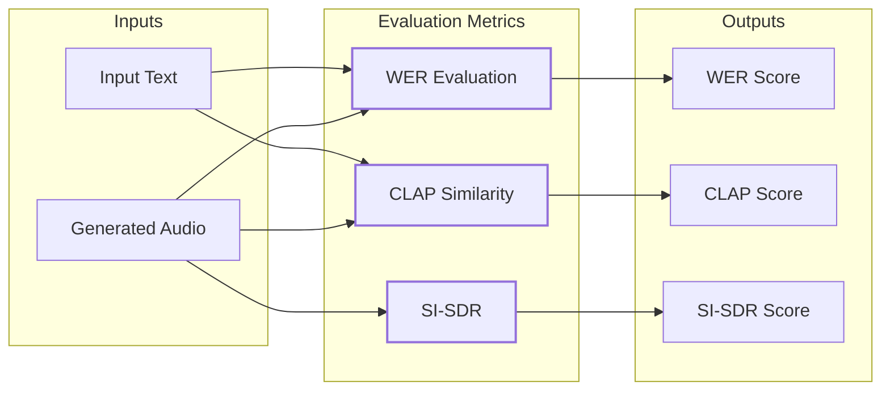
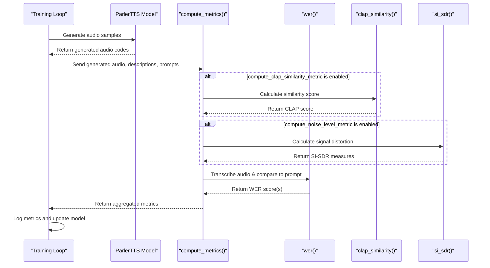
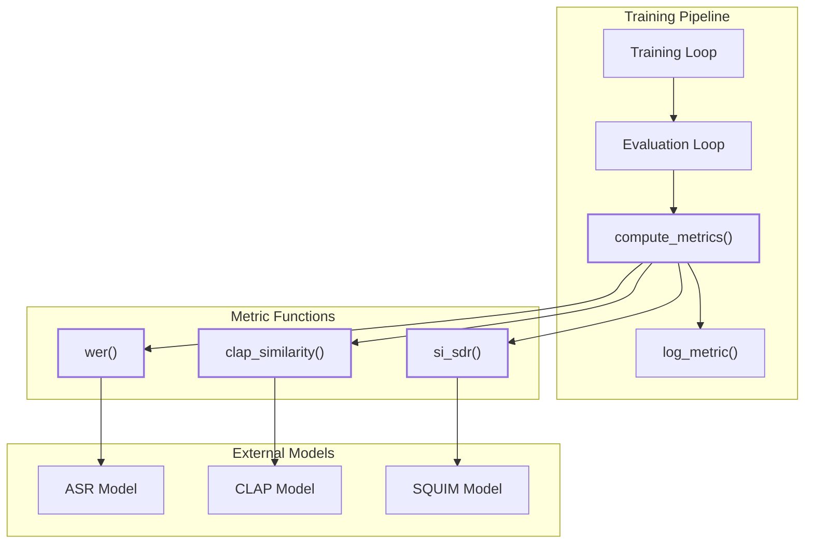
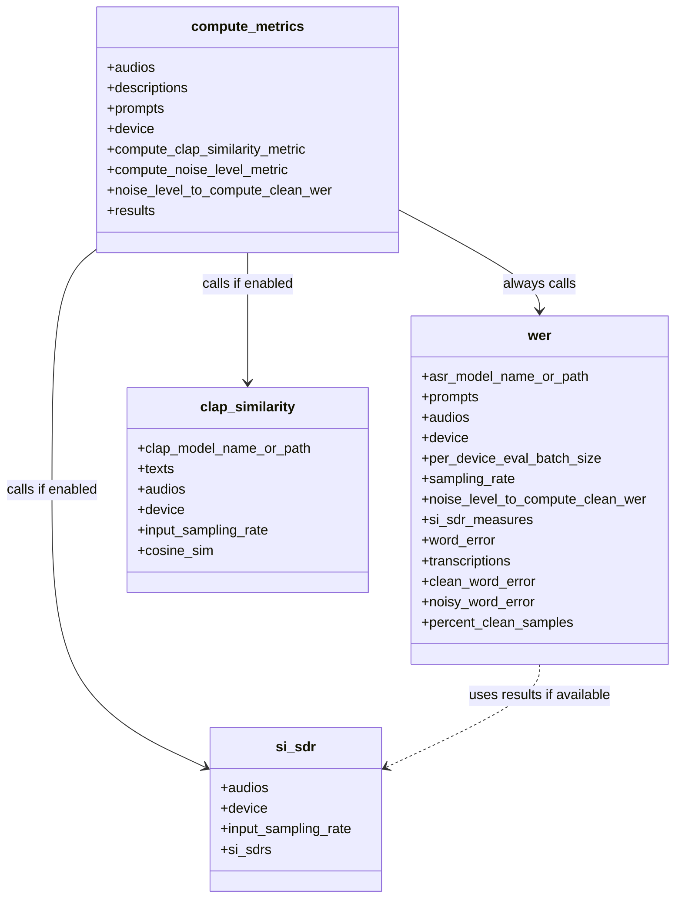

<!-- source: DeepWiki mcp.deepwiki.com · repo huggingface/parler-tts · page 3.3 Evaluation Metrics · fetched 2026-10-26 -->

# Evaluation Metrics

<details>
<summary>Relevant source files</summary>

The following files were used as context for generating this wiki page:

- [training/eval.py](training/eval.py)
- [training/run_parler_tts_training.py](training/run_parler_tts_training.py)

</details>


This document outlines the evaluation metrics used in Parler-TTS to assess the quality of generated speech. The metrics described here are integrated into the training pipeline to provide quantitative measurements of model performance. For information about the broader training process, see [Training Pipeline](#3.1).

## Overview of Evaluation Metrics

Parler-TTS uses three primary metrics to evaluate the quality and accuracy of generated speech:

1. **Word Error Rate (WER)**: Measures how accurately the generated speech can be transcribed back to the original text
2. **CLAP Similarity**: Assesses semantic alignment between the input text and generated audio
3. **Scale-Invariant Signal-to-Distortion Ratio (SI-SDR)**: Evaluates the acoustic quality of the generated speech



Sources: [training/eval.py:1-142](), [training/run_parler_tts_training.py:668-709]()

## Evaluation Process in Training Pipeline

The evaluation metrics are integrated into the training pipeline through the `compute_metrics` function. This function is called during the evaluation phase of training to assess model performance on the validation dataset.



Sources: [training/run_parler_tts_training.py:668-709](), [training/run_parler_tts_training.py:1183-1205]()

## Word Error Rate (WER)

WER is a fundamental speech metric that measures how accurately the generated speech can be transcribed back to the original text.

### Implementation Details

The WER evaluation is implemented in the `wer()` function in `eval.py`. The process works as follows:

1. An Automatic Speech Recognition (ASR) model transcribes the generated audio
2. The transcription is normalized using appropriate text normalizers
3. The WER is calculated by comparing the normalized transcription with the normalized reference text

```
WER = (Substitutions + Insertions + Deletions) / Number of Words in Reference × 100%
```

Lower WER values indicate better speech intelligibility and accuracy.

### Clean vs. Noisy WER

When noise level metrics are enabled, the system computes separate WER scores for:

- **Clean samples**: Audio samples with SI-SDR scores above a specified threshold
- **Noisy samples**: Audio samples with SI-SDR scores below the threshold

This separation allows for more nuanced analysis of model performance under different quality conditions.

Sources: [training/eval.py:71-142](), [training/run_parler_tts_training.py:693-707]()

## CLAP Similarity

CLAP Similarity measures the semantic alignment between the input text and the generated audio using a Contrastive Language-Audio Pretraining (CLAP) model.

### Implementation Details

The CLAP similarity metric is implemented in the `clap_similarity()` function in `eval.py`:

1. Text and audio are processed through a CLAP model to extract feature embeddings
2. Cosine similarity is calculated between these embeddings
3. Higher similarity scores indicate better semantic alignment between text and audio

This metric is particularly valuable for assessing how well the generated speech captures the meaning of the input text, beyond just word-level accuracy.

Sources: [training/eval.py:17-43](), [training/run_parler_tts_training.py:684-687]()

## Scale-Invariant Signal-to-Distortion Ratio (SI-SDR)

SI-SDR is an audio quality metric that evaluates the acoustic properties of the generated speech.

### Implementation Details

The SI-SDR metric is implemented in the `si_sdr()` function in `eval.py`:

1. The audio is processed through the SQUIM objective model from torchaudio
2. The SQUIM model calculates the SI-SDR score for each audio sample
3. Higher SI-SDR scores indicate better audio quality with less distortion

### Noise Level Classification

SI-SDR scores are used to classify audio samples as either "clean" or "noisy" based on a configurable threshold (`noise_level_to_compute_clean_wer`). This classification is used for:

1. Computing separate WER metrics for clean and noisy samples
2. Reporting the percentage of clean samples in the evaluation set

This provides insights into the model's ability to generate high-quality audio across different conditions.

Sources: [training/eval.py:46-68](), [training/run_parler_tts_training.py:691-692](), [training/run_parler_tts_training.py:704-707]()

## Integration in Training Pipeline

The evaluation metrics are integrated into the training process through the following components:



Sources: [training/run_parler_tts_training.py:1175-1206](), [training/run_parler_tts_training.py:668-709]()

### Configuration Parameters

The evaluation metrics can be configured through the following parameters in the training arguments:

| Parameter | Description | Default |
|-----------|-------------|---------|
| `compute_clap_similarity_metric` | Whether to compute CLAP similarity | `False` |
| `compute_noise_level_metric` | Whether to compute SI-SDR for noise classification | `False` |
| `noise_level_to_compute_clean_wer` | SI-SDR threshold for clean/noisy classification | `None` |
| `clap_model_name_or_path` | Path to CLAP model | Specified in model arguments |
| `asr_model_name_or_path` | Path to ASR model | Specified in model arguments |

Sources: [training/run_parler_tts_training.py:1190-1191](), [training/run_parler_tts_training.py:684-687]()

## Logging and Visualization

Evaluation metrics are logged during training to assist in model development and performance tracking:

1. Metrics are logged to the selected tracking system (e.g., Weights & Biases) via the `log_metric()` function
2. Audio samples, transcriptions, and metric scores are logged for qualitative assessment via the `log_pred()` function
3. Clean/noisy WER breakdown provides insights into performance across different quality levels

This comprehensive evaluation approach enables effective model monitoring and iterative improvement.

Sources: [training/run_parler_tts_training.py:1194-1205](), [training/run_parler_tts_training.py:1215-1222]()

## Code Relationship and Implementation

The evaluation metrics are implemented through a collaboration of multiple code components:



Sources: [training/eval.py:17-142](), [training/run_parler_tts_training.py:668-709]()

---

