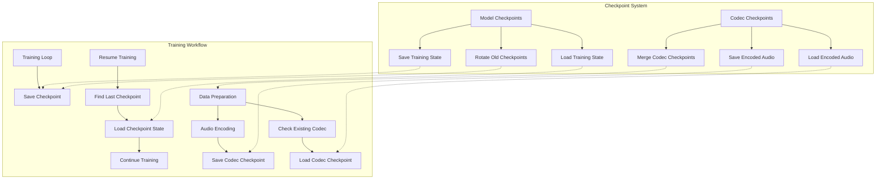
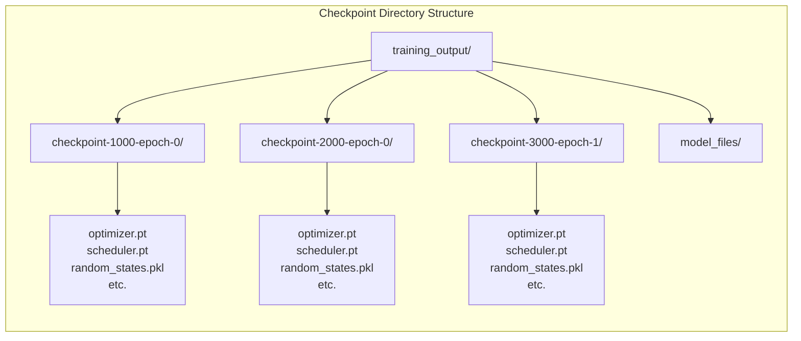
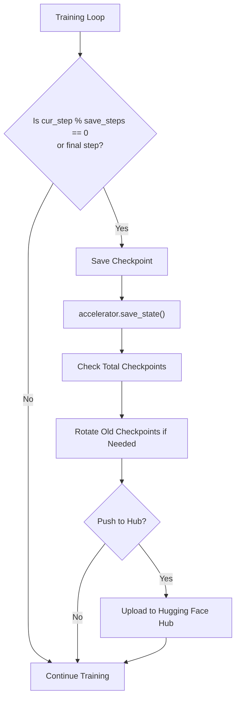
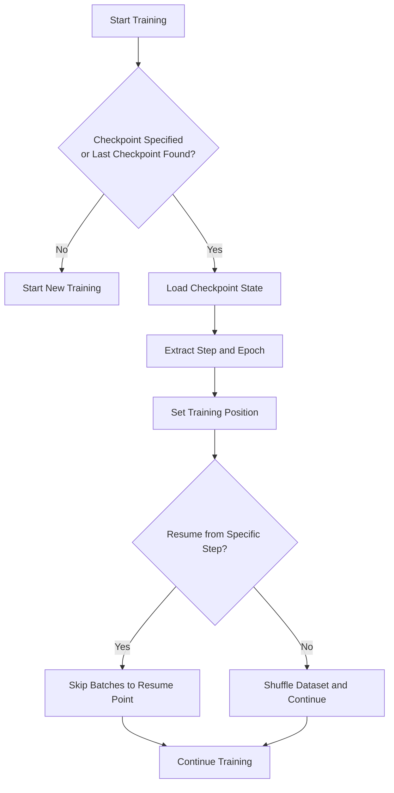
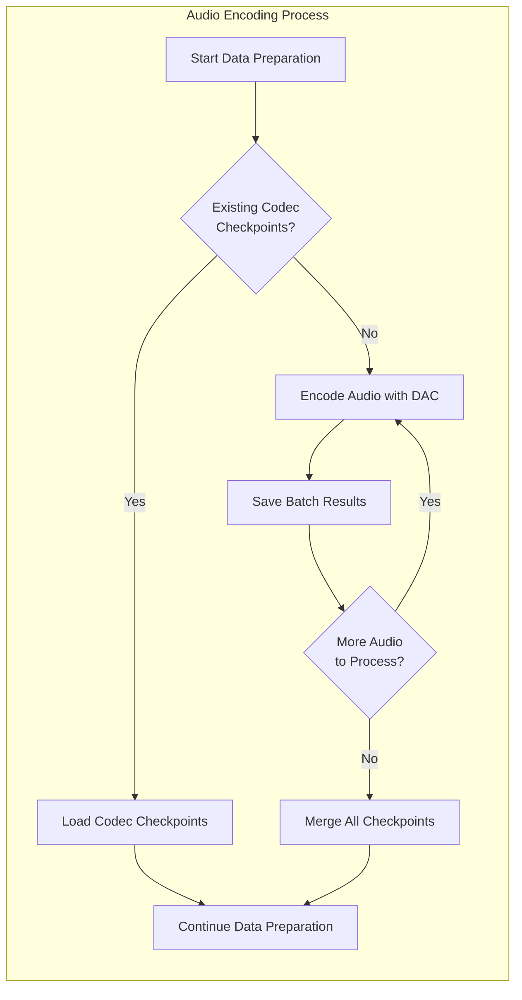
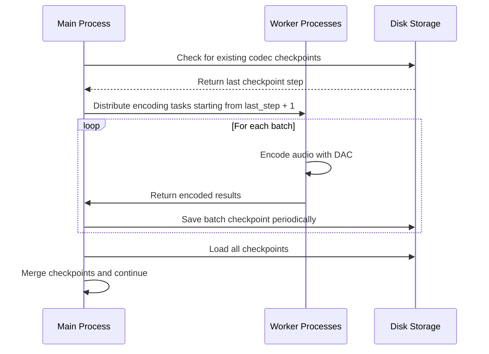
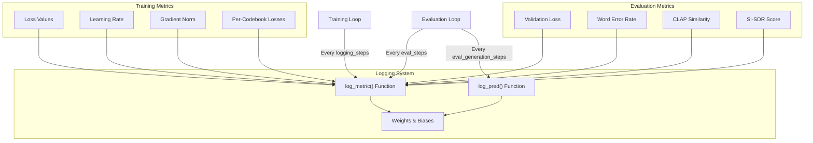

<!-- source: DeepWiki mcp.deepwiki.com · repo huggingface/parler-tts · page 3.4 Checkpointing and Utilities · fetched 2026-10-26 -->

# Checkpointing and Utilities

<details>
<summary>Relevant source files</summary>

The following files were used as context for generating this wiki page:

- [training/run_parler_tts_training.py](training/run_parler_tts_training.py)
- [training/utils.py](training/utils.py)

</details>


This document explains the checkpoint management system and utility functions used during the training of Parler-TTS models. It covers model checkpointing, audio codec checkpoint handling, and training utilities for metrics logging and visualization. For information about the overall training pipeline, see [Training Pipeline](#3.1), and for data preparation, see [Data Preparation and Loading](#3.2).

## Checkpoint Management Overview

Parler-TTS uses a comprehensive checkpoint system that handles two distinct types of checkpoints:

1. **Model checkpoints**: Save the model weights, optimizer state, and training progress
2. **Codec checkpoints**: Save intermediate audio encoding results to avoid redundant computation



Sources: [training/utils.py:22-117](), [training/run_parler_tts_training.py:145-157](), [training/run_parler_tts_training.py:794-856]()

## Model Checkpoint Management

The model checkpoint system is designed to save the complete training state at regular intervals and allow for efficient resumption of training.

### Checkpoint Naming and Detection

Model checkpoints follow a specific naming pattern: `checkpoint-{step}-epoch-{epoch}`, which enables easy identification of when a checkpoint was created.



The system provides utility functions to manage checkpoints:

- `get_last_checkpoint`: Finds the most recent checkpoint in a directory
- `sorted_checkpoints`: Returns a list of checkpoints sorted from oldest to newest
- `rotate_checkpoints`: Removes the oldest checkpoints when the total exceeds a specified limit

Sources: [training/utils.py:22-64](), [training/run_parler_tts_training.py:145-157]()

### Saving and Loading Checkpoints

During training, checkpoints are saved at regular intervals specified by the `save_steps` parameter:



When resuming training, the system automatically detects the last checkpoint and loads the saved state:



Sources: [training/run_parler_tts_training.py:1075-1100](), [training/run_parler_tts_training.py:794-856]()

## Codec Checkpoint Management

Audio encoding is a computationally expensive process that doesn't need to be repeated for each training run. The codec checkpoint system saves intermediate audio encoding results to speed up data preparation.

### Codec Checkpoint Workflow



The codec checkpoint system includes:

- `save_codec_checkpoint`: Saves encoded audio data at specific steps
- `load_codec_checkpoint`: Loads a single codec checkpoint
- `load_all_codec_checkpoints`: Loads and merges all codec checkpoints
- `get_last_codec_checkpoint_step`: Identifies the last processed step to resume encoding

Sources: [training/utils.py:67-117](), [training/run_parler_tts_training.py:499-564]()

### Resuming Audio Encoding

The system can resume audio encoding from the last checkpoint, which is particularly useful for large datasets:



Sources: [training/run_parler_tts_training.py:499-564]()

## Logging Utilities

Parler-TTS includes comprehensive logging utilities for tracking training progress and visualizing results.

### Metrics Logging

The system logs various metrics during training and evaluation:



The key logging functions are:

- `log_metric`: Logs numerical metrics with appropriate prefixes
- `log_pred`: Logs generated audio samples, transcriptions, and descriptions

These functions work with the Accelerate library to ensure metrics are properly gathered across distributed training processes.

Sources: [training/utils.py:120-204](), [training/run_parler_tts_training.py:1059-1074](), [training/run_parler_tts_training.py:1174-1206]()

### Audio Sample Visualization

During evaluation, the system logs audio samples along with their descriptions and transcriptions to Weights & Biases:

| Component | Description |
|-----------|-------------|
| Audio samples | Generated speech in waveform format |
| Target descriptions | Text descriptions used for generation |
| Target prompts | Original text prompts |
| Predicted transcriptions | ASR transcriptions of generated audio |
| Noise estimation | SI-SDR measurements of audio quality |

Sources: [training/utils.py:143-204]()

## Practical Usage

### Resuming Training from a Checkpoint

To resume training from a specific checkpoint:

```bash
python run_parler_tts_training.py \
    --resume_from_checkpoint /path/to/checkpoint-X-epoch-Y \
    [other training arguments]
```

The system will automatically load the model state, optimizer state, scheduler state, and random states to continue training from exactly where it left off.

### Checkpoint Rotation

To limit disk usage, the system can automatically delete old checkpoints:

```bash
python run_parler_tts_training.py \
    --save_steps 1000 \
    --save_total_limit 5 \
    [other training arguments]
```

This will keep only the 5 most recent checkpoints, deleting older ones as new checkpoints are created.

Sources: [training/utils.py:51-64](), [training/run_parler_tts_training.py:1075-1100]()

## Implementation Details

### Checkpoint Directory Structure

The checkpoint system creates a directory structure that includes:

- Model checkpoints with naming pattern `checkpoint-{step}-epoch-{epoch}`
- Codec checkpoints with naming pattern `checkpoint-{step}`
- Final model weights in the output directory root

### Regular Expression Patterns

The system uses regular expressions to identify and parse checkpoint names:

- Model checkpoint pattern: `^checkpoint-(\d+)-epoch-(\d+)$`
- Codec checkpoint pattern: `^checkpoint-(\d+)$`

Sources: [training/utils.py:18-20]()

### Accelerate Integration

The checkpoint system is tightly integrated with the Hugging Face Accelerate library:

- `accelerator.save_state()` for saving the complete training state
- `accelerator.load_state()` for loading a previously saved state
- `accelerator.wait_for_everyone()` to synchronize distributed processes

This integration ensures that checkpointing works correctly across distributed training environments.

Sources: [training/run_parler_tts_training.py:1075-1100](), [training/run_parler_tts_training.py:794-856]()

---

