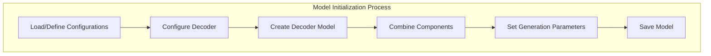
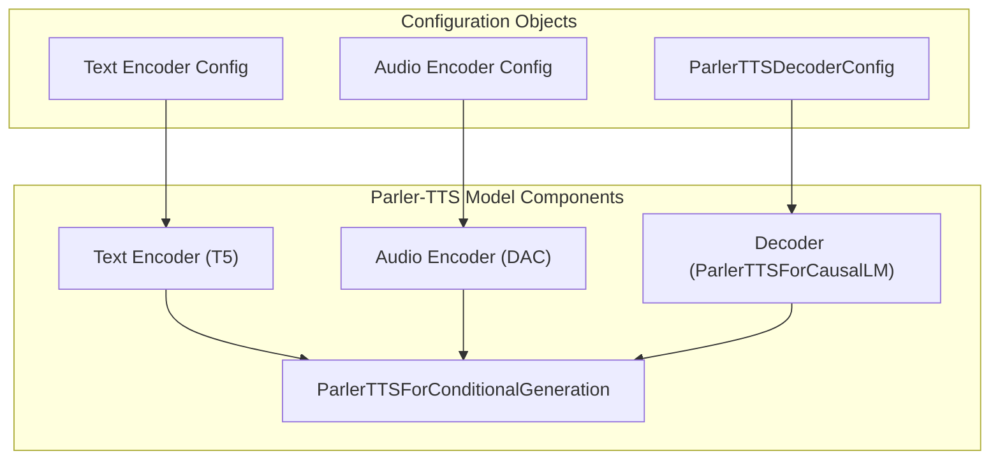
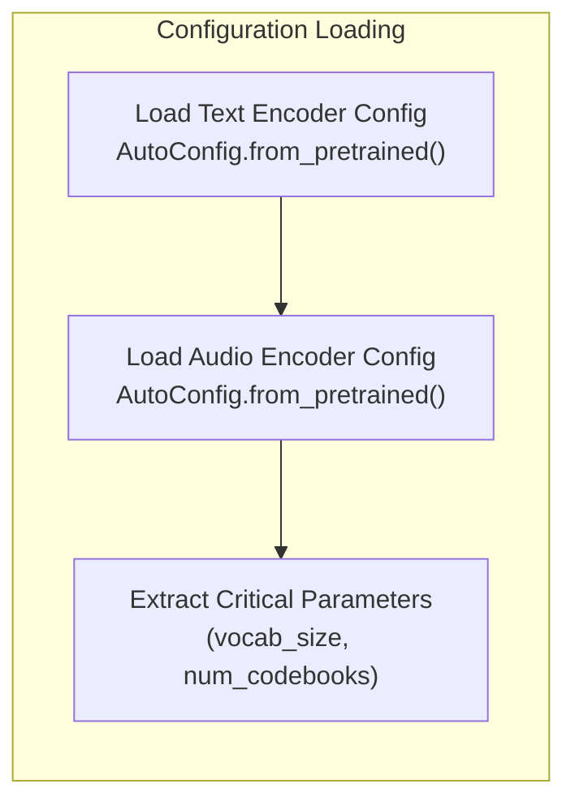
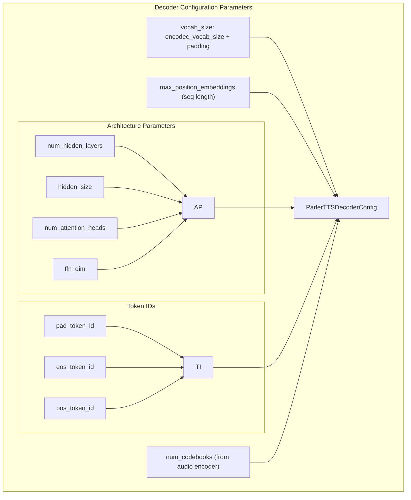
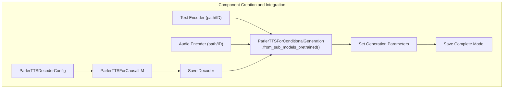
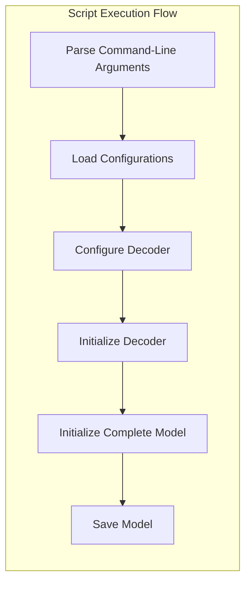

<!-- source: DeepWiki mcp.deepwiki.com · repo huggingface/parler-tts · page 3.5 Model Initialization · fetched 2026-10-26 -->

# Model Initialization

<details>
<summary>Relevant source files</summary>

The following files were used as context for generating this wiki page:

- [helpers/model_init_scripts/init_dummy_model.py](helpers/model_init_scripts/init_dummy_model.py)
- [helpers/model_init_scripts/init_dummy_model_with_encodec.py](helpers/model_init_scripts/init_dummy_model_with_encodec.py)
- [helpers/model_init_scripts/init_model_600M.py](helpers/model_init_scripts/init_model_600M.py)
- [helpers/training_configs/librispeech_tts_r_300M_dummy.json](helpers/training_configs/librispeech_tts_r_300M_dummy.json)
- [helpers/training_configs/starting_point_0.01.json](helpers/training_configs/starting_point_0.01.json)

</details>


This page explains how to initialize Parler-TTS models of different sizes and configurations. It covers the initialization scripts, configuration parameters, and the overall process of creating new Parler-TTS models from scratch. For information about model training, see [Training Pipeline](#3.1).

## Overview of Model Initialization

Model initialization in Parler-TTS refers to the process of creating new, untrained model instances that can be used as starting points for training. The initialization process involves:

1. Loading or defining configurations for the text encoder, audio encoder, and decoder components
2. Creating the decoder model with appropriate settings
3. Combining the components into a complete Parler-TTS model
4. Setting generation parameters and tokenization settings
5. Saving the model to disk



Sources: [helpers/model_init_scripts/init_dummy_model.py](), [helpers/model_init_scripts/init_model_600M.py]()

## Required Components

The Parler-TTS model consists of three main components, each requiring specific initialization:

1. **Text Encoder**: Usually a pre-trained T5 model (from Hugging Face)
2. **Audio Encoder**: A DAC (Descript Audio Codec) model for audio encoding/decoding
3. **Decoder**: A custom `ParlerTTSForCausalLM` model that needs to be initialized with a specific configuration



Sources: [helpers/model_init_scripts/init_dummy_model.py:17-21](), [helpers/model_init_scripts/init_model_600M.py:17-21]()

## Initialization Process

### 1. Loading Pre-trained Component Configurations

The first step in model initialization is loading configurations for the text and audio encoders:



This is accomplished using the Hugging Face `AutoConfig` class to load configurations from pre-trained models or model IDs.

Sources: [helpers/model_init_scripts/init_dummy_model.py:17-24](), [helpers/model_init_scripts/init_model_600M.py:17-24]()

### 2. Configuring the Decoder

The decoder requires a custom configuration based on the `ParlerTTSDecoderConfig` class. Key parameters include:

- `vocab_size`: Based on the audio encoder's codebook size plus extra tokens
- `max_position_embeddings`: Maximum sequence length (related to audio duration)
- Architecture parameters: `num_hidden_layers`, `hidden_size`, `num_attention_heads`, etc.
- Token-related parameters: `pad_token_id`, `eos_token_id`, `bos_token_id`
- Audio-specific parameters: `num_codebooks`



Sources: [helpers/model_init_scripts/init_dummy_model.py:27-44](), [helpers/model_init_scripts/init_model_600M.py:27-44]()

### 3. Creating and Combining Components

With the configurations defined, the initialization process continues with:

1. Creating the decoder model using the decoder configuration
2. Combining the text encoder, audio encoder, and decoder into a complete Parler-TTS model
3. Setting generation parameters and token IDs



Sources: [helpers/model_init_scripts/init_dummy_model.py:46-69](), [helpers/model_init_scripts/init_model_600M.py:46-68]()

## Model Size Configurations

Parler-TTS supports initializing models of different sizes, from small test models to larger production models. The primary differences lie in the decoder configuration parameters.

### Dummy/Small Model

The dummy model is a minimal configuration useful for testing:

| Parameter | Value |
|-----------|-------|
| hidden_size | 512 |
| num_hidden_layers | 4 |
| num_attention_heads | 8 |
| ffn_dim | 512 |
| max_position_embeddings | 2048 |

Sources: [helpers/model_init_scripts/init_dummy_model.py:27-44](), [helpers/model_init_scripts/init_dummy_model_with_encodec.py:24-41]()

### 600M Model

The 600M model provides a larger configuration suitable for production use:

| Parameter | Value |
|-----------|-------|
| hidden_size | 1024 |
| num_hidden_layers | 24 |
| num_attention_heads | 16 |
| ffn_dim | 4096 |
| max_position_embeddings | 4096 |
| dropout | 0.1 |

Sources: [helpers/model_init_scripts/init_model_600M.py:27-44]()

## Using Initialization Scripts

Parler-TTS provides command-line scripts for initializing models with different configurations. These scripts accept parameters for:

- The directory to save the model
- The text encoder model to use
- The audio encoder model to use



Example command for initializing a 600M model:

```bash
python helpers/model_init_scripts/init_model_600M.py /path/to/save/directory --text_model google/flan-t5-base --audio_model ylacombe/dac_44khZ_8kbps
```

Sources: [helpers/model_init_scripts/init_model_600M.py:9-15]()

## Training Configuration for Initialized Models

After initializing a model, training configurations typically reference the saved model path:

```json
{
    "model_name_or_path": "./parler-tts-untrained-600M/parler-tts-untrained-600M/",
    "feature_extractor_name": "ylacombe/dac_44khZ_8kbps",
    "description_tokenizer_name": "google/flan-t5-base",
    "prompt_tokenizer_name": "google/flan-t5-base",
    // other training parameters...
}
```

These training configurations ensure the training pipeline uses the correct initialized model and compatible tokenizers/feature extractors.

Sources: [helpers/training_configs/librispeech_tts_r_300M_dummy.json:1-9](), [helpers/training_configs/starting_point_0.01.json:1-9]()

## Key Generation Configuration Settings

During initialization, several important generation parameters are set:

| Parameter | Purpose |
|-----------|---------|
| `decoder_start_token_id` | The token ID to start generation with |
| `pad_token_id` | The padding token ID |
| `eos_token_id` | The end-of-sequence token ID |
| `max_length` | Maximum generation length (calculated from audio encoder frame rate) |
| `do_sample` | Whether to use sampling during generation |

These parameters influence the model's generation behavior and are crucial for the audio generation process.

Sources: [helpers/model_init_scripts/init_dummy_model.py:56-63](), [helpers/model_init_scripts/init_model_600M.py:56-63]()

---

