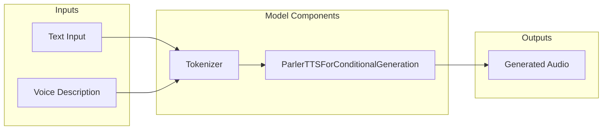
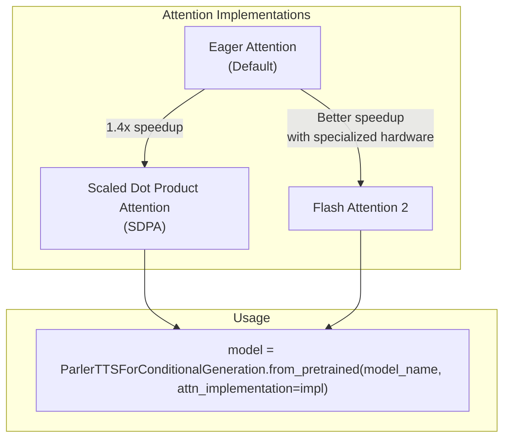
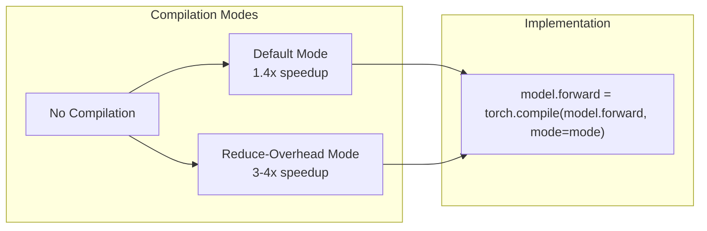
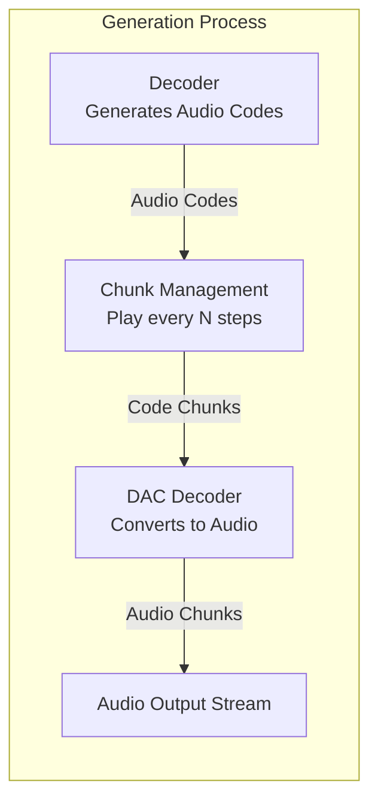
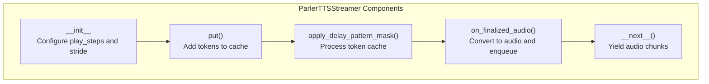
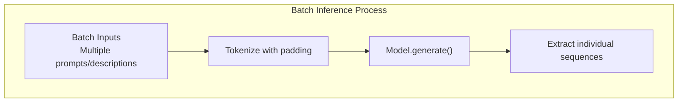
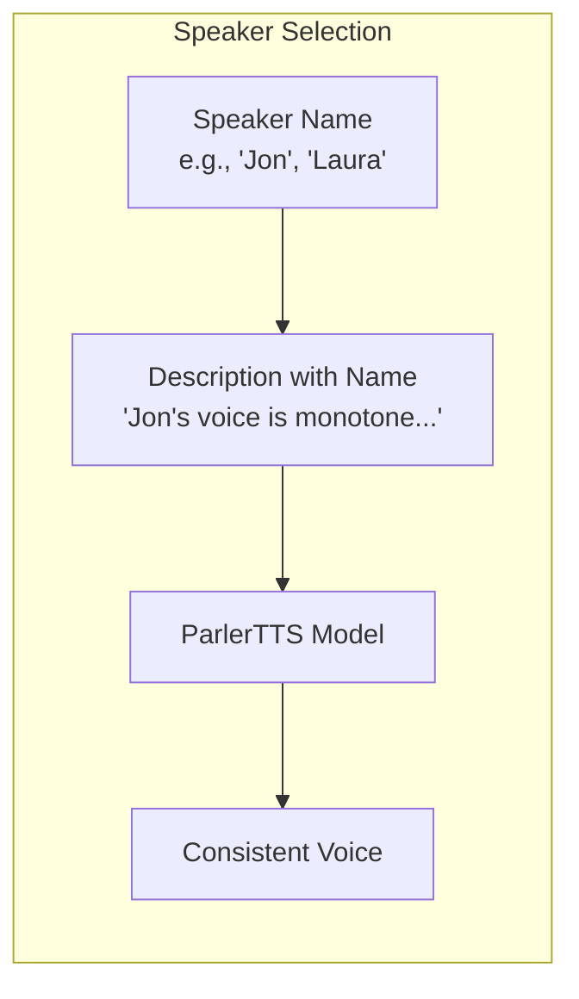
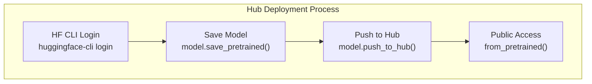
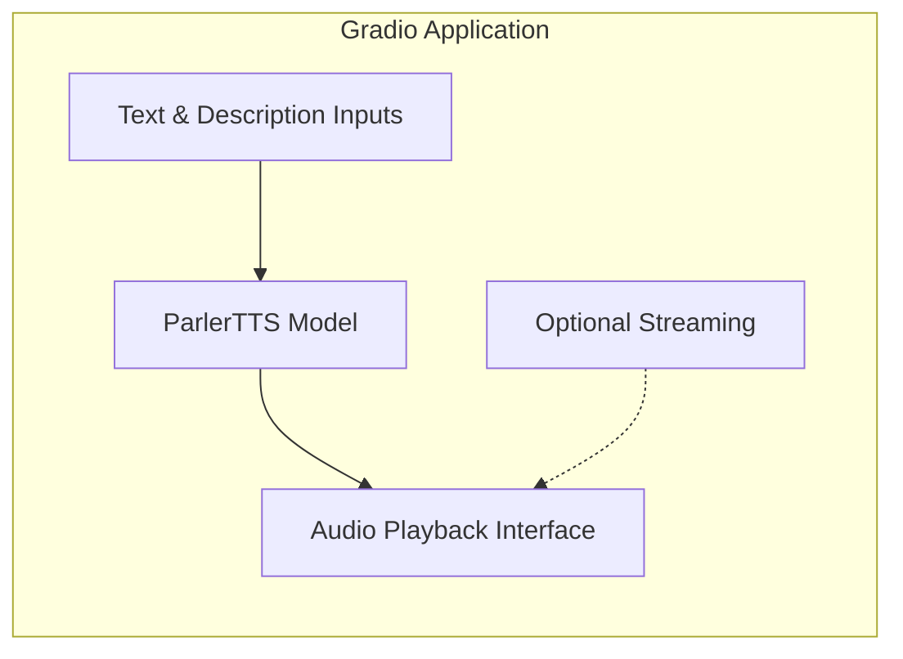

<!-- source: DeepWiki mcp.deepwiki.com · repo huggingface/parler-tts · page 4 Inference and Deployment · fetched 2026-10-26 -->

# Inference and Deployment

<details>
<summary>Relevant source files</summary>

The following files were used as context for generating this wiki page:

- [INFERENCE.md](INFERENCE.md)
- [README.md](README.md)
- [parler_tts/streamer.py](parler_tts/streamer.py)
- [training/README.md](training/README.md)

</details>


This page provides technical documentation for running inference with Parler-TTS and deploying models. It covers optimized inference techniques, streaming generation, batch processing, and options for model deployment. For information about model components, see [Model Components](#2), and for training information, see [Training](#3).

## Basic Inference

Parler-TTS enables audio generation from text with voice characteristics controlled through descriptive prompts. The basic inference flow involves:



Basic usage example:

```python
import torch
from parler_tts import ParlerTTSForConditionalGeneration
from transformers import AutoTokenizer
import soundfile as sf

device = "cuda:0" if torch.cuda.is_available() else "cpu"

model = ParlerTTSForConditionalGeneration.from_pretrained("parler-tts/parler-tts-mini-v1").to(device)
tokenizer = AutoTokenizer.from_pretrained("parler-tts/parler-tts-mini-v1")

prompt = "Hey, how are you doing today?"
description = "A female speaker delivers a slightly expressive and animated speech with a moderate speed and pitch."

input_ids = tokenizer(description, return_tensors="pt").input_ids.to(device)
prompt_input_ids = tokenizer(prompt, return_tensors="pt").input_ids.to(device)

generation = model.generate(input_ids=input_ids, prompt_input_ids=prompt_input_ids)
audio_arr = generation.cpu().numpy().squeeze()
sf.write("output.wav", audio_arr, model.config.sampling_rate)
```

Sources: [README.md:58-78]()

## Optimized Inference Techniques

Parler-TTS offers multiple optimization techniques to increase generation speed.

### Attention Implementations

The model supports three attention mechanisms with different performance characteristics:



To select a specific attention implementation:

```python
attn_implementation = "sdpa"  # Options: "eager", "sdpa", "flash_attention_2"
model = ParlerTTSForConditionalGeneration.from_pretrained(
    "parler-tts/parler-tts-mini-v1",
    attn_implementation=attn_implementation
).to(device)
```

Sources: [INFERENCE.md:12-33]()

### Model Compilation

Using PyTorch's `torch.compile()` can significantly improve generation speed:



Key considerations for compilation:
1. Use `mode="default"` for moderate speedup with minimal compilation time
2. Use `mode="reduce-overhead"` for maximum speedup (3-4x) but longer compilation time
3. Set padding max length and use static cache implementation for best results
4. Perform warmup generation(s) before actual inference

Sources: [INFERENCE.md:35-78](), [README.md:116-118]()

## Streaming Generation

Streaming allows generation and playback of audio in chunks, reducing perceived latency.

### How Streaming Works



The `ParlerTTSStreamer` class enables this functionality:



Key parameters:
- `play_steps`: Number of generation steps before returning audio (default: 10)
- `stride`: Window between adjacent audio samples for smooth playback
- `device`: Computation device (GPU/CPU)

Sources: [parler_tts/streamer.py:11-147](), [INFERENCE.md:81-161]()

### Streaming Example

To implement streaming:

1. Create a `ParlerTTSStreamer` instance
2. Run generation in a separate thread
3. Iterate over the streamer to get audio chunks as they're generated

```python
# Create the streamer
play_steps_in_s = 0.5  # Control chunk size
play_steps = int(frame_rate * play_steps_in_s)
streamer = ParlerTTSStreamer(model, device=device, play_steps=play_steps)

# Generate in a thread
thread = Thread(target=model.generate, kwargs={
    "input_ids": input_ids,
    "prompt_input_ids": prompt_input_ids,
    "streamer": streamer,
    # Other generation parameters
})
thread.start()

# Process audio chunks as they arrive
for audio_chunk in streamer:
    # Process or play the audio chunk
    # Each chunk is approximately play_steps_in_s seconds long
```

Sources: [INFERENCE.md:97-161]()

## Batch Generation

For generating multiple audio samples simultaneously:



Implementation steps:
1. Prepare batched inputs with proper padding
2. Run generation with the batch
3. Extract individual audio sequences using `generation.sequences` and `generation.audios_length`

Sources: [INFERENCE.md:162-203]()

## Speaker Consistency

Parler-TTS models can generate consistent speaker voices using predefined speaker identities.



Available speakers include: Laura, Gary, Jon, Lea, Karen, Rick, Brenda, David, Eileen, Jordan, Mike, Yann, Joy, James, Eric, Lauren, Rose, Will, Jason, Aaron, Naomie, Alisa, Patrick, Jerry, Tina, Jenna, Bill, Tom, Carol, Barbara, Rebecca, Anna, Bruce, and Emily.

The top-performing speakers for consistency (based on similarity scores):
- Mini Model: Jon, Lea, Gary, Jenna, Mike
- Large Model: Will, Eric, Laura, Alisa, Patrick

Sources: [INFERENCE.md:205-263](), [README.md:80-115]()

## Deployment Options

### Hugging Face Hub Deployment

Models can be pushed to the Hugging Face Hub for sharing and easy access:



Steps for deploying to Hub:
1. Authenticate with Hugging Face CLI
2. Save your model locally with `save_pretrained()`
3. Push to Hub with `push_to_hub()`

### Gradio Demo Application

Parler-TTS can be easily deployed as an interactive web application using Gradio:



A Gradio demo is available at: https://huggingface.co/spaces/parler-tts/parler_tts

Sources: [README.md:23-24](), [training/README.md:73-74]()

## Conclusion

Parler-TTS offers several optimization techniques and deployment options to achieve efficient, high-quality text-to-speech generation. By utilizing attention optimizations, model compilation, streaming, and batch processing, users can significantly improve inference speed and user experience.

For more details on specific components, see [ParlerTTS Model](#2.1), [Optimized Inference](#4.1), [Streaming Generation](#4.2), [Deployment to Hugging Face Hub](#4.3), and [Gradio Demo Application](#4.4).

---

