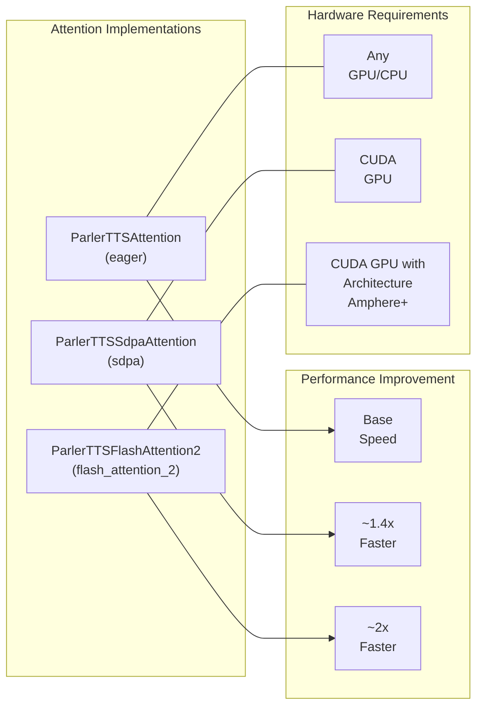
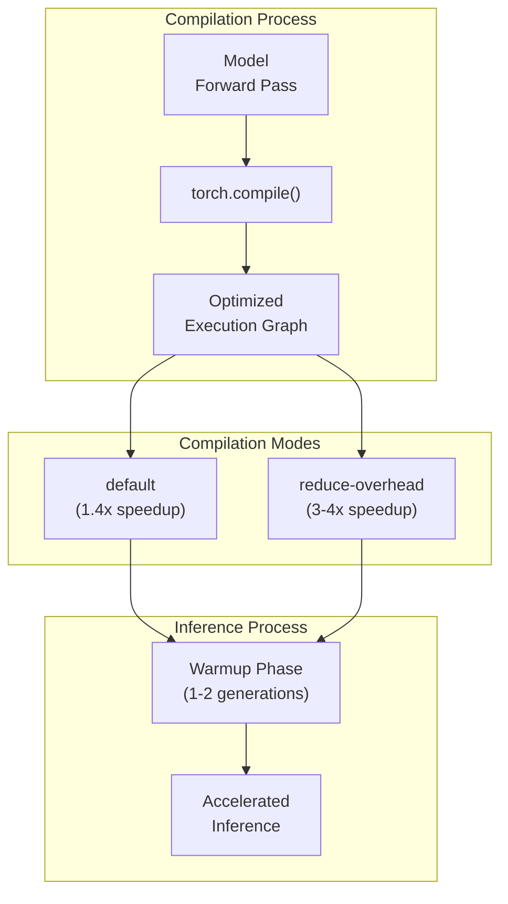
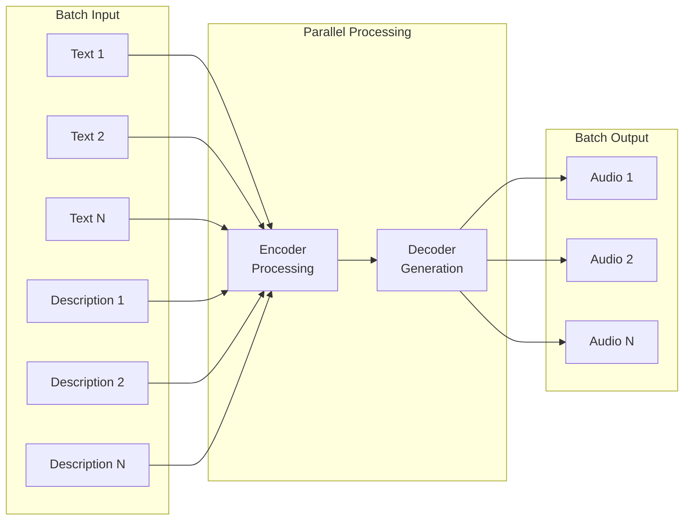
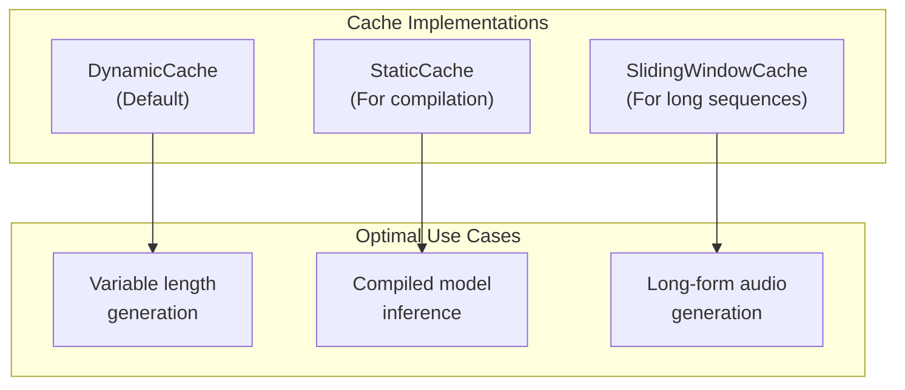
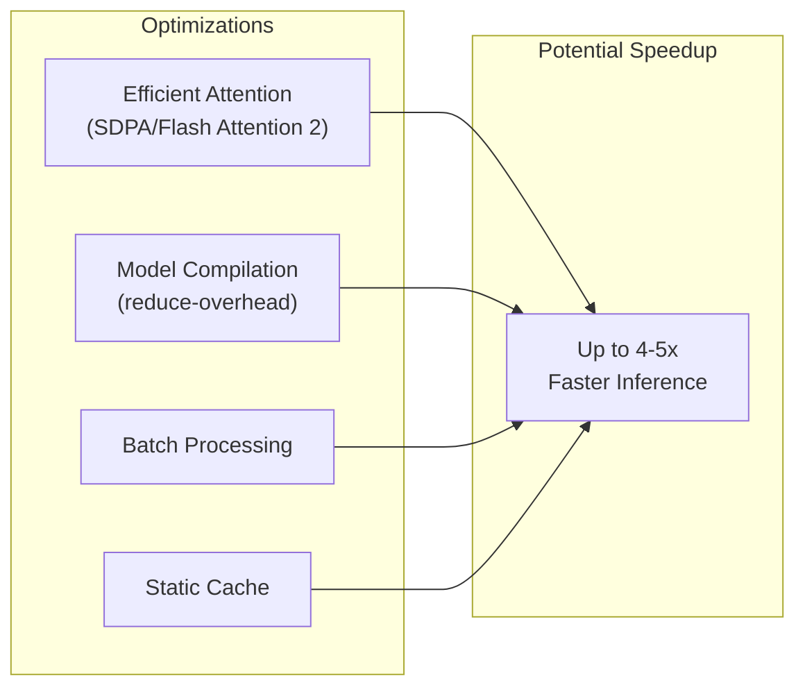

<!-- source: DeepWiki mcp.deepwiki.com · repo huggingface/parler-tts · page 4.1 Optimized Inference · fetched 2026-10-26 -->

# Optimized Inference

<details>
<summary>Relevant source files</summary>

The following files were used as context for generating this wiki page:

- [INFERENCE.md](INFERENCE.md)
- [parler_tts/modeling_parler_tts.py](parler_tts/modeling_parler_tts.py)
- [parler_tts/streamer.py](parler_tts/streamer.py)

</details>


This document details various optimization techniques available for accelerating inference with Parler-TTS models. These optimizations can significantly improve generation speed and reduce latency without sacrificing audio quality. For information about streaming generation specifically, see [Streaming Generation](#4.2).

## Overview

Parler-TTS offers several optimization techniques that can make inference up to 4x faster:

1. **Efficient attention implementations** - Using optimized attention mechanisms like SDPA and Flash Attention 2
2. **Model compilation** - Leveraging PyTorch's compilation capabilities to optimize model execution
3. **Batch processing** - Generating multiple audio outputs simultaneously
4. **Efficient memory usage patterns** - Using appropriate caching strategies

These optimizations can be combined to achieve maximum performance, depending on your hardware and use case requirements.

## Attention Mechanisms

Parler-TTS supports three attention implementations, each with different performance characteristics:

1. **Eager Attention** (`ParlerTTSAttention`) - The standard attention implementation
2. **SDPA Attention** (`ParlerTTSSdpaAttention`) - Using PyTorch's scaled_dot_product_attention for improved performance
3. **Flash Attention 2** (`ParlerTTSFlashAttention2`) - For maximum performance on supported hardware



Sources: [parler_tts/modeling_parler_tts.py:934-937](), [INFERENCE.md:12-33]()

### Selecting an Attention Implementation

You can specify which attention implementation to use when loading a model:

```python
from parler_tts import ParlerTTSForConditionalGeneration
import torch

model = ParlerTTSForConditionalGeneration.from_pretrained(
    "parler-tts/parler-tts-mini-v1",
    attn_implementation="sdpa"  # Options: "eager", "sdpa", "flash_attention_2"
).to("cuda", dtype=torch.bfloat16)
```

Notes:
- SDPA is the default implementation and provides a good balance of compatibility and performance
- Flash Attention 2 requires installation of the [flash-attn](https://github.com/Dao-AILab/flash-attention) package and a compatible GPU
- Performance gains vary depending on hardware and model size

Sources: [parler_tts/modeling_parler_tts.py:82-86](), [parler_tts/modeling_parler_tts.py:599-814](), [parler_tts/modeling_parler_tts.py:818-930](), [INFERENCE.md:12-33]()

## Model Compilation

PyTorch's `torch.compile()` feature can significantly accelerate model inference by optimizing the computational graph. Parler-TTS models can be compiled to achieve up to 4.5x speedup compared to non-compiled models.



Sources: [INFERENCE.md:35-78]()

### How to Use Compilation

To compile the model's forward pass:

```python
import torch
from parler_tts import ParlerTTSForConditionalGeneration

# Load model
model = ParlerTTSForConditionalGeneration.from_pretrained(
    "parler-tts/parler-tts-mini-v1",
    attn_implementation="sdpa"
).to("cuda", dtype=torch.bfloat16)

# Set up compilation
compile_mode = "default"  # Options: "default", "reduce-overhead"
model.generation_config.cache_implementation = "static"
model.forward = torch.compile(model.forward, mode=compile_mode)

# Warmup (important for compilation to take effect)
# Run a sample generation to compile the model
```

Key points about compilation:
- The `"default"` mode offers ~1.4x speedup with minimal compilation time
- The `"reduce-overhead"` mode offers 3-4x speedup but requires longer compilation time
- With `"reduce-overhead"`, you need to generate at least twice to see the benefits
- Setting `cache_implementation` to `"static"` is recommended for best performance with compilation

Sources: [INFERENCE.md:35-78](), [parler_tts/modeling_parler_tts.py:57]()

## Batch Generation

Parler-TTS supports batch generation, allowing you to process multiple inputs simultaneously for improved throughput.



Sources: [INFERENCE.md:164-203]()

### Batch Generation Example

To generate audio for multiple texts in a single batch:

```python
from parler_tts import ParlerTTSForConditionalGeneration
from transformers import AutoTokenizer

model = ParlerTTSForConditionalGeneration.from_pretrained("parler-tts/parler-tts-mini-v1").to("cuda")
tokenizer = AutoTokenizer.from_pretrained("parler-tts/parler-tts-mini-v1", padding_side="left")

# Prepare batch inputs
input_text = ["Hello, world!", "How are you today?"]
descriptions = ["A male voice speaking slowly.", "A female voice speaking quickly."]

# Tokenize with padding
inputs = tokenizer(descriptions, return_tensors="pt", padding=True).to("cuda")
prompts = tokenizer(input_text, return_tensors="pt", padding=True).to("cuda")

# Generate in batch
generation = model.generate(
    input_ids=inputs.input_ids,
    attention_mask=inputs.attention_mask,
    prompt_input_ids=prompts.input_ids,
    prompt_attention_mask=prompts.attention_mask,
    do_sample=True,
    return_dict_in_generate=True,
)

# Extract individual audio outputs
audio_samples = []
for i in range(len(input_text)):
    audio = generation.sequences[i, :generation.audios_length[i]]
    audio_samples.append(audio)
```

Key considerations for batch generation:
- Ensure inputs are properly padded to the same length
- For best performance, group similar-length inputs in the same batch
- Memory usage increases with batch size, so adjust based on your hardware

Sources: [INFERENCE.md:164-203]()

## Optimized Caching Strategies

Parler-TTS supports different caching implementations that can affect performance:



Sources: [parler_tts/modeling_parler_tts.py:29-35](), [parler_tts/modeling_parler_tts.py:97]()

To set a specific cache implementation:

```python
# For compiled models
model.generation_config.cache_implementation = "static"

# For long-form generation
model.generation_config.cache_implementation = "sliding_window"
```

## Combining Optimizations

For maximum performance, you can combine multiple optimization techniques:



### Recommended Configuration for Maximum Performance

For the fastest possible inference on supported hardware:

```python
import torch
from parler_tts import ParlerTTSForConditionalGeneration

# Load model with optimal settings
model = ParlerTTSForConditionalGeneration.from_pretrained(
    "parler-tts/parler-tts-mini-v1",
    attn_implementation="flash_attention_2"  # Use SDPA if Flash Attention is not available
).to("cuda", dtype=torch.bfloat16)

# Configure static cache for compiled models
model.generation_config.cache_implementation = "static"

# Compile with reduce-overhead mode
model.forward = torch.compile(model.forward, mode="reduce-overhead")

# Run warmup generations (needed for compilation to take effect)
# Run actual inference with batched inputs where possible
```

## Performance Comparison

The following table shows approximate performance improvements for different optimization combinations:

| Optimization | Approximate Speedup | Hardware Requirements |
|--------------|---------------------|------------------------|
| SDPA Attention | 1.4x | CUDA GPU |
| Flash Attention 2 | 2x | CUDA GPU (Ampere+) |
| Default Compilation | 1.4x | PyTorch 2.0+ |
| Reduce-overhead Compilation | 3-4x | PyTorch 2.0+ |
| SDPA + Default Compilation | 2x | CUDA GPU, PyTorch 2.0+ |
| Flash Attention 2 + Reduce-overhead | 4-5x | CUDA GPU (Ampere+), PyTorch 2.0+ |

Note: Actual performance gains may vary based on specific hardware, model size, and generation parameters.

Sources: [INFERENCE.md:12-33](), [INFERENCE.md:35-78]()

## Best Practices for Optimized Inference

1. **Choose the appropriate attention mechanism** based on your hardware capabilities
2. **Use compilation** when possible, with the mode that best fits your use case
3. **Batch similar requests** together to maximize throughput
4. **Use BFloat16 precision** for the best balance of speed and accuracy on supported hardware
5. **Consider streaming** for latency-sensitive applications (see [Streaming Generation](#4.2))
6. **Set an appropriate cache implementation** based on your generation pattern

By following these best practices and leveraging the available optimizations, you can significantly improve the inference performance of Parler-TTS models, making them more suitable for real-time and production applications.

Sources: [INFERENCE.md](), [parler_tts/modeling_parler_tts.py]()

---

