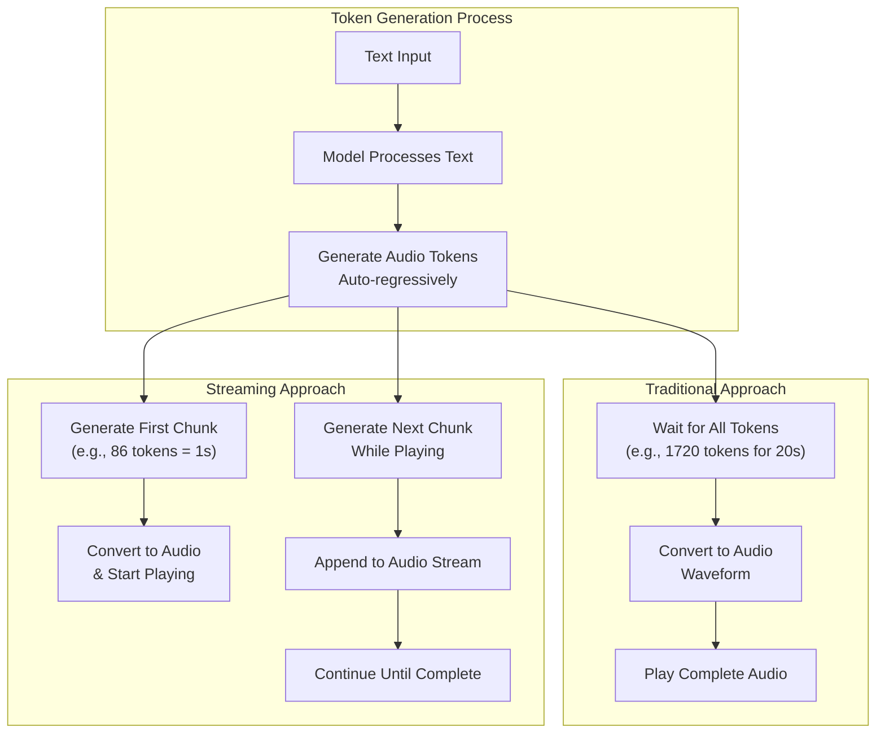
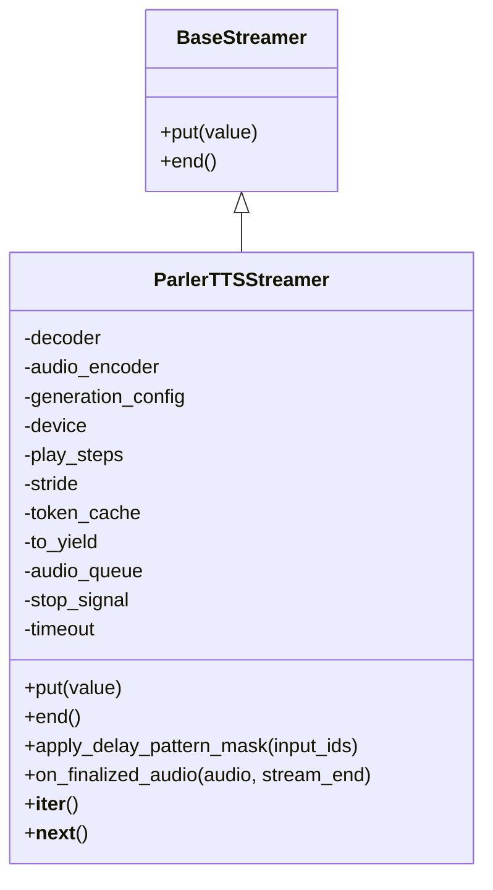
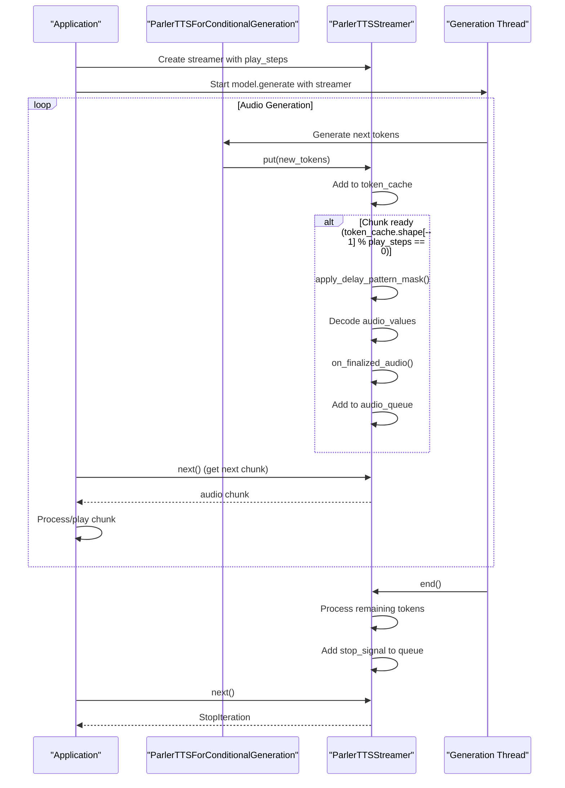
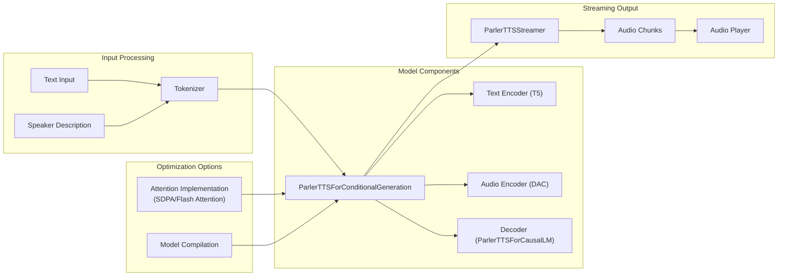

<!-- source: DeepWiki mcp.deepwiki.com · repo huggingface/parler-tts · page 4.2 Streaming Generation · fetched 2026-10-26 -->

# Streaming Generation

<details>
<summary>Relevant source files</summary>

The following files were used as context for generating this wiki page:

- [INFERENCE.md](INFERENCE.md)
- [parler_tts/__init__.py](parler_tts/__init__.py)
- [parler_tts/streamer.py](parler_tts/streamer.py)
- [setup.py](setup.py)

</details>


## Overview

Streaming generation in Parler-TTS enables real-time audio output as it's being generated, rather than waiting for the complete audio sequence to finish. This significantly reduces perceived latency, allowing for time-to-first-audio in under 500ms on modern GPUs. This document explains how streaming works in Parler-TTS and how to implement it in your applications.

For information about optimized inference techniques that can be combined with streaming, see [Optimized Inference](#4.1).

Sources: [INFERENCE.md:80-97]()

## How Streaming Works in Parler-TTS

Parler-TTS generates audio tokens auto-regressively, where each set of generated tokens corresponds to a small segment of audio. Rather than waiting for all tokens to be generated, streaming allows playing audio chunks as soon as enough tokens are available.



Each set of generated audio codes from the DAC model corresponds to approximately 0.011 seconds. For a 20-second audio clip, this would require 1720 decoding steps. With streaming, you can start playing after a configurable number of steps (e.g., 86 steps for 1 second of audio), significantly reducing perceived latency.

Sources: [INFERENCE.md:84-97](), [parler_tts/streamer.py:2-11]()

## The `ParlerTTSStreamer` Class

Streaming is implemented through the `ParlerTTSStreamer` class, which inherits from the Transformers `BaseStreamer` class. It manages a queue of audio chunks that can be accessed by downstream applications as an iterator.



The key components of the streamer include:

1. **Token Cache**: Accumulates generated tokens until a chunk is ready for playback
2. **Audio Queue**: Stores processed audio chunks ready for playback
3. **Delay Pattern Mask**: Handles the Parler-TTS-specific token offsetting between codebooks

Sources: [parler_tts/streamer.py:11-65]()

## Streaming Process Flow

The streaming process involves coordination between the generation thread and the application consuming the audio chunks:



When the model's `generate()` method is called with a streamer, it:
1. Iteratively calls the streamer's `put()` method with newly generated tokens
2. The streamer accumulates tokens and processes them when enough are available
3. The application iterates over the streamer to get audio chunks as they're ready
4. When generation completes, the model calls `end()` to finalize the stream

Sources: [parler_tts/streamer.py:109-147]()

## Configuration Parameters

The `ParlerTTSStreamer` accepts several parameters to optimize streaming performance:

| Parameter | Type | Default | Description |
|-----------|------|---------|-------------|
| `model` | ParlerTTSForConditionalGeneration | Required | The model used for generation |
| `device` | str | model.device | Torch device for computation |
| `play_steps` | int | 10 | Number of steps before returning audio |
| `stride` | int | Calculated | Window between adjacent samples |
| `timeout` | float | None | Timeout for audio queue |

The `play_steps` parameter is particularly important:
- **Lower values**: First chunk is ready faster, but requires more codec decoding steps
- **Higher values**: Longer wait for first chunk, but fewer codec decoding steps overall
- Should be tuned to your device and latency requirements

Sources: [parler_tts/streamer.py:12-40]()

## Implementation Example

Here's how to implement streaming in your application:

```python
import torch
from parler_tts import ParlerTTSForConditionalGeneration, ParlerTTSStreamer
from transformers import AutoTokenizer
from threading import Thread

# Load model and tokenizer
model = ParlerTTSForConditionalGeneration.from_pretrained("parler-tts/parler-tts-mini-v1").to("cuda")
tokenizer = AutoTokenizer.from_pretrained("parler-tts/parler-tts-mini-v1")

# Configure streaming parameters
sampling_rate = model.audio_encoder.config.sampling_rate
frame_rate = model.audio_encoder.config.frame_rate
play_steps_in_s = 0.5  # Generate chunks of 0.5 seconds
play_steps = int(frame_rate * play_steps_in_s)

# Create streamer
streamer = ParlerTTSStreamer(model, device="cuda", play_steps=play_steps)

# Tokenize inputs
text = "This is a streaming test."
description = "A calm female voice."
inputs = tokenizer(description, return_tensors="pt").to("cuda")
prompt = tokenizer(text, return_tensors="pt").to("cuda")

# Set up generation parameters
generation_kwargs = {
    "input_ids": inputs.input_ids,
    "prompt_input_ids": prompt.input_ids,
    "attention_mask": inputs.attention_mask,
    "prompt_attention_mask": prompt.attention_mask,
    "streamer": streamer,
    "do_sample": True,
    "temperature": 1.0,
    "min_new_tokens": 10,
}

# Run generation in a separate thread
thread = Thread(target=model.generate, kwargs=generation_kwargs)
thread.start()

# Process audio chunks as they're generated
for audio_chunk in streamer:
    # Process the audio chunk (e.g., play it, save it, etc.)
    print(f"Received chunk of length {audio_chunk.shape[0]/sampling_rate:.2f} seconds")
```

Sources: [INFERENCE.md:101-161]()

## Considerations and Limitations

When implementing streaming generation, keep in mind:

1. **Batch Size**: The `ParlerTTSStreamer` currently only supports batch size 1
2. **Chunk Size Tuning**: The optimal `play_steps` value depends on your hardware
   - Too small: CPU/GPU overhead may cause playback stuttering
   - Too large: Increased latency before first audio
3. **Stride Value**: Using a stride between chunks smooths transitions between audio segments
4. **Threading**: Generation should run in a separate thread to avoid blocking the main application
5. **Error Handling**: Consider setting a timeout to handle exceptions in the generation thread

Sources: [parler_tts/streamer.py:110-112](), [INFERENCE.md:92-97]()

## Integration with Other Components

The `ParlerTTSStreamer` is designed to work with the Parler-TTS architecture and can be integrated with other optimization techniques:



The streamer works particularly well when combined with optimized attention implementations and model compilation to further reduce generation latency.

Sources: [INFERENCE.md:12-62](), [parler_tts/__init__.py:15]()

---

