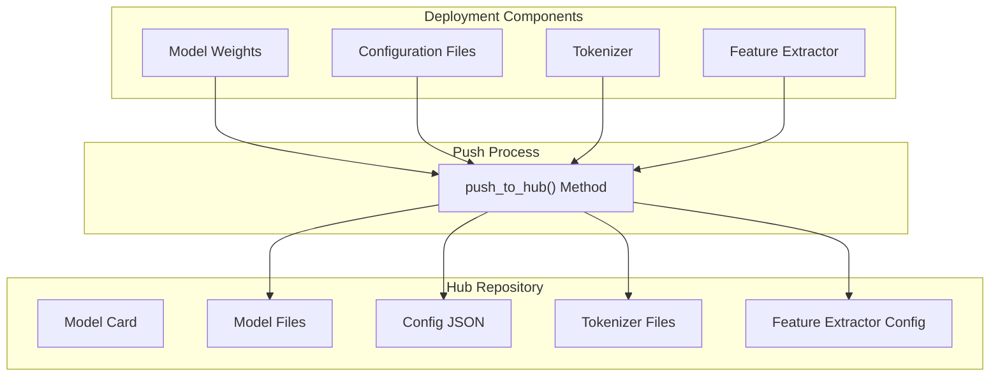
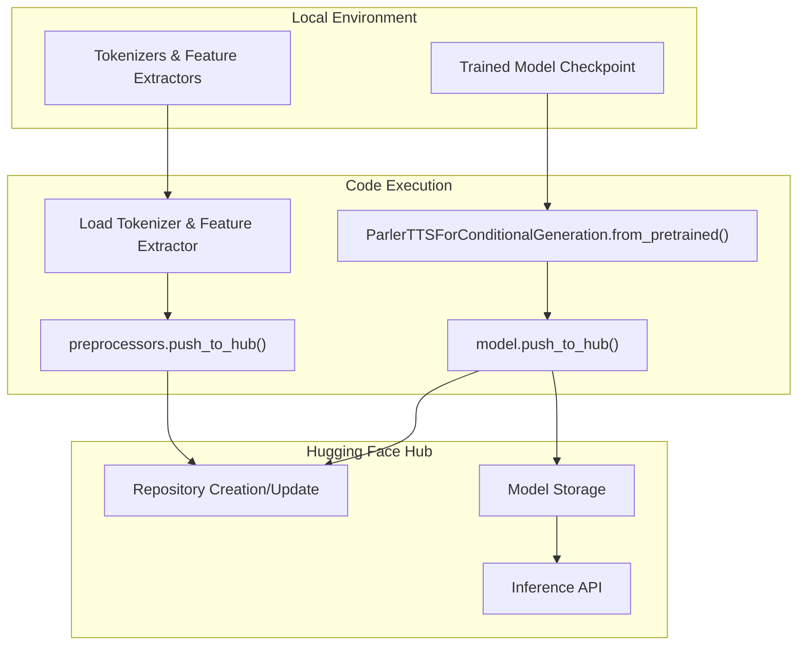
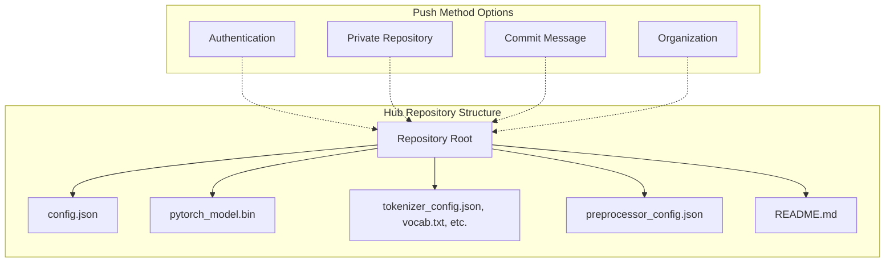

<!-- source: DeepWiki mcp.deepwiki.com · repo huggingface/parler-tts · page 4.3 Deployment to Hugging Face Hub · fetched 2026-10-26 -->

# Deployment to Hugging Face Hub

<details>
<summary>Relevant source files</summary>

The following files were used as context for generating this wiki page:

- [helpers/gradio_demo/app.py](helpers/gradio_demo/app.py)
- [helpers/push_to_hub_scripts/push_dac_to_hub.py](helpers/push_to_hub_scripts/push_dac_to_hub.py)
- [helpers/push_to_hub_scripts/push_trained_parler_tts_to_hub.py](helpers/push_to_hub_scripts/push_trained_parler_tts_to_hub.py)

</details>


This page documents the process of deploying trained Parler-TTS models to the Hugging Face Hub. Deployment makes your models easily accessible, versioned, and shareable with the community. For information about optimizing models for inference, see [Optimized Inference](#4.1), and for guidance on creating interactive demos, see [Gradio Demo Application](#4.4).

## Overview of Deployment

The Hugging Face Hub provides a centralized platform for sharing and versioning machine learning models. Deploying Parler-TTS models to the Hub involves uploading the model weights along with necessary configuration files and preprocessors.



Sources: [helpers/push_to_hub_scripts/push_trained_parler_tts_to_hub.py](), [helpers/push_to_hub_scripts/push_dac_to_hub.py]()

## Components Required for Deployment

When deploying a Parler-TTS model, you need to push the following components to the Hub:

| Component | Class | Purpose |
|-----------|-------|---------|
| Model | `ParlerTTSForConditionalGeneration` | The trained model weights and architecture |
| Feature Extractor | `AutoFeatureExtractor` | Handles audio processing for the model |
| Tokenizer | `AutoTokenizer` | Processes text input for the model |

For DAC models (audio codec), you need:

| Component | Class | Purpose |
|-----------|-------|---------|
| Model | `DACModel` | The audio codec model |
| Feature Extractor | `EncodecFeatureExtractor` | Processes audio for the codec |

Sources: [helpers/push_to_hub_scripts/push_trained_parler_tts_to_hub.py](), [helpers/push_to_hub_scripts/push_dac_to_hub.py]()

## Deployment Process

### Deployment Pipeline Overview



Sources: [helpers/push_to_hub_scripts/push_trained_parler_tts_to_hub.py](), [helpers/push_to_hub_scripts/push_dac_to_hub.py]()

### Deploying Parler-TTS Models

To deploy a trained Parler-TTS model, use the following procedure:

1. Ensure you have the necessary components: the trained model, tokenizer, and feature extractor
2. Push the tokenizer and feature extractor to the Hub
3. Load the trained model
4. Push the model to the Hub

Here's how this looks in code:

```python
# Push the necessary preprocessors
AutoFeatureExtractor.from_pretrained("ylacombe/dac_44khZ_8kbps").push_to_hub(repo_id)
AutoTokenizer.from_pretrained("google/t5-v1_1-base").push_to_hub(repo_id)

# Load and push the trained model
ParlerTTSForConditionalGeneration.from_pretrained(path).push_to_hub(repo_id)
```

Sources: [helpers/push_to_hub_scripts/push_trained_parler_tts_to_hub.py:10-13]()

### Deploying DAC Models

The Descript Audio Codec (DAC) is a crucial component of the Parler-TTS system. To deploy a DAC model to the Hub:

1. Register the DAC model with AutoConfig and AutoModel
2. Download or load the trained DAC model
3. Create a Hugging Face-compatible DAC model
4. Copy the model weights
5. Push the model and feature extractor to the Hub

```python
# Register the model architecture with the Hugging Face ecosystem
AutoConfig.register("dac", DACConfig)
AutoModel.register(DACConfig, DACModel)

# Download a pre-trained model
model_path = dac.utils.download(model_type="44khz")
model = dac.DAC.load(model_path)

# Create a Hugging Face compatible model and copy weights
hf_dac = DACModel(DACConfig())
hf_dac.model.load_state_dict(model.state_dict())

# Push to the Hub
hf_dac.push_to_hub("parler-tts/dac_44khZ_8kbps")
EncodecFeatureExtractor(sampling_rate=44100).push_to_hub("parler-tts/dac_44khZ_8kbps")
```

Sources: [helpers/push_to_hub_scripts/push_dac_to_hub.py:11-26]()

## Using Deployed Models

Once deployed to the Hub, models can be easily loaded and used for inference:

```python
from transformers import AutoFeatureExtractor, AutoTokenizer
from parler_tts import ParlerTTSForConditionalGeneration

# Load from Hub
repo_id = "parler-tts/parler_tts_mini_v0.1"
model = ParlerTTSForConditionalGeneration.from_pretrained(repo_id)
tokenizer = AutoTokenizer.from_pretrained(repo_id)
feature_extractor = AutoFeatureExtractor.from_pretrained(repo_id)

# Use the model for generation
# See the Inference section for more details
```

Sources: [helpers/gradio_demo/app.py:10-14]()

## Deployment Best Practices

### Repository Organization



Sources: [helpers/push_to_hub_scripts/push_trained_parler_tts_to_hub.py](), [helpers/push_to_hub_scripts/push_dac_to_hub.py]()

### Best Practices

1. **Authentication**: Before pushing to the Hub, authenticate using `huggingface-cli login` or a token passed to the `push_to_hub` method.

2. **Repository Name**: Choose a descriptive name for your repository that indicates the model size and version.

3. **Model Card**: Create a comprehensive model card (README.md) that includes:
   - Model capabilities and limitations
   - Training data overview
   - Performance metrics
   - Example usage code

4. **Component Versioning**: Ensure all components (model, tokenizer, feature extractor) are compatible with each other.

5. **Commit Messages**: Use descriptive commit messages when pushing updates to the Hub.

6. **Organization**: Consider creating an organization on the Hub for team projects to manage model access and collaborations.

Sources: [helpers/push_to_hub_scripts/push_trained_parler_tts_to_hub.py](), [helpers/push_to_hub_scripts/push_dac_to_hub.py]()

## Complete Deployment Example

Here's a complete example script that demonstrates the process of deploying a trained Parler-TTS model to the Hub:

```python
# Import required libraries
from transformers import AutoFeatureExtractor, AutoTokenizer
from parler_tts import ParlerTTSForConditionalGeneration

# Define paths and repository ID
model_path = "/path/to/your/trained/model"
repo_id = "username/parler_tts_model"

# Push feature extractor
feature_extractor = AutoFeatureExtractor.from_pretrained("parler-tts/dac_44khZ_8kbps")
feature_extractor.push_to_hub(repo_id)

# Push tokenizer
tokenizer = AutoTokenizer.from_pretrained("google/t5-v1_1-base")
tokenizer.push_to_hub(repo_id)

# Load and push model
model = ParlerTTSForConditionalGeneration.from_pretrained(model_path)
model.push_to_hub(repo_id, private=False, commit_message="Add Parler-TTS model")

print(f"Model successfully deployed to: https://huggingface.co/{repo_id}")
```

Sources: [helpers/push_to_hub_scripts/push_trained_parler_tts_to_hub.py]()

This example shows how to deploy all the necessary components of a Parler-TTS model to the Hugging Face Hub in the correct order.

---

