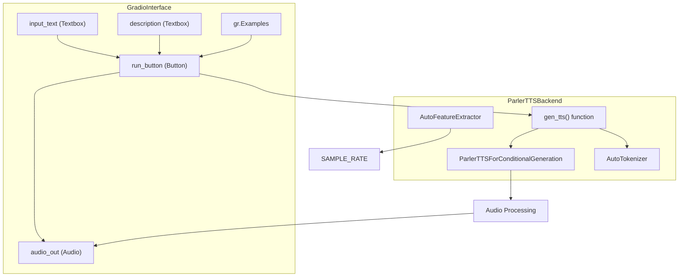
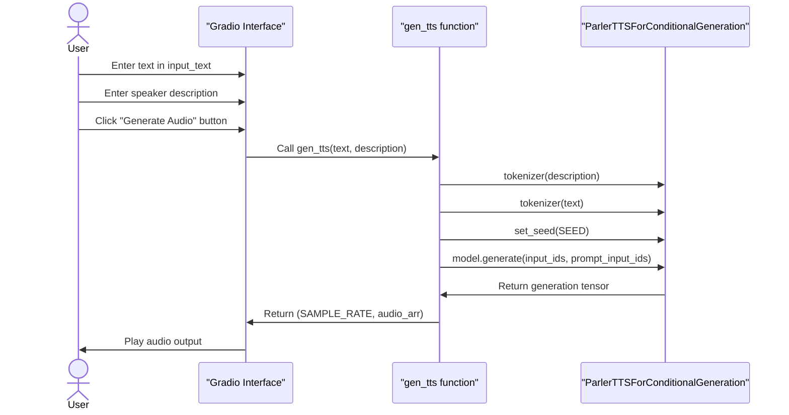

<!-- source: DeepWiki mcp.deepwiki.com · repo huggingface/parler-tts · page 4.4 Gradio Demo Application · fetched 2026-10-26 -->

# Gradio Demo Application

<details>
<summary>Relevant source files</summary>

The following files were used as context for generating this wiki page:

- [helpers/gradio_demo/app.py](helpers/gradio_demo/app.py)
- [helpers/push_to_hub_scripts/push_trained_parler_tts_to_hub.py](helpers/push_to_hub_scripts/push_trained_parler_tts_to_hub.py)

</details>


This document covers the Gradio demonstration application included in the Parler-TTS repository. The demo provides an interactive web interface that allows users to generate speech from text and speaker descriptions, showcasing the capabilities of the Parler-TTS model in a user-friendly manner.

For information about model inference optimizations, see [Optimized Inference](#4.1). For streaming generation capabilities, see [Streaming Generation](#4.2).

## Architecture Overview

The Gradio demo consists of a simple web application that integrates the Parler-TTS model with an interactive interface. Users can input text and speaker descriptions, which are processed by the model to generate audio output.

### Gradio Demo Component Structure



Sources: [helpers/gradio_demo/app.py:1-105]()

## Data Flow

The following diagram illustrates how data flows through the Gradio demo application during text-to-speech generation:

### Gradio Demo Generation Process



Sources: [helpers/gradio_demo/app.py:40-50]()

## Implementation Details

### Model Initialization

The demo loads a pre-trained Parler-TTS model along with its associated tokenizer and feature extractor:

```
model = ParlerTTSForConditionalGeneration.from_pretrained(repo_id).to(device)
tokenizer = AutoTokenizer.from_pretrained(repo_id)
feature_extractor = AutoFeatureExtractor.from_pretrained(repo_id)
```

By default, the application uses the `"parler-tts/parler_tts_mini_v0.1"` model from the Hugging Face Hub.

Sources: [helpers/gradio_demo/app.py:10-14]()

### Generation Function

The core functionality is implemented in the `gen_tts()` function:

```
def gen_tts(text, description):
    inputs = tokenizer(description, return_tensors="pt").to(device)
    prompt = tokenizer(text, return_tensors="pt").to(device)

    set_seed(SEED)
    generation = model.generate(
        input_ids=inputs.input_ids, prompt_input_ids=prompt.input_ids, do_sample=True, temperature=1.0
    )
    audio_arr = generation.cpu().numpy().squeeze()

    return (SAMPLE_RATE, audio_arr)
```

This function:
1. Tokenizes the speaker description and input text
2. Sets a fixed random seed (41) for reproducible results
3. Generates audio using the model with `do_sample=True` and `temperature=1.0`
4. Processes the output tensor to a NumPy array for audio playback

Sources: [helpers/gradio_demo/app.py:40-50]()

### User Interface Components

The Gradio interface is constructed using `gr.Blocks()` and organized in a two-column layout:

| Component | Type | Purpose |
|-----------|------|---------|
| `input_text` | `gr.Textbox` | Text to be synthesized into speech |
| `description` | `gr.Textbox` | Description of desired speaker voice and style |
| `run_button` | `gr.Button` | Triggers the generation process |
| `audio_out` | `gr.Audio` | Displays and plays the generated audio |
| `gr.Examples` | Examples component | Provides pre-defined examples for demonstration |

Sources: [helpers/gradio_demo/app.py:89-102]()

## Provided Examples

The demo includes the following examples to demonstrate different voice styles:

| Text | Description |
|------|-------------|
| "'This is the best time of my life, Bartley,' she said happily." | "A female speaker with a slightly low-pitched, quite monotone voice delivers her words at a slightly faster-than-average pace in a confined space with very clear audio." |
| "Montrose also, after having experienced still more variety of good and bad fortune, threw down his arms, and retired out of the kingdom." | "A male speaker with a slightly high-pitched voice delivering his words at a slightly slow pace in a small, confined space with a touch of background noise and a quite monotone tone." |
| "montrose also after having experienced still more variety of good and bad fortune threw down his arms and retired out of the kingdom" | "A male speaker with a low-pitched voice delivering his words at a fast pace in a small, confined space with a lot of background noise and an animated tone." |

These examples demonstrate how the same text can be rendered with different voice characteristics by changing the description.

Sources: [helpers/gradio_demo/app.py:24-37]()

## Running the Demo

To run the Gradio demo application:

1. Ensure all dependencies are installed:
   - gradio
   - torch
   - transformers
   - parler_tts (local package)

2. Execute the application script:
   ```
   python helpers/gradio_demo/app.py
   ```

3. Access the demo through:
   - A local URL (typically http://127.0.0.1:7860)
   - A public Gradio share URL (provided in the console output)

The application automatically configures itself to use CUDA if available, falling back to CPU otherwise.

Sources: [helpers/gradio_demo/app.py:8](), [helpers/gradio_demo/app.py:104-105]()

## Integration with the Parler-TTS Ecosystem

The Gradio demo serves as a practical demonstration of how the Parler-TTS model can be integrated into applications. It showcases:

1. Model loading from the Hugging Face Hub
2. Input processing and tokenization
3. Text-to-speech generation with controllable speaker characteristics
4. Audio output playback

This demo is particularly useful for testing different speaker descriptions and understanding how they affect the generated speech, serving as both a demonstration and a development tool.

Sources: [helpers/gradio_demo/app.py:1-105](), [helpers/push_to_hub_scripts/push_trained_parler_tts_to_hub.py:1-14]()