# Page: Overview

# Overview

<details>
<summary>Relevant source files</summary>

The following files were used as context for generating this wiki page:

- [README.md](README.md)
- [parler_tts/__init__.py](parler_tts/__init__.py)
- [setup.py](setup.py)
- [training/README.md](training/README.md)

</details>


This document provides a comprehensive introduction to Parler-TTS, an open-source text-to-speech system that generates high-quality, natural-sounding speech controlled through natural language descriptions. For detailed information about specific components, please refer to their dedicated pages in this wiki.

## What is Parler-TTS?

Parler-TTS is a lightweight text-to-speech model that can generate speech in the style of a given speaker based on natural language descriptions of voice characteristics (gender, pitch, speaking style, etc.). It is a reproduction of work from the paper "Natural language guidance of high-fidelity text-to-speech with synthetic annotations" by Dan Lyth and Simon King.

Key distinguishing features:
- Fully open-source with all datasets, preprocessing, training code, and model weights released under permissive licenses
- Natural language control of voice characteristics through descriptive text prompts
- Support for 34 named speakers for consistent voice generation across multiple prompts
- Optimized inference with SDPA and Flash Attention 2 support

Sources: [README.md:3-5](), [README.md:82-85]()

## System Architecture

Parler-TTS follows an encoder-decoder architecture consisting of three primary components:

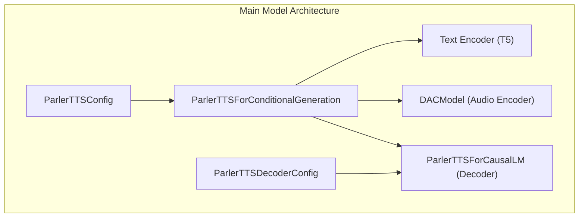

1. **Text Encoder**: A frozen T5 encoder that converts speaker descriptions into hidden state representations
2. **Audio Encoder**: The DAC (Descript Audio Codec) encoder that processes optional audio prompts
3. **Decoder**: A causal language model that generates audio tokens based on encoder outputs

Sources: [training/README.md:25-28](), [parler_tts/__init__.py:6-12]()

## Data Flow During Generation

This diagram illustrates how data flows through the system during speech generation:

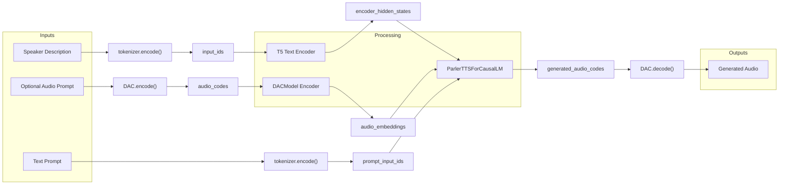

The generation process includes:
1. Tokenizing the text prompt and speaker description
2. Encoding any optional audio prompt with the DAC encoder
3. Processing the description through the T5 encoder
4. Generating audio tokens with the decoder
5. Converting the generated tokens to audio waveforms using the DAC decoder

Sources: [README.md:56-77](), [README.md:89-108]()

## Core Components

Parler-TTS is composed of several core components that work together:

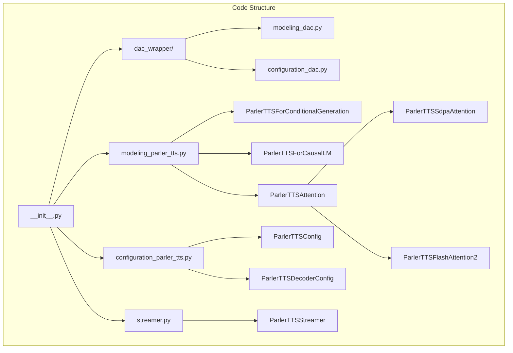

Key components include:

1. **ParlerTTSForConditionalGeneration**: The main model class that integrates the encoders and decoder
2. **ParlerTTSForCausalLM**: The decoder model that generates audio tokens
3. **DACModel**: Handles audio encoding and decoding
4. **ParlerTTSStreamer**: Enables real-time audio streaming during generation
5. **Attention Mechanisms**: Various attention implementations (standard, SDPA, Flash Attention 2)

Sources: [parler_tts/__init__.py:6-15]()

## Available Models

Parler-TTS currently offers two pre-trained checkpoints:

| Model | Parameters | Repository ID | Training Data |
|-------|------------|---------------|--------------|
| Parler-TTS Mini | 880M | parler-tts/parler-tts-mini-v1 | 45K hours of audiobooks |
| Parler-TTS Large | 2.3B | parler-tts/parler-tts-large-v1 | 45K hours of audiobooks |

Sources: [README.md:9-14]()

## Installation

Installing Parler-TTS is straightforward:

```bash
pip install git+https://github.com/huggingface/parler-tts.git
```

For Apple Silicon users, an additional step is needed for bfloat16 support:

```bash
pip3 install --pre torch torchaudio --index-url https://download.pytorch.org/whl/nightly/cpu
```

The package has several dependencies including transformers, torch, sentencepiece, and descript-audio-codec.

Sources: [README.md:28-40](), [setup.py:20-27]()

## Basic Usage

Basic usage involves providing a text prompt and a description of the desired voice:

```python
import torch
from parler_tts import ParlerTTSForConditionalGeneration
from transformers import AutoTokenizer
import soundfile as sf

device = "cuda:0" if torch.cuda.is_available() else "cpu"

model = ParlerTTSForConditionalGeneration.from_pretrained("parler-tts/parler-tts-mini-v1").to(device)
tokenizer = AutoTokenizer.from_pretrained("parler-tts/parler-tts-mini-v1")

prompt = "Hey, how are you doing today?"
description = "A female speaker delivers a slightly expressive and animated speech with a moderate speed and pitch."

input_ids = tokenizer(description, return_tensors="pt").input_ids.to(device)
prompt_input_ids = tokenizer(prompt, return_tensors="pt").input_ids.to(device)

generation = model.generate(input_ids=input_ids, prompt_input_ids=prompt_input_ids)
audio_arr = generation.cpu().numpy().squeeze()
sf.write("parler_tts_out.wav", audio_arr, model.config.sampling_rate)
```

Parler-TTS supports:
- Random voices through descriptive prompts
- 34 named speakers for consistent voices (Laura, Gary, Jon, Lea, etc.)
- Voice control through natural language descriptions

Sources: [README.md:53-114]()

## Optimizations for Inference

Parler-TTS includes several optimizations to improve inference speed:

1. **SDPA (Scaled Dot Product Attention)** for efficient attention computation
2. **Flash Attention 2** support for even faster processing
3. **Model compilation** for additional performance gains
4. **Streaming generation** via the ParlerTTSStreamer class

These optimizations significantly improve the generation speed, especially on newer hardware.

Sources: [README.md:16](), [README.md:116-118]()

---

# Page: Architecture

# Architecture

<details>
<summary>Relevant source files</summary>

The following files were used as context for generating this wiki page:

- [README.md](README.md)
- [parler_tts/configuration_parler_tts.py](parler_tts/configuration_parler_tts.py)
- [parler_tts/modeling_parler_tts.py](parler_tts/modeling_parler_tts.py)
- [training/README.md](training/README.md)

</details>


This document describes the architecture of the Parler-TTS system, a text-to-speech model that can generate high-quality, natural sounding speech conditioned on text descriptions of speaker characteristics. The architecture section explains the core components, how they interact, and the data flow through the system during both training and inference. For information about installation and basic usage, see [Installation and Setup](#1.2).

## Overview

Parler-TTS is an encoder-decoder architecture that converts text into speech while giving users control over speaker characteristics through natural language descriptions. It leverages three core components:

1. A **Text Encoder** (based on T5) that processes speaker descriptions
2. An **Audio Encoder** (based on DAC) that encodes optional audio prompts
3. A **Decoder** that generates audio tokens, which are later converted to waveforms

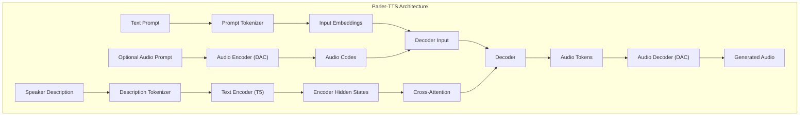

Sources: 
- [README.md:3-7]()
- [training/README.md:24-34]()
- [parler_tts/modeling_parler_tts.py:101-160]()

## Core Components

The Parler-TTS architecture consists of several key components that work together to generate speech:

### 1. Text Encoder

The text encoder processes natural language descriptions of speaker characteristics and speaking style. It's based on the Flan-T5 encoder and produces hidden state representations that guide the decoder.

- Implemented as a frozen pre-trained T5 model
- Takes tokenized speaker descriptions as input
- Outputs hidden states that influence speaking style, gender, pitch, etc.
- Connected to the decoder via cross-attention layers

### 2. Audio Encoder (DAC)

The Descript Audio Codec (DAC) serves as both the audio encoder during prompting and the audio decoder during generation:

- Encodes optional audio prompts into a sequence of discrete audio tokens
- Produces multi-codebook representations (typically 4 codebooks)
- Allows for high-fidelity audio reconstruction
- Supports 44.1kHz sampling rate

### 3. Decoder (ParlerTTSForCausalLM)

The decoder is a transformer-based language model that generates audio tokens autoregressively:

- Takes encoder hidden states and optional audio codes as input
- Implements a delayed pattern mask for multi-codebook generation
- Supports various attention mechanisms (standard, SDPA, FlashAttention2)
- Outputs tokens that can be converted back to audio using DAC

### 4. Configuration System

The model uses a hierarchical configuration system:

- `ParlerTTSConfig`: Top-level configuration that composes all sub-configurations
- `ParlerTTSDecoderConfig`: Configuration for the decoder architecture
- Configurations from T5 and DAC for the respective encoders

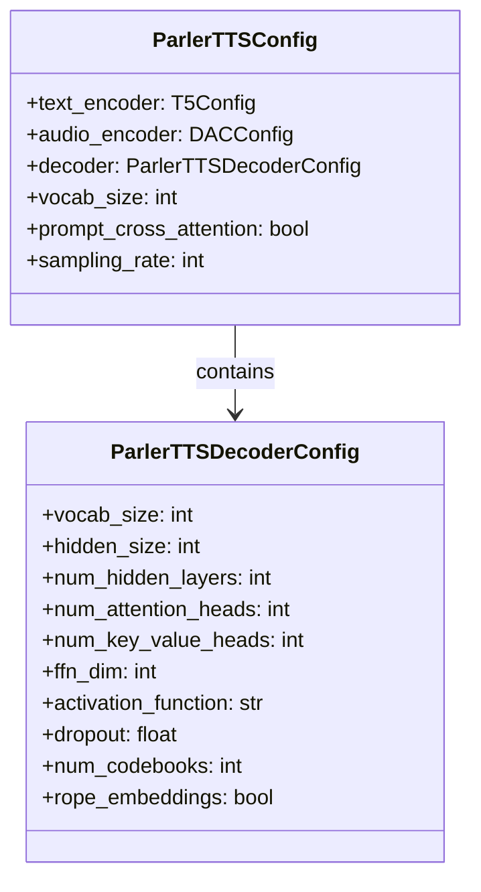

Sources:
- [parler_tts/configuration_parler_tts.py:33-166]()
- [parler_tts/configuration_parler_tts.py:175-291]()
- [training/README.md:24-34]()

## Model Architecture

The Parler-TTS model is implemented as a single end-to-end system with the following class hierarchy:

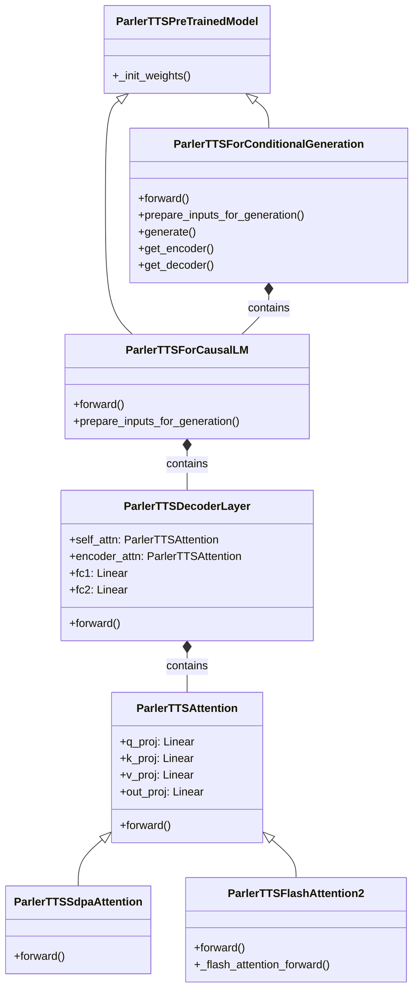

Sources:
- [parler_tts/modeling_parler_tts.py:101-1075]()
- [parler_tts/modeling_parler_tts.py:1077-1103]()

## Data Flow During Inference

During inference, data flows through the system as follows:

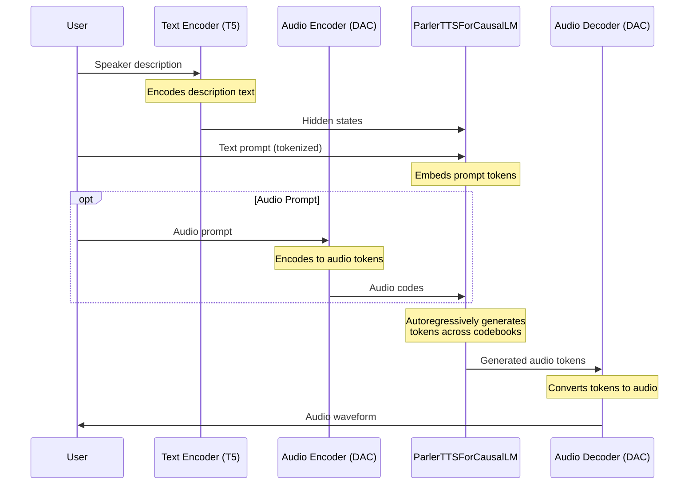

The key steps in data flow are:

1. **Text Description Processing**: The speaker description is tokenized and encoded by T5 to produce hidden states
2. **Text Prompt Processing**: The text prompt is tokenized and embedded directly
3. **Audio Prompt Processing** (optional): An audio prompt can be encoded into audio tokens by DAC
4. **Token Generation**: The decoder generates audio tokens autoregressively, using cross-attention to condition on the encoded description
5. **Audio Synthesis**: The generated tokens are decoded back to audio using DAC

Sources:
- [README.md:52-108]()
- [parler_tts/modeling_parler_tts.py:205-276]()

## Attention Mechanisms

Parler-TTS supports three different attention implementations to balance performance and efficiency:

1. **Standard Attention** (`ParlerTTSAttention`): The default attention mechanism with standard matrix operations
2. **SDPA Attention** (`ParlerTTSSdpaAttention`): Uses PyTorch's scaled dot-product attention for better performance
3. **FlashAttention2** (`ParlerTTSFlashAttention2`): Optimized attention implementation for maximum speed

The attention implementations are interchangeable and can be selected based on hardware availability and performance requirements.

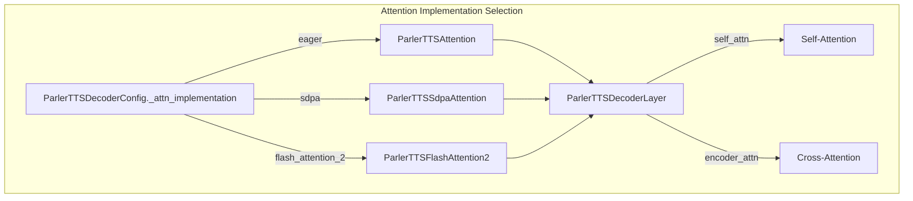

Sources:
- [parler_tts/modeling_parler_tts.py:439-933]()
- [parler_tts/modeling_parler_tts.py:933-937]()
- [README.md:116-119]()

## Multi-Codebook Generation

One of the key architectural features of Parler-TTS is its multi-codebook generation approach. The model generates tokens for multiple codebooks in parallel using a specialized pattern:

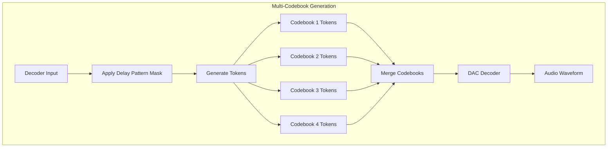

The delay pattern mask ensures that each codebook is generated with an offset from the others, allowing for a structured approach to multi-codebook generation:

- Codebook 1 starts at position 1
- Codebook 2 starts at position 2
- And so on...

This approach enables the model to properly handle dependencies between codebooks and generate coherent audio.

Sources:
- [parler_tts/modeling_parler_tts.py:205-276]()

## Available Model Variants

Parler-TTS currently comes in two pre-trained variants:

| Model | Parameters | Training Data | Characteristics |
|-------|------------|---------------|-----------------|
| Parler-TTS Mini | 880M | 45K hours | Lightweight but high quality |
| Parler-TTS Large | 2.3B | 45K hours | Higher quality, more capabilities |

Both models follow the same architecture but differ in size (number of layers, hidden dimensions, attention heads) and consequently in their generation capabilities.

Sources:
- [README.md:9-16]()

## Integration with Hugging Face Ecosystem

The Parler-TTS architecture is designed to integrate seamlessly with the Hugging Face ecosystem:

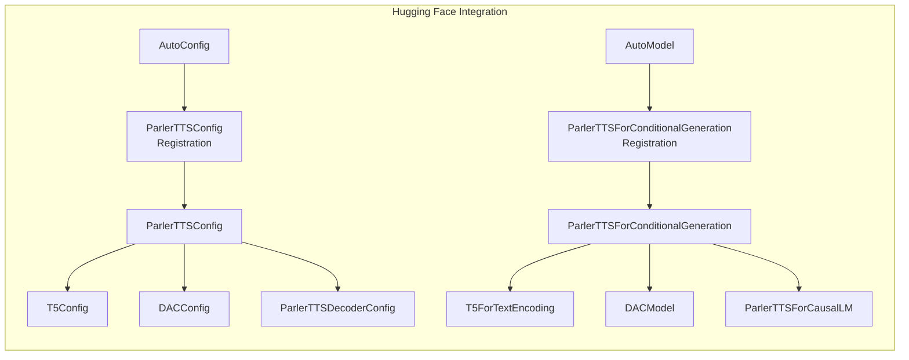

This integration enables:
- Easy loading of pre-trained models with `from_pretrained()`
- Automatic handling of model configs and weights
- Compatibility with Transformers pipelines
- Support for model quantization and optimization

Sources:
- [parler_tts/modeling_parler_tts.py:68-74]()
- [parler_tts/configuration_parler_tts.py:259-285]()

## Summary

The Parler-TTS architecture combines a frozen text encoder, an audio codec, and a decoder to create a flexible and powerful text-to-speech system that can be controlled through natural language descriptions. Its multi-codebook approach enables high-quality audio generation, while its integration with the Hugging Face ecosystem makes it accessible and easy to use.

The architecture balances flexibility and performance, with optimized attention mechanisms and support for various hardware configurations. The model's design allows for both fast inference and high-quality audio generation, making it suitable for a wide range of applications.

---

# Page: Installation and Setup

# Installation and Setup

<details>
<summary>Relevant source files</summary>

The following files were used as context for generating this wiki page:

- [README.md](README.md)
- [parler_tts/__init__.py](parler_tts/__init__.py)
- [setup.py](setup.py)
- [training/README.md](training/README.md)

</details>


This guide covers the installation process and initial setup for Parler-TTS, a lightweight text-to-speech model that can generate high-quality, natural-sounding speech. For detailed information about training setup and advanced configuration, see [Training](#3) and [Inference and Deployment](#4).

## 1. Installation Methods

Parler-TTS has lightweight dependencies for standard usage, with additional requirements for training.

### 1.1 Basic Installation

The simplest way to install Parler-TTS is using pip:

```bash
pip install git+https://github.com/huggingface/parler-tts.git
```

### 1.2 Apple Silicon Installation

Apple Silicon users need to run an additional command to install a nightly build of PyTorch with bfloat16 support:

```bash
pip3 install --pre torch torchaudio --index-url https://download.pytorch.org/whl/nightly/cpu
```

### 1.3 Installation from Source (for Development/Training)

For development or training, install from source:

```bash
git clone https://github.com/huggingface/parler-tts.git
cd parler-tts
pip install -e .              # Basic installation
pip install -e .[train]       # Installation with training dependencies
pip install -e .[dev]         # Installation with development dependencies
```

Sources: [README.md:28-40](), [training/README.md:47-58](), [setup.py:57-69]()

## 2. Dependencies

Parler-TTS relies on several key dependencies that enable its audio generation capabilities.

### 2.1 Core Dependencies

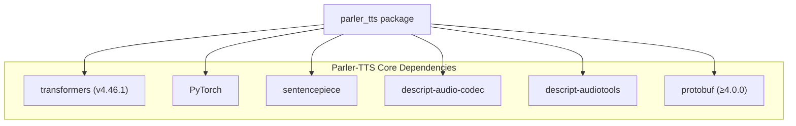

**Key Dependencies Diagram**

Sources: [setup.py:20-27]()

### 2.2 Training Dependencies

If planning to train models, additional dependencies are required:

```bash
pip install -e .[train]
```

This will install:
- jiwer (Word Error Rate calculation)
- wandb (experiment tracking)
- accelerate (distributed training)
- evaluate (evaluation framework)
- datasets[audio] (audio dataset handling)

Sources: [setup.py:35-41](), [training/README.md:47-58]()

## 3. Post-Installation Setup

After installing Parler-TTS, several additional setup steps may be required depending on your use case.

### 3.1 Configuration for Inference

Parler-TTS integrates with the Hugging Face ecosystem through AutoConfig and AutoModel registration:

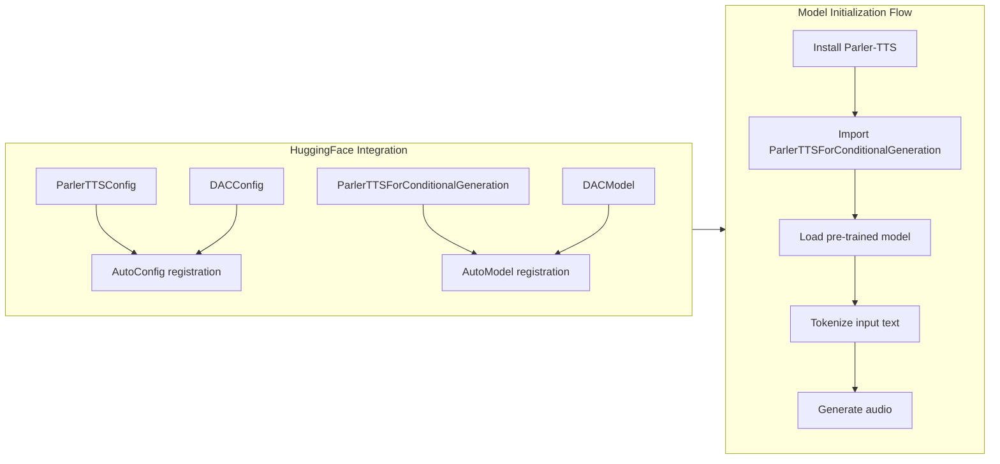

**Model Initialization and Registration Diagram**

Sources: [parler_tts/__init__.py:4-25](), [README.md:66-78]()

### 3.2 Training Setup (Optional)

For those interested in training Parler-TTS models, additional setup is required:

1. **Configure Accelerate** (for distributed training):
   ```bash
   accelerate config
   ```

2. **Login to Hugging Face Hub** (for saving models):
   ```bash
   git config --global credential.helper store
   huggingface-cli login
   ```

3. **Optional: Set up Weights & Biases** for experiment tracking

Sources: [training/README.md:60-74]()

## 4. Basic Usage Setup

Once installed, here's how to set up Parler-TTS for basic text-to-speech generation:

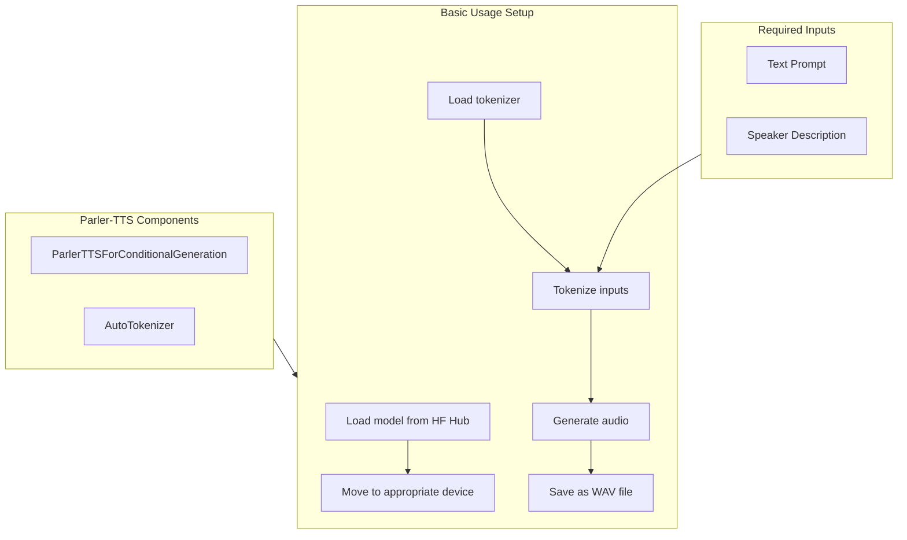

**Basic Usage Workflow Diagram**

### 4.1 Loading the Model and Tokenizer

```python
import torch
from parler_tts import ParlerTTSForConditionalGeneration
from transformers import AutoTokenizer

device = "cuda:0" if torch.cuda.is_available() else "cpu"

model = ParlerTTSForConditionalGeneration.from_pretrained("parler-tts/parler-tts-mini-v1").to(device)
tokenizer = AutoTokenizer.from_pretrained("parler-tts/parler-tts-mini-v1")
```

### 4.2 Available Pretrained Models

The following pre-trained models are available:

| Model | Parameters | Hub ID |
|-------|------------|--------|
| Parler-TTS Mini | 880M | parler-tts/parler-tts-mini-v1 |
| Parler-TTS Large | 2.3B | parler-tts/parler-tts-large-v1 |

Sources: [README.md:66-78](), [README.md:9-16]()

## 5. Optimizing Inference

Parler-TTS supports several optimization techniques for faster inference.

### 5.1 Available Optimization Methods

| Method | Description | Requirements |
|--------|-------------|--------------|
| SDPA Attention | Scaled dot-product attention | PyTorch 2.0+ |
| Flash Attention 2 | Optimized attention algorithm | Flash Attention library |
| Model Compilation | JIT or TorchDynamo compilation | PyTorch 2.0+ |

### 5.2 Attention Mechanisms

The model supports different attention implementations that can be configured at load time:

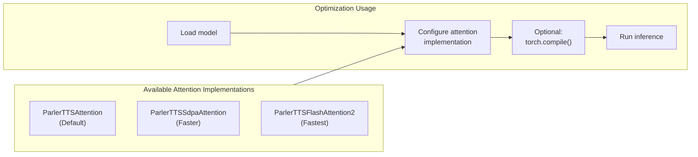

**Attention Mechanisms Diagram**

Sources: [README.md:115-118]()

## 6. Troubleshooting

### 6.1 Common Installation Issues

- **Missing or incompatible dependencies**: Ensure all dependencies are properly installed
- **CUDA compatibility issues**: Verify CUDA version is compatible with installed PyTorch
- **Apple Silicon issues**: Make sure to run the additional installation command for Apple Silicon

### 6.2 Support Resources

- GitHub Issues: For bug reports and feature requests
- Hugging Face Community: For usage questions and community support

Sources: [README.md:28-40]()

This installation and setup guide provides the foundation for using Parler-TTS. For more advanced topics, please refer to the specific documentation sections on [Model Components](#2), [Training](#3), and [Inference and Deployment](#4).

---

# Page: Model Components

# Model Components

<details>
<summary>Relevant source files</summary>

The following files were used as context for generating this wiki page:

- [parler_tts/configuration_parler_tts.py](parler_tts/configuration_parler_tts.py)
- [parler_tts/modeling_parler_tts.py](parler_tts/modeling_parler_tts.py)

</details>


This document provides a comprehensive overview of the core components that make up the Parler-TTS text-to-speech system. It covers the model architecture, key classes, their configurations, and how they interact to form a complete TTS pipeline. For details on training these components, see [Training](#3), and for inference and deployment information, see [Inference and Deployment](#4).

## High-Level Architecture

Parler-TTS follows an encoder-decoder architecture specifically designed for conditional text-to-speech generation. The system consists of three main components that work together to transform text input into high-quality audio output.

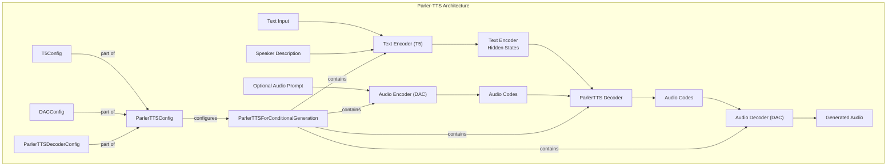

Sources: [parler_tts/configuration_parler_tts.py:175-291](), [parler_tts/modeling_parler_tts.py:2800-3031]()

## Core Components

Parler-TTS consists of three main components that work together:

1. **Text Encoder**: Processes the text input and speaker description
2. **Audio Encoder**: Processes the optional audio prompt
3. **Decoder**: Generates the audio codes, which are then converted to audio

Let's examine each component in detail:

### Text Encoder (T5)

The text encoder in Parler-TTS is based on the T5 model architecture. It takes as input both the text to be synthesized and a description of how the speech should sound (speaker description). The text encoder produces hidden state representations that are fed to the decoder.

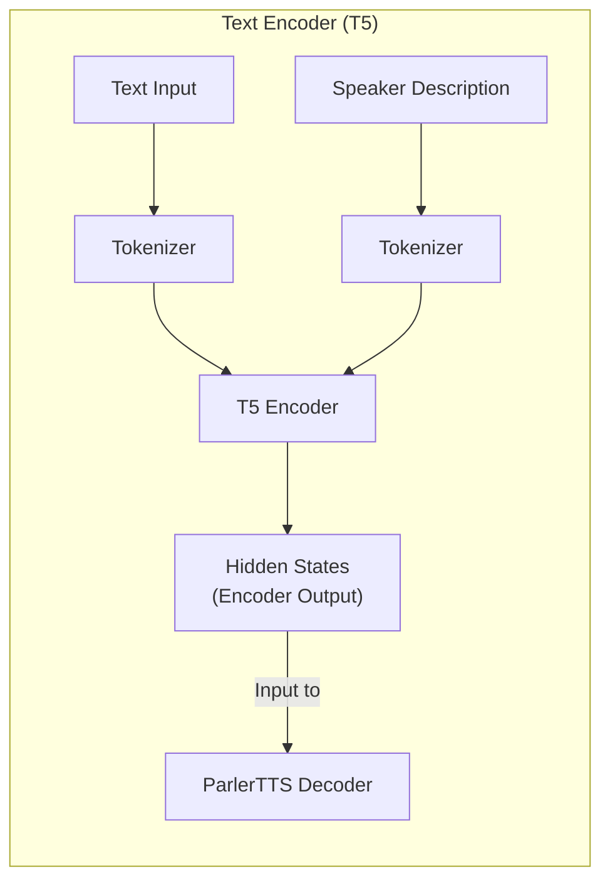

The model uses the text encoder from the Hugging Face transformers library, loaded via AutoModelForTextEncoding. This flexible approach allows different text encoder architectures to be used, although the default is T5.

Sources: [parler_tts/modeling_parler_tts.py:2817-2824](), [parler_tts/configuration_parler_tts.py:193-195]()

### Audio Encoder (DAC)

The Descript Audio Codec (DAC) serves as the audio encoder for Parler-TTS. It can encode audio prompts into a discrete representation (audio codes) that can be processed by the decoder. These audio codes represent the acoustic characteristics that the model should emulate in the generated speech.

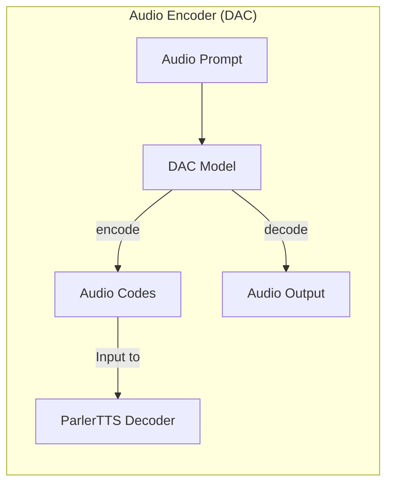

The DAC model handles both encoding audio prompts and decoding the generated audio codes back into waveforms. The encoder portion compresses the audio into a more compact discrete representation, while the decoder portion reconstructs audio from these codes.

Sources: [parler_tts/modeling_parler_tts.py:2825-2833](), [parler_tts/configuration_parler_tts.py:196-198]()

### Decoder (ParlerTTSForCausalLM)

The decoder is the heart of the Parler-TTS model. It takes the encoded text and optional audio codes as input and generates new audio codes autoregressively (one token at a time). The decoder is based on a transformer architecture, specifically designed for audio generation.

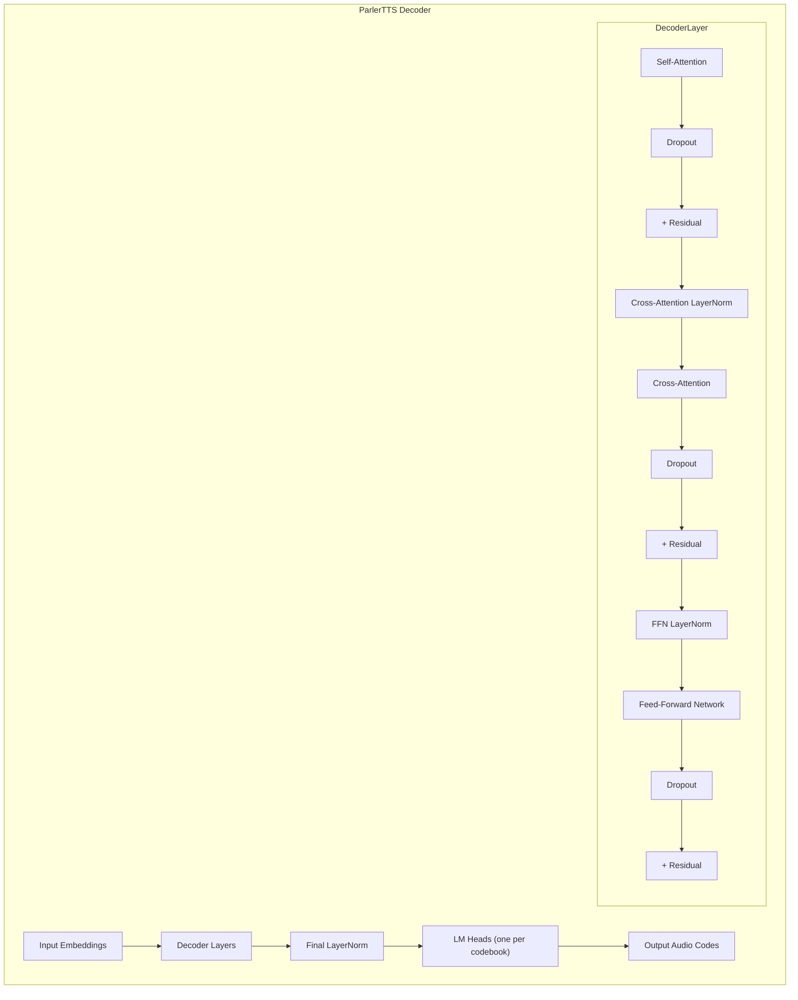

The decoder includes several key features:
- Multiple codebook support for representing audio
- Support for various attention mechanisms
- Rotary positional embeddings (RoPE) or sinusoidal positional embeddings
- Multiple language modeling heads (one per codebook)

Sources: [parler_tts/modeling_parler_tts.py:1338-1806](), [parler_tts/modeling_parler_tts.py:1824-2799]()

## Configuration System

The Parler-TTS configuration system consists of several configuration classes that control the behavior and architecture of different components:

### ParlerTTSConfig

This is the main configuration class that defines the overall model architecture. It contains configurations for the text encoder, audio encoder, and decoder.

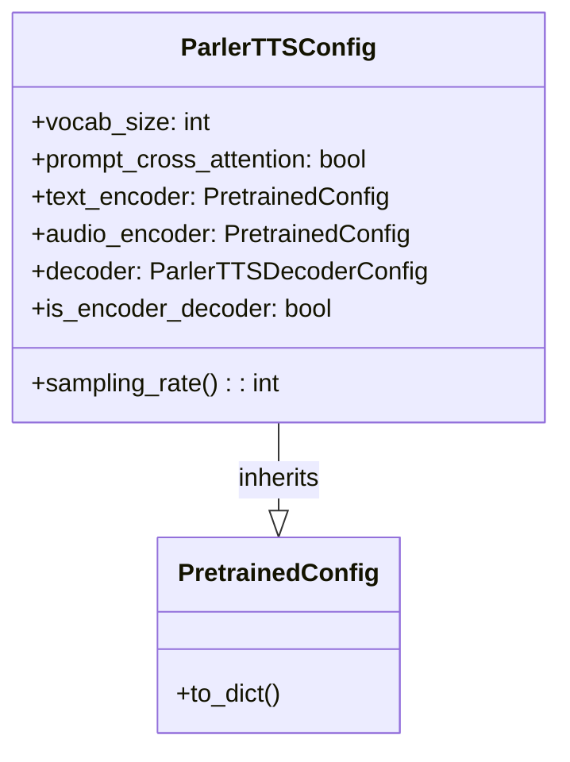

Key parameters:
- `vocab_size`: Size of the vocabulary for prompt token IDs
- `prompt_cross_attention`: Whether to use cross-attention for prompting
- `text_encoder`: Configuration for the text encoder
- `audio_encoder`: Configuration for the audio encoder
- `decoder`: Configuration for the decoder

Sources: [parler_tts/configuration_parler_tts.py:175-291]()

### ParlerTTSDecoderConfig

This configuration class defines the architecture and behavior of the decoder component.

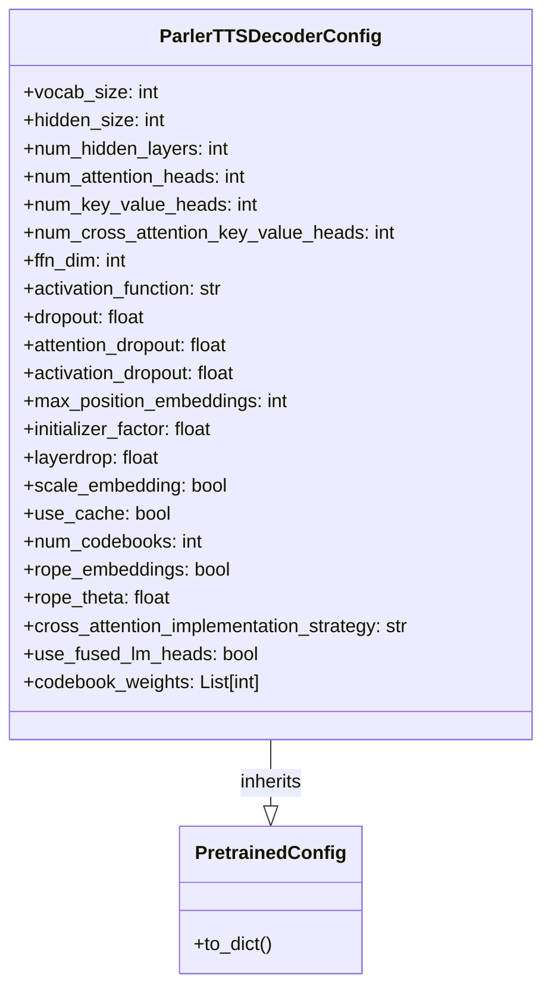

Key parameters:
- `vocab_size`: Vocabulary size for the decoder (typically 2049)
- `hidden_size`: Dimension of the hidden layers
- `num_hidden_layers`: Number of decoder layers
- `num_attention_heads`: Number of attention heads
- `num_key_value_heads`: Number of key/value heads for GQA or MQA
- `ffn_dim`: Dimension of the feed-forward network
- `num_codebooks`: Number of parallel codebooks (typically 4)
- `rope_embeddings`: Whether to use rotary positional embeddings

Sources: [parler_tts/configuration_parler_tts.py:33-172]()

## Model Implementation

### ParlerTTSForConditionalGeneration

This is the main model class that integrates the text encoder, audio encoder, and decoder components.

```mermaid
classDiagram
    class ParlerTTSForConditionalGeneration {
        -config: ParlerTTSConfig
        -text_encoder: PreTrainedModel
        -enc_to_dec_proj: Linear
        -decoder: ParlerTTSForCausalLM
        -audio_encoder: DACModel
        +forward()
        +prepare_inputs_for_generation()
        +generate()
    }
    
    class PreTrainedModel {
        +from_pretrained()
        +save_pretrained()
    }
    
    ParlerTTSForConditionalGeneration --|> PreTrainedModel: inherits
```

The `ParlerTTSForConditionalGeneration` class manages the flow of data through the entire model:
1. Encodes text and speaker description using the text encoder
2. Optionally encodes audio prompts using the audio encoder
3. Projects the encoder outputs to the decoder dimension
4. Feeds the encoded data to the decoder to generate audio codes
5. Decodes the audio codes back to waveforms using the audio decoder

Sources: [parler_tts/modeling_parler_tts.py:2800-3031]()

### ParlerTTSForCausalLM

This class implements the decoder with a language modeling head. It takes encoder outputs and generates audio codes autoregressively.

```mermaid
classDiagram
    class ParlerTTSForCausalLM {
        -model: ParlerTTSModel
        -lm_heads: ModuleList[Linear] or Linear
        -num_codebooks: int
        -vocab_size: int
        -use_fused_lm_heads: bool
        +forward()
        +prepare_inputs_for_generation()
    }
    
    class ParlerTTSPreTrainedModel {
        +_init_weights()
    }
    
    ParlerTTSForCausalLM --|> ParlerTTSPreTrainedModel: inherits
```

The `ParlerTTSForCausalLM` class contains:
- A `ParlerTTSModel` for processing inputs
- Language modeling heads for predicting audio codes
- Support for multiple codebooks
- Optional fused language modeling heads for efficiency

Sources: [parler_tts/modeling_parler_tts.py:1824-2799]()

## Attention Mechanisms

Parler-TTS supports multiple attention implementation strategies for optimal performance across different hardware:

```mermaid
graph TB
    subgraph "Attention Mechanisms"
        Base["ParlerTTSAttention<br>(Base Implementation)"]
        SDPA["ParlerTTSSdpaAttention<br>(Scaled Dot-Product)"]
        Flash["ParlerTTSFlashAttention2<br>(Flash Attention 2)"]
        
        Base --> SDPA
        Base --> Flash
        
        Config["_attn_implementation<br>in Config"] --> |"selects"| AttentionImplementation["Attention<br>Implementation"]
        AttentionImplementation --> |"eager"| Base
        AttentionImplementation --> |"sdpa"| SDPA
        AttentionImplementation --> |"flash_attention_2"| Flash
    end
```

The model supports three attention implementations:

1. **ParlerTTSAttention** (eager): Standard attention implementation
   - Supports both self-attention and cross-attention
   - Works with GQA (grouped query attention) and MQA (multi-query attention)
   - Optional rotary positional embeddings (RoPE)

2. **ParlerTTSSdpaAttention** (sdpa): Uses PyTorch's scaled dot-product attention
   - More efficient than the eager implementation
   - Falls back to eager implementation when unsupported features are requested

3. **ParlerTTSFlashAttention2** (flash_attention_2): Uses Flash Attention 2 for maximum efficiency
   - Fastest implementation on supported hardware
   - Handles padding in inputs for optimal performance

The attention implementation can be selected through the `_attn_implementation` parameter in the configuration.

Sources: [parler_tts/modeling_parler_tts.py:439-937]()

## Data Flow and Generation Process

This diagram illustrates the flow of data through the Parler-TTS model during generation:

```mermaid
sequenceDiagram
    participant User
    participant TextEncoder
    participant AudioEncoder
    participant Decoder
    participant AudioDecoder
    
    User->>TextEncoder: Text Input + Speaker Description
    TextEncoder->>Decoder: Text Encoder Hidden States
    
    opt Audio Prompt Provided
        User->>AudioEncoder: Audio Prompt
        AudioEncoder->>Decoder: Audio Codes
    end
    
    loop Autoregressive Generation
        Decoder->>Decoder: Generate Next Audio Code
    end
    
    Decoder->>AudioDecoder: Generated Audio Codes
    AudioDecoder->>User: Generated Audio
```

The generation process:
1. Text and speaker description are encoded through the text encoder
2. If provided, an audio prompt is encoded through the audio encoder
3. The decoder generates audio codes autoregressively
4. The audio decoder converts the audio codes back to waveforms

During the autoregressive generation, the model uses cached attention states for efficiency. The decoder uses a delayed pattern mask when working with multiple codebooks, which allows it to generate tokens in parallel for each codebook.

Sources: [parler_tts/modeling_parler_tts.py:3188-3413]()

## Component Relationship Table

The following table summarizes the relationship between model components and their configurations:

| Component | Implementation Class | Configuration Class | Description |
|-----------|---------------------|---------------------|-------------|
| Text Encoder | AutoModelForTextEncoding | T5Config | Encodes text and speaker description |
| Audio Encoder | DACModel | DACConfig | Encodes audio prompts, decodes audio outputs |
| Decoder | ParlerTTSForCausalLM | ParlerTTSDecoderConfig | Generates audio codes |
| Main Model | ParlerTTSForConditionalGeneration | ParlerTTSConfig | Orchestrates the entire generation process |
| Attention | ParlerTTSAttention and variants | Configured via ParlerTTSDecoderConfig | Implements different attention mechanisms |

Sources: [parler_tts/configuration_parler_tts.py:33-291](), [parler_tts/modeling_parler_tts.py:1338-3413]()

## Advanced Features

### Multi-Codebook Generation

Parler-TTS uses multiple codebooks to represent audio, which allows for more expressive speech generation:

```mermaid
graph LR
    subgraph "Multi-Codebook Generation"
        Input["Decoder Input"] --> Split["Split by Codebook"]
        Split --> |"Codebook 1"| Emb1["Embedding 1"]
        Split --> |"Codebook 2"| Emb2["Embedding 2"]
        Split --> |"Codebook 3"| Emb3["Embedding 3"]
        Split --> |"Codebook 4"| Emb4["Embedding 4"]
        
        Emb1 --> Sum["Sum Embeddings"]
        Emb2 --> Sum
        Emb3 --> Sum
        Emb4 --> Sum
        
        Sum --> Decoder["Decoder Processing"]
        
        Decoder --> LMHeads["LM Heads"]
        LMHeads --> |"Codebook 1"| Out1["Output Codes 1"]
        LMHeads --> |"Codebook 2"| Out2["Output Codes 2"]
        LMHeads --> |"Codebook 3"| Out3["Output Codes 3"]
        LMHeads --> |"Codebook 4"| Out4["Output Codes 4"]
        
        Out1 --> Combine["Combine for Decoding"]
        Out2 --> Combine
        Out3 --> Combine
        Out4 --> Combine
    end
```

Each codebook captures different aspects of the audio, and the model can either use:
- Multiple language modeling heads (one per codebook)
- A fused language modeling head (when `use_fused_lm_heads=True`)

Sources: [parler_tts/modeling_parler_tts.py:1834-1840](), [parler_tts/configuration_parler_tts.py:98-99]()

### Positional Encodings

Parler-TTS supports two types of positional encodings:

1. **Sinusoidal Positional Embeddings**: Traditional positional encoding that adds positional information to token embeddings
2. **Rotary Positional Embeddings (RoPE)**: Applies rotations to the query and key vectors in the attention mechanism

The type of positional encoding is controlled by the `rope_embeddings` parameter in the decoder configuration.

Sources: [parler_tts/modeling_parler_tts.py:327-406](), [parler_tts/configuration_parler_tts.py:92-95]()

## Summary

Parler-TTS is a comprehensive text-to-speech system with a modular architecture:
- Text encoder for processing text and speaker descriptions
- Audio encoder for processing audio prompts
- Decoder for generating audio codes
- Multiple attention mechanisms for optimal performance
- Support for multiple codebooks for expressive speech generation

The system is highly configurable through its configuration classes, allowing for different model sizes and architectural choices. The components work together to create a pipeline that can generate high-quality speech from text inputs, with optional control through speaker descriptions and audio prompts.

Sources: [parler_tts/configuration_parler_tts.py:33-291](), [parler_tts/modeling_parler_tts.py:2800-3031]()

---

# Page: ParlerTTS Model

# ParlerTTS Model

<details>
<summary>Relevant source files</summary>

The following files were used as context for generating this wiki page:

- [README.md](README.md)
- [parler_tts/modeling_parler_tts.py](parler_tts/modeling_parler_tts.py)
- [training/README.md](training/README.md)

</details>


## Purpose and Scope

This document provides a detailed explanation of the core model architecture of Parler-TTS, focusing on the `ParlerTTSForConditionalGeneration` and `ParlerTTSForCausalLM` model classes. It covers their structure, internal components, and how they work together to generate high-quality speech from text input. For information about model configuration, see [Model Configuration](#2.2), and for details about the audio codec, see [Audio Codec (DAC)](#2.3).

## Model Architecture Overview

Parler-TTS follows an encoder-decoder architecture similar to other conditional generation models, but specialized for text-to-speech synthesis.

### High-Level Architecture Diagram

```mermaid
flowchart LR
    subgraph Inputs
        text["Text Prompt"]
        desc["Speaker Description"]
        audioPrompt["Optional Audio Prompt"]
    end

    subgraph "ParlerTTSForConditionalGeneration"
        subgraph Encoders
            T5["Text Encoder (T5)"]
            DAC["Audio Encoder (DAC)"]
        end
        
        subgraph Decoder
            PC["ParlerTTSForCausalLM"]
        end
        
        EMB["Prompt Embeddings"]
    end

    subgraph Output
        Audio["Generated Audio"]
    end
    
    text --> EMB
    desc --> T5
    audioPrompt --> DAC
    
    T5 --> PC
    DAC --> PC
    EMB --> PC
    
    PC --> Audio
```

Sources: [parler_tts/modeling_parler_tts.py:1742-2450](), [training/README.md:25-34]()

The model consists of three main components:

1. **Text Encoder**: A frozen T5 encoder that converts speaker descriptions into hidden representations
2. **Audio Encoder**: A DAC (Descript Audio Codec) encoder that converts optional audio prompts into code embeddings
3. **Decoder**: A transformer-based decoder that generates audio tokens autoregressively

## ParlerTTSForConditionalGeneration

The `ParlerTTSForConditionalGeneration` class is the main end-to-end model for text-to-speech generation.

### Component Structure

```mermaid
classDiagram
    class ParlerTTSForConditionalGeneration {
        +text_encoder: T5EncoderModel
        +decoder: ParlerTTSForCausalLM
        +audio_encoder: DACModel
        +enc_to_dec_proj: Linear
        +config: ParlerTTSConfig
        +generation_config: GenerationConfig
        +forward()
        +generate()
        +prepare_inputs_for_generation()
    }
    
    ParlerTTSForConditionalGeneration --> "T5EncoderModel" : text_encoder
    ParlerTTSForConditionalGeneration --> "ParlerTTSForCausalLM" : decoder
    ParlerTTSForConditionalGeneration --> "DACModel" : audio_encoder
    ParlerTTSForConditionalGeneration --> "Linear" : enc_to_dec_proj
```

Sources: [parler_tts/modeling_parler_tts.py:3100-3564]()

### Data Flow During Generation

```mermaid
sequenceDiagram
    participant Input
    participant TextEncoder
    participant AudioEncoder
    participant Decoder
    participant Output
    
    Input->>TextEncoder: Speaker description (input_ids)
    TextEncoder->>Decoder: Encoded description (hidden states)
    
    Input->>Decoder: Text prompt (prompt_input_ids)
    
    alt With audio prompt
        Input->>AudioEncoder: Audio prompt (audio_values)
        AudioEncoder->>Decoder: Audio codes (conditioning)
    end
    
    Decoder->>Decoder: Generate audio tokens autoregressively
    Decoder->>Output: Audio tokens
    Output->>Output: Convert to audio waveform via DAC decoder
```

Sources: [parler_tts/modeling_parler_tts.py:3329-3564](), [README.md:56-78]()

### Key Features

1. **Flexible Input Handling**: 
   - Can process text description for voice characteristics
   - Accepts text prompt to determine what to say
   - Optionally takes audio prompt for voice cloning

2. **Integrated Generation Pipeline**:
   - Processes all inputs through respective encoders
   - Coordinates between text and audio modalities
   - Handles autoregressive generation of audio tokens
   - Converts generated tokens to audio waveform

3. **Optimized Inference**:
   - Supports SDPA (Scaled Dot-Product Attention)
   - Compatible with Flash Attention 2
   - Supports model compilation

Sources: [README.md:116-118](), [parler_tts/modeling_parler_tts.py:3329-3564]()

## ParlerTTSForCausalLM (Decoder)

The `ParlerTTSForCausalLM` class is the decoder component responsible for generating audio tokens conditioned on encoded text and optional audio inputs.

### Decoder Architecture

```mermaid
flowchart TD
    inputs["Inputs (Text/Audio Embeddings)"] --> embed["Token Embeddings"]
    embed --> pos["Position Embeddings"]
    pos --> layers["Decoder Layers"]
    
    subgraph "Decoder Layer Structure"
        ln1["Layer Norm"] --> selfAttn["Self Attention"]
        selfAttn --> dropout1["Dropout"]
        dropout1 --> add1["Add & Norm"]
        
        add1 --> ln2["Layer Norm"]
        ln2 --> crossAttn["Cross Attention"]
        crossAttn --> dropout2["Dropout"]
        dropout2 --> add2["Add & Norm"]
        
        add2 --> ln3["Layer Norm"]
        ln3 --> ff["Feed Forward"]
        ff --> dropout3["Dropout"]
        dropout3 --> add3["Add & Norm"]
    end
    
    layers --> final["Final Layer Norm"]
    final --> projection["Projection Head"]
    projection --> logits["Output Logits"]
```

Sources: [parler_tts/modeling_parler_tts.py:1338-1737](), [parler_tts/modeling_parler_tts.py:940-1075]()

### Multi-Head Attention Mechanisms

The decoder supports multiple attention implementations for different performance and compatibility needs:

```mermaid
classDiagram
    class ParlerTTSAttention {
        +embed_dim
        +num_heads
        +num_key_value_heads
        +head_dim
        +k_proj, v_proj, q_proj
        +out_proj
        +forward()
    }
    
    class ParlerTTSSdpaAttention {
        +Uses torch.nn.functional.scaled_dot_product_attention
    }
    
    class ParlerTTSFlashAttention2 {
        +Uses flash_attn_func from Flash Attention 2
    }
    
    ParlerTTSAttention <|-- ParlerTTSSdpaAttention
    ParlerTTSAttention <|-- ParlerTTSFlashAttention2
    
    note for ParlerTTSSdpaAttention "Optimized with CUDA kernels"
    note for ParlerTTSFlashAttention2 "Highest performance on supported hardware"
```

Sources: [parler_tts/modeling_parler_tts.py:439-585](), [parler_tts/modeling_parler_tts.py:599-815](), [parler_tts/modeling_parler_tts.py:818-930]()

### Decoder Layer Components

Each decoder layer in `ParlerTTSForCausalLM` consists of:

1. **Self-attention mechanism**: Processes the sequence history
2. **Cross-attention mechanism**: Attends to encoder outputs
3. **Feed-forward neural network**: Processes transformed representations

The decoder also supports various optimizations:

- Rotary position embeddings (RoPE) for better handling of sequence positions
- Group Query Attention (GQA) and Multi-Query Attention (MQA) for efficiency
- Various caching strategies for faster autoregressive generation

Sources: [parler_tts/modeling_parler_tts.py:940-1075](), [parler_tts/modeling_parler_tts.py:372-436]()

## Generation Process

### Input Processing and Token Generation

```mermaid
flowchart TD
    input["User Input"]
    
    subgraph "Text Processing"
        descToken["Tokenize Description"]
        promptToken["Tokenize Prompt"]
    end
    
    subgraph "Optional Audio Processing"
        audioEncode["Encode Audio Prompt"]
    end
    
    subgraph "Generation"
        encoder["T5 Encoder"]
        decoderPrep["Prepare Decoder Inputs"]
        decoder["ParlerTTS Decoder"]
        decoding["Autoregressive Decoding"]
    end
    
    subgraph "Post-Processing"
        dac["DAC Decoder"]
        audio["Audio Waveform"]
    end
    
    input --> descToken
    input --> promptToken
    input --> audioEncode
    
    descToken --> encoder
    promptToken --> decoderPrep
    audioEncode --> decoderPrep
    
    encoder --> decoderPrep
    decoderPrep --> decoder
    decoder --> decoding
    decoding --> dac
    dac --> audio
```

Sources: [README.md:56-78](), [parler_tts/modeling_parler_tts.py:3329-3564]()

### Generation Parameters

The generation process can be controlled through various parameters:

| Parameter | Description | Default Value |
|-----------|-------------|---------------|
| `temperature` | Controls randomness in sampling | 1.0 |
| `top_k` | Limits sampling to top k tokens | 50 |
| `top_p` | Nucleus sampling parameter | 1.0 |
| `use_cache` | Enable KV-caching for faster generation | True |
| `max_new_tokens` | Maximum number of tokens to generate | None |
| `attn_implementation` | Attention implementation to use | 'sdpa' |

Sources: [parler_tts/modeling_parler_tts.py:3329-3564](), [README.md:116-118]()

## Optimization Features

### Attention Implementations

Parler-TTS supports three attention implementations:

1. **Eager Attention** (`ParlerTTSAttention`): Standard implementation, most compatible
2. **SDPA Attention** (`ParlerTTSSdpaAttention`): Uses PyTorch's scaled dot-product attention
3. **Flash Attention 2** (`ParlerTTSFlashAttention2`): Fastest on supported hardware

These implementations can be selected via the model configuration or at inference time:

```python
# Example of selecting attention implementation during model loading
model = ParlerTTSForConditionalGeneration.from_pretrained(
    "parler-tts/parler-tts-mini-v1", 
    attn_implementation="flash_attention_2"
)
```

Sources: [parler_tts/modeling_parler_tts.py:933-937](), [README.md:116-118]()

### Caching Strategies

The model supports different caching strategies for optimized inference:

- **Dynamic Cache**: Default cache for standard generation
- **Static Cache**: Pre-allocated cache for fixed-length generation
- **Sliding Window Cache**: Limited context window for memory efficiency

```mermaid
flowchart LR
    subgraph "Cache Types"
        direction TB
        dynamic["DynamicCache<br>Flexible but slower"]
        static["StaticCache<br>Fast but fixed size"]
        sliding["SlidingWindowCache<br>Memory efficient"]
    end
    
    generate["model.generate()"] --> cache["Cache Selection"]
    cache --> dynamic
    cache --> static
    cache --> sliding
```

Sources: [parler_tts/modeling_parler_tts.py:97-97](), [parler_tts/modeling_parler_tts.py:1657-1731]()

## Integration with Hugging Face Ecosystem

Parler-TTS is fully integrated with the Hugging Face ecosystem, including:

- Registration with `AutoConfig` and `AutoModel`
- Compatibility with Hugging Face generation utilities
- Support for model loading and saving via `from_pretrained` and `save_pretrained`

```mermaid
flowchart LR
    subgraph "Hugging Face Ecosystem"
        auto["AutoModel/AutoConfig"]
        hub["Hugging Face Hub"]
        transformers["Transformers Library"]
    end
    
    subgraph "Parler-TTS Models"
        config["ParlerTTSConfig"]
        model["ParlerTTSForConditionalGeneration"]
        decoder["ParlerTTSForCausalLM"]
    end
    
    auto --> model
    model --> hub
    transformers --> model
```

Sources: [parler_tts/modeling_parler_tts.py:69-74](), [README.md:66-68](), [README.md:96-98]()

## Summary

The ParlerTTS model consists of two main components:

1. `ParlerTTSForConditionalGeneration`: The complete text-to-speech model that:
   - Processes speaker descriptions and text prompts
   - Optionally handles audio prompts
   - Manages the flow between encoders and decoder
   - Generates high-quality speech output

2. `ParlerTTSForCausalLM`: The decoder component that:
   - Takes encoded inputs from text and audio encoders
   - Implements a transformer-based architecture
   - Supports various attention mechanisms for optimization
   - Generates audio tokens autoregressively

Together, these components provide a flexible and powerful text-to-speech system capable of generating natural-sounding speech with controllable voice characteristics.

---

# Page: Model Configuration

# Model Configuration

<details>
<summary>Relevant source files</summary>

The following files were used as context for generating this wiki page:

- [helpers/model_init_scripts/init_dummy_model.py](helpers/model_init_scripts/init_dummy_model.py)
- [helpers/model_init_scripts/init_dummy_model_with_encodec.py](helpers/model_init_scripts/init_dummy_model_with_encodec.py)
- [helpers/model_init_scripts/init_model_600M.py](helpers/model_init_scripts/init_model_600M.py)
- [helpers/training_configs/librispeech_tts_r_300M_dummy.json](helpers/training_configs/librispeech_tts_r_300M_dummy.json)
- [helpers/training_configs/starting_point_0.01.json](helpers/training_configs/starting_point_0.01.json)
- [parler_tts/configuration_parler_tts.py](parler_tts/configuration_parler_tts.py)

</details>


This page documents the configuration system for Parler-TTS, which defines the model architecture, parameters, and behavior. The configuration system provides a structured way to instantiate, customize, and save Parler-TTS models. For information about the models themselves, see [ParlerTTS Model](#2.1).

## Configuration Architecture

The Parler-TTS configuration system consists of two main configuration classes:

1. `ParlerTTSConfig`: The top-level configuration that defines the entire Parler-TTS model, including the text encoder, audio encoder, and decoder components.
2. `ParlerTTSDecoderConfig`: A specialized configuration for the decoder component of the Parler-TTS model.

These configuration classes inherit from Hugging Face's `PretrainedConfig`, allowing them to seamlessly integrate with the broader Hugging Face ecosystem for saving, loading, and modifying model configurations.

```mermaid
classDiagram
    PretrainedConfig <|-- ParlerTTSConfig
    PretrainedConfig <|-- ParlerTTSDecoderConfig
    ParlerTTSConfig --> "1" ParlerTTSDecoderConfig : contains
    ParlerTTSConfig --> "1" T5Config : contains
    ParlerTTSConfig --> "1" DACConfig : contains
    
    class PretrainedConfig {
        +to_dict()
        +from_pretrained()
        +save_pretrained()
    }
    
    class ParlerTTSConfig {
        +Boolean is_composition
        +String model_type
        +Boolean prompt_cross_attention
        +Int vocab_size
        +T5Config text_encoder
        +DACConfig audio_encoder
        +ParlerTTSDecoderConfig decoder
        +from_sub_models_config()
    }
    
    class ParlerTTSDecoderConfig {
        +String model_type
        +Int vocab_size
        +Int hidden_size
        +Int ffn_dim
        +Int num_hidden_layers
        +Int num_attention_heads
        +Int num_key_value_heads
        +Int num_codebooks
        +Boolean rope_embeddings
        +Float dropout
    }
    
    class T5Config {
        +configuration for text encoder
    }
    
    class DACConfig {
        +configuration for audio encoder
    }
```

Sources: [parler_tts/configuration_parler_tts.py:33-172](), [parler_tts/configuration_parler_tts.py:175-291]()

## ParlerTTSConfig

`ParlerTTSConfig` is the main configuration class for the Parler-TTS model. It is a composition of three sub-configurations:

1. **Text Encoder Config**: Configuration for the T5 model used to encode speaker descriptions.
2. **Audio Encoder Config**: Configuration for the DAC (Descript Audio Codec) model used to encode audio.
3. **Decoder Config**: Configuration for the Parler-TTS decoder that generates audio codes.

### Key Attributes

- `vocab_size`: Size of the text prompt vocabulary.
- `prompt_cross_attention`: Whether to use cross-attention for the prompt inputs.
- `text_encoder`: Configuration for the text encoder model (T5).
- `audio_encoder`: Configuration for the audio encoder model (DAC).
- `decoder`: Configuration for the Parler-TTS decoder.
- `is_encoder_decoder`: Set to `True` to indicate this is an encoder-decoder model.

### Creation Methods

The class provides a `from_sub_models_config` method to create a configuration from individual sub-model configurations:

```python
@classmethod
def from_sub_models_config(
    cls,
    text_encoder_config: PretrainedConfig,
    audio_encoder_config: PretrainedConfig,
    decoder_config: ParlerTTSDecoderConfig,
    **kwargs,
):
    return cls(
        text_encoder=text_encoder_config.to_dict(),
        audio_encoder=audio_encoder_config.to_dict(),
        decoder=decoder_config.to_dict(),
        **kwargs,
    )
```

Sources: [parler_tts/configuration_parler_tts.py:175-286]()

## ParlerTTSDecoderConfig

`ParlerTTSDecoderConfig` defines the architecture and behavior of the Parler-TTS decoder, which is responsible for generating audio codes based on encoded text and optional audio prompts.

### Key Parameters

The decoder configuration includes numerous parameters to customize the model architecture:

| Parameter | Description | Default |
|-----------|-------------|---------|
| `vocab_size` | Vocabulary size of the decoder (audio tokens) | 2049 |
| `hidden_size` | Dimension of hidden layers | 1024 |
| `num_hidden_layers` | Number of decoder layers | 24 |
| `num_attention_heads` | Number of attention heads | 16 |
| `num_key_value_heads` | Number of key/value heads for GQA | Same as attention heads |
| `ffn_dim` | Dimension of feed-forward layer | 4096 |
| `dropout` | Dropout probability | 0.1 |
| `attention_dropout` | Dropout for attention probabilities | 0.0 |
| `activation_function` | Non-linear activation function | "gelu" |
| `max_position_embeddings` | Maximum sequence length | 2048 |
| `num_codebooks` | Number of parallel codebooks | 4 |
| `rope_embeddings` | Whether to use RoPE embeddings | False |
| `rope_theta` | Base period for RoPE | 10000.0 |
| `use_fused_lm_heads` | Whether to fuse audio LM heads | False |
| `codebook_weights` | Weights for each codebook in loss | None |

Sources: [parler_tts/configuration_parler_tts.py:33-172]()

## Model Instantiation Flow

The following diagram illustrates how the configuration classes are used to instantiate a complete Parler-TTS model:

```mermaid
flowchart TD
    subgraph "Configuration Creation"
        T5C["T5Config (text_encoder)"]
        DACC["DACConfig (audio_encoder)"]
        PDEC["ParlerTTSDecoderConfig (decoder)"]
        PTTS["ParlerTTSConfig"]
        
        T5C --> PTTS
        DACC --> PTTS
        PDEC --> PTTS
    end
    
    subgraph "Model Initialization"
        T5["T5ForConditionalGeneration"]
        DAC["DACModel"]
        PTTSDec["ParlerTTSForCausalLM"]
        PTTSModel["ParlerTTSForConditionalGeneration"]
        
        T5C --> T5
        DACC --> DAC
        PDEC --> PTTSDec
        
        T5 --> PTTSModel
        DAC --> PTTSModel
        PTTSDec --> PTTSModel
        PTTS --> PTTSModel
    end
```

Sources: [helpers/model_init_scripts/init_dummy_model.py:20-69](), [helpers/model_init_scripts/init_model_600M.py:20-68]()

## Usage Examples

### Creating a Configuration from Scratch

To create a Parler-TTS model configuration from scratch, you first create the sub-model configurations and then combine them:

```python
from transformers import T5Config, AutoConfig
from parler_tts import ParlerTTSConfig, ParlerTTSDecoderConfig

# Create sub-model configurations
text_encoder_config = T5Config()
audio_encoder_config = AutoConfig.from_pretrained("ylacombe/dac_44khZ_8kbps")

# Create decoder configuration
decoder_config = ParlerTTSDecoderConfig(
    vocab_size=audio_encoder_config.codebook_size + 1,
    max_position_embeddings=2048,
    num_hidden_layers=24,
    ffn_dim=4096,
    num_attention_heads=16,
    hidden_size=1024,
    num_codebooks=audio_encoder_config.num_codebooks,
)

# Create the complete model configuration
model_config = ParlerTTSConfig.from_sub_models_config(
    text_encoder_config=text_encoder_config,
    audio_encoder_config=audio_encoder_config,
    decoder_config=decoder_config,
    vocab_size=text_encoder_config.vocab_size,
)
```

Sources: [helpers/model_init_scripts/init_model_600M.py:20-54]()

### Model Size Variants

Parler-TTS provides different model size variants by adjusting the configuration parameters. Below are examples of parameters for different model sizes:

#### Tiny Model (for testing)

```mermaid
graph TD
    subgraph "Tiny Model Configuration"
        direction LR
        decoder["ParlerTTSDecoderConfig:
            hidden_size: 512
            num_hidden_layers: 4
            ffn_dim: 512
            num_attention_heads: 8"]
    end
```

Sources: [helpers/model_init_scripts/init_dummy_model.py:27-44]()

#### 600M Parameter Model

```mermaid
graph TD
    subgraph "600M Model Configuration"
        direction LR
        decoder["ParlerTTSDecoderConfig:
            hidden_size: 1024
            num_hidden_layers: 24
            ffn_dim: 4096
            num_attention_heads: 16"]
    end
```

Sources: [helpers/model_init_scripts/init_model_600M.py:27-44]()

## Configuration for Training

When configuring a model for training, additional settings are specified in a JSON configuration file. These settings include:

1. Model initialization path
2. Dataset configurations
3. Training hyperparameters
4. Evaluation settings

The training configuration works in conjunction with the model configuration, specifying how the model should be trained without changing its architecture.

```mermaid
flowchart LR
    subgraph "Training Configuration"
        direction TB
        TC["Training Config JSON"]
        MP["model_name_or_path"]
        DS["dataset settings"]
        HP["hyperparameters"]
        EV["evaluation settings"]
        
        TC --> MP
        TC --> DS
        TC --> HP
        TC --> EV
    end
    
    subgraph "Model Configuration"
        direction TB
        MC["ParlerTTSConfig"]
        TE["text_encoder"]
        AE["audio_encoder"]
        DE["decoder"]
        
        MC --> TE
        MC --> AE
        MC --> DE
    end
    
    MP --> MC
```

Sources: [helpers/training_configs/librispeech_tts_r_300M_dummy.json:1-72](), [helpers/training_configs/starting_point_0.01.json:1-74]()

## Accessing Model Configuration

After a model is initialized, its configuration can be accessed through the `config` attribute, which contains the top-level `ParlerTTSConfig`. The sub-model configurations can be accessed through the `text_encoder`, `audio_encoder`, and `decoder` attributes of this configuration.

```python
# Accessing configuration from a loaded model
model = ParlerTTSForConditionalGeneration.from_pretrained("parler-tts/parler-tts-mini-v1")

# Top-level configuration
config = model.config  # ParlerTTSConfig

# Sub-model configurations
text_encoder_config = model.config.text_encoder  # T5Config
audio_encoder_config = model.config.audio_encoder  # DACConfig
decoder_config = model.config.decoder  # ParlerTTSDecoderConfig
```

Sources: [parler_tts/configuration_parler_tts.py:200-234]()

## Saving and Loading Configurations

Parler-TTS configurations can be saved and loaded using the standard Hugging Face methods:

```python
# Save configuration
model.config.save_pretrained("path/to/save")

# Load configuration
config = ParlerTTSConfig.from_pretrained("path/to/save")
```

This integration with the Hugging Face ecosystem simplifies model sharing and reproducibility.

Sources: [parler_tts/configuration_parler_tts.py:200-234]()

---

# Page: Audio Codec (DAC)

# Audio Codec (DAC)

<details>
<summary>Relevant source files</summary>

The following files were used as context for generating this wiki page:

- [helpers/push_to_hub_scripts/push_dac_to_hub.py](helpers/push_to_hub_scripts/push_dac_to_hub.py)
- [parler_tts/dac_wrapper/__init__.py](parler_tts/dac_wrapper/__init__.py)
- [parler_tts/dac_wrapper/configuration_dac.py](parler_tts/dac_wrapper/configuration_dac.py)
- [parler_tts/dac_wrapper/modeling_dac.py](parler_tts/dac_wrapper/modeling_dac.py)

</details>


The Audio Codec component, specifically the Descript Audio Codec (DAC), is a critical part of the Parler-TTS system responsible for encoding raw audio waveforms into discrete codes and decoding these codes back into audio. This document covers the implementation, configuration, and usage of the DAC component within the Parler-TTS framework. For information about the overall model architecture, see [Architecture](#1.1).

## Overview and Position in the Architecture

The DAC serves as both the Audio Encoder and Decoder in the Parler-TTS pipeline. It handles the conversion between continuous audio signals and discrete representations that the model can work with.

```mermaid
flowchart LR
    subgraph "Parler-TTS Audio Processing Flow"
        Audio["Audio Waveform"] --> DACEncoder["DAC Encoder"]
        DACEncoder --> Codes["Discrete Audio Codes"]
        Codes --> DecoderModel["ParlerTTS Decoder"]
        DecoderModel --> GenCodes["Generated Audio Codes"] 
        GenCodes --> DACDecoder["DAC Decoder"]
        DACDecoder --> OutputAudio["Output Audio Waveform"]
    end
```

Sources: [parler_tts/dac_wrapper/modeling_dac.py:33-104](), [parler_tts/dac_wrapper/modeling_dac.py:106-142]()

## Implementation Components

The DAC implementation in Parler-TTS consists of two main classes wrapping the original DAC model to make it compatible with the Hugging Face ecosystem.

```mermaid
classDiagram
    class DACConfig {
        +num_codebooks: int
        +model_bitrate: int
        +codebook_size: int
        +latent_dim: int
        +frame_rate: int
        +sampling_rate: int
    }

    class DACModel {
        +model: DAC
        +encode()
        +decode()
        +forward()
        +apply_weight_norm()
        +remove_weight_norm()
    }

    DACConfig <-- DACModel : uses
```

Sources: [parler_tts/dac_wrapper/configuration_dac.py:7-27](), [parler_tts/dac_wrapper/modeling_dac.py:14-164]()

## Configuration

The `DACConfig` class defines the parameters for the DAC model, setting important values that control the codec's behavior:

| Parameter | Default Value | Description |
|-----------|---------------|-------------|
| `num_codebooks` | 9 | Number of codebooks used for vector quantization |
| `model_bitrate` | 8 kbps | Target bitrate for audio compression |
| `codebook_size` | 1024 | Number of entries in each codebook |
| `latent_dim` | 1024 | Dimension of the latent representation |
| `frame_rate` | 86 | Frames per second for encoding |
| `sampling_rate` | 44100 Hz | Audio sampling frequency |

Sources: [parler_tts/dac_wrapper/configuration_dac.py:10-27]()

## Audio Encoding Process

The encoding process converts raw audio waveforms into discrete codes that represent the audio content in a compressed form.

```mermaid
flowchart TD
    subgraph "DACModel.encode()"
        input["input_values: Audio Waveform"] --> preprocess["model.preprocess()"]
        preprocess --> encode["model.encode()"]
        encode --> output["encoded_frames: Discrete Codes"]
    end
```

Key steps in the encoding process:
1. Audio input is preprocessed to match the model's requirements
2. The preprocessed audio is passed through the DAC encoder
3. The encoder produces discrete codes representing the audio content
4. These codes are returned in a format compatible with the Hugging Face ecosystem

Sources: [parler_tts/dac_wrapper/modeling_dac.py:33-104]()

## Audio Decoding Process

The decoding process converts discrete codes back into audio waveforms that can be played.

```mermaid
flowchart TD
    subgraph "DACModel.decode()"
        input["audio_codes: Discrete Codes"] --> fromCodes["model.quantizer.from_codes()"]
        fromCodes --> decode["model.decode()"]
        decode --> output["audio_values: Audio Waveform"]
    end
```

Key steps in the decoding process:
1. Discrete codes are converted to audio embeddings using the quantizer
2. These embeddings are passed through the DAC decoder
3. The decoder generates the audio waveform
4. The audio is returned in a format compatible with the Hugging Face ecosystem

Sources: [parler_tts/dac_wrapper/modeling_dac.py:106-142]()

## Integration with Hugging Face

The DAC model is integrated with the Hugging Face ecosystem, allowing it to be used with standard Hugging Face interfaces and tools.

```mermaid
flowchart LR
    subgraph "Hugging Face Integration"
        DACConfig["DACConfig"] -->|"registers"| AutoConfig["AutoConfig"]
        DACModel["DACModel"] -->|"registers"| AutoModel["AutoModel"]
        
        AutoConfig --> Hub["Hugging Face Hub"]
        AutoModel --> Hub
        
        Hub -->|"parler-tts/dac_44khZ_8kbps"| PretrainedDAC["Pretrained DAC Model"]
    end
```

Sources: [helpers/push_to_hub_scripts/push_dac_to_hub.py:11-16](), [helpers/push_to_hub_scripts/push_dac_to_hub.py:25-26]()

## Model Structure

The `DACModel` is a wrapper around the original DAC implementation, adding compatibility with the Hugging Face `PreTrainedModel` interface. It handles:

1. Initialization with the specified configuration
2. Encoding audio waveforms to discrete codes
3. Decoding discrete codes to audio waveforms
4. Weight normalization for improved model performance

```mermaid
flowchart TD
    subgraph "DACModel Structure"
        Config["DACConfig"] --> Init["__init__"]
        Init --> OrigDAC["Original DAC Model"]
        
        OrigDAC --> Encode["encode()"]
        OrigDAC --> Decode["decode()"]
        
        Encode --> EncoderOutput["EncodecEncoderOutput"]
        Decode --> DecoderOutput["EncodecDecoderOutput"]
    end
```

Sources: [parler_tts/dac_wrapper/modeling_dac.py:21-32](), [parler_tts/dac_wrapper/modeling_dac.py:148-164]()

## Practical Usage

### Model Initialization

```python
from parler_tts import DACConfig, DACModel

# Initialize with default configuration
config = DACConfig()
dac_model = DACModel(config)

# Load a pretrained model
from transformers import AutoModel
pretrained_dac = AutoModel.from_pretrained("parler-tts/dac_44khZ_8kbps")
```

### Encoding Audio

```python
# Assuming audio_waveform is a tensor of shape [batch_size, channels, length]
encoded_output = dac_model.encode(audio_waveform)
audio_codes = encoded_output.audio_codes
```

### Decoding Audio

```python
# Convert discrete codes back to audio
decoded_output = dac_model.decode(audio_codes, audio_scales=None)
reconstructed_audio = decoded_output.audio_values
```

Sources: [parler_tts/dac_wrapper/modeling_dac.py:33-104](), [parler_tts/dac_wrapper/modeling_dac.py:106-142]()

## Limitations

The current DAC implementation has some limitations to be aware of:

1. Limited batching support: The model has constraints on batched processing as noted in the comments
2. The `forward()` method is not implemented, requiring direct use of `encode()` and `decode()`
3. `chunk_length` handling is still under development

Sources: [parler_tts/dac_wrapper/modeling_dac.py:11-12](), [parler_tts/dac_wrapper/modeling_dac.py:144-145](), [parler_tts/dac_wrapper/modeling_dac.py:68-73]()

---

# Page: Attention Mechanisms

# Attention Mechanisms

<details>
<summary>Relevant source files</summary>

The following files were used as context for generating this wiki page:

- [INFERENCE.md](INFERENCE.md)
- [parler_tts/modeling_parler_tts.py](parler_tts/modeling_parler_tts.py)
- [parler_tts/streamer.py](parler_tts/streamer.py)

</details>


This page documents the different attention mechanism implementations available in Parler-TTS. Attention is a core component of the transformer architecture that enables the model to focus on relevant parts of input sequences when generating audio. For information about the overall model architecture, see [Architecture](#1.1).

## Attention Implementation Overview

Parler-TTS provides three attention implementation variants, each offering different performance characteristics:

```mermaid
graph TD
    BaseAtt["ParlerTTSAttention (Base/Eager)"]
    SDPAAtt["ParlerTTSSdpaAttention"]
    FlashAtt["ParlerTTSFlashAttention2"]
    
    BaseAtt --> SDPAAtt
    BaseAtt --> FlashAtt
    
    DecoderLayer["ParlerTTSDecoderLayer"]
    DecoderLayer --> |"Uses"| ATTCLASSES["PARLERTTS_ATTENTION_CLASSES"]
    
    ATTCLASSES --> BaseAtt
    ATTCLASSES --> SDPAAtt
    ATTCLASSES --> FlashAtt
    
    Config["config._attn_implementation"]
    Config --> |"Determines"| ATTCLASSES
```

Sources: [parler_tts/modeling_parler_tts.py:933-937]()

## Base Attention Implementation

The foundational attention implementation is `ParlerTTSAttention`, which uses eager computation and serves as the parent class for the optimized implementations.

### Key Features

- Multi-head attention with support for Group Query Attention (GQA)
- Separate number of heads for queries vs. keys/values
- Support for rotary positional embeddings (RoPE)
- Key-value caching for efficient autoregressive generation
- Support for cross-attention (when `key_value_states` are provided)

```mermaid
flowchart LR
    subgraph "ParlerTTSAttention"
        QProj["q_proj"]
        KProj["k_proj"]
        VProj["v_proj"]
        SDPA["Scaled Dot-Product Attention"]
        OutProj["out_proj"]
    end
    
    Hidden["hidden_states"] --> QProj
    KeyValue["key_value_states\n(optional)"] --> KProj
    KeyValue --> VProj
    
    QProj --> |"shape & scale"| SDPA
    KProj --> |"shape & transpose"| SDPA
    VProj --> |"shape"| SDPA
    
    AttMask["attention_mask\n(optional)"] --> SDPA
    ROPE["Rotary Position\nEmbeddings (optional)"] --> QProj
    ROPE --> KProj
    Cache["past_key_value\n(optional)"] --> SDPA
    
    SDPA --> OutProj
    OutProj --> Output["attention_output"]
```

Sources: [parler_tts/modeling_parler_tts.py:439-584]()

### Attention Computation Flow

The attention computation in `ParlerTTSAttention` follows these steps:

1. Project hidden states to queries, keys, and values
2. Apply rotary position embeddings if enabled
3. Reuse cached key/values if provided, otherwise compute new ones
4. Repeat key/value heads if using GQA (Group Query Attention)
5. Compute attention weights via matrix multiplication
6. Apply attention mask if provided
7. Apply softmax and dropout
8. Compute weighted values and project to output dimension

## Optimized Attention Implementations

Parler-TTS includes two optimized attention mechanisms that inherit from the base implementation but replace the core attention computation with more efficient algorithms.

### SDPA Attention

`ParlerTTSSdpaAttention` uses PyTorch's native `torch.nn.functional.scaled_dot_product_attention` function, which provides optimized kernels for different hardware:

```python
attn_output = torch.nn.functional.scaled_dot_product_attention(
    query_states,
    key_states,
    value_states,
    attn_mask=causal_mask,
    dropout_p=self.dropout if self.training else 0.0,
    is_causal=is_causal,
)
```

Key benefits:
- Up to 1.4x speedup over eager attention
- Uses optimized CUDA kernels on NVIDIA GPUs
- Falls back to the base implementation when `output_attentions=True`

Sources: [parler_tts/modeling_parler_tts.py:818-930](), [INFERENCE.md:12-33]()

### Flash Attention 2

`ParlerTTSFlashAttention2` integrates the Flash Attention 2 library for maximum efficiency, particularly with long sequences:

```mermaid
flowchart TD
    subgraph "FlashAttention2Process"
        Check["Check if input contains padding"]
        FlashVarlen["flash_attn_varlen_func\n(for padded inputs)"]
        FlashFunc["flash_attn_func\n(for non-padded inputs)"]
        Unpad["Unpad input tensors"]
        Pad["Pad output tensor"]
    end
    
    Input["Input tensors"] --> Check
    
    Check --> |"Has padding"| Unpad
    Check --> |"No padding"| FlashFunc
    
    Unpad --> FlashVarlen
    FlashVarlen --> Pad
    
    FlashFunc --> Output["Output tensor"]
    Pad --> Output
```

Key benefits:
- Memory-efficient attention computation
- Higher performance on long sequences
- Special handling for padding tokens

Limitations:
- Requires the Flash Attention 2 library
- Not compatible with static cache implementation
- Does not support output attentions

Sources: [parler_tts/modeling_parler_tts.py:600-814](), [INFERENCE.md:12-33]()

## Attention Selection Mechanism

The attention implementation is selected through a dictionary mapping:

```python
PARLERTTS_ATTENTION_CLASSES = {
    "eager": ParlerTTSAttention,
    "sdpa": ParlerTTSSdpaAttention,
    "flash_attention_2": ParlerTTSFlashAttention2,
}
```

This mapping is used in the `ParlerTTSDecoderLayer` constructor to create the appropriate attention modules:

```python
self.self_attn = PARLERTTS_ATTENTION_CLASSES[config._attn_implementation](
    embed_dim=self.embed_dim,
    num_heads=config.num_attention_heads,
    num_key_value_heads=config.num_key_value_heads,
    dropout=config.attention_dropout,
    is_decoder=True,
    is_causal=True,
    # ...other parameters
)
```

Sources: [parler_tts/modeling_parler_tts.py:933-937](), [parler_tts/modeling_parler_tts.py:940-977]()

## Integration with Decoder Layers

Within each `ParlerTTSDecoderLayer`, there are two attention mechanisms:

1. **Self-attention** - Uses the specified attention implementation from the config
2. **Cross-attention** - Can use a different implementation based on the `cross_attention_implementation_strategy`

```mermaid
graph TD
    subgraph "ParlerTTSDecoderLayer"
        SelfAttn["self_attn"]
        CrossAttn["encoder_attn"]
        FFN["Feed-Forward Network"]
    end
    
    Hidden["Hidden states"] --> SelfAttn
    SelfAttn --> |"+ residual"| CrossAttn
    EncoderHidden["Encoder hidden states"] --> CrossAttn
    CrossAttn --> |"+ residual"| FFN
    FFN --> |"+ residual"| Output["Layer output"]
    
    Config["config._attn_implementation"] --> SelfAttn
    CrossConfig["config.cross_attention_implementation_strategy"] --> CrossAttn
```

The cross-attention implementation can be configured separately:

```python
cross_attn_implementation = config._attn_implementation
if config.cross_attention_implementation_strategy == "always_eager":
    cross_attn_implementation = "eager"
elif config.cross_attention_implementation_strategy == "always_sdpa":
    cross_attn_implementation = "sdpa"
```

Sources: [parler_tts/modeling_parler_tts.py:940-1075]()

## Using Different Attention Implementations

You can specify which attention implementation to use when loading a Parler-TTS model:

```python
from parler_tts import ParlerTTSForConditionalGeneration
import torch

model = ParlerTTSForConditionalGeneration.from_pretrained(
    "parler-tts/parler-tts-mini-v1",
    attn_implementation="sdpa"  # Options: "eager", "sdpa", "flash_attention_2"
).to("cuda", dtype=torch.bfloat16)
```

SDPA is used by default and offers a good balance of performance and compatibility. For maximum performance, Flash Attention 2 is recommended if your hardware supports it.

Sources: [INFERENCE.md:12-33]()

## Performance Comparison

| Implementation | Speed Improvement | Hardware Support | Notes |
|----------------|-------------------|------------------|-------|
| eager          | Baseline          | All              | Default implementation, supports all features |
| sdpa           | Up to 1.4x        | Modern GPUs      | Default in Parler-TTS, good balance of compatibility and speed |
| flash_attention_2 | Up to 3x      | NVIDIA GPUs with Flash Attention 2 | Best for long sequences, requires additional library |

For maximum inference speed, using Flash Attention 2 combined with model compilation can provide significant performance improvements. See [Optimized Inference](#4.1) for more information on compilation techniques.

Sources: [INFERENCE.md:12-33](), [INFERENCE.md:35-78]()

## Caching for Efficient Generation

All attention implementations support key-value caching for efficient autoregressive generation. This allows the model to reuse previously computed key and value states, reducing computation during inference.

The following cache implementations are supported:
- `DynamicCache` - Default cache implementation that grows with the sequence
- `StaticCache` - Pre-allocated cache with fixed maximum length
- `SlidingWindowCache` - Cache that only keeps a sliding window of past keys/values

Flash Attention 2 is not compatible with the static cache implementation.

Sources: [parler_tts/modeling_parler_tts.py:97-97](), [parler_tts/modeling_parler_tts.py:630-633]()

---

# Page: Training

# Training

<details>
<summary>Relevant source files</summary>

The following files were used as context for generating this wiki page:

- [README.md](README.md)
- [training/README.md](training/README.md)
- [training/run_parler_tts_training.py](training/run_parler_tts_training.py)

</details>


This page provides an overview of the training process for Parler-TTS models. It covers the high-level architecture of the training system, the key components involved, and how they interact during the training process. For more specific details about individual aspects of training, please refer to the following pages:

- [Training Pipeline](3.1) - Detailed explanation of the training pipeline components
- [Data Preparation and Loading](3.2) - How data is processed for training
- [Evaluation Metrics](3.3) - Metrics used to evaluate model performance
- [Checkpointing and Utilities](3.4) - How model checkpoints are managed
- [Model Initialization](3.5) - How to initialize models of different sizes

## Training System Architecture

The training system in Parler-TTS is designed to facilitate the end-to-end training of text-to-speech models. It handles everything from data preprocessing to model evaluation and checkpoint management.

```mermaid
flowchart TD
    subgraph "Training System Components"
        TrainingScript["run_parler_tts_training.py"]
        DataModule["Data Processing Module<br>(data.py)"]
        ModelModule["Model Module<br>(ParlerTTSForConditionalGeneration)"]
        EvalModule["Evaluation Module<br>(eval.py)"]
        CheckpointModule["Checkpoint Module<br>(utils.py)"]
        
        TrainingScript --> |"1. Initializes"| DataModule
        TrainingScript --> |"2. Sets up"| ModelModule
        TrainingScript --> |"3. Runs training loop"| TrainingLoop
        TrainingLoop --> |"4. Evaluates"| EvalModule
        TrainingLoop --> |"5. Saves checkpoints"| CheckpointModule
        
        subgraph "Training Loop"
            Forward["Forward Pass"]
            Backward["Backward Pass"]
            Optimize["Optimization Step"]
            Log["Logging"]
            
            Forward --> Backward --> Optimize --> Log
        end
    end
```

Sources: [training/run_parler_tts_training.py:65-246](), [README.md:122-142]()

## Training Process Flow

The training process follows a structured flow from data preparation to model evaluation and checkpoint saving.

```mermaid
flowchart TB
    Start["Start Training"] --> DataPrep["Data Preparation<br>- Load datasets<br>- Preprocess text<br>- Encode audio"]
    DataPrep --> ModelInit["Model Initialization<br>- Load config<br>- Create model<br>- Freeze encoders"]
    ModelInit --> TrainLoop["Training Loop<br>- Forward pass<br>- Loss calculation<br>- Backward pass<br>- Optimization"]
    TrainLoop --> Eval["Evaluation<br>- WER metrics<br>- CLAP similarity<br>- SI-SDR"]
    Eval --> Checkpoint["Checkpointing<br>- Save model state<br>- Rotate checkpoints"]
    Checkpoint --> |"Continue for<br>next epoch"| TrainLoop
    Checkpoint --> |"Training complete"| End["End Training"]
```

Sources: [training/run_parler_tts_training.py:73-1246](), [training/README.md:113-117]()

## Key Components of the Training System

### Data Preparation and Loading

Before training can begin, Parler-TTS requires preprocessing of both text and audio data:

1. **Dataset Loading**: Multiple datasets can be loaded and merged using the `load_multiple_datasets` function
2. **Text Processing**: Text descriptions and prompts are tokenized using their respective tokenizers
3. **Audio Encoding**: Audio is encoded using the DAC (Descript Audio Codec) to create the discrete tokens used for training

```mermaid
flowchart LR
    subgraph "Data Preparation Process"
        Raw["Raw Datasets<br>(Audio + Text)"] --> Load["Dataset Loading<br>(load_multiple_datasets)"]
        Load --> TextProc["Text Processing<br>(Tokenization)"]
        Load --> AudioProc["Audio Processing<br>(DAC Encoding)"]
        TextProc --> Collate["Data Collation<br>(DataCollatorParlerTTSWithPadding)"]
        AudioProc --> Collate
        Collate --> Loader["DataLoader"]
    end
```

Sources: [training/run_parler_tts_training.py:226-636](), [training/data.py]()

### Model Configuration and Initialization

The model is configured and initialized with appropriate parameters before training:

1. **Config Loading**: The ParlerTTSConfig is loaded or created
2. **Model Creation**: The ParlerTTSForConditionalGeneration model is instantiated
3. **Encoder Freezing**: Text encoder can be optionally frozen to save compute resources

Key configuration options include:
- Model size (number of parameters)
- Cross-attention implementation strategy
- Attention mechanism (SDPA, Flash Attention 2)
- Data types (bfloat16, float16, float32)

Sources: [training/run_parler_tts_training.py:303-345](), [training/README.md:76-92]()

### Training Loop

The training loop handles the core training process:

1. **Forward Pass**: Process batches of data through the model
2. **Loss Calculation**: Compute cross-entropy loss for predicted audio tokens
3. **Backward Pass**: Calculate gradients with respect to the loss
4. **Optimization**: Update model parameters using AdamW optimizer
5. **Logging**: Record metrics and performance data

The training loop is designed to be flexible, supporting:
- Gradient accumulation for larger effective batch sizes
- Mixed precision training (float16/bfloat16)
- Distributed training across multiple GPUs

```mermaid
flowchart TD
    subgraph "Training Loop Implementation"
        BatchData["Batch of Data"] --> Forward["Forward Pass<br>(model(**batch))"]
        Forward --> Loss["Loss Calculation<br>(CE Loss)"]
        Loss --> Backward["Backward Pass<br>(accelerator.backward(loss))"]
        Backward --> GradAcc{{"Gradient Accumulation<br>Complete?"}}
        GradAcc -->|"No"| NextBatch["Next Batch"]
        NextBatch --> BatchData
        GradAcc -->|"Yes"| Optimize["Optimization Step<br>(optimizer.step())"]
        Optimize --> ZeroGrad["Zero Gradients<br>(optimizer.zero_grad())"]
        ZeroGrad --> Logging["Log Metrics<br>(log_metric())"]
        Logging --> EvalCheck{{"Evaluation Step?"}}
        EvalCheck -->|"Yes"| Eval["Run Evaluation<br>(eval_step())"]
        EvalCheck -->|"No"| CheckpointCheck
        Eval --> CheckpointCheck{{"Checkpoint Step?"}}
        CheckpointCheck -->|"Yes"| SaveState["Save State<br>(accelerator.save_state())"]
        CheckpointCheck -->|"No"| NextIteration["Next Iteration"]
        SaveState --> NextIteration
        NextIteration --> BatchData
    end
```

Sources: [training/run_parler_tts_training.py:784-1243](), [training/run_parler_tts_training.py:880-926]()

### Evaluation

During training, the model is periodically evaluated to track its performance:

1. **Loss Calculation**: Compute validation loss on evaluation dataset
2. **Audio Generation**: Generate audio samples from text descriptions
3. **Metric Computation**:
   - Word Error Rate (WER): Measures transcription accuracy
   - CLAP Similarity: Measures alignment between text description and generated audio
   - SI-SDR: Measures signal-to-distortion ratio

```mermaid
flowchart LR
    subgraph "Evaluation Process"
        EvalStart["Start Evaluation"] --> EvalLoss["Compute Validation Loss<br>(eval_step)"]
        EvalLoss --> Generate["Generate Audio Samples<br>(generate_step)"]
        Generate --> Metrics["Compute Metrics<br>(compute_metrics)"]
        Metrics --> WER["Word Error Rate<br>(wer())"]
        Metrics --> CLAP["CLAP Similarity<br>(clap_similarity())"]
        Metrics --> SISDR["SI-SDR<br>(si_sdr())"]
        WER & CLAP & SISDR --> Log["Log Results<br>(log_metric)"]
    end
```

Sources: [training/run_parler_tts_training.py:668-707](), [training/eval.py]()

### Checkpointing

To ensure training progress is not lost and to enable model sharing, the system includes robust checkpoint management:

1. **Regular Saving**: Checkpoints are saved at configurable intervals
2. **Checkpoint Rotation**: Older checkpoints are removed to save disk space
3. **Resumption**: Training can be resumed from saved checkpoints
4. **Hugging Face Hub Integration**: Models can be pushed directly to the Hugging Face Hub

Sources: [training/run_parler_tts_training.py:1077-1100](), [training/utils.py]()

## Configuration and Parameters

Training in Parler-TTS is highly configurable through command-line arguments or a JSON configuration file. Key parameters are organized into three categories:

### Model Arguments
Control the model architecture and behavior:
- `model_name_or_path`: Path to pretrained model or model identifier
- `freeze_text_encoder`: Whether to freeze the text encoder during training
- `attn_implementation`: Attention mechanism to use (eager, sdpa, flash_attention_2)
- `temperature`: Temperature for generation sampling

### Data Arguments
Control data processing and dataset handling:
- `train_dataset_name`: Name of the training dataset(s)
- `eval_dataset_name`: Name of the evaluation dataset(s)
- `max_duration_in_seconds`: Maximum duration of audio files
- `description_column_name`: Column name for speaker descriptions
- `prompt_column_name`: Column name for speech transcriptions

### Training Arguments
Control the training process itself:
- `per_device_train_batch_size`: Batch size per GPU for training
- `gradient_accumulation_steps`: Number of steps to accumulate gradients
- `learning_rate`: Learning rate for the optimizer
- `num_train_epochs`: Number of training epochs
- `eval_steps`: Steps between evaluations
- `save_steps`: Steps between saving checkpoints

Table of important training parameters:

| Parameter | Purpose | Typical Value |
|-----------|---------|---------------|
| `learning_rate` | Controls the size of parameter updates | 0.0001 - 0.001 |
| `num_train_epochs` | Number of passes through the dataset | 3 - 5 |
| `per_device_train_batch_size` | Batch size on each GPU | 2 - 8 |
| `gradient_accumulation_steps` | Batches before parameter update | 4 - 16 |
| `dtype` | Data type for model computations | "bfloat16" or "float16" |
| `freeze_text_encoder` | Whether to freeze text encoder | true |
| `max_duration_in_seconds` | Maximum audio clip duration | 10 - 30 |

Sources: [training/run_parler_tts_training.py:64-187](), [training/arguments.py](), [training/README.md:118-174]()

## Example Training Flow

This diagram shows how data flows through the system during training:

```mermaid
flowchart TD
    subgraph "Data Flow During Training"
        Text["Text Description"] --> DescTokenizer["description_tokenizer<br>(T5 Tokenizer)"]
        Prompt["Speech Prompt"] --> PromptTokenizer["prompt_tokenizer<br>(T5 Tokenizer)"]
        Audio["Audio File"] --> FeatureExtractor["feature_extractor<br>(DAC Feature Extractor)"]
        
        DescTokenizer --> InputIDs["input_ids"]
        PromptTokenizer --> PromptIDs["prompt_input_ids"]
        FeatureExtractor --> AudioFeatures["audio_features"]
        
        AudioFeatures --> DAC["DAC Audio Encoder<br>(model.audio_encoder)"]
        DAC --> Labels["labels<br>(Audio Tokens)"]
        
        InputIDs & PromptIDs & Labels --> Collator["DataCollatorParlerTTSWithPadding"]
        Collator --> TrainBatch["Training Batch"]
        
        TrainBatch --> Model["ParlerTTSForConditionalGeneration"]
        Model --> Loss["Cross-Entropy Loss"]
        Loss --> Optimizer["AdamW Optimizer"]
        Optimizer --> ModelUpdate["Updated Model Parameters"]
    end
```

Sources: [training/run_parler_tts_training.py:880-927](), [training/data.py]()

## Running a Training Job

To start training a Parler-TTS model, you can use the `run_parler_tts_training.py` script with either command-line arguments or a JSON configuration file:

### Using a JSON configuration file:

```
accelerate launch ./training/run_parler_tts_training.py ./helpers/training_configs/starting_point_v1.json
```

### Using command-line arguments:

```
accelerate launch ./training/run_parler_tts_training.py \
    --model_name_or_path "parler-tts/parler-tts-mini-v1" \
    --feature_extractor_name "parler-tts/dac_44khZ_8kbps" \
    --description_tokenizer_name "google/flan-t5-large" \
    --train_dataset_name "your_dataset" \
    --description_column_name "text_description" \
    --prompt_column_name "text" \
    --target_audio_column_name "audio" \
    --per_device_train_batch_size 4 \
    --learning_rate 0.0001 \
    --num_train_epochs 3 \
    --save_steps 5000 \
    --output_dir "./output_dir"
```

For distributed training across multiple GPUs, just configure Accelerate with `accelerate config` and the script will automatically utilize all available resources.

Sources: [training/README.md:118-189](), [README.md:123-142]()

## Monitoring Training Progress

Training progress can be monitored through:

1. **Terminal Logs**: Basic metrics are printed to the console
2. **Weights & Biases**: Detailed metrics and generated audio samples can be viewed if `--report_to "wandb"` is specified
3. **Checkpoint Files**: Stored in the output directory at regular intervals

Key metrics to monitor include:
- Training and validation loss
- Word Error Rate (WER)
- CLAP similarity score
- SI-SDR (Signal-to-Distortion Ratio)

Sources: [training/run_parler_tts_training.py:1039-1074](), [training/run_parler_tts_training.py:1214-1223]()

---

# Page: Training Pipeline

# Training Pipeline

<details>
<summary>Relevant source files</summary>

The following files were used as context for generating this wiki page:

- [README.md](README.md)
- [training/README.md](training/README.md)
- [training/arguments.py](training/arguments.py)
- [training/run_parler_tts_training.py](training/run_parler_tts_training.py)

</details>


This page documents the Parler-TTS training pipeline, which provides an end-to-end framework for training high-quality text-to-speech models conditioned on text prompts and speaker descriptions. We cover the workflow, components, and configuration options of the training system.

For information about the model architecture itself, see [Architecture](#1.1), and for details on data preparation, see [Data Preparation and Loading](#3.2).

## Pipeline Overview

The Parler-TTS training pipeline is orchestrated by a single script that handles the entire workflow from data loading to model evaluation. The pipeline:

1. Processes command-line arguments or configuration files
2. Loads and initializes model components (tokenizers, encoders, decoder)
3. Prepares datasets, including preprocessing and audio encoding
4. Sets up training (optimizer, scheduler, data collation)
5. Executes the training loop with periodic evaluation
6. Checkpoints models and exports the final trained model

```mermaid
flowchart TD
    A["Arguments Parsing"] --> B["Model Initialization"]
    B --> C["Dataset Loading"]
    C --> D["Audio Encoding with DAC"]
    D --> E["Training Preparation"]
    E --> F["Training Loop"]
    
    F --> G["Loss Calculation"]
    G --> H["Parameter Updates"]
    H --> F
    
    F --> I["Evaluation<br>(WER, CLAP, SI-SDR)"]
    I --> F
    
    F --> J["Checkpointing"]
    J --> F
    
    F --> K["Model Export"]
```

Sources: [training/run_parler_tts_training.py:73-1249]()

## Training Script Components

The main training script (`run_parler_tts_training.py`) is organized into several logical sections that handle different aspects of the training process:

```mermaid
flowchart TD
    subgraph "Initialization Section"
        A["ArgumentParser<br>Parse JSON or CLI args"] --> B["Accelerator Setup<br>Mixed Precision & DDP"]
        B --> C["Setup Logging<br>& Trackers"]
        C --> D["Tokenizers & Feature<br>Extractor Initialization"]
    end
    
    subgraph "Dataset Processing"
        E["Load Raw Datasets"] --> F["Merge Multiple Datasets"]
        F --> G["Tokenize Text"]
        G --> H["Encode Audio with DAC"]
        H --> I["Filter by Length"]
        I --> J["Prepare Data Loaders"]
    end
    
    subgraph "Training Loop"
        K["Initialize<br>Optimizer & Scheduler"] --> L["Batch Processing"]
        L --> M["Compute Loss"]
        M --> N["Backward & Optimize"]
        N --> O["Logging & Evaluation"]
        O --> P["Checkpointing"]
        P --> L
    end
    
    D --> E
    J --> K
```

Sources: [training/run_parler_tts_training.py:111-142](), [training/run_parler_tts_training.py:226-608](), [training/run_parler_tts_training.py:744-1244]()

## Command Line Arguments

The training pipeline uses three main argument classes to control every aspect of training:

| Argument Category | Purpose | Key Arguments |
|-------------------|---------|---------------|
| **ModelArguments** | Controls model architecture | `model_name_or_path`, `freeze_text_encoder`, `attn_implementation` |
| **DataTrainingArguments** | Controls dataset handling | `train_dataset_name`, `description_column_name`, `max_duration_in_seconds` |
| **ParlerTTSTrainingArguments** | Controls training behavior | `learning_rate`, `per_device_train_batch_size`, `gradient_accumulation_steps` |

These arguments can be specified either in a JSON configuration file or directly on the command line:

```
accelerate launch ./training/run_parler_tts_training.py ./helpers/training_configs/starting_point_v1.json
```

Sources: [training/arguments.py:1-375](), [training/run_parler_tts_training.py:77-84]()

## Dataset Processing Pipeline

One of the most complex parts of the training pipeline is dataset handling, which includes several stages:

```mermaid
flowchart LR
    subgraph "Data Sources"
        A1["LibriTTS-R Dataset"]
        A2["MLS English Dataset"]
        A3["Speaker Description<br>Metadata"]
    end
    
    subgraph "Processing Steps"
        B["load_multiple_datasets()"]
        C["Text Tokenization"]
        D["DAC Audio Encoding"]
        E["Length Filtering"]
        F["DataCollator"]
    end
    
    A1 --> B
    A2 --> B
    A3 --> B
    B --> C
    C --> D
    D --> E
    E --> F
    F --> G["Training Batches"]
    
    style D fill:#f9f,stroke:#333,stroke-width:1px
    style B fill:#f9f,stroke:#333,stroke-width:1px
    style F fill:#f9f,stroke:#333,stroke-width:1px
```

Key features of dataset processing:

1. **Multiple Dataset Loading**: Supports concatenating multiple datasets with the `+` separator in configuration
2. **Audio Encoding**: Pre-computes audio tokens using DAC to save computation during training
3. **Caching**: Can save processed datasets to disk to avoid repeating preprocessing
4. **Filtering**: Removes samples based on duration and token length criteria
5. **Batch Creation**: Custom data collator with support for different padding strategies

Sources: [training/run_parler_tts_training.py:226-313](), [training/run_parler_tts_training.py:413-565]()

## Model Initialization

The training script initializes all components of the Parler-TTS model:

```mermaid
classDiagram
    class ParlerTTSForConditionalGeneration {
        +text_encoder
        +audio_encoder
        +decoder
        +enc_to_dec_proj
        +freeze_encoders()
        +generate()
        +forward()
    }
    
    class FeatureExtractor {
        +sampling_rate
        +extract_features()
    }
    
    class Tokenizers {
        +prompt_tokenizer
        +description_tokenizer
    }
    
    class ModelConfig {
        +ParlerTTSConfig
        +decoder
        +pad_token_id
        +decoder_start_token_id
    }
    
    ModelConfig --> ParlerTTSForConditionalGeneration: configures
    FeatureExtractor --> ParlerTTSForConditionalGeneration: processes audio
    Tokenizers --> ParlerTTSForConditionalGeneration: processes text
```

The model initialization handles:
- Loading pre-trained weights if continuing from a checkpoint
- Setting up the feature extractor for audio processing
- Configuring tokenizers for both prompt text and description text
- Optionally freezing the text encoder for more efficient training

Sources: [training/run_parler_tts_training.py:191-218](), [training/run_parler_tts_training.py:304-368]()

## Training Loop

The core training loop implements:

```mermaid
flowchart TD
    A["Initialize Optimizers<br>& Schedulers"] --> B["Prepare DataLoaders"]
    B --> C["Begin Training Loop"]
    
    C --> D["Batch Accumulation"]
    D --> E["Forward Pass<br>train_step()"]
    E --> F["Loss Calculation"]
    F --> G["Backward Pass"]
    G --> H["Gradient Clipping"]
    H --> I["Optimizer Step"]
    I --> J["Scheduler Step"]
    
    J --> K["Logging Step?"]
    K -- Yes --> L["Log Metrics"]
    K -- No --> M["Checkpoint Step?"]
    L --> M
    
    M -- Yes --> N["Save Checkpoint"]
    M -- No --> O["Evaluation Step?"]
    N --> O
    
    O -- Yes --> P["Evaluate Model<br>with Metrics"]
    O -- No --> Q["Continue<br>Training"]
    P --> Q
    
    Q --> C
```

Key functions in the training loop:
- `train_step()`: Performs forward pass and calculates loss
- `eval_step()`: Evaluates model on validation data
- `generate_step()`: Generates audio for evaluation metrics
- `compute_metrics()`: Calculates WER, CLAP similarity, and SI-SDR

Sources: [training/run_parler_tts_training.py:880-985](), [training/run_parler_tts_training.py:988-1244]()

## Evaluation Metrics

During training, the pipeline periodically evaluates the model using several metrics:

| Metric | Description | Implementation |
|--------|-------------|----------------|
| **WER (Word Error Rate)** | Measures transcription accuracy using ASR | Uses Whisper to transcribe generated audio, then compares to ground truth |
| **CLAP Similarity** | Audio-text similarity score | Uses CLAP model to compute similarity between description and generated audio |
| **SI-SDR** | Signal-to-distortion ratio | Measures audio quality and noise level |

The evaluation process:

```mermaid
flowchart LR
    A["Generated Audio"] --> B["ASR Model<br>(Whisper)"]
    A --> C["CLAP Model"]
    A --> D["SI-SDR Calculation"]
    
    E["Reference Text"] --> F["WER Calculation"]
    B --> F
    
    G["Description Text"] --> C
    
    C --> H["Metrics Aggregation"]
    F --> H
    D --> H
    
    H --> I["WandB Logging"]
```

Sources: [training/run_parler_tts_training.py:668-709](), [training/run_parler_tts_training.py:1167-1205]()

## Optimization Features

The training pipeline incorporates several optimization techniques to improve training efficiency:

1. **Mixed Precision Training**: Supports fp16 and bf16 for faster computation
   ```python
   # Configured through training_args.dtype
   mixed_precision = "fp16" if training_args.dtype == "float16" else "bf16" if training_args.dtype == "bfloat16" else "no"
   ```

2. **Distributed Training**: Uses Accelerate for multi-GPU training
   ```python
   # Handled through Accelerate
   accelerator = Accelerator(
       gradient_accumulation_steps=training_args.gradient_accumulation_steps,
       mixed_precision=mixed_precision,
       ...
   )
   ```

3. **Gradient Accumulation**: Accumulates gradients across multiple batches for larger effective batch sizes
   ```python
   # Loop through batches
   for i,batch in enumerate(batch_samples):
       with ctx():
           loss, train_metric = train_step(batch, accelerator, autocast_kwargs, num_items_in_batch, gradient_accumulation_steps)
           accelerator.backward(loss)
   ```

4. **Attention Implementations**: Supports efficient attention mechanisms
   ```python
   # Configurable attention implementation
   model = ParlerTTSForConditionalGeneration.from_pretrained(
       ...,
       attn_implementation={"decoder": model_args.attn_implementation, "text_encoder": "eager"},
   )
   ```

Sources: [training/run_parler_tts_training.py:90-98](), [training/run_parler_tts_training.py:114-120](), [training/run_parler_tts_training.py:1039-1046](), [training/run_parler_tts_training.py:333-340]()

## Memory Optimization

The training pipeline implements several memory optimizations:

1. **Audio Pre-encoding**: Encodes audio only once at the start of training
2. **Gradient Checkpointing**: Optional memory-computation tradeoff
3. **Dataset Caching**: Saves processed datasets to avoid repetitive work
4. **Progressive Batch Processing**: Processes batches one by one in gradient accumulation
5. **Memory Release**: Explicitly releases memory after evaluation

Sources: [training/run_parler_tts_training.py:343-344](), [training/run_parler_tts_training.py:413-565](), [training/run_parler_tts_training.py:1039-1046](), [training/run_parler_tts_training.py:1225-1229]()

## Using the Training Pipeline

To train a Parler-TTS model, you can use the provided JSON configuration or command line arguments:

1. **Using a JSON config**:
   ```bash
   accelerate launch ./training/run_parler_tts_training.py ./helpers/training_configs/starting_point_v1.json
   ```

2. **Using command line arguments**:
   ```bash
   accelerate launch ./training/run_parler_tts_training.py \
       --model_name_or_path "./parler-tts-untrained-600M/" \
       --feature_extractor_name "parler-tts/dac_44khZ_8kbps" \
       --description_tokenizer_name "google/flan-t5-large" \
       --train_dataset_name "parler-tts/libritts_r_filtered" \
       --target_audio_column_name "audio" \
       --description_column_name "text_description" \
       --prompt_column_name "text" \
       --max_duration_in_seconds 30 \
       --do_train true \
       --per_device_train_batch_size 4 \
       --gradient_accumulation_steps 6
   ```

3. **Multiple datasets with metadata**:
   You can specify multiple datasets by separating them with `+`:
   ```
   --train_dataset_name "dataset1+dataset2+dataset3" \
   --train_metadata_dataset_name "metadata1+metadata2+metadata3" \
   --train_dataset_config_name "config1+config2+config3"
   ```

Sources: [training/README.md:119-175](), [training/run_parler_tts_training.py:78-84]()

## Best Practices

Based on the implementation, here are some best practices for training Parler-TTS models:

1. **Dataset Preprocessing**: Use `--preprocessing_only` and `--save_to_disk` for large datasets to precompute everything once
2. **Mixed Precision**: Use `--dtype "bfloat16"` on A100 GPUs and `--dtype "float16"` on V100 GPUs
3. **Text Encoder**: Enable `--freeze_text_encoder` to save compute resources
4. **Logging**: Enable WandB tracking with `--report_to "wandb"` for comprehensive metrics
5. **Batch Size**: Use a combination of `--per_device_train_batch_size` and `--gradient_accumulation_steps` for optimal memory usage
6. **Checkpoint Management**: Set appropriate `--save_steps` and `--eval_steps` for regular evaluation

Sources: [training/README.md:186-212](), [training/run_parler_tts_training.py:1077-1100]()

## Conclusion

The Parler-TTS training pipeline provides a comprehensive system for training high-quality text-to-speech models. It handles the entire workflow from data preparation to model evaluation, with extensive configuration options for optimizing training for different hardware and dataset requirements.

For information about the trained model components, see [ParlerTTS Model](#2.1). For details on evaluation metrics, see [Evaluation Metrics](#3.3).

---

# Page: Data Preparation and Loading

# Data Preparation and Loading

<details>
<summary>Relevant source files</summary>

The following files were used as context for generating this wiki page:

- [training/data.py](training/data.py)
- [training/run_parler_tts_training.py](training/run_parler_tts_training.py)

</details>


This page details the data preparation and loading process for training Parler-TTS models. Proper data preparation is critical for training high-quality text-to-speech models, as it involves processing multiple datasets, handling text and audio inputs, and preparing them in the format required by the model architecture.

For information about the training pipeline that uses this data, see [Training Pipeline](#3.1).

## Overview of Data Preparation Flow

The data preparation process in Parler-TTS involves several key steps, from loading raw datasets to creating batched, tokenized inputs ready for model training.

```mermaid
flowchart TD
    subgraph Input_Sources["Input Sources"]
        RawDatasets["Multiple Datasets<br>(LibriTTS-R, MLS, etc.)"]
        MetadataDatasets["Metadata Datasets<br>(Speaker descriptions, etc.)"]
    end

    subgraph Dataset_Loading["Dataset Loading"]
        LoadDatasets["load_multiple_datasets()"]
        MetadataMerging["Metadata Merging"]
        ColumnFiltering["Column Filtering"]
    end

    subgraph Preprocessing["Preprocessing"]
        TextTokenization["Text Tokenization<br>(Prompt & Description)"]
        AudioEncoding["Audio Encoding with DAC"]
        BuildDelayPatternMask["Build Delay Pattern Mask"]
    end

    subgraph Filtering["Filtering & Validation"]
        LengthFiltering["Audio Length Filtering"]
        TokenLengthFiltering["Token Length Filtering"]
    end

    subgraph Collation["Data Collation"]
        DataCollator["DataCollatorParlerTTSWithPadding"]
        Batching["Batch Creation"]
    end

    RawDatasets --> LoadDatasets
    MetadataDatasets --> LoadDatasets
    LoadDatasets --> MetadataMerging
    MetadataMerging --> ColumnFiltering
    ColumnFiltering --> TextTokenization
    ColumnFiltering --> AudioEncoding
    AudioEncoding --> BuildDelayPatternMask
    TextTokenization --> LengthFiltering
    BuildDelayPatternMask --> LengthFiltering
    LengthFiltering --> TokenLengthFiltering
    TokenLengthFiltering --> DataCollator
    DataCollator --> Batching
```

Sources: [training/data.py:175-311](), [training/run_parler_tts_training.py:227-308](), [training/run_parler_tts_training.py:410-565]()

## Dataset Loading

The dataset loading process handles multiple datasets from various sources, optionally merging them with metadata datasets that contain additional information (such as speaker descriptions).

### Loading Multiple Datasets

Parler-TTS uses the `load_multiple_datasets` function to load and combine multiple datasets:

```mermaid
flowchart TD
    subgraph InputParams["Input Parameters"]
        DatasetNames["dataset_names"]
        ConfigNames["dataset_config_names"]
        MetadataNames["metadata_dataset_names"]
        Splits["splits"]
        Columns["columns_to_keep"]
    end

    subgraph LoadingProcess["Loading Process"]
        ParseParams["Convert string params to lists"]
        LoadLoop["For each dataset"]
        LoadDataset["Load dataset from HF Hub"]
        ResampleAudio["Resample Audio"]
        LoadMetadata["Load metadata dataset"]
        MergeMetadata["Merge dataset with metadata"]
        FilterColumns["Keep required columns"]
    end

    subgraph Output["Output"]
        SingleDataset["Return single dataset"]
        ConcatDatasets["Concatenate multiple datasets"]
        InterleaveDatasets["Interleave datasets (streaming)"]
    end

    InputParams --> ParseParams
    ParseParams --> LoadLoop
    LoadLoop --> LoadDataset
    LoadDataset --> ResampleAudio
    ResampleAudio --> LoadMetadata
    LoadMetadata --> MergeMetadata
    MergeMetadata --> FilterColumns
    FilterColumns --> Output
    
    style LoadDataset fill:#f5f5f5,stroke:#333,stroke-width:1px
    style MergeMetadata fill:#f5f5f5,stroke:#333,stroke-width:1px
```

Sources: [training/data.py:175-311](), [training/run_parler_tts_training.py:227-308]()

The dataset loading function supports:

- Loading from multiple dataset sources
- Automatic audio resampling to the target sampling rate
- Merging with metadata datasets
- Filtering to keep only required columns
- Concatenating or interleaving datasets

### Dataset and Metadata Merging

A key feature of the data pipeline is the ability to merge primary datasets (containing audio) with metadata datasets (containing descriptions):

```mermaid
flowchart LR
    subgraph PrimaryDataset["Primary Dataset"]
        AudioColumn["audio"]
        TextColumn["text/prompt"]
        IdColumn["id"]
    end

    subgraph MetadataDataset["Metadata Dataset"]
        DescriptionColumn["description"]
        MetadataIdColumn["id"]
    end

    subgraph MergedDataset["Merged Dataset"]
        MergedAudio["audio"]
        MergedText["text/prompt"]
        MergedId["id"]
        MergedDescription["description"]
    end

    PrimaryDataset -- "match on id" --> MergedDataset
    MetadataDataset -- "match on id" --> MergedDataset
```

Sources: [training/data.py:222-271](), [training/run_parler_tts_training.py:260-272]()

The merging process:
1. Loads the metadata dataset with the same configuration and split as the primary dataset
2. Renames the ID column in the metadata dataset to avoid conflicts
3. Removes columns that exist in both datasets to prevent duplicates
4. Concatenates the datasets along the column axis
5. Optionally verifies that the IDs match between the two datasets

## Audio Processing 

Audio processing is a critical part of the data preparation pipeline, involving resampling, encoding, and preparing for the model's decoder architecture.

### Audio Encoding Process

The Parler-TTS model uses the DAC (Descript Audio Codec) to encode audio into discrete codes:

```mermaid
flowchart TD
    subgraph InputAudio["Input Audio"]
        RawAudio["Raw Audio Waveforms"]
        AudioFeatures["Feature Extractor Processing"]
    end

    subgraph Encoding["Audio Encoding"]
        AudioEncoder["DAC Audio Encoder"]
        CodeExtraction["Extract Audio Codes"]
    end
    
    subgraph PostProcessing["Post-Processing"]
        AddBOS["Add BOS Token"]
        DelayPattern["Build Delay Pattern Mask"]
        AddEOS["Add EOS Tokens"]
    end

    subgraph Output["Final Labels"]
        StructuredCodes["Structured Codebook Tokens<br>[B, a, b, E, E, E]<br>[B, B, c, d, E, E]<br>[B, B, B, e, f, E]<br>[B, B, B, B, g, h]"]
    end
    
    RawAudio --> AudioFeatures
    AudioFeatures --> AudioEncoder
    AudioEncoder --> CodeExtraction
    CodeExtraction --> AddBOS
    AddBOS --> DelayPattern
    DelayPattern --> AddEOS
    AddEOS --> StructuredCodes
```

Sources: [training/run_parler_tts_training.py:413-486]()

The audio encoding process:
1. Raw audio waveforms are processed by the feature extractor
2. The DAC encoder converts audio into discrete codes
3. BOS (beginning of sequence) tokens are added
4. A delay pattern mask is applied to create the staggered codebook structure
5. EOS (end of sequence) tokens are added to pad the sequences

### Delay Pattern Mask

The delay pattern mask is a unique feature of Parler-TTS that creates a staggered pattern for multi-codebook generation:

```mermaid
flowchart LR
    subgraph InputCodes["Input Audio Codes"]
        Codebook1["Codebook 1: [a, b]"]
        Codebook2["Codebook 2: [c, d]"]
        Codebook3["Codebook 3: [e, f]"]
        Codebook4["Codebook 4: [g, h]"]
    end

    subgraph ProcessedLabels["Processed Training Labels"]
        Sequence1["Row 1: [B, a, b, E, E, E, E]"]
        Sequence2["Row 2: [B, B, c, d, E, E, E]"]
        Sequence3["Row 3: [B, B, B, e, f, E, E]"]
        Sequence4["Row 4: [B, B, B, B, g, h, E]"]
    end

    InputCodes --> ProcessedLabels
    
    style Sequence1 fill:#f5f5f5,stroke:#333,stroke-width:1px
    style Sequence2 fill:#f5f5f5,stroke:#333,stroke-width:1px
    style Sequence3 fill:#f5f5f5,stroke:#333,stroke-width:1px
    style Sequence4 fill:#f5f5f5,stroke:#333,stroke-width:1px
```

Sources: [training/run_parler_tts_training.py:466-485]()

The delay pattern:
- Each codebook's tokens are offset by one position
- BOS tokens (B) are added at the beginning of each sequence
- EOS tokens (E) are added at the end of each sequence
- This structure enables the autoregressive generation of multiple codebooks

## Data Filtering and Validation

After processing, the datasets undergo several filtering steps to ensure quality and compatibility with the model:

| Filter Type | Purpose | Implementation |
|-------------|---------|----------------|
| Audio Length | Remove audio samples that are too short or too long | Filter based on `min_target_length` and `max_target_length` |
| Description Token Length | Ensure text descriptions don't exceed maximum token length | Filter based on `max_description_token_length` |
| Prompt Token Length | Ensure prompts don't exceed maximum token length | Filter based on `max_prompt_token_length` |

Sources: [training/run_parler_tts_training.py:569-600](), [training/run_parler_tts_training.py:622-638]()

The filtering process ensures that:
1. Audio samples are within the appropriate length range (based on sampling rate and duration)
2. Text descriptions and prompts don't exceed the maximum token lengths
3. All samples can be effectively processed by the model

## Data Collation

Data collation is the final step in the data preparation process, preparing batches of data for model training.

### Collator Classes

Parler-TTS uses two main collator classes:

1. **DataCollatorEncodecWithPadding**: Handles audio collation for encoding with the DAC model
   - Pads audio inputs to the same length within a batch
   - Prepares inputs for the feature extractor
   - Tracks original audio lengths

2. **DataCollatorParlerTTSWithPadding**: Handles collation for model training
   - Pads text inputs (prompts and descriptions) using the respective tokenizers
   - Pads audio labels with appropriate padding values
   - Creates batches with the required structure for model training

Sources: [training/data.py:14-114]()

### Padding Strategies

The collators support different padding strategies:

```mermaid
flowchart TD
    subgraph PaddingStrategies["Padding Strategies"]
        Longest["longest: Pad to longest sequence in batch"]
        MaxLength["max_length: Pad to specified maximum length"]
    end
    
    subgraph InputTypes["Input Types"]
        AudioInputs["Audio Inputs"]
        PromptInputs["Prompt Inputs"]
        DescriptionInputs["Description Inputs"]
        Labels["Audio Code Labels"]
    end
    
    subgraph OutputBatch["Output Batch"]
        BatchedInputs["input_ids, attention_mask"]
        BatchedPrompts["prompt_input_ids, prompt_attention_mask"]
        BatchedLabels["labels (padded with -100)"]
    end
    
    PaddingStrategies --> InputTypes
    InputTypes --> OutputBatch
```

Sources: [training/data.py:68-114](), [training/run_parler_tts_training.py:109-110]()

Key features of the padding process:
- Audio labels are padded with `-100` (ignored in loss calculation)
- Text inputs are padded with the tokenizer's pad token
- Optional padding to a multiple of a specified value for hardware optimization

## Integration with Training Pipeline

The data preparation process integrates with the training pipeline through data loaders and iterators:

```mermaid
flowchart TD
    subgraph DataPreparation["Data Preparation"]
        ProcessedDatasets["Processed Datasets"]
        DataCollator["Data Collator"]
    end
    
    subgraph DataLoading["Data Loading"]
        TrainDataLoader["Train DataLoader"]
        EvalDataLoader["Evaluation DataLoader"]
        BatchSampling["Batch Sampling Strategies"]
    end
    
    subgraph Training["Training Loop"]
        BatchExtraction["Batch Extraction"]
        ModelForward["Model Forward Pass"]
        LossCalculation["Loss Calculation"]
    end
    
    ProcessedDatasets --> DataLoading
    DataCollator --> DataLoading
    BatchSampling --> TrainDataLoader
    TrainDataLoader --> BatchExtraction
    BatchExtraction --> ModelForward
    ModelForward --> LossCalculation
```

Sources: [training/run_parler_tts_training.py:997-1005](), [training/run_parler_tts_training.py:1115-1125]()

The data loading integration features:
- Support for length-based grouping of samples
- Optional shuffling of datasets for each epoch
- Configurable batch sizes for training and evaluation
- Options for multi-processing data loading with `num_workers`

## Supported Datasets and Formats

Parler-TTS supports various datasets from the Hugging Face Hub, with particular focus on:

| Dataset | Description | Use Case |
|---------|-------------|----------|
| LibriTTS-R | Read speech from audiobooks | General speech synthesis |
| MLS (Multilingual LibriSpeech) | Multilingual read speech | Cross-lingual synthesis |
| Custom datasets | User-provided datasets | Specialized use cases |

Sources: [training/run_parler_tts_training.py:227-295]()

Dataset requirements:
- Audio column with waveform data
- Prompt column with transcription text
- Optional description column for speaker/style information
- Optional ID column for metadata matching

## Caching and Optimization

The data preparation pipeline includes several optimizations to improve training efficiency:

1. **Dataset Caching**: Processed datasets can be saved to disk to avoid redundant processing
2. **Streaming Mode**: Optional streaming support for working with large datasets
3. **Efficient Audio Processing**: Audio processing is optimized to minimize memory usage
4. **Checkpoint-based Processing**: Audio encoding can be checkpointed to resume interrupted processing

Sources: [training/run_parler_tts_training.py:228-236](), [training/run_parler_tts_training.py:499-553](), [training/run_parler_tts_training.py:602-608]()

The caching approach is particularly important for audio datasets, as it:
- Avoids repeated audio encoding, which is computationally expensive
- Reduces disk I/O during training
- Enables efficient resumption of training from checkpoints

---

# Page: Evaluation Metrics

# Evaluation Metrics

<details>
<summary>Relevant source files</summary>

The following files were used as context for generating this wiki page:

- [training/eval.py](training/eval.py)
- [training/run_parler_tts_training.py](training/run_parler_tts_training.py)

</details>


This document outlines the evaluation metrics used in Parler-TTS to assess the quality of generated speech. The metrics described here are integrated into the training pipeline to provide quantitative measurements of model performance. For information about the broader training process, see [Training Pipeline](#3.1).

## Overview of Evaluation Metrics

Parler-TTS uses three primary metrics to evaluate the quality and accuracy of generated speech:

1. **Word Error Rate (WER)**: Measures how accurately the generated speech can be transcribed back to the original text
2. **CLAP Similarity**: Assesses semantic alignment between the input text and generated audio
3. **Scale-Invariant Signal-to-Distortion Ratio (SI-SDR)**: Evaluates the acoustic quality of the generated speech

```mermaid
flowchart LR
    subgraph Inputs
        input_text["Input Text"]
        generated_audio["Generated Audio"]
    end

    subgraph "Evaluation Metrics"
        wer_metric["WER Evaluation"]
        clap_metric["CLAP Similarity"]
        si_sdr_metric["SI-SDR"]
    end

    subgraph Outputs
        wer_score["WER Score"]
        clap_score["CLAP Score"]
        si_sdr_score["SI-SDR Score"]
    end

    input_text --> wer_metric
    generated_audio --> wer_metric
    input_text --> clap_metric
    generated_audio --> clap_metric
    generated_audio --> si_sdr_metric

    wer_metric --> wer_score
    clap_metric --> clap_score
    si_sdr_metric --> si_sdr_score
    
    style wer_metric stroke-width:2px
    style clap_metric stroke-width:2px
    style si_sdr_metric stroke-width:2px
```

Sources: [training/eval.py:1-142](), [training/run_parler_tts_training.py:668-709]()

## Evaluation Process in Training Pipeline

The evaluation metrics are integrated into the training pipeline through the `compute_metrics` function. This function is called during the evaluation phase of training to assess model performance on the validation dataset.

```mermaid
sequenceDiagram
    participant Training as "Training Loop"
    participant Model as "ParlerTTS Model"
    participant Metrics as "compute_metrics()"
    participant WER as "wer()"
    participant CLAP as "clap_similarity()"
    participant SISDR as "si_sdr()"
    
    Training->>Model: Generate audio samples
    Model-->>Training: Return generated audio codes
    Training->>Metrics: Send generated audio, descriptions, prompts
    
    alt compute_clap_similarity_metric is enabled
        Metrics->>CLAP: Calculate similarity score
        CLAP-->>Metrics: Return CLAP score
    end
    
    alt compute_noise_level_metric is enabled
        Metrics->>SISDR: Calculate signal distortion
        SISDR-->>Metrics: Return SI-SDR measures
    end
    
    Metrics->>WER: Transcribe audio & compare to prompt
    WER-->>Metrics: Return WER score(s)
    
    Metrics-->>Training: Return aggregated metrics
    Training->>Training: Log metrics and update model
```

Sources: [training/run_parler_tts_training.py:668-709](), [training/run_parler_tts_training.py:1183-1205]()

## Word Error Rate (WER)

WER is a fundamental speech metric that measures how accurately the generated speech can be transcribed back to the original text.

### Implementation Details

The WER evaluation is implemented in the `wer()` function in `eval.py`. The process works as follows:

1. An Automatic Speech Recognition (ASR) model transcribes the generated audio
2. The transcription is normalized using appropriate text normalizers
3. The WER is calculated by comparing the normalized transcription with the normalized reference text

```
WER = (Substitutions + Insertions + Deletions) / Number of Words in Reference × 100%
```

Lower WER values indicate better speech intelligibility and accuracy.

### Clean vs. Noisy WER

When noise level metrics are enabled, the system computes separate WER scores for:

- **Clean samples**: Audio samples with SI-SDR scores above a specified threshold
- **Noisy samples**: Audio samples with SI-SDR scores below the threshold

This separation allows for more nuanced analysis of model performance under different quality conditions.

Sources: [training/eval.py:71-142](), [training/run_parler_tts_training.py:693-707]()

## CLAP Similarity

CLAP Similarity measures the semantic alignment between the input text and the generated audio using a Contrastive Language-Audio Pretraining (CLAP) model.

### Implementation Details

The CLAP similarity metric is implemented in the `clap_similarity()` function in `eval.py`:

1. Text and audio are processed through a CLAP model to extract feature embeddings
2. Cosine similarity is calculated between these embeddings
3. Higher similarity scores indicate better semantic alignment between text and audio

This metric is particularly valuable for assessing how well the generated speech captures the meaning of the input text, beyond just word-level accuracy.

Sources: [training/eval.py:17-43](), [training/run_parler_tts_training.py:684-687]()

## Scale-Invariant Signal-to-Distortion Ratio (SI-SDR)

SI-SDR is an audio quality metric that evaluates the acoustic properties of the generated speech.

### Implementation Details

The SI-SDR metric is implemented in the `si_sdr()` function in `eval.py`:

1. The audio is processed through the SQUIM objective model from torchaudio
2. The SQUIM model calculates the SI-SDR score for each audio sample
3. Higher SI-SDR scores indicate better audio quality with less distortion

### Noise Level Classification

SI-SDR scores are used to classify audio samples as either "clean" or "noisy" based on a configurable threshold (`noise_level_to_compute_clean_wer`). This classification is used for:

1. Computing separate WER metrics for clean and noisy samples
2. Reporting the percentage of clean samples in the evaluation set

This provides insights into the model's ability to generate high-quality audio across different conditions.

Sources: [training/eval.py:46-68](), [training/run_parler_tts_training.py:691-692](), [training/run_parler_tts_training.py:704-707]()

## Integration in Training Pipeline

The evaluation metrics are integrated into the training process through the following components:

```mermaid
flowchart TD
    subgraph "Training Pipeline"
        training_loop["Training Loop"]
        eval_loop["Evaluation Loop"]
        compute_metrics["compute_metrics()"]
        log_metric["log_metric()"]
    end

    subgraph "Metric Functions"
        wer_func["wer()"]
        clap_func["clap_similarity()"]
        si_sdr_func["si_sdr()"]
    end

    subgraph "External Models"
        asr_model["ASR Model"]
        clap_model["CLAP Model"]
        squim_model["SQUIM Model"]
    end

    training_loop --> eval_loop
    eval_loop --> compute_metrics
    compute_metrics --> wer_func
    compute_metrics --> clap_func
    compute_metrics --> si_sdr_func
    
    wer_func --> asr_model
    clap_func --> clap_model
    si_sdr_func --> squim_model
    
    compute_metrics --> log_metric
    
    style compute_metrics stroke-width:2px
    style wer_func stroke-width:2px
    style clap_func stroke-width:2px
    style si_sdr_func stroke-width:2px
```

Sources: [training/run_parler_tts_training.py:1175-1206](), [training/run_parler_tts_training.py:668-709]()

### Configuration Parameters

The evaluation metrics can be configured through the following parameters in the training arguments:

| Parameter | Description | Default |
|-----------|-------------|---------|
| `compute_clap_similarity_metric` | Whether to compute CLAP similarity | `False` |
| `compute_noise_level_metric` | Whether to compute SI-SDR for noise classification | `False` |
| `noise_level_to_compute_clean_wer` | SI-SDR threshold for clean/noisy classification | `None` |
| `clap_model_name_or_path` | Path to CLAP model | Specified in model arguments |
| `asr_model_name_or_path` | Path to ASR model | Specified in model arguments |

Sources: [training/run_parler_tts_training.py:1190-1191](), [training/run_parler_tts_training.py:684-687]()

## Logging and Visualization

Evaluation metrics are logged during training to assist in model development and performance tracking:

1. Metrics are logged to the selected tracking system (e.g., Weights & Biases) via the `log_metric()` function
2. Audio samples, transcriptions, and metric scores are logged for qualitative assessment via the `log_pred()` function
3. Clean/noisy WER breakdown provides insights into performance across different quality levels

This comprehensive evaluation approach enables effective model monitoring and iterative improvement.

Sources: [training/run_parler_tts_training.py:1194-1205](), [training/run_parler_tts_training.py:1215-1222]()

## Code Relationship and Implementation

The evaluation metrics are implemented through a collaboration of multiple code components:

```mermaid
classDiagram
    class compute_metrics {
        +audios
        +descriptions
        +prompts
        +device
        +compute_clap_similarity_metric
        +compute_noise_level_metric
        +noise_level_to_compute_clean_wer
        +results
    }
    
    class wer {
        +asr_model_name_or_path
        +prompts
        +audios
        +device
        +per_device_eval_batch_size
        +sampling_rate
        +noise_level_to_compute_clean_wer
        +si_sdr_measures
        +word_error
        +transcriptions
        +clean_word_error
        +noisy_word_error
        +percent_clean_samples
    }
    
    class clap_similarity {
        +clap_model_name_or_path
        +texts
        +audios
        +device
        +input_sampling_rate
        +cosine_sim
    }
    
    class si_sdr {
        +audios
        +device
        +input_sampling_rate
        +si_sdrs
    }
    
    compute_metrics --> clap_similarity : calls if enabled
    compute_metrics --> si_sdr : calls if enabled
    compute_metrics --> wer : always calls
    wer ..> si_sdr : uses results if available
```

Sources: [training/eval.py:17-142](), [training/run_parler_tts_training.py:668-709]()

---

# Page: Checkpointing and Utilities

# Checkpointing and Utilities

<details>
<summary>Relevant source files</summary>

The following files were used as context for generating this wiki page:

- [training/run_parler_tts_training.py](training/run_parler_tts_training.py)
- [training/utils.py](training/utils.py)

</details>


This document explains the checkpoint management system and utility functions used during the training of Parler-TTS models. It covers model checkpointing, audio codec checkpoint handling, and training utilities for metrics logging and visualization. For information about the overall training pipeline, see [Training Pipeline](#3.1), and for data preparation, see [Data Preparation and Loading](#3.2).

## Checkpoint Management Overview

Parler-TTS uses a comprehensive checkpoint system that handles two distinct types of checkpoints:

1. **Model checkpoints**: Save the model weights, optimizer state, and training progress
2. **Codec checkpoints**: Save intermediate audio encoding results to avoid redundant computation

```mermaid
flowchart TD
    subgraph "Checkpoint System"
        ModelCheck["Model Checkpoints"]
        CodecCheck["Codec Checkpoints"]
        
        ModelCheck --> SaveState["Save Training State"]
        ModelCheck --> LoadState["Load Training State"]
        ModelCheck --> Rotate["Rotate Old Checkpoints"]
        
        CodecCheck --> SaveCodec["Save Encoded Audio"]
        CodecCheck --> LoadCodec["Load Encoded Audio"]
        CodecCheck --> MergeCodec["Merge Codec Checkpoints"]
    end
    
    subgraph "Training Workflow"
        Train["Training Loop"] --> SavePoint["Save Checkpoint"]
        Resume["Resume Training"] --> FindCheck["Find Last Checkpoint"]
        FindCheck --> LoadCheck["Load Checkpoint State"]
        LoadCheck --> ContinueTrain["Continue Training"]
        
        DataPrep["Data Preparation"] --> CodecEncode["Audio Encoding"]
        CodecEncode --> SaveCodecPoint["Save Codec Checkpoint"]
        DataPrep --> CheckExistingCodec["Check Existing Codec"]
        CheckExistingCodec --> LoadCodecPoint["Load Codec Checkpoint"]
    end
    
    SaveState -.-> SavePoint
    LoadState -.-> LoadCheck
    SaveCodec -.-> SaveCodecPoint
    LoadCodec -.-> LoadCodecPoint
    MergeCodec -.-> DataPrep
    Rotate -.-> SavePoint
```

Sources: [training/utils.py:22-117](), [training/run_parler_tts_training.py:145-157](), [training/run_parler_tts_training.py:794-856]()

## Model Checkpoint Management

The model checkpoint system is designed to save the complete training state at regular intervals and allow for efficient resumption of training.

### Checkpoint Naming and Detection

Model checkpoints follow a specific naming pattern: `checkpoint-{step}-epoch-{epoch}`, which enables easy identification of when a checkpoint was created.

```mermaid
flowchart LR
    subgraph "Checkpoint Directory Structure"
        OutputDir["training_output/"] --> CP1["checkpoint-1000-epoch-0/"]
        OutputDir --> CP2["checkpoint-2000-epoch-0/"]
        OutputDir --> CP3["checkpoint-3000-epoch-1/"]
        OutputDir --> ModelFiles["model_files/"]
        
        CP1 --> StateDict1["optimizer.pt\nscheduler.pt\nrandom_states.pkl\netc."]
        CP2 --> StateDict2["optimizer.pt\nscheduler.pt\nrandom_states.pkl\netc."]
        CP3 --> StateDict3["optimizer.pt\nscheduler.pt\nrandom_states.pkl\netc."]
    end
```

The system provides utility functions to manage checkpoints:

- `get_last_checkpoint`: Finds the most recent checkpoint in a directory
- `sorted_checkpoints`: Returns a list of checkpoints sorted from oldest to newest
- `rotate_checkpoints`: Removes the oldest checkpoints when the total exceeds a specified limit

Sources: [training/utils.py:22-64](), [training/run_parler_tts_training.py:145-157]()

### Saving and Loading Checkpoints

During training, checkpoints are saved at regular intervals specified by the `save_steps` parameter:

```mermaid
flowchart TD
    Start["Training Loop"] --> CheckStep{"Is cur_step % save_steps == 0\nor final step?"}
    CheckStep -->|No| Continue["Continue Training"]
    CheckStep -->|Yes| SaveCP["Save Checkpoint"]
    SaveCP --> SaveState["accelerator.save_state()"]
    SaveState --> CheckLimit["Check Total Checkpoints"]
    CheckLimit --> RotateCP["Rotate Old Checkpoints if Needed"]
    RotateCP --> PushHub{"Push to Hub?"}
    PushHub -->|Yes| Upload["Upload to Hugging Face Hub"]
    PushHub -->|No| Continue
    Upload --> Continue
```

When resuming training, the system automatically detects the last checkpoint and loads the saved state:

```mermaid
flowchart TD
    Start["Start Training"] --> CheckCP{"Checkpoint Specified\nor Last Checkpoint Found?"}
    CheckCP -->|No| NewTrain["Start New Training"]
    CheckCP -->|Yes| LoadState["Load Checkpoint State"]
    LoadState --> ExtractInfo["Extract Step and Epoch"]
    ExtractInfo --> SetPos["Set Training Position"]
    SetPos --> ResumeStep{"Resume from Specific Step?"}
    ResumeStep -->|Yes| SkipBatches["Skip Batches to Resume Point"]
    ResumeStep -->|No| ShuffleData["Shuffle Dataset and Continue"]
    SkipBatches --> Continue["Continue Training"]
    ShuffleData --> Continue
```

Sources: [training/run_parler_tts_training.py:1075-1100](), [training/run_parler_tts_training.py:794-856]()

## Codec Checkpoint Management

Audio encoding is a computationally expensive process that doesn't need to be repeated for each training run. The codec checkpoint system saves intermediate audio encoding results to speed up data preparation.

### Codec Checkpoint Workflow

```mermaid
flowchart LR
    subgraph "Audio Encoding Process"
        Start["Start Data Preparation"] --> CheckExisting{"Existing Codec\nCheckpoints?"}
        CheckExisting -->|Yes| LoadCP["Load Codec Checkpoints"]
        CheckExisting -->|No| EncodeAudio["Encode Audio with DAC"]
        EncodeAudio --> SaveBatch["Save Batch Results"]
        SaveBatch --> CheckMore{"More Audio\nto Process?"}
        CheckMore -->|Yes| EncodeAudio
        CheckMore -->|No| MergeCP["Merge All Checkpoints"]
        LoadCP --> ContinuePrep["Continue Data Preparation"]
        MergeCP --> ContinuePrep
    end
```

The codec checkpoint system includes:

- `save_codec_checkpoint`: Saves encoded audio data at specific steps
- `load_codec_checkpoint`: Loads a single codec checkpoint
- `load_all_codec_checkpoints`: Loads and merges all codec checkpoints
- `get_last_codec_checkpoint_step`: Identifies the last processed step to resume encoding

Sources: [training/utils.py:67-117](), [training/run_parler_tts_training.py:499-564]()

### Resuming Audio Encoding

The system can resume audio encoding from the last checkpoint, which is particularly useful for large datasets:

```mermaid
sequenceDiagram
    participant Main as Main Process
    participant Worker as Worker Processes
    participant Storage as Disk Storage
    
    Main->>Storage: Check for existing codec checkpoints
    Storage-->>Main: Return last checkpoint step
    Main->>Worker: Distribute encoding tasks starting from last_step + 1
    loop For each batch
        Worker->>Worker: Encode audio with DAC
        Worker->>Main: Return encoded results
        Main->>Storage: Save batch checkpoint periodically
    end
    Main->>Storage: Load all checkpoints
    Main->>Main: Merge checkpoints and continue
```

Sources: [training/run_parler_tts_training.py:499-564]()

## Logging Utilities

Parler-TTS includes comprehensive logging utilities for tracking training progress and visualizing results.

### Metrics Logging

The system logs various metrics during training and evaluation:

```mermaid
flowchart TD
    subgraph "Training Metrics"
        Loss["Loss Values"]
        LR["Learning Rate"]
        GradNorm["Gradient Norm"]
        CodebookLoss["Per-Codebook Losses"]
    end
    
    subgraph "Evaluation Metrics"
        EvalLoss["Validation Loss"]
        WER["Word Error Rate"]
        CLAP["CLAP Similarity"]
        SISDR["SI-SDR Score"]
    end
    
    subgraph "Logging System"
        LogMetric["log_metric() Function"]
        LogPred["log_pred() Function"]
        WandB["Weights & Biases"]
    end
    
    Training["Training Loop"] --> |Every logging_steps| LogMetric
    Eval["Evaluation Loop"] --> |Every eval_steps| LogMetric
    Eval -->|Every eval_generation_steps| LogPred
    
    Loss --> LogMetric
    LR --> LogMetric
    GradNorm --> LogMetric
    CodebookLoss --> LogMetric
    
    EvalLoss --> LogMetric
    WER --> LogMetric
    CLAP --> LogMetric
    SISDR --> LogMetric
    
    LogMetric --> WandB
    LogPred --> WandB
```

The key logging functions are:

- `log_metric`: Logs numerical metrics with appropriate prefixes
- `log_pred`: Logs generated audio samples, transcriptions, and descriptions

These functions work with the Accelerate library to ensure metrics are properly gathered across distributed training processes.

Sources: [training/utils.py:120-204](), [training/run_parler_tts_training.py:1059-1074](), [training/run_parler_tts_training.py:1174-1206]()

### Audio Sample Visualization

During evaluation, the system logs audio samples along with their descriptions and transcriptions to Weights & Biases:

| Component | Description |
|-----------|-------------|
| Audio samples | Generated speech in waveform format |
| Target descriptions | Text descriptions used for generation |
| Target prompts | Original text prompts |
| Predicted transcriptions | ASR transcriptions of generated audio |
| Noise estimation | SI-SDR measurements of audio quality |

Sources: [training/utils.py:143-204]()

## Practical Usage

### Resuming Training from a Checkpoint

To resume training from a specific checkpoint:

```bash
python run_parler_tts_training.py \
    --resume_from_checkpoint /path/to/checkpoint-X-epoch-Y \
    [other training arguments]
```

The system will automatically load the model state, optimizer state, scheduler state, and random states to continue training from exactly where it left off.

### Checkpoint Rotation

To limit disk usage, the system can automatically delete old checkpoints:

```bash
python run_parler_tts_training.py \
    --save_steps 1000 \
    --save_total_limit 5 \
    [other training arguments]
```

This will keep only the 5 most recent checkpoints, deleting older ones as new checkpoints are created.

Sources: [training/utils.py:51-64](), [training/run_parler_tts_training.py:1075-1100]()

## Implementation Details

### Checkpoint Directory Structure

The checkpoint system creates a directory structure that includes:

- Model checkpoints with naming pattern `checkpoint-{step}-epoch-{epoch}`
- Codec checkpoints with naming pattern `checkpoint-{step}`
- Final model weights in the output directory root

### Regular Expression Patterns

The system uses regular expressions to identify and parse checkpoint names:

- Model checkpoint pattern: `^checkpoint-(\d+)-epoch-(\d+)$`
- Codec checkpoint pattern: `^checkpoint-(\d+)$`

Sources: [training/utils.py:18-20]()

### Accelerate Integration

The checkpoint system is tightly integrated with the Hugging Face Accelerate library:

- `accelerator.save_state()` for saving the complete training state
- `accelerator.load_state()` for loading a previously saved state
- `accelerator.wait_for_everyone()` to synchronize distributed processes

This integration ensures that checkpointing works correctly across distributed training environments.

Sources: [training/run_parler_tts_training.py:1075-1100](), [training/run_parler_tts_training.py:794-856]()

---

# Page: Model Initialization

# Model Initialization

<details>
<summary>Relevant source files</summary>

The following files were used as context for generating this wiki page:

- [helpers/model_init_scripts/init_dummy_model.py](helpers/model_init_scripts/init_dummy_model.py)
- [helpers/model_init_scripts/init_dummy_model_with_encodec.py](helpers/model_init_scripts/init_dummy_model_with_encodec.py)
- [helpers/model_init_scripts/init_model_600M.py](helpers/model_init_scripts/init_model_600M.py)
- [helpers/training_configs/librispeech_tts_r_300M_dummy.json](helpers/training_configs/librispeech_tts_r_300M_dummy.json)
- [helpers/training_configs/starting_point_0.01.json](helpers/training_configs/starting_point_0.01.json)

</details>


This page explains how to initialize Parler-TTS models of different sizes and configurations. It covers the initialization scripts, configuration parameters, and the overall process of creating new Parler-TTS models from scratch. For information about model training, see [Training Pipeline](#3.1).

## Overview of Model Initialization

Model initialization in Parler-TTS refers to the process of creating new, untrained model instances that can be used as starting points for training. The initialization process involves:

1. Loading or defining configurations for the text encoder, audio encoder, and decoder components
2. Creating the decoder model with appropriate settings
3. Combining the components into a complete Parler-TTS model
4. Setting generation parameters and tokenization settings
5. Saving the model to disk

```mermaid
flowchart TD
    subgraph "Model Initialization Process"
        A["Load/Define Configurations"] -->
        B["Configure Decoder"] -->
        C["Create Decoder Model"] -->
        D["Combine Components"] -->
        E["Set Generation Parameters"] -->
        F["Save Model"]
    end
```

Sources: [helpers/model_init_scripts/init_dummy_model.py](), [helpers/model_init_scripts/init_model_600M.py]()

## Required Components

The Parler-TTS model consists of three main components, each requiring specific initialization:

1. **Text Encoder**: Usually a pre-trained T5 model (from Hugging Face)
2. **Audio Encoder**: A DAC (Descript Audio Codec) model for audio encoding/decoding
3. **Decoder**: A custom `ParlerTTSForCausalLM` model that needs to be initialized with a specific configuration

```mermaid
graph TD
    subgraph "Parler-TTS Model Components"
        TE["Text Encoder (T5)"] --> PTM["ParlerTTSForConditionalGeneration"]
        AE["Audio Encoder (DAC)"] --> PTM
        DC["Decoder (ParlerTTSForCausalLM)"] --> PTM
    end
    
    subgraph "Configuration Objects"
        TC["Text Encoder Config"] --> TE
        AC["Audio Encoder Config"] --> AE
        DC_C["ParlerTTSDecoderConfig"] --> DC
    end
```

Sources: [helpers/model_init_scripts/init_dummy_model.py:17-21](), [helpers/model_init_scripts/init_model_600M.py:17-21]()

## Initialization Process

### 1. Loading Pre-trained Component Configurations

The first step in model initialization is loading configurations for the text and audio encoders:

```mermaid
flowchart LR
    subgraph "Configuration Loading"
        TC["Load Text Encoder Config<br/>AutoConfig.from_pretrained()"] -->
        AC["Load Audio Encoder Config<br/>AutoConfig.from_pretrained()"] -->
        CP["Extract Critical Parameters<br/>(vocab_size, num_codebooks)"]
    end
```

This is accomplished using the Hugging Face `AutoConfig` class to load configurations from pre-trained models or model IDs.

Sources: [helpers/model_init_scripts/init_dummy_model.py:17-24](), [helpers/model_init_scripts/init_model_600M.py:17-24]()

### 2. Configuring the Decoder

The decoder requires a custom configuration based on the `ParlerTTSDecoderConfig` class. Key parameters include:

- `vocab_size`: Based on the audio encoder's codebook size plus extra tokens
- `max_position_embeddings`: Maximum sequence length (related to audio duration)
- Architecture parameters: `num_hidden_layers`, `hidden_size`, `num_attention_heads`, etc.
- Token-related parameters: `pad_token_id`, `eos_token_id`, `bos_token_id`
- Audio-specific parameters: `num_codebooks`

```mermaid
flowchart TD
    subgraph "Decoder Configuration Parameters"
        VS["vocab_size: encodec_vocab_size + padding"] -->
        DC["ParlerTTSDecoderConfig"]
        
        MP["max_position_embeddings (seq length)"] --> DC
        
        subgraph "Architecture Parameters"
            LA["num_hidden_layers"] --> AP
            HS["hidden_size"] --> AP
            NA["num_attention_heads"] --> AP
            FD["ffn_dim"] --> AP
        end
        
        AP --> DC
        
        subgraph "Token IDs"
            PT["pad_token_id"] --> TI
            ET["eos_token_id"] --> TI
            BT["bos_token_id"] --> TI
        end
        
        TI --> DC
        
        NC["num_codebooks (from audio encoder)"] --> DC
    end
```

Sources: [helpers/model_init_scripts/init_dummy_model.py:27-44](), [helpers/model_init_scripts/init_model_600M.py:27-44]()

### 3. Creating and Combining Components

With the configurations defined, the initialization process continues with:

1. Creating the decoder model using the decoder configuration
2. Combining the text encoder, audio encoder, and decoder into a complete Parler-TTS model
3. Setting generation parameters and token IDs

```mermaid
flowchart TD
    subgraph "Component Creation and Integration"
        DC["ParlerTTSDecoderConfig"] --> D["ParlerTTSForCausalLM"]
        D --> SD["Save Decoder"]
        
        TE["Text Encoder (path/ID)"] --> M["ParlerTTSForConditionalGeneration<br/>.from_sub_models_pretrained()"]
        AE["Audio Encoder (path/ID)"] --> M
        SD --> M
        
        M --> GP["Set Generation Parameters"]
        GP --> SM["Save Complete Model"]
    end
```

Sources: [helpers/model_init_scripts/init_dummy_model.py:46-69](), [helpers/model_init_scripts/init_model_600M.py:46-68]()

## Model Size Configurations

Parler-TTS supports initializing models of different sizes, from small test models to larger production models. The primary differences lie in the decoder configuration parameters.

### Dummy/Small Model

The dummy model is a minimal configuration useful for testing:

| Parameter | Value |
|-----------|-------|
| hidden_size | 512 |
| num_hidden_layers | 4 |
| num_attention_heads | 8 |
| ffn_dim | 512 |
| max_position_embeddings | 2048 |

Sources: [helpers/model_init_scripts/init_dummy_model.py:27-44](), [helpers/model_init_scripts/init_dummy_model_with_encodec.py:24-41]()

### 600M Model

The 600M model provides a larger configuration suitable for production use:

| Parameter | Value |
|-----------|-------|
| hidden_size | 1024 |
| num_hidden_layers | 24 |
| num_attention_heads | 16 |
| ffn_dim | 4096 |
| max_position_embeddings | 4096 |
| dropout | 0.1 |

Sources: [helpers/model_init_scripts/init_model_600M.py:27-44]()

## Using Initialization Scripts

Parler-TTS provides command-line scripts for initializing models with different configurations. These scripts accept parameters for:

- The directory to save the model
- The text encoder model to use
- The audio encoder model to use

```mermaid
flowchart LR
    subgraph "Script Execution Flow"
        CLA["Parse Command-Line Arguments"] -->
        LC["Load Configurations"] -->
        CD["Configure Decoder"] -->
        ID["Initialize Decoder"] -->
        IM["Initialize Complete Model"] -->
        SM["Save Model"]
    end
```

Example command for initializing a 600M model:

```bash
python helpers/model_init_scripts/init_model_600M.py /path/to/save/directory --text_model google/flan-t5-base --audio_model ylacombe/dac_44khZ_8kbps
```

Sources: [helpers/model_init_scripts/init_model_600M.py:9-15]()

## Training Configuration for Initialized Models

After initializing a model, training configurations typically reference the saved model path:

```json
{
    "model_name_or_path": "./parler-tts-untrained-600M/parler-tts-untrained-600M/",
    "feature_extractor_name": "ylacombe/dac_44khZ_8kbps",
    "description_tokenizer_name": "google/flan-t5-base",
    "prompt_tokenizer_name": "google/flan-t5-base",
    // other training parameters...
}
```

These training configurations ensure the training pipeline uses the correct initialized model and compatible tokenizers/feature extractors.

Sources: [helpers/training_configs/librispeech_tts_r_300M_dummy.json:1-9](), [helpers/training_configs/starting_point_0.01.json:1-9]()

## Key Generation Configuration Settings

During initialization, several important generation parameters are set:

| Parameter | Purpose |
|-----------|---------|
| `decoder_start_token_id` | The token ID to start generation with |
| `pad_token_id` | The padding token ID |
| `eos_token_id` | The end-of-sequence token ID |
| `max_length` | Maximum generation length (calculated from audio encoder frame rate) |
| `do_sample` | Whether to use sampling during generation |

These parameters influence the model's generation behavior and are crucial for the audio generation process.

Sources: [helpers/model_init_scripts/init_dummy_model.py:56-63](), [helpers/model_init_scripts/init_model_600M.py:56-63]()

---

# Page: Inference and Deployment

# Inference and Deployment

<details>
<summary>Relevant source files</summary>

The following files were used as context for generating this wiki page:

- [INFERENCE.md](INFERENCE.md)
- [README.md](README.md)
- [parler_tts/streamer.py](parler_tts/streamer.py)
- [training/README.md](training/README.md)

</details>


This page provides technical documentation for running inference with Parler-TTS and deploying models. It covers optimized inference techniques, streaming generation, batch processing, and options for model deployment. For information about model components, see [Model Components](#2), and for training information, see [Training](#3).

## Basic Inference

Parler-TTS enables audio generation from text with voice characteristics controlled through descriptive prompts. The basic inference flow involves:

```mermaid
flowchart LR
    subgraph "Inputs"
        text["Text Input"]
        description["Voice Description"]
    end
    
    subgraph "Model Components"
        model["ParlerTTSForConditionalGeneration"]
        tokenizer["Tokenizer"]
    end
    
    subgraph "Outputs"
        audio["Generated Audio"]
    end
    
    text --> tokenizer
    description --> tokenizer
    tokenizer --> model
    model --> audio
```

Basic usage example:

```python
import torch
from parler_tts import ParlerTTSForConditionalGeneration
from transformers import AutoTokenizer
import soundfile as sf

device = "cuda:0" if torch.cuda.is_available() else "cpu"

model = ParlerTTSForConditionalGeneration.from_pretrained("parler-tts/parler-tts-mini-v1").to(device)
tokenizer = AutoTokenizer.from_pretrained("parler-tts/parler-tts-mini-v1")

prompt = "Hey, how are you doing today?"
description = "A female speaker delivers a slightly expressive and animated speech with a moderate speed and pitch."

input_ids = tokenizer(description, return_tensors="pt").input_ids.to(device)
prompt_input_ids = tokenizer(prompt, return_tensors="pt").input_ids.to(device)

generation = model.generate(input_ids=input_ids, prompt_input_ids=prompt_input_ids)
audio_arr = generation.cpu().numpy().squeeze()
sf.write("output.wav", audio_arr, model.config.sampling_rate)
```

Sources: [README.md:58-78]()

## Optimized Inference Techniques

Parler-TTS offers multiple optimization techniques to increase generation speed.

### Attention Implementations

The model supports three attention mechanisms with different performance characteristics:

```mermaid
flowchart TD
    subgraph "Attention Implementations"
        eager["Eager Attention<br>(Default)"]
        sdpa["Scaled Dot Product Attention<br>(SDPA)"]
        flash["Flash Attention 2"]
    end
    
    eager -->|"1.4x speedup"| sdpa
    eager -->|"Better speedup<br>with specialized hardware"| flash
    
    subgraph "Usage"
        model["model = ParlerTTSForConditionalGeneration.from_pretrained(model_name, attn_implementation=impl)"]
    end
    
    sdpa --> model
    flash --> model
```

To select a specific attention implementation:

```python
attn_implementation = "sdpa"  # Options: "eager", "sdpa", "flash_attention_2"
model = ParlerTTSForConditionalGeneration.from_pretrained(
    "parler-tts/parler-tts-mini-v1",
    attn_implementation=attn_implementation
).to(device)
```

Sources: [INFERENCE.md:12-33]()

### Model Compilation

Using PyTorch's `torch.compile()` can significantly improve generation speed:

```mermaid
flowchart LR
    subgraph "Compilation Modes"
        nocomp["No Compilation"]
        default["Default Mode<br>1.4x speedup"]
        reduced["Reduce-Overhead Mode<br>3-4x speedup"]
    end
    
    nocomp --> default
    nocomp --> reduced
    
    subgraph "Implementation"
        comp["model.forward = torch.compile(model.forward, mode=mode)"]
    end
    
    default --> comp
    reduced --> comp
```

Key considerations for compilation:
1. Use `mode="default"` for moderate speedup with minimal compilation time
2. Use `mode="reduce-overhead"` for maximum speedup (3-4x) but longer compilation time
3. Set padding max length and use static cache implementation for best results
4. Perform warmup generation(s) before actual inference

Sources: [INFERENCE.md:35-78](), [README.md:116-118]()

## Streaming Generation

Streaming allows generation and playback of audio in chunks, reducing perceived latency.

### How Streaming Works

```mermaid
flowchart LR
    subgraph "Generation Process"
        decoder["Decoder<br>Generates Audio Codes"]
        chunk["Chunk Management<br>Play every N steps"]
        dac["DAC Decoder<br>Converts to Audio"]
        output["Audio Output Stream"]
    end
    
    decoder -->|"Audio Codes"| chunk
    chunk -->|"Code Chunks"| dac
    dac -->|"Audio Chunks"| output
```

The `ParlerTTSStreamer` class enables this functionality:

```mermaid
flowchart TD
    subgraph "ParlerTTSStreamer Components"
        init["__init__<br>Configure play_steps and stride"]
        put["put()<br>Add tokens to cache"]
        apply["apply_delay_pattern_mask()<br>Process token cache"]
        audio["on_finalized_audio()<br>Convert to audio and enqueue"]
        iter["__next__()<br>Yield audio chunks"]
    end
    
    init --> put
    put --> apply
    apply --> audio
    audio --> iter
```

Key parameters:
- `play_steps`: Number of generation steps before returning audio (default: 10)
- `stride`: Window between adjacent audio samples for smooth playback
- `device`: Computation device (GPU/CPU)

Sources: [parler_tts/streamer.py:11-147](), [INFERENCE.md:81-161]()

### Streaming Example

To implement streaming:

1. Create a `ParlerTTSStreamer` instance
2. Run generation in a separate thread
3. Iterate over the streamer to get audio chunks as they're generated

```python
# Create the streamer
play_steps_in_s = 0.5  # Control chunk size
play_steps = int(frame_rate * play_steps_in_s)
streamer = ParlerTTSStreamer(model, device=device, play_steps=play_steps)

# Generate in a thread
thread = Thread(target=model.generate, kwargs={
    "input_ids": input_ids,
    "prompt_input_ids": prompt_input_ids,
    "streamer": streamer,
    # Other generation parameters
})
thread.start()

# Process audio chunks as they arrive
for audio_chunk in streamer:
    # Process or play the audio chunk
    # Each chunk is approximately play_steps_in_s seconds long
```

Sources: [INFERENCE.md:97-161]()

## Batch Generation

For generating multiple audio samples simultaneously:

```mermaid
flowchart TD
    subgraph "Batch Inference Process"
        inputs["Batch Inputs<br>Multiple prompts/descriptions"]
        tokenize["Tokenize with padding"]
        model["Model.generate()"]
        extract["Extract individual sequences"]
    end
    
    inputs --> tokenize
    tokenize --> model
    model --> extract
```

Implementation steps:
1. Prepare batched inputs with proper padding
2. Run generation with the batch
3. Extract individual audio sequences using `generation.sequences` and `generation.audios_length`

Sources: [INFERENCE.md:162-203]()

## Speaker Consistency

Parler-TTS models can generate consistent speaker voices using predefined speaker identities.

```mermaid
flowchart LR
    subgraph "Speaker Selection"
        name["Speaker Name<br>e.g., 'Jon', 'Laura'"]
        desc["Description with Name<br>'Jon's voice is monotone...'"]
        model["ParlerTTS Model"]
        voice["Consistent Voice"]
    end
    
    name --> desc
    desc --> model
    model --> voice
```

Available speakers include: Laura, Gary, Jon, Lea, Karen, Rick, Brenda, David, Eileen, Jordan, Mike, Yann, Joy, James, Eric, Lauren, Rose, Will, Jason, Aaron, Naomie, Alisa, Patrick, Jerry, Tina, Jenna, Bill, Tom, Carol, Barbara, Rebecca, Anna, Bruce, and Emily.

The top-performing speakers for consistency (based on similarity scores):
- Mini Model: Jon, Lea, Gary, Jenna, Mike
- Large Model: Will, Eric, Laura, Alisa, Patrick

Sources: [INFERENCE.md:205-263](), [README.md:80-115]()

## Deployment Options

### Hugging Face Hub Deployment

Models can be pushed to the Hugging Face Hub for sharing and easy access:

```mermaid
flowchart TD
    subgraph "Hub Deployment Process"
        login["HF CLI Login<br>huggingface-cli login"]
        save["Save Model<br>model.save_pretrained()"]
        push["Push to Hub<br>model.push_to_hub()"]
        access["Public Access<br>from_pretrained()"]
    end
    
    login --> save
    save --> push
    push --> access
```

Steps for deploying to Hub:
1. Authenticate with Hugging Face CLI
2. Save your model locally with `save_pretrained()`
3. Push to Hub with `push_to_hub()`

### Gradio Demo Application

Parler-TTS can be easily deployed as an interactive web application using Gradio:

```mermaid
flowchart LR
    subgraph "Gradio Application"
        inputs["Text & Description Inputs"]
        model["ParlerTTS Model"]
        playback["Audio Playback Interface"]
        stream["Optional Streaming"]
    end
    
    inputs --> model
    model --> playback
    stream -.-> playback
```

A Gradio demo is available at: https://huggingface.co/spaces/parler-tts/parler_tts

Sources: [README.md:23-24](), [training/README.md:73-74]()

## Conclusion

Parler-TTS offers several optimization techniques and deployment options to achieve efficient, high-quality text-to-speech generation. By utilizing attention optimizations, model compilation, streaming, and batch processing, users can significantly improve inference speed and user experience.

For more details on specific components, see [ParlerTTS Model](#2.1), [Optimized Inference](#4.1), [Streaming Generation](#4.2), [Deployment to Hugging Face Hub](#4.3), and [Gradio Demo Application](#4.4).

---

# Page: Optimized Inference

# Optimized Inference

<details>
<summary>Relevant source files</summary>

The following files were used as context for generating this wiki page:

- [INFERENCE.md](INFERENCE.md)
- [parler_tts/modeling_parler_tts.py](parler_tts/modeling_parler_tts.py)
- [parler_tts/streamer.py](parler_tts/streamer.py)

</details>


This document details various optimization techniques available for accelerating inference with Parler-TTS models. These optimizations can significantly improve generation speed and reduce latency without sacrificing audio quality. For information about streaming generation specifically, see [Streaming Generation](#4.2).

## Overview

Parler-TTS offers several optimization techniques that can make inference up to 4x faster:

1. **Efficient attention implementations** - Using optimized attention mechanisms like SDPA and Flash Attention 2
2. **Model compilation** - Leveraging PyTorch's compilation capabilities to optimize model execution
3. **Batch processing** - Generating multiple audio outputs simultaneously
4. **Efficient memory usage patterns** - Using appropriate caching strategies

These optimizations can be combined to achieve maximum performance, depending on your hardware and use case requirements.

## Attention Mechanisms

Parler-TTS supports three attention implementations, each with different performance characteristics:

1. **Eager Attention** (`ParlerTTSAttention`) - The standard attention implementation
2. **SDPA Attention** (`ParlerTTSSdpaAttention`) - Using PyTorch's scaled_dot_product_attention for improved performance
3. **Flash Attention 2** (`ParlerTTSFlashAttention2`) - For maximum performance on supported hardware

```mermaid
flowchart LR
    subgraph Attention["Attention Implementations"]
        EA["ParlerTTSAttention\n(eager)"]
        SDPA["ParlerTTSSdpaAttention\n(sdpa)"]
        FA2["ParlerTTSFlashAttention2\n(flash_attention_2)"]
    end

    subgraph Performance["Performance Improvement"]
        P1["Base\nSpeed"]
        P2["~1.4x\nFaster"]
        P3["~2x\nFaster"]
    end

    EA --> P1
    SDPA --> P2
    FA2 --> P3

    subgraph Hardware["Hardware Requirements"]
        H1["Any\nGPU/CPU"]
        H2["CUDA\nGPU"]
        H3["CUDA GPU with\nArchitecture\nAmphere+"]
    end

    EA --- H1
    SDPA --- H2
    FA2 --- H3
```

Sources: [parler_tts/modeling_parler_tts.py:934-937](), [INFERENCE.md:12-33]()

### Selecting an Attention Implementation

You can specify which attention implementation to use when loading a model:

```python
from parler_tts import ParlerTTSForConditionalGeneration
import torch

model = ParlerTTSForConditionalGeneration.from_pretrained(
    "parler-tts/parler-tts-mini-v1",
    attn_implementation="sdpa"  # Options: "eager", "sdpa", "flash_attention_2"
).to("cuda", dtype=torch.bfloat16)
```

Notes:
- SDPA is the default implementation and provides a good balance of compatibility and performance
- Flash Attention 2 requires installation of the [flash-attn](https://github.com/Dao-AILab/flash-attention) package and a compatible GPU
- Performance gains vary depending on hardware and model size

Sources: [parler_tts/modeling_parler_tts.py:82-86](), [parler_tts/modeling_parler_tts.py:599-814](), [parler_tts/modeling_parler_tts.py:818-930](), [INFERENCE.md:12-33]()

## Model Compilation

PyTorch's `torch.compile()` feature can significantly accelerate model inference by optimizing the computational graph. Parler-TTS models can be compiled to achieve up to 4.5x speedup compared to non-compiled models.

```mermaid
flowchart TD
    subgraph Compilation["Compilation Process"]
        direction LR
        M["Model\nForward Pass"] --> C["torch.compile()"]
        C --> O["Optimized\nExecution Graph"]
    end

    subgraph Modes["Compilation Modes"]
        direction TB
        D["default\n(1.4x speedup)"]
        R["reduce-overhead\n(3-4x speedup)"]
    end

    O --> D
    O --> R

    subgraph Process["Inference Process"]
        direction LR
        W["Warmup Phase\n(1-2 generations)"] --> A["Accelerated\nInference"]
    end

    D --> W
    R --> W
```

Sources: [INFERENCE.md:35-78]()

### How to Use Compilation

To compile the model's forward pass:

```python
import torch
from parler_tts import ParlerTTSForConditionalGeneration

# Load model
model = ParlerTTSForConditionalGeneration.from_pretrained(
    "parler-tts/parler-tts-mini-v1",
    attn_implementation="sdpa"
).to("cuda", dtype=torch.bfloat16)

# Set up compilation
compile_mode = "default"  # Options: "default", "reduce-overhead"
model.generation_config.cache_implementation = "static"
model.forward = torch.compile(model.forward, mode=compile_mode)

# Warmup (important for compilation to take effect)
# Run a sample generation to compile the model
```

Key points about compilation:
- The `"default"` mode offers ~1.4x speedup with minimal compilation time
- The `"reduce-overhead"` mode offers 3-4x speedup but requires longer compilation time
- With `"reduce-overhead"`, you need to generate at least twice to see the benefits
- Setting `cache_implementation` to `"static"` is recommended for best performance with compilation

Sources: [INFERENCE.md:35-78](), [parler_tts/modeling_parler_tts.py:57]()

## Batch Generation

Parler-TTS supports batch generation, allowing you to process multiple inputs simultaneously for improved throughput.

```mermaid
flowchart LR
    subgraph Input["Batch Input"]
        T1["Text 1"]
        T2["Text 2"]
        T3["Text N"]
        D1["Description 1"]
        D2["Description 2"]
        D3["Description N"]
    end

    subgraph Processing["Parallel Processing"]
        E["Encoder\nProcessing"]
        D["Decoder\nGeneration"]
    end

    subgraph Output["Batch Output"]
        A1["Audio 1"]
        A2["Audio 2"]
        A3["Audio N"]
    end

    T1 & T2 & T3 & D1 & D2 & D3 --> E
    E --> D
    D --> A1 & A2 & A3
```

Sources: [INFERENCE.md:164-203]()

### Batch Generation Example

To generate audio for multiple texts in a single batch:

```python
from parler_tts import ParlerTTSForConditionalGeneration
from transformers import AutoTokenizer

model = ParlerTTSForConditionalGeneration.from_pretrained("parler-tts/parler-tts-mini-v1").to("cuda")
tokenizer = AutoTokenizer.from_pretrained("parler-tts/parler-tts-mini-v1", padding_side="left")

# Prepare batch inputs
input_text = ["Hello, world!", "How are you today?"]
descriptions = ["A male voice speaking slowly.", "A female voice speaking quickly."]

# Tokenize with padding
inputs = tokenizer(descriptions, return_tensors="pt", padding=True).to("cuda")
prompts = tokenizer(input_text, return_tensors="pt", padding=True).to("cuda")

# Generate in batch
generation = model.generate(
    input_ids=inputs.input_ids,
    attention_mask=inputs.attention_mask,
    prompt_input_ids=prompts.input_ids,
    prompt_attention_mask=prompts.attention_mask,
    do_sample=True,
    return_dict_in_generate=True,
)

# Extract individual audio outputs
audio_samples = []
for i in range(len(input_text)):
    audio = generation.sequences[i, :generation.audios_length[i]]
    audio_samples.append(audio)
```

Key considerations for batch generation:
- Ensure inputs are properly padded to the same length
- For best performance, group similar-length inputs in the same batch
- Memory usage increases with batch size, so adjust based on your hardware

Sources: [INFERENCE.md:164-203]()

## Optimized Caching Strategies

Parler-TTS supports different caching implementations that can affect performance:

```mermaid
flowchart TD
    subgraph CacheTypes["Cache Implementations"]
        DC["DynamicCache\n(Default)"]
        SC["StaticCache\n(For compilation)"]
        SWC["SlidingWindowCache\n(For long sequences)"]
    end

    subgraph UseCases["Optimal Use Cases"]
        UC1["Variable length\ngeneration"]
        UC2["Compiled model\ninference"]
        UC3["Long-form audio\ngeneration"]
    end

    DC --> UC1
    SC --> UC2
    SWC --> UC3
```

Sources: [parler_tts/modeling_parler_tts.py:29-35](), [parler_tts/modeling_parler_tts.py:97]()

To set a specific cache implementation:

```python
# For compiled models
model.generation_config.cache_implementation = "static"

# For long-form generation
model.generation_config.cache_implementation = "sliding_window"
```

## Combining Optimizations

For maximum performance, you can combine multiple optimization techniques:

```mermaid
flowchart LR
    subgraph Optimizations["Optimizations"]
        A["Efficient Attention\n(SDPA/Flash Attention 2)"]
        C["Model Compilation\n(reduce-overhead)"]
        B["Batch Processing"]
        M["Static Cache"]
    end

    subgraph Speedup["Potential Speedup"]
        S["Up to 4-5x\nFaster Inference"]
    end

    A & C & B & M --> S
```

### Recommended Configuration for Maximum Performance

For the fastest possible inference on supported hardware:

```python
import torch
from parler_tts import ParlerTTSForConditionalGeneration

# Load model with optimal settings
model = ParlerTTSForConditionalGeneration.from_pretrained(
    "parler-tts/parler-tts-mini-v1",
    attn_implementation="flash_attention_2"  # Use SDPA if Flash Attention is not available
).to("cuda", dtype=torch.bfloat16)

# Configure static cache for compiled models
model.generation_config.cache_implementation = "static"

# Compile with reduce-overhead mode
model.forward = torch.compile(model.forward, mode="reduce-overhead")

# Run warmup generations (needed for compilation to take effect)
# Run actual inference with batched inputs where possible
```

## Performance Comparison

The following table shows approximate performance improvements for different optimization combinations:

| Optimization | Approximate Speedup | Hardware Requirements |
|--------------|---------------------|------------------------|
| SDPA Attention | 1.4x | CUDA GPU |
| Flash Attention 2 | 2x | CUDA GPU (Ampere+) |
| Default Compilation | 1.4x | PyTorch 2.0+ |
| Reduce-overhead Compilation | 3-4x | PyTorch 2.0+ |
| SDPA + Default Compilation | 2x | CUDA GPU, PyTorch 2.0+ |
| Flash Attention 2 + Reduce-overhead | 4-5x | CUDA GPU (Ampere+), PyTorch 2.0+ |

Note: Actual performance gains may vary based on specific hardware, model size, and generation parameters.

Sources: [INFERENCE.md:12-33](), [INFERENCE.md:35-78]()

## Best Practices for Optimized Inference

1. **Choose the appropriate attention mechanism** based on your hardware capabilities
2. **Use compilation** when possible, with the mode that best fits your use case
3. **Batch similar requests** together to maximize throughput
4. **Use BFloat16 precision** for the best balance of speed and accuracy on supported hardware
5. **Consider streaming** for latency-sensitive applications (see [Streaming Generation](#4.2))
6. **Set an appropriate cache implementation** based on your generation pattern

By following these best practices and leveraging the available optimizations, you can significantly improve the inference performance of Parler-TTS models, making them more suitable for real-time and production applications.

Sources: [INFERENCE.md](), [parler_tts/modeling_parler_tts.py]()

---

# Page: Streaming Generation

# Streaming Generation

<details>
<summary>Relevant source files</summary>

The following files were used as context for generating this wiki page:

- [INFERENCE.md](INFERENCE.md)
- [parler_tts/__init__.py](parler_tts/__init__.py)
- [parler_tts/streamer.py](parler_tts/streamer.py)
- [setup.py](setup.py)

</details>


## Overview

Streaming generation in Parler-TTS enables real-time audio output as it's being generated, rather than waiting for the complete audio sequence to finish. This significantly reduces perceived latency, allowing for time-to-first-audio in under 500ms on modern GPUs. This document explains how streaming works in Parler-TTS and how to implement it in your applications.

For information about optimized inference techniques that can be combined with streaming, see [Optimized Inference](#4.1).

Sources: [INFERENCE.md:80-97]()

## How Streaming Works in Parler-TTS

Parler-TTS generates audio tokens auto-regressively, where each set of generated tokens corresponds to a small segment of audio. Rather than waiting for all tokens to be generated, streaming allows playing audio chunks as soon as enough tokens are available.

```mermaid
flowchart TD
    subgraph "Token Generation Process"
        A["Text Input"] --> B["Model Processes Text"]
        B --> C["Generate Audio Tokens<br>Auto-regressively"]
    end
    
    subgraph "Traditional Approach"
        C --> D["Wait for All Tokens<br>(e.g., 1720 tokens for 20s)"]
        D --> E["Convert to Audio<br>Waveform"]
        E --> F["Play Complete Audio"]
    end
    
    subgraph "Streaming Approach"
        C --> G["Generate First Chunk<br>(e.g., 86 tokens = 1s)"]
        G --> H["Convert to Audio<br>& Start Playing"]
        C --> I["Generate Next Chunk<br>While Playing"]
        I --> J["Append to Audio Stream"]
        J --> K["Continue Until Complete"]
    end
```

Each set of generated audio codes from the DAC model corresponds to approximately 0.011 seconds. For a 20-second audio clip, this would require 1720 decoding steps. With streaming, you can start playing after a configurable number of steps (e.g., 86 steps for 1 second of audio), significantly reducing perceived latency.

Sources: [INFERENCE.md:84-97](), [parler_tts/streamer.py:2-11]()

## The `ParlerTTSStreamer` Class

Streaming is implemented through the `ParlerTTSStreamer` class, which inherits from the Transformers `BaseStreamer` class. It manages a queue of audio chunks that can be accessed by downstream applications as an iterator.

```mermaid
classDiagram
    class BaseStreamer {
        +put(value)
        +end()
    }
    
    class ParlerTTSStreamer {
        -decoder
        -audio_encoder
        -generation_config
        -device
        -play_steps
        -stride
        -token_cache
        -to_yield
        -audio_queue
        -stop_signal
        -timeout
        +put(value)
        +end()
        +apply_delay_pattern_mask(input_ids)
        +on_finalized_audio(audio, stream_end)
        +__iter__()
        +__next__()
    }
    
    BaseStreamer <|-- ParlerTTSStreamer
```

The key components of the streamer include:

1. **Token Cache**: Accumulates generated tokens until a chunk is ready for playback
2. **Audio Queue**: Stores processed audio chunks ready for playback
3. **Delay Pattern Mask**: Handles the Parler-TTS-specific token offsetting between codebooks

Sources: [parler_tts/streamer.py:11-65]()

## Streaming Process Flow

The streaming process involves coordination between the generation thread and the application consuming the audio chunks:

```mermaid
sequenceDiagram
    participant App as "Application"
    participant Model as "ParlerTTSForConditionalGeneration"
    participant Streamer as "ParlerTTSStreamer"
    participant Thread as "Generation Thread"
    
    App->>Streamer: Create streamer with play_steps
    App->>Thread: Start model.generate with streamer
    
    loop Audio Generation
        Thread->>Model: Generate next tokens
        Model->>Streamer: put(new_tokens)
        Streamer->>Streamer: Add to token_cache
        
        alt Chunk ready (token_cache.shape[-1] % play_steps == 0)
            Streamer->>Streamer: apply_delay_pattern_mask()
            Streamer->>Streamer: Decode audio_values
            Streamer->>Streamer: on_finalized_audio()
            Streamer->>Streamer: Add to audio_queue
        end
        
        App->>Streamer: next() (get next chunk)
        Streamer-->>App: audio chunk
        App->>App: Process/play chunk
    end
    
    Thread->>Streamer: end()
    Streamer->>Streamer: Process remaining tokens
    Streamer->>Streamer: Add stop_signal to queue
    App->>Streamer: next()
    Streamer-->>App: StopIteration
```

When the model's `generate()` method is called with a streamer, it:
1. Iteratively calls the streamer's `put()` method with newly generated tokens
2. The streamer accumulates tokens and processes them when enough are available
3. The application iterates over the streamer to get audio chunks as they're ready
4. When generation completes, the model calls `end()` to finalize the stream

Sources: [parler_tts/streamer.py:109-147]()

## Configuration Parameters

The `ParlerTTSStreamer` accepts several parameters to optimize streaming performance:

| Parameter | Type | Default | Description |
|-----------|------|---------|-------------|
| `model` | ParlerTTSForConditionalGeneration | Required | The model used for generation |
| `device` | str | model.device | Torch device for computation |
| `play_steps` | int | 10 | Number of steps before returning audio |
| `stride` | int | Calculated | Window between adjacent samples |
| `timeout` | float | None | Timeout for audio queue |

The `play_steps` parameter is particularly important:
- **Lower values**: First chunk is ready faster, but requires more codec decoding steps
- **Higher values**: Longer wait for first chunk, but fewer codec decoding steps overall
- Should be tuned to your device and latency requirements

Sources: [parler_tts/streamer.py:12-40]()

## Implementation Example

Here's how to implement streaming in your application:

```python
import torch
from parler_tts import ParlerTTSForConditionalGeneration, ParlerTTSStreamer
from transformers import AutoTokenizer
from threading import Thread

# Load model and tokenizer
model = ParlerTTSForConditionalGeneration.from_pretrained("parler-tts/parler-tts-mini-v1").to("cuda")
tokenizer = AutoTokenizer.from_pretrained("parler-tts/parler-tts-mini-v1")

# Configure streaming parameters
sampling_rate = model.audio_encoder.config.sampling_rate
frame_rate = model.audio_encoder.config.frame_rate
play_steps_in_s = 0.5  # Generate chunks of 0.5 seconds
play_steps = int(frame_rate * play_steps_in_s)

# Create streamer
streamer = ParlerTTSStreamer(model, device="cuda", play_steps=play_steps)

# Tokenize inputs
text = "This is a streaming test."
description = "A calm female voice."
inputs = tokenizer(description, return_tensors="pt").to("cuda")
prompt = tokenizer(text, return_tensors="pt").to("cuda")

# Set up generation parameters
generation_kwargs = {
    "input_ids": inputs.input_ids,
    "prompt_input_ids": prompt.input_ids,
    "attention_mask": inputs.attention_mask,
    "prompt_attention_mask": prompt.attention_mask,
    "streamer": streamer,
    "do_sample": True,
    "temperature": 1.0,
    "min_new_tokens": 10,
}

# Run generation in a separate thread
thread = Thread(target=model.generate, kwargs=generation_kwargs)
thread.start()

# Process audio chunks as they're generated
for audio_chunk in streamer:
    # Process the audio chunk (e.g., play it, save it, etc.)
    print(f"Received chunk of length {audio_chunk.shape[0]/sampling_rate:.2f} seconds")
```

Sources: [INFERENCE.md:101-161]()

## Considerations and Limitations

When implementing streaming generation, keep in mind:

1. **Batch Size**: The `ParlerTTSStreamer` currently only supports batch size 1
2. **Chunk Size Tuning**: The optimal `play_steps` value depends on your hardware
   - Too small: CPU/GPU overhead may cause playback stuttering
   - Too large: Increased latency before first audio
3. **Stride Value**: Using a stride between chunks smooths transitions between audio segments
4. **Threading**: Generation should run in a separate thread to avoid blocking the main application
5. **Error Handling**: Consider setting a timeout to handle exceptions in the generation thread

Sources: [parler_tts/streamer.py:110-112](), [INFERENCE.md:92-97]()

## Integration with Other Components

The `ParlerTTSStreamer` is designed to work with the Parler-TTS architecture and can be integrated with other optimization techniques:

```mermaid
flowchart LR
    subgraph "Input Processing"
        A["Text Input"] --> B["Tokenizer"]
        C["Speaker Description"] --> B
    end
    
    subgraph "Model Components"
        D["ParlerTTSForConditionalGeneration"] --> E["Text Encoder (T5)"]
        D --> F["Audio Encoder (DAC)"]
        D --> G["Decoder (ParlerTTSForCausalLM)"]
    end
    
    subgraph "Optimization Options"
        H["Attention Implementation<br>(SDPA/Flash Attention)"]
        I["Model Compilation"]
    end
    
    subgraph "Streaming Output"
        J["ParlerTTSStreamer"] --> K["Audio Chunks"]
        K --> L["Audio Player"]
    end
    
    B --> D
    D --> J
    H --> D
    I --> D
```

The streamer works particularly well when combined with optimized attention implementations and model compilation to further reduce generation latency.

Sources: [INFERENCE.md:12-62](), [parler_tts/__init__.py:15]()

---

# Page: Deployment to Hugging Face Hub

# Deployment to Hugging Face Hub

<details>
<summary>Relevant source files</summary>

The following files were used as context for generating this wiki page:

- [helpers/gradio_demo/app.py](helpers/gradio_demo/app.py)
- [helpers/push_to_hub_scripts/push_dac_to_hub.py](helpers/push_to_hub_scripts/push_dac_to_hub.py)
- [helpers/push_to_hub_scripts/push_trained_parler_tts_to_hub.py](helpers/push_to_hub_scripts/push_trained_parler_tts_to_hub.py)

</details>


This page documents the process of deploying trained Parler-TTS models to the Hugging Face Hub. Deployment makes your models easily accessible, versioned, and shareable with the community. For information about optimizing models for inference, see [Optimized Inference](#4.1), and for guidance on creating interactive demos, see [Gradio Demo Application](#4.4).

## Overview of Deployment

The Hugging Face Hub provides a centralized platform for sharing and versioning machine learning models. Deploying Parler-TTS models to the Hub involves uploading the model weights along with necessary configuration files and preprocessors.

```mermaid
flowchart TD
    subgraph "Deployment Components"
        ModelWeights["Model Weights"]
        ConfigFiles["Configuration Files"]
        Tokenizer["Tokenizer"]
        FeatureExtractor["Feature Extractor"]
    end

    subgraph "Push Process"
        PushToHub["push_to_hub() Method"]
    end

    subgraph "Hub Repository"
        ModelCard["Model Card"]
        ModelFiles["Model Files"]
        ConfigJSON["Config JSON"]
        TokenizerFiles["Tokenizer Files"]
        ExtractorConfig["Feature Extractor Config"]
    end

    ModelWeights --> PushToHub
    ConfigFiles --> PushToHub
    Tokenizer --> PushToHub
    FeatureExtractor --> PushToHub

    PushToHub --> ModelFiles
    PushToHub --> ConfigJSON
    PushToHub --> TokenizerFiles
    PushToHub --> ExtractorConfig
```

Sources: [helpers/push_to_hub_scripts/push_trained_parler_tts_to_hub.py](), [helpers/push_to_hub_scripts/push_dac_to_hub.py]()

## Components Required for Deployment

When deploying a Parler-TTS model, you need to push the following components to the Hub:

| Component | Class | Purpose |
|-----------|-------|---------|
| Model | `ParlerTTSForConditionalGeneration` | The trained model weights and architecture |
| Feature Extractor | `AutoFeatureExtractor` | Handles audio processing for the model |
| Tokenizer | `AutoTokenizer` | Processes text input for the model |

For DAC models (audio codec), you need:

| Component | Class | Purpose |
|-----------|-------|---------|
| Model | `DACModel` | The audio codec model |
| Feature Extractor | `EncodecFeatureExtractor` | Processes audio for the codec |

Sources: [helpers/push_to_hub_scripts/push_trained_parler_tts_to_hub.py](), [helpers/push_to_hub_scripts/push_dac_to_hub.py]()

## Deployment Process

### Deployment Pipeline Overview

```mermaid
graph TD
    subgraph "Local Environment"
        TrainedModel["Trained Model Checkpoint"]
        ModelPreprocessors["Tokenizers & Feature Extractors"]
    end

    subgraph "Code Execution"
        LoadModel["ParlerTTSForConditionalGeneration.from_pretrained()"]
        LoadPreprocessors["Load Tokenizer & Feature Extractor"]
        PushModel["model.push_to_hub()"]
        PushPreprocessors["preprocessors.push_to_hub()"]
    end

    subgraph "Hugging Face Hub"
        RepoCreation["Repository Creation/Update"]
        ModelStorage["Model Storage"]
        APIEndpoint["Inference API"]
    end

    TrainedModel --> LoadModel
    ModelPreprocessors --> LoadPreprocessors
    
    LoadModel --> PushModel
    LoadPreprocessors --> PushPreprocessors
    
    PushModel --> RepoCreation
    PushModel --> ModelStorage
    PushPreprocessors --> RepoCreation
    
    ModelStorage --> APIEndpoint
```

Sources: [helpers/push_to_hub_scripts/push_trained_parler_tts_to_hub.py](), [helpers/push_to_hub_scripts/push_dac_to_hub.py]()

### Deploying Parler-TTS Models

To deploy a trained Parler-TTS model, use the following procedure:

1. Ensure you have the necessary components: the trained model, tokenizer, and feature extractor
2. Push the tokenizer and feature extractor to the Hub
3. Load the trained model
4. Push the model to the Hub

Here's how this looks in code:

```python
# Push the necessary preprocessors
AutoFeatureExtractor.from_pretrained("ylacombe/dac_44khZ_8kbps").push_to_hub(repo_id)
AutoTokenizer.from_pretrained("google/t5-v1_1-base").push_to_hub(repo_id)

# Load and push the trained model
ParlerTTSForConditionalGeneration.from_pretrained(path).push_to_hub(repo_id)
```

Sources: [helpers/push_to_hub_scripts/push_trained_parler_tts_to_hub.py:10-13]()

### Deploying DAC Models

The Descript Audio Codec (DAC) is a crucial component of the Parler-TTS system. To deploy a DAC model to the Hub:

1. Register the DAC model with AutoConfig and AutoModel
2. Download or load the trained DAC model
3. Create a Hugging Face-compatible DAC model
4. Copy the model weights
5. Push the model and feature extractor to the Hub

```python
# Register the model architecture with the Hugging Face ecosystem
AutoConfig.register("dac", DACConfig)
AutoModel.register(DACConfig, DACModel)

# Download a pre-trained model
model_path = dac.utils.download(model_type="44khz")
model = dac.DAC.load(model_path)

# Create a Hugging Face compatible model and copy weights
hf_dac = DACModel(DACConfig())
hf_dac.model.load_state_dict(model.state_dict())

# Push to the Hub
hf_dac.push_to_hub("parler-tts/dac_44khZ_8kbps")
EncodecFeatureExtractor(sampling_rate=44100).push_to_hub("parler-tts/dac_44khZ_8kbps")
```

Sources: [helpers/push_to_hub_scripts/push_dac_to_hub.py:11-26]()

## Using Deployed Models

Once deployed to the Hub, models can be easily loaded and used for inference:

```python
from transformers import AutoFeatureExtractor, AutoTokenizer
from parler_tts import ParlerTTSForConditionalGeneration

# Load from Hub
repo_id = "parler-tts/parler_tts_mini_v0.1"
model = ParlerTTSForConditionalGeneration.from_pretrained(repo_id)
tokenizer = AutoTokenizer.from_pretrained(repo_id)
feature_extractor = AutoFeatureExtractor.from_pretrained(repo_id)

# Use the model for generation
# See the Inference section for more details
```

Sources: [helpers/gradio_demo/app.py:10-14]()

## Deployment Best Practices

### Repository Organization

```mermaid
graph TD
    subgraph "Hub Repository Structure"
        RepoRoot["Repository Root"]
        ConfigFile["config.json"]
        ModelFile["pytorch_model.bin"]
        TokenizerFiles["tokenizer_config.json, vocab.txt, etc."]
        FeatureExtractorFile["preprocessor_config.json"]
        ModelCard["README.md"]
    end

    RepoRoot --> ConfigFile
    RepoRoot --> ModelFile
    RepoRoot --> TokenizerFiles
    RepoRoot --> FeatureExtractorFile
    RepoRoot --> ModelCard

    subgraph "Push Method Options"
        Authentication["Authentication"]
        PrivateRepo["Private Repository"]
        Commit["Commit Message"]
        Organization["Organization"]
    end

    Authentication -.-> RepoRoot
    PrivateRepo -.-> RepoRoot
    Commit -.-> RepoRoot
    Organization -.-> RepoRoot
```

Sources: [helpers/push_to_hub_scripts/push_trained_parler_tts_to_hub.py](), [helpers/push_to_hub_scripts/push_dac_to_hub.py]()

### Best Practices

1. **Authentication**: Before pushing to the Hub, authenticate using `huggingface-cli login` or a token passed to the `push_to_hub` method.

2. **Repository Name**: Choose a descriptive name for your repository that indicates the model size and version.

3. **Model Card**: Create a comprehensive model card (README.md) that includes:
   - Model capabilities and limitations
   - Training data overview
   - Performance metrics
   - Example usage code

4. **Component Versioning**: Ensure all components (model, tokenizer, feature extractor) are compatible with each other.

5. **Commit Messages**: Use descriptive commit messages when pushing updates to the Hub.

6. **Organization**: Consider creating an organization on the Hub for team projects to manage model access and collaborations.

Sources: [helpers/push_to_hub_scripts/push_trained_parler_tts_to_hub.py](), [helpers/push_to_hub_scripts/push_dac_to_hub.py]()

## Complete Deployment Example

Here's a complete example script that demonstrates the process of deploying a trained Parler-TTS model to the Hub:

```python
# Import required libraries
from transformers import AutoFeatureExtractor, AutoTokenizer
from parler_tts import ParlerTTSForConditionalGeneration

# Define paths and repository ID
model_path = "/path/to/your/trained/model"
repo_id = "username/parler_tts_model"

# Push feature extractor
feature_extractor = AutoFeatureExtractor.from_pretrained("parler-tts/dac_44khZ_8kbps")
feature_extractor.push_to_hub(repo_id)

# Push tokenizer
tokenizer = AutoTokenizer.from_pretrained("google/t5-v1_1-base")
tokenizer.push_to_hub(repo_id)

# Load and push model
model = ParlerTTSForConditionalGeneration.from_pretrained(model_path)
model.push_to_hub(repo_id, private=False, commit_message="Add Parler-TTS model")

print(f"Model successfully deployed to: https://huggingface.co/{repo_id}")
```

Sources: [helpers/push_to_hub_scripts/push_trained_parler_tts_to_hub.py]()

This example shows how to deploy all the necessary components of a Parler-TTS model to the Hugging Face Hub in the correct order.

---

# Page: Gradio Demo Application

# Gradio Demo Application

<details>
<summary>Relevant source files</summary>

The following files were used as context for generating this wiki page:

- [helpers/gradio_demo/app.py](helpers/gradio_demo/app.py)
- [helpers/push_to_hub_scripts/push_trained_parler_tts_to_hub.py](helpers/push_to_hub_scripts/push_trained_parler_tts_to_hub.py)

</details>


This document covers the Gradio demonstration application included in the Parler-TTS repository. The demo provides an interactive web interface that allows users to generate speech from text and speaker descriptions, showcasing the capabilities of the Parler-TTS model in a user-friendly manner.

For information about model inference optimizations, see [Optimized Inference](#4.1). For streaming generation capabilities, see [Streaming Generation](#4.2).

## Architecture Overview

The Gradio demo consists of a simple web application that integrates the Parler-TTS model with an interactive interface. Users can input text and speaker descriptions, which are processed by the model to generate audio output.

### Gradio Demo Component Structure

```mermaid
graph TD
    subgraph "GradioInterface"
        TextInput["input_text (Textbox)"] --> RunButton["run_button (Button)"]
        Description["description (Textbox)"] --> RunButton
        RunButton --> AudioOut["audio_out (Audio)"]
        Examples["gr.Examples"] --> RunButton
    end
    
    subgraph "ParlerTTSBackend"
        Model["ParlerTTSForConditionalGeneration"]
        Tokenizer["AutoTokenizer"]
        FeatureExtractor["AutoFeatureExtractor"]
        GenTTS["gen_tts() function"]
    end
    
    RunButton --> GenTTS
    GenTTS --> Tokenizer
    GenTTS --> Model
    Model --> AudioProcessing["Audio Processing"]
    AudioProcessing --> AudioOut
    FeatureExtractor --> SAMPLE_RATE
```

Sources: [helpers/gradio_demo/app.py:1-105]()

## Data Flow

The following diagram illustrates how data flows through the Gradio demo application during text-to-speech generation:

### Gradio Demo Generation Process

```mermaid
sequenceDiagram
    actor User
    participant UI as "Gradio Interface"
    participant Backend as "gen_tts function"
    participant Model as "ParlerTTSForConditionalGeneration"

    User->>UI: Enter text in input_text
    User->>UI: Enter speaker description
    User->>UI: Click "Generate Audio" button
    UI->>Backend: Call gen_tts(text, description)
    Backend->>Model: tokenizer(description)
    Backend->>Model: tokenizer(text)
    Backend->>Model: set_seed(SEED)
    Backend->>Model: model.generate(input_ids, prompt_input_ids)
    Model->>Backend: Return generation tensor
    Backend->>UI: Return (SAMPLE_RATE, audio_arr)
    UI->>User: Play audio output
```

Sources: [helpers/gradio_demo/app.py:40-50]()

## Implementation Details

### Model Initialization

The demo loads a pre-trained Parler-TTS model along with its associated tokenizer and feature extractor:

```
model = ParlerTTSForConditionalGeneration.from_pretrained(repo_id).to(device)
tokenizer = AutoTokenizer.from_pretrained(repo_id)
feature_extractor = AutoFeatureExtractor.from_pretrained(repo_id)
```

By default, the application uses the `"parler-tts/parler_tts_mini_v0.1"` model from the Hugging Face Hub.

Sources: [helpers/gradio_demo/app.py:10-14]()

### Generation Function

The core functionality is implemented in the `gen_tts()` function:

```
def gen_tts(text, description):
    inputs = tokenizer(description, return_tensors="pt").to(device)
    prompt = tokenizer(text, return_tensors="pt").to(device)

    set_seed(SEED)
    generation = model.generate(
        input_ids=inputs.input_ids, prompt_input_ids=prompt.input_ids, do_sample=True, temperature=1.0
    )
    audio_arr = generation.cpu().numpy().squeeze()

    return (SAMPLE_RATE, audio_arr)
```

This function:
1. Tokenizes the speaker description and input text
2. Sets a fixed random seed (41) for reproducible results
3. Generates audio using the model with `do_sample=True` and `temperature=1.0`
4. Processes the output tensor to a NumPy array for audio playback

Sources: [helpers/gradio_demo/app.py:40-50]()

### User Interface Components

The Gradio interface is constructed using `gr.Blocks()` and organized in a two-column layout:

| Component | Type | Purpose |
|-----------|------|---------|
| `input_text` | `gr.Textbox` | Text to be synthesized into speech |
| `description` | `gr.Textbox` | Description of desired speaker voice and style |
| `run_button` | `gr.Button` | Triggers the generation process |
| `audio_out` | `gr.Audio` | Displays and plays the generated audio |
| `gr.Examples` | Examples component | Provides pre-defined examples for demonstration |

Sources: [helpers/gradio_demo/app.py:89-102]()

## Provided Examples

The demo includes the following examples to demonstrate different voice styles:

| Text | Description |
|------|-------------|
| "'This is the best time of my life, Bartley,' she said happily." | "A female speaker with a slightly low-pitched, quite monotone voice delivers her words at a slightly faster-than-average pace in a confined space with very clear audio." |
| "Montrose also, after having experienced still more variety of good and bad fortune, threw down his arms, and retired out of the kingdom." | "A male speaker with a slightly high-pitched voice delivering his words at a slightly slow pace in a small, confined space with a touch of background noise and a quite monotone tone." |
| "montrose also after having experienced still more variety of good and bad fortune threw down his arms and retired out of the kingdom" | "A male speaker with a low-pitched voice delivering his words at a fast pace in a small, confined space with a lot of background noise and an animated tone." |

These examples demonstrate how the same text can be rendered with different voice characteristics by changing the description.

Sources: [helpers/gradio_demo/app.py:24-37]()

## Running the Demo

To run the Gradio demo application:

1. Ensure all dependencies are installed:
   - gradio
   - torch
   - transformers
   - parler_tts (local package)

2. Execute the application script:
   ```
   python helpers/gradio_demo/app.py
   ```

3. Access the demo through:
   - A local URL (typically http://127.0.0.1:7860)
   - A public Gradio share URL (provided in the console output)

The application automatically configures itself to use CUDA if available, falling back to CPU otherwise.

Sources: [helpers/gradio_demo/app.py:8](), [helpers/gradio_demo/app.py:104-105]()

## Integration with the Parler-TTS Ecosystem

The Gradio demo serves as a practical demonstration of how the Parler-TTS model can be integrated into applications. It showcases:

1. Model loading from the Hugging Face Hub
2. Input processing and tokenization
3. Text-to-speech generation with controllable speaker characteristics
4. Audio output playback

This demo is particularly useful for testing different speaker descriptions and understanding how they affect the generated speech, serving as both a demonstration and a development tool.

Sources: [helpers/gradio_demo/app.py:1-105](), [helpers/push_to_hub_scripts/push_trained_parler_tts_to_hub.py:1-14]()