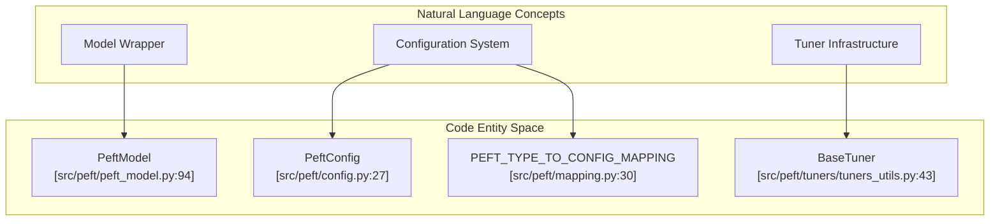
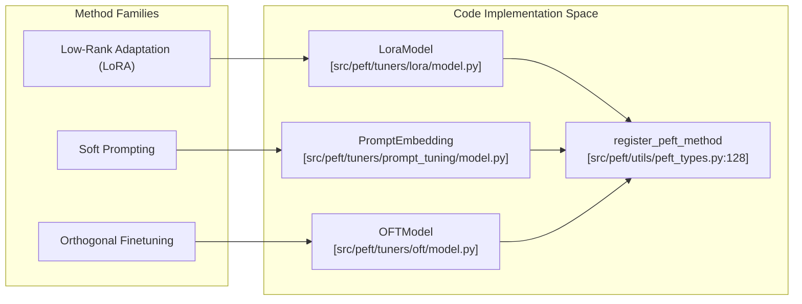

<!-- source: DeepWiki mcp.deepwiki.com · repo huggingface/peft · page 1 Overview · fetched 2026-10-26 -->

# Overview

Relevant source files

The following files were used as context for generating this wiki page:

- [.pre-commit-config.yaml](.pre-commit-config.yaml)
- [README.md](README.md)
- [docs/source/_redirects.yml](docs/source/_redirects.yml)
- [docs/source/_toctree.yml](docs/source/_toctree.yml)
- [docs/source/developer_guides/memory_efficient_training.md](docs/source/developer_guides/memory_efficient_training.md)
- [docs/source/guides/peft_integrations.md](docs/source/guides/peft_integrations.md)
- [docs/source/index.md](docs/source/index.md)
- [docs/source/package_reference/auto_class.md](docs/source/package_reference/auto_class.md)
- [docs/source/quicktour.md](docs/source/quicktour.md)
- [examples/lora_dreambooth/lora_dreambooth_inference.ipynb](examples/lora_dreambooth/lora_dreambooth_inference.ipynb)
- [examples/lora_dreambooth/train_dreambooth.py](examples/lora_dreambooth/train_dreambooth.py)
- [examples/lora_ga_finetuning/README.md](examples/lora_ga_finetuning/README.md)
- [examples/lora_ga_finetuning/lora_ga_finetuning.py](examples/lora_ga_finetuning/lora_ga_finetuning.py)
- [examples/oft_dreambooth/oft_dreambooth_inference.ipynb](examples/oft_dreambooth/oft_dreambooth_inference.ipynb)
- [examples/oft_dreambooth/train_dreambooth.py](examples/oft_dreambooth/train_dreambooth.py)
- [examples/road_finetuning/README.md](examples/road_finetuning/README.md)
- [examples/stable_diffusion/train_dreambooth.py](examples/stable_diffusion/train_dreambooth.py)
- [pyproject.toml](pyproject.toml)
- [scripts/stale.py](scripts/stale.py)
- [setup.py](setup.py)
- [src/peft/__init__.py](src/peft/__init__.py)
- [src/peft/mapping.py](src/peft/mapping.py)
- [src/peft/tuners/__init__.py](src/peft/tuners/__init__.py)
- [src/peft/tuners/lora/arrow.py](src/peft/tuners/lora/arrow.py)
- [src/peft/tuners/lora/loraga.py](src/peft/tuners/lora/loraga.py)
- [src/peft/utils/peft_types.py](src/peft/utils/peft_types.py)
- [tests/conftest.py](tests/conftest.py)

## Purpose and Scope

This document provides a high-level introduction to the PEFT (Parameter-Efficient Fine-Tuning) library, explaining its purpose, architecture, and key components. It covers fundamental design patterns, supported fine-tuning methods, and integration points with the Hugging Face ecosystem.

As a parent overview page, this document keeps technical details high-level and delegates deep dives to child sections:
- For installation, quicktours, package entry points, and directory layout, see [Quickstart and Package Layout](#1.1).
- For documentation organization and doc-builder workflows, see [Documentation Site](#1.2).
- For fundamental abstractions, see [Core Architecture](#2).
- For method implementations, see [PEFT Methods](#3).
- For quantization and distributed training, see [Integration Features](#4).
- For practical scenarios, see [Example Applications](#5).
- For contributing and developer tasks, see [Developer Guides](#6).

Sources: [`setup.py:50-78`](), [`src/peft/__init__.py:15`](), [`README.md:22`]()

---

## What is PEFT

Parameter-Efficient Fine-Tuning (PEFT) enables efficient adaptation of large pretrained models to downstream tasks by fine-tuning only a small subset of parameters instead of all model weights [README.md:22](). PEFT methods introduce trainable adapter modules or parameters that typically represent 0.1% to 2% of the total model size, significantly reducing memory footprint, computational overhead, and storage requirements while retaining performance comparable to full fine-tuning [README.md:22]().

The library is defined in [`setup.py:50-78`]() with version tracking in [`src/peft/__init__.py:15`](). Supported methods span over 30 distinct paradigms registered via [`src/peft/utils/peft_types.py:19-104`]().

For details on getting started, the public API surface in [`src/peft/__init__.py`](), and package layout, see [Quickstart and Package Layout](#1.1). For details on documentation structure and the doc-builder toolchain, see [Documentation Site](#1.2).

Sources: [`README.md:22`](), [`setup.py:50-78`](), [`src/peft/__init__.py:15`](), [`src/peft/utils/peft_types.py:19-104`]()

---

## Core Architecture Overview

The PEFT library uses unified abstractions to wrap base models, manage configurations, and inject adapter layers in-place. 

### Diagram: PEFT Core Architecture Mapping
This diagram bridges the natural language conceptual space of PEFT core abstractions to their concrete code entities.

Sources: [`src/peft/peft_model.py:94`](), [`src/peft/config.py:27`](), [`src/peft/tuners/tuners_utils.py:43`](), [`src/peft/mapping.py:30`]()

For deep dives into `PeftModel`, base classes, configuration hierarchies, tuner layer injection (`_create_and_replace`), adapter lifecycle states, state management, and auxiliary wrappers, see [Core Architecture](#2).

---

## PEFT Methods Taxonomy

PEFT supports over 30 parameter-efficient fine-tuning methods categorized into low-rank adapters, soft prompting approaches, layer tuning, and orthogonal transformations.

### Diagram: PEFT Method Registration and Implementation Space
This diagram associates method family concepts with their concrete module paths and registration entry points.

Sources: [`src/peft/utils/peft_types.py:128-203`](), [`src/peft/tuners/__init__.py:15-78`]()

For details on specific method implementations, initialization strategies, rank allocation, multi-adapter composition, and `PeftMixedModel`, see [PEFT Methods](#3).

---

## Integration Ecosystem and Benefits

PEFT integrates tightly with core ecosystem libraries to provide seamless training and inference workflows:
- **Quantization**: Support for BitsAndBytes (8/4-bit), GPTQ, AWQ, HQQ, and TorchAO backends (`[src/peft/utils/other.py:151]()`).
- **Distributed Training**: Integration with Megatron-LM, DeepSpeed, and FSDP (`[docs/source/_toctree.yml:17-21]()`).
- **Model Libraries**: Native compatibility with Hugging Face `transformers`, `diffusers`, and `accelerate` (`[README.md:24]()`).

For integration details, see [Integration Features](#4). For end-to-end code implementations across language models, vision, quantized training, and benchmarking suites, see [Example Applications](#5). For contributor workflows and testing frameworks, see [Developer Guides](#6).

Sources: [`README.md:24`](), [`src/peft/utils/other.py:151`](), [`docs/source/_toctree.yml:17-21`]()

---

