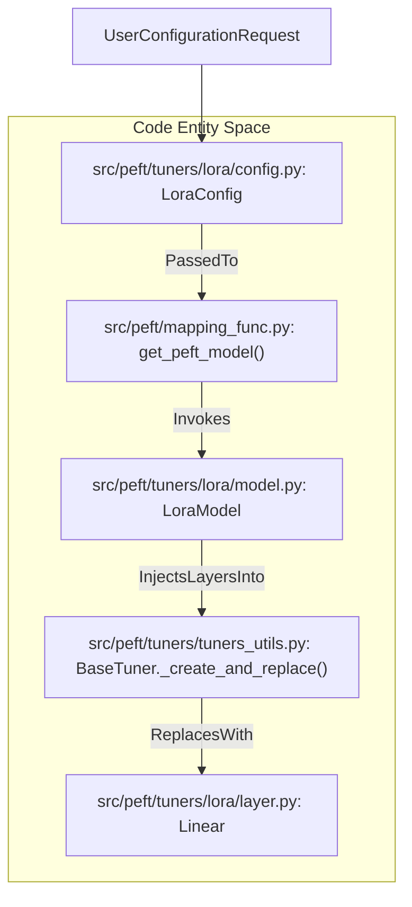
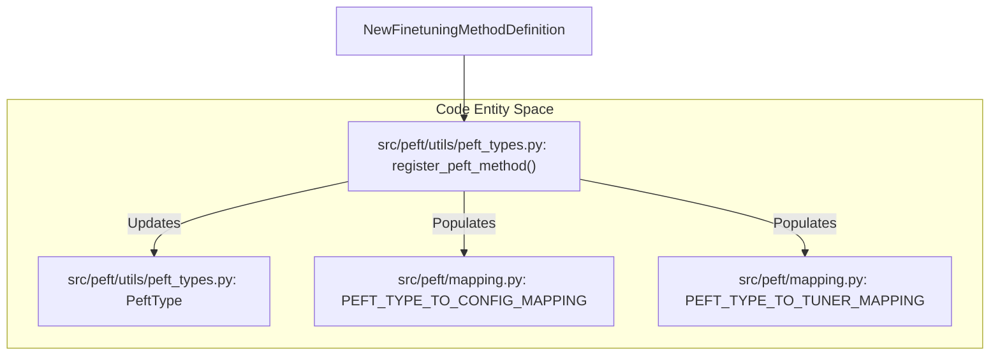

<!-- source: DeepWiki mcp.deepwiki.com · repo huggingface/peft · page 1.1 Quickstart and Package Layout · fetched 2026-10-26 -->

# Quickstart and Package Layout

<details>
<summary>Relevant source files</summary>

The following files were used as context for generating this wiki page:

- [.pre-commit-config.yaml](.pre-commit-config.yaml)
- [docs/source/_redirects.yml](docs/source/_redirects.yml)
- [docs/source/_toctree.yml](docs/source/_toctree.yml)
- [docs/source/developer_guides/memory_efficient_training.md](docs/source/developer_guides/memory_efficient_training.md)
- [docs/source/guides/peft_integrations.md](docs/source/guides/peft_integrations.md)
- [docs/source/index.md](docs/source/index.md)
- [docs/source/package_reference/auto_class.md](docs/source/package_reference/auto_class.md)
- [docs/source/package_reference/cartridges.md](docs/source/package_reference/cartridges.md)
- [docs/source/package_reference/config.md](docs/source/package_reference/config.md)
- [docs/source/package_reference/hira.md](docs/source/package_reference/hira.md)
- [docs/source/package_reference/lora.md](docs/source/package_reference/lora.md)
- [docs/source/package_reference/lora_variant_monteclora.md](docs/source/package_reference/lora_variant_monteclora.md)
- [docs/source/package_reference/peft_model.md](docs/source/package_reference/peft_model.md)
- [docs/source/quicktour.md](docs/source/quicktour.md)
- [examples/lora_ga_finetuning/README.md](examples/lora_ga_finetuning/README.md)
- [examples/lora_ga_finetuning/lora_ga_finetuning.py](examples/lora_ga_finetuning/lora_ga_finetuning.py)
- [examples/road_finetuning/README.md](examples/road_finetuning/README.md)
- [pyproject.toml](pyproject.toml)
- [setup.py](setup.py)
- [src/peft/__init__.py](src/peft/__init__.py)
- [src/peft/mapping.py](src/peft/mapping.py)
- [src/peft/tuners/__init__.py](src/peft/tuners/__init__.py)
- [src/peft/tuners/lora/arrow.py](src/peft/tuners/lora/arrow.py)
- [src/peft/tuners/lora/loraga.py](src/peft/tuners/lora/loraga.py)
- [src/peft/utils/peft_types.py](src/peft/utils/peft_types.py)
- [tests/conftest.py](tests/conftest.py)

</details>


## Purpose and Scope
This page covers the foundational aspects of the Hugging Face PEFT (Parameter-Efficient Fine-Tuning) library. It details how to install the package, provides a quick tour using `get_peft_model`, examines the public API surface exposed in `src/peft/__init__.py`, explains the method registration and mapping mechanisms (`register_peft_method`, `PEFT_TYPE_TO_CONFIG_MAPPING`), and outlines the repository directory layout.

Sources: [`setup.py:1-95`](), [`src/peft/__init__.py:1-182`](), [`src/peft/mapping.py:1-45`](), [`src/peft/utils/peft_types.py:128-203`](), [`docs/source/quicktour.md:1-116`]()

---

## 1. Installation and Environment Setup

PEFT requires Python 3.10 or higher and depends on core libraries like PyTorch, Transformers, Accelerate, and Hugging Face Hub. You can install PEFT via PyPI or directly from source.

### Standard Installation
```bash
pip install peft
```

### Development Installation
To install PEFT for development with all testing and quality tools, clone the repository and install with editable mode:
```bash
git clone https://github.com/huggingface/peft.git
cd peft
pip install -e ".[test,dev]"
```

The package configuration (`setup.py`) defines key dependencies and optional extras (`quality`, `docs_specific`, `test`, `dev`) to ensure compatibility with various workflows [setup.py:20-80]().

Sources: [`setup.py:20-80`]()

---

## 2. Quicktour: Getting Started with `get_peft_model`

The core design pattern of PEFT involves creating a configuration object (e.g., `LoraConfig`) and wrapping an existing base model (typically from Hugging Face `transformers`) using `get_peft_model`. This process injects trainable adapter layers in-place while freezing the base model parameters [docs/source/quicktour.md:31-95]().

```python
from transformers import AutoModelForCausalLM
from peft import LoraConfig, TaskType, get_peft_model

# 1. Load base model
model = AutoModelForCausalLM.from_pretrained("meta-llama/Llama-3.2-1B")

# 2. Define PEFT configuration
peft_config = LoraConfig(
    task_type=TaskType.CAUSAL_LM,
    inference_mode=False,
    r=8,
    lora_alpha=32,
    lora_dropout=0.1,
    target_modules=["q_proj", "v_proj"]
)

# 3. Create trainable PEFT model
peft_model = get_peft_model(model, peft_config)
peft_model.print_trainable_parameters()
```

### Diagram: Initialization & Wrapping Flow (Natural Language to Code Entity Space)
This diagram maps abstract concepts of adapter configuration and model wrapping to their concrete implementation classes and functions in the codebase.


Sources: [`docs/source/quicktour.md:31-95`](), [`src/peft/__init__.py:33-48`](), [`src/peft/mapping.py:36-103`]()

---

## 3. Public API Surface (`src/peft/__init__.py`)

The public interface of PEFT is consolidated in `src/peft/__init__.py`. Importing `peft` exposes the primary abstraction classes, auto-loading utilities, mapping dicts, and individual tuner implementations [src/peft/__init__.py:17-182]().

Key components exported by the package include:
- **Auto Models**: `AutoPeftModel`, `AutoPeftModelForCausalLM`, etc. [src/peft/__init__.py:17-26]()
- **Base Models**: `PeftModel`, `PeftModelForCausalLM`, `PeftMixedModel` [src/peft/__init__.py:37-45]()
- **Configurations**: `PeftConfig`, `PromptLearningConfig`, and method-specific configs (`LoraConfig`, `AdaLoraConfig`, etc.) [src/peft/__init__.py:27-150]()
- **Mapping & Registration**: `PEFT_TYPE_TO_CONFIG_MAPPING`, `PEFT_TYPE_TO_TUNER_MAPPING`, `register_peft_method` [src/peft/__init__.py:29-35]()

Sources: [`src/peft/__init__.py:17-182`]()

---

## 4. Mapping and Registration System

PEFT uses a centralized registration and mapping architecture to associate string/enum-based method identifiers with their respective configuration classes, tuner models, and prefixes [src/peft/utils/peft_types.py:128-202](), [src/peft/mapping.py:29-35]().

### Registration Flow
When a new tuning method is initialized, it registers itself via `register_peft_method()` [src/peft/utils/peft_types.py:128-130](). This populates global dictionaries such as `PEFT_TYPE_TO_CONFIG_MAPPING` and `PEFT_TYPE_TO_TUNER_MAPPING` [src/peft/mapping.py:29-32]().

### Diagram: Registration and Configuration Mapping (Natural Language to Code Entity Space)
This diagram bridges registration concepts to the underlying dictionary data structures and utility functions.



Sources: [`src/peft/utils/peft_types.py:128-203`](), [`src/peft/mapping.py:29-45`]()

---

## 5. Repository Directory Layout

The `peft` repository follows a structured layout separating core logic, tuners, utilities, and tests:

```text
peft/
├── src/
│   └── peft/
│       ├── __init__.py            # Public API exports
│       ├── auto.py                # AutoPeftModel implementations
│       ├── config.py              # Base configuration classes
│       ├── mapping.py             # Method mappings and adapter injection
│       ├── mapping_func.py        # get_peft_model factory function
│       ├── mixed_model.py         # PeftMixedModel for heterogeneous adapters
│       ├── peft_model.py          # PeftModel wrapper and task subclasses
│       ├── tuners/                # Implementation of individual PEFT methods
│       │   ├── lora/              # LoRA and variants (DoRA, PiSSA, LoftQ)
│       │   ├── adalora/           # AdaLoRA dynamic rank allocation
│       │   ├── prefix_tuning/     # Prefix tuning implementation
│       │   └── ...                # 30+ other tuner subdirectories
│       └── utils/                 # Serialization, quantization helpers, peft_types.py
├── tests/                         # Comprehensive unit and integration test suite
├── examples/                      # End-to-end task examples and scripts
└── setup.py                       # Package installation script
```

Sources: [`setup.py:1-95`](), [`src/peft/__init__.py:1-182`]()

---

