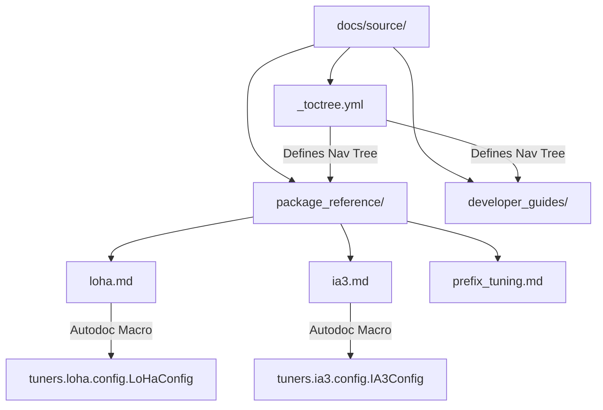
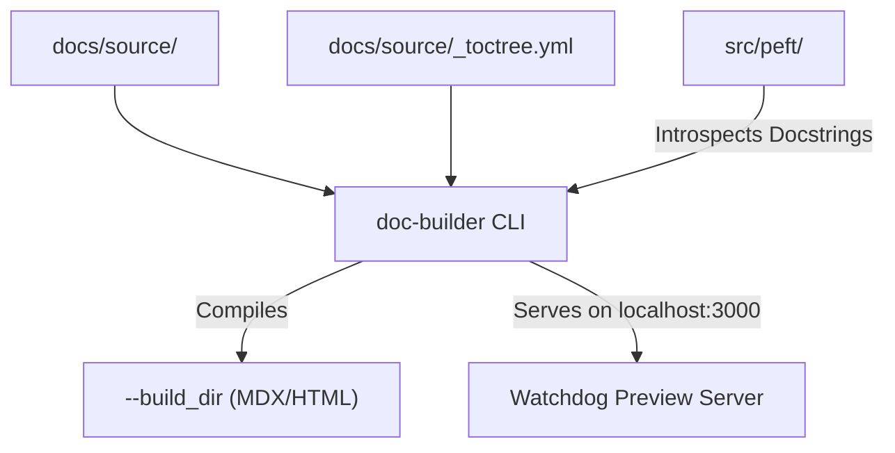
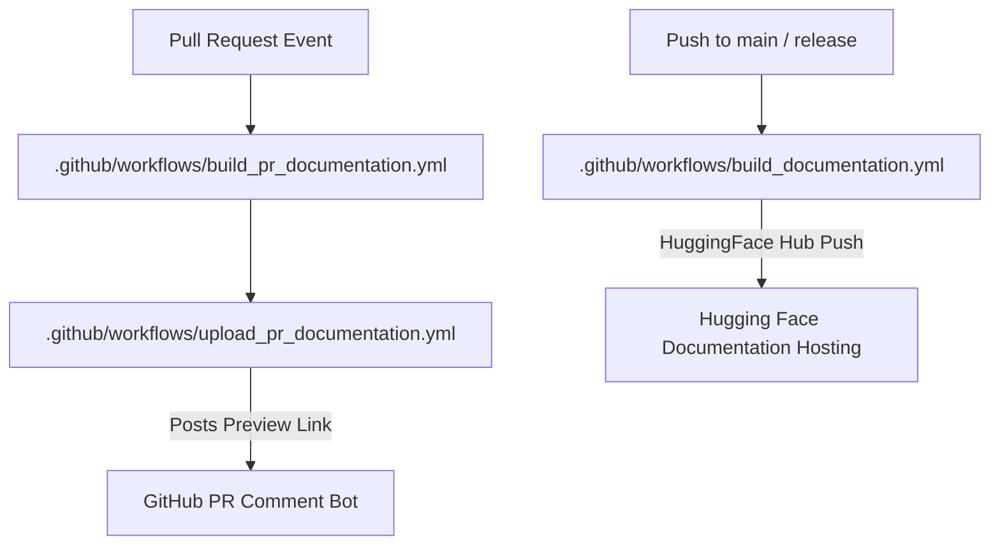

<!-- source: DeepWiki mcp.deepwiki.com · repo huggingface/peft · page 1.2 Documentation Site · fetched 2026-10-26 -->

# Documentation Site

<details>
<summary>Relevant source files</summary>

The following files were used as context for generating this wiki page:

- [.github/workflows/build_docker_images.yml](.github/workflows/build_docker_images.yml)
- [.github/workflows/build_documentation.yml](.github/workflows/build_documentation.yml)
- [.github/workflows/build_pr_documentation.yml](.github/workflows/build_pr_documentation.yml)
- [.github/workflows/test-docker-build.yml](.github/workflows/test-docker-build.yml)
- [.github/workflows/trufflehog.yml](.github/workflows/trufflehog.yml)
- [.github/workflows/upload_pr_documentation.yml](.github/workflows/upload_pr_documentation.yml)
- [docs/Makefile](docs/Makefile)
- [docs/README.md](docs/README.md)
- [docs/source/package_reference/adalora.md](docs/source/package_reference/adalora.md)
- [docs/source/package_reference/ia3.md](docs/source/package_reference/ia3.md)
- [docs/source/package_reference/llama_adapter.md](docs/source/package_reference/llama_adapter.md)
- [docs/source/package_reference/loha.md](docs/source/package_reference/loha.md)
- [docs/source/package_reference/lokr.md](docs/source/package_reference/lokr.md)
- [docs/source/package_reference/multitask_prompt_tuning.md](docs/source/package_reference/multitask_prompt_tuning.md)
- [docs/source/package_reference/p_tuning.md](docs/source/package_reference/p_tuning.md)
- [docs/source/package_reference/prefix_tuning.md](docs/source/package_reference/prefix_tuning.md)
- [docs/source/package_reference/prompt_tuning.md](docs/source/package_reference/prompt_tuning.md)

</details>


This page details the organization, compilation pipeline, and contribution workflows for the PEFT documentation site. Powered by the Hugging Face `doc-builder` tool, the documentation source files reside in `docs/source/` and are automatically compiled and published via GitHub Actions upon merge into the main branch or on pull request updates.

---

## Directory Organization and Navigation (`_toctree.yml`)

The documentation source files are located in the `docs/source/` directory and comprise a mix of Markdown (`.md`), Markdown-extension (`.mdx`), and notebook files. The structural layout and sidebar navigation of the generated site are strictly governed by `docs/source/_toctree.yml`.

The repository categorizes documentation into distinct logical sections:
- **Get Started / Quickstart**: Installation and basic library usage.
- **Developer Guides**: Contribution workflows, code quality, testing infrastructure, and environment setup (`docs/README.md`) [docs/README.md:1-125]().
- **Package Reference & Methods**: Detailed API specifications and mathematical/algorithmic overviews for all 30+ supported parameter-efficient fine-tuning methods (e.g., LoRA, LoHa, LoKr, IA3, Prefix Tuning) [docs/source/package_reference/loha.md:1-90]().


*Sources: [.github/workflows/build_documentation.yml:1-21](), [docs/README.md:82-128](), [docs/source/package_reference/loha.md:82-90]()*

---

## The Doc-Builder Pipeline and Local Preview

The PEFT documentation utilizes the `huggingface/doc-builder` package to convert Markdown files containing special macros (such as `[[autodoc]]`) into production-ready MDX and HTML output.

### Local Installation and Build
To generate the documentation locally, install the repository in editable mode with documentation dependencies, followed by the `doc-builder` package [docs/README.md:17-30]():

```bash
pip install -e ".[docs]"
pip install git+https://github.com/huggingface/doc-builder
```

To build the static HTML/MDX site into a temporary directory, run [docs/README.md:40-47]() [docs/README.md:61-71]():

```bash
doc-builder build peft docs/source/ --build_dir ~/tmp/test-build
```

To launch a live-reload preview server on `http://localhost:3000`:

```bash
doc-builder preview peft docs/source/
```

> [!NOTE]
> The `preview` process caches the tree structure. If you add a brand new Markdown file, you must update `docs/source/_toctree.yml` and restart the preview command [docs/README.md:76-80]().


*Sources: [.github/workflows/build_documentation.yml:1-21](), [docs/README.md:17-74]()*

---

## CI/CD and Hosting Infrastructure

Documentation builds are fully automated using GitHub Actions workflows located in `.github/workflows/`. Three primary workflows govern the documentation lifecycle:

1. **Main Documentation Build (`build_documentation.yml`)**: Triggered on pushes to `main`, `doc-builder*`, or release branches. It invokes the reusable workflow from `huggingface/doc-builder` (`build_main_documentation.yml`) to compile and publish the documentation package to the Hugging Face hub [.github/workflows/build_documentation.yml:1-21]().
2. **PR Documentation Build (`build_pr_documentation.yml`)**: Triggered on pull requests, this action compiles the documentation for the specific PR branch SHA and outputs build reports [.github/workflows/build_pr_documentation.yml:1-18]().
3. **PR Documentation Upload (`upload_pr_documentation.yml`)**: Automatically posts a comment on the active PR with a link to the deployed staging documentation built specifically for that branch [.github/workflows/upload_pr_documentation.yml:1-18]().


*Sources: [.github/workflows/build_documentation.yml:1-21](), [.github/workflows/build_pr_documentation.yml:1-18](), [.github/workflows/upload_pr_documentation.yml:1-18]()*

---

## Adding Documentation for a New Method

When implementing a new parameter-efficient fine-tuning method (e.g., a new tuner or configuration class), you must register and document it correctly to maintain API coverage and sidebar navigation.

### Step 1: Create the Documentation File
Create a new Markdown file under `docs/source/package_reference/<method_name>.md`. Follow the standard structure used across method references (such as `loha.md` or `ia3.md`), including math/paper references, conceptual explanations, code snippets, benchmark widgets, and `[[autodoc]]` directives pointing to your classes [docs/source/package_reference/loha.md:17-90]():

```markdown
# MyNewMethod

Low-Rank MyNewMethod description...

## Usage

```python
from peft import MyNewMethodConfig, get_peft_model
...
```

# API

## MyNewMethodConfig

[[autodoc]] tuners.mynewmethod.config.MyNewMethodConfig

## MyNewMethodModel

[[autodoc]] tuners.mynewmethod.model.MyNewMethodModel
```

### Step 2: Update the Toc-Tree
Open `docs/source/_toctree.yml` and add the filename (without extension) under the appropriate method family section so that the `doc-builder` includes it in the sidebar navigation tree [docs/README.md:82-88]().

### Step 3: Write Docstrings and Code Annotations
Docstrings in python files (`src/peft/tuners/mynewmethod/`) must follow the Google style guide (supported by Napoleon in sphinx/doc-builder) [docs/README.md:113-118]():

```python
def my_method_function(n_layers: int):
    """
    Args:
        n_layers (`int`):
            The number of layers of the model.
    """
```
Internal object cross-referencing in markdown or docstrings uses backtick syntax: `[`MyNewMethodConfig`]` or `[`~tuners.mynewmethod.config.MyNewMethodConfig`]` [docs/README.md:135-144]().

*Sources: [docs/README.md:82-168](), [docs/source/package_reference/loha.md:17-90]()*

---

