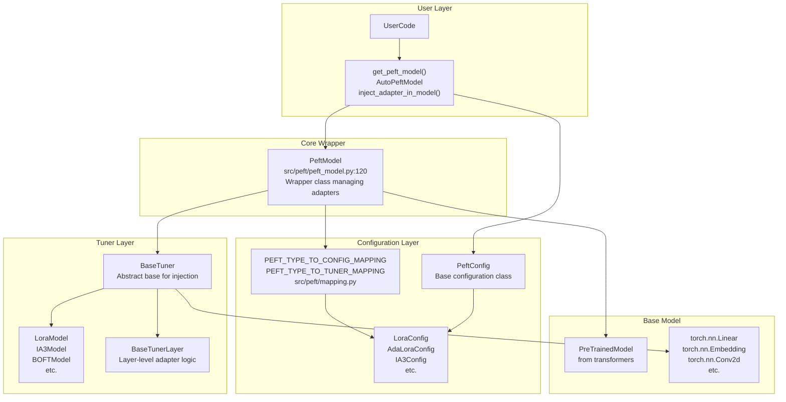
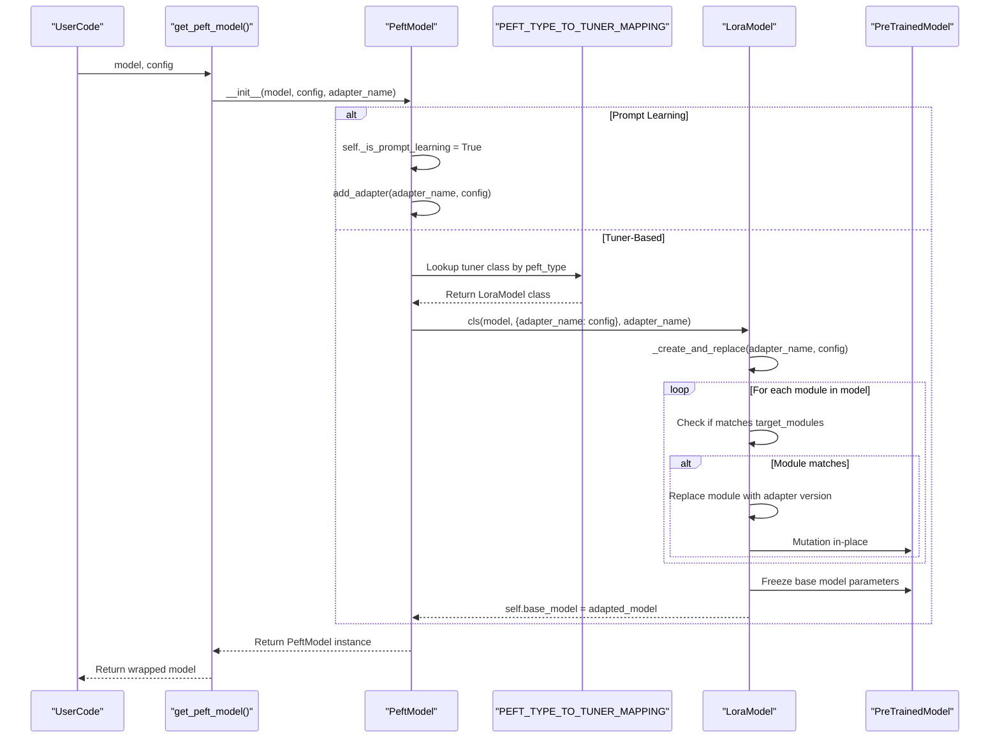

<!-- source: DeepWiki mcp.deepwiki.com · repo huggingface/peft · page 2 Core Architecture · fetched 2026-10-26 -->

# Core Architecture

Relevant source files

The following files were used as context for generating this wiki page:

- [src/peft/peft_model.py](src/peft/peft_model.py)
- [src/peft/tuners/lora/__init__.py](src/peft/tuners/lora/__init__.py)
- [src/peft/tuners/lora/config.py](src/peft/tuners/lora/config.py)
- [src/peft/tuners/lora/layer.py](src/peft/tuners/lora/layer.py)
- [src/peft/tuners/lora/model.py](src/peft/tuners/lora/model.py)
- [src/peft/tuners/lora/variants.py](src/peft/tuners/lora/variants.py)
- [src/peft/tuners/tuners_utils.py](src/peft/tuners/tuners_utils.py)
- [src/peft/utils/__init__.py](src/peft/utils/__init__.py)
- [src/peft/utils/constants.py](src/peft/utils/constants.py)
- [src/peft/utils/other.py](src/peft/utils/other.py)
- [src/peft/utils/save_and_load.py](src/peft/utils/save_and_load.py)
- [tests/test_custom_models.py](tests/test_custom_models.py)
- [tests/test_decoder_models.py](tests/test_decoder_models.py)
- [tests/test_encoder_decoder_models.py](tests/test_encoder_decoder_models.py)
- [tests/test_feature_extraction_models.py](tests/test_feature_extraction_models.py)
- [tests/test_initialization.py](tests/test_initialization.py)
- [tests/test_lora_variants.py](tests/test_lora_variants.py)
- [tests/test_seq_classifier.py](tests/test_seq_classifier.py)
- [tests/test_tuners_utils.py](tests/test_tuners_utils.py)
- [tests/testing_common.py](tests/testing_common.py)

This document describes the fundamental design patterns and abstractions that enable PEFT's extensible architecture, including the wrapping pattern, configuration system, registry-based dispatch mechanism, and adapter injection process. This page provides a high-level overview of how PEFT integrates adapters into base models while maintaining compatibility with the Hugging Face ecosystem.

As a parent page, this overview outlines core concepts. For detailed information, see the respective child pages:
- PeftModel wrapper class, task-specific subclasses, and AutoPeftModel loading: see [PeftModel and Base Classes](#2.1)
- Configuration hierarchy, serialization, and registry dispatch: see [Configuration System](#2.2)
- BaseTuner/BaseTunerLayer interfaces and layer injection: see [Tuner Infrastructure](#2.3)
- Adapter states, lifecycle methods, and multi-adapter operations: see [Adapter Lifecycle Management](#2.4)
- State dictionary management, hotswapping, and cross-format conversion: see [State Management and Serialization](#2.5)
- Auxiliary training wrappers for non-adapter parameters: see [Auxiliary Training Wrappers](#2.6)

---

## Architectural Overview

PEFT uses a **wrapper pattern** where the `PeftModel` class wraps a base model (typically a `transformers.PreTrainedModel`) and adds adapter capabilities. The architecture is modular, extensible, and supports multiple concurrent adapter types.

### System Architecture Diagram

Sources: [src/peft/peft_model.py:120-150](), [src/peft/mapping.py:30-93](), [src/peft/__init__.py:17-152]()

---

## Core Architectural Sub-Topics

### 1. PeftModel and Base Classes
The `PeftModel` class serves as the primary container wrapping base pretrained models. It provides task-specific subclasses (`PeftModelForCausalLM`, `PeftModelForSequenceClassification`, etc.) and lifecycle methods like `from_pretrained` and `save_pretrained`.
For details, see [PeftModel and Base Classes](#2.1).
Sources: [src/peft/peft_model.py:120-200]()

### 2. Configuration System
PEFT manages hyperparameters through a configuration inheritance hierarchy rooted in `PeftConfig`, leveraging `PeftConfigMixin` for JSON serialization and forward compatibility. The global registry mappings (`PEFT_TYPE_TO_CONFIG_MAPPING`) link adapter types to their respective classes.
For details, see [Configuration System](#2.2).
Sources: [src/peft/config.py](), [src/peft/mapping.py:30-45]()

### 3. Tuner Infrastructure
The low-level mechanics of adapter injection are driven by `BaseTuner` and `BaseTunerLayer`. These abstract classes coordinate target module matching, layer replacement (`_create_and_replace`), and weight transformation across diverse methods including LoRA, IA3, and Lycoris tuners.
For details, see [Tuner Infrastructure](#2.3).
Sources: [src/peft/tuners/tuners_utils.py](), [src/peft/tuners/lora/model.py:131-180]()

### 4. Adapter Lifecycle Management
Adapters exist in multiple states—active, inactive, or merged into the base weights. Management utilities allow runtime toggling (`set_adapter`, `enable_adapters`, `disable_adapters`), multi-adapter mixing, deletion, and complete unloading.
For details, see [Adapter Lifecycle Management](#2.4).
Sources: [src/peft/peft_model.py:800-1100]()

### 5. State Management and Serialization
Serialization is optimized by saving only lightweight adapter parameters rather than full model weights via `get_peft_model_state_dict` and `set_peft_model_state_dict`. This subsystem also handles adapter name remapping, hotswapping (`hotswap_adapter`), and transformers weight format conversion.
For details, see [State Management and Serialization](#2.5).
Sources: [src/peft/utils/save_and_load.py:1-164]()

### 6. Auxiliary Training Wrappers
To support training non-adapter parameters alongside adapters, PEFT provides specialized wrappers like `ModulesToSaveWrapper` (for full fine-tuning of specific sub-modules) and `TrainableTokensWrapper` (for selective embedding token updates).
For details, see [Auxiliary Training Wrappers](#2.6).
Sources: [src/peft/utils/other.py:612-730](), [src/peft/peft_model.py:45-50]()

---

## Adapter Injection Flow

The following sequence diagram illustrates how adapters are initialized and injected into a base model via `get_peft_model`.

Sources: [src/peft/peft_model.py:126-151](), [src/peft/mapping.py:47-92]()

---

