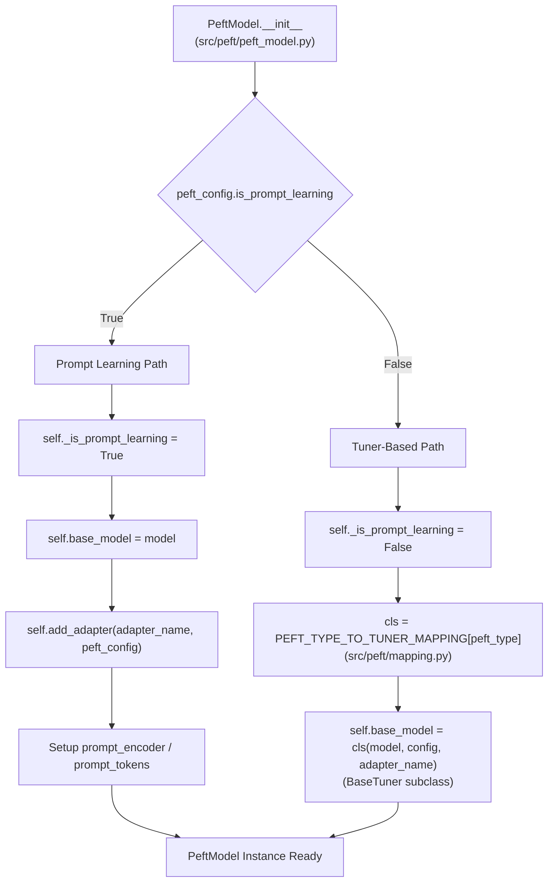
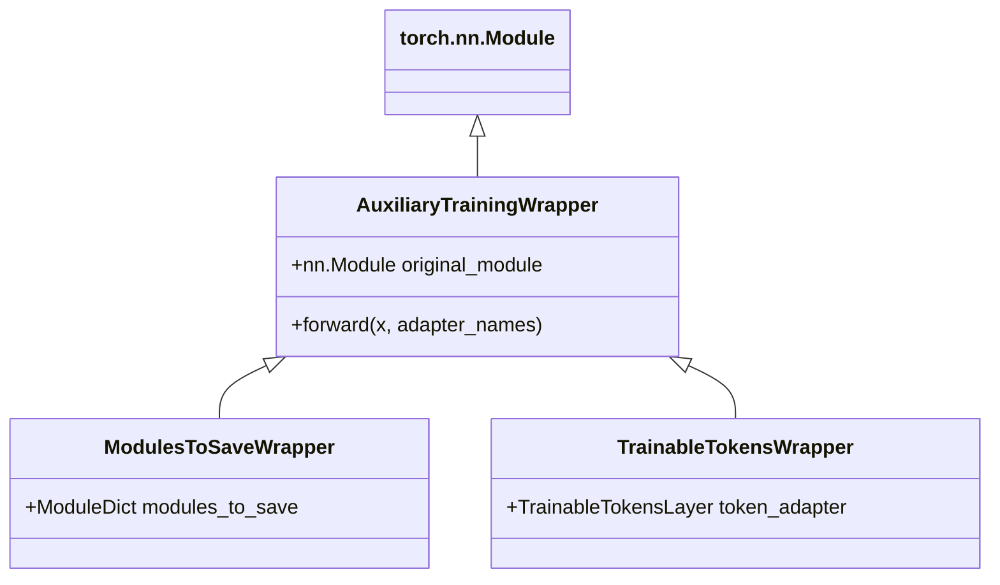

<!-- source: DeepWiki mcp.deepwiki.com · repo huggingface/peft · page 2.1 PeftModel and Base Classes · fetched 2026-10-26 -->

# PeftModel and Base Classes

<details>
<summary>Relevant source files</summary>

The following files were used as context for generating this wiki page:

- [src/peft/auto.py](src/peft/auto.py)
- [src/peft/config.py](src/peft/config.py)
- [src/peft/peft_model.py](src/peft/peft_model.py)
- [src/peft/utils/__init__.py](src/peft/utils/__init__.py)
- [src/peft/utils/constants.py](src/peft/utils/constants.py)
- [src/peft/utils/other.py](src/peft/utils/other.py)
- [src/peft/utils/save_and_load.py](src/peft/utils/save_and_load.py)
- [tests/test_auto.py](tests/test_auto.py)
- [tests/test_config.py](tests/test_config.py)
- [tests/test_decoder_models.py](tests/test_decoder_models.py)
- [tests/test_encoder_decoder_models.py](tests/test_encoder_decoder_models.py)
- [tests/test_feature_extraction_models.py](tests/test_feature_extraction_models.py)
- [tests/test_hub_features.py](tests/test_hub_features.py)
- [tests/test_lora_megatron.py](tests/test_lora_megatron.py)
- [tests/test_seq_classifier.py](tests/test_seq_classifier.py)
- [tests/testing_common.py](tests/testing_common.py)

</details>


## Overview

`PeftModel` is the central orchestrator class in the PEFT library (`src/peft/peft_model.py`). It wraps pre-trained models to add parameter-efficient fine-tuning capabilities through adapters. The class implements a **dual-path architecture**:

1. **Prompt Learning Path**: For methods like Prompt Tuning and Prefix Tuning, where the base model remains unchanged and trainable virtual prompts are prepended or injected into inputs/activations.
2. **Tuner-Based Path**: For methods like LoRA, AdaLoRA, and IA³, where adapter layers are injected into target modules via `BaseTuner` subclasses (`peft.tuners.tuners_utils.BaseTuner`).

Additionally, this page covers task-specific model subclasses, `AutoPeftModel` loading logic, adapter lifecycle management methods (`from_pretrained`, `save_pretrained`), and auxiliary wrappers (`AuxiliaryTrainingWrapper`, `ModulesToSaveWrapper`, `TrainableTokensWrapper`).

Sources:
- [src/peft/peft_model.py:120-152]()
- [src/peft/utils/other.py:45-48]()

---

## PeftModel Class Hierarchy

### Inheritance and Core Attributes

`PeftModel` inherits from `PushToHubMixin` and `torch.nn.Module`, enabling standard PyTorch module semantics and seamless Hugging Face Hub integration (`src/peft/peft_model.py`).

**Diagram: PeftModel Class Structure and Code Entities**

```mermaid
classDiagram
    class Module["torch.nn.Module"] {
        +forward()
        +parameters()
        +state_dict()
    }
    
    class PushToHubMixin {
        +push_to_hub()
    }
    
    class PeftModel {
        +torch.nn.Module base_model
        +dict peft_config
        +str active_adapter
        +list active_adapters
        +set special_peft_forward_args
        -_is_prompt_learning bool
        +__init__(model, peft_config, adapter_name)
        +save_pretrained(save_directory)
        +from_pretrained(model, model_id)
        +add_adapter(adapter_name, peft_config)
        +set_adapter(adapter_names)
        +delete_adapter(adapter_name)
        +merge_and_unload()
        +load_adapter(model_id, adapter_name)
        +get_nb_trainable_parameters()
        +enable_adapters()
        +disable_adapters()
    }
    
    class BaseTuner {
        +torch.nn.Module model
        +dict peft_config
        +str active_adapter
        +inject_adapter(adapter_name)
        +merge_adapter()
        +unmerge_adapter()
        +_mark_only_adapters_as_trainable()
    }
    
    Module <|-- PeftModel
    PushToHubMixin <|-- PeftModel
    BaseTuner <|-- LoraModel
    PeftModel *-- "base_model" : wraps
    BaseTuner <.. PeftModel : contains when tuner-based
```

**Key Attributes:**

| Attribute | Type | Purpose |
|-----------|------|---------|
| `base_model` | `torch.nn.Module` | The wrapped model (either original or tuner-wrapped) [src/peft/peft_model.py:138]() |
| `peft_config` | `dict[str, PeftConfig]` | Configuration for each adapter [src/peft/peft_model.py:139]() |
| `active_adapter` | `str` | Currently active adapter name [src/peft/peft_model.py:127]() |
| `_is_prompt_learning` | `bool` | Whether using prompt learning path [src/peft/peft_model.py:141]() |

Sources:
- [src/peft/peft_model.py:120-152]()

---

## Dual-Path Architecture

The core design of `PeftModel` implements two distinct paths based on the PEFT method type, determined at initialization time via `peft_config.is_prompt_learning`.

**Diagram: Initialization Flow and Code Entities**



**Path Comparison:**

| Aspect | Prompt Learning Path | Tuner-Based Path |
|--------|---------------------|------------------|
| Base model modified? | No | Yes (adapter layers injected) |
| `_is_prompt_learning` | `True` | `False` |
| `base_model` type | Original `PreTrainedModel` | `BaseTuner` subclass |
| Trainable parameters | Prompt embeddings / virtual tokens | Adapter weights (`lora_A`, `lora_B`, etc.) |

Sources:
- [src/peft/peft_model.py:126-152]()
- [src/peft/mapping.py:31-52]()

---

## Task-Specific Model Variants and AutoPeftModel

`PeftModel` has specialized subclasses for different model tasks, enabling custom forward passes, classification heads, or sequence-to-sequence routing. These include `PeftModelForCausalLM`, `PeftModelForSeq2SeqLM`, `PeftModelForSequenceClassification`, `PeftModelForTokenClassification`, and `PeftModelForQuestionAnswering`.

The `AutoPeftModel` loading classes (`src/peft/auto.py`) inspect the configuration file (`adapter_config.json`) to automatically select the appropriate `PeftModel` task-specific subclass and instantiate it.

Sources:
- [src/peft/peft_model.py:39-41]()
- [src/peft/auto.py:1-50]()

---

## Adapter Lifecycle Operations

`PeftModel` provides unified lifecycle methods to manage adapters dynamically at runtime.

**Core Adapter Management Methods:**

| Method | Purpose | Code Reference |
|--------|---------|----------------|
| `add_adapter(adapter_name, peft_config)` | Inject or instantiate a new adapter | [src/peft/peft_model.py:145]() |
| `set_adapter(adapter_names)` | Switch active adapter(s) for inference/training | [src/peft/peft_model.py:172-181]() |
| `disable_adapters()` / `enable_adapters()` | Temporarily toggle adapter computation | [src/peft/peft_model.py:172-181]() |
| `merge_and_unload()` | Merge adapter weights into base weights and return base model | [src/peft/peft_model.py:37]() |

Sources:
- [src/peft/peft_model.py:154-189]()

---

## Prompt Learning Implementation

When `_is_prompt_learning=True`, `PeftModel` manages virtual prompts directly through `prompt_encoder` and `prompt_tokens`.

- **Prompt Tuning**: Uses `PromptEmbedding` to maintain trainable embedding tensors (`src/peft/__init__.py`).
- **Prefix Tuning / P-Tuning**: Uses `PromptEncoder` or `PrefixEncoder` MLPs to generate virtual activations injected into attention layers.

Sources:
- [src/peft/peft_model.py:116-145]()

---

## Saving and Loading (`save_pretrained` & `from_pretrained`)

### `save_pretrained`
The `save_pretrained(save_directory)` method serializes only the adapter weights and configuration, avoiding duplication of base model weights. It invokes `get_peft_model_state_dict` (`src/peft/utils/save_and_load.py`) to extract trainable adapter parameters and saves them as `adapter_model.safetensors` or `adapter_model.bin`, alongside `adapter_config.json`.

### `from_pretrained`
The classmethod `from_pretrained(model, model_id, ...)` loads adapter weights and configuration from a local directory or the Hugging Face Hub, instantiates the correct `PeftModel` subclass, and loads the state dict via `set_peft_model_state_dict` (`src/peft/utils/save_and_load.py`).

Sources:
- [src/peft/peft_model.py:53-70]()
- [src/peft/utils/save_and_load.py:83-89]()

---

## Advanced Features and Auxiliary Training Wrappers

PEFT provides specialized wrapper classes in `src/peft/utils/other.py` to handle modules that require full fine-tuning alongside parameter-efficient adapters.

**Diagram: Auxiliary Wrapper Hierarchy and Code Entities**



- **`ModulesToSaveWrapper`**: Wraps submodules specified via `modules_to_save` in `PeftConfig`, allowing full parameter updates for specific layers (e.g., classification heads).
- **`TrainableTokensWrapper`**: Manages trainable token embeddings alongside adapter layers.

Sources:
- [src/peft/utils/other.py:39-61]()
- [src/peft/peft_model.py:45-48]()

---

## Trainable Parameters Management

During initialization, `PeftModel` freezes base model parameters (`requires_grad = False`) and marks only adapter parameters or prompt encoder parameters as trainable via `_set_trainable` (`src/peft/utils/other.py`).

Sources:
- [src/peft/utils/other.py:61-70]()

---

