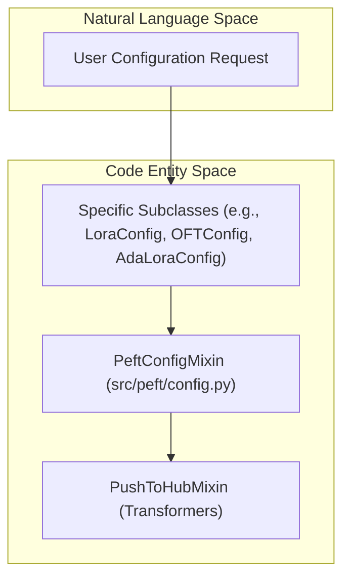
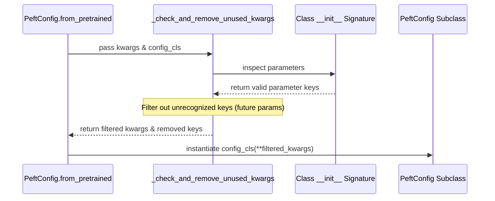
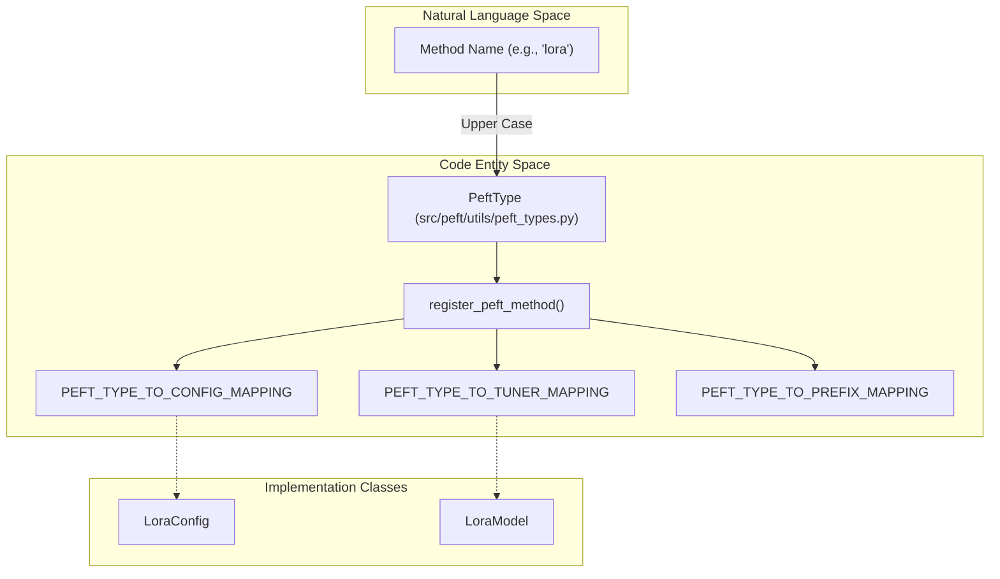
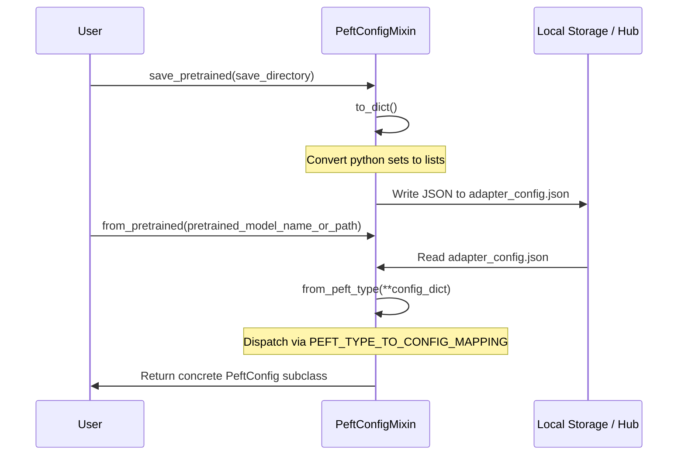

<!-- source: DeepWiki mcp.deepwiki.com · repo huggingface/peft · page 2.2 Configuration System · fetched 2026-10-26 -->

# Configuration System

Relevant source files

The following files were used as context for generating this wiki page:

- [.pre-commit-config.yaml](.pre-commit-config.yaml)
- [docs/source/_toctree.yml](docs/source/_toctree.yml)
- [pyproject.toml](pyproject.toml)
- [setup.py](setup.py)
- [src/peft/__init__.py](src/peft/__init__.py)
- [src/peft/auto.py](src/peft/auto.py)
- [src/peft/config.py](src/peft/config.py)
- [src/peft/mapping.py](src/peft/mapping.py)
- [src/peft/tuners/__init__.py](src/peft/tuners/__init__.py)
- [src/peft/tuners/adalora/config.py](src/peft/tuners/adalora/config.py)
- [src/peft/tuners/boft/config.py](src/peft/tuners/boft/config.py)
- [src/peft/tuners/fourierft/config.py](src/peft/tuners/fourierft/config.py)
- [src/peft/tuners/hra/config.py](src/peft/tuners/hra/config.py)
- [src/peft/tuners/ia3/config.py](src/peft/tuners/ia3/config.py)
- [src/peft/tuners/loha/config.py](src/peft/tuners/loha/config.py)
- [src/peft/tuners/lokr/config.py](src/peft/tuners/lokr/config.py)
- [src/peft/tuners/lora/arrow.py](src/peft/tuners/lora/arrow.py)
- [src/peft/tuners/oft/config.py](src/peft/tuners/oft/config.py)
- [src/peft/tuners/vblora/config.py](src/peft/tuners/vblora/config.py)
- [src/peft/tuners/vera/config.py](src/peft/tuners/vera/config.py)
- [src/peft/utils/peft_types.py](src/peft/utils/peft_types.py)
- [tests/conftest.py](tests/conftest.py)
- [tests/test_auto.py](tests/test_auto.py)
- [tests/test_config.py](tests/test_config.py)
- [tests/test_hub_features.py](tests/test_hub_features.py)
- [tests/test_lora_megatron.py](tests/test_lora_megatron.py)

The Configuration System in PEFT (Parameter-Efficient Fine-Tuning) provides a structured architecture to define, serialize, version, and load parameters for diverse parameter-efficient fine-tuning techniques. This page details the configuration hierarchy, serialization mechanisms, forward compatibility handling, and the global registration/dispatch system.

## Overview and Scope

The configuration system handles the lifecycle of adapter parameters from initialization to serialization and runtime dispatch. It ensures that any adapter configuration can be uniquely identified, serialized to disk (`adapter_config.json`), shared via the Hugging Face Hub, and dynamically resolved to the correct tuner implementation class at runtime.

Sources: [src/peft/config.py:77-164](), [src/peft/mapping.py:28-44]()

## Configuration Hierarchy and `PeftConfigMixin`

All PEFT configuration classes inherit from `PeftConfigMixin`, which extends `PushToHubMixin` from the `transformers` library to support direct pushing and pulling from the Hugging Face Hub.

Sources: [src/peft/config.py:77-94](), [src/peft/tuners/oft/config.py:28-28]()

Key shared attributes initialized by `PeftConfigMixin.__post_init__`:
* `task_type`: An optional `TaskType` enum specifying the downstream model head (e.g., `CAUSAL_LM`, `SEQ_CLS`) [src/peft/config.py:88]().
* `peft_type`: A `PeftType` enum identifying the fine-tuning method [src/peft/config.py:89]().
* `auto_mapping`: Dictionary assisting in base model retrieval for custom architectures [src/peft/config.py:90-92]().
* `peft_version`: Library version tracker incorporating commit hashes for development builds [src/peft/config.py:93-124]().

Sources: [src/peft/config.py:77-124]()

## Forward Compatibility Handling

To prevent checkpoints generated with newer PEFT versions from crashing older client versions, PEFT employs `_check_and_remove_unused_kwargs`. When loading a configuration dictionary, this utility inspects the target class's `__init__` signature and strips any keyword arguments absent from the current signature [src/peft/config.py:37-50]().

Sources: [src/peft/config.py:37-50](), [src/peft/config.py:166-174]()

Sources: [src/peft/config.py:37-50]()

## Registration and Dispatch System (`PEFT_TYPE_TO_CONFIG_MAPPING`)

PEFT maps string method identifiers and enums (`PeftType`) to their corresponding configuration classes, tuner implementations, and mixed-model classes via lookup dictionaries defined in `src/peft/mapping.py` and populated by `register_peft_method` [src/peft/utils/peft_types.py:128-202]().

Sources: [src/peft/utils/peft_types.py:128-202](), [src/peft/mapping.py:28-34]()

### Global Mapping Tables

| Mapping Name | Code Entity | Purpose |
| :--- | :--- | :--- |
| `PEFT_TYPE_TO_CONFIG_MAPPING` | `dict[PeftType, type[PeftConfig]]` | Maps `PeftType` to configuration classes [src/peft/mapping.py:30]() |
| `PEFT_TYPE_TO_TUNER_MAPPING` | `dict[PeftType, type[BaseTuner]]` | Maps `PeftType` to tuner model implementations [src/peft/mapping.py:31]() |
| `PEFT_TYPE_TO_MIXED_MODEL_MAPPING` | `dict[PeftType, type[BaseTuner]]` | Maps methods compatible with `PeftMixedModel` [src/peft/mapping.py:32]() |
| `PEFT_TYPE_TO_PREFIX_MAPPING` | `dict[PeftType, str]` | Maps methods to state dict prefix strings [src/peft/mapping.py:33]() |

Sources: [src/peft/mapping.py:28-34](), [src/peft/utils/peft_types.py:128-202]()

## Configuration Serialization

Adapter configurations serialize to disk as `adapter_config.json` [src/peft/utils/other.py:19](). The serialization workflow converts complex types (such as `set` objects into JSON-compatible `list` structures) and saves them with sorted keys [src/peft/config.py:132-164]().

Sources: [src/peft/config.py:126-174](), [src/peft/utils/other.py:19]()

Key serialization methods:
* `to_dict()`: Serializes dataclass fields using `dataclasses.asdict` [src/peft/config.py:126-130]().
* `save_pretrained()`: Manages directory creation and outputs `adapter_config.json` [src/peft/config.py:132-164]().
* `from_peft_type()`: Factory method dispatching instantiation based on `peft_type` [src/peft/config.py:166-174]().

Sources: [src/peft/config.py:126-174]()

## Auto-Configuration (`AutoPeftModel`) and Security

The `AutoPeftModel` family uses the configuration to automatically infer the required base model class and downstream task wrapper [src/peft/auto.py:89-156](). 

To prevent arbitrary code execution vulnerabilities during dynamic module importing specified in `auto_mapping`, PEFT enforces an `import_allowlist` [src/peft/auto.py:55-74](). By default, only trusted libraries like `transformers`, `diffusers`, `lerobot`, and `megatron-core` are permitted to be dynamically imported [src/peft/auto.py:55-61]().

Sources: [src/peft/auto.py:55-156]()

## Runtime Configuration

PEFT separates persistent configuration from execution-specific parameters via runtime configuration classes (e.g., `LoraRuntimeConfig`) [src/peft/tuners/lora/config.py:315-334](). These settings control transient execution behavior, such as ephemeral offloading, and are intentionally omitted from disk serialization.

Sources: [src/peft/tuners/lora/config.py:315-334]()

---

