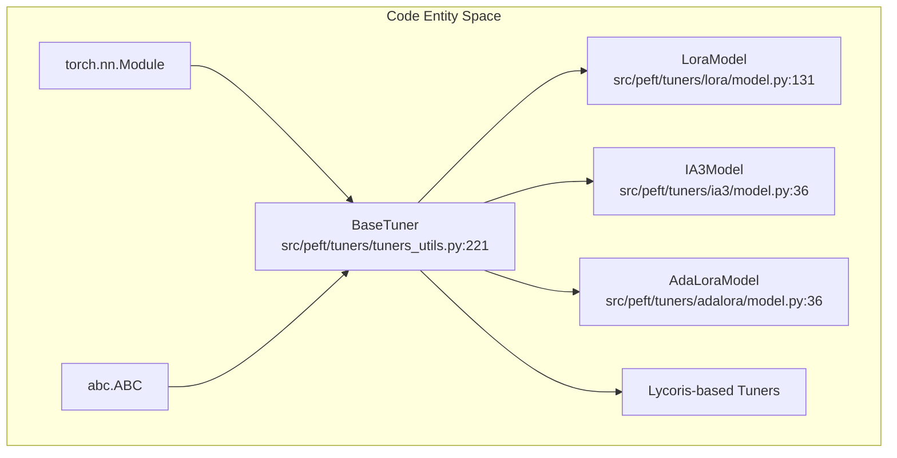
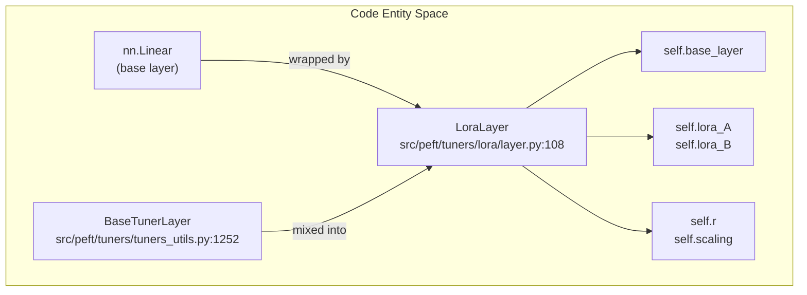
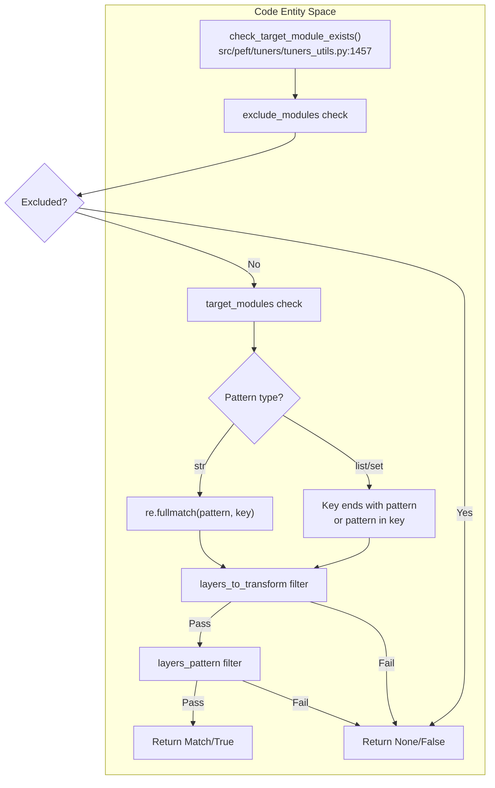
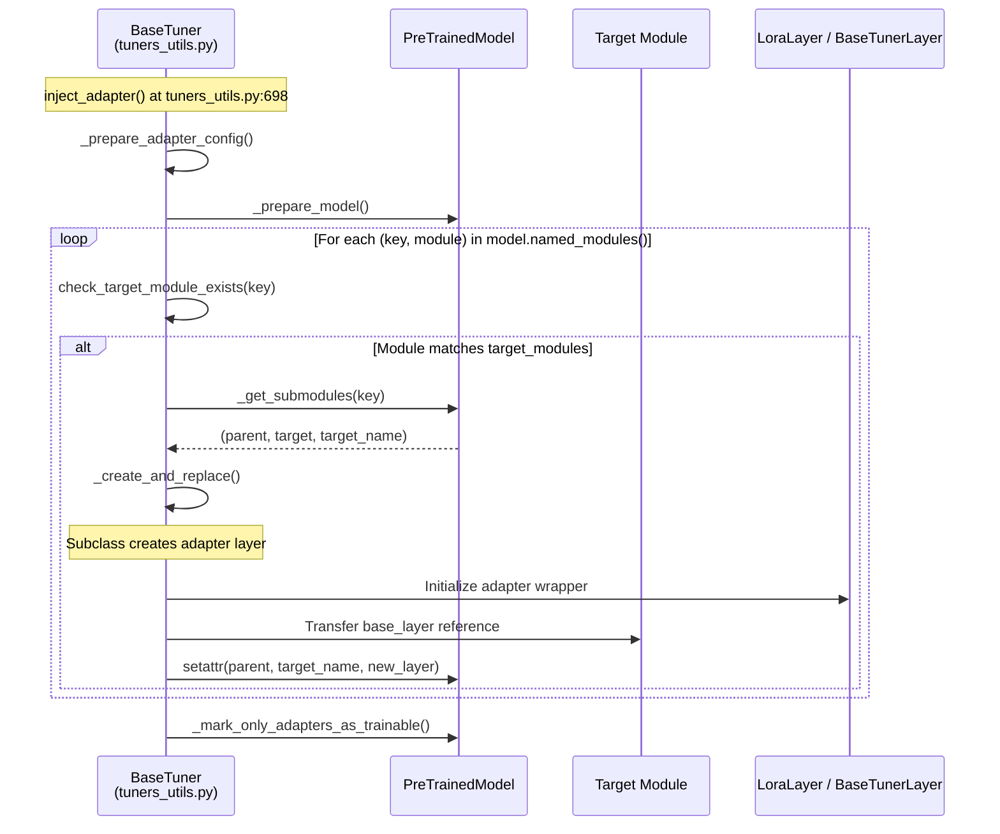

<!-- source: DeepWiki mcp.deepwiki.com · repo huggingface/peft · page 2.3 Tuner Infrastructure · fetched 2026-10-26 -->

# Tuner Infrastructure

Relevant source files

The following files were used as context for generating this wiki page:

- [docs/source/developer_guides/low_level_api.md](docs/source/developer_guides/low_level_api.md)
- [src/peft/tuners/adalora/layer.py](src/peft/tuners/adalora/layer.py)
- [src/peft/tuners/adalora/model.py](src/peft/tuners/adalora/model.py)
- [src/peft/tuners/frod/model.py](src/peft/tuners/frod/model.py)
- [src/peft/tuners/ia3/layer.py](src/peft/tuners/ia3/layer.py)
- [src/peft/tuners/ia3/model.py](src/peft/tuners/ia3/model.py)
- [src/peft/tuners/loha/layer.py](src/peft/tuners/loha/layer.py)
- [src/peft/tuners/loha/model.py](src/peft/tuners/loha/model.py)
- [src/peft/tuners/lokr/layer.py](src/peft/tuners/lokr/layer.py)
- [src/peft/tuners/lokr/model.py](src/peft/tuners/lokr/model.py)
- [src/peft/tuners/lora/__init__.py](src/peft/tuners/lora/__init__.py)
- [src/peft/tuners/lora/config.py](src/peft/tuners/lora/config.py)
- [src/peft/tuners/lora/layer.py](src/peft/tuners/lora/layer.py)
- [src/peft/tuners/lora/model.py](src/peft/tuners/lora/model.py)
- [src/peft/tuners/lora/variants.py](src/peft/tuners/lora/variants.py)
- [src/peft/tuners/lycoris_utils.py](src/peft/tuners/lycoris_utils.py)
- [src/peft/tuners/pvera/model.py](src/peft/tuners/pvera/model.py)
- [src/peft/tuners/tinylora/model.py](src/peft/tuners/tinylora/model.py)
- [src/peft/tuners/tuners_utils.py](src/peft/tuners/tuners_utils.py)
- [src/peft/tuners/unilora/model.py](src/peft/tuners/unilora/model.py)
- [src/peft/tuners/vblora/model.py](src/peft/tuners/vblora/model.py)
- [src/peft/tuners/vera/model.py](src/peft/tuners/vera/model.py)
- [tests/test_custom_models.py](tests/test_custom_models.py)
- [tests/test_initialization.py](tests/test_initialization.py)
- [tests/test_lora_variants.py](tests/test_lora_variants.py)
- [tests/test_low_level_api.py](tests/test_low_level_api.py)
- [tests/test_tuners_utils.py](tests/test_tuners_utils.py)

## Purpose and Scope

The Tuner Infrastructure provides the foundational abstractions and mechanisms that enable parameter-efficient adapter injection into PyTorch models. This page details the `BaseTuner` and `BaseTunerLayer` interfaces, target module matching logic, the layer injection process via `_create_and_replace()`, the low-level `inject_adapter_in_model` API, and the generalization of tuner abstractions through `LycorisLayer` and `LycorisConfig`.

For information about the `PeftModel` wrapper that orchestrates tuner usage, see [PeftModel and Base Classes](2.1). For configuration management, see [Configuration System](2.2). For adapter lifecycle operations (activation, merging, etc.), see [Adapter Lifecycle Management](2.4).

Sources: [src/peft/tuners/tuners_utils.py:1-200](), [src/peft/tuners/lycoris_utils.py:1-60]()

---

## Core Abstractions

The tuner infrastructure is built on two abstract base classes that define the contract for all PEFT methods.

### BaseTuner Class

`BaseTuner` [src/peft/tuners/tuners_utils.py:221-1250]() is the abstract base class that all PEFT method implementations inherit from. It manages the injection of adapter layers into a base model and provides infrastructure for multi-adapter scenarios.

**Class Hierarchy:**

**Required Class Attributes:**

Each `BaseTuner` subclass must define specific class-level attributes [src/peft/tuners/lora/model.py:161-163]():

| Attribute | Type | Example | Description |
|-----------|------|---------|-------------|
| `prefix` | `str` | `"lora_"` | Unique prefix for adapter weight names in state_dict |
| `tuner_layer_cls` | `type[BaseTunerLayer]` | `LoraLayer` | The layer class used to wrap target modules |
| `target_module_mapping` | `dict[str, list[str]]` | `{"llama": ["q_proj", "v_proj"]}` | Default target modules per model architecture |

**Core Methods:**

| Method | Signature | Purpose |
|--------|-----------|---------|
| `__init__()` | `(model, peft_config, adapter_name)` | Initializes tuner and calls `inject_adapter()` |
| `inject_adapter()` | `(model, adapter_name, low_cpu_mem_usage, state_dict)` | Main entry point for adapter injection [src/peft/tuners/tuners_utils.py:698-977]() |
| `_prepare_adapter_config()` | `(peft_config, model_config) -> PeftConfig` | Prepares config, auto-infers target modules [src/peft/tuners/tuners_utils.py:333-370]() |
| `_create_and_replace()` | `(config, adapter_name, target, target_name, parent, key)` | Abstract method: creates adapter layer and replaces target [src/peft/tuners/tuners_utils.py:390-422]() |
| `_mark_only_adapters_as_trainable()` | `(model, adapter_name)` | Freezes base weights, enables adapter gradients [src/peft/tuners/tuners_utils.py:424-446]() |
| `merge_and_unload()` | `(progressbar, safe_merge, adapter_names)` | Merges adapters and returns unwrapped model [src/peft/tuners/tuners_utils.py:1081-1142]() |

Sources: [src/peft/tuners/tuners_utils.py:221-1250](), [src/peft/tuners/lora/model.py:131-163]()

### BaseTunerLayer Class

`BaseTunerLayer` [src/peft/tuners/tuners_utils.py:1252-1454]() is the abstract base class for adapter layers that wrap original model layers. It acts as a mixin that is combined with the base layer type (e.g., `nn.Linear`) to create adapter-enabled layers like `LoraLayer` [src/peft/tuners/lora/layer.py:108]() or `LycorisLayer` [src/peft/tuners/lycoris_utils.py:60]().

**Layer Composition Pattern:**

**Required Class Attributes:**

Subclasses must define these tuples to identify adapter parameters [src/peft/tuners/lora/layer.py:105-107]():

| Attribute | Type | Example | Purpose |
|-----------|------|---------|---------|
| `adapter_layer_names` | `tuple[str, ...]` | `("lora_A", "lora_B")` | Names of `nn.ModuleDict` containing adapter weights |
| `other_param_names` | `tuple[str, ...]` | `("r", "lora_alpha", "scaling")` | Names of other adapter metadata (scalars, dicts) |

**Core Methods:**

| Method | Purpose | Implementation |
|--------|---------|----------------|
| `get_base_layer()` | Recursively unwraps to find original layer | [src/peft/tuners/tuners_utils.py:1277-1287]() |
| `enable_adapters(enabled)` | Toggles adapter enable/disable | [src/peft/tuners/tuners_utils.py:1393-1409]() |
| `set_adapter(adapter_names)` | Sets active adapter(s) | [src/peft/tuners/tuners_utils.py:1411-1442]() |

Sources: [src/peft/tuners/tuners_utils.py:1252-1454](), [src/peft/tuners/lora/layer.py:103-138]()

---

## Target Module Matching

Target module matching determines which layers in the base model should be wrapped with adapters. This is controlled by the `target_modules` configuration parameter.

### Matching Logic

The core matching logic resides in `check_target_module_exists()` [src/peft/tuners/tuners_utils.py:1457-1523]():

**Diagram: `check_target_module_exists()` Logic Flow**

Sources: [src/peft/tuners/tuners_utils.py:1457-1523]()

### Architecture-Specific Defaults

The library provides default target modules for popular model architectures via mapping dictionaries (e.g., `TRANSFORMERS_MODELS_TO_LORA_TARGET_MODULES_MAPPING`).

Sources: [src/peft/utils/other.py:40-82](), [src/peft/tuners/tuners_utils.py:333-370]()

---

## Adapter Injection Mechanism & `_create_and_replace`

Adapter injection is the process of replacing target modules in the base model with adapter-wrapped versions.

### Injection Process Flow

**Diagram: `inject_adapter()` Execution Flow**

Sources: [src/peft/tuners/tuners_utils.py:698-977]()

### The `_create_and_replace()` Mechanism

The `_create_and_replace()` method is implemented by tuner subclasses (e.g., `LoraModel`, `IA3Model`, `AdaLoraModel`) to define how adapter layers are instantiated and inserted into the parent module. For example, in `IA3Model`, `_create_and_replace()` checks if a target module falls under `feedforward_modules` before invoking `_create_new_module()` [src/peft/tuners/ia3/model.py:153-176]().

Sources: [src/peft/tuners/tuners_utils.py:390-422](), [src/peft/tuners/ia3/model.py:153-176](), [src/peft/tuners/adalora/model.py:118-158]()

---

## Low-Level `inject_adapter_in_model` API

In addition to high-level model wrappers (`PeftModel`), PEFT exposes low-level functional APIs such as `inject_adapter_in_model` [src/peft/utils/other.py](). This function accepts an arbitrary `torch.nn.Module` and a `PeftConfig`, instantiates the corresponding tuner backend, and injects adapters directly without wrapping the model in a `PeftModel` instance.

As validated in low-level tests [tests/test_low_level_api.py:72-117](), `inject_adapter_in_model` supports direct injection for standard tuners like `LoraConfig`, `AdaLoraConfig`, and `IA3Config`, while rejecting shared-state tuners that require `get_peft_model`.

Sources: [tests/test_low_level_api.py:72-117](), [src/peft/utils/other.py]()

---

## LycorisTuner Generalization

To support advanced structural matrix adaptation techniques (such as LoHa, LoKr, and other LyCORIS variants), PEFT provides a generalized infrastructure layer in `src/peft/tuners/lycoris_utils.py` [src/peft/tuners/lycoris_utils.py:1-261]().

### Core LyCORIS Components

- **`LycorisConfig`** [src/peft/tuners/lycoris_utils.py:34-58](): Extends `PeftConfig` to include granular `rank_pattern` and `alpha_pattern` dictionaries for assigning layer-specific ranks and scaling factors.
- **`LycorisLayer`** [src/peft/tuners/lycoris_utils.py:60-176](): Extends `BaseTunerLayer` to manage multi-adapter weights, rank dropout (`rank_dropout`), module dropout (`module_dropout`), and safe weight merging (`merge` with `safe_merge=True`).

Sources: [src/peft/tuners/lycoris_utils.py:1-176]()

---

