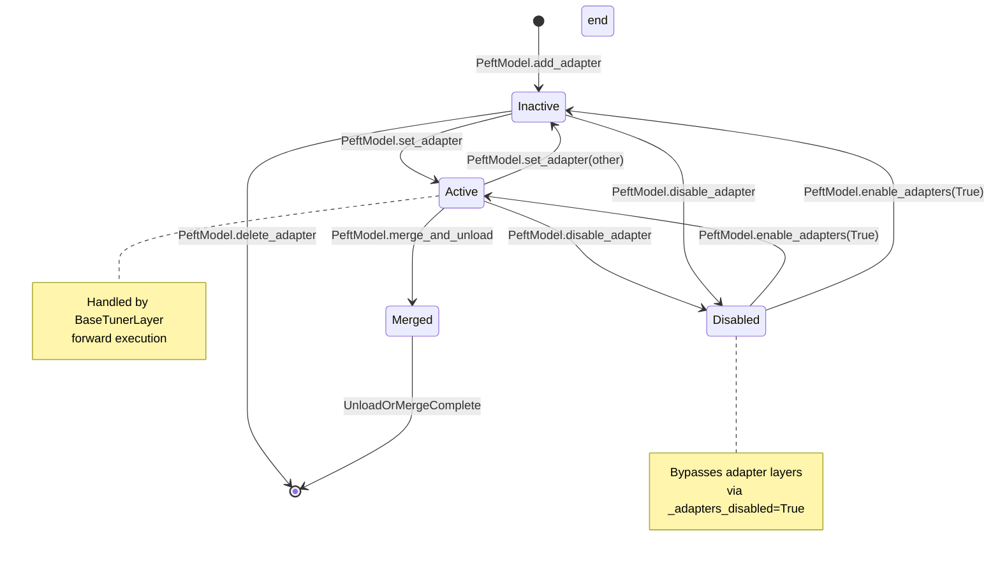
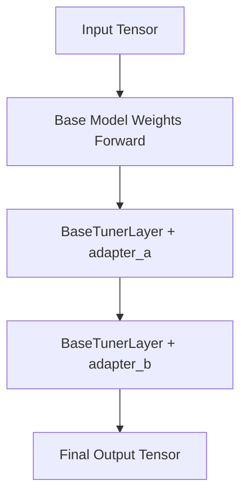
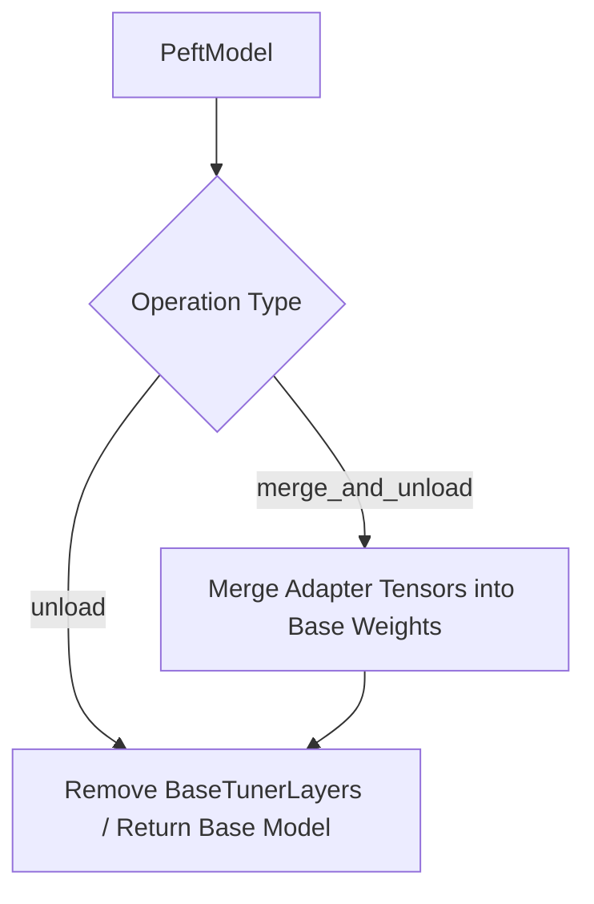

<!-- source: DeepWiki mcp.deepwiki.com · repo huggingface/peft · page 2.4 Adapter Lifecycle Management · fetched 2026-10-26 -->

# Adapter Lifecycle Management

<details>
<summary>Relevant source files</summary>

The following files were used as context for generating this wiki page:

- [docs/source/package_reference/glora.md](docs/source/package_reference/glora.md)
- [docs/source/package_reference/helpers.md](docs/source/package_reference/helpers.md)
- [docs/source/package_reference/lora_variant_bdlora.md](docs/source/package_reference/lora_variant_bdlora.md)
- [examples/KappaTune/README.md](examples/KappaTune/README.md)
- [examples/KappaTune/experiments_kappatune_peft.py](examples/KappaTune/experiments_kappatune_peft.py)
- [src/peft/helpers.py](src/peft/helpers.py)
- [src/peft/peft_model.py](src/peft/peft_model.py)
- [src/peft/utils/__init__.py](src/peft/utils/__init__.py)
- [src/peft/utils/constants.py](src/peft/utils/constants.py)
- [src/peft/utils/other.py](src/peft/utils/other.py)
- [src/peft/utils/save_and_load.py](src/peft/utils/save_and_load.py)
- [tests/test_decoder_models.py](tests/test_decoder_models.py)
- [tests/test_encoder_decoder_models.py](tests/test_encoder_decoder_models.py)
- [tests/test_feature_extraction_models.py](tests/test_feature_extraction_models.py)
- [tests/test_helpers.py](tests/test_helpers.py)
- [tests/test_seq_classifier.py](tests/test_seq_classifier.py)
- [tests/testing_common.py](tests/testing_common.py)

</details>


## Purpose and Scope

This document details how the PEFT library manages the complete lifecycle of adapters following their injection into a base model. It covers adapter states (`active`, `inactive`, `disabled`, `merged`), methods for controlling active adapters (`set_adapter`, `enable_adapters`, `disable_adapters`), multi-adapter workflows, adapter deletion and unloading (`delete_adapter`, `unload`, `merge_and_unload`), and signature/scaling utilities provided in `src/peft/helpers.py`.

For initial model wrapping and configuration, see [PeftModel and Base Classes](2.1) and [Configuration System](2.2). For serialization and state dictionary handling, see [State Management and Serialization](2.5).

Sources: [src/peft/peft_model.py:120-181](), [src/peft/helpers.py:1-50]()

---

## Adapter States

Adapters within a `PeftModel` can reside in several distinct states that dictate whether their parameters participate in the forward pass:

| State | Description | Affects Forward Pass | Activation Mechanism |
|-------|-------------|---------------------|----------------------|
| **Active** | Adapter is selected and executes during forward computation. | Yes | Selected via `set_adapter()` [src/peft/peft_model.py:848-885]() |
| **Inactive** | Adapter weights exist in memory but are deselected. | No | Can be activated via `set_adapter()` [src/peft/peft_model.py:848-885]() |
| **Disabled** | All adapters are temporarily bypassed via context flag `_adapters_disabled`. | No | Toggled via `disable_adapter()` context manager [src/peft/peft_model.py:958-983]() |
| **Merged** | Adapter weights are baked into the base model weights and removed. | Yes (permanently via base model) | Executed via `merge_and_unload()` [src/peft/peft_model.py:915-956]() |

Sources: [src/peft/peft_model.py:135-181](), [src/peft/peft_model.py:848-983]()

---

## Adapter State Machine

The following diagram bridges the conceptual adapter states to their corresponding code execution paths across `PeftModel` and `BaseTuner`.

Title: Adapter State Transitions and Code Mapping



Sources: [src/peft/peft_model.py:848-983](), [src/peft/tuners/tuners_utils.py:43]()

---

## Adapter Activation and Control

### Setting Active Adapters

The `set_adapter()` method on `PeftModel` modifies which adapters are currently evaluated during the forward pass [src/peft/peft_model.py:848-885](). It accepts either a single string or a sequence of strings representing adapter names.

```python
# Activate a single adapter
model.set_adapter("adapter_1")

# Activate multiple adapters sequentially
model.set_adapter(["adapter_1", "adapter_2"])
```

Internally, `set_adapter` validates the presence of the requested adapter names in `peft_config`, updates prompt-encoder states if applicable, and delegates to the underlying `BaseTuner` implementation to update active flags on each `BaseTunerLayer`.

### Status Properties

- `active_adapters`: Returns a list of strings representing the currently active adapter names [src/peft/peft_model.py:154-170]().
- `has_active_enabled_adapter`: Returns a boolean indicating whether at least one adapter is active and adapters are not globally disabled [src/peft/peft_model.py:172-181]().

Sources: [src/peft/peft_model.py:154-181](), [src/peft/peft_model.py:848-885]()

---

## Enabling and Disabling Adapters

### Context Manager Disabling

To temporarily evaluate a `PeftModel` using solely its base weights without altering the active adapter configuration, use the `disable_adapter()` context manager [src/peft/peft_model.py:958-983]().

```python
with model.disable_adapter():
    outputs = model(**inputs)
```

This sets `model._adapters_disabled = True` during context execution, ensuring tuner layers skip adapter computation [src/peft/peft_model.py:958-983]().

### Persistent Enable/Disable

The `enable_adapters()` method toggles the global enabled state across all tuner sub-modules via `_set_adapter_layers()` [src/peft/peft_model.py:987-1009]().

Sources: [src/peft/peft_model.py:958-1009]()

---

## Multi-Adapter Management

When multiple adapters are activated simultaneously via `set_adapter(["adapter_a", "adapter_b"])`, each compatible `BaseTunerLayer` executes the adapter forward passes in the specified sequence.

Title: Multi-Adapter Execution Flow



Sources: [src/peft/peft_model.py:848-885](), [src/peft/tuners/tuners_utils.py:43]()

---

## Deletion and Unloading

### Deleting Specific Adapters

The `delete_adapter(adapter_name)` method permanently purges an adapter from the model [src/peft/peft_model.py:887-900](). It removes weights from tuner layers, updates auxiliary wrappers such as `ModulesToSaveWrapper`, and deletes the entry from `peft_config`.

### Unloading and Merging

- `unload()`: Removes all PEFT wrappers and returns the raw base model without altering weight values [src/peft/peft_model.py:902-913]().
- `merge_and_unload()`: Permanently folds adapter weights into the base model weights, strips wrapper layers, and returns a standard `torch.nn.Module` [src/peft/peft_model.py:915-956]().

Title: Unload vs Merge Execution Architecture



Sources: [src/peft/peft_model.py:887-956]()

---

## Helpers Utilities (`src/peft/helpers.py`)

The `src/peft/helpers.py` module provides auxiliary utilities for managing PEFT model signatures and adapter scaling:

- `update_forward_signature(model)`: Synchronizes the `PeftModel.forward` method signature with the underlying base model's forward signature [src/peft/helpers.py:39-71]().
- `update_generate_signature(model)`: Updates `PeftModel.generate` to match the base model's generation signature [src/peft/helpers.py:73-112]().
- `update_signature(model, method="all")`: Convenience dispatcher for updating forward, generate, or both signatures [src/peft/helpers.py:114-147]().
- `check_if_peft_model(model_name_or_path)`: Inspects local paths or the Hugging Face Hub to verify if an artifact is a PEFT model configuration [src/peft/helpers.py:149-167]().
- `rescale_adapter_scale(model, multiplier)`: Context manager that temporarily scales LoRA adapter scaling factors by a multiplier [src/peft/helpers.py:171-]().

Sources: [src/peft/helpers.py:39-180]()

---

