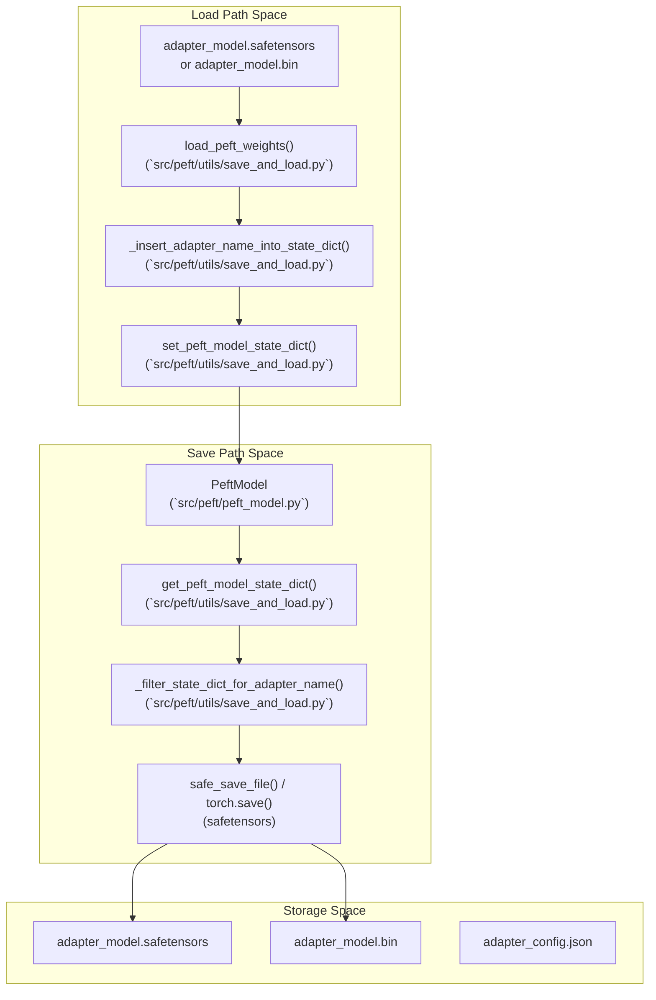
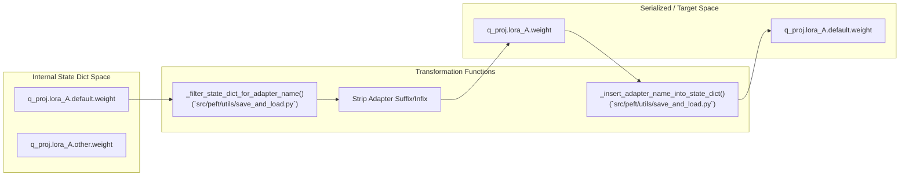
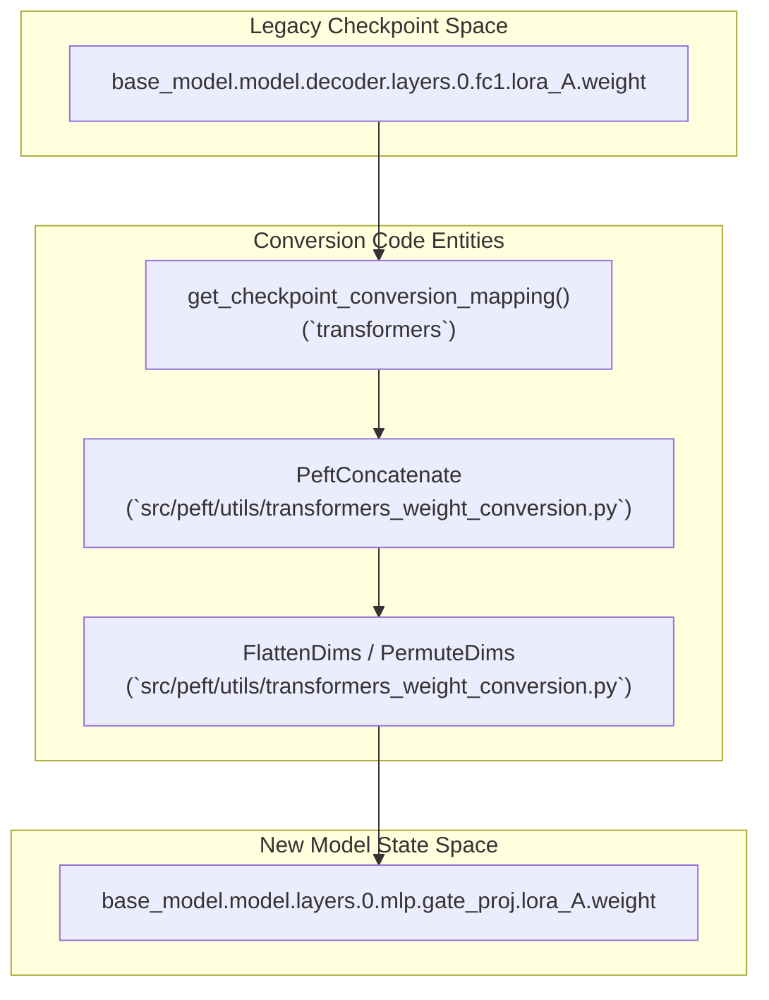

<!-- source: DeepWiki mcp.deepwiki.com · repo huggingface/peft · page 2.5 State Management and Serialization · fetched 2026-10-26 -->

# State Management and Serialization

<details>
<summary>Relevant source files</summary>

The following files were used as context for generating this wiki page:

- [docs/source/package_reference/hotswap.md](docs/source/package_reference/hotswap.md)
- [src/peft/peft_model.py](src/peft/peft_model.py)
- [src/peft/utils/__init__.py](src/peft/utils/__init__.py)
- [src/peft/utils/constants.py](src/peft/utils/constants.py)
- [src/peft/utils/hotswap.py](src/peft/utils/hotswap.py)
- [src/peft/utils/other.py](src/peft/utils/other.py)
- [src/peft/utils/save_and_load.py](src/peft/utils/save_and_load.py)
- [src/peft/utils/transformers_weight_conversion.py](src/peft/utils/transformers_weight_conversion.py)
- [tests/test_decoder_models.py](tests/test_decoder_models.py)
- [tests/test_encoder_decoder_models.py](tests/test_encoder_decoder_models.py)
- [tests/test_feature_extraction_models.py](tests/test_feature_extraction_models.py)
- [tests/test_integrations.py](tests/test_integrations.py)
- [tests/test_lora_conversion.py](tests/test_lora_conversion.py)
- [tests/test_seq_classifier.py](tests/test_seq_classifier.py)
- [tests/testing_common.py](tests/testing_common.py)

</details>


This page documents how PEFT manages adapter weights through serialization and deserialization. It covers the mechanisms for extracting adapter parameters from model state dictionaries, saving them to disk, loading them back into models, adapter name normalization, dynamic hotswapping via `hotswap_adapter`, lora conversion utilities, and cross-format compatibility handling via `transformers_weight_conversion.py`.

For information about the overall adapter lifecycle (add, delete, merge operations), see [Adapter Lifecycle Management](#2.4). For configuration persistence, see [Configuration System](#2.2).

## Overview

PEFT's state management system is designed around a key principle: **only adapter parameters are saved, not the base model weights**. This dramatically reduces storage requirements—a typical adapter checkpoint may be ~19MB compared to ~11GB for a full model. The system handles:

1. **State dict extraction** - Isolating adapter parameters from the full model state using `get_peft_model_state_dict` [src/peft/utils/save_and_load.py:148-162]().
2. **Adapter name normalization** - Removing adapter names from keys for portability during serialization and re-inserting them via `set_peft_model_state_dict` [src/peft/utils/save_and_load.py:564-601]().
3. **Multi-format persistence** - Supporting both `safetensors` and pickle formats, complete with tensor aliasing detection [src/peft/peft_model.py:302-344]().
4. **Hotswapping** - In-place replacement of weights via `src/peft/utils/hotswap.py` to avoid re-compilation in `torch.compile` scenarios [src/peft/utils/hotswap.py:14-80]().
5. **Cross-version compatibility** - Converting weights between different `transformers` versions via `src/peft/utils/transformers_weight_conversion.py` [src/peft/utils/transformers_weight_conversion.py:1-137]().

Title: "PEFT Save and Load Data Flow and Code Mapping"

Sources: [src/peft/peft_model.py:120-200](), [src/peft/utils/save_and_load.py:148-180](), [src/peft/utils/save_and_load.py:564-601]()

## State Dict Extraction (`get_peft_model_state_dict`)

The `get_peft_model_state_dict` function extracts only the trainable adapter parameters from a model's full state dict. This function is the core of the save path.

### Function Signature and Purpose

```python
def get_peft_model_state_dict(
    model, 
    state_dict=None, 
    adapter_name: str = "default",
    unwrap_compiled: bool = False, 
    save_embedding_layers: bool | Literal["auto"] = "auto",
)
```
[src/peft/utils/save_and_load.py:148-154]()

The function filters the model's state dict to include only:
- Adapter-specific parameters (e.g., `lora_A`, `lora_B`, `ia3_`, `boft_`).
- Auxiliary training modules (via `ModulesToSaveWrapper`, `TrainableTokensWrapper`) [src/peft/utils/save_and_load.py:231-246]().
- Optionally, embedding layers if they were modified.

Sources: [src/peft/utils/save_and_load.py:148-246](), [src/peft/peft_model.py:62-67]()

### Type-Specific Parameter Selection

Different PEFT types require different filtering logic. `get_peft_model_state_dict` uses the `PeftConfig` associated with the `adapter_name` to determine the extraction strategy.

| PEFT Type | Key Pattern | Additional Logic |
|-----------|-------------|------------------|
| **LORA/ADALORA** | `lora_` in key | Respects `bias` config (`none`/`all`/`lora_only`) [src/peft/utils/save_and_load.py:247-285]() |
| **BOFT** | `boft_` in key | Respects `bias` config |
| **ADAPTION_PROMPT** | Key ends with `adaption_*` | Direct pattern match |
| **Prompt Learning** | N/A | Returns prompt embeddings directly |
| **VERA** | `vera_` in key | Optionally saves `vera_A`/`vera_B` projections |
| **VBLORA** | `vblora_logits` in key | Can save topk weights for efficiency |

Sources: [src/peft/utils/save_and_load.py:247-350](), [src/peft/mapping.py:29-34]()

## Key Transformation and Adapter Names

PEFT models use the adapter name in parameter keys internally (e.g., `model.layer.0.lora_A.default.weight`). For serialization, these names are removed to make the checkpoints portable.

### Adapter Name Handling in State Dicts

Title: "Adapter Name Filtering and Insertion Flow"


- **Extraction Filtering**: `_filter_state_dict_for_adapter_name` removes keys belonging to unwanted adapters [src/peft/utils/save_and_load.py:131-145]().
- **Loading Insertion**: `set_peft_model_state_dict` performs the inverse via `_insert_adapter_name_into_state_dict`, inserting the target `adapter_name` into the keys of the loaded checkpoint before calling PyTorch's `model.load_state_dict` [src/peft/utils/save_and_load.py:564-601]().

Sources: [src/peft/utils/save_and_load.py:131-145](), [src/peft/utils/save_and_load.py:564-601]()

## Hotswapping Adapters (`hotswap_adapter`)

The `hotswap_adapter` mechanism allows for in-place replacement of adapter weights. This is particularly useful for inference servers using `torch.compile`, as it avoids triggering a re-compilation when switching between adapters of the same rank.

### Core Implementation
The logic resides in `src/peft/utils/hotswap.py`. It supports:
1. **Scaling Updates**: Updating LoRA scaling factors in-place using `_update_scaling` [src/peft/utils/hotswap.py:37-54]().
2. **Padding**: If ranks don't match, PEFT can pad the weights to a target rank via `_get_padded_linear` [src/peft/utils/hotswap.py:84-149]().
3. **Compiled Support**: `_convert_scalings_to_tensor` converts float scalings to tensors so they can be updated dynamically without breaking a compiled PyTorch graph [src/peft/utils/hotswap.py:57-81]().

Sources: [src/peft/utils/hotswap.py:14-150]()

## Transformers Weight Conversion (`transformers_weight_conversion.py`)

With recent updates in `transformers` v5, model architectures and key names undergo restructuring. PEFT provides `transformers_weight_conversion.py` to handle these transitions automatically during weight loading and mapping.

### Conversion Mechanisms
- **PeftConcatenate**: Handles fused weights in MoE (Mixtral) models. When base weights are fused, LoRA weights must be merged in a block-diagonal fashion via `_block_diag_3d` and `PeftConcatenate.convert` [src/peft/utils/transformers_weight_conversion.py:48-138]().
- **Conversion Operations**: Includes `FlattenDims` and `PermuteDims` subclasses of `ConversionOps` to reshape weights during the conversion pipeline [src/peft/utils/transformers_weight_conversion.py:144-200]().

Title: "Transformers Weight Conversion Pipeline"

Sources: [src/peft/utils/transformers_weight_conversion.py:1-138](), [src/peft/utils/transformers_weight_conversion.py:144-200]()

## Auxiliary Module Serialization

PEFT supports saving non-adapter parameters alongside adapters via `modules_to_save` and `trainable_token_indices`. These are managed by dedicated wrappers that integrate directly into the state dict workflow.

### ModulesToSaveWrapper and TrainableTokensWrapper
- **ModulesToSaveWrapper**: Wraps standard non-adapter layers (like a classifier head). Its internal logic ensures that only the parameters corresponding to the active adapter are saved [src/peft/utils/other.py:612-650]().
- **TrainableTokensWrapper**: Handles embedding layers where only specific token indices are marked as trainable [src/peft/utils/other.py:440-455]().

During `get_peft_model_state_dict`, the system iterates through these wrappers to extract the relevant weights [src/peft/utils/save_and_load.py:231-246]().

Sources: [src/peft/utils/other.py:612-723](), [src/peft/utils/save_and_load.py:231-246]()

## Storage Formats, Safetensors, and Aliasing

PEFT defaults to the `safetensors` format for serialization, providing improved security and loading speed.

### Tensor Aliasing Handling
`safetensors` does not permit multiple keys to point to the exact same memory address. PEFT's `save_pretrained` implementation detects aliasing using `id_tensor_storage` and clones shared tensors to ensure a valid serialization payload [src/peft/peft_model.py:302-344]().

```python
# Pointer map to detect aliasing
ptrs = collections.defaultdict(list)
for name, tensor in output_state_dict.items():
    ptrs[id_tensor_storage(tensor)].append(name)

# Clone all but the first reference for shared storage
shared_ptrs = {ptr: names for ptr, names in ptrs.items() if len(names) > 1}
for _, names in shared_ptrs.items():
    for shared_tensor_name in names[1:]:
        output_state_dict[shared_tensor_name] = output_state_dict[shared_tensor_name].clone()
```
[src/peft/peft_model.py:302-344]()

### Platform-Specific Normalization (e.g., Windows SHiRA)
On Windows platforms, `safetensors` can encounter serialization limitations with certain integer tensor types. PEFT automatically converts `shira_indices` to `float32` before saving on Windows systems and casts them back to integers upon loading [src/peft/utils/save_and_load.py:167-184]().

Sources: [src/peft/peft_model.py:302-344](), [src/peft/utils/save_and_load.py:167-184](), [src/peft/utils/save_and_load.py:464-562]()

---

