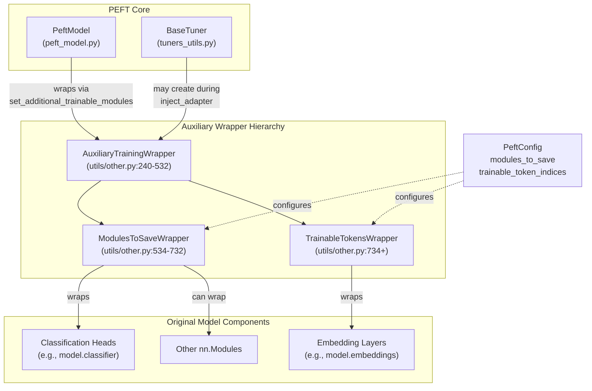
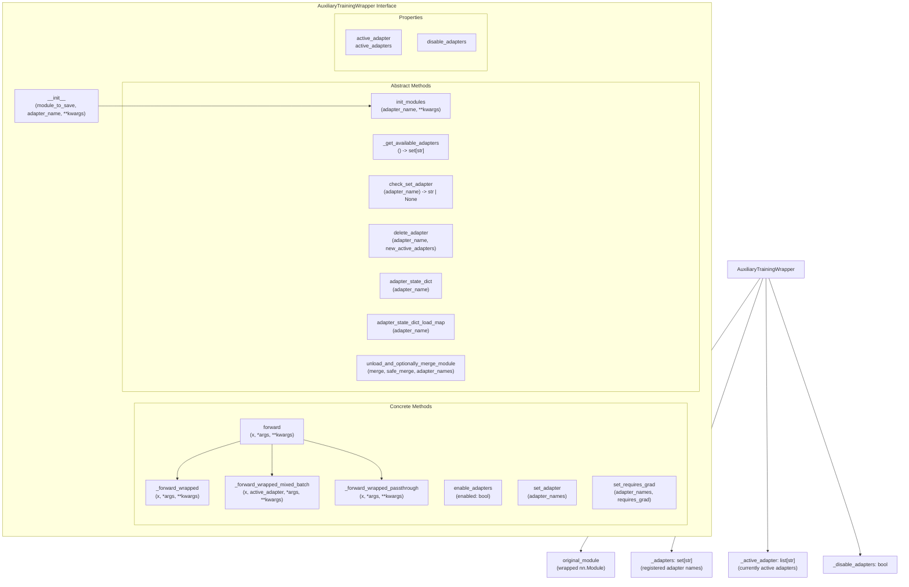
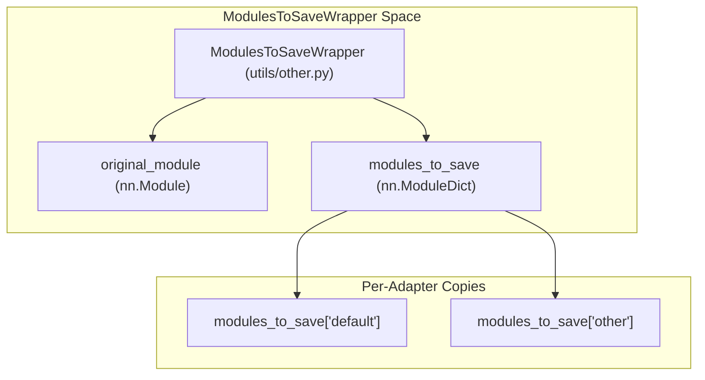
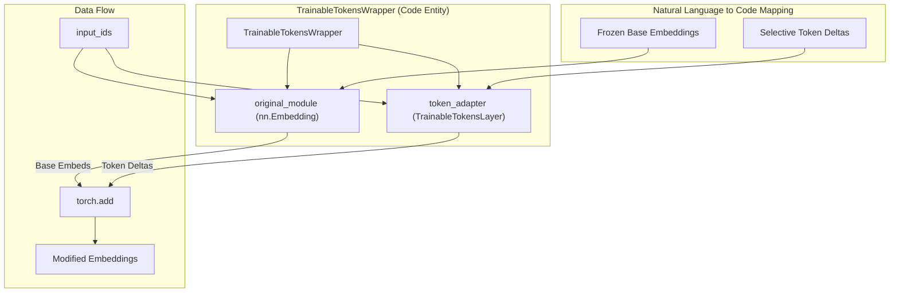
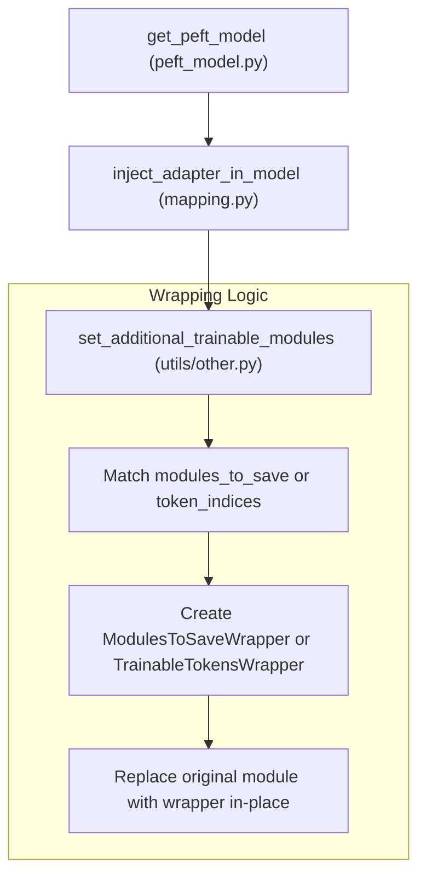

<!-- source: DeepWiki mcp.deepwiki.com · repo huggingface/peft · page 2.6 Auxiliary Training Wrappers · fetched 2026-10-26 -->

# Auxiliary Training Wrappers

<details>
<summary>Relevant source files</summary>

The following files were used as context for generating this wiki page:

- [docs/source/developer_guides/custom_models.md](docs/source/developer_guides/custom_models.md)
- [docs/source/developer_guides/troubleshooting.md](docs/source/developer_guides/troubleshooting.md)
- [docs/source/package_reference/trainable_tokens.md](docs/source/package_reference/trainable_tokens.md)
- [src/peft/mixed_model.py](src/peft/mixed_model.py)
- [src/peft/tuners/c3a/config.py](src/peft/tuners/c3a/config.py)
- [src/peft/tuners/c3a/layer.py](src/peft/tuners/c3a/layer.py)
- [src/peft/tuners/mixed/model.py](src/peft/tuners/mixed/model.py)
- [src/peft/tuners/trainable_tokens/config.py](src/peft/tuners/trainable_tokens/config.py)
- [src/peft/tuners/trainable_tokens/layer.py](src/peft/tuners/trainable_tokens/layer.py)
- [src/peft/tuners/trainable_tokens/model.py](src/peft/tuners/trainable_tokens/model.py)
- [tests/test_mixed.py](tests/test_mixed.py)
- [tests/test_other.py](tests/test_other.py)
- [tests/test_trainable_tokens.py](tests/test_trainable_tokens.py)

</details>


## Purpose and Scope

The Auxiliary Training Wrappers system provides a mechanism for training model components that fall outside the standard PEFT adapter paradigm. While most PEFT methods modify layers through adapter injections (see [2.3]() for tuner infrastructure), certain components require different treatment, such as fully training a classification head or selectively updating specific embedding tokens. This system wraps such modules in specialized classes that handle their unique training, activation, and serialization requirements.

For information about standard PEFT adapters (LoRA, IA3, etc.), see [3](). For adapter lifecycle operations, see [2.4]().

Sources: [src/peft/utils/other.py:240-244](), [src/peft/peft_model.py:44-47]()

## System Architecture

The auxiliary wrapper system consists of a base abstraction and specialized implementations that integrate with the broader PEFT model management infrastructure:


Sources: [src/peft/utils/other.py:240-814](), [src/peft/peft_model.py:44](), [src/peft/utils/other.py:47-48]()

**Key Components:**

| Component | Location | Purpose |
|-----------|----------|---------|
| `AuxiliaryTrainingWrapper` | [src/peft/utils/other.py:240-532]() | Abstract base class defining interface for auxiliary wrappers |
| `ModulesToSaveWrapper` | [src/peft/utils/other.py:534-732]() | Wraps modules for full training (e.g., classification heads) |
| `TrainableTokensWrapper` | [src/peft/utils/other.py:734-814]() | Wraps embedding layers for selective token training |

Sources: [src/peft/utils/other.py:240-814](), [src/peft/peft_model.py:44](), [src/peft/utils/other.py:47-48]()

## AuxiliaryTrainingWrapper Base Class

### Core Abstraction

`AuxiliaryTrainingWrapper` is an abstract base class that provides the interface and common functionality for wrapping modules that require training behaviors tangential to standard PEFT adapters.


Sources: [src/peft/utils/other.py:240-265](), [src/peft/utils/other.py:299-314]()

**Key Attributes:**

| Attribute | Type | Description |
|-----------|------|-------------|
| `original_module` | `nn.Module` | The wrapped module [src/peft/utils/other.py:246]() |
| `_active_adapter` | `list[str]` | Currently active adapter names [src/peft/utils/other.py:255]() |
| `_disable_adapters` | `bool` | Whether adapters are disabled [src/peft/utils/other.py:256]() |
| `_adapters` | `set[str]` | All registered adapter names [src/peft/utils/other.py:254]() |

Sources: [src/peft/utils/other.py:240-265](), [src/peft/utils/other.py:299-314]()

### Forward Pass Routing

The wrapper implements a routing mechanism that handles different adapter activation scenarios, including mixed-batch inference where different samples in a batch use different adapters.

| Method | Location | Purpose |
|--------|----------|---------|
| `forward` | [src/peft/utils/other.py:435-444]() | Entry point, routes to appropriate handler |
| `_forward_wrapped_passthrough` | [src/peft/utils/other.py:397-399]() | No adapter involved, use original module |
| `_forward_wrapped` | [src/peft/utils/other.py:389-390]() | Standard forward with active adapter |
| `_mixed_batch_forward` | [src/peft/utils/other.py:401-433]() | Handles mixed adapter batches by grouping samples |

Sources: [src/peft/utils/other.py:389-444]()

## ModulesToSaveWrapper

### Purpose and Use Cases

`ModulesToSaveWrapper` wraps modules that should be fully trained rather than adapted. The most common use case is classification heads in fine-tuning tasks where the head needs full training.

**Configuration:**
```python
config = LoraConfig(
    target_modules=["q_proj", "v_proj"],
    modules_to_save=["classifier"], # Wrapped in ModulesToSaveWrapper
)
```

Sources: [src/peft/utils/other.py:534-548](), [tests/test_seq_classifier.py:178-183]()

### Architecture

`ModulesToSaveWrapper` maintains a `ModuleDict` of copies of the original module, one for each adapter.


Sources: [src/peft/utils/other.py:534-548](), [src/peft/utils/other.py:599-603]()

**Key Constraint:** Unlike standard PEFT adapters which can be composed, `ModulesToSaveWrapper` only supports a single active adapter at a time [src/peft/utils/other.py:657-658]().

Sources: [src/peft/utils/other.py:534-548](), [src/peft/utils/other.py:599-603]()

### State Management

`ModulesToSaveWrapper` provides specialized state dict handling for loading and saving adapter-specific module weights.

| Method | Location | Purpose |
|--------|----------|---------|
| `adapter_state_dict` | [src/peft/utils/other.py:724-732]() | Extract adapter's module state dict |
| `adapter_state_dict_load_map` | [src/peft/utils/other.py:715-722]() | Map saved keys to load-time keys (e.g. adding prefix) |

Sources: [src/peft/utils/other.py:715-732]()

## TrainableTokensWrapper

### Purpose and Configuration

`TrainableTokensWrapper` enables selective training of specific embedding tokens while keeping the rest frozen. It is typically applied to embedding layers via `trainable_token_indices` in the config [src/peft/utils/other.py:734-738]().

### Architecture and Data Flow


Sources: [src/peft/utils/other.py:734-814](), [tests/test_trainable_tokens.py:27-28]()

The `TrainableTokensLayer` stores a `ParameterDict` called `trainable_tokens_delta` which contains the learned offsets for the selected token indices [src/peft/utils/other.py:734-814]().

Sources: [src/peft/utils/other.py:734-814](), [tests/test_trainable_tokens.py:27-28]()

## Integration with PeftModel

Auxiliary wrappers are injected into the model during the PEFT initialization process.


Sources: [src/peft/peft_model.py:126-152](), [src/peft/mapping.py:47-92](), [src/peft/utils/other.py:1104-1178]()

**Attribute Delegation:** Auxiliary wrappers implement `__getattr__` to delegate attribute access to the currently active adapter's module, making the wrapper transparent to the rest of the model [src/peft/utils/other.py:329-351]().

Sources: [src/peft/peft_model.py:126-152](), [src/peft/mapping.py:47-92](), [src/peft/utils/other.py:1104-1178]()

## Serialization and State Dicts

When saving a PEFT model, `get_peft_model_state_dict` collects parameters from these wrappers.

| Wrapper | State Dict Key Pattern | Source |
|---------|------------------------|--------|
| `ModulesToSaveWrapper` | `modules_to_save.{adapter_name}.{key}` | [src/peft/utils/other.py:715-732]() |
| `TrainableTokensWrapper` | `token_adapter.{adapter_name}.trainable_tokens_delta.{adapter_name}` | [src/peft/utils/other.py:734-814]() |

During loading, `set_peft_model_state_dict` uses the wrapper's `adapter_state_dict_load_map` to route saved weights back into the correct internal modules [src/peft/utils/save_and_load.py:94-126]().

Sources: [src/peft/utils/save_and_load.py:94-165](), [src/peft/utils/other.py:715-732]()

---

