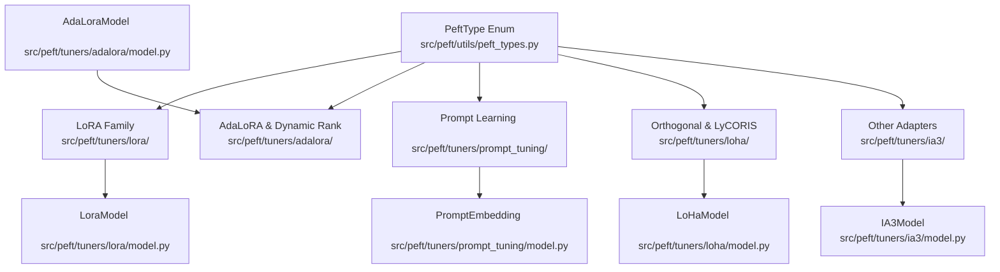
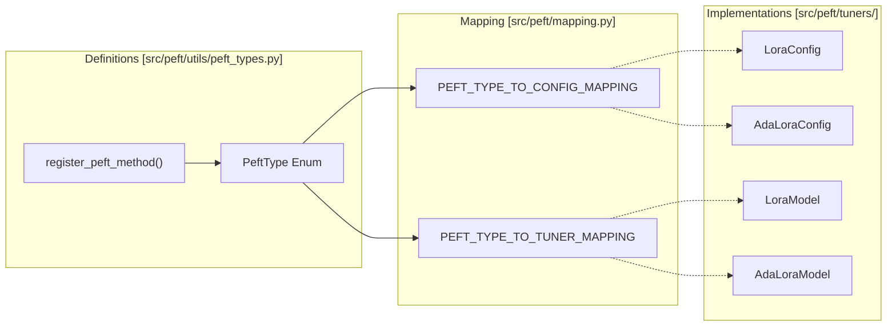

<!-- source: DeepWiki mcp.deepwiki.com · repo huggingface/peft · page 3 PEFT Methods · fetched 2026-10-26 -->

# PEFT Methods

Relevant source files

The following files were used as context for generating this wiki page:

- [src/peft/tuners/adalora/layer.py](src/peft/tuners/adalora/layer.py)
- [src/peft/tuners/adalora/model.py](src/peft/tuners/adalora/model.py)
- [src/peft/tuners/ia3/layer.py](src/peft/tuners/ia3/layer.py)
- [src/peft/tuners/ia3/model.py](src/peft/tuners/ia3/model.py)
- [src/peft/tuners/loha/layer.py](src/peft/tuners/loha/layer.py)
- [src/peft/tuners/loha/model.py](src/peft/tuners/loha/model.py)
- [src/peft/tuners/lokr/layer.py](src/peft/tuners/lokr/layer.py)
- [src/peft/tuners/lokr/model.py](src/peft/tuners/lokr/model.py)
- [src/peft/tuners/lora/__init__.py](src/peft/tuners/lora/__init__.py)
- [src/peft/tuners/lora/config.py](src/peft/tuners/lora/config.py)
- [src/peft/tuners/lora/layer.py](src/peft/tuners/lora/layer.py)
- [src/peft/tuners/lora/model.py](src/peft/tuners/lora/model.py)
- [src/peft/tuners/lora/variants.py](src/peft/tuners/lora/variants.py)
- [src/peft/tuners/lycoris_utils.py](src/peft/tuners/lycoris_utils.py)
- [src/peft/tuners/tuners_utils.py](src/peft/tuners/tuners_utils.py)
- [tests/test_custom_models.py](tests/test_custom_models.py)
- [tests/test_initialization.py](tests/test_initialization.py)
- [tests/test_lora_variants.py](tests/test_lora_variants.py)
- [tests/test_tuners_utils.py](tests/test_tuners_utils.py)

The PEFT library implements over 30 parameter-efficient fine-tuning (PEFT) methods, enabling the adaptation of large pre-trained models by training only a small fraction of parameters or adding lightweight auxiliary structures. This page provides a high-level overview of the supported method families, their architectural categorization, and how they map to the codebase.

For deep technical details, implementation specifics, and advanced usage, refer to the child pages linked in each section below.

Sources:
- [src/peft/utils/peft_types.py:19-101]()
- [src/peft/mapping.py:29-50]()

## Method Families Overview

PEFT methods are categorized based on their underlying mathematical and structural approach to model modification—such as low-rank matrix decomposition, activation scaling, orthogonal transformations, prompt injection, or random-basis projections.

Sources:
- [src/peft/utils/peft_types.py:58-101]()
- [src/peft/tuners/lora/model.py:131-145]()
- [src/peft/tuners/adalora/model.py:36-50]()
- [src/peft/tuners/ia3/model.py:36-50]()

---

## 3.1. LoRA Family

The Low-Rank Adaptation (LoRA) family parameterizes weight updates by factorizing weight matrices into low-rank equivalents $\Delta W = B A$. PEFT provides a robust core implementation in `LoraModel` and `LoraLayer`, along with diverse initialization strategies (such as Gaussian, PiSSA, OLoRA, LoftQ, CORDA, Eva, and Lora-GA) and architectural variants (like DoRA, aLoRA, Arrow, QALoRA, KaSA, and BD-LoRA).

For complete details on layer implementations, initialization routines, and variants, see [LoRA Family](#3.1).

Sources:
- [src/peft/tuners/lora/model.py:131-163]()
- [src/peft/tuners/lora/layer.py:108-177]()
- [src/peft/tuners/lora/config.py:47-164]()

---

## 3.2. AdaLoRA and Dynamic Rank Allocation

AdaLoRA (`AdaLoraModel` and `AdaLoraLayer`) dynamically allocates parameter budgets across modules during training using parameter importance scoring via Singular Value Decomposition (SVD). Instead of keeping uniform ranks, AdaLoRA prunes less important triplet components (P, $\Lambda$, Q) from an initial rank `init_r` down to a target rank `target_r` under orthogonal regularization.

For details on the SVD parameterization, `RankAllocator`, and update integration, see [AdaLoRA and Dynamic Rank Allocation](#3.2).

Sources:
- [src/peft/tuners/adalora/model.py:36-96]()
- [src/peft/tuners/adalora/layer.py:1-50]()

---

## 3.3. Prompt Learning Methods

Prompt learning techniques keep the base model frozen while prepending or inserting learnable continuous vectors ("virtual tokens") into the input embeddings or hidden states across transformer layers. PEFT supports Prompt Tuning, Prefix Tuning, P-Tuning (via `PromptEncoder`), Multitask Prompt Tuning, and AdaptionPrompt (LLaMA-Adapter).

For details on virtual token initialization, prompt encoders, and layer insertion, see [Prompt Learning Methods](#3.3).

Sources:
- [src/peft/utils/peft_types.py:58-61]()
- [src/peft/mapping.py:29-45]()

---

## 3.4. Other Adapter Methods

Beyond LoRA and prompt learning, PEFT supports a wide collection of specialized adapter paradigms. This includes element-wise activation scaling (`IA3`), tensor-product low-rank factorization (`LoHa`, `LoKr`), random-basis projection (`VeRA`, `UniLoRA`, `VBLoRA`, `RandLoRA`), orthogonal/butterfly transformations (`OFT`, `BOFT`), and frequency/wavelet domain adaptation (`FourierFT`, `WaveFT`).

For details on these methods and their respective config and layer classes, see [Other Adapter Methods](#3.4).

Sources:
- [src/peft/utils/peft_types.py:65-100]()
- [src/peft/tuners/ia3/model.py:36-50]()
- [src/peft/tuners/lycoris_utils.py:34-60]()

---

## 3.5. Multi-Adapter Composition

PEFT enables combining and serving multiple heterogeneous adapters simultaneously through `PeftMixedModel`. It supports dynamic adapter switching (`set_adapter`), adapter merging and unloading (`merge_and_unload`), and advanced weight-merging arithmetic utilities such as task arithmetic, TIES, and DARE (`merge_utils`).

For details on multi-adapter routing and merging strategies, see [Multi-Adapter Composition](#3.5).

Sources:
- [src/peft/peft_model.py:1-100]()
- [src/peft/utils/merge_utils.py:1-50]()

---

## Method Registration and Mapping

PEFT dynamically connects configuration dataclasses to their corresponding tuner models using centralized mapping dictionaries (`PEFT_TYPE_TO_CONFIG_MAPPING` and `PEFT_TYPE_TO_TUNER_MAPPING`) initialized via `register_peft_method`.

Sources:
- [src/peft/utils/peft_types.py:125-200]()
- [src/peft/mapping.py:29-50]()

### Supported Methods Summary Table

| PeftType Enum | Configuration Class | Tuner / Model Class | Target Family |
| :--- | :--- | :--- | :--- |
| `LORA` | `LoraConfig` | `LoraModel` | LoRA Family |
| `ADALORA` | `AdaLoraConfig` | `AdaLoraModel` | AdaLoRA |
| `IA3` | `IA3Config` | `IA3Model` | Other Adapters |
| `PROMPT_TUNING` | `PromptTuningConfig` | `PromptEmbedding` | Prompt Learning |
| `PREFIX_TUNING` | `PrefixTuningConfig` | `PrefixEncoder` | Prompt Learning |
| `OFT` | `OFTConfig` | `OFTModel` | Orthogonal Methods |
| `LOHA` | `LoHaConfig` | `LoHaModel` | LyCORIS / LoRA-derived |
| `VERA` | `VeraConfig` | `VeraModel` | Random-basis Adapters |
| `XLORA` | `XLoraConfig` | `XLoraModel` | Mixture-of-Adapters |

Sources:
- [src/peft/utils/peft_types.py:58-101]()
- [src/peft/mapping.py:29-60]()

---

