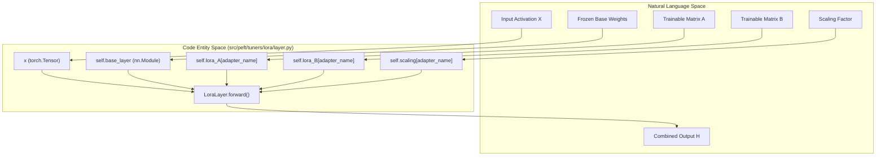
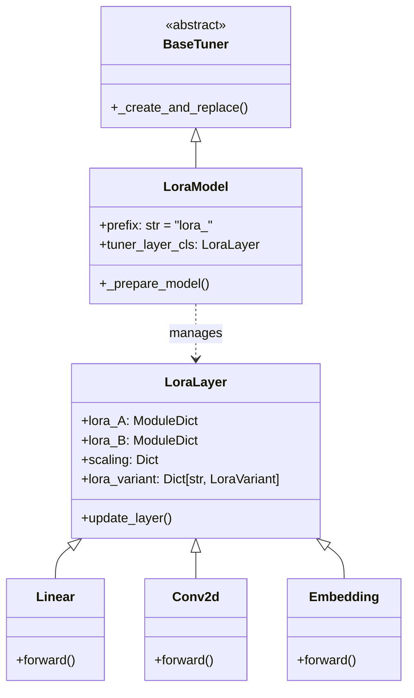
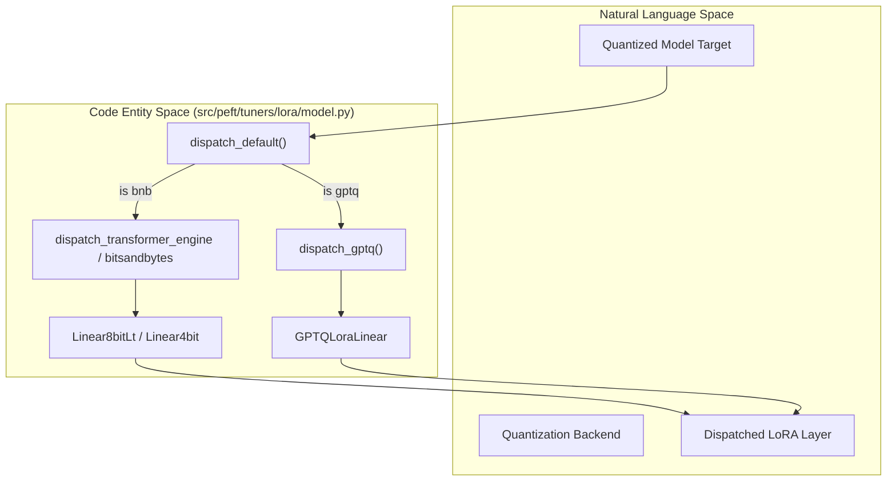

<!-- source: DeepWiki mcp.deepwiki.com · repo huggingface/peft · page 3.1 LoRA Family · fetched 2026-10-26 -->

# LoRA Family

Relevant source files

The following files were used as context for generating this wiki page:

- [examples/corda_finetuning/README.md](examples/corda_finetuning/README.md)
- [examples/corda_finetuning/corda_finetuning.py](examples/corda_finetuning/corda_finetuning.py)
- [examples/corda_finetuning/datautils.py](examples/corda_finetuning/datautils.py)
- [examples/corda_finetuning/preprocess.py](examples/corda_finetuning/preprocess.py)
- [examples/loftq_finetuning/LoftQ_weight_replacement.ipynb](examples/loftq_finetuning/LoftQ_weight_replacement.ipynb)
- [examples/loftq_finetuning/README.md](examples/loftq_finetuning/README.md)
- [examples/loftq_finetuning/quantize_save_load.py](examples/loftq_finetuning/quantize_save_load.py)
- [examples/loftq_finetuning/train_gsm8k_llama.py](examples/loftq_finetuning/train_gsm8k_llama.py)
- [examples/miss_finetuning/README.md](examples/miss_finetuning/README.md)
- [examples/miss_finetuning/miss_finetuning.py](examples/miss_finetuning/miss_finetuning.py)
- [requirements.txt](requirements.txt)
- [src/peft/tuners/lora/__init__.py](src/peft/tuners/lora/__init__.py)
- [src/peft/tuners/lora/config.py](src/peft/tuners/lora/config.py)
- [src/peft/tuners/lora/corda.py](src/peft/tuners/lora/corda.py)
- [src/peft/tuners/lora/eva.py](src/peft/tuners/lora/eva.py)
- [src/peft/tuners/lora/layer.py](src/peft/tuners/lora/layer.py)
- [src/peft/tuners/lora/model.py](src/peft/tuners/lora/model.py)
- [src/peft/tuners/lora/variants.py](src/peft/tuners/lora/variants.py)
- [src/peft/tuners/tuners_utils.py](src/peft/tuners/tuners_utils.py)
- [src/peft/utils/incremental_pca.py](src/peft/utils/incremental_pca.py)
- [src/peft/utils/loftq_utils.py](src/peft/utils/loftq_utils.py)
- [tests/test_custom_models.py](tests/test_custom_models.py)
- [tests/test_incremental_pca.py](tests/test_incremental_pca.py)
- [tests/test_initialization.py](tests/test_initialization.py)
- [tests/test_lora_variants.py](tests/test_lora_variants.py)
- [tests/test_tuners_utils.py](tests/test_tuners_utils.py)

This page provides a deep technical dive into Low-Rank Adaptation (LoRA) and its extensive ecosystem of variants implemented in the PEFT library. LoRA is the foundational parameter-efficient fine-tuning method that enables adaptation of large models by injecting trainable low-rank matrices into existing frozen layers.

## Overview of LoRA

LoRA reduces the number of trainable parameters by representing weight updates as products of low-rank matrices. Instead of fine-tuning the full weight matrix $W \in \mathbb{R}^{d \times k}$, LoRA adds a low-rank decomposition:

$$h = Wx + \Delta Wx = Wx + BAx$$

Where:
- $W$ is the frozen pre-trained weight matrix.
- $B \in \mathbb{R}^{d \times r}$ is a trainable matrix (initialized to zero).
- $A \in \mathbb{R}^{r \times k}$ is a trainable matrix (initialized with Kaiming uniform or Gaussian).
- $r \ll \min(d, k)$ is the rank.
- The output is scaled by $\alpha/r$ (standard) or $\alpha/\sqrt{r}$ (rsLoRA).

**Diagram: LoRA Data Flow and Code Mapping**

Sources: [src/peft/tuners/lora/layer.py:108-177](), [src/peft/tuners/lora/model.py:131-178]()

## LoRA Architecture

The LoRA implementation follows a hierarchical structure where a central tuner manages specialized adapter layers.

**Diagram: LoRA Class Hierarchy**

Sources: [src/peft/tuners/lora/model.py:131-178](), [src/peft/tuners/lora/layer.py:108-177](), [src/peft/tuners/lora/layer.py:54-106]()

### Key Components
- **`LoraModel`**: Subclasses `BaseTuner`. It handles the injection logic by traversing the model and replacing target modules with LoRA-wrapped versions via `_create_and_replace` [src/peft/tuners/lora/model.py:131-178]().
- **`LoraLayer`**: A base mixin for all LoRA-compatible layers. It maintains `ModuleDict` containers for `lora_A` and `lora_B`, allowing for multi-adapter support on a single layer [src/peft/tuners/lora/layer.py:108-177]().
- **`LoraVariant`**: A strategy-pattern class that allows modular extension of LoRA behavior (e.g., DoRA, aLoRA) without subclassing the entire layer [src/peft/tuners/lora/layer.py:54-106]().

Sources: [src/peft/tuners/lora/model.py:131-178](), [src/peft/tuners/lora/layer.py:108-177](), [src/peft/tuners/lora/layer.py:54-106]()

## Initialization Strategies

LoRA's performance and convergence are highly sensitive to how $A$ and $B$ are initialized. PEFT supports a wide array of strategies via the `init_lora_weights` parameter in `LoraConfig` [src/peft/tuners/lora/config.py:1-263]().

| Strategy | Description | Key Function/Logic |
| :--- | :--- | :--- |
| **Default** | $A$ is Kaiming Uniform, $B$ is zeros. | `nn.init.kaiming_uniform_` [tests/test_initialization.py:130-152]() |
| **Gaussian** | $A$ is normal distribution, $B$ is zeros. | `nn.init.normal_` [tests/test_initialization.py:153-176]() |
| **PiSSA** | Uses SVD to initialize $A$ and $B$ from principal components. | `pissa_init` [src/peft/tuners/lora/layer.py:322-356]() |
| **OLoRA** | Uses QR decomposition for orthogonal initialization. | `olora_init` [src/peft/tuners/lora/layer.py:277-321]() |
| **LoftQ** | Quantization-aware initialization to minimize error. | `loftq_init` [src/peft/utils/loftq_utils.py:52-101]() |
| **CorDA** | Context-oriented decomposition using task-specific data. | `corda_init` [src/peft/tuners/lora/corda.py:1-70]() |
| **EVA** | Explained Variance Adaptation for data-driven rank allocation. | `initialize_lora_eva_weights` [src/peft/tuners/lora/eva.py:31-60]() |
| **LoRA-GA** | Gradient-informed initialization strategy. | `preprocess_loraga` [src/peft/tuners/lora/loraga.py:1-50]() |

Sources: [src/peft/tuners/lora/layer.py:277-356](), [src/peft/utils/loftq_utils.py:52-101](), [src/peft/tuners/lora/corda.py:1-70](), [tests/test_initialization.py:130-176]()

## LoRA Variants

PEFT implements several advanced variants of LoRA to address specific training and inference requirements.

### DoRA (Weight-Decomposed LoRA)
DoRA decomposes the weight update into magnitude and direction. It applies LoRA to the direction component while keeping a separate trainable magnitude vector.
- **Implementation**: Managed by `DoraLinearVariant` and `lora_magnitude_vector` [src/peft/tuners/lora/variants.py:138-160]().
- **Benefit**: Matches or exceeds full fine-tuning performance with LoRA efficiency.

### aLoRA (Activated LoRA)
aLoRA allows selective activation of LoRA based on specific "invocation tokens".
- **Logic**: Input tokens are scanned for invocation offsets, ensuring LoRA is only applied selectively [src/peft/tuners/lora/variants.py:38-137]().
- **Implementation**: Uses `ALoraLinearVariant` [src/peft/tuners/lora/variants.py:38-137]().

### Arrow
Arrow is a routing algorithm for combining multiple LoRA modules dynamically (MoE-style).
- **Components**: `ArrowConfig` and `ArrowLoraLinearLayer` [src/peft/tuners/lora/config.py:139-164](), [src/peft/tuners/lora/variants.py:38-137]().
- **Logic**: It builds prototypes of adapters and routes inputs to the top-k experts [src/peft/tuners/lora/variants.py:38-137]().

### VeLoRA
VeLoRA focuses on memory efficiency by using grouped sub-tokens and projection-based weight updates.
- **Config**: `VeloraConfig` defines `num_groups` and `init_type` [src/peft/tuners/lora/config.py:74-123]().
- **Implementation**: Uses `VeloraFunction` for custom backward passes [src/peft/tuners/lora/variants.py:34-35]().

### BD-LoRA (Block-Diagonal LoRA)
Designed for multi-GPU serving, BD-LoRA uses block-diagonal structures for $A$ or $B$ matrices to eliminate inter-GPU communication during the adapter forward pass.
- **Config**: `BdLoraConfig` specifies which modules are block-diagonal [src/peft/tuners/lora/config.py:1-263]().

### KaSA & QALoRA & Intruders
Other variants like KaSA (`KasaConfig`) [src/peft/tuners/lora/__init__.py:19-30]() and various specialized initializations are fully supported through configuration composition in `LoraConfig` [src/peft/tuners/lora/config.py:1-263]().

Sources: [src/peft/tuners/lora/config.py:74-164](), [src/peft/tuners/lora/variants.py:38-160](), [src/peft/tuners/lora/layer.py:108-177]()

## Layer Implementations

LoRA is implemented for several standard PyTorch layers and backends:

1. **Linear**: The most common target. Supports standard `nn.Linear` and `transformers.pytorch_utils.Conv1D` [src/peft/tuners/lora/layer.py:108-177]().
2. **Conv2d / Conv3d**: Implements LoRA for convolutional layers by using multidimensional convolutions for low-rank matrices [src/peft/tuners/lora/layer.py:108-177]().
3. **Embedding**: Adapts embedding weights by adding low-rank increments `lora_embedding_A` and `lora_embedding_B` [src/peft/tuners/lora/layer.py:108-177]().
4. **Quantized Layers**: Specialized dispatchers for `BitsAndBytes` (8-bit/4-bit), `GPTQ`, `AWQ`, and `HQQ` [src/peft/tuners/lora/model.py:58-68]().

**Diagram: Quantized LoRA Dispatch and Code Mapping**

Sources: [src/peft/tuners/lora/model.py:58-68](), [src/peft/tuners/lora/__init__.py:69-85]()

---

