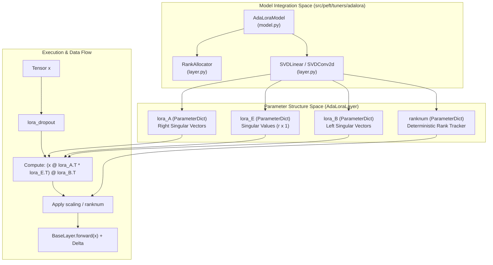
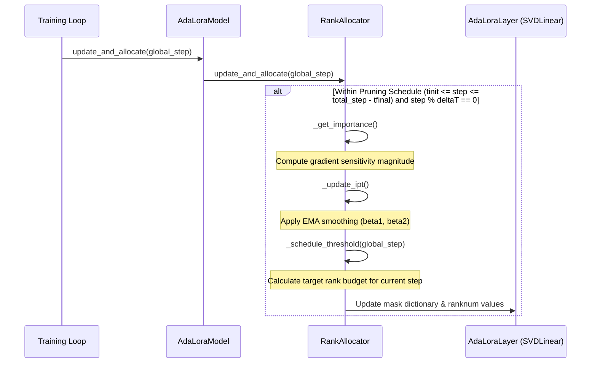

<!-- source: DeepWiki mcp.deepwiki.com · repo huggingface/peft · page 3.2 AdaLoRA and Dynamic Rank Allocation · fetched 2026-10-26 -->

# AdaLoRA and Dynamic Rank Allocation

<details>
<summary>Relevant source files</summary>

The following files were used as context for generating this wiki page:

- [examples/conditional_generation/multitask_prompt_tuning.ipynb](examples/conditional_generation/multitask_prompt_tuning.ipynb)
- [examples/conditional_generation/peft_adalora_seq2seq.py](examples/conditional_generation/peft_adalora_seq2seq.py)
- [examples/conditional_generation/peft_ia3_seq2seq.ipynb](examples/conditional_generation/peft_ia3_seq2seq.ipynb)
- [examples/conditional_generation/peft_lora_seq2seq.ipynb](examples/conditional_generation/peft_lora_seq2seq.ipynb)
- [examples/conditional_generation/peft_prefix_tuning_seq2seq.ipynb](examples/conditional_generation/peft_prefix_tuning_seq2seq.ipynb)
- [examples/conditional_generation/peft_prompt_tuning_seq2seq.ipynb](examples/conditional_generation/peft_prompt_tuning_seq2seq.ipynb)
- [examples/conditional_generation/peft_prompt_tuning_seq2seq_with_generate.ipynb](examples/conditional_generation/peft_prompt_tuning_seq2seq_with_generate.ipynb)
- [src/peft/tuners/adalora/layer.py](src/peft/tuners/adalora/layer.py)
- [src/peft/tuners/adalora/model.py](src/peft/tuners/adalora/model.py)
- [src/peft/tuners/ia3/layer.py](src/peft/tuners/ia3/layer.py)
- [src/peft/tuners/ia3/model.py](src/peft/tuners/ia3/model.py)
- [src/peft/tuners/loha/layer.py](src/peft/tuners/loha/layer.py)
- [src/peft/tuners/loha/model.py](src/peft/tuners/loha/model.py)
- [src/peft/tuners/lokr/layer.py](src/peft/tuners/lokr/layer.py)
- [src/peft/tuners/lokr/model.py](src/peft/tuners/lokr/model.py)
- [src/peft/tuners/lycoris_utils.py](src/peft/tuners/lycoris_utils.py)

</details>


## Purpose and Scope

This document details **AdaLoRA (Adaptive Low-Rank Adaptation)**, a sophisticated variant of LoRA that dynamically allocates the rank budget across different layers and modules during training based on importance scoring. Standard LoRA assigns a uniform fixed rank across all target modules regardless of their sensitivity or contribution to the downstream task. AdaLoRA addresses this inefficiency by parameterizing incremental weight matrices using a Singular Value Decomposition (SVD) form: $W = W_0 + B E A$, where $P$ (left singular vectors, `lora_B`), $E$ (singular values, `lora_E`), and $Q$ (right singular vectors, `lora_A`) are optimized jointly, and less important singular triplets are progressively pruned.

**Key Features:**
- **Dynamic Rank Allocation**: Automatically redistributes parameter budgets across layers over the course of training [src/peft/tuners/adalora/model.py:95]().
- **Importance-Based Pruning**: Computes importance scores via sensitivity metrics to prune redundant singular values through `RankAllocator` [src/peft/tuners/adalora/layer.py:465-470]().
- **SVD Decomposition**: Decomposes parameter updates into `lora_A` (right vectors), `lora_E` (singular values), and `lora_B` (left vectors) [src/peft/tuners/adalora/layer.py:37-50]().
- **Gradual Budget Reduction**: Transitions total rank from an initial configuration (`init_r`) down to a target average rank (`target_r`) [src/peft/tuners/adalora/model.py:128-157]().

Sources: [src/peft/tuners/adalora/model.py:36-96](), [src/peft/tuners/adalora/layer.py:37-91]()

---

## Configuration (`AdaLoraConfig`)

AdaLoRA is configured via `AdaLoraConfig`, which extends standard Lora configuration parameters with scheduling, importance smoothing, and regularization hyperparameters.

| Parameter | Type | Description |
|-----------|------|-------------|
| `init_r` | `int` | Initial rank for each incremental SVD matrix at the start of training. |
| `target_r` | `int` | Target average rank to reach after pruning concludes. |
| `tinit` | `int` | Warmup steps of initial fine-tuning before rank pruning starts. |
| `tfinal` | `int` | Step threshold defining the end of pruning and final fine-tuning phase. |
| `deltaT` | `int` | Interval (in steps) between successive rank budget allocation events. |
| `beta1` | `float` | Exponential moving average (EMA) decay factor for gradient magnitude smoothing. |
| `beta2` | `float` | Exponential moving average decay factor for uncertainty/variance smoothing. |
| `orth_reg_weight` | `float` | Regularization coefficient enforcing orthogonality constraints on $A$ and $B$. |
| `total_step` | `int` | Total number of training steps (required for schedule calculation). |

Sources: [src/peft/tuners/adalora/model.py:43-67](), [src/peft/tuners/adalora/layer.py:51-90]()

---

## Architecture Overview and Code Entity Mapping

AdaLoRA subclasses `LoraModel` and wraps linear or convolutional layers with `AdaLoraLayer` and `SVDLinear` implementations, injecting `lora_A`, `lora_E`, `lora_B`, and `ranknum` parameters into each adapted module [src/peft/tuners/adalora/model.py:36-37](), [src/peft/tuners/adalora/layer.py:37-50]().



Sources: [src/peft/tuners/adalora/model.py:36-96](), [src/peft/tuners/adalora/layer.py:37-91]()

---

## Dynamic Rank Allocation and `RankAllocator`

The core innovation of AdaLoRA is managed by the `RankAllocator` class, which monitors importance scores and adjusts mask structures dynamically during training [src/peft/tuners/adalora/model.py:95]().

### The `update_and_allocate` Workflow

During the training loop, the trainer calls `model.base_model.update_and_allocate(global_step)`, which delegates importance evaluation and rank pruning to the `RankAllocator` instance [src/peft/tuners/adalora/model.py:123]().



Sources: [src/peft/tuners/adalora/model.py:123](), [src/peft/tuners/adalora/layer.py:465-515]()

### Importance Scoring Mechanism
The importance $I_t$ of each singular triplet is computed using gradient information combined with exponential moving averages to capture stability and sensitivity:
1. **Sensitivity Calculation**: $s_t = | \nabla_{E} \mathcal{L} \odot E |$ [src/peft/tuners/adalora/layer.py:515]()
2. **EMA Smoothing**: 
   - Mean: $m_t = \beta_1 m_{t-1} + (1 - \beta_1) s_t$ [src/peft/tuners/adalora/layer.py:515]()
   - Variance: $v_t = \beta_2 v_{t-1} + (1 - \beta_2) s_t^2$ [src/peft/tuners/adalora/layer.py:515]()
3. **Score Metric**: $I_t = \frac{m_t}{\sqrt{v_t + \epsilon}}$ [src/peft/tuners/adalora/layer.py:515]()
4. **Pruning**: Triplet scores falling below the dynamically scheduled threshold have their corresponding entries in `lora_E` zeroed out via masking [src/peft/tuners/adalora/layer.py:515]().

Sources: [src/peft/tuners/adalora/layer.py:515]()

---

## Implementation Details

### Orthogonal Regularization
To preserve the orthogonality properties of the SVD factorization matrices $A$ and $B$, AdaLoRA incorporates an orthogonal regularization penalty into training:
$$\mathcal{L}_{\text{orth}} = \|A A^T - I\|_F^2 + \|B^T B - I\|_F^2$$
This encourages $A$ and $B$ to remain valid orthogonal bases throughout dynamic rank resizing [src/peft/tuners/adalora/layer.py:515]().

### Layer Variants and Code Mapping
AdaLoRA supports dense linear layers, 2D convolutions, and quantized backends through specialized SVD layer classes:

| Class Name | Base Layer Type | Implementation File |
|------------|-----------------|---------------------|
| `SVDLinear` | `torch.nn.Linear` | [src/peft/tuners/adalora/layer.py:99]() |
| `SVDConv2d` | `torch.nn.Conv2d` | [src/peft/tuners/adalora/layer.py:223]() |
| `SVDLinear8bitLt` | `bitsandbytes.nn.Linear8bitLt` | [src/peft/tuners/adalora/bnb.py:27]() |
| `SVDLinear4bit` | `bitsandbytes.nn.Linear4bit` | [src/peft/tuners/adalora/bnb.py:84]() |
| `SVDQuantLinear` | GPTQ Quantized Linear | [src/peft/tuners/adalora/gptq.py:20]() |

Sources: [src/peft/tuners/adalora/layer.py:99-223](), [src/peft/tuners/adalora/bnb.py:27-84](), [src/peft/tuners/adalora/gptq.py:20-50]()

---

## Training Workflow Example

The following script demonstrates setting up `AdaLoraConfig`, wrapping a sequence-to-sequence model, and invoking `update_and_allocate` during the training loop [examples/conditional_generation/peft_adalora_seq2seq.py:44-123]().

```python
import torch
from transformers import AutoModelForSeq2SeqLM
from peft import AdaLoraConfig, TaskType, get_peft_model

peft_config = AdaLoraConfig(
    init_r=12,
    target_r=8,
    beta1=0.85,
    beta2=0.85,
    tinit=200,
    tfinal=1000,
    deltaT=10,
    lora_alpha=32,
    lora_dropout=0.1,
    task_type=TaskType.SEQ_2_SEQ_LM,
    inference_mode=False,
    total_step=1000,
)

model = AutoModelForSeq2SeqLM.from_pretrained("facebook/bart-base")
model = get_peft_model(model, peft_config)

optimizer = torch.optim.AdamW(model.parameters(), lr=1e-3)

global_step = 0
for epoch in range(num_epochs):
    model.train()
    for batch in train_dataloader:
        outputs = model(**batch)
        loss = outputs.loss
        loss.backward()
        
        optimizer.step()
        
        # Dynamically update rank allocation based on importance scores
        model.base_model.update_and_allocate(global_step)
        
        optimizer.zero_grad()
        global_step += 1
```

Sources: [examples/conditional_generation/peft_adalora_seq2seq.py:44-125]()

---

