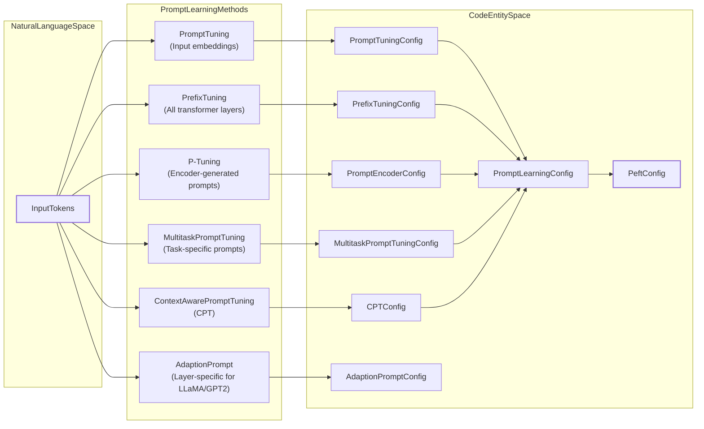
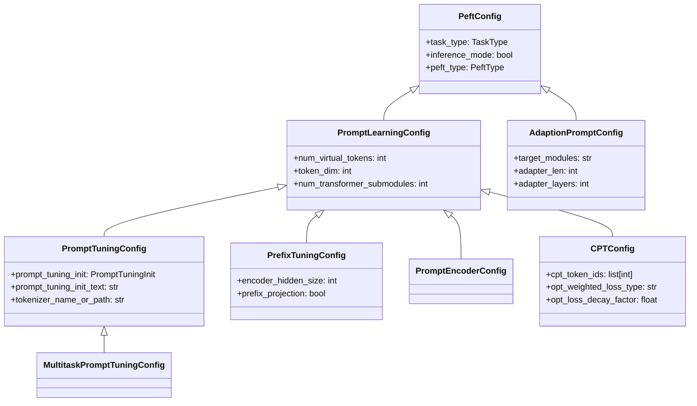
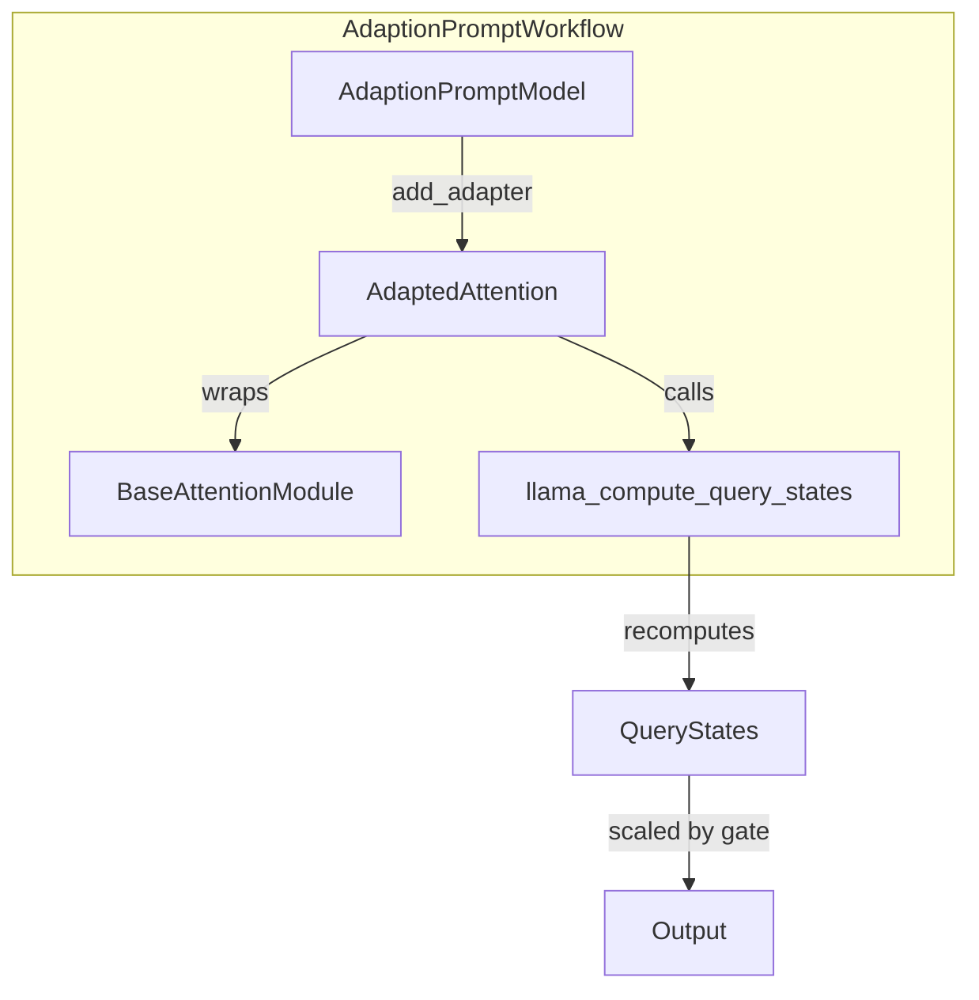
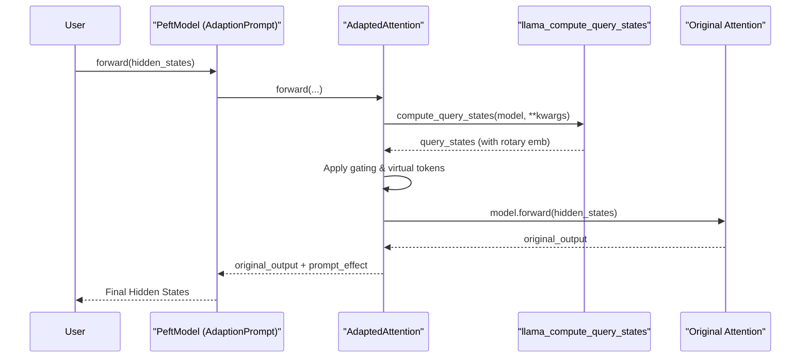

<!-- source: DeepWiki mcp.deepwiki.com · repo huggingface/peft · page 3.3 Prompt Learning Methods · fetched 2026-10-26 -->

# Prompt Learning Methods

Relevant source files

The following files were used as context for generating this wiki page:

- [method_comparison/MetaMathQA/default_training_params.json](method_comparison/MetaMathQA/default_training_params.json)
- [method_comparison/MetaMathQA/experiments/prefixtuning/llama-3.2-3B-lr_0.005_zero_init/adapter_config.json](method_comparison/MetaMathQA/experiments/prefixtuning/llama-3.2-3B-lr_0.005_zero_init/adapter_config.json)
- [method_comparison/MetaMathQA/experiments/prefixtuning/llama-3.2-3B-lr_0.005_zero_init/training_params.json](method_comparison/MetaMathQA/experiments/prefixtuning/llama-3.2-3B-lr_0.005_zero_init/training_params.json)
- [method_comparison/MetaMathQA/experiments/prefixtuning/llama-3.2-3B-tokens50-init_prefix-lr_0.005/adapter_config.json](method_comparison/MetaMathQA/experiments/prefixtuning/llama-3.2-3B-tokens50-init_prefix-lr_0.005/adapter_config.json)
- [method_comparison/MetaMathQA/experiments/prefixtuning/llama-3.2-3B-tokens50-init_prefix-lr_0.005/training_params.json](method_comparison/MetaMathQA/experiments/prefixtuning/llama-3.2-3B-tokens50-init_prefix-lr_0.005/training_params.json)
- [src/peft/tuners/adaption_prompt/config.py](src/peft/tuners/adaption_prompt/config.py)
- [src/peft/tuners/adaption_prompt/layer.py](src/peft/tuners/adaption_prompt/layer.py)
- [src/peft/tuners/adaption_prompt/model.py](src/peft/tuners/adaption_prompt/model.py)
- [src/peft/tuners/adaption_prompt/utils.py](src/peft/tuners/adaption_prompt/utils.py)
- [src/peft/tuners/cpt/config.py](src/peft/tuners/cpt/config.py)
- [src/peft/tuners/multitask_prompt_tuning/config.py](src/peft/tuners/multitask_prompt_tuning/config.py)
- [src/peft/tuners/multitask_prompt_tuning/model.py](src/peft/tuners/multitask_prompt_tuning/model.py)
- [src/peft/tuners/p_tuning/config.py](src/peft/tuners/p_tuning/config.py)
- [src/peft/tuners/p_tuning/model.py](src/peft/tuners/p_tuning/model.py)
- [src/peft/tuners/prefix_tuning/config.py](src/peft/tuners/prefix_tuning/config.py)
- [src/peft/tuners/prefix_tuning/model.py](src/peft/tuners/prefix_tuning/model.py)
- [src/peft/tuners/prompt_tuning/config.py](src/peft/tuners/prompt_tuning/config.py)
- [src/peft/tuners/prompt_tuning/model.py](src/peft/tuners/prompt_tuning/model.py)
- [src/peft/tuners/randlora/__init__.py](src/peft/tuners/randlora/__init__.py)
- [src/peft/tuners/randlora/bnb.py](src/peft/tuners/randlora/bnb.py)
- [src/peft/tuners/randlora/config.py](src/peft/tuners/randlora/config.py)
- [tests/test_adaption_prompt.py](tests/test_adaption_prompt.py)
- [tests/test_cpt.py](tests/test_cpt.py)
- [tests/test_multitask_prompt_tuning.py](tests/test_multitask_prompt_tuning.py)
- [tests/test_stablediffusion.py](tests/test_stablediffusion.py)

This page details the prompt learning techniques available in PEFT, which add trainable "virtual tokens" to a model while keeping the original model parameters frozen. For other parameter-efficient methods like LoRA, see [LoRA Family](#3.1), or for methods like IA3, see [Other Adapter Methods](#3.4).

## Overview of Prompt Learning Methods

Prompt learning methods are parameter-efficient fine-tuning techniques that work by adding trainable embeddings (called "virtual tokens" or "soft prompts") to a model's inputs or hidden states. Unlike methods that modify the weights directly, prompt learning methods keep the original model frozen and only train a small number of additional parameters.

Key characteristics:
- Extremely parameter-efficient (typically <1% of the model's parameters).
- Preserve original model weights enabling easy adapter switching.
- Suitable for various NLP tasks, especially text generation and sequence classification.
- Different methods inject prompts at different locations in the model architecture (input vs. attention layers).

Sources: [src/peft/tuners/prompt_tuning/config.py:30-46](), [src/peft/tuners/prefix_tuning/config.py:27-44](), [src/peft/tuners/p_tuning/config.py:26-40](), [src/peft/tuners/multitask_prompt_tuning/config.py:29-45](), [src/peft/tuners/cpt/config.py:23-34](), [src/peft/tuners/adaption_prompt/config.py:25-33]()

## Prompt Learning Configuration Hierarchy

All prompt learning methods in PEFT inherit from the base `PromptLearningConfig` class (except `AdaptionPromptConfig` which inherits directly from `PeftConfig`), which provides common attributes and functionality.

Sources: [src/peft/tuners/prompt_tuning/config.py:30-30](), [src/peft/tuners/prefix_tuning/config.py:27-27](), [src/peft/tuners/p_tuning/config.py:26-26](), [src/peft/tuners/cpt/config.py:23-34](), [src/peft/tuners/adaption_prompt/config.py:25-25]()

## Prompt Learning Methods in Detail

### Prompt Tuning

Prompt Tuning adds virtual tokens to the input embeddings. In PEFT, it's implemented through `PromptTuningConfig` [src/peft/tuners/prompt_tuning/config.py:30-30]() and `PromptEmbedding` [src/peft/tuners/prompt_tuning/model.py:25-27]().

Key features:
- **Initialization Strategies**: Controlled by `PromptTuningInit` [src/peft/tuners/prompt_tuning/config.py:23-26]().
    - `TEXT`: Initializes with specific text embeddings [src/peft/tuners/prompt_tuning/model.py:79-101]().
    - `SAMPLE_VOCAB`: Randomly samples tokens from the model's vocabulary [src/peft/tuners/prompt_tuning/model.py:68-77]().
    - `RANDOM`: Standard random initialization.
- **Implementation**: The `PromptEmbedding` class encodes indices into virtual token embeddings [src/peft/tuners/prompt_tuning/model.py:25-61]().

### Prefix Tuning

Prefix Tuning adds virtual tokens to the key and value states of every attention layer.

Key features:
- **Prefix Projection**: Can use a smaller MLP to project the prefix tokens if `prefix_projection` is True [src/peft/tuners/prefix_tuning/config.py:27-44]().
- **Virtual Tokens**: These tokens are prepended to the keys and values during the forward pass, effectively providing a "prefix" for the attention mechanism.

### P-Tuning

P-Tuning uses a `PromptEncoder` (typically an MLP or LSTM) to generate virtual token embeddings.

Key features:
- **Reparameterization**: Uses an encoder network to handle dependencies between virtual tokens [src/peft/tuners/p_tuning/config.py:26-40]().
- **Encoder Types**: Supports `MLP` and `LSTM` via `PromptEncoderConfig`.

### Multitask Prompt Tuning (MPT)

MPT extends prompt tuning for handling multiple tasks simultaneously using task-specific prompts via `MultitaskPromptEmbedding` [src/peft/tuners/multitask_prompt_tuning/model.py:28-30]().

Key features:
- **Task IDs**: Requires a `task_ids` input during the forward pass to select the appropriate prompt [src/peft/tuners/multitask_prompt_tuning/model.py:108-120]().
- **Initialization**: Can be initialized with task-specific text via `prompt_tuning_init_text` [tests/test_multitask_prompt_tuning.py:47-50]().

### Context-Aware Prompt Tuning (CPT)

Context-Aware Prompt Tuning (`CPTConfig`) extends prompt learning by incorporating token type masks, specialized weighted loss types (such as exponential decay via `opt_weighted_loss_type`), and format/input projection epsilons for causal language modeling tasks [src/peft/tuners/cpt/config.py:23-85]().

### Adaption Prompt (LLaMA-Adapter style)

Adaption Prompt is designed for LLaMA and GPT-2 architectures, replacing the top $L$ attention modules with `AdaptedAttention` layers [src/peft/tuners/adaption_prompt/model.py:27-32]().

Key features:
- **Injection Point**: Replaces attention modules (e.g., `self_attn` for Llama) [src/peft/tuners/adaption_prompt/config.py:50-72]().
- **Gating**: Uses a zero-initialized gating mechanism to ensure the model starts with the original behavior [src/peft/tuners/adaption_prompt/layer.py:55-60]().
- **Dynamic Swapping**: Manages active adapters by swapping `AdaptedAttention` modules in and out of the model hierarchy [src/peft/tuners/adaption_prompt/model.py:44-106]().
- **Query State Computation**: Requires custom logic to recompute query states since base transformer implementations often don't expose them [src/peft/tuners/adaption_prompt/utils.py:61-125]().

Sources: [src/peft/tuners/adaption_prompt/model.py:27-61](), [src/peft/tuners/adaption_prompt/utils.py:61-66](), [src/peft/tuners/adaption_prompt/config.py:50-72](), [src/peft/tuners/adaption_prompt/layer.py:55-60]()

## Initialization Strategies

Prompt learning methods rely heavily on how the `num_virtual_tokens` are initialized.

| Strategy | Description | Implementation |
| :--- | :--- | :--- |
| `RANDOM` | Standard random initialization. | Default in `PromptTuningConfig` [src/peft/tuners/prompt_tuning/config.py:48-51]() |
| `TEXT` | Uses an `AutoTokenizer` to convert text to IDs, then look up base model embeddings. | `PromptEmbedding.__init__` [src/peft/tuners/prompt_tuning/model.py:79-101]() |
| `SAMPLE_VOCAB` | Randomly picks token IDs from the base model's vocabulary. | `PromptEmbedding.__init__` [src/peft/tuners/prompt_tuning/model.py:68-77]() |

Sources: [src/peft/tuners/prompt_tuning/config.py:23-26](), [src/peft/tuners/prompt_tuning/model.py:63-102]()

## Transfer Learning Workflows

Multitask Prompt Tuning enables complex transfer learning workflows where a source prompt can be used to initialize task-specific prompts.

1. **Source Training**: Train a `PromptTuningConfig` on a large source dataset.
2. **Target Initialization**: Use the learned embeddings to initialize a `MultitaskPromptTuningConfig` [src/peft/tuners/multitask_prompt_tuning/model.py:28-68]().
3. **Fine-tuning**: Fine-tune only the task-specific components on the target datasets.

Sources: [tests/test_multitask_prompt_tuning.py:42-50](), [src/peft/tuners/multitask_prompt_tuning/model.py:28-60]()

## Data Flow in Adaption Prompt

The `AdaptionPromptModel` modifies the model's module tree by replacing standard attention layers with `AdaptedAttention`.

Sources: [src/peft/tuners/adaption_prompt/model.py:124-142](), [src/peft/tuners/adaption_prompt/utils.py:61-125](), [src/peft/tuners/adaption_prompt/layer.py:151-164]()

---

