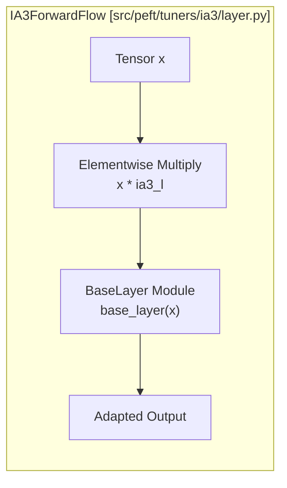
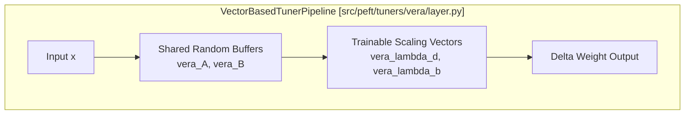
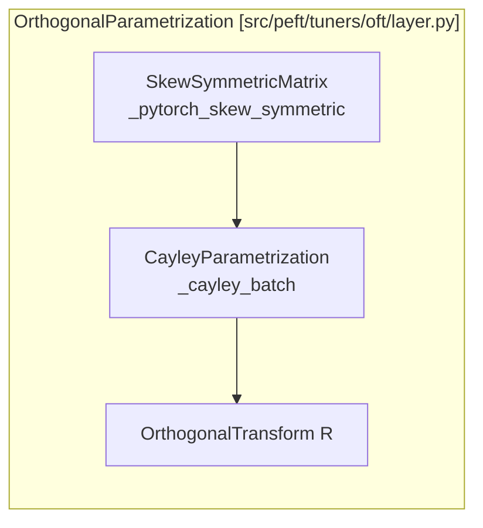

<!-- source: DeepWiki mcp.deepwiki.com · repo huggingface/peft · page 3.4 Other Adapter Methods · fetched 2026-10-26 -->

# Other Adapter Methods

Relevant source files

The following files were used as context for generating this wiki page:

- [docs/source/package_reference/hra.md](docs/source/package_reference/hra.md)
- [docs/source/package_reference/osf.md](docs/source/package_reference/osf.md)
- [docs/source/package_reference/xlora.md](docs/source/package_reference/xlora.md)
- [examples/arrow_multitask/arrow_phi3_mini.py](examples/arrow_multitask/arrow_phi3_mini.py)
- [examples/arrow_multitask/requirements.txt](examples/arrow_multitask/requirements.txt)
- [examples/beft_finetuning/README.md](examples/beft_finetuning/README.md)
- [examples/beft_finetuning/beft_finetuning.py](examples/beft_finetuning/beft_finetuning.py)
- [examples/xlora/README.md](examples/xlora/README.md)
- [method_comparison/MetaMathQA/experiments/beft/llama-3.2-3B-target-v_proj/adapter_config.json](method_comparison/MetaMathQA/experiments/beft/llama-3.2-3B-target-v_proj/adapter_config.json)
- [src/peft/mapping_func.py](src/peft/mapping_func.py)
- [src/peft/tuners/adamss/config.py](src/peft/tuners/adamss/config.py)
- [src/peft/tuners/adamss/layer.py](src/peft/tuners/adamss/layer.py)
- [src/peft/tuners/adamss/utils.py](src/peft/tuners/adamss/utils.py)
- [src/peft/tuners/beft/__init__.py](src/peft/tuners/beft/__init__.py)
- [src/peft/tuners/beft/config.py](src/peft/tuners/beft/config.py)
- [src/peft/tuners/beft/layer.py](src/peft/tuners/beft/layer.py)
- [src/peft/tuners/beft/model.py](src/peft/tuners/beft/model.py)
- [src/peft/tuners/boft/layer.py](src/peft/tuners/boft/layer.py)
- [src/peft/tuners/boft/model.py](src/peft/tuners/boft/model.py)
- [src/peft/tuners/c3a/model.py](src/peft/tuners/c3a/model.py)
- [src/peft/tuners/deft/layer.py](src/peft/tuners/deft/layer.py)
- [src/peft/tuners/fourierft/layer.py](src/peft/tuners/fourierft/layer.py)
- [src/peft/tuners/fourierft/model.py](src/peft/tuners/fourierft/model.py)
- [src/peft/tuners/frod/layer.py](src/peft/tuners/frod/layer.py)
- [src/peft/tuners/gralora/config.py](src/peft/tuners/gralora/config.py)
- [src/peft/tuners/gralora/layer.py](src/peft/tuners/gralora/layer.py)
- [src/peft/tuners/hira/bnb.py](src/peft/tuners/hira/bnb.py)
- [src/peft/tuners/hira/config.py](src/peft/tuners/hira/config.py)
- [src/peft/tuners/hira/layer.py](src/peft/tuners/hira/layer.py)
- [src/peft/tuners/hira/model.py](src/peft/tuners/hira/model.py)
- [src/peft/tuners/hra/layer.py](src/peft/tuners/hra/layer.py)
- [src/peft/tuners/hra/model.py](src/peft/tuners/hra/model.py)
- [src/peft/tuners/ln_tuning/layer.py](src/peft/tuners/ln_tuning/layer.py)
- [src/peft/tuners/ln_tuning/model.py](src/peft/tuners/ln_tuning/model.py)
- [src/peft/tuners/lora/conversion.py](src/peft/tuners/lora/conversion.py)
- [src/peft/tuners/lora/intruders.py](src/peft/tuners/lora/intruders.py)
- [src/peft/tuners/miss/config.py](src/peft/tuners/miss/config.py)
- [src/peft/tuners/miss/layer.py](src/peft/tuners/miss/layer.py)
- [src/peft/tuners/oft/__init__.py](src/peft/tuners/oft/__init__.py)
- [src/peft/tuners/oft/layer.py](src/peft/tuners/oft/layer.py)
- [src/peft/tuners/oft/model.py](src/peft/tuners/oft/model.py)
- [src/peft/tuners/osf/config.py](src/peft/tuners/osf/config.py)
- [src/peft/tuners/osf/layer.py](src/peft/tuners/osf/layer.py)
- [src/peft/tuners/osf/utils.py](src/peft/tuners/osf/utils.py)
- [src/peft/tuners/peanut/layer.py](src/peft/tuners/peanut/layer.py)
- [src/peft/tuners/poly/layer.py](src/peft/tuners/poly/layer.py)
- [src/peft/tuners/poly/model.py](src/peft/tuners/poly/model.py)
- [src/peft/tuners/psoft/config.py](src/peft/tuners/psoft/config.py)
- [src/peft/tuners/psoft/layer.py](src/peft/tuners/psoft/layer.py)
- [src/peft/tuners/pvera/bnb.py](src/peft/tuners/pvera/bnb.py)
- [src/peft/tuners/pvera/config.py](src/peft/tuners/pvera/config.py)
- [src/peft/tuners/pvera/layer.py](src/peft/tuners/pvera/layer.py)
- [src/peft/tuners/randlora/layer.py](src/peft/tuners/randlora/layer.py)
- [src/peft/tuners/randlora/model.py](src/peft/tuners/randlora/model.py)
- [src/peft/tuners/shadow/layers.py](src/peft/tuners/shadow/layers.py)
- [src/peft/tuners/shadow/model.py](src/peft/tuners/shadow/model.py)
- [src/peft/tuners/shira/layer.py](src/peft/tuners/shira/layer.py)
- [src/peft/tuners/shira/mask_functions.py](src/peft/tuners/shira/mask_functions.py)
- [src/peft/tuners/shira/model.py](src/peft/tuners/shira/model.py)
- [src/peft/tuners/vblora/layer.py](src/peft/tuners/vblora/layer.py)
- [src/peft/tuners/vera/layer.py](src/peft/tuners/vera/layer.py)
- [src/peft/tuners/waveft/layer.py](src/peft/tuners/waveft/layer.py)
- [src/peft/tuners/waveft/model.py](src/peft/tuners/waveft/model.py)
- [src/peft/tuners/xlora/classifier.py](src/peft/tuners/xlora/classifier.py)
- [src/peft/tuners/xlora/layer.py](src/peft/tuners/xlora/layer.py)
- [src/peft/tuners/xlora/model.py](src/peft/tuners/xlora/model.py)
- [src/peft/utils/quantization_utils.py](src/peft/utils/quantization_utils.py)
- [tests/test_arrow.py](tests/test_arrow.py)
- [tests/test_boft.py](tests/test_boft.py)
- [tests/test_deft.py](tests/test_deft.py)
- [tests/test_lora_intruders.py](tests/test_lora_intruders.py)
- [tests/test_osf.py](tests/test_osf.py)
- [tests/test_quantization.py](tests/test_quantization.py)
- [tests/test_randlora.py](tests/test_randlora.py)
- [tests/test_shadow.py](tests/test_shadow.py)
- [tests/test_shira.py](tests/test_shira.py)
- [tests/test_xlora.py](tests/test_xlora.py)

## Purpose and Scope

This document covers PEFT adapter methods beyond the LoRA family and prompt learning approaches. These methods employ diverse mathematical mechanisms including learned scaling vectors, Hadamard product factorization, Kronecker product decomposition, orthogonal transformations, random projections, and mixture-of-experts gating.

These adapters inherit from base classes such as `BaseTuner` (`src/peft/tuners/tuners_utils.py`) and `BaseTunerLayer` (`src/peft/tuners/tuners_utils.py`), integrating into PEFT's layer injection and state dictionary management infrastructure.

## Adapter Methods Taxonomy & Code Mapping

The following diagram bridges natural language names for various adapter methods to their respective codebase classes and files:

```mermaid
graph TB
    subgraph "Scaling & Normalization"
        IA3["IA3Model<br/>src/peft/tuners/ia3/model.py"]
        LNTuning["LNTuningModel<br/>src/peft/tuners/ln_tuning/model.py"]
        TrainableTokens["TrainableTokensModel<br/>src/peft/tuners/trainable_tokens/model.py"]
    end

    subgraph "Factorization & Orthogonal"
        LoHa["LoHaModel<br/>src/peft/tuners/loha/model.py"]
        LoKr["LoKrModel<br/>src/peft/tuners/lokr/model.py"]
        OFT["OFTModel<br/>src/peft/tuners/oft/model.py"]
        BOFT["BOFTModel<br/>src/peft/tuners/boft/model.py"]
        PSOFT["psoft.OrthLayer<br/>src/peft/tuners/psoft/layer.py"]
    end

    subgraph "Random Projections & Structured"
        VeRA["VeraLayer<br/>src/peft/tuners/vera/layer.py"]
        pVeRA["PveraLayer<br/>src/peft/tuners/pvera/layer.py"]
        VBLoRA["VBLoRALayer<br/>src/peft/tuners/vblora/layer.py"]
        RandLoRA["RandLoraModel<br/>src/peft/tuners/randlora/model.py"]
    end

    subgraph "Advanced & Mixture Tuners"
        XLoRA["XLoraModel<br/>src/peft/tuners/xlora/model.py"]
        Poly["PolyModel<br/>src/peft/tuners/poly/model.py"]
        MiSS["MissLayer<br/>src/peft/tuners/miss/layer.py"]
        Shira["ShiraConfig<br/>src/peft/tuners/shira/layer.py"]
    end

    BaseTuner["BaseTuner<br/>src/peft/tuners/tuners_utils.py"]

    BaseTuner --> IA3
    BaseTuner --> LNTuning
    BaseTuner --> TrainableTokens
    BaseTuner --> LoHa
    BaseTuner --> LoKr
    BaseTuner --> OFT
    BaseTuner --> BOFT
    BaseTuner --> PSOFT
    BaseTuner --> VeRA
    BaseTuner --> pVeRA
    BaseTuner --> VBLoRA
    BaseTuner --> RandLoRA
    BaseTuner --> XLoRA
    BaseTuner --> Poly
    BaseTuner --> MiSS
    BaseTuner --> Shira

    style BaseTuner fill:#f9f9f9
```

**Sources:** `[src/peft/tuners/tuners_utils.py]()`, `[src/peft/tuners/ia3/model.py:36-71]()`, `[src/peft/tuners/ln_tuning/model.py:28-66]()`, `[src/peft/tuners/oft/model.py:44-98]()`, `[src/peft/tuners/boft/model.py:36-64]()`, `[src/peft/tuners/vera/layer.py:30-140]()`, `[src/peft/tuners/xlora/model.py:156-170]()`, `[src/peft/tuners/miss/layer.py:30-58]()`, `[src/peft/tuners/psoft/layer.py:31-65]()`

---

## Scaling and Multiplicative Methods

### IA3: Infused Adapter by Inhibiting and Amplifying Inner Activations

IA3 scales intermediate activations using multiplicative vectors rather than adding low-rank updates.
- **Feedforward layers**: Scales input activations before projection (`[src/peft/tuners/ia3/layer.py:28-71]()`).
- **Attention layers**: Scales output activations after projection (`[src/peft/tuners/ia3/model.py:36-71]()`).

**Sources:** `[src/peft/tuners/ia3/layer.py:28-71]()`, `[src/peft/tuners/ia3/model.py:36-71]()`

### LNTuning and TrainableTokens

- **LNTuning**: Tunes only layer normalization parameters (`LNTuningModel` in `[src/peft/tuners/ln_tuning/model.py:28-66]()`). It avoids adding new weight matrices by replacing or adapting LayerNorm modules (`[src/peft/tuners/ln_tuning/layer.py]()`).
- **TrainableTokens**: Restricts gradient updates to specific token embedding indices (`TrainableTokensModel` in `[src/peft/tuners/trainable_tokens/model.py:32-55]()`).

**Sources:** `[src/peft/tuners/ln_tuning/model.py:28-66]()`, `[src/peft/tuners/trainable_tokens/model.py:32-55]()`

---

## Factorization Methods: LoHa and LoKr

LoHa (Hadamard product adaptation) and LoKr (Kronecker product adaptation) decompose weight updates using advanced matrix products.
- **LoHa**: Computes the weight update as the Hadamard (element-wise) product of two pairs of low-rank matrices (`LoHaModel` in `[src/peft/tuners/loha/model.py]()`).
- **LoKr**: Uses Kronecker products to construct weight perturbations from smaller matrix components (`LoKrModel` in `[src/peft/tuners/lokr/model.py]()`).

**Sources:** `[src/peft/tuners/lycoris_utils.py:194-261]()`, `[src/peft/tuners/loha/layer.py:25-44]`, `[src/peft/tuners/lokr/layer.py:25-61]()`

---

## Random Projection and Vector-Based Methods

### VeRA, pVeRA, UniLoRA, VBLoRA, and RandLoRA

These methods rely on fixed or shared random projections to drastically reduce the trainable parameter count.

- **VeRA**: Shares frozen random matrices `vera_A` and `vera_B` across all layers while learning vector scaling parameters `vera_lambda_d` and `vera_lambda_b` (`[src/peft/tuners/vera/layer.py:30-140]()`, `[src/peft/tuners/vera/model.py:146-160]()`).
- **pVeRA**: Probabilistic or partitioned variant of VeRA (`[src/peft/tuners/pvera/layer.py]()`).
- **UniLoRA**: Unified low-rank adaptation using shared bases (`[src/peft/tuners/unilora/layer.py]()`).
- **VBLoRA**: Vector-based LoRA utilizing codebooks or compressed representations (`[src/peft/tuners/vblora/layer.py]()`).
- **RandLoRA**: Employs random subspace projections for low-rank updates (`[src/peft/tuners/randlora/layer.py:30-60]()`, `[src/peft/tuners/randlora/model.py]()`).

**Sources:** `[src/peft/tuners/vera/layer.py:30-140]()`, `[src/peft/tuners/vera/model.py:146-160]()`, `[src/peft/tuners/pvera/layer.py]()`, `[src/peft/tuners/vblora/layer.py]()`, `[src/peft/tuners/randlora/layer.py:30-60]()`

---

## Orthogonal Transformation Methods: OFT, BOFT, and pSOFT

Orthogonal fine-tuning methods constrain weight updates to orthogonal transformations, preserving hyperspherical norms.

- **OFT**: Orthogonal Fine-Tuning using skew-symmetric matrices parameterized via the Cayley transform (`OFTModel` in `[src/peft/tuners/oft/model.py:44-98]()`, `[src/peft/tuners/oft/layer.py:73-158]()`).
- **BOFT**: Butterfly Orthogonal Fine-Tuning, representing orthogonal matrices via butterfly factorization for enhanced parameter scaling and CUDA acceleration (`FastBlockDiag` in `[src/peft/tuners/boft/layer.py:106-141]()`).
- **pSOFT**: Parameterized Soft/Structured Orthogonal Fine-Tuning (`psoft.OrthLayer` in `[src/peft/tuners/psoft/layer.py:31-65]()`).

**Sources:** `[src/peft/tuners/oft/model.py:44-98]()`, `[src/peft/tuners/oft/layer.py:73-158]()`, `[src/peft/tuners/boft/layer.py:106-141]()`, `[src/peft/tuners/psoft/layer.py:31-65]()`

---

## Specialized Tuners and Advanced Adaptations

PEFT supports a wide range of specialized architectures designed for specific regularization, structural constraints, or routing strategies.

| Method | Core Class & File | Mechanism & Description |
|---|---|---|
| **OSF** | `OsfLayer` (`[src/peft/tuners/osf/layer.py]()`) | Orthogonal Subspace Fine-tuning. |
| **MiSS / Bone** | `MissLayer` (`[src/peft/tuners/miss/layer.py:30-58]()`) | Minimal Subspace Search / Bone adapters. |
| **HRA** | `HraLayer` (`[src/peft/tuners/hra/layer.py]()`) | High-Rank / Hierarchical Residual Adaptation. |
| **FourierFT** | `FourierFTConfig` (`[src/peft/tuners/fourierft/layer.py]()`) | Fine-tuning model weights in the Fourier frequency domain. |
| **WaveFT** | `WaveFTLayer` (`[src/peft/tuners/waveft/layer.py]()`) | Wavelet-domain parameter adaptation. |
| **C3A** | `C3AModel` (`[src/peft/tuners/c3a/model.py]()`) | Context-aware cross-attention adapter. |
| **Shira** | `ShiraConfig` (`[src/peft/tuners/shira/layer.py]()`) | Structured hierarchical random adaptation (`[tests/test_quantization.py:195-197]()`). |
| **Shadow** | `ShadowModel` (`[src/peft/tuners/shadow/model.py]()`) | Shadow parameter tuning (`[src/peft/tuners/shadow/layers.py]()`). |
| **HiRA** | `HiraLayer` (`[src/peft/tuners/hira/layer.py]()`) | Hierarchical residual adapter (`[src/peft/tuners/hira/model.py]()`). |
| **DeLoRA** | `DeloraLayer` (`[src/peft/tuners/delora/layer.py]()`) | Decoupled Low-Rank Adaptation. |
| **FroD** | `FrodLayer` (`[src/peft/tuners/frod/layer.py]()`) | Frobenius-norm regularized adaptation. |
| **DeFT** | `DeftLayer` (`[src/peft/tuners/deft/layer.py]()`) | Decoupled Fine-Tuning. |
| **BEFT** | `BeftModel` (`[src/peft/tuners/beft/model.py]()`) | Balanced/Block-based Efficient Fine-Tuning. |
| **Poly** | `PolyModel` (`[src/peft/tuners/poly/model.py]()`) | Polytropic adapters for multi-expert routing. |
| **X-LoRA** | `XLoraModel` (`[src/peft/tuners/xlora/model.py:156-170]()`) | Mixture-of-Experts dynamic gating over multiple LoRA adapters (`[tests/test_xlora.py:51-144]()`). |

**Sources:** `[src/peft/tuners/miss/layer.py:30-58]()`, `[src/peft/tuners/xlora/model.py:156-170]()`, `[tests/test_xlora.py:51-144]()`, `[tests/test_quantization.py:195-197]()`, `[src/peft/tuners/shadow/model.py]()`, `[src/peft/tuners/beft/model.py]()`

---

