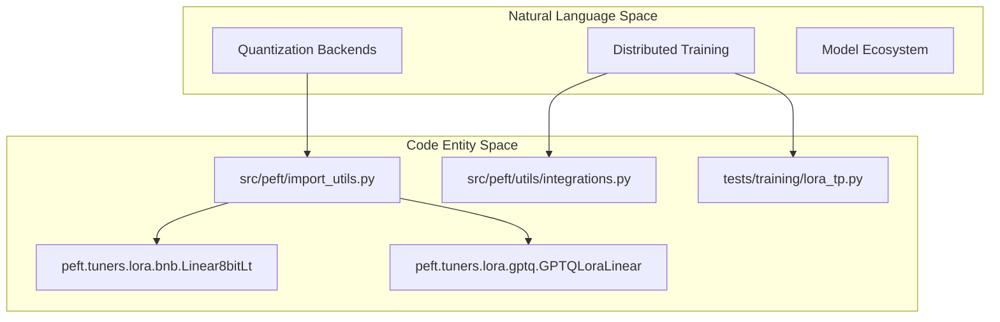
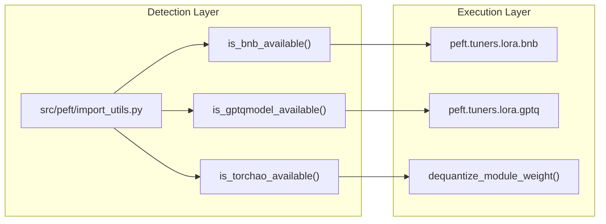

<!-- source: DeepWiki mcp.deepwiki.com · repo huggingface/peft · page 4 Integration Features · fetched 2026-10-26 -->

# Integration Features

Relevant source files

The following files were used as context for generating this wiki page:

- [docker/peft-gpu/Dockerfile](docker/peft-gpu/Dockerfile)
- [docs/source/developer_guides/quantization.md](docs/source/developer_guides/quantization.md)
- [examples/loftq_finetuning/int8_correction.py](examples/loftq_finetuning/int8_correction.py)
- [src/peft/import_utils.py](src/peft/import_utils.py)
- [src/peft/tuners/tinylora/layer.py](src/peft/tuners/tinylora/layer.py)
- [src/peft/utils/integrations.py](src/peft/utils/integrations.py)
- [tests/test_common_gpu.py](tests/test_common_gpu.py)
- [tests/test_gpu_examples.py](tests/test_gpu_examples.py)
- [tests/testing_utils.py](tests/testing_utils.py)
- [tests/training/lora_tp.py](tests/training/lora_tp.py)

## Purpose and Scope

This document provides a high-level overview of PEFT's integration capabilities with external quantization backends, distributed training frameworks, model libraries across the Hugging Face ecosystem, and specialized optimizers. PEFT bridges core adapter mechanisms with these external libraries to enable parameter-efficient fine-tuning across diverse hardware configurations, from single consumer GPUs to multi-node clusters.

For detailed implementation guides and technical specifications, refer to the child pages:
- Quantization-specific backends and initialization, see [Quantization Support](#4.1)
- Distributed training strategies, tensor parallelism, and device maps, see [Distributed Training](#4.2)
- Model ecosystem integrations (Transformers, Diffusers, Accelerate, `torch.compile`), see [Model Library Integration](#4.3)
- Specialized optimizers for PEFT methods, see [Optimizers](#4.4)

Sources: [src/peft/import_utils.py:35-190](), [src/peft/utils/integrations.py:1-58]()

## Integration Architecture Overview

PEFT's integration architecture connects high-level user workflows (Natural Language Space) to low-level execution components and runtime utilities (Code Entity Space). The system detects available third-party libraries lazily and dispatches base layers to specialized tuner wrappers.

Sources: [src/peft/import_utils.py:48-178](), [src/peft/utils/integrations.py:52-76](), [tests/training/lora_tp.py:56-66]()

## Quantization Support

PEFT integrates with multiple quantization libraries to support memory-efficient training workflows like QLoRA. Integration is handled via lazy availability checks in `src/peft/import_utils.py` and weight dequantization helpers in `src/peft/utils/integrations.py`.

Supported backends include:
- **bitsandbytes**: 8-bit and 4-bit precision via classes like `Linear8bitLt` and `Linear4bit` [src/peft/import_utils.py:48-61](), [tests/test_common_gpu.py:74-88]()
- **GPTQModel**: GPTQ quantization integration [src/peft/import_utils.py:64-98]()
- **AQLM & AWQ & HQQ & EETQ**: Low-bit quantization backends [src/peft/import_utils.py:124-136]()
- **TorchAO**: PyTorch native tensor subclass quantization backends [src/peft/import_utils.py:144-177]()

For complete setup guides, `prepare_model_for_kbit_training`, and LoftQ initialization, see [Quantization Support](#4.1).

Sources: [src/peft/import_utils.py:48-177](), [src/peft/utils/integrations.py:79-114](), [tests/test_common_gpu.py:74-88]()

## Distributed Training Integration

PEFT supports multi-GPU and distributed training frameworks, enabling sharded execution and tensor parallelism for large language models.

- **Megatron-LM & Transformers TP**: Tensor parallelism is supported via custom linear layers like `LoraParallelLinear` that split weight matrices across tensor parallel ranks [tests/training/lora_tp.py:56-85]()
- **DeepSpeed**: Integration supports Zero-3 offloading and parameter gathering via `gather_params_ctx` [src/peft/utils/integrations.py:60-76]()
- **FSDP**: Fully Sharded Data Parallel integration uses `fsdp_auto_wrap_policy` to correctly shard PEFT model parameters [tests/test_gpu_examples.py:106-107]()

For detailed distributed training configurations, launch scripts, and device mapping helpers, see [Distributed Training](#4.2).

Sources: [src/peft/utils/integrations.py:30-76](), [tests/training/lora_tp.py:56-85]()

## Model Library Integration

PEFT is natively integrated across the Hugging Face ecosystem to streamline loading, saving, and inference optimization:

- **Transformers**: Native support for `add_adapter`, `load_adapter`, and `PeftModel` wrappers [tests/test_common_gpu.py:49-57]()
- **Diffusers**: Integration for Stable Diffusion and Flux fine-tuning adapters
- **Hotswap & torch.compile**: Dynamic adapter swapping utilities (`hotswap_adapter`) designed to operate efficiently under compiled execution graphs [tests/test_gpu_examples.py:104-106]()

For library-specific integration APIs, see [Model Library Integration](#4.3).

Sources: [tests/test_gpu_examples.py:104-106](), [tests/test_common_gpu.py:49-57]()

## Optimizers

PEFT supports custom optimizer utilities tailored for parameter-efficient training dynamics:
- **LoraPlus**: Applies differential learning rates to LoRA $A$ and $B$ matrices to improve convergence rates.
- **LoraFA**: Freezes the $A$ matrix after initialization, updating only the $B$ matrix to reduce memory overhead.
- **Riemannian LoRA**: Optimizes parameters on Riemannian manifolds.

For configuration details and integration with standard training loops, see [Optimizers](#4.4).

Sources: [docs/source/_toctree.yml:1-10]()

---

