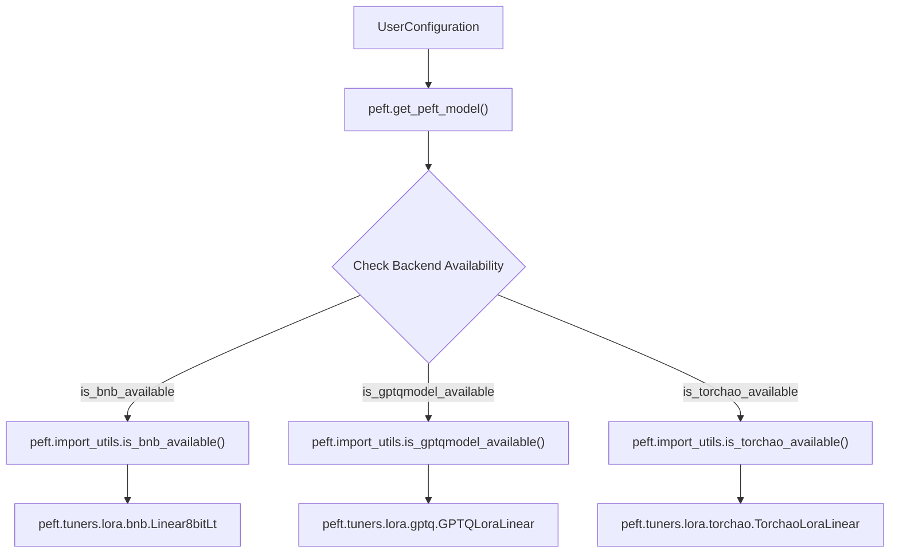
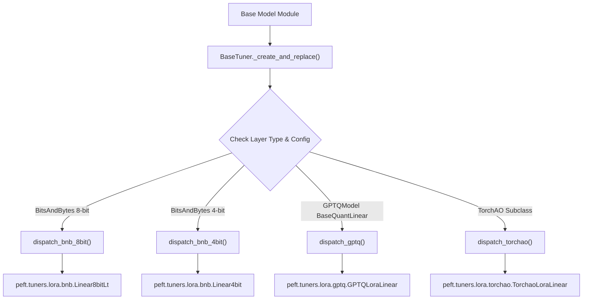

<!-- source: DeepWiki mcp.deepwiki.com · repo huggingface/peft · page 4.1 Quantization Support · fetched 2026-10-26 -->

# Quantization Support

<details>
<summary>Relevant source files</summary>

The following files were used as context for generating this wiki page:

- [docker/peft-gpu/Dockerfile](docker/peft-gpu/Dockerfile)
- [docs/source/developer_guides/quantization.md](docs/source/developer_guides/quantization.md)
- [docs/source/package_reference/vera.md](docs/source/package_reference/vera.md)
- [examples/loftq_finetuning/LoftQ_weight_replacement.ipynb](examples/loftq_finetuning/LoftQ_weight_replacement.ipynb)
- [examples/loftq_finetuning/README.md](examples/loftq_finetuning/README.md)
- [examples/loftq_finetuning/int8_correction.py](examples/loftq_finetuning/int8_correction.py)
- [examples/loftq_finetuning/quantize_save_load.py](examples/loftq_finetuning/quantize_save_load.py)
- [examples/loftq_finetuning/train_gsm8k_llama.py](examples/loftq_finetuning/train_gsm8k_llama.py)
- [examples/sequence_classification/FourierFT.ipynb](examples/sequence_classification/FourierFT.ipynb)
- [examples/sequence_classification/IA3.ipynb](examples/sequence_classification/IA3.ipynb)
- [examples/sequence_classification/LoRA-torchao-8bit-dynamic-activation.ipynb](examples/sequence_classification/LoRA-torchao-8bit-dynamic-activation.ipynb)
- [examples/sequence_classification/LoRA-torchao-8bit.ipynb](examples/sequence_classification/LoRA-torchao-8bit.ipynb)
- [examples/sequence_classification/VBLoRA.ipynb](examples/sequence_classification/VBLoRA.ipynb)
- [examples/sequence_classification/VeRA.ipynb](examples/sequence_classification/VeRA.ipynb)
- [requirements.txt](requirements.txt)
- [src/peft/import_utils.py](src/peft/import_utils.py)
- [src/peft/tuners/adalora/bnb.py](src/peft/tuners/adalora/bnb.py)
- [src/peft/tuners/adalora/gptq.py](src/peft/tuners/adalora/gptq.py)
- [src/peft/tuners/ia3/bnb.py](src/peft/tuners/ia3/bnb.py)
- [src/peft/tuners/lora/aqlm.py](src/peft/tuners/lora/aqlm.py)
- [src/peft/tuners/lora/awq.py](src/peft/tuners/lora/awq.py)
- [src/peft/tuners/lora/bnb.py](src/peft/tuners/lora/bnb.py)
- [src/peft/tuners/lora/eetq.py](src/peft/tuners/lora/eetq.py)
- [src/peft/tuners/lora/gptq.py](src/peft/tuners/lora/gptq.py)
- [src/peft/tuners/lora/hqq.py](src/peft/tuners/lora/hqq.py)
- [src/peft/tuners/lora/torchao.py](src/peft/tuners/lora/torchao.py)
- [src/peft/tuners/lora/tp_layer.py](src/peft/tuners/lora/tp_layer.py)
- [src/peft/tuners/tinylora/layer.py](src/peft/tuners/tinylora/layer.py)
- [src/peft/utils/integrations.py](src/peft/utils/integrations.py)
- [src/peft/utils/loftq_utils.py](src/peft/utils/loftq_utils.py)
- [tests/test_common_gpu.py](tests/test_common_gpu.py)
- [tests/test_gpu_examples.py](tests/test_gpu_examples.py)
- [tests/testing_utils.py](tests/testing_utils.py)
- [tests/training/lora_tp.py](tests/training/lora_tp.py)

</details>


Quantization is a critical technique for reducing the memory footprint and accelerating inference of large language models (LLMs). PEFT provides robust support for training quantized models using parameter-efficient methods, enabling fine-tuning of large models that would otherwise be impractical due to memory constraints. This page documents how PEFT integrates with various quantization backends, allowing users to combine the benefits of weight compression with efficient fine-tuning.

## Overview of Quantization Backends

PEFT integrates with several quantization libraries to enable fine-tuning of compressed models. The library uses a dispatch mechanism to automatically wrap quantized layers with adapter logic based on import availability checks (`src/peft/import_utils.py`) [src/peft/import_utils.py:48-176]().

| Quantization Method | Bit Widths | Implementation Module / Class | Check Function |
|---------------------|------------|--------------------------------|----------------|
| **BitsAndBytes** | 8-bit, 4-bit | `peft.tuners.lora.bnb.Linear8bitLt`, `Linear4bit` | `is_bnb_available()`, `is_bnb_4bit_available()` [src/peft/import_utils.py:48-61]() |
| **GPTQ** | 2-8 bit | `peft.tuners.lora.gptq.GPTQLoraLinear` [src/peft/tuners/lora/gptq.py:26-36]() | `is_gptqmodel_available()` [src/peft/import_utils.py:64-99]() |
| **AQLM** | 2-bit+ | `peft.tuners.lora.aqlm` | `is_aqlm_available()` [src/peft/import_utils.py:124-125]() |
| **EETQ** | 8-bit | `peft.tuners.lora.eetq` | `is_eetq_available()` [src/peft/import_utils.py:129-130]() |
| **HQQ** | Various | `peft.tuners.lora.hqq` | `is_hqq_available()` [src/peft/import_utils.py:134-135]() |
| **torchao** | int8, int4 | `peft.tuners.lora.torchao.TorchaoLoraLinear` | `is_torchao_available()` [src/peft/import_utils.py:144-165]() |
| **Transformer Engine** | FP8 | `peft.tuners.lora.te` | `is_te_available()` [tests/test_gpu_examples.py:96-96]() |

### Diagram: Quantization Backend Discovery to Code Entities



Sources:
- [src/peft/import_utils.py:48-176]()
- [src/peft/tuners/lora/gptq.py:26-36]()

---

## Preparing Quantized Models (`prepare_model_for_kbit_training`)

Before wrapping a quantized model with `get_peft_model`, users must call `prepare_model_for_kbit_training` [docs/source/developer_guides/quantization.md:59-65](). This helper function handles several preprocessing tasks for low-precision training:

1. **Gradient Checkpointing**: Enables gradient checkpointing via `model.gradient_checkpointing_enable()` to save memory.
2. **LayerNorm Casting**: Casts normalization layers to `float32` for numerical stability during backpropagation.
3. **Output Requires Grad**: Attaches a hook or sets `requires_grad=True` on the model outputs to ensure gradients flow correctly through frozen quantized weights.

### Example: QLoRA Setup
```python
import torch
from transformers import BitsAndBytesConfig, AutoModelForCausalLM
from peft import prepare_model_for_kbit_training, LoraConfig, get_peft_model

bnb_config = BitsAndBytesConfig(
    load_in_4bit=True,
    bnb_4bit_quant_type="nf4",
    bnb_4bit_compute_dtype=torch.bfloat16
)

model = AutoModelForCausalLM.from_pretrained("mistralai/Mistral-7B-v0.1", quantization_config=bnb_config)
model = prepare_model_for_kbit_training(model)

config = LoraConfig(r=16, lora_alpha=32, target_modules="all-linear", task_type="CAUSAL_LM")
model = get_peft_model(model, config)
```

Sources:
- [docs/source/developer_guides/quantization.md:32-92]()
- [tests/test_common_gpu.py:112-156]()

---

## Quantized Layer Implementations and Dispatch Mechanisms

PEFT matches base model linear layers to specialized quantized tuner classes using `dispatch_*` functions [src/peft/tuners/lora/bnb.py:35-183](), [src/peft/tuners/lora/gptq.py:113-133]().

### Diagram: Quantization Dispatch Data Flow



### BitsAndBytes (8-bit and 4-bit)
- `Linear8bitLt`: Wraps `bnb.nn.Linear8bitLt`. Handles forward passes with mixed precision and facilitates dequantization during weight merging [src/peft/tuners/lora/bnb.py:35-136]().
- `Linear4bit`: Wraps `bnb.nn.Linear4bit`. Manages 4-bit quantization states (`Params4bit`) and computes adapter contributions using the appropriate compute dtype.

### GPTQ and AWQ
- `GPTQLoraLinear`: Interacts with `gptqmodel.nn_modules.qlinear.BaseQuantLinear`. It preserves `target.qweight` and delegates base computations to the quantized linear module while adding adapter outputs [src/peft/tuners/lora/gptq.py:26-106](). Merging is generally unsupported due to high dequantization loss and computational cost.
- `AwqLoraLinear`: Implements equivalent delta-forward logic for AWQ-quantized weights.

### TorchAO
- `TorchaoLoraLinear`: Integrates with `torchao` tensor subclasses. It utilizes `get_apply_tensor_subclass` callbacks to handle re-quantization after adapter state manipulation [src/peft/tuners/lora/torchao.py:29-168]().

Sources:
- [src/peft/tuners/lora/bnb.py:35-183]()
- [src/peft/tuners/lora/gptq.py:26-133]()
- [src/peft/utils/integrations.py:79-114]()

---

## LoftQ Initialization

LoftQ (Low-rank Adaptation-aware Fine-tuning) minimizes quantization error by alternating between low-bit quantization and low-rank matrix decomposition via Singular Value Decomposition (SVD) [src/peft/utils/loftq_utils.py:35-123]().

### Implementation Workflow
1. **Config-driven**: Passing `init_lora_weights="loftq"` in `LoraConfig`.
2. **In-place Replacement**: Applying `replace_lora_weights_loftq()` on an already instantiated quantized PEFT model [docs/source/developer_guides/quantization.md:113-127]().

```python
from peft import replace_lora_weights_loftq
from transformers import BitsAndBytesConfig, AutoModelForCausalLM
from peft import LoraConfig, get_peft_model

bnb_config = BitsAndBytesConfig(load_in_4bit=True)
base_model = AutoModelForCausalLM.from_pretrained("facebook/opt-350m", quantization_config=bnb_config)
lora_config = LoraConfig(task_type="CAUSAL_LM", r=16)
peft_model = get_peft_model(base_model, lora_config)
replace_lora_weights_loftq(peft_model)
```

Sources:
- [src/peft/utils/loftq_utils.py:35-123]()
- [docs/source/developer_guides/quantization.md:96-127]()

---

## Merging and Unmerging with Quantized Weights

Merging adapters into quantized base weights (such as bitsandbytes 8-bit or 4-bit) requires dequantization, addition of the LoRA delta matrix, and subsequent re-quantization [src/peft/tuners/lora/bnb.py:77-164]().

### Dequantization and Merge Flow (`dequantize_bnb_weight`)
1. **Dequantize Base Weight**: `dequantize_bnb_weight()` transforms `Params4bit` or `Int8Params` back into a high-precision floating-point tensor using scaling factors (`SCB`) [src/peft/utils/integrations.py:116-143]().
2. **Compute Delta**: The adapter delta weight `(lora_B @ lora_A) * scaling` is added to the dequantized tensor [src/peft/tuners/lora/bnb.py:112-113]().
3. **Re-quantize**: The combined tensor is packed back into the low-precision container (e.g., `bnb.nn.Int8Params`) [src/peft/tuners/lora/bnb.py:122-124]().

> **Warning**: Merging quantized weights is lossy due to rounding errors during re-quantization. PEFT raises a warning when merge/unmerge operations are invoked on quantized layers [src/peft/tuners/lora/bnb.py:99-101]().

Sources:
- [src/peft/tuners/lora/bnb.py:77-164]()
- [src/peft/utils/integrations.py:79-143]()

---

