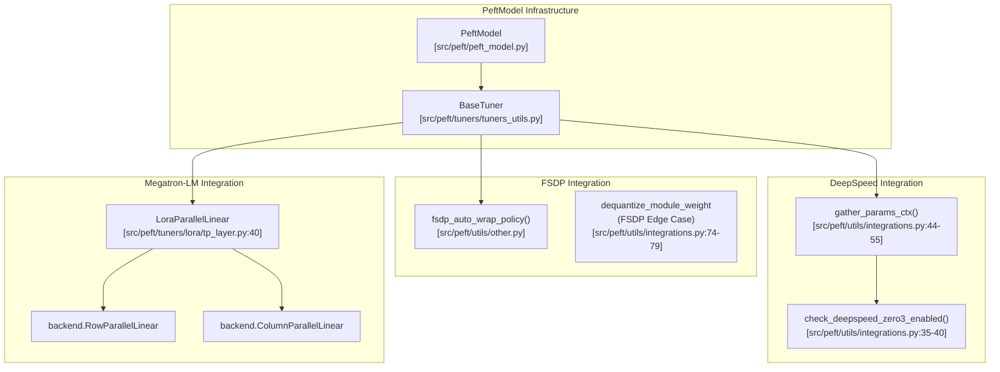
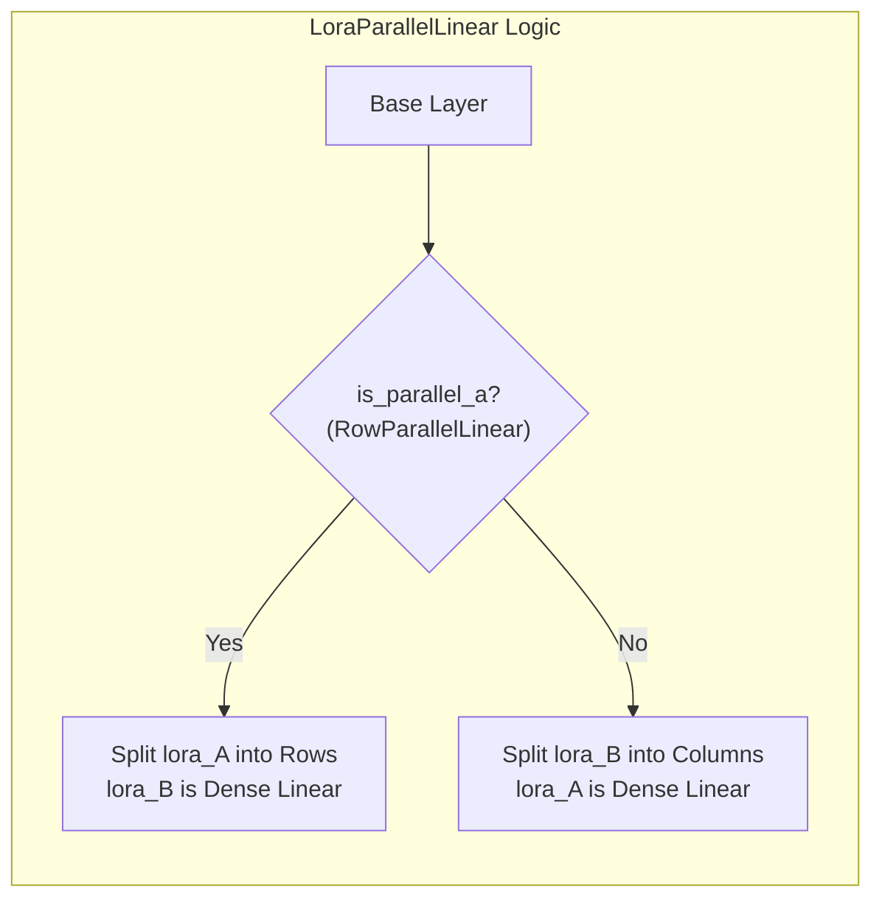

<!-- source: DeepWiki mcp.deepwiki.com · repo huggingface/peft · page 4.2 Distributed Training · fetched 2026-10-26 -->

# Distributed Training

<details>
<summary>Relevant source files</summary>

The following files were used as context for generating this wiki page:

- [Makefile](Makefile)
- [docker/peft-cpu/Dockerfile](docker/peft-cpu/Dockerfile)
- [docs/source/accelerate/deepspeed.md](docs/source/accelerate/deepspeed.md)
- [docs/source/accelerate/fsdp.md](docs/source/accelerate/fsdp.md)
- [examples/sft/README.md](examples/sft/README.md)
- [examples/sft/requirements_xpu.txt](examples/sft/requirements_xpu.txt)
- [examples/sft/train.py](examples/sft/train.py)
- [examples/sft/utils.py](examples/sft/utils.py)
- [scripts/log_reports.py](scripts/log_reports.py)
- [src/peft/auto.py](src/peft/auto.py)
- [src/peft/config.py](src/peft/config.py)
- [src/peft/tuners/adalora/bnb.py](src/peft/tuners/adalora/bnb.py)
- [src/peft/tuners/adalora/gptq.py](src/peft/tuners/adalora/gptq.py)
- [src/peft/tuners/ia3/bnb.py](src/peft/tuners/ia3/bnb.py)
- [src/peft/tuners/lora/aqlm.py](src/peft/tuners/lora/aqlm.py)
- [src/peft/tuners/lora/awq.py](src/peft/tuners/lora/awq.py)
- [src/peft/tuners/lora/bnb.py](src/peft/tuners/lora/bnb.py)
- [src/peft/tuners/lora/eetq.py](src/peft/tuners/lora/eetq.py)
- [src/peft/tuners/lora/gptq.py](src/peft/tuners/lora/gptq.py)
- [src/peft/tuners/lora/hqq.py](src/peft/tuners/lora/hqq.py)
- [src/peft/tuners/lora/tp_layer.py](src/peft/tuners/lora/tp_layer.py)
- [tests/test_auto.py](tests/test_auto.py)
- [tests/test_config.py](tests/test_config.py)
- [tests/test_hub_features.py](tests/test_hub_features.py)
- [tests/test_lora_megatron.py](tests/test_lora_megatron.py)
- [tests/training/deepspeed_config.yaml](tests/training/deepspeed_config.yaml)
- [tests/training/fsdp2_config.yaml](tests/training/fsdp2_config.yaml)
- [tests/training/fsdp_config.yaml](tests/training/fsdp_config.yaml)
- [tests/training/training.py](tests/training/training.py)

</details>


This page explains how to use PEFT with distributed training frameworks to fine-tune large language models efficiently. While PEFT methods already reduce memory usage by making only a small subset of parameters trainable, distributed training becomes necessary when working with very large models (billions of parameters) or when seeking to increase training throughput.

The document focuses on three main distributed training paradigms supported by PEFT, alongside multi-GPU device maps and the testing/training harness configurations:
1. **Megatron-LM** Tensor Parallelism via specialized layers (`LoraParallelLinear`).
2. **DeepSpeed** with ZeRO optimization (`gather_params_ctx`, `deepspeed_config.yaml`).
3. **PyTorch Fully Sharded Data Parallel (FSDP / FSDP2)** integration.
4. **Device Mapping Strategies** and multi-GPU patterns.
5. **Tests and Training Harness Configs** (`tests/training/`).

---

## Overview of Distributed Training with PEFT

Distributed training in PEFT shards model parameters, gradients, and optimizer states across multiple devices. PEFT provides specialized integration utilities to ensure that adapter parameters are handled correctly within these complex distributed environments.

### Distributed Training Architecture



Sources: [src/peft/utils/integrations.py:35-55](), [src/peft/tuners/lora/tp_layer.py:40-104](), [src/peft/utils/integrations.py:74-79]()

---

## Megatron-LM Tensor Parallelism

PEFT supports Megatron-LM style tensor parallelism through the `LoraParallelLinear` class [src/peft/tuners/lora/tp_layer.py:40](). This allows LoRA adapters to be applied to models that have already been partitioned using Column or Row parallelism.

### LoraParallelLinear Implementation
The `LoraParallelLinear` class detects whether the base layer is a `RowParallelLinear` or `ColumnParallelLinear` and adjusts the LoRA matrices accordingly [src/peft/tuners/lora/tp_layer.py:73-97]():

- **RowParallelLinear**: LoRA matrix `lora_A` is split into rows (`backend.RowParallelLinear`), while `lora_B` remains a complete linear layer [src/peft/tuners/lora/tp_layer.py:137-146]().
- **ColumnParallelLinear**: LoRA matrix `lora_A` is a complete linear layer, while `lora_B` is split into columns (`backend.ColumnParallelLinear`) [src/peft/tuners/lora/tp_layer.py:148-156]().

Allowed module namespaces are verified via `get_default_module_allowlist()` [src/peft/tuners/lora/tp_layer.py:33-38]().



### Precision and Initialization
In Megatron configurations, LoRA parameters are forced to 32-bit precision (`torch.float32`) to prevent overflow during parallel accumulation [src/peft/tuners/lora/tp_layer.py:134-135](). Initialization methods such as `init_method` are drawn directly from the `megatron_config` [src/peft/tuners/lora/tp_layer.py:77-81]().

Sources: [src/peft/tuners/lora/tp_layer.py:33-156]()

---

## DeepSpeed and FSDP Integration

[DeepSpeed](https://www.deepspeed.ai/) uses the Zero Redundancy Optimizer (ZeRO) to shard optimizer states (ZeRO-1), gradients (ZeRO-2), and parameters (ZeRO-3) [docs/source/accelerate/deepspeed.md:7](). PEFT is fully compatible with these stages, including QLoRA workflows.

### ZeRO-3 Parameter Gathering
In ZeRO-3, parameters are sharded across all GPUs. When PEFT needs to perform operations on the full weight (e.g., during initialization or merging), it must "gather" these shards. PEFT uses a specialized context manager, `gather_params_ctx` [src/peft/utils/integrations.py:44-55]():

```python
def gather_params_ctx(param, modifier_rank: Optional[int] = 0, fwd_module: torch.nn.Module = None):
    if not check_deepspeed_zero3_enabled():
        yield
        return
    import deepspeed
    with deepspeed.zero.GatheredParameters(param, modifier_rank=modifier_rank, fwd_module=fwd_module):
        yield
```

Key call sites for this context manager include:
- **LoRA Initialization**: During `pissa_init`, `corda_init`, `olora_init`, and `loftq_init` in `LoraParallelLinear` [src/peft/tuners/lora/tp_layer.py:167-178]().

### PyTorch FSDP Support
Fully Sharded Data Parallel (FSDP and FSDP2) shards model states similarly to ZeRO-3. A critical requirement for PEFT + FSDP is the `fsdp_auto_wrap_policy`, which ensures that trainable adapter parameters and frozen base parameters are wrapped in separate FSDP units [docs/source/accelerate/fsdp.md:146-154]().

When saving models trained with FSDP, the state dict type must be set to `FULL_STATE_DICT` before calling `save_model()` [examples/sft/train.py:142-144]():
```python
if trainer.is_fsdp_enabled:
    trainer.accelerator.state.fsdp_plugin.set_state_dict_type("FULL_STATE_DICT")
trainer.save_model()
```

Sources: [docs/source/accelerate/deepspeed.md:7](), [src/peft/utils/integrations.py:44-55](), [src/peft/tuners/lora/tp_layer.py:167-178](), [examples/sft/train.py:142-144]()

---

## Device Mapping Strategies

PEFT includes utilities to handle complex device placements across multiple GPUs during inference and sharded training.

### Layer and Cache Device Mapping
- **`get_layer_device_map(model)`**: Derives the device map for model layers, handling cases where layers are sharded or offloaded to CPU or disk [src/peft/utils/integrations.py:137-162]().
- **`map_cache_to_layer_device_map(model, cache)`**: Ensures that KV caches reside on the exact same device as their corresponding transformer layers, avoiding cross-device transfer latency [src/peft/utils/integrations.py:167-190]().

Sources: [src/peft/utils/integrations.py:137-190]()

---

## Tests and Training Harness Configs

The PEFT test suite contains a dedicated `tests/training/` harness used to validate distributed training setups via Accelerate launcher configurations [Makefile:66-76]().

### Harness Configuration Files
- **`tests/training/deepspeed_config.yaml`**: Configures ZeRO Stage-3 distributed training parameters.
- **`tests/training/fsdp_config.yaml`**: Configures PyTorch FSDP wrapping and mixed-precision policies.
- **`tests/training/fsdp2_config.yaml`**: Configures PyTorch FSDP2 (fully sharded data parallel v2) workflows.
- **`tests/training/tp_config.yaml`**: Configures Tensor Parallelism integration tests (`lora_tp.py`).

### Makefile Training Targets
Distributed training scripts are validated locally and in CI via Makefile targets [Makefile:66-76]():
```make
tests_training:
	accelerate launch --config_file tests/training/deepspeed_config.yaml tests/training/training.py
	accelerate launch --config_file tests/training/fsdp_config.yaml tests/training/training.py
	accelerate launch --config_file tests/training/fsdp2_config.yaml tests/training/training.py
	accelerate launch --config_file tests/training/tp_config.yaml tests/training/lora_tp.py
```

Sources: [Makefile:66-76](), [tests/training/deepspeed_config.yaml:1-22](), [tests/training/fsdp_config.yaml:1-25]()

---

## Summary of Distributed Training Patterns

| Feature | DeepSpeed ZeRO-3 | PyTorch FSDP / FSDP2 | Megatron-LM |
| :--- | :--- | :--- | :--- |
| **Sharding Level** | Optimizer, Grads, Params | Optimizer, Grads, Params | Tensor-level (TP) |
| **PEFT Adapter Handling** | `gather_params_ctx` | `fsdp_auto_wrap_policy` | `LoraParallelLinear` |
| **Quantization** | QLoRA Compatible | QLoRA Compatible | Experimental |
| **Harness Config** | `deepspeed_config.yaml` | `fsdp_config.yaml` / `fsdp2_config.yaml` | `tp_config.yaml` |

Sources: [docs/source/accelerate/deepspeed.md:42-50](), [Makefile:66-76](), [src/peft/tuners/lora/tp_layer.py:77-81]()

---

