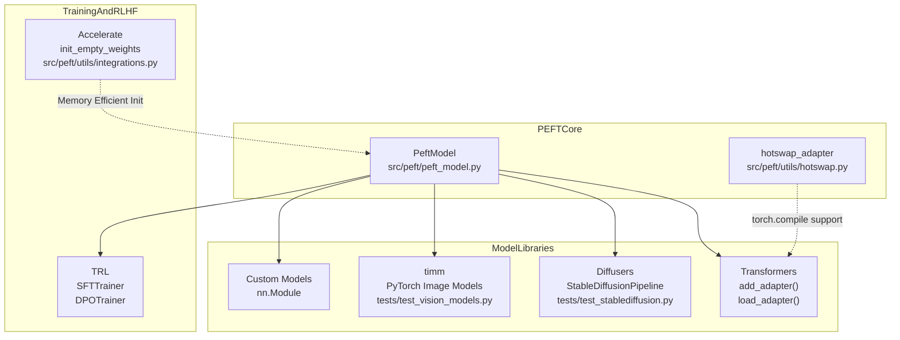
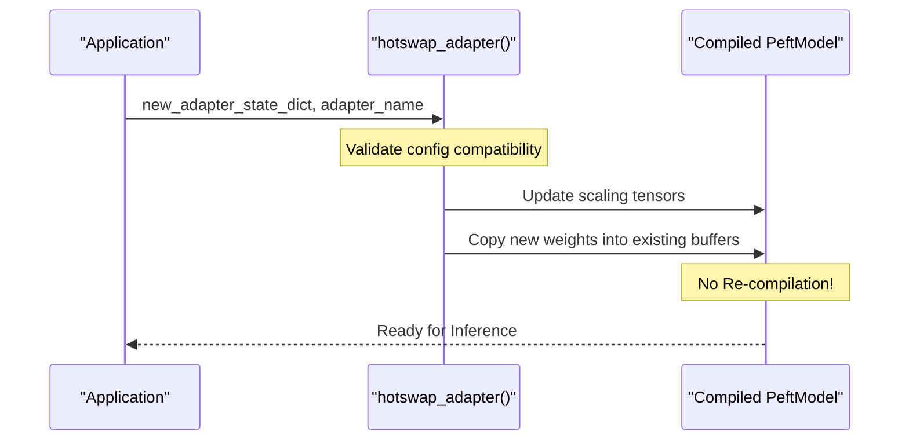
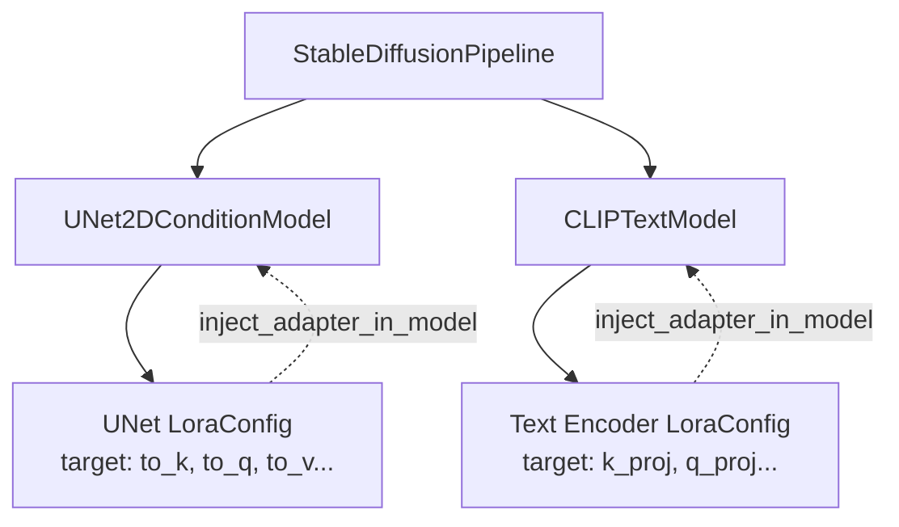

<!-- source: DeepWiki mcp.deepwiki.com · repo huggingface/peft · page 4.3 Model Library Integration · fetched 2026-10-26 -->

# Model Library Integration

Relevant source files

The following files were used as context for generating this wiki page:

- [docs/source/developer_guides/torch_compile.md](docs/source/developer_guides/torch_compile.md)
- [docs/source/package_reference/hotswap.md](docs/source/package_reference/hotswap.md)
- [src/peft/tuners/adaption_prompt/config.py](src/peft/tuners/adaption_prompt/config.py)
- [src/peft/tuners/adaption_prompt/layer.py](src/peft/tuners/adaption_prompt/layer.py)
- [src/peft/tuners/adaption_prompt/model.py](src/peft/tuners/adaption_prompt/model.py)
- [src/peft/tuners/adaption_prompt/utils.py](src/peft/tuners/adaption_prompt/utils.py)
- [src/peft/tuners/multitask_prompt_tuning/config.py](src/peft/tuners/multitask_prompt_tuning/config.py)
- [src/peft/tuners/p_tuning/config.py](src/peft/tuners/p_tuning/config.py)
- [src/peft/utils/hotswap.py](src/peft/utils/hotswap.py)
- [src/peft/utils/transformers_weight_conversion.py](src/peft/utils/transformers_weight_conversion.py)
- [tests/__init__.py](tests/__init__.py)
- [tests/test_adaption_prompt.py](tests/test_adaption_prompt.py)
- [tests/test_gptqmodel.py](tests/test_gptqmodel.py)
- [tests/test_integrations.py](tests/test_integrations.py)
- [tests/test_multitask_prompt_tuning.py](tests/test_multitask_prompt_tuning.py)
- [tests/test_stablediffusion.py](tests/test_stablediffusion.py)
- [tests/test_torch_compile.py](tests/test_torch_compile.py)
- [tests/test_vision_models.py](tests/test_vision_models.py)

This page documents how PEFT integrates with different model libraries in the Hugging Face ecosystem and beyond. PEFT provides primary integration patterns including the `get_peft_model` wrapper approach, the native `add_adapter` API for Transformers models, and specialized mechanisms like `hotswap_adapter` with `torch.compile` support. It also covers integrations with Diffusers, timm, Accelerate, and TRL.

## Integration Overview

PEFT integrates with multiple libraries across the machine learning ecosystem, each with specific integration patterns and capabilities.

**PEFT Library Integration Ecosystem**

Sources: [src/peft/peft_model.py:33-33](), [src/peft/utils/hotswap.py:32-34](), [src/peft/utils/integrations.py:29-30](), [tests/test_stablediffusion.py:48-79](), [tests/test_vision_models.py:31-41]()

## Integration Approaches

### 1. Wrapper Pattern: `get_peft_model()`
The traditional PEFT approach wraps a base model with a `PeftModel` class. This pattern is required for Diffusers, timm models, and custom architectures. It exposes model lifecycle methods like `save_pretrained` and `from_pretrained` [tests/test_adaption_prompt.py:55-57]().

### 2. Native API: `add_adapter()` (Transformers only)
Transformers models feature native PEFT support through the `add_adapter()` API [tests/test_low_level_api.py:178-185](). This modifies the model in-place without requiring an outer wrapper class.

### 3. Dynamic Hotswapping: `hotswap_adapter()`
For low-latency adapter switching environments (e.g., production inference servers), PEFT provides `hotswap_adapter`. Unlike `set_adapter`, which toggles between pre-loaded modules, `hotswap_adapter` replaces weights in-place within existing layers.

**Dynamic Hotswap Mechanism**

Sources: [src/peft/utils/hotswap.py:36-80]()

## Transformers Integration

Transformers provides seamless integration through native adapter management APIs.

### Key Integration Methods
| Method | File Reference | Description |
|--------|----------------|-------------|
| `add_adapter` | [tests/test_low_level_api.py:184-184]() | Injects adapter layers into a Transformers model in-place. |
| `load_adapter` | [src/peft/utils/save_and_load.py:29-29]() | Loads saved adapter weights into a specific adapter slot. |
| `set_adapter` | [src/peft/peft_model.py:24-24]() | Sets the active adapter(s) for the forward execution pass. |

### Weight Conversion for Transformers v5+
PEFT includes `transformers_weight_conversion.py` to handle complex cross-format weight mappings, such as converting per-expert LoRA weights into block-diagonal merged formats for Mixture-of-Experts (MoE) architectures like Mixtral [src/peft/utils/transformers_weight_conversion.py:65-100]().

Sources: [src/peft/utils/transformers_weight_conversion.py:202-205]()

## Diffusers Integration

Diffusers pipelines, such as `StableDiffusionPipeline`, contain multiple independent sub-models (UNet and Text Encoder) that require separate adapter configurations.

**Stable Diffusion Adapter Structure**

Sources: [tests/test_stablediffusion.py:48-79]()

### Supported Tuners in Diffusers
PEFT supports various tuning configurations for Diffusion pipelines, including `LoraConfig`, `LoHaConfig`, `LoKrConfig`, `OFTConfig`, `BOFTConfig`, and `HRAConfig` [tests/test_stablediffusion.py:25-37]().

## Timm Integration

PEFT integrates with `timm` (PyTorch Image Models) by targeting convolutional and linear layers within vision backbones. Using `get_peft_model()`, vision models (such as ResNet or Vision Transformers) can be adapted while freezing the base backbone parameters.

- **Targeting Vision Layers**: Convolutional layers (`nn.Conv2d`) and linear projection layers are targeted via `LoraConfig(target_modules=["convolution"])` or similar module name patterns [tests/test_vision_models.py:47-60]().
- **Normalization and Classifiers**: Vision workflows frequently require fine-tuning normalization layers or classification heads via `modules_to_save` alongside the primary adapter weights [tests/test_vision_models.py:47-60]().

Sources: [tests/test_vision_models.py:31-60]()

## Accelerate & Distributed Integration

PEFT leverages `Accelerate` features for efficient model initialization and memory handling, particularly for large models that exceed single-device memory limits.

- **Empty Weight Initialization**: The `init_empty_weights` context manager permits instant model instantiation on the `meta` device without allocating host or device memory [tests/test_integrations.py:48-55]().
- **Skip Init on Device**: The `skip_init_on_device` decorator prevents parameters from being moved to the meta device when executing inside initialization contexts, ensuring they remain on CPU or target devices as requested [tests/test_integrations.py:57-65]().

Sources: [src/peft/utils/integrations.py:29-30](), [tests/test_integrations.py:29-30]()

## TRL (RLHF) Integration

PEFT serves as a foundational component in `TRL` (Transformers Reinforcement Learning) workflows for Supervised Fine-Tuning (SFT) and Direct Preference Optimization (DPO).

- **Supervised Fine-Tuning**: `SFTTrainer` wraps models with PEFT configurations to optimize memory consumption during instruction tuning.
- **Preference Optimization**: DPOTrainer interacts directly with `PeftModel` instances to update adapter weights while keeping base model parameters frozen.

Sources: [tests/test_helpers.py:20-29]()

## Dynamic Hotswapping with `torch.compile`

When deploying models compiled with `torch.compile`, changing adapters via standard model mutation triggers costly graph recompilations. PEFT solves this using `hotswap_adapter` in combination with tensor-backed scaling factors (`_convert_scalings_to_tensor`) [src/peft/utils/hotswap.py:57-81]().

- **Scaling Conversion**: `_convert_scalings_to_tensor` transforms scalar scaling multipliers into PyTorch tensors residing on the correct device [src/peft/utils/hotswap.py:57-81]().
- **In-Place Weight Replacement**: New adapter weights are copied directly into pre-existing buffers and padded dynamically if ranks differ (`_get_padded_linear`) [src/peft/utils/hotswap.py:84-149](), bypassing graph invalidation.

Sources: [src/peft/utils/hotswap.py:36-149]()

## Helper Utilities for Integrations

PEFT provides signature restoration and scaling helpers to bridge user-facing interfaces with internal model structures.

### Signature Updating
When wrapping base models, `PeftModel` can obscure original `forward` or `generate` signatures. PEFT provides reflection utilities to restore them:
- `update_forward_signature`: Updates `model.forward` to include parent class arguments [src/peft/helpers.py:38-70]().
- `update_generate_signature`: Updates `model.generate` to include parent class arguments [src/peft/helpers.py:72-111]().
- `update_signature`: Unified wrapper for both signature types [src/peft/helpers.py:113-146]().

### Scale Rescaling
The `rescale_adapter_scale` context manager enables temporary adjustment of LoRA multipliers during inference passes without altering the stored weights [src/peft/helpers.py:169-186]().

Sources: [src/peft/helpers.py:15-186]()

---

