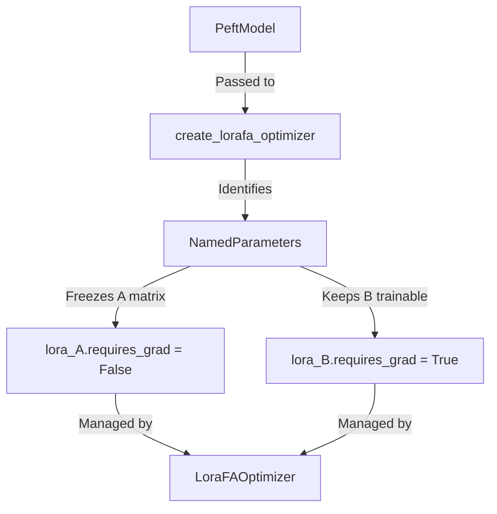
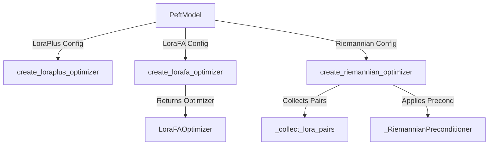

<!-- source: DeepWiki mcp.deepwiki.com · repo huggingface/peft · page 4.4 Optimizers · fetched 2026-10-26 -->

# Optimizers

<details>
<summary>Relevant source files</summary>

The following files were used as context for generating this wiki page:

- [examples/lorafa_finetune/README.md](examples/lorafa_finetune/README.md)
- [examples/lorafa_finetune/lorafa_finetuning.py](examples/lorafa_finetune/lorafa_finetuning.py)
- [method_comparison/MetaMathQA/experiments/lora/llama-3.2-3B-rank32-riemannian/adapter_config.json](method_comparison/MetaMathQA/experiments/lora/llama-3.2-3B-rank32-riemannian/adapter_config.json)
- [method_comparison/MetaMathQA/experiments/lora/llama-3.2-3B-rank32-riemannian/training_params.json](method_comparison/MetaMathQA/experiments/lora/llama-3.2-3B-rank32-riemannian/training_params.json)
- [src/peft/optimizers/__init__.py](src/peft/optimizers/__init__.py)
- [src/peft/optimizers/lorafa.py](src/peft/optimizers/lorafa.py)
- [src/peft/optimizers/loraplus.py](src/peft/optimizers/loraplus.py)
- [src/peft/optimizers/riemannian.py](src/peft/optimizers/riemannian.py)
- [src/peft/tuners/waveft/waverec2d.py](src/peft/tuners/waveft/waverec2d.py)
- [tests/test_lorafa.py](tests/test_lorafa.py)
- [tests/test_loraplus.py](tests/test_loraplus.py)
- [tests/test_riemannian_lora.py](tests/test_riemannian_lora.py)

</details>


The PEFT library provides specialized optimizer utilities located in `src/peft/optimizers/__init__.py` [src/peft/optimizers/__init__.py:1-20]() designed to enhance the training efficiency and performance of LoRA-based models. These utilities implement advanced optimization strategies: LoraPlus (differential learning rates), LoraFA (frozen-A memory efficiency), and Riemannian LoRA (Riemannian-preconditioned updates).

---

## LoraPlus

LoraPlus implements the strategy described in [Efficient Low Rank Adaptation of Large Models](https://huggingface.co/papers/2402.12354). It addresses the sub-optimal nature of using a single learning rate for both LoRA $A$ and $B$ matrices by applying a higher learning rate to the $B$ matrix.

### Implementation Details
The `create_loraplus_optimizer` function [src/peft/optimizers/loraplus.py:32-59]() acts as a factory that wraps a standard `torch.optim.Optimizer`. It partitions the model's trainable parameters into four distinct groups to apply differential learning rates and weight decay settings:

1.  **Group A**: Contains `lora_A` parameters. These use the base learning rate `lr` [src/peft/optimizers/loraplus.py:63-88]().
2.  **Group B**: Contains `lora_B` parameters and parameters with `ndim == 1` (like biases) that are subject to weight decay. These use `lr * loraplus_lr_ratio` [src/peft/optimizers/loraplus.py:81-85]().
3.  **Group B (No Decay)**: Similar to Group B but for parameters excluded from weight decay (e.g., specific biases). These also use the increased learning rate `lr * loraplus_lr_ratio` [src/peft/optimizers/loraplus.py:81-85]().
4.  **Embedding**: LoRA adapters applied to `nn.Embedding` layers. These can be assigned a specific `loraplus_lr_embedding` (defaulting to `1e-6`) [src/peft/optimizers/loraplus.py:79-80]().

### Integration with 8-bit Optimizers
When using `bitsandbytes` 8-bit optimizers (e.g., `AdamW8bit`), `create_loraplus_optimizer` automatically registers module overrides to ensure embedding weights are optimized in 32-bit for stability [src/peft/optimizers/loraplus.py:116-125]().

Sources:
- `src/peft/optimizers/loraplus.py` [32-125]()
- `src/peft/optimizers/__init__.py` [1-20]()

---

## LoraFA (Frozen-A)

LoRA-FA (Low-Rank Adaptation with Frozen-A) is a memory-efficient variant that freezes the $A$ matrix after initialization, reducing the memory overhead required to store activations for the backward pass [examples/lorafa_finetune/README.md:1-5]().

### Functional Workflow
The `create_lorafa_optimizer` utility and `LoraFAOptimizer` class [src/peft/optimizers/lorafa.py:34-80]() automate the process of setting `requires_grad = False` for all `lora_A` parameters while ensuring `lora_B` remains trainable.

### Data Flow for LoRA-FA Initialization
This diagram illustrates how the optimizer factory configures parameter groups and freezes adapter matrices.

**LoRA-FA Configuration Flow**

Sources:
- `src/peft/optimizers/lorafa.py` [34-118]()
- `examples/lorafa_finetune/README.md` [1-51]()
- `tests/test_lorafa.py` [112-161]()

---

## Riemannian LoRA Optimizer

The Riemannian LoRA optimizer, introduced via `create_riemannian_optimizer` and supported by `_RiemannianPreconditioner` [src/peft/optimizers/riemannian.py:56-157](), implements Riemannian preconditioning for LoRA weights [Riemannian Preconditioned LoRA for Fine-Tuning Foundation Models](https://huggingface.co/papers/2402.02347).

### Preconditioning Mechanics
For every matched `(lora_A, lora_B)` parameter pair collected by `_collect_lora_pairs` [src/peft/optimizers/riemannian.py:29-53](), Euclidean gradients are rescaled on each optimizer step:
- $g_A$ is preconditioned by $(B^\top B + \text{reg} \cdot I_r)^{-1}$ [src/peft/optimizers/riemannian.py:98-101]()
- $g_B$ is preconditioned by $(AA^\top + \text{reg} \cdot I_r)^{-1}$ [src/peft/optimizers/riemannian.py:104-107]()

A damping factor `reg` is added to the diagonal before inversion using `_damped_inverse` to ensure numerical stability [src/peft/optimizers/riemannian.py:77-82](). Non-LoRA parameters are updated unchanged by the underlying base optimizer class (`optimizer_cls`) [src/peft/optimizers/riemannian.py:110-144]().

Sources:
- `src/peft/optimizers/riemannian.py` [29-157]()
- `tests/test_riemannian_lora.py` [61-125]()

---

## Integration with Training Loops

All specialized PEFT optimizers (`create_loraplus_optimizer`, `create_lorafa_optimizer`, and `create_riemannian_optimizer`) are designed to integrate seamlessly with standard PyTorch training loops and Hugging Face `Trainer` instances [examples/lorafa_finetune/lorafa_finetuning.py:143-156]().

### Optimizer Code Mapping
This diagram maps the high-level optimizer abstractions to their corresponding codebase entities.

**Optimizer Code Mapping**

Sources:
- `src/peft/optimizers/__init__.py` [1-20]()
- `src/peft/optimizers/loraplus.py` [32-59]()
- `src/peft/optimizers/lorafa.py` [34-80]()
- `src/peft/optimizers/riemannian.py` [29-53,110-157]()

### Usage Example: LoRA-FA with Trainer
```python
from peft import LoraConfig, get_peft_model
from peft.optimizers import create_lorafa_optimizer
from transformers import Trainer

# 1. Initialize PEFT model
config = LoraConfig(r=16, lora_alpha=32)
peft_model = get_peft_model(model, config)

# 2. Create LoRA-FA optimizer
optimizer = create_lorafa_optimizer(
    model=peft_model, 
    r=16, 
    lora_alpha=32, 
    lr=7e-5
)

# 3. Pass optimizer tuple to Trainer
trainer = Trainer(
    model=peft_model,
    optimizers=(optimizer, None),
    ...
)
```
Sources:
- `examples/lorafa_finetune/README.md` [9-49]()
- `examples/lorafa_finetune/lorafa_finetuning.py` [143-156]()

---

