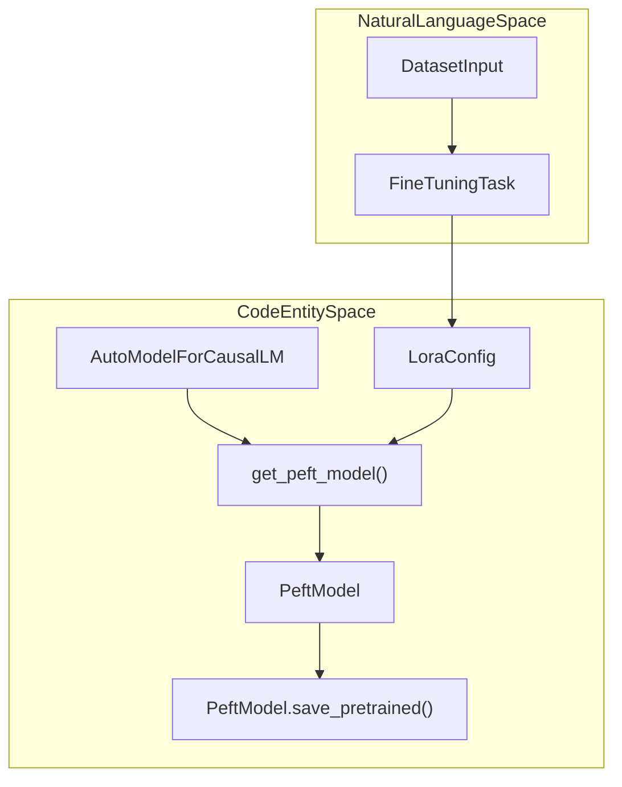
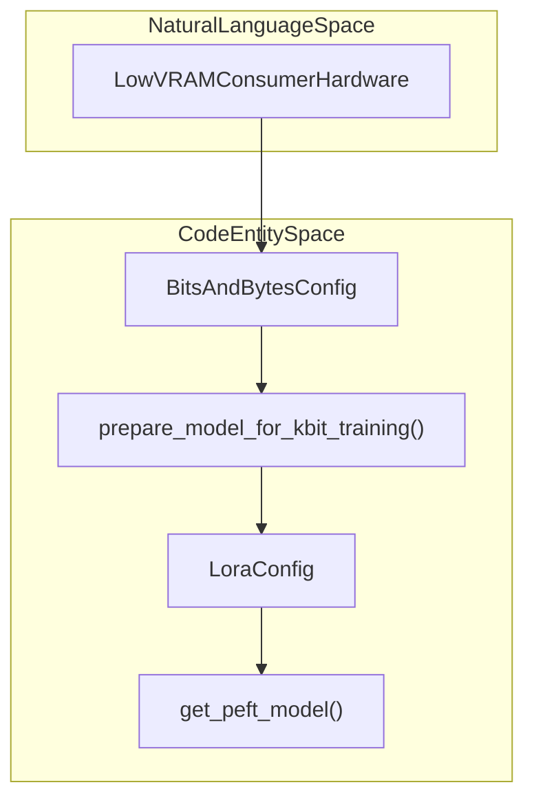

<!-- source: DeepWiki mcp.deepwiki.com · repo huggingface/peft · page 5 Example Applications · fetched 2026-10-26 -->

# Example Applications

Relevant source files

The following files were used as context for generating this wiki page:

- [README.md](README.md)
- [examples/boft_dreambooth/boft_dreambooth.md](examples/boft_dreambooth/boft_dreambooth.md)
- [examples/deft_finetuning/deft_finetuning.py](examples/deft_finetuning/deft_finetuning.py)
- [examples/delora_finetuning/delora_finetuning.py](examples/delora_finetuning/delora_finetuning.py)
- [examples/ephemeral_gpu_offloading/load_with_dora.py](examples/ephemeral_gpu_offloading/load_with_dora.py)
- [examples/eva_finetuning/README.md](examples/eva_finetuning/README.md)
- [examples/eva_finetuning/eva_finetuning.py](examples/eva_finetuning/eva_finetuning.py)
- [examples/eva_finetuning/eva_finetuning_multi_accelerator.py](examples/eva_finetuning/eva_finetuning_multi_accelerator.py)
- [examples/eva_finetuning/utils.py](examples/eva_finetuning/utils.py)
- [examples/lora_dreambooth/lora_dreambooth_inference.ipynb](examples/lora_dreambooth/lora_dreambooth_inference.ipynb)
- [examples/lora_dreambooth/train_dreambooth.py](examples/lora_dreambooth/train_dreambooth.py)
- [examples/oft_dreambooth/oft_dreambooth_inference.ipynb](examples/oft_dreambooth/oft_dreambooth_inference.ipynb)
- [examples/oft_dreambooth/train_dreambooth.py](examples/oft_dreambooth/train_dreambooth.py)
- [examples/randlora_finetuning/README.md](examples/randlora_finetuning/README.md)
- [examples/randlora_finetuning/qrandlora_finetuning.ipynb](examples/randlora_finetuning/qrandlora_finetuning.ipynb)
- [examples/randlora_finetuning/randlora_finetuning.py](examples/randlora_finetuning/randlora_finetuning.py)
- [examples/stable_diffusion/inc_flux_lora_hpu.py](examples/stable_diffusion/inc_flux_lora_hpu.py)
- [examples/stable_diffusion/train_dreambooth.py](examples/stable_diffusion/train_dreambooth.py)
- [examples/xlora/xlora_inference_mistralrs.py](examples/xlora/xlora_inference_mistralrs.py)
- [method_comparison/MetaMathQA/experiments/randlora/llama-3.2-3B-default/adapter_config.json](method_comparison/MetaMathQA/experiments/randlora/llama-3.2-3B-default/adapter_config.json)
- [scripts/stale.py](scripts/stale.py)

This page provides an overview of how PEFT (Parameter-Efficient Fine-Tuning) methods are applied across different model types and training scenarios. It serves as a high-level entry point to practical implementations, ranging from large language models to diffusion frameworks, including specialized workflows like quantization and distributed training. For deep technical details, see the child pages linked throughout.

## Common Usage Patterns

PEFT enables efficient fine-tuning by wrapping standard `torch.nn.Module` architectures. The library provides a unified interface for injecting adapters, managing trainable parameters, and serializing results.

Sources: [examples/conditional_generation/peft_adalora_seq2seq.py:43-62](), [examples/causal_language_modeling/peft_lora_clm_accelerate_ds_zero3_offload.py:111-114]()

The standard workflow across all applications involves:
1.  **Configuration**: Defining a `PeftConfig` subclass (e.g., `LoraConfig`, `AdaLoraConfig`, `PromptTuningConfig`) [examples/conditional_generation/peft_adalora_seq2seq.py:44-57]().
2.  **Injection**: Using `get_peft_model(model, peft_config)` to wrap the base model and inject adapter layers [examples/conditional_generation/peft_adalora_seq2seq.py:60]().
3.  **Training**: Optimizing only the parameters identified by the PEFT method [examples/conditional_generation/peft_adalora_seq2seq.py:61]().
4.  **Persistence**: Saving only the adapter weights via `save_pretrained()` [examples/conditional_generation/peft_adalora_seq2seq.py:162]().

Sources: [examples/conditional_generation/peft_adalora_seq2seq.py:43-62](), [examples/causal_language_modeling/peft_lora_clm_accelerate_ds_zero3_offload.py:111-114]()

---

## Language Model Fine-tuning

PEFT is extensively used for both Causal LM (decoder-only) and Seq2Seq (encoder-decoder) architectures. Examples demonstrate task-specific adaptation for sentiment analysis, classification, and conditional generation using `LoraConfig`, `AdaLoraConfig`, and `IA3Config`.

*   **Causal LM**: Fine-tuning models like BLOOM or OPT for text classification by appending labels to input sequences [examples/causal_language_modeling/peft_lora_clm_accelerate_ds_zero3_offload.py:141-167]().
*   **Seq2Seq**: Using methods like LoRA, AdaLoRA, or IA3 on models like T5 and BART for conditional generation tasks [examples/conditional_generation/peft_adalora_seq2seq.py:15-16]().
*   **Prompt Learning**: Implementing `PromptTuningConfig` or `PrefixTuningConfig` to add virtual tokens to the input space [examples/causal_language_modeling/peft_prompt_tuning_clm.ipynb:23-29]().

For end-to-end examples including dataset preparation, training loops, and evaluation, see **[Language Model Fine-tuning](#5.1)**.

Sources: [examples/causal_language_modeling/peft_lora_clm_accelerate_ds_zero3_offload.py:141-167](), [examples/conditional_generation/peft_adalora_seq2seq.py:15-16]()

---

## Vision and Diffusion Models

Beyond text, PEFT is applied to vision transformers and image generation models. This significantly reduces the VRAM required to personalize diffusion models or fine-tune vision-language models.

*   **Stable Diffusion**: Personalizing image generation via DreamBooth or ControlNet using `LoraConfig`, `OFTConfig`, or `BOFTConfig` [examples/lora_dreambooth/train_dreambooth.py:41-51](), [examples/oft_dreambooth/train_dreambooth.py:41-43]().
*   **Vision Transformers**: Applying orthogonal methods like `HRAConfig` or rank-based methods like `LoraConfig` to ViT backbones.

For details on vision and diffusion tasks, adapter conversion scripts, and hyperparameter setups, see **[Vision and Diffusion Models](#5.2)**.

Sources: [examples/lora_dreambooth/train_dreambooth.py:41-51](), [examples/oft_dreambooth/train_dreambooth.py:41-43]()

---

## Quantized Training Workflows

One of the most powerful applications of PEFT is **QLoRA**, which combines 4-bit or 8-bit quantization with low-rank adapters via `BitsAndBytesConfig` and `prepare_model_for_kbit_training()`. This allows training models with billions of parameters on consumer-grade hardware.

Sources: [examples/randlora_finetuning/randlora_finetuning.py:58-72](), [examples/eva_finetuning/README.md:74-87]()

Examples demonstrate how to use `BitsAndBytesConfig` to load models in low precision before injecting PEFT adapters, alongside LoftQ initialization and QALoRA integration. For step-by-step guides on memory optimization, see **[Quantized Training Workflows](#5.3)**.

Sources: [examples/randlora_finetuning/randlora_finetuning.py:58-72](), [examples/eva_finetuning/README.md:74-87]()

---

## Advanced Training Techniques

PEFT supports complex training scenarios beyond simple single-adapter fine-tuning:

*   **Distributed Training**: Integration with `Accelerate`, `DeepSpeed` (ZeRO-3), and `FSDP` using `fsdp_auto_wrap_policy` [examples/conditional_generation/peft_lora_seq2seq_accelerate_fsdp.py:11-15, 81-82]().
*   **Dynamic Rank Allocation**: Using `AdaLoraConfig` and the `update_and_allocate` method to dynamically adjust adapter ranks during training [examples/conditional_generation/peft_adalora_seq2seq.py:123]().
*   **Multi-Adapter Composition**: Composition of multiple adapters using `add_weighted_adapter()` for task arithmetic, TIES, or DARE merging [examples/lora_dreambooth/lora_dreambooth_inference.ipynb:145-150]().
*   **LayerNorm Tuning**: Fine-tuning only the LayerNorm parameters using `LNTuningConfig` [examples/causal_language_modeling/peft_ln_tuning_clm.ipynb:24-26]().

For details on distributed setups, ephemeral GPU offloading, mixed-batch inference with `adapter_names`, and advanced adapter manipulation, see **[Advanced Training Techniques](#5.4)**.

Sources: [examples/conditional_generation/peft_lora_seq2seq_accelerate_fsdp.py:11-15](), [examples/lora_dreambooth/lora_dreambooth_inference.ipynb:145-150]()

---

## Method Comparison Benchmarks

To evaluate the efficacy and overhead of various PEFT algorithms, the library includes a structured benchmarking suite (`method_comparison/`). 

*   **MetaMathQA Suite**: Includes benchmark runners (`run.py`, `data.py`, `utils.py`) structured under `experiments/` and `results/` layouts to assess mathematical reasoning across models like Llama.
*   **Image Generation Benchmarks**: Performance evaluations for Flux and Stable Diffusion adapter variants.
*   **Text Generation Benchmarks**: Throughput and latency suites for measuring inference overhead with active adapters.
*   **Gradio Applications**: Interactive demo apps (`app.py`, `peft-shop`) deployed to Hugging Face Spaces for visual inspection and multi-adapter experimentation.

For detailed benchmark setups and evaluation metrics, see **[Method Comparison Benchmarks](#5.5)**.

Sources: [method_comparison/MetaMathQA/experiments/randlora/llama-3.2-3B-default/adapter_config.json:1-10]()

---

