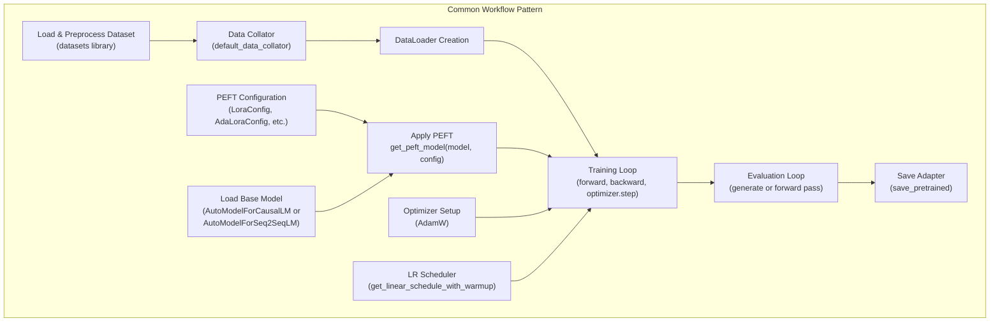
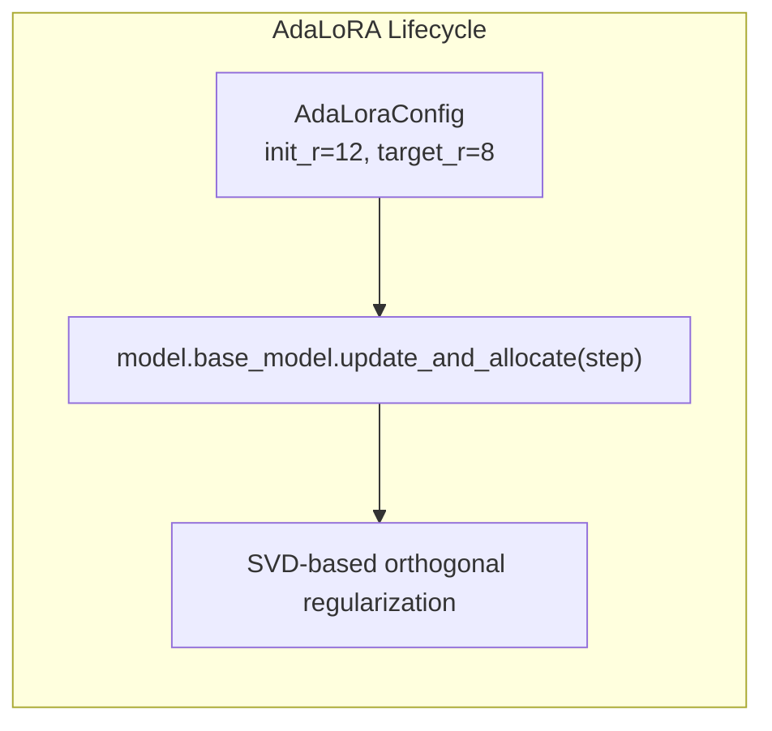

<!-- source: DeepWiki mcp.deepwiki.com · repo huggingface/peft · page 5.1 Language Model Fine-tuning · fetched 2026-10-26 -->

# Language Model Fine-tuning

<details>
<summary>Relevant source files</summary>

The following files were used as context for generating this wiki page:

- [docker/README.md](docker/README.md)
- [docs/source/package_reference/boft.md](docs/source/package_reference/boft.md)
- [docs/source/package_reference/layernorm_tuning.md](docs/source/package_reference/layernorm_tuning.md)
- [examples/boft_controlnet/boft_controlnet.md](examples/boft_controlnet/boft_controlnet.md)
- [examples/causal_language_modeling/peft_ln_tuning_clm.ipynb](examples/causal_language_modeling/peft_ln_tuning_clm.ipynb)
- [examples/causal_language_modeling/peft_lora_clm_accelerate_ds_zero3_offload.py](examples/causal_language_modeling/peft_lora_clm_accelerate_ds_zero3_offload.py)
- [examples/causal_language_modeling/peft_prefix_tuning_clm.ipynb](examples/causal_language_modeling/peft_prefix_tuning_clm.ipynb)
- [examples/causal_language_modeling/peft_prompt_tuning_clm.ipynb](examples/causal_language_modeling/peft_prompt_tuning_clm.ipynb)
- [examples/conditional_generation/multitask_prompt_tuning.ipynb](examples/conditional_generation/multitask_prompt_tuning.ipynb)
- [examples/conditional_generation/peft_adalora_seq2seq.py](examples/conditional_generation/peft_adalora_seq2seq.py)
- [examples/conditional_generation/peft_ia3_seq2seq.ipynb](examples/conditional_generation/peft_ia3_seq2seq.ipynb)
- [examples/conditional_generation/peft_lora_seq2seq.ipynb](examples/conditional_generation/peft_lora_seq2seq.ipynb)
- [examples/conditional_generation/peft_lora_seq2seq_accelerate_ds_zero3_offload.py](examples/conditional_generation/peft_lora_seq2seq_accelerate_ds_zero3_offload.py)
- [examples/conditional_generation/peft_lora_seq2seq_accelerate_fsdp.py](examples/conditional_generation/peft_lora_seq2seq_accelerate_fsdp.py)
- [examples/conditional_generation/peft_prefix_tuning_seq2seq.ipynb](examples/conditional_generation/peft_prefix_tuning_seq2seq.ipynb)
- [examples/conditional_generation/peft_prompt_tuning_seq2seq.ipynb](examples/conditional_generation/peft_prompt_tuning_seq2seq.ipynb)
- [examples/conditional_generation/peft_prompt_tuning_seq2seq_with_generate.ipynb](examples/conditional_generation/peft_prompt_tuning_seq2seq_with_generate.ipynb)
- [examples/feature_extraction/peft_lora_embedding_semantic_search.py](examples/feature_extraction/peft_lora_embedding_semantic_search.py)
- [examples/feature_extraction/peft_lora_embedding_semantic_similarity_inference.ipynb](examples/feature_extraction/peft_lora_embedding_semantic_similarity_inference.ipynb)
- [examples/feature_extraction/requirements.txt](examples/feature_extraction/requirements.txt)
- [examples/olora_finetuning/README.md](examples/olora_finetuning/README.md)
- [examples/olora_finetuning/olora_finetuning.py](examples/olora_finetuning/olora_finetuning.py)
- [examples/pissa_finetuning/README.md](examples/pissa_finetuning/README.md)
- [examples/pissa_finetuning/pissa_finetuning.py](examples/pissa_finetuning/pissa_finetuning.py)
- [examples/pissa_finetuning/preprocess.py](examples/pissa_finetuning/preprocess.py)
- [examples/sequence_classification/LoRA.ipynb](examples/sequence_classification/LoRA.ipynb)
- [examples/sequence_classification/P_Tuning.ipynb](examples/sequence_classification/P_Tuning.ipynb)
- [examples/sequence_classification/Prompt_Tuning.ipynb](examples/sequence_classification/Prompt_Tuning.ipynb)
- [examples/sequence_classification/prefix_tuning.ipynb](examples/sequence_classification/prefix_tuning.ipynb)
- [examples/token_classification/peft_lora_ner.ipynb](examples/token_classification/peft_lora_ner.ipynb)
- [examples/token_classification/peft_lora_token_cls.ipynb](examples/token_classification/peft_lora_token_cls.ipynb)
- [src/peft/tuners/ln_tuning/__init__.py](src/peft/tuners/ln_tuning/__init__.py)

</details>


This document covers the example scripts and notebooks that demonstrate fine-tuning language models using PEFT (Parameter-Efficient Fine-Tuning) methods. These examples provide practical implementations for causal language models, sequence-to-sequence tasks, sequence/token classification, and feature extraction using various PEFT techniques including LoRA, AdaLoRA, IA3, Prompt Tuning, Prefix Tuning, PiSSA, and OLoRA.

For vision and diffusion model examples, see [Vision and Diffusion Models](#5.2). For advanced techniques like embedding expansion and mixed-batch inference, see [Advanced Training Techniques](#5.4).

## Overview of Example Structure

All language model fine-tuning examples follow a consistent workflow pattern, differing primarily in their PEFT configuration, model architecture (encoder-decoder vs. decoder-only), and distributed training setup.



**Sources:** [examples/causal_language_modeling/peft_lora_clm_accelerate_ds_zero3_offload.py:110-381](), [examples/conditional_generation/peft_lora_seq2seq_accelerate_ds_zero3_offload.py:104-333](), [examples/conditional_generation/peft_adalora_seq2seq.py:43-162]()

## PEFT Method Examples

### LoRA Family (LoRA, PiSSA, OLoRA)

**Causal Language Modeling with LoRA and DeepSpeed Zero-3**
The `peft_lora_clm_accelerate_ds_zero3_offload.py` script demonstrates LoRA fine-tuning on causal language models with DeepSpeed Zero-3 memory optimization. It uses the BLOOMZ-7B1 model on the Twitter complaints classification dataset.

**Sources:** [examples/causal_language_modeling/peft_lora_clm_accelerate_ds_zero3_offload.py:112-114]()

**PiSSA (Principal Singular values and Singular vectors Adaptation)**
PiSSA factorizes a weight matrix $W$ using SVD and initializes trainable matrices $A$ and $B$ from principal singular components, while freezing a residual matrix $W^{res}$. It converges faster than standard LoRA and reduces quantization error. You can use fast SVD initialization via `init_lora_weights="pissa_niter_4"` [examples/pissa_finetuning/README.md:18](), and convert trained PiSSA adapters back to standard LoRA via `save_pretrained` with weight conversion options [examples/pissa_finetuning/README.md:75]().

**Sources:** [examples/pissa_finetuning/README.md:3-77]()

**OLoRA (Orthonormal Low Rank Adaptation)**
OLoRA applies QR decomposition to original weights, decomposing them into $\mathbf{Q}$ and $\mathbf{R}$ matrices to initialize $\mathbf{A}$ and $\mathbf{B}$. Specify `init_lora_weights="olora"` in your `LoraConfig` [examples/olora_finetuning/README.md:18]().

**Sources:** [examples/olora_finetuning/README.md:4-31]()

### AdaLoRA Fine-tuning

AdaLoRA (Adaptive LoRA) dynamically allocates the parameter budget among weight matrices based on importance scores. The `peft_adalora_seq2seq.py` script demonstrates this on `facebook/bart-base` using the `twitter-financial-news-sentiment` dataset.



Key AdaLoRA parameters:
- `init_r`: Initial rank for the matrices [examples/conditional_generation/peft_adalora_seq2seq.py:45]().
- `target_r`: Target average rank after pruning [examples/conditional_generation/peft_adalora_seq2seq.py:46]().
- `tinit` / `tfinal`: Steps to start/stop the adaptive pruning [examples/conditional_generation/peft_adalora_seq2seq.py:49-50]().
- `update_and_allocate(global_step)`: Must be called inside the training loop to perform rank updates [examples/conditional_generation/peft_adalora_seq2seq.py:123]().

**Sources:** [examples/conditional_generation/peft_adalora_seq2seq.py:44-57](), [examples/conditional_generation/peft_adalora_seq2seq.py:123]()

### IA3 Fine-tuning

IA3 (Infused Adaptive Inverse-Inner-Aggregation) scales internal activations with learned vectors. The `peft_ia3_seq2seq.ipynb` notebook demonstrates this on T5 models, achieving extremely low trainable parameter counts (typically <0.01%).

**Sources:** [examples/conditional_generation/peft_ia3_seq2seq.ipynb]()

### Prompt and Prefix Tuning

Both methods involve learnable virtual tokens.
- **Prompt Tuning**: Adds learnable embeddings to the input sequence [examples/causal_language_modeling/peft_prompt_tuning_clm.ipynb:23-29]().
- **Prefix Tuning**: Prepends learnable prefixes to the hidden states of every transformer layer [examples/causal_language_modeling/peft_prefix_tuning_clm.ipynb:23]().

**Sources:** [examples/causal_language_modeling/peft_prompt_tuning_clm.ipynb:23-29](), [examples/causal_language_modeling/peft_prefix_tuning_clm.ipynb:23]()

### Sequence/Token Classification and Feature Extraction

- **Token Classification**: Fine-tuning models like LayoutLM or BERT for named entity recognition (NER) or form understanding using `AutoModelForTokenClassification` with LoRA [examples/token_classification/peft_lora_token_cls.ipynb](), [examples/token_classification/peft_lora_ner.ipynb]()
- **Feature Extraction**: Training sentence embedding models for semantic search and similarity using `AutoModelForSentenceEmbedding` wrappers around `AutoModel` with LoRA [examples/feature_extraction/peft_lora_embedding_semantic_search.py:36-169]()

**Sources:** [examples/token_classification/peft_lora_token_cls.ipynb](), [examples/token_classification/peft_lora_ner.ipynb](), [examples/feature_extraction/peft_lora_embedding_semantic_search.py:36-169]()

## Distributed Training Integration

### DeepSpeed ZeRO-3

DeepSpeed ZeRO-3 partitions model parameters across GPUs. In PEFT, this requires specific handling for generation during evaluation.

| Feature | Configuration |
| :--- | :--- |
| **Stage 3 Compatibility** | Compatible with LoRA and QLoRA [docs/source/accelerate/deepspeed.md:15-19]() |
| **Generation** | Requires `synced_gpus=True` in Stage 3 [examples/causal_language_modeling/peft_lora_clm_accelerate_ds_zero3_offload.py:288-290]() |
| **Offloading** | Supports offloading optimizer and parameters to CPU/NVMe [docs/source/accelerate/deepspeed.md:45-46]() |

**Sources:** [docs/source/accelerate/deepspeed.md:15-19](), [examples/causal_language_modeling/peft_lora_clm_accelerate_ds_zero3_offload.py:288-290]()

### Fully Sharded Data Parallel (FSDP)

FSDP requires a specific auto-wrap policy to ensure that trainable PEFT parameters are not sharded in a way that breaks gradient computation.

```python
if getattr(trainer.accelerator.state, "fsdp_plugin", None):
    from peft.utils.other import fsdp_auto_wrap_policy
    fsdp_plugin = trainer.accelerator.state.fsdp_plugin
    fsdp_plugin.auto_wrap_policy = fsdp_auto_wrap_policy(trainer.model)
```

**Sources:** [docs/source/accelerate/fsdp.md:149-154](), [examples/conditional_generation/peft_lora_seq2seq_accelerate_fsdp.py:81-82]()

## Dataset Preparation patterns

### Financial Phrasebank and Twitter Sentiment
Datasets like `financial_phrasebank` or `twitter-financial-news-sentiment` are often mapped to natural language labels (e.g., "Bearish", "Bullish") for Seq2Seq or Causal LM tasks.

```python
# Label mapping example
classes = dataset["train"].features["label"].names
dataset = dataset.map(
    lambda x: {"text_label": [classes[label] for label in x["label"]]},
    batched=True,
)
```

**Sources:** [examples/conditional_generation/peft_adalora_seq2seq.py:32-40](), [examples/conditional_generation/peft_lora_seq2seq.ipynb:93-97]()

## Summary of Example Files

| File | Method | Model Type | Task / Dataset |
| :--- | :--- | :--- | :--- |
| `peft_adalora_seq2seq.py` | AdaLoRA | Seq2Seq | Financial Sentiment |
| `peft_lora_clm_accelerate_ds_zero3_offload.py` | LoRA | Causal LM | Twitter Complaints |
| `peft_lora_embedding_semantic_search.py` | LoRA | Feature Extraction | Semantic Search |
| `peft_prompt_tuning_clm.ipynb` | Prompt Tuning | Causal LM | Twitter Complaints |
| `peft_ia3_seq2seq.ipynb` | IA3 | Seq2Seq | Financial Sentiment |

**Sources:** [examples/conditional_generation/peft_adalora_seq2seq.py](), [examples/causal_language_modeling/peft_lora_clm_accelerate_ds_zero3_offload.py](), [examples/feature_extraction/peft_lora_embedding_semantic_search.py]()

---

