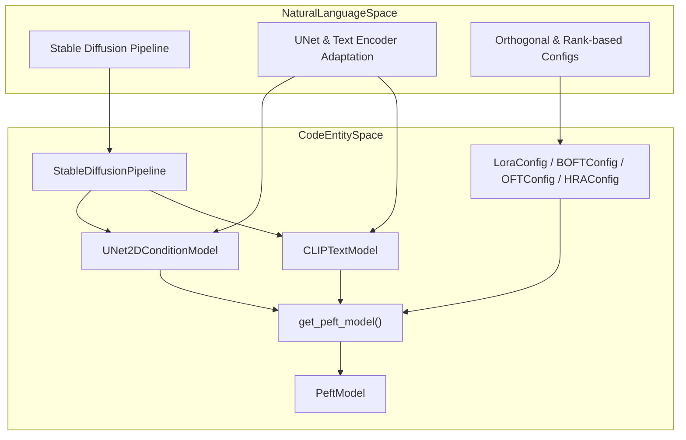
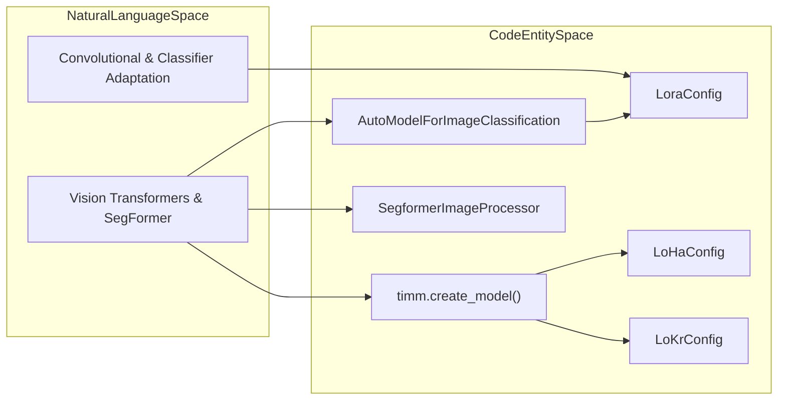

<!-- source: DeepWiki mcp.deepwiki.com · repo huggingface/peft · page 5.2 Vision and Diffusion Models · fetched 2026-10-26 -->

# Vision and Diffusion Models

Relevant source files

The following files were used as context for generating this wiki page:

- [examples/boft_controlnet/eval.py](examples/boft_controlnet/eval.py)
- [examples/boft_controlnet/requirements.txt](examples/boft_controlnet/requirements.txt)
- [examples/boft_controlnet/test_controlnet.py](examples/boft_controlnet/test_controlnet.py)
- [examples/boft_controlnet/test_controlnet.sh](examples/boft_controlnet/test_controlnet.sh)
- [examples/boft_controlnet/train_controlnet.py](examples/boft_controlnet/train_controlnet.py)
- [examples/boft_controlnet/utils/light_controlnet.py](examples/boft_controlnet/utils/light_controlnet.py)
- [examples/boft_controlnet/utils/pipeline_controlnet.py](examples/boft_controlnet/utils/pipeline_controlnet.py)
- [examples/boft_controlnet/utils/tracemalloc.py](examples/boft_controlnet/utils/tracemalloc.py)
- [examples/boft_controlnet/utils/unet_2d_condition.py](examples/boft_controlnet/utils/unet_2d_condition.py)
- [examples/boft_dreambooth/dreambooth_inference.ipynb](examples/boft_dreambooth/dreambooth_inference.ipynb)
- [examples/boft_dreambooth/requirements.txt](examples/boft_dreambooth/requirements.txt)
- [examples/boft_dreambooth/train_dreambooth.py](examples/boft_dreambooth/train_dreambooth.py)
- [examples/boft_dreambooth/utils/tracemalloc.py](examples/boft_dreambooth/utils/tracemalloc.py)
- [examples/hra_dreambooth/a_purple_qwe_backpack.png](examples/hra_dreambooth/a_purple_qwe_backpack.png)
- [examples/hra_dreambooth/dreambooth_inference.ipynb](examples/hra_dreambooth/dreambooth_inference.ipynb)
- [examples/hra_dreambooth/requirements.txt](examples/hra_dreambooth/requirements.txt)
- [examples/hra_dreambooth/train_dreambooth.py](examples/hra_dreambooth/train_dreambooth.py)
- [examples/hra_dreambooth/train_dreambooth.sh](examples/hra_dreambooth/train_dreambooth.sh)
- [examples/hra_dreambooth/utils/__init__.py](examples/hra_dreambooth/utils/__init__.py)
- [examples/hra_dreambooth/utils/args_loader.py](examples/hra_dreambooth/utils/args_loader.py)
- [examples/hra_dreambooth/utils/dataset.py](examples/hra_dreambooth/utils/dataset.py)
- [examples/hra_dreambooth/utils/tracemalloc.py](examples/hra_dreambooth/utils/tracemalloc.py)
- [examples/image_classification/README.md](examples/image_classification/README.md)
- [examples/image_classification/image_classification_peft_lora.ipynb](examples/image_classification/image_classification_peft_lora.ipynb)
- [examples/image_classification/image_classification_timm_peft_lora.ipynb](examples/image_classification/image_classification_timm_peft_lora.ipynb)
- [examples/lora_dreambooth/convert_kohya_ss_sd_lora_to_peft.py](examples/lora_dreambooth/convert_kohya_ss_sd_lora_to_peft.py)
- [examples/lora_dreambooth/convert_peft_sd_lora_to_kohya_ss.py](examples/lora_dreambooth/convert_peft_sd_lora_to_kohya_ss.py)
- [examples/multilayer_perceptron/README.md](examples/multilayer_perceptron/README.md)
- [examples/multilayer_perceptron/multilayer_perceptron_lora.ipynb](examples/multilayer_perceptron/multilayer_perceptron_lora.ipynb)
- [examples/semantic_segmentation/README.md](examples/semantic_segmentation/README.md)
- [examples/semantic_segmentation/semantic_segmentation_peft_lora.ipynb](examples/semantic_segmentation/semantic_segmentation_peft_lora.ipynb)
- [examples/stable_diffusion/convert_sd_adapter_to_peft.py](examples/stable_diffusion/convert_sd_adapter_to_peft.py)

## Purpose and Scope
This page documents the application of Parameter-Efficient Fine-Tuning (PEFT) methods—including LoRA, BOFT, HRA, OFT, LoHa, and LoKr—to vision transformers, image classification/segmentation pipelines, and diffusion models (such as DreamBooth and ControlNet). It details memory efficiency, architectural adaptations, training workflows, and adapter conversion utilities for interoperability with external tools like `kohya_ss` and Stable Diffusion WebUIs.

---

## 1. Diffusers Integration and Diffusion Models

PEFT integrates directly with the [Diffusers](https://huggingface.co/docs/diffusers) library to enable memory-efficient fine-tuning of diffusion models like Stable Diffusion. The iterative denoising process requires substantial GPU memory, making parameter-efficient methods crucial for consumer hardware.

### Architecture and Data Flow

The following diagram bridges the natural language conceptual space of diffusion adaptation to the concrete Python classes and functions in the codebase.

Sources: [examples/lora_dreambooth/train_dreambooth.py:10-50](), [tests/test_stablediffusion.py:25-50]()

### DreamBooth, ControlNet, and Orthogonal Tuners
Diffusion pipelines target specific sub-modules within the `UNet2DConditionModel` and `CLIPTextModel`.
- **UNet Target Modules**: Typically mapped to attention projection layers such as `["to_q", "to_v", "query", "value"]` [examples/lora_dreambooth/train_dreambooth.py:49]().
- **Text Encoder Target Modules**: Typically mapped to `["q_proj", "v_proj"]` [examples/lora_dreambooth/train_dreambooth.py:50]().
- **Advanced Tuners**: Beyond standard LoRA, diffusion models leverage orthogonal parameterization. For instance, ControlNet and DreamBooth models can be fine-tuned using Butterfly Orthogonal Fine-Tuning (`BOFTConfig`) [tests/test_stablediffusion.py:171-197](), Orthogonal Fine-Tuning (`OFTConfig`) [tests/test_stablediffusion.py:141-169](), and Householder Reflection Adaptation (`HRAConfig`) [tests/test_stablediffusion.py:199-221]() as executed in controlnet test harnesses [examples/boft_controlnet/test_controlnet.py:78-82]().

Sources: [examples/lora_dreambooth/train_dreambooth.py:41-55](), [tests/test_stablediffusion.py:141-221](), [examples/boft_controlnet/test_controlnet.py:75-85]()

---

## 2. Adapter Format Conversion Scripts (`kohya_ss` and Stable Diffusion)

PEFT provides dedicated conversion scripts to interoperate with community training frameworks like `kohya_ss/sd-scripts` and WebUI checkpoints.

### Conversion Utilities
- `examples/lora_dreambooth/convert_kohya_ss_sd_lora_to_peft.py`: Parses `kohya_ss` safetensors checkpoints, extracts ranks, alphas, and down/up projection weights (`lora_down`, `lora_up`), and constructs a native `LoraConfig` and `PeftModel` state dict for both UNet and text encoder [examples/lora_dreambooth/convert_kohya_ss_sd_lora_to_peft.py:39-175]().
- `examples/lora_dreambooth/convert_peft_sd_lora_to_kohya_ss.py`: Translates a PEFT-trained Stable Diffusion LoRA model back into the `kohya_ss` naming convention (`lora_unet`, `lora_te`, `lora_down`, `lora_up`, and `.alpha` keys) for WebUI usage [examples/lora_dreambooth/convert_peft_sd_lora_to_kohya_ss.py:19-100]().
- `examples/stable_diffusion/convert_sd_adapter_to_peft.py`: Extends conversion support to higher-order adapter families like `LoHaConfig` and `LoKrConfig`, processing Hadamard product and Kronecker product weights (`hada_w1_a`, `hada_w2_b`, `lokr_w1`, etc.) [examples/stable_diffusion/convert_sd_adapter_to_peft.py:32-180]().

Sources: [examples/lora_dreambooth/convert_kohya_ss_sd_lora_to_peft.py:1-175](), [examples/lora_dreambooth/convert_peft_sd_lora_to_kohya_ss.py:1-100](), [examples/stable_diffusion/convert_sd_adapter_to_peft.py:1-180]()

---

## 3. Vision Transformers and Image Classification/Segmentation

PEFT supports vision backbones from both `transformers` (e.g., ViT, SegFormer) and `timm` (e.g., PoolFormer) for image classification and semantic segmentation tasks [examples/image_classification/README.md:1-15]().

### Vision Model Architecture

Sources: [examples/image_classification/image_classification_peft_lora.ipynb:1-15](), [examples/image_classification/image_classification_timm_peft_lora.ipynb:100-135](), [tests/test_vision_models.py:24-60]()

### Implementation Details and Target Modules
- **Convolutional Layers**: In addition to linear self-attention projections, vision models often require adapting 2D convolutional layers (`Conv2d`). PEFT matches these via `target_modules` configurations [tests/test_vision_models.py:47-53]().
- **Modules to Save**: Classification heads and normalization layers are frequently fully fine-tuned alongside adapters using the `modules_to_save` parameter, ensuring correct serialization of tensors like `classifier` and normalization stats [tests/test_vision_models.py:47-53]().
- **BatchNorm Handling**: When training vision models with `BatchNorm` layers, PEFT correctly tracks `running_mean` and `running_var` inside `ModulesToSaveWrapper` to preserve statistical stability across saving and reloading cycles [tests/test_vision_models.py:109-160]().

Sources: [tests/test_vision_models.py:47-160]()

---

## 4. Advanced Adaptation Techniques

### AdaptionPrompt (LLaMA-Adapter)
For vision-language and causal models requiring prefix/prompt injection into attention blocks, PEFT provides `AdaptionPromptConfig` and `AdaptedAttention` layers [src/peft/tuners/adaption_prompt/config.py](), [src/peft/tuners/adaption_prompt/layer.py](). These modules recompute query states via `llama_compute_query_states` to inject virtual prompt tokens efficiently [src/peft/tuners/adaption_prompt/utils.py:61-125]().

### Quantization and Compilation
Large vision encoders and diffusion UNets can combine PEFT with quantization backends (`bitsandbytes`, `GPTQ`, `AWQ`) using `prepare_model_for_kbit_training` [tests/test_gptqmodel.py:85-106](). Furthermore, core tuners maintain compatibility with `torch.compile` for accelerated training and inference [tests/test_torch_compile.py:65-93]().

Sources: [src/peft/tuners/adaption_prompt/model.py:25-40](), [tests/test_gptqmodel.py:85-106](), [tests/test_torch_compile.py:65-93]()

---

