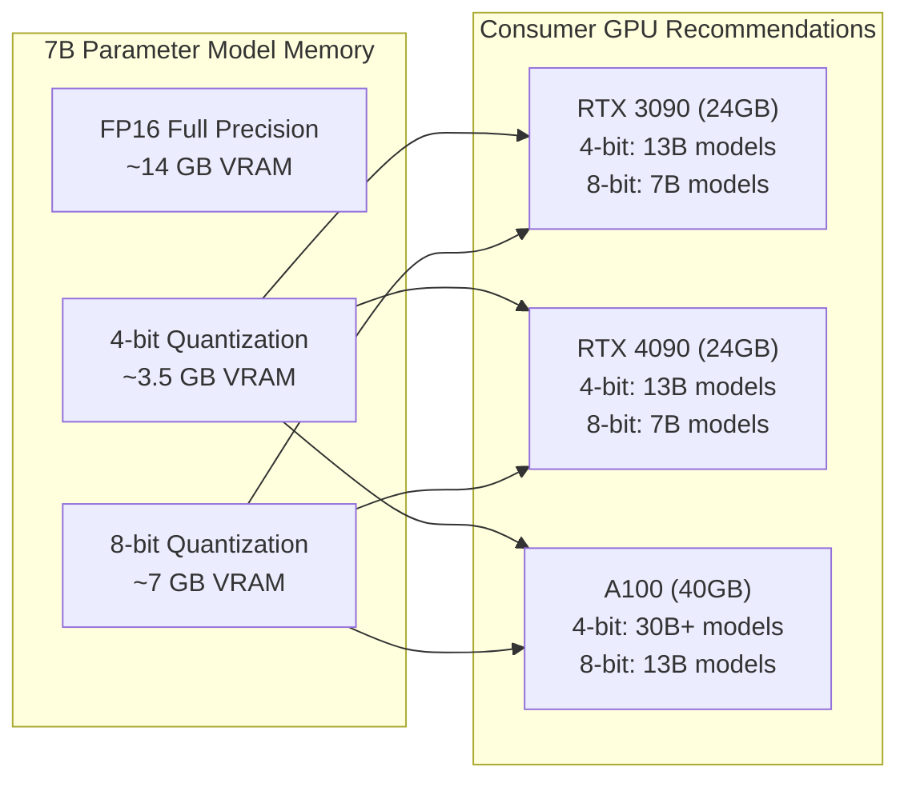
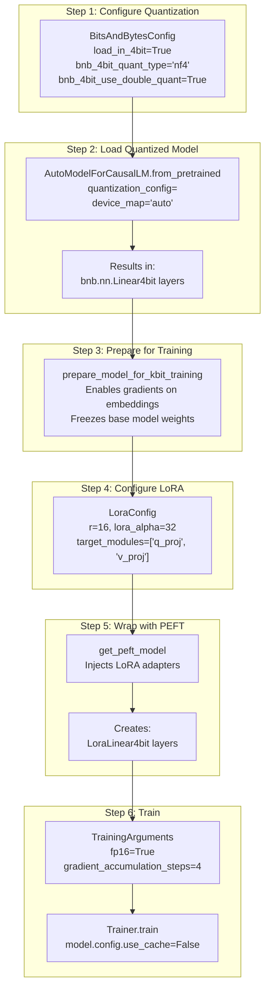
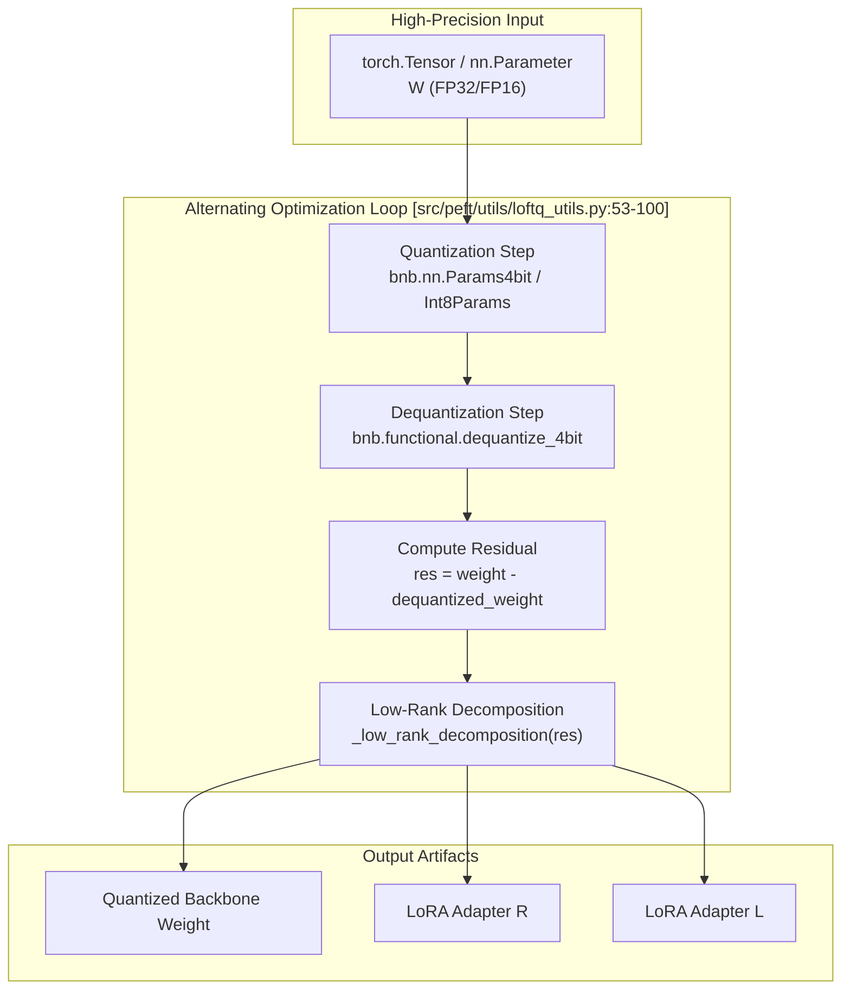
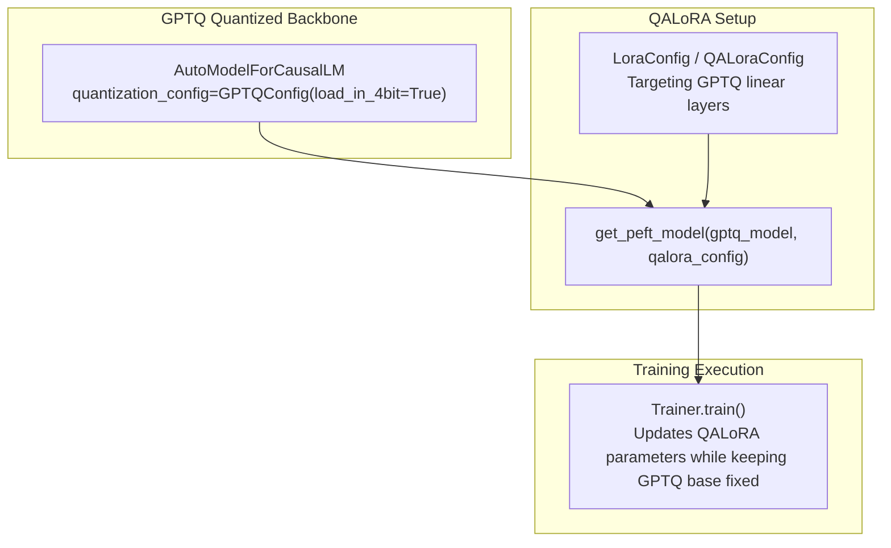
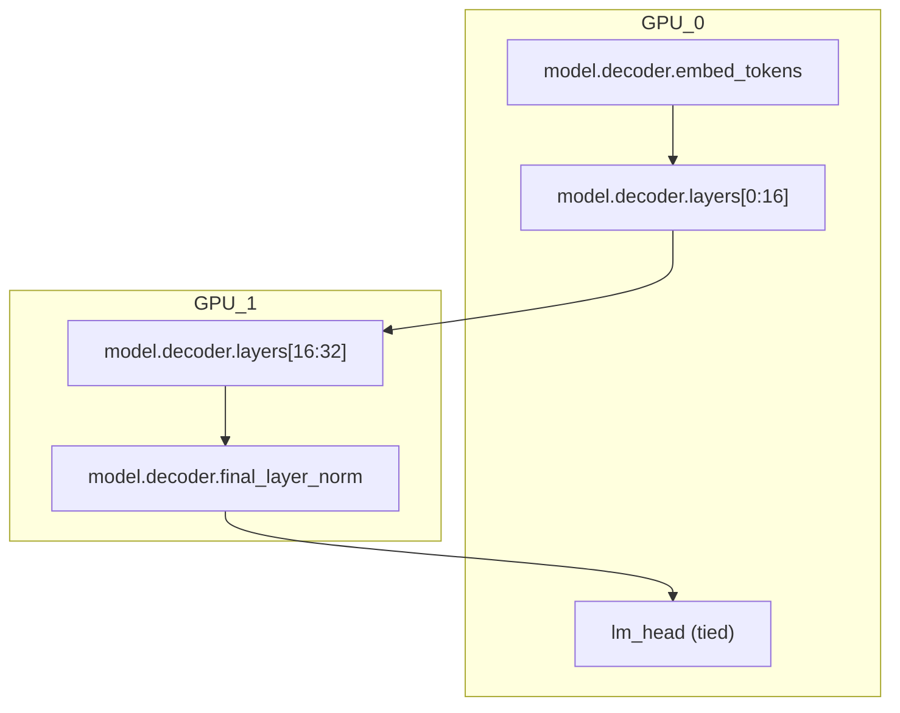

<!-- source: DeepWiki mcp.deepwiki.com · repo huggingface/peft · page 5.3 Quantized Training Workflows · fetched 2026-10-26 -->

# Quantized Training Workflows

<details>
<summary>Relevant source files</summary>

The following files were used as context for generating this wiki page:

- [docs/source/developer_guides/model_merging.md](docs/source/developer_guides/model_merging.md)
- [docs/source/package_reference/merge_utils.md](docs/source/package_reference/merge_utils.md)
- [examples/fp4_finetuning/finetune_fp4_opt_bnb_peft.py](examples/fp4_finetuning/finetune_fp4_opt_bnb_peft.py)
- [examples/int8_training/Finetune_flan_t5_large_bnb_peft.ipynb](examples/int8_training/Finetune_flan_t5_large_bnb_peft.ipynb)
- [examples/int8_training/Finetune_opt_bnb_peft.ipynb](examples/int8_training/Finetune_opt_bnb_peft.ipynb)
- [examples/int8_training/config.yaml](examples/int8_training/config.yaml)
- [examples/int8_training/fine_tune_blip2_int8.py](examples/int8_training/fine_tune_blip2_int8.py)
- [examples/int8_training/peft_adalora_whisper_large_training.py](examples/int8_training/peft_adalora_whisper_large_training.py)
- [examples/int8_training/peft_bnb_whisper_large_v2_training.ipynb](examples/int8_training/peft_bnb_whisper_large_v2_training.ipynb)
- [examples/int8_training/requirements.txt](examples/int8_training/requirements.txt)
- [examples/loftq_finetuning/LoftQ_weight_replacement.ipynb](examples/loftq_finetuning/LoftQ_weight_replacement.ipynb)
- [examples/loftq_finetuning/README.md](examples/loftq_finetuning/README.md)
- [examples/loftq_finetuning/quantize_save_load.py](examples/loftq_finetuning/quantize_save_load.py)
- [examples/loftq_finetuning/train_gsm8k_llama.py](examples/loftq_finetuning/train_gsm8k_llama.py)
- [examples/qalora_finetuning/README.md](examples/qalora_finetuning/README.md)
- [examples/qalora_finetuning/qalora_gptq_finetuning.py](examples/qalora_finetuning/qalora_gptq_finetuning.py)
- [requirements.txt](requirements.txt)
- [src/peft/utils/loftq_utils.py](src/peft/utils/loftq_utils.py)

</details>


## Purpose and Scope

This page provides step-by-step guides for training PEFT adapters on quantized models, enabling fine-tuning of large language models on consumer hardware. The focus is on practical QLoRA (Quantized LoRA) workflows combining 4-bit/8-bit quantization with LoRA adapters, including `BitsAndBytesConfig` setup, LoftQ fine-tuning scripts, QALoRA integration, and memory optimization strategies.

For detailed information about quantization integration mechanisms and supported libraries, see page 4.1 (Quantization Support). For general language model fine-tuning without quantization, see page 5.1 (Language Model Fine-tuning).

**Key workflows covered:**
- QLoRA (4-bit/FP4) training on single GPU (consumer hardware focus)
- 8-bit LoRA training for better accuracy-memory tradeoff
- Multi-GPU quantized training with device mapping
- Memory optimization techniques (gradient checkpointing, double quantization)
- Alternative backends (GPTQ, AQLM, EETQ, HQQ, torchao)
- LoftQ initialization and fine-tuning (`src/peft/utils/loftq_utils.py:53-100]`, `examples/loftq_finetuning/train_gsm8k_llama.py`)
- QALoRA and GPTQ workflows (`examples/qalora_finetuning/qalora_gptq_finetuning.py`)

**Sources:** [docs/source/developer_guides/quantization.md:1-295](), [tests/test_gpu_examples.py:240-394](), [src/peft/utils/loftq_utils.py:53-100]()

## Prerequisites and Environment Setup

### Required Dependencies

Quantized training requires specific libraries depending on the quantization backend:

| Quantization Backend | Library | Installation | Bits Supported |
|---------------------|---------|--------------|----------------|
| bitsandbytes | `bitsandbytes` | `pip install bitsandbytes` | 4-bit, 8-bit |
| GPTQ | `gptqmodel` (recommended) or `auto-gptq` | `pip install gptqmodel` | 2-8 bit |
| AQLM | `aqlm` | `pip install aqlm>=1.0.2` | 2-bit |
| EETQ | `eetq` | `pip install eetq` | 8-bit |
| HQQ | `hqq` | `pip install hqq` | 2-8 bit |
| torchao | `torchao` | `pip install torchao>=0.16.0` | int8, int4 |

PEFT checks library availability using `is_bnb_available()`, `is_gptqmodel_available()`, and related functions in [src/peft/import_utils.py:36-149](). The primary focus of this guide is bitsandbytes, which provides the most mature integration with PEFT.

### Hardware Requirements for Consumer Hardware

**Memory Requirements by Quantization Level**



The test suite validates quantized training on single GPU setups ([tests/test_gpu_examples.py:279-336]()) and multi-GPU configurations ([tests/test_gpu_examples.py:396-456]()).

**Sources:** [tests/test_gpu_examples.py:240-456](), [docs/source/developer_guides/quantization.md:19-28]()

## QLoRA Workflow: 4-bit Training on Consumer Hardware

QLoRA (Quantized Low-Rank Adaptation) enables training large models on consumer GPUs by quantizing the base model to 4-bit precision while keeping adapter parameters in higher precision.

### QLoRA Training Pipeline

**QLoRA Training Flow with Code Entity Mapping**



### Implementation Steps

1. **Configure BitsAndBytesConfig**: Set `load_in_4bit=True` and `bnb_4bit_quant_type="nf4"` for optimal precision-to-bits ratio [examples/fp4_finetuning/finetune_fp4_opt_bnb_peft.py:50-57]().
2. **Load Base Model**: Pass the config to `from_pretrained` [examples/fp4_finetuning/finetune_fp4_opt_bnb_peft.py:47-59]().
3. **Prepare Model**: Call `prepare_model_for_kbit_training(model)` to enable gradient checkpointing compatibility and freeze base weights [src/peft/utils/integrations.py:53-88]().
4. **Inject Adapters**: Use `get_peft_model(model, lora_config)` to wrap quantized layers with `LoraLinear4bit` [examples/fp4_finetuning/finetune_fp4_opt_bnb_peft.py:117]().
5. **Training Loop**: Ensure `model.config.use_cache = False` to prevent forward pass errors during training [examples/fp4_finetuning/finetune_fp4_opt_bnb_peft.py:153]().

**Sources:** [docs/source/developer_guides/quantization.md:32-94](), [examples/fp4_finetuning/finetune_fp4_opt_bnb_peft.py:47-154]()

## LoftQ Initialization and Fine-Tuning Workflows

LoftQ (Low-Rank Adaptation-Aware Quantization) initializes LoRA weights to minimize quantization error, improving performance on quantized models [src/peft/utils/loftq_utils.py:15-16]().

### LoftQ Architecture and Data Flow



There are two primary ways to apply LoftQ:
1. **Initialization during model creation**: Configure `LoftQConfig` within `LoraConfig` via `quantize_save_load.py` [examples/loftq_finetuning/quantize_save_load.py:143-155]().
2. **On-the-fly replacement**: Use `replace_lora_weights_loftq` on an existing PEFT model [examples/loftq_finetuning/README.md:142-144]().

### LoftQ Fine-Tuning Script Example

To train a LoftQ-initialized model (such as Llama-2 on GSM8K), use the provided example training script [examples/loftq_finetuning/train_gsm8k_llama.py:107-126]():

```sh
python train_gsm8k_llama.py \
    --model_name_or_path LoftQ/Llama-2-13b-hf-4bit-64rank \
    --output_dir exp_results/gsm8k/llama-2-13b/bit4-rank64/lr1e-4 \
    --learning_rate 1e-4  \
    --weight_decay 0.1 \
    --lr_scheduler_type cosine \
    --num_warmup_steps 100 \
    --seed 202 \
    --dataset_name gsm8k \
    --dataset_config main \
    --pad_to_max_length \
    --max_source_length 128 \
    --max_target_length 256 \
    --num_train_epochs 5 \
    --per_device_train_batch_size 4 \
    --per_device_eval_batch_size 4 \
    --gradient_accumulation_steps 4 \
    --with_tracking \
    --report_to tensorboard
```

**Sources:** [examples/loftq_finetuning/README.md:1-144](), [src/peft/utils/loftq_utils.py:1-123](), [examples/loftq_finetuning/quantize_save_load.py:1-193]()

## QALoRA with GPTQ

QALoRA combines group-wise vector quantization with low-rank adaptation. When working with pre-quantized GPTQ backbones, QALoRA inserts quantization-aware adapters that compensate for quantization loss during backpropagation.



For practical scripts and configuration patterns, refer to `examples/qalora_finetuning/qalora_gptq_finetuning.py` and `examples/qalora_finetuning/README.md`.

**Sources:** [examples/qalora_finetuning/README.md](), [examples/qalora_finetuning/qalora_gptq_finetuning.py]()

## Multi-GPU Quantized Training

Multi-GPU training with quantized models requires `device_map="auto"` or explicit device mapping to ensure tied weights (like embeddings and language model heads) remain on the same device.

### Device Mapping with Tied Weights



Manual device maps for models like OPT-6.7B ensure that `model.decoder.embed_tokens` and `lm_head` are both on `device: 0` [tests/testing_utils.py:48-131]().

**Sources:** [tests/test_gpu_examples.py:396-456](), [tests/testing_utils.py:48-131]()

## Memory Optimization Strategies

| Technique | Implementation | Impact |
|-----------|----------------|--------|
| **Gradient Checkpointing** | `model.gradient_checkpointing_enable()` | Reduces activation memory by recomputing during backward pass [tests/test_gpu_examples.py:471-472](). |
| **Double Quantization** | `bnb_4bit_use_double_quant=True` | Quantizes quantization constants, saving ~0.4 bits/param [examples/fp4_finetuning/finetune_fp4_opt_bnb_peft.py:55](). |
| **8-bit Optimizer** | `optim="paged_adamw_8bit"` | Offloads optimizer states to CPU/RAM when VRAM is full [examples/int8_training/peft_bnb_whisper_large_v2_training.ipynb](). |
| **Compute Dtype** | `bnb_4bit_compute_dtype=torch.bfloat16` | Faster computation and better stability on supported hardware [examples/loftq_finetuning/README.md:30](). |

**Sources:** [docs/source/developer_guides/quantization.md:17-65](), [tests/test_gpu_examples.py:459-603](), [examples/fp4_finetuning/finetune_fp4_opt_bnb_peft.py:50-57]()

## Example: Training Whisper-Large-V2 with 8-bit AdaLoRA

AdaLoRA can be combined with 8-bit quantization for adaptive rank allocation during training.

```python
from peft import AdaLoraConfig, get_peft_model
from transformers import WhisperForConditionalGeneration, BitsAndBytesConfig

model = WhisperForConditionalGeneration.from_pretrained(
    "openai/whisper-large-v2",
    quantization_config=BitsAndBytesConfig(load_in_8bit=True),
    device_map="auto"
)

config = AdaLoraConfig(
    init_r=12,
    target_r=8,
    beta1=0.85,
    beta2=0.85,
    tinit=200,
    tfinal=1000,
    deltaT=10,
    task_type="SEQ_2_SEQ_LM"
)

model = get_peft_model(model, config)
# Training loop must call model.update_and_allocate(step)
```

Implementation details for AdaLoRA rank updates and importance scoring are found in [tests/test_gpu_examples.py:459-603]().

**Sources:** [examples/int8_training/peft_adalora_whisper_large_training.py:43-200](), [tests/test_gpu_examples.py:459-603]()

---

