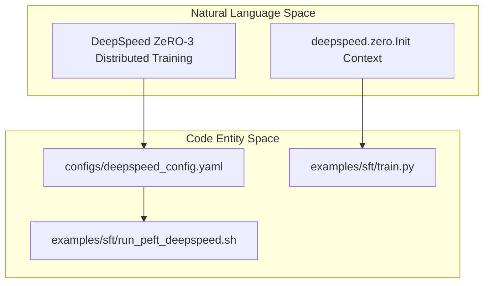
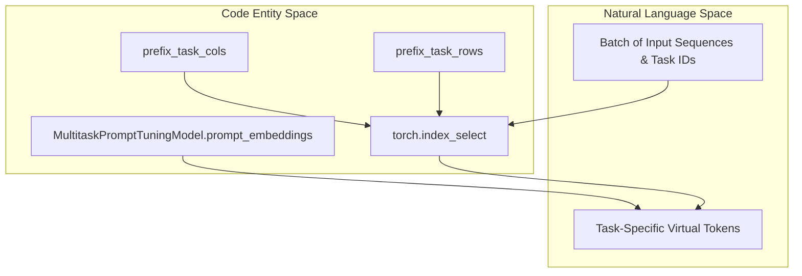

<!-- source: DeepWiki mcp.deepwiki.com · repo huggingface/peft · page 5.4 Advanced Training Techniques · fetched 2026-10-26 -->

# Advanced Training Techniques

<details>
<summary>Relevant source files</summary>

The following files were used as context for generating this wiki page:

- [docs/source/accelerate/deepspeed.md](docs/source/accelerate/deepspeed.md)
- [docs/source/accelerate/fsdp.md](docs/source/accelerate/fsdp.md)
- [docs/source/package_reference/lora_conversion.md](docs/source/package_reference/lora_conversion.md)
- [docs/source/package_reference/randlora.md](docs/source/package_reference/randlora.md)
- [examples/alora_finetuning/README.md](examples/alora_finetuning/README.md)
- [examples/alora_finetuning/alora_finetuning.py](examples/alora_finetuning/alora_finetuning.py)
- [examples/boft_dreambooth/boft_dreambooth.md](examples/boft_dreambooth/boft_dreambooth.md)
- [examples/causal_language_modeling/peft_lora_clm_with_additional_tokens.ipynb](examples/causal_language_modeling/peft_lora_clm_with_additional_tokens.ipynb)
- [examples/deft_finetuning/deft_finetuning.py](examples/deft_finetuning/deft_finetuning.py)
- [examples/delora_finetuning/README.md](examples/delora_finetuning/README.md)
- [examples/delora_finetuning/delora_finetuning.py](examples/delora_finetuning/delora_finetuning.py)
- [examples/dora_finetuning/QDoRA_finetuning.ipynb](examples/dora_finetuning/QDoRA_finetuning.ipynb)
- [examples/dora_finetuning/README.md](examples/dora_finetuning/README.md)
- [examples/dora_finetuning/dora_finetuning.py](examples/dora_finetuning/dora_finetuning.py)
- [examples/ephemeral_gpu_offloading/load_with_dora.py](examples/ephemeral_gpu_offloading/load_with_dora.py)
- [examples/eva_finetuning/README.md](examples/eva_finetuning/README.md)
- [examples/eva_finetuning/eva_finetuning.py](examples/eva_finetuning/eva_finetuning.py)
- [examples/eva_finetuning/eva_finetuning_multi_accelerator.py](examples/eva_finetuning/eva_finetuning_multi_accelerator.py)
- [examples/eva_finetuning/utils.py](examples/eva_finetuning/utils.py)
- [examples/randlora_finetuning/README.md](examples/randlora_finetuning/README.md)
- [examples/randlora_finetuning/qrandlora_finetuning.ipynb](examples/randlora_finetuning/qrandlora_finetuning.ipynb)
- [examples/randlora_finetuning/randlora_finetuning.py](examples/randlora_finetuning/randlora_finetuning.py)
- [examples/sft/README.md](examples/sft/README.md)
- [examples/sft/requirements_xpu.txt](examples/sft/requirements_xpu.txt)
- [examples/sft/run_peft.sh](examples/sft/run_peft.sh)
- [examples/sft/run_peft_deepspeed.sh](examples/sft/run_peft_deepspeed.sh)
- [examples/sft/run_peft_fsdp.sh](examples/sft/run_peft_fsdp.sh)
- [examples/sft/run_peft_fsdp_gptq.sh](examples/sft/run_peft_fsdp_gptq.sh)
- [examples/sft/run_peft_multigpu.sh](examples/sft/run_peft_multigpu.sh)
- [examples/sft/run_peft_qlora_deepspeed_stage3.sh](examples/sft/run_peft_qlora_deepspeed_stage3.sh)
- [examples/sft/run_peft_qlora_fsdp.sh](examples/sft/run_peft_qlora_fsdp.sh)
- [examples/sft/run_unsloth_peft.sh](examples/sft/run_unsloth_peft.sh)
- [examples/sft/train.py](examples/sft/train.py)
- [examples/sft/utils.py](examples/sft/utils.py)
- [examples/stable_diffusion/inc_flux_lora_hpu.py](examples/stable_diffusion/inc_flux_lora_hpu.py)
- [examples/xlora/xlora_inference_mistralrs.py](examples/xlora/xlora_inference_mistralrs.py)
- [method_comparison/MetaMathQA/experiments/randlora/llama-3.2-3B-default/adapter_config.json](method_comparison/MetaMathQA/experiments/randlora/llama-3.2-3B-default/adapter_config.json)
- [src/peft/tuners/delora/config.py](src/peft/tuners/delora/config.py)
- [src/peft/tuners/delora/model.py](src/peft/tuners/delora/model.py)
- [tests/test_mapping.py](tests/test_mapping.py)

</details>


This page documents specialized training optimizations, distributed execution backends, multitask transfer learning, adapter composition, and supervised fine-tuning (SFT) workflows using DeepSpeed and FSDP within the PEFT ecosystem.

---

## 1. Training Optimizations and Distributed Scaling

### Gradient Checkpointing & Mixed-Precision
Gradient checkpointing trades compute for memory by recomputing activations during the backward pass rather than storing all intermediate tensors. In PEFT training loops (such as `examples/sft/train.py`), gradient checkpointing is configured via the Transformers/TRL integration [examples/sft/train.py:103-108]():
```python
model.config.use_cache = not training_args.gradient_checkpointing
if training_args.gradient_checkpointing:
    training_args.gradient_checkpointing_kwargs = {"use_reentrant": model_args.use_reentrant}
```
Automatic Mixed Precision (AMP) via `torch.amp.autocast` and `GradScaler` further optimizes memory consumption and throughput.

### DeepSpeed Integration (ZeRO Stage 3)
DeepSpeed enables scaling massive models (such as Llama-70B) across multiple GPUs and nodes by sharding optimizer states, gradients, and parameters (ZeRO-3). 


*Figure 1: Mapping DeepSpeed distributed training concepts to PEFT launch artifacts.*

**Sources:** [docs/source/accelerate/deepspeed.md:25-78](), [examples/sft/train.py:103-108]()

---

## 2. Multitask and Transfer Prompt Tuning (MTPT)

Multitask Prompt Tuning (MTPT) extends standard prompt tuning by factoring task-specific virtual prompt representations into low-rank matrices, enabling zero-shot and few-shot transfer across multiple tasks.

### Architecture and Data Flow


*Figure 2: Bridging multitask prompt injection concepts to `MultitaskPromptTuningModel` code structures.*

**Sources:** [src/peft/tuners/multitask_prompt_tuning/model.py:28-121]()

### Transfer Initialization Strategies
MTPT configurations support initialization strategies defined in `MultitaskPromptTuningConfig` (`src/peft/tuners/multitask_prompt_tuning/config.py`):
- `AVERAGE_SOURCE_TASKS`: Averages parameter weights across all source task matrices.
- `EXACT_SOURCE_TASK`: Copies weights from a designated source task.
- `ONLY_SOURCE_SHARED`: Initializes using only shared prompt embeddings.

**Sources:** [src/peft/tuners/multitask_prompt_tuning/config.py:23-34](), [src/peft/tuners/multitask_prompt_tuning/model.py:59-107]()

---

## 3. Adapter Composition, Merging, and Mixed-Batch Inference

### Weighted Adapter Merging
Adapters can be dynamically combined using arithmetic operations or advanced merging algorithms (`task_arithmetic`, `ties`, `dare`) via `add_weighted_adapter`. This is particularly useful in multi-domain diffusion and language models where stylistic adapters are blended.

### Dynamic Scaling Context Manager
The `rescale_adapter_scale` utility allows temporary scaling of adapter multipliers during inference without modifying underlying weights [src/peft/helpers.py:170-181]():
```python
from peft.helpers import rescale_adapter_scale

with rescale_adapter_scale(model, multiplier=0.5):
    outputs = model(**inputs)
```

**Sources:** [src/peft/helpers.py:170-184](), [docs/source/package_reference/helpers.md:14-17]()

---

## 4. Ephemeral GPU Offloading

Ephemeral GPU offloading temporarily transfers model layers or adapter weights to host CPU memory or alternative accelerators during inactive execution phases, minimizing peak VRAM utilization. This is especially critical when running high-rank adaptations or combining quantization backends (like `bitsandbytes`) with memory-intensive tuner layers such as DoRA or RandLoRA.

**Sources:** [examples/ephemeral_gpu_offloading/load_with_dora.py](), [examples/dora_finetuning/dora_finetuning.py:51-68]()

---

## 5. Supervised Fine-Tuning (SFT) with DeepSpeed and FSDP Launch Scripts

PEFT integrates with 🤗 Accelerate to launch distributed SFT jobs using DeepSpeed and Fully Sharded Data Parallel (FSDP).

### DeepSpeed Launch Configuration
The training script `examples/sft/train.py` [examples/sft/train.py:1-156]() is launched using the Accelerate CLI and a ZeRO-3 configuration file (`examples/sft/configs/deepspeed_config.yaml`) [docs/source/accelerate/deepspeed.md:54-78]():
```bash
accelerate launch --config_file "configs/deepspeed_config.yaml" train.py \
--model_name_or_path "meta-llama/Llama-2-70b-hf" \
--use_peft_lora True \
--lora_r 8 \
--lora_alpha 16 \
--lora_target_modules "all-linear"
```

### FSDP Configuration and Auto-Wrapping
When using FSDP, PEFT provides automatic wrapping policies to segregate trainable adapter parameters from frozen base model weights [docs/source/accelerate/fsdp.md:146-154]():
```python
if getattr(trainer.accelerator.state, "fsdp_plugin", None):
    from peft.utils.other import fsdp_auto_wrap_policy
    fsdp_plugin = trainer.accelerator.state.fsdp_plugin
    fsdp_plugin.auto_wrap_policy = fsdp_auto_wrap_policy(trainer.model)
```

**Sources:** [docs/source/accelerate/deepspeed.md:54-123](), [docs/source/accelerate/fsdp.md:32-154](), [examples/sft/train.py:123-145]()

---

