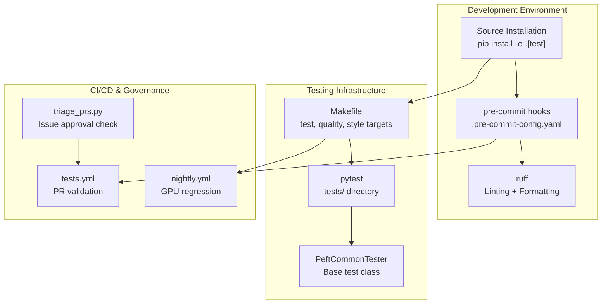

<!-- source: DeepWiki mcp.deepwiki.com · repo huggingface/peft · page 6 Developer Guides · fetched 2026-10-26 -->

# Developer Guides

Relevant source files

The following files were used as context for generating this wiki page:

- [.ai/AGENTS.md](.ai/AGENTS.md)
- [.ai/skills/peft-method-changes/SKILL.md](.ai/skills/peft-method-changes/SKILL.md)
- [.github/PULL_REQUEST_TEMPLATE.md](.github/PULL_REQUEST_TEMPLATE.md)
- [.github/workflows/triage_prs.yml](.github/workflows/triage_prs.yml)
- [AGENTS.md](AGENTS.md)
- [CLAUDE.md](CLAUDE.md)
- [docs/source/developer_guides/contributing.md](docs/source/developer_guides/contributing.md)
- [docs/source/install.md](docs/source/install.md)
- [scripts/triage_prs.py](scripts/triage_prs.py)
- [tests/README.md](tests/README.md)

This section provides resources for developers who want to contribute to PEFT, extend its functionality, or integrate it into their own projects. It covers the development workflow, testing infrastructure, code quality standards, and guidance for adding new PEFT methods. 

As a PARENT page, this document provides a high-level overview. For deep technical details, refer to the child sections linked below.

## Overview

The PEFT development ecosystem bridges source contributions, local test suites, automated CI/CD pipelines, and rigorous code quality standards. The following diagram illustrates the interaction between developer tools, testing layers, and CI workflows.

### Development Ecosystem Overview

**Sources:** [docs/source/developer_guides/contributing.md:31-92](), [.ai/AGENTS.md:46-52](), [.github/workflows/triage_prs.yml:50-72]()

---

## 6.1 Installation and Setup

Setting up a local environment for PEFT development requires cloning the repository and performing an editable installation with test dependencies [docs/source/developer_guides/contributing.md:37-67](). PEFT supports Python 3.9+ across PyPI and source distribution channels [docs/source/install.md:19-29]().

For detailed instructions on setting up virtual environments, CUDA support on special architectures, and Docker images (`peft-cpu`, `peft-gpu`), see [Installation and Setup](#6.1).

**Sources:** [docs/source/install.md:19-64](), [docs/source/developer_guides/contributing.md:31-67]()

---

## 6.2 Testing Framework

PEFT utilizes a comprehensive testing architecture centered around `PeftCommonTester` in `tests/testing_common.py`, which parametrizes validation across multiple adapter methods and model types [tests/README.md:7-15](). Tests are categorized into common matrix tests, cross-cutting features (`test_config.py`, `test_initialization.py`), method-specific files (`test_<method>.py`), and GPU/quantization suites [tests/README.md:18-28]().

For detailed information on test suite organization, skip logic (`require_*` decorators), regression testing with `--regression`, and running tests locally via `Makefile`, see [Testing Framework](#6.2).

**Sources:** [tests/README.md:1-80]()

---

## 6.3 CI/CD Infrastructure

The CI/CD pipeline automates validation through GitHub Actions workflows including `tests.yml`, `nightly.yml`, `torch_compile_tests.yml`, and docker build actions [docs/source/developer_guides/contributing.md:73-116](). Additionally, automated governance scripts such as `scripts/triage_prs.py` enforce issue approval policies for pull requests [.github/workflows/triage_prs.yml:68-72]().

For detailed documentation on self-hosted GPU runners (`aws-g6-4xlarge-plus`), model caching, PR triage automation, and reporting scripts, see [CI/CD Infrastructure](#6.3).

**Sources:** [.github/workflows/triage_prs.yml:50-72](), [scripts/triage_prs.py:1-58]()

---

## 6.4 Contributing New PEFT Methods

Adding a new parameter-efficient fine-tuning method to PEFT requires implementing a configuration class inheriting from `PeftConfig`, a tuner class subclassing `BaseTuner`, specific layer implementations, and proper registration in `src/peft/utils/mapping.py` and `src/peft/__init__.py`. Contributors must also follow backward-compatibility guidelines as outlined in `.ai/skills/peft-method-changes/SKILL.md`.

For a step-by-step implementation guide, configuration serialization rules, and required test coverage, see [Contributing New PEFT Methods](#6.4).

**Sources:** [.ai/skills/peft-method-changes/SKILL.md:1-60]()

---

## 6.5 Code Quality and Standards

Code contributions must adhere to strict formatting and linting standards enforced by `ruff` and `pre-commit` hooks [docs/source/developer_guides/contributing.md:78-102](). Developers should execute `make style` to format code and `make quality` to check linting and documentation consistency [docs/source/developer_guides/contributing.md:83-93](). AI-assisted contributions are subject to mandatory accountability policies defined in `.ai/AGENTS.md` [.ai/AGENTS.md:3-19]().

For details on doc-builder conventions, Makefile targets, and contribution workflows, see [Code Quality and Standards](#6.5).

**Sources:** [docs/source/developer_guides/contributing.md:73-102](), [.ai/AGENTS.md:1-53]()

---

## 6.6 Troubleshooting

Developing and extending PEFT can sometimes introduce complex edge cases related to quantization backend compatibility, weight merging/unmerging errors, state dict serialization across versions, device mapping, and `torch.compile` tracing. 

For common development issues and their respective solutions, see [Troubleshooting](#6.6).

**Sources:** [tests/README.md:26-35](), [.ai/skills/peft-method-changes/SKILL.md:43-84]()

---

