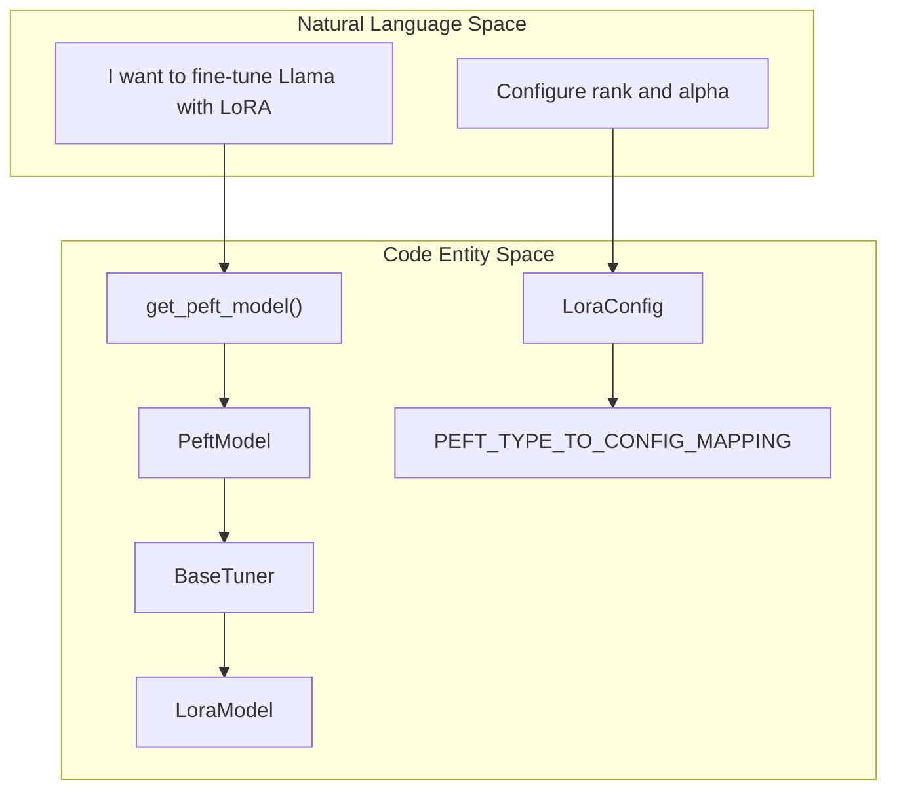
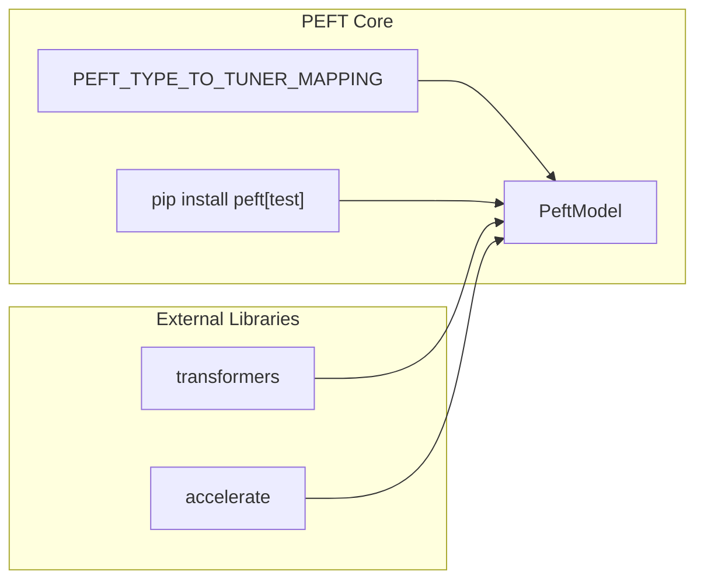

<!-- source: DeepWiki mcp.deepwiki.com · repo huggingface/peft · page 6.1 Installation and Setup · fetched 2026-10-26 -->

# Installation and Setup

<details>
<summary>Relevant source files</summary>

The following files were used as context for generating this wiki page:

- [.ai/AGENTS.md](.ai/AGENTS.md)
- [.ai/skills/peft-method-changes/SKILL.md](.ai/skills/peft-method-changes/SKILL.md)
- [.github/PULL_REQUEST_TEMPLATE.md](.github/PULL_REQUEST_TEMPLATE.md)
- [.github/workflows/build_docker_images.yml](.github/workflows/build_docker_images.yml)
- [.github/workflows/build_documentation.yml](.github/workflows/build_documentation.yml)
- [.github/workflows/build_pr_documentation.yml](.github/workflows/build_pr_documentation.yml)
- [.github/workflows/test-docker-build.yml](.github/workflows/test-docker-build.yml)
- [.github/workflows/triage_prs.yml](.github/workflows/triage_prs.yml)
- [.github/workflows/trufflehog.yml](.github/workflows/trufflehog.yml)
- [.github/workflows/upload_pr_documentation.yml](.github/workflows/upload_pr_documentation.yml)
- [AGENTS.md](AGENTS.md)
- [CLAUDE.md](CLAUDE.md)
- [Makefile](Makefile)
- [docker/peft-cpu/Dockerfile](docker/peft-cpu/Dockerfile)
- [docs/source/developer_guides/contributing.md](docs/source/developer_guides/contributing.md)
- [docs/source/install.md](docs/source/install.md)
- [scripts/log_reports.py](scripts/log_reports.py)
- [scripts/triage_prs.py](scripts/triage_prs.py)
- [tests/README.md](tests/README.md)
- [tests/training/deepspeed_config.yaml](tests/training/deepspeed_config.yaml)
- [tests/training/fsdp2_config.yaml](tests/training/fsdp2_config.yaml)
- [tests/training/fsdp_config.yaml](tests/training/fsdp_config.yaml)
- [tests/training/training.py](tests/training/training.py)

</details>


This page provides comprehensive instructions for installing and setting up the PEFT (Parameter-Efficient Fine-Tuning) library. It covers installation methods, hardware-specific configurations, Docker images, and development environment setup for both users and developers.

## 1. Installation Methods

PEFT can be installed through several methods depending on your requirements for stability or access to cutting-edge features.

### 1.1 Standard Installation from PyPI

For most users, installing the stable release from PyPI is recommended [docs/source/install.md:23-29]():

```bash
pip install peft
```

### 1.2 CUDA Windows Arm64

For systems with PyTorch CUDA on Windows Arm64 (such as NVIDIA RTX Spark laptops), install PyTorch from the NVIDIA PyPI index first [docs/source/install.md:31-46]():

```bash
nvidia-smi
pip install torch --index-url https://pypi.nvidia.com/nvtorch_oot_nightly
pip install peft
```

### 1.3 Installation from Source

To access the latest features and bug fixes that haven't been released yet [docs/source/install.md:48-54]():

```bash
pip install git+https://github.com/huggingface/peft
```

### 1.4 Editable Installation for Development

For contributors or users who want to modify the source code, use an editable installation with test dependencies [docs/source/install.md:56-63](), [.github/workflows/build_docker_images.yml:41-43]()]:

```bash
git clone https://github.com/huggingface/peft
cd peft
pip install -e ".[test]"
```

Sources: [docs/source/install.md:19-64](), [docker/peft-cpu/Dockerfile:35-35]()

## 2. Dependencies and Requirements

### 2.1 Core Requirements

PEFT is tested on **Python 3.9+** [docs/source/install.md:19-19]() and relies on modern deep learning libraries.

| Requirement | Purpose |
|-------------|---------|
| Python >=3.9 | Language runtime and execution [docs/source/install.md:19-19]() |
| PyTorch | Deep learning tensor framework |
| transformers | Model architecture integration [docker/peft-cpu/Dockerfile:33-33]() |
| accelerate | Distributed training and hardware dispatch [docker/peft-cpu/Dockerfile:34-34]() |
| safetensors | Fast and safe weight serialization |
| huggingface_hub | Model repository downloads and uploads |

### 2.2 Optional and Test Dependencies

Development and testing environments install extra requirements specified via `.[test]` [docs/source/install.md:62-62](), which include testing frameworks (`pytest`), dataset utilities (`datasets`), and diffusion components (`diffusers`).

Sources: [docs/source/install.md:19-19](), [docker/peft-cpu/Dockerfile:27-36]()

## 3. Docker Environments

PEFT provides official Docker configurations maintained and built via automated workflows (`build_docker_images.yml`) to ensure reproducible environments across CPU and GPU hardware targets [.github/workflows/build_docker_images.yml:1-87]().

### 3.1 Docker Image Variants

The repository maintains specialized Dockerfiles for different compute backends:

| Image Name | Context / Dockerfile | Purpose |
|------------|----------------------|---------|
| `huggingface/peft-cpu` | `docker/peft-cpu` [.github/workflows/build_docker_images.yml:41-43]() | CPU-only runtime, testing, and development [docker/peft-cpu/Dockerfile:1-46]() |
| `huggingface/peft-gpu` | `docker/peft-gpu` [.github/workflows/build_docker_images.yml:76-78]() | GPU training with CUDA and quantization support |

### 3.2 Building and Running Docker Containers

To build the CPU image locally using Docker Buildx or standard build commands:

```bash
docker build -c docker/peft-cpu -t huggingface/peft-cpu .
```

Sources: [.github/workflows/build_docker_images.yml:1-87](), [docker/peft-cpu/Dockerfile:1-46]()

## 4. Architecture and System Integration

The installation process configures the environment and dependencies needed to map user intent down to instantiated tuner layers and backend execution models.

### 4.1 Natural Language to Code Entity Mapping

The following diagram bridges conceptual installation requests to internal code structures.

**PEFT Setup Flow**

Sources: [docs/source/install.md:19-64](), [docker/peft-cpu/Dockerfile:27-36]()

### 4.2 Dependency Graph and Data Flow

This diagram illustrates how installation packages interact during model initialization and training.

**Component Interaction**

Sources: [docs/source/install.md:62-62](), [docker/peft-cpu/Dockerfile:33-35]()

## 5. Development Environment and Quality Assurance

Developers contributing to PEFT should set up a local editable environment and utilize the `Makefile` for code quality and test execution [docs/source/install.md:56-63](), [Makefile:1-76]().

### 5.1 Quality and Style Checks

The codebase uses `ruff` for linting and formatting, along with `doc-builder` for documentation verification [Makefile:8-19]():

```bash
# Run quality checks across source, tests, examples, and docs
make quality

# Format source code automatically
make style
```

### 5.2 Running Tests Locally

The test suite can be invoked via `pytest` targets defined in the `Makefile` [Makefile:20-65]():

```bash
# Run unit tests across 3 workers
make test

# Run common GPU decoder model tests
make tests_common_gpu
```

Sources: [Makefile:1-76](), [docs/source/developer_guides/contributing.md:33-116](), [.ai/AGENTS.md:58-79]()

---

