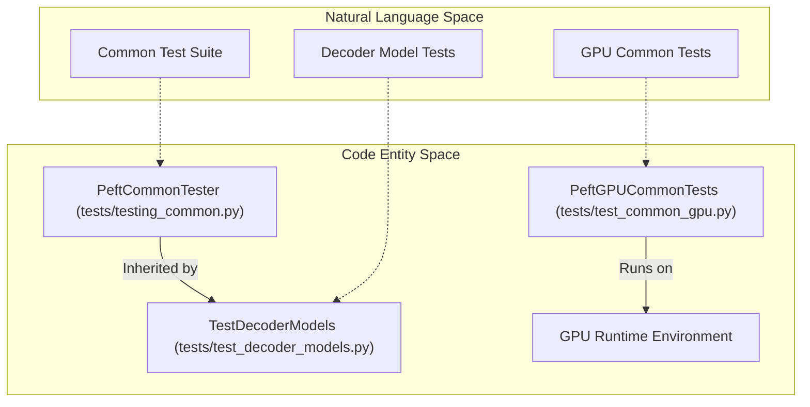
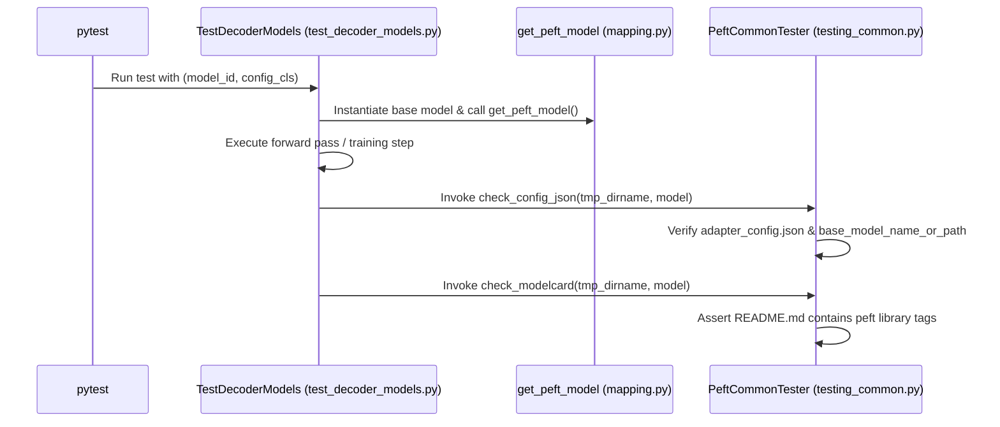

<!-- source: DeepWiki mcp.deepwiki.com · repo huggingface/peft · page 6.2 Testing Framework · fetched 2026-10-26 -->

# Testing Framework

<details>
<summary>Relevant source files</summary>

The following files were used as context for generating this wiki page:

- [Makefile](Makefile)
- [docker/peft-cpu/Dockerfile](docker/peft-cpu/Dockerfile)
- [docker/peft-gpu/Dockerfile](docker/peft-gpu/Dockerfile)
- [docs/source/developer_guides/quantization.md](docs/source/developer_guides/quantization.md)
- [examples/loftq_finetuning/int8_correction.py](examples/loftq_finetuning/int8_correction.py)
- [scripts/log_reports.py](scripts/log_reports.py)
- [src/peft/import_utils.py](src/peft/import_utils.py)
- [src/peft/peft_model.py](src/peft/peft_model.py)
- [src/peft/tuners/tinylora/layer.py](src/peft/tuners/tinylora/layer.py)
- [src/peft/utils/__init__.py](src/peft/utils/__init__.py)
- [src/peft/utils/constants.py](src/peft/utils/constants.py)
- [src/peft/utils/integrations.py](src/peft/utils/integrations.py)
- [src/peft/utils/other.py](src/peft/utils/other.py)
- [src/peft/utils/save_and_load.py](src/peft/utils/save_and_load.py)
- [tests/regression/__init__.py](tests/regression/__init__.py)
- [tests/regression/test_regression.py](tests/regression/test_regression.py)
- [tests/test_common_gpu.py](tests/test_common_gpu.py)
- [tests/test_decoder_models.py](tests/test_decoder_models.py)
- [tests/test_encoder_decoder_models.py](tests/test_encoder_decoder_models.py)
- [tests/test_feature_extraction_models.py](tests/test_feature_extraction_models.py)
- [tests/test_gpu_examples.py](tests/test_gpu_examples.py)
- [tests/test_seq_classifier.py](tests/test_seq_classifier.py)
- [tests/testing_common.py](tests/testing_common.py)
- [tests/testing_utils.py](tests/testing_utils.py)
- [tests/training/deepspeed_config.yaml](tests/training/deepspeed_config.yaml)
- [tests/training/fsdp2_config.yaml](tests/training/fsdp2_config.yaml)
- [tests/training/fsdp_config.yaml](tests/training/fsdp_config.yaml)
- [tests/training/lora_tp.py](tests/training/lora_tp.py)
- [tests/training/training.py](tests/training/training.py)

</details>


The PEFT testing framework ensures the reliability, correctness, and cross-backend compatibility of over 30 parameter-efficient fine-tuning methods across diverse model architectures (Causal LM, Seq2Seq, Vision, and Audio) and quantization backends (BitsAndBytes, GPTQ, AWQ, TorchAO, etc.). It relies on centralized base tester classes, rigorous parameterization grids, automatic hardware detection, and targeted regression suites.

Sources: [tests/testing_common.py:112-125](), [tests/test_common_gpu.py:90-94]()

## Core Testing Architecture

The foundation of the test suite is `PeftCommonTester`, which defines a standardized set of validation methods for every PEFT method and model combination. Subclasses implement specific architectures (e.g., decoder-only models, seq2seq models) while inheriting shared validation logic for adapter attributes, serialization, configuration integrity, and state-dict roundtrips.

| Feature | Code Entity | Description |
| :--- | :--- | :--- |
| **Common Base Suite** | `PeftCommonTester` (`tests/testing_common.py`) | Provides standard tests for model wrapping, attributes, and save/load cycles [tests/testing_common.py:112-125](). |
| **Config Validation** | `check_config_json` (`tests/testing_common.py`) | Asserts that `adapter_config.json` is correctly written with proper base model references [tests/testing_common.py:149-158](). |
| **Model Card Check** | `check_modelcard` (`tests/testing_common.py`) | Verifies that `README.md` includes correct library tags (`peft`, `lora`) [tests/testing_common.py:129-148](). |

### Code Entity Mapping: Test Infrastructure


Sources: [tests/testing_common.py:112-125](), [tests/test_decoder_models.py:70-75](), [tests/test_common_gpu.py:90-94]()

## Test Parameterization across Methods and Models

To prevent combinatoric explosion while achieving exhaustive test coverage, the test suite uses `pytest` and `parameterized` decorators.

### Configuration Grids
Model test suites define `ALL_CONFIGS`, an extensive list pairing configuration classes (such as `LoraConfig`, `AdaLoraConfig`, `BOFTConfig`, `IA3Config`, `VeraConfig`, etc.) with dictionary keyword arguments covering both default and edge-case initializations (e.g., `init_weights=True` vs `init_weights=False`) [tests/test_decoder_models.py:100-253]().

Similarly, model architectures are parameterized across lists such as `PEFT_DECODER_MODELS_TO_TEST` and `PEFT_ENCODER_DECODER_MODELS_TO_TEST`, pulling small, fast-loading testing weights from internal Hugging Face repositories (`peft-internal-testing/`, `trl-internal-testing/`) [tests/test_decoder_models.py:79-86](), [tests/test_encoder_decoder_models.py:64-67]().

Sources: [tests/test_decoder_models.py:79-253](), [tests/test_encoder_decoder_models.py:64-73]()

## Skip and Compatibility Logic

Because different PEFT tuner families have distinct architectural constraints (e.g., prompt learning methods do not support weight merging; certain tuners do not support `Conv1D` layers or adapter deletion), the testing framework utilizes explicit guard and skip functions.

*   **Merging Support:** `_skip_if_merging_not_supported` intercepts tests attempting adapter merging on incompatible configurations like `PromptLearningConfig`, `LilyConfig`, or `ShadowConfig` [tests/testing_common.py:83-97]().
*   **Weighted Composition:** `_skip_if_adding_weighted_adapters_not_supported` ensures multi-adapter arithmetic tests only run on supported methods like `LoraConfig` and `IA3Config` [tests/testing_common.py:99-102]().
*   **Conv1D Compatibility:** `_skip_if_conv1d_not_supported` skips non-supporting methods when testing architectures utilizing `Conv1D` layers (such as GPT-2) [tests/testing_common.py:104-110]().

Sources: [tests/testing_common.py:83-110]()

## GPU Tests and Quantization Backends

Tests requiring hardware acceleration are isolated via pytest markers (`@pytest.mark.single_gpu_tests`, `@pytest.mark.multi_gpu_tests`, `@require_bitsandbytes`) and helper decorators from `tests/testing_utils.py`.

The `PeftGPUCommonTests` class in `tests/test_common_gpu.py` executes end-to-end integration tests on GPU backends, verifying:
*   BitsAndBytes 8-bit (`BitsAndBytesConfig(load_in_8bit=True)`) and 4-bit integration with LoRA and VeRA layers (`LoraLinear8bitLt`, `LoraLinear4bit`) [tests/test_common_gpu.py:109-197]().
*   Automatic device mapping and memory cleanup via `clear_device_cache(garbage_collection=True)` in `tearDown` [tests/test_common_gpu.py:101-108]().
*   Advanced tuner runtime offloading (e.g., `FrodConfig(runtime_offload_base_weight=True)`) [tests/test_gpu_examples.py:160-175]().

Sources: [tests/test_common_gpu.py:90-197](), [tests/test_gpu_examples.py:160-175]()

## Regression and State-Dict Tests

Regression tests located under `tests/regression/` prevent the re-introduction of historical bugs and ensure stability across updates to upstream dependencies like `transformers` and `accelerate`.

Additionally, serialization and state-dict validation utilities are explicitly tested to catch malformed exports. For example, `_validate_lora_adapter_state_dict` in `src/peft/utils/save_and_load.py` inspects exported tensors before disk writes, issuing warnings if 1-D or zero-sized `lora_A` / `lora_B` parameters indicate ungathered DeepSpeed ZeRO-3 or FSDP shards [src/peft/utils/save_and_load.py:48-94]().

Sources: [src/peft/utils/save_and_load.py:48-94]()

## Data Flow in a Typical Test

The following sequence diagram outlines the execution flow when running parameterized PEFT model tests.

### Code Entity Mapping: Test Execution Flow


Sources: [tests/test_decoder_models.py:70-90](), [src/peft/mapping.py:47-53](), [tests/testing_common.py:129-158]()

## Running Tests Locally via Makefile Targets

Developers can execute tests locally using `pytest` directly or through standard `Makefile` targets. The utility function `infer_device()` in `src/peft/utils/other.py` automatically detects CUDA, MPS, XPU, NPU, or CPU runtimes [src/peft/utils/other.py:144-155]().

Common commands:
```bash
# Run code quality and style checks
make quality
make style

# Run core CPU test suites
pytest tests/test_decoder_models.py

# Run GPU-specific integration tests
pytest tests/test_common_gpu.py
```

Sources: [src/peft/utils/other.py:144-155](), [tests/test_common_gpu.py:90-94]()

---

