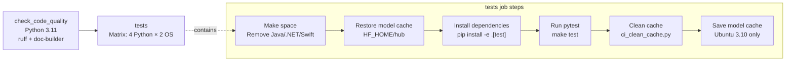

<!-- source: DeepWiki mcp.deepwiki.com · repo huggingface/peft · page 6.3 CI/CD Infrastructure · fetched 2026-10-26 -->

# CI/CD Infrastructure

Relevant source files

The following files were used as context for generating this wiki page:

- [.github/ISSUE_TEMPLATE/bug-report.yml](.github/ISSUE_TEMPLATE/bug-report.yml)
- [.github/ISSUE_TEMPLATE/feature-request.yml](.github/ISSUE_TEMPLATE/feature-request.yml)
- [.github/workflows/build_docker_images.yml](.github/workflows/build_docker_images.yml)
- [.github/workflows/build_documentation.yml](.github/workflows/build_documentation.yml)
- [.github/workflows/build_pr_documentation.yml](.github/workflows/build_pr_documentation.yml)
- [.github/workflows/deploy_method_comparison_app.yml](.github/workflows/deploy_method_comparison_app.yml)
- [.github/workflows/integrations_tests.yml](.github/workflows/integrations_tests.yml)
- [.github/workflows/nightly.yml](.github/workflows/nightly.yml)
- [.github/workflows/stale.yml](.github/workflows/stale.yml)
- [.github/workflows/test-docker-build.yml](.github/workflows/test-docker-build.yml)
- [.github/workflows/tests-main.yml](.github/workflows/tests-main.yml)
- [.github/workflows/tests.yml](.github/workflows/tests.yml)
- [.github/workflows/torch_compile_tests.yml](.github/workflows/torch_compile_tests.yml)
- [.github/workflows/trufflehog.yml](.github/workflows/trufflehog.yml)
- [.github/workflows/upload_pr_documentation.yml](.github/workflows/upload_pr_documentation.yml)
- [.github/workflows/zizmor.yaml](.github/workflows/zizmor.yaml)
- [.github/zizmor.yml](.github/zizmor.yml)
- [Makefile](Makefile)
- [docker/peft-cpu/Dockerfile](docker/peft-cpu/Dockerfile)
- [scripts/log_reports.py](scripts/log_reports.py)
- [tests/training/deepspeed_config.yaml](tests/training/deepspeed_config.yaml)
- [tests/training/fsdp2_config.yaml](tests/training/fsdp2_config.yaml)
- [tests/training/fsdp_config.yaml](tests/training/fsdp_config.yaml)
- [tests/training/training.py](tests/training/training.py)

## Purpose and Scope

This document describes PEFT's continuous integration and continuous deployment (CI/CD) infrastructure, including GitHub Actions workflows, Docker images, self-hosted GPU runners, test execution strategies, and reporting mechanisms. For information about the test framework itself and test patterns, see [Testing Framework](#6.2). For contributing guidelines and code quality standards, see [Code Quality and Standards](#6.5).

## Workflow Overview

PEFT's CI/CD system consists of several GitHub Actions workflows that handle different testing scenarios and infrastructure maintenance tasks. These workflows coordinate to ensure code quality, validate functionality across hardware configurations, and maintain up-to-date Docker images.

```mermaid
graph TB
    subgraph "PR & Main Workflows"
        tests["tests.yml<br/>Every PR + main push<br/>Ubuntu + Windows<br/>Python 3.10-3.13"]
        testdocker["test-docker-build.yml<br/>On Dockerfile changes<br/>Validates build"]
        docbuild["build_documentation.yml<br/>Builds docs on main/release"]
        prdoc["build_pr_documentation.yml<br/>Builds docs for PRs"]
    end
    
    subgraph "Scheduled Workflows"
        nightly["nightly.yml<br/>Daily 02:00 UTC<br/>Single + Multi GPU<br/>Slow tests"]
        docker["build_docker_images.yml<br/>Daily 01:00 UTC<br/>peft-cpu + peft-gpu"]
        stale["stale.yml<br/>Daily 15:00 UTC<br/>Close stale issues"]
    end
    
    subgraph "On-Demand Workflows"
        compile["torch_compile_tests.yml<br/>workflow_dispatch<br/>Torch compile validation"]
        integrations["integrations_tests.yml<br/>workflow_dispatch<br/>Transformers + Diffusers"]
    end
    
    subgraph "Continuous Workflows"
        testsmain["tests-main.yml<br/>On main push<br/>Test vs transformers main"]
        trufflehog["trufflehog.yml<br/>Every push<br/>Secret scanning"]
        zizmor["zizmor.yaml<br/>Security analysis"]
        deploy_app["deploy_method_comparison_app.yml<br/>Deploy to Spaces on main push"]
    end
    
    subgraph "Infrastructure"
        ghrunners["GitHub Runners<br/>ubuntu-latest<br/>windows-latest"]
        selfhosted["Self-Hosted Runners<br/>aws-g6-4xlarge-plus<br/>aws-g6-12xlarge-plus"]
        dockerhub["Docker Hub<br/>huggingface/peft-cpu<br/>huggingface/peft-gpu"]
        spaces["HF Spaces<br/>PEFT-method-comparison"]
    end
    
    tests --> ghrunners
    testdocker --> ghrunners
    testsmain --> ghrunners
    integrations --> ghrunners
    zizmor --> ghrunners
    
    nightly --> selfhosted
    compile --> selfhosted
    
    docker --> dockerhub
    nightly -.uses.-> dockerhub
    compile -.uses.-> dockerhub
    
    deploy_app --> spaces
    stale --> ghrunners
    trufflehog --> ghrunners
```

**Sources:** [.github/workflows/tests.yml](), [.github/workflows/nightly.yml](), [.github/workflows/build_docker_images.yml](), [.github/workflows/torch_compile_tests.yml](), [.github/workflows/tests-main.yml](), [.github/workflows/integrations_tests.yml](), [.github/workflows/test-docker-build.yml](), [.github/workflows/stale.yml](), [.github/workflows/trufflehog.yml](), [.github/workflows/deploy_method_comparison_app.yml](), [.github/workflows/build_documentation.yml]()

## Primary Test Workflow (tests.yml)

The `tests.yml` workflow is the main CI pipeline that runs on every pull request and push to main. It executes a matrix of test configurations across multiple Python versions and operating systems.

### Workflow Configuration

| Parameter | Values |
|-----------|--------|
| **Trigger** | Push to main (except docs), Pull requests (except docs) |
| **Python versions** | 3.10, 3.11, 3.12, 3.13 |
| **Operating systems** | ubuntu-latest, windows-latest |
| **Total matrix jobs** | 8 (4 Python × 2 OS) |
| **Dependencies** | CPU-only PyTorch via `pip install -e .[test]` |

**Sources:** [.github/workflows/tests.yml:3-14](), [.github/workflows/tests.yml:46-51]()

### Job Stages

**Sources:** [.github/workflows/tests.yml:22-41](), [.github/workflows/tests.yml:42-169]()

### Disk Space Management

Ubuntu runners have limited disk space (~14GB free). The workflow removes unnecessary pre-installed software to make room for the model cache and test execution:

- **Removed components:** Java JDKs, .NET SDKs, Swift toolchain, Haskell (GHC), Julia, Android SDKs, Chromium, Azure CLI, PowerShell, CodeQL toolcache [ .github/workflows/tests.yml:66-97 ]().
- **Implementation:** The `df -h` command is used before and after cleanup to monitor space [ .github/workflows/tests.yml:64-99 ]().

**Sources:** [.github/workflows/tests.yml:56-99]()

### Model Cache Strategy

PEFT uses GitHub Actions cache to persist downloaded Hugging Face models across runs. This significantly reduces test execution time and bandwidth usage.

| Cache Parameter | Value |
|----------------|-------|
| **Cache path** | `${{ env.HF_HOME }}/hub/**` (excludes `.pyc` files) |
| **Cache key** | `model-cache-${{ github.run_id }}` |
| **Restore keys** | `model-cache-` (prefix matching) |
| **Cross-OS** | Enabled via `enableCrossOsArchive: true` |
| **Update strategy** | Only Ubuntu 3.10 job updates cache on every run |

The cache cleaning script `scripts/ci_clean_cache.py` runs before saving to remove old model versions and prevent cache bloat [ .github/workflows/tests.yml:158-161 ]().

**Sources:** [.github/workflows/tests.yml:16-17](), [.github/workflows/tests.yml:100-112](), [.github/workflows/tests.yml:158-169]()

## Nightly GPU Testing (nightly.yml)

The nightly workflow runs comprehensive GPU tests daily at 02:00 UTC on self-hosted AWS runners. This workflow validates PEFT's quantization integrations and distributed training capabilities.

### GPU Runner Configuration

| Runner Type | GPUs | Use Case |
|-------------|------|----------|
| **aws-g6-4xlarge-plus** | 1× L4 (24GB) | Single-GPU tests [ .github/workflows/nightly.yml:21-25 ]() |
| **aws-g6-12xlarge-plus** | 4× L4 (96GB total) | Multi-GPU tests (uses 2 GPUs) [ .github/workflows/nightly.yml:89-93 ]() |
| **Container image** | `huggingface/peft-gpu:latest` | Pre-built with all quantization libraries |
| **Container options** | `--gpus all --shm-size "16gb"` | Full GPU access, large shared memory |

**Sources:** [.github/workflows/nightly.yml:21-28](), [.github/workflows/nightly.yml:89-96]()

### Test Execution Flow

```mermaid
graph TB
    subgraph "Single GPU Job (aws-g6-4xlarge-plus)"
        sg1["tests_common_gpu<br/>decoder + encoder-decoder<br/>+ gptqmodel tests"]
        sg2["tests_examples_single_gpu<br/>End-to-end examples"]
        sg3["tests_core_single_gpu<br/>LoRA/VeRA/IA3<br/>with quantization"]
        sg4["tests_regression<br/>Regression test suite"]
        sg5["Generate Report<br/>log_reports.py"]
        
        sg1 --> sg2
        sg2 --> sg3
        sg3 --> sg4
        sg4 --> sg5
    end
    
    subgraph "Multi GPU Job (aws-g6-12xlarge-plus)"
        mg1["tests_common_gpu<br/>Same as single GPU"]
        mg2["tests_examples_multi_gpu<br/>Multi-GPU examples"]
        mg3["tests_core_multi_gpu<br/>Multi-GPU core tests"]
        mg4["tests_training<br/>DeepSpeed/FSDP/TP"]
        mg5["Generate Report<br/>log_reports.py"]
        
        mg1 --> mg2
        mg2 --> mg3
        mg3 --> mg4
        mg4 --> mg5
    end
```

**Sources:** [.github/workflows/nightly.yml:42-75](), [.github/workflows/nightly.yml:110-142]()

## Makefile Test Targets

The `Makefile` provides standardized test targets used by both CI workflows and local development. All test targets conditionally generate `--report-log` files when `IS_GITHUB_CI` is set [ Makefile:20 ]().

### Core Test Targets

| Target | Description | Markers | Log File |
|--------|-------------|---------|----------|
| `test` | Standard test suite (CPU) | None | `ci_tests.log` |
| `tests_common_gpu` | Decoder + encoder-decoder models | None | `common_decoder.log`, `common_encoder_decoder.log`, `gptqmodel_gpu.log` |
| `tests_core_single_gpu` | Single GPU core tests | `single_gpu_tests` | `core_single_gpu.log` |
| `tests_core_multi_gpu` | Multi GPU core tests | `multi_gpu_tests` | `core_multi_gpu.log` |
| `tests_examples_single_gpu` | Single GPU examples | `single_gpu_tests` | `single_gpu_examples.log` |
| `tests_examples_multi_gpu` | Multi GPU examples | `multi_gpu_tests` | `multi_gpu_examples.log` |
| `tests_regression` | Regression test suite | `--regression` | `regression_tests.log` |
| `tests_torch_compile` | Torch compile compatibility | None | `compile_tests.log` |
| `tests_training` | Distributed training tests | None | N/A (Accelerate launch) |

**Sources:** [Makefile:19-76]()

### Distributed Training Targets

The `tests_training` target validates advanced training configurations using `accelerate launch`:
- **DeepSpeed:** Tests standard, 4-bit, and 8-bit quantization [ Makefile:66-69 ]().
- **FSDP:** Tests standard and 4-bit quantization [ Makefile:70-71 ]().
- **FSDP2:** Tests standard, 4-bit, and specific target module/parameter configurations [ Makefile:72-74 ]().
- **Tensor Parallelism (TP):** Validates LoRA TP support [ Makefile:76 ]().

**Sources:** [Makefile:65-76]()

## Docker Images

PEFT maintains two Docker images that are rebuilt daily at 01:00 UTC via `build_docker_images.yml` [ .github/workflows/build_docker_images.yml:7 ](). These images provide consistent test environments with all dependencies pre-installed.

### peft-gpu Image

The GPU image is built using `docker/peft-gpu/Dockerfile` and includes comprehensive quantization library support.

**Installed libraries:**
- **Core:** `transformers`, `accelerate`, `peft[test]`
- **Quantization:** `bitsandbytes`, `auto-gptq`, `autoawq`, `eetq`, `aqlm[gpu]`, `hqq`, `torchao`, `fbgemm-gpu-genai`

**Sources:** [.github/workflows/build_docker_images.yml:73-79]()

### peft-cpu Image

The CPU image is lighter weight, built using `docker/peft-cpu/Dockerfile` with only essential dependencies:

- **Core:** `transformers`, `accelerate`, `peft[test]`

**Sources:** [.github/workflows/build_docker_images.yml:38-44]()

## Security Scanning: Trufflehog & Zizmor

PEFT integrates automated security auditing into its repository workflows:
- **Trufflehog (`trufflehog.yml`):** Runs on every push with a full commit history fetch (`fetch-depth: 0`) to detect accidental secret or API key leaks [ .github/workflows/trufflehog.yml:1-18 ]().
- **Zizmor (`zizmor.yaml`):** Static analysis tool dedicated to auditing GitHub Actions workflow security configurations for common misconfigurations and privilege escalation vectors.

**Sources:** [.github/workflows/trufflehog.yml:1-18]()

## Test Reporting and Monitoring

### log_reports.py Script

The `scripts/log_reports.py` script processes pytest JSON log files and generates formatted reports for GitHub Actions summary and Slack notifications.

#### Implementation Details

The script parses log files generated by `pytest-reportlog`. It extracts the `nodeid` and `outcome` to identify failed tests.

- **Slack Integration:** Uses `slack_sdk` to post to specific channels defined by `SLACK_API_TOKEN` [ .github/workflows/nightly.yml:13 ]().
- **Table Formatting:** Uses the `tabulate` library to create a grid of failed tests for the GitHub Step Summary [ nightly.yml:73-74 ]().

**Sources:** [scripts/log_reports.py:1-144](), [.github/workflows/nightly.yml:70-75]()

## Documentation Workflows

PEFT uses the Hugging Face `doc-builder` for documentation generation and deployment.

- **Main Build:** `build_documentation.yml` builds the documentation on every push to `main` or release branches [ .github/workflows/build_documentation.yml:4-9 ]().
- **PR Previews:** `build_pr_documentation.yml` and `upload_pr_documentation.yml` coordinate to build and host documentation previews for every pull request [ .github/workflows/build_pr_documentation.yml:1-19 ](), [ .github/workflows/upload_pr_documentation.yml:1-19 ]().

**Sources:** [.github/workflows/build_documentation.yml](), [.github/workflows/build_pr_documentation.yml](), [.github/workflows/upload_pr_documentation.yml]()

## App Deployment (Method Comparison)

The `deploy_method_comparison_app.yml` workflow automatically deploys the Gradio-based "method comparison" application to Hugging Face Spaces when changes are pushed to the `method_comparison/` directory [ .github/workflows/deploy_method_comparison_app.yml:4-9 ]().

- **Spaces Target:** Deploys to `PEFT-method-comparison` and `PEFT-method-comparison-embed` [ .github/workflows/deploy_method_comparison_app.yml:44, 58 ]().
- **Mechanism:** Uses `git push -f` to the Space's remote repository [ .github/workflows/deploy_method_comparison_app.yml:47, 61 ]().

**Sources:** [.github/workflows/deploy_method_comparison_app.yml:1-61]()

---

