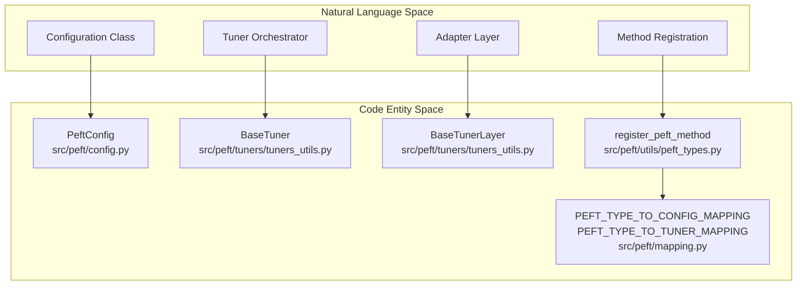
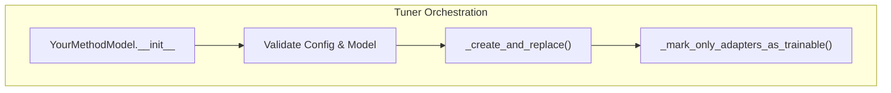

<!-- source: DeepWiki mcp.deepwiki.com · repo huggingface/peft · page 6.4 Contributing New PEFT Methods · fetched 2026-10-26 -->

# Contributing New PEFT Methods

<details>
<summary>Relevant source files</summary>

The following files were used as context for generating this wiki page:

- [.ai/AGENTS.md](.ai/AGENTS.md)
- [.ai/skills/peft-method-changes/SKILL.md](.ai/skills/peft-method-changes/SKILL.md)
- [.github/PULL_REQUEST_TEMPLATE.md](.github/PULL_REQUEST_TEMPLATE.md)
- [.github/workflows/triage_prs.yml](.github/workflows/triage_prs.yml)
- [.pre-commit-config.yaml](.pre-commit-config.yaml)
- [AGENTS.md](AGENTS.md)
- [CLAUDE.md](CLAUDE.md)
- [docs/source/_toctree.yml](docs/source/_toctree.yml)
- [docs/source/developer_guides/contributing.md](docs/source/developer_guides/contributing.md)
- [docs/source/install.md](docs/source/install.md)
- [docs/source/package_reference/adalora.md](docs/source/package_reference/adalora.md)
- [docs/source/package_reference/ia3.md](docs/source/package_reference/ia3.md)
- [docs/source/package_reference/llama_adapter.md](docs/source/package_reference/llama_adapter.md)
- [docs/source/package_reference/loha.md](docs/source/package_reference/loha.md)
- [docs/source/package_reference/lokr.md](docs/source/package_reference/lokr.md)
- [docs/source/package_reference/multitask_prompt_tuning.md](docs/source/package_reference/multitask_prompt_tuning.md)
- [docs/source/package_reference/p_tuning.md](docs/source/package_reference/p_tuning.md)
- [docs/source/package_reference/prefix_tuning.md](docs/source/package_reference/prefix_tuning.md)
- [docs/source/package_reference/prompt_tuning.md](docs/source/package_reference/prompt_tuning.md)
- [pyproject.toml](pyproject.toml)
- [scripts/triage_prs.py](scripts/triage_prs.py)
- [setup.py](setup.py)
- [src/peft/__init__.py](src/peft/__init__.py)
- [src/peft/mapping.py](src/peft/mapping.py)
- [src/peft/tuners/__init__.py](src/peft/tuners/__init__.py)
- [src/peft/tuners/adalora/__init__.py](src/peft/tuners/adalora/__init__.py)
- [src/peft/tuners/adaption_prompt/__init__.py](src/peft/tuners/adaption_prompt/__init__.py)
- [src/peft/tuners/hra/__init__.py](src/peft/tuners/hra/__init__.py)
- [src/peft/tuners/ia3/__init__.py](src/peft/tuners/ia3/__init__.py)
- [src/peft/tuners/loha/__init__.py](src/peft/tuners/loha/__init__.py)
- [src/peft/tuners/lokr/__init__.py](src/peft/tuners/lokr/__init__.py)
- [src/peft/tuners/lora/arrow.py](src/peft/tuners/lora/arrow.py)
- [src/peft/tuners/multitask_prompt_tuning/__init__.py](src/peft/tuners/multitask_prompt_tuning/__init__.py)
- [src/peft/tuners/prefix_tuning/__init__.py](src/peft/tuners/prefix_tuning/__init__.py)
- [src/peft/tuners/prompt_tuning/__init__.py](src/peft/tuners/prompt_tuning/__init__.py)
- [src/peft/utils/peft_types.py](src/peft/utils/peft_types.py)
- [tests/README.md](tests/README.md)
- [tests/conftest.py](tests/conftest.py)

</details>


This guide provides a step-by-step technical walkthrough for implementing new parameter-efficient fine-tuning (PEFT) methods in the library. It covers the complete process from defining configuration classes and tuner infrastructure to registering the method in the PEFT ecosystem, adding documentation, writing examples, and implementing comprehensive tests.

**Scope**: This document focuses on the implementation mechanics for adding adapter-based PEFT methods (e.g., LoRA, AdaLoRA, IA3) as well as prompt-learning and layer-tuning methods. For general contribution guidelines including code quality standards, see [6.5 Code Quality and Standards](). For testing patterns, see [6.2 Testing Framework]().

---

## 1. Prerequisites and Planning

Before writing any code for a new PEFT method, you must follow the upstream contribution and agentic governance policies outlined in `.ai/AGENTS.md` and `docs/source/developer_guides/contributing.md`.

1. **Verify novelty and coordination**: Check `src/peft/tuners/__init__.py` [src/peft/tuners/__init__.py:15-78]() and `src/peft/utils/peft_types.py` [src/peft/utils/peft_types.py:19-105]() to ensure the method is not already implemented. Open an issue on GitHub and obtain explicit maintainer approval before submitting a pull request (PR).
2. **Select a reference method**: Identify an existing PEFT method with similar architectural characteristics to use as a structural template:
   - Low-rank methods: reference `LoraModel` [src/peft/tuners/lora/model.py:88-164]() and `LoraLayer`.
   - Orthogonal / unitary methods: reference `BOFTModel` [src/peft/tuners/boft/model.py:1-100]() or `OFTModel`.
   - Prompt-learning methods: reference `PromptEmbedding` [src/peft/tuners/prompt_tuning/__init__.py:1-23]() or `PrefixEncoder`.

Sources: [src/peft/tuners/__init__.py:15-78](), [src/peft/utils/peft_types.py:19-105](), [docs/source/developer_guides/contributing.md:21-30]()

---

## 2. Architecture Overview and Code Mapping

PEFT uses a modular architecture where configuration parameters, model orchestration (`BaseTuner`), and layer-level modifications (`BaseTunerLayer`) are cleanly decoupled and registered via mapping registries.

**Diagram: Natural Language to Code Entity Mapping**


Sources: [src/peft/config.py:27-30](), [src/peft/tuners/tuners_utils.py:32-150](), [src/peft/mapping.py:29-45](), [src/peft/utils/peft_types.py:128-202]()

---

## 3. Step-by-Step Implementation Guide

### Step 1: Add `PeftType` Enum Entry
Every PEFT method must have a unique enum member defined in `PeftType`.

- **File**: `src/peft/utils/peft_types.py` [src/peft/utils/peft_types.py:19-105]()
- **Implementation**: Add your method name in uppercase string format.

```python
class PeftType(str, enum.Enum):
    # ... existing entries ...
    YOUR_METHOD = "YOUR_METHOD"
```

Sources: [src/peft/utils/peft_types.py:19-105]()

### Step 2: Create Configuration Class
The configuration class stores all hyperparameters and serialization logic. It must inherit from `PeftConfig`.

- **File**: `src/peft/tuners/your_method/config.py` (or integrated within the tuner module package).
- **Implementation**: Define dataclass fields and set `self.peft_type = PeftType.YOUR_METHOD` in `__post_init__`.

```python
@dataclass
class YourMethodConfig(PeftConfig):
    r: int = field(default=8, metadata={"help": "Adapter rank"})
    target_modules: Optional[Union[list[str], str]] = field(default=None, metadata={"help": "Target modules"})

    def __post_init__(self):
        self.peft_type = PeftType.YOUR_METHOD
        super().__post_init__()
```

Sources: [src/peft/config.py:27-30](), [src/peft/mapping.py:36-45]()

### Step 3: Implement Tuner Class
The tuner orchestrates adapter injection across the base model modules. It subclasses `BaseTuner`.

- **File**: `src/peft/tuners/your_method/model.py`
- **Implementation**: Override `_create_and_replace` to identify target modules and replace them with custom adapter layers, and implement `_mark_only_adapters_as_trainable`.

**Diagram: Tuner Injection Flow**


Sources: [src/peft/tuners/tuners_utils.py:32-250](), [src/peft/mapping.py:47-103]()

### Step 4: Implement Layer Classes
Custom adapter layers wrap base model layers and inject trainable parameters. They inherit from `BaseTunerLayer` and standard PyTorch modules (`torch.nn.Module`).

- **File**: `src/peft/tuners/your_method/layer.py`
- **Implementation**: Maintain `base_layer`, handle a `nn.ModuleDict` for multi-adapter support, and implement `update_layer`.

Sources: [src/peft/tuners/tuners_utils.py:77-120]()

### Step 5: Register the Method
Register your configuration and model classes using `register_peft_method`.

- **File**: `src/peft/tuners/your_method/__init__.py`
- **Implementation**: Call `register_peft_method` with lower-case name, config class, and model class.

```python
from peft.utils import register_peft_method
from .config import YourMethodConfig
from .model import YourMethodModel

register_peft_method(
    name="your_method",
    config_cls=YourMethodConfig,
    model_cls=YourMethodModel,
)
```

Sources: [src/peft/utils/peft_types.py:128-202](), [src/peft/mapping.py:29-45]()

### Step 6: Expose in Package Public API
Export your config and model classes in the root and tuner package initializers.

- **Files**: `src/peft/__init__.py` [src/peft/__init__.py:17-157]() and `src/peft/tuners/__init__.py` [src/peft/tuners/__init__.py:15-78]()
- **Implementation**: Import and add classes to `__all__`.

Sources: [src/peft/__init__.py:17-157](), [src/peft/tuners/__init__.py:15-78]()

---

## 4. Documentation, Examples, and Tests

### Documentation Site Integration
Add a markdown documentation page for your method under `docs/source/package_reference/your_method.md` and reference it in `docs/source/_toctree.yml` under the appropriate adapter category [docs/source/_toctree.yml:43-152](). Run `make quality` to verify that all public API symbols are fully documented.

Sources: [docs/source/_toctree.yml:43-152](), [docs/source/developer_guides/contributing.md:73-94]()

### Test Suite Implementation
1. **Config Tests**: Add your config class to `ALL_CONFIG_CLASSES` in `tests/test_config.py`.
2. **Unit & Functional Tests**: Create `tests/test_your_method.py` leveraging `PeftCommonTester` to validate forward passes, saving, loading, merging, and unmerging [tests/README.md:1-50]().
3. **Hardware-Specific Tests**: If the implementation requires CUDA kernels or specialized hardware, add corresponding test hooks in `tests/test_gpu_examples.py` or `tests/test_common_gpu.py`.

Sources: [tests/README.md:1-50](), [docs/source/developer_guides/contributing.md:111-116]()

---

## 5. Agent Guidance & AI-Assisted Contribution Policy

If you are contributing using AI tools, you must adhere strictly to `.ai/AGENTS.md` and `.ai/skills/peft-method-changes/SKILL.md`:
- **Human Accountability**: Pure code-agent PRs are strictly prohibited. A human submitter must understand and defend the code end-to-end, review every line, and execute tests.
- **Mandatory PR Requirements**: PR descriptions must link to an approved issue, state the AI assistance used, and list the exact `pytest` commands executed along with their pass/fail status.
- **Test Selection**: Run localized unit tests for your method instead of executing the entire test suite, ensuring selectors do not deselect 100% of the tests (e.g., `pytest tests/ -k your_method`).

Sources: [.ai/AGENTS.md:3-80](), [.ai/skills/peft-method-changes/SKILL.md:1-25]()

---

