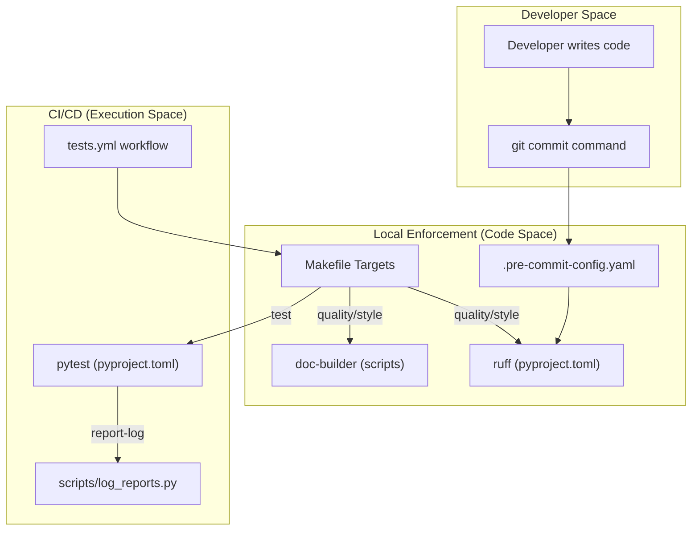
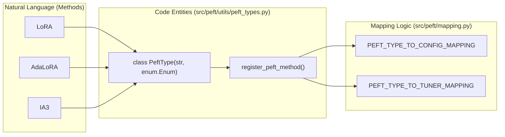

<!-- source: DeepWiki mcp.deepwiki.com · repo huggingface/peft · page 6.5 Code Quality and Standards · fetched 2026-10-26 -->

# Code Quality and Standards

Relevant source files

The following files were used as context for generating this wiki page:

- [.ai/AGENTS.md](.ai/AGENTS.md)
- [.ai/skills/peft-method-changes/SKILL.md](.ai/skills/peft-method-changes/SKILL.md)
- [.github/PULL_REQUEST_TEMPLATE.md](.github/PULL_REQUEST_TEMPLATE.md)
- [.github/workflows/triage_prs.yml](.github/workflows/triage_prs.yml)
- [.pre-commit-config.yaml](.pre-commit-config.yaml)
- [AGENTS.md](AGENTS.md)
- [CLAUDE.md](CLAUDE.md)
- [Makefile](Makefile)
- [docker/peft-cpu/Dockerfile](docker/peft-cpu/Dockerfile)
- [docs/source/_toctree.yml](docs/source/_toctree.yml)
- [docs/source/developer_guides/contributing.md](docs/source/developer_guides/contributing.md)
- [docs/source/install.md](docs/source/install.md)
- [pyproject.toml](pyproject.toml)
- [scripts/log_reports.py](scripts/log_reports.py)
- [scripts/triage_prs.py](scripts/triage_prs.py)
- [setup.py](setup.py)
- [src/peft/__init__.py](src/peft/__init__.py)
- [src/peft/mapping.py](src/peft/mapping.py)
- [src/peft/tuners/__init__.py](src/peft/tuners/__init__.py)
- [src/peft/tuners/lora/arrow.py](src/peft/tuners/lora/arrow.py)
- [src/peft/utils/peft_types.py](src/peft/utils/peft_types.py)
- [tests/README.md](tests/README.md)
- [tests/conftest.py](tests/conftest.py)
- [tests/training/deepspeed_config.yaml](tests/training/deepspeed_config.yaml)
- [tests/training/fsdp2_config.yaml](tests/training/fsdp2_config.yaml)
- [tests/training/fsdp_config.yaml](tests/training/fsdp_config.yaml)
- [tests/training/training.py](tests/training/training.py)

This page documents the code quality standards, tooling, and enforcement mechanisms used in the PEFT codebase. It covers linting, formatting, documentation standards, testing requirements, and the development workflow. For information about the broader testing infrastructure and CI/CD pipelines, see [6.3](). For guidance on contributing new PEFT methods, see [6.4]().

## Purpose and Scope

PEFT maintains code quality through automated tooling that enforces consistent formatting, catches common errors, validates documentation standards, and ensures test coverage. All contributions must pass these quality checks before being merged. This page explains:

- The quality tools used (`ruff`, `doc-builder`, `pytest`)
- How to run quality checks locally via `Makefile`
- Configuration of linting and formatting rules
- Pre-commit hooks for automatic validation
- How quality standards are enforced in CI/CD

Sources: [Makefile:1-17](), [pyproject.toml:6-68](), [.pre-commit-config.yaml:1-13]()

## Quality Tools Overview

PEFT uses a streamlined set of modern quality tools:

| Tool | Purpose | Configuration File | Usage |
|------|---------|-------------------|-------|
| **ruff** | Linting and code formatting (replaces black, isort, flake8) | [pyproject.toml:6-46]() | Code style, import sorting, error detection |
| **doc-builder** | Documentation style validation | [Makefile:11]() | Line length, doc formatting |
| **pytest** | Test execution and coverage | [pyproject.toml:47-68]() | Unit tests, integration tests |
| **pre-commit** | Git hook automation | [.pre-commit-config.yaml:1-13]() | Automatic pre-commit checks |

Sources: [Makefile:1-17](), [pyproject.toml:6-68](), [.pre-commit-config.yaml:1-13]()

## Quality Tools Architecture

The following diagram bridges the developer workflow with the underlying code entities and scripts that enforce standards.

### Quality Enforcement Workflow

Sources: [Makefile:1-21](), [.pre-commit-config.yaml:1-13](), [scripts/log_reports.py:1-15](), [pyproject.toml:6-25]()

## Linting and Formatting with Ruff

### Configuration and Rules

PEFT uses `ruff` version `==0.16.4` [setup.py:25](), [pyproject.toml:10](). The configuration is centralized in `pyproject.toml`.

- **Target Version**: Python 3.10 [pyproject.toml:7]().
- **Line Length**: 119 characters [pyproject.toml:8]().
- **Linting Rules**: Extends selection with Complexity (`C`), PEP8 errors (`E`/`F`), Import sorting (`I`), Pyupgrade upgrades (`UP`), and Pytest assertions (`PT009`) [pyproject.toml:15-25]().
- **Exclusions**: Jupyter notebooks and markdown files are excluded from ruff checks [pyproject.toml:9]().

### Running Quality Checks

The `Makefile` defines two primary targets for quality control:

1.  **`make quality`**: Runs checks on all files without making changes [Makefile:8-11]().
    - `ruff check $(check_dirs)`
    - `ruff format --check $(check_dirs)`
    - `doc-builder style src/peft tests docs/source --max_len 119 --check_only`
    - `./scripts/check_doc_coverage.py`
2.  **`make style`**: Automatically fixes linting issues and formats code [Makefile:15-18]().
    - `ruff check --fix $(check_dirs)`
    - `ruff format $(check_dirs)`
    - `doc-builder style src/peft tests docs/source --max_len 119`

The `check_dirs` include `src`, `tests`, `examples`, `docs`, `scripts`, and `docker` [Makefile:3]().

Sources: [Makefile:3-18](), [pyproject.toml:6-46](), [setup.py:21-27]()

## Documentation Standards

### doc-builder

PEFT uses `hf-doc-builder` [setup.py:23]() to maintain documentation quality. It enforces a strict 119-character line length limit [Makefile:11]().

### API Reference and Mapping

Documentation quality is tied to the internal mapping system that defines how methods are exposed. The `PeftType` enum and registration functions ensure consistency between the code and the documentation structure.

### Method Registration System

Sources: [src/peft/utils/peft_types.py:19-105](), [src/peft/utils/peft_types.py:128-202](), [src/peft/mapping.py:30-32]()

## Testing Standards

### Test Execution

Tests are executed using `pytest`. The `Makefile` provides specialized targets for different hardware and library combinations:

- **General Tests**: `make test` runs unit tests with 3 parallel workers and generates report logs under GitHub CI [Makefile:20-21]().
- **GPU Tests**: Targets like `tests_common_gpu` and `tests_core_single_gpu` filter tests using markers [Makefile:29-43]().
- **Integration Tests**: `tests_torch_compile.py` and `tests_regression` validate core features and compile compatibility [Makefile:60-64]().
- **Quantization Tests**: Specialized targets for `bitsandbytes` (e.g., `tests_core_single_gpu_bnb`) [Makefile:50-54]().

### Regression and CI Reporting

- **Regression**: `make tests_regression` runs tests located in `tests/regression/` to prevent old bugs from reappearing [Makefile:60-61]().
- **CI Logging**: In GitHub CI environments, tests use the `--report-log` flag [Makefile:21](). The `scripts/log_reports.py` script parses these log files to identify failed node IDs, durations, and post notifications to Slack [scripts/log_reports.py:30-46]().

Sources: [Makefile:20-76](), [scripts/log_reports.py:1-144](), [pyproject.toml:47-68]()

## Pre-commit Hooks

PEFT uses `pre-commit` to automate quality enforcement at the point of commit.

Configured Hooks [.pre-commit-config.yaml:1-13]():
1.  **ruff**: Runs with `--fix` to resolve linting issues automatically [.pre-commit-config.yaml:5-7]().
2.  **ruff-format**: Ensures code follows formatting standards [.pre-commit-config.yaml:8]().
3.  **check-merge-conflict**: Prevents committing files with unresolved conflicts [.pre-commit-config.yaml:12]().
4.  **check-yaml**: Validates the syntax of YAML files [.pre-commit-config.yaml:13]().

These hooks ensure that the `quality` and `style` standards defined in the `Makefile` are met before code reaches the remote repository.

Sources: [.pre-commit-config.yaml:1-13]()

## Contribution Guidelines

### Dependency Management

New features or quality tools should be added to `setup.py` under the appropriate `extras_require` category:
- `quality`: For linting and formatting tools (`ruff`, `black`, `hf-doc-builder`, `griffe`) [setup.py:21-27]().
- `docs_specific`: For documentation building tools [setup.py:28-32]().
- `test`: For testing frameworks and datasets [setup.py:34-46]().

### Release Checklist

The library maintains a strict release process documented in `setup.py` [setup.py:97-118]():
1.  Update version in `src/peft/__init__.py` [src/peft/__init__.py:15]() and `setup.py` [setup.py:18]().
2.  Address all `# TODO` items in the codebase [setup.py:99]().
3.  Verify package installation via `twine` and `testpypi` [setup.py:106-113]().
4.  Tag the release in git and update release notes on GitHub [setup.py:101-116]().

Sources: [setup.py:18-46](), [setup.py:97-118](), [src/peft/__init__.py:15]()

---

