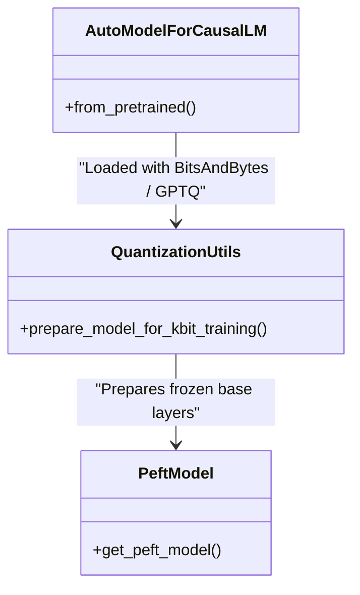
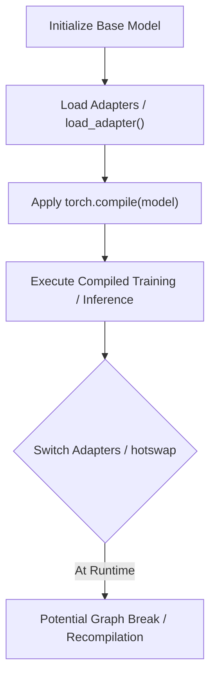

<!-- source: DeepWiki mcp.deepwiki.com · repo huggingface/peft · page 6.6 Troubleshooting · fetched 2026-10-26 -->

# Troubleshooting

<details>
<summary>Relevant source files</summary>

The following files were used as context for generating this wiki page:

- [docs/source/developer_guides/custom_models.md](docs/source/developer_guides/custom_models.md)
- [docs/source/developer_guides/torch_compile.md](docs/source/developer_guides/torch_compile.md)
- [docs/source/developer_guides/troubleshooting.md](docs/source/developer_guides/troubleshooting.md)
- [docs/source/package_reference/trainable_tokens.md](docs/source/package_reference/trainable_tokens.md)
- [src/peft/tuners/c3a/config.py](src/peft/tuners/c3a/config.py)
- [src/peft/tuners/c3a/layer.py](src/peft/tuners/c3a/layer.py)
- [src/peft/tuners/trainable_tokens/config.py](src/peft/tuners/trainable_tokens/config.py)
- [src/peft/tuners/trainable_tokens/layer.py](src/peft/tuners/trainable_tokens/layer.py)
- [src/peft/tuners/trainable_tokens/model.py](src/peft/tuners/trainable_tokens/model.py)
- [tests/__init__.py](tests/__init__.py)
- [tests/test_gptqmodel.py](tests/test_gptqmodel.py)
- [tests/test_torch_compile.py](tests/test_torch_compile.py)
- [tests/test_trainable_tokens.py](tests/test_trainable_tokens.py)
- [tests/test_vision_models.py](tests/test_vision_models.py)

</details>


This wiki page covers common issues and resolutions encountered when using the Parameter-Efficient Fine-Tuning (PEFT) library. It provides technical details on diagnosing and resolving problems related to package versions, data types, target module matching, quantization compatibility, merge/unmerge operations, device mapping, forward compatibility, custom models, and `torch.compile` considerations.

Sources: [docs/source/developer_guides/troubleshooting.md:17-20]()

## Package Versions and Dtype-Related Issues

### Environment and Package Mismatches

Examples and advanced features frequently depend on recent package versions. If unexpected errors occur, verify and update the core stack:

```bash
python -m pip install -U peft transformers accelerate torch
```

Installing from the latest source repository ensures access to recent bug fixes:

```bash
python -m pip install git+https://github.com/huggingface/peft
```

Sources: [docs/source/developer_guides/troubleshooting.md:21-41]()

### FP16 Gradient Unscaling and Adapter Precision

When loading a base model with `dtype=torch.float16` and training using automatic mixed precision (AMP) (e.g. `fp16=True` in 🤗 Transformers [`~transformers.Trainer`]), a `ValueError: Attempting to unscale FP16 gradients` may occur. Trainable parameters should not use half-precision under AMP. 

To resolve this, cast trainable parameters to float32 or utilize [`~utils.cast_mixed_precision_params`]:

```python
from peft import cast_mixed_precision_params, get_peft_model

peft_model = get_peft_model(...)
cast_mixed_precision_params(peft_model, dtype=torch.float16)
```

Alternatively, starting from PEFT v0.12.0, adapter weights are automatically promoted to `torch.float32`. To disable this behavior and use half-precision adapters, pass `autocast_adapter_dtype=False` to [`~get_peft_model`], [`~PeftModel.from_pretrained`], or [`~PeftModel.load_adapter`].

Sources: [docs/source/developer_guides/troubleshooting.md:42-78]()

```mermaid
graph TD
    A["Load Base Model (fp16)"] --> B["Apply get_peft_model()"]
    B --> C{"Check autocast_adapter_dtype"}
    C -->|True (Default)| D["Promote adapter to torch.float32"]
    C -->|False| E["Keep adapter in half-precision"]
    D --> F["Compatible with AMP Trainer"]
    E --> G["Lower memory, risk of overflow"]
```

Sources: [docs/source/developer_guides/troubleshooting.md:42-93]()

## Training Health and Target Module Matching

If training loss decreases normally but model performance does not improve, inspect whether trainable parameters are actually updating using `torch.allclose()`.

### Missing Target Modules in Hybrid Architectures

With hybrid architectures like Mamba, Jamba, or NemotronH, layer naming conventions differ from standard Transformers. If some configured `target_modules` do not exist, PEFT silently skips them without raising an error, leaving large portions of the model frozen.

To diagnose, check the trainable parameter breakdown:

```python
model.print_trainable_parameters()
print(model.get_layer_status())
```

Sources: [docs/source/developer_guides/troubleshooting.md:94-140]()

## Quantization Compatibility

When employing quantized base models (such as BitsAndBytes 8-bit/4-bit, GPTQ, AWQ, or HQQ), ensure that [`prepare_model_for_kbit_training`] is invoked on the base model *before* passing it to [`get_peft_model`].

```python
from transformers import AutoModelForCausalLM, BitsAndBytesConfig
from peft import prepare_model_for_kbit_training, get_peft_model, LoraConfig

model = AutoModelForCausalLM.from_pretrained(model_id, quantization_config=BitsAndBytesConfig(load_in_4bit=True))
model = prepare_model_for_kbit_training(model)
config = LoraConfig(task_type="CAUSAL_LM")
peft_model = get_peft_model(model, config)
```

For LoftQ initialization, target all linear layers using `target_modules="all-linear"` to achieve optimal initialization quality.



Sources: [tests/test_gptqmodel.py:70-96](), [docs/source/developer_guides/troubleshooting.md:1-20]()

## Merge, Unmerge, and Device Mapping Errors

When merging adapters into the base model weight matrices (`model.merge_and_unload()`), check for NaN outputs or device placement mismatches. 

- **Device Mapping**: When using `device_map="auto"` or `device_map="balanced"`, ensure that adapter layers are injected *after* device placement or that hooks are correctly synchronized across devices.
- **Modules to Save**: Layers like classification heads (`classifier`, `score`) must be declared under `modules_to_save` in the tuner configuration to ensure they are properly tracked, serialized, and restored during adapter loading.

Sources: [tests/test_vision_models.py:46-60](), [tests/test_gptqmodel.py:91-105]()

## Custom Models and Mixed Adapters

### Applying PEFT to Custom Architectures

When working with non-Transformer models (such as `timm` vision models or custom `torch.nn.Module` networks like multi-layer perceptrons), inspect module names via `named_modules()` to explicitly define `target_modules`:

```python
print([(n, type(m)) for n, m in custom_model.named_modules()])
```

Configure `LoraConfig` with exact module paths:

```python
from peft import LoraConfig

config = LoraConfig(
    target_modules=["seq.0", "seq.2"],
    modules_to_save=["seq.4"],
)
```

Sources: [docs/source/developer_guides/custom_models.md:55-88]()

### Mixed Adapters

When utilizing `PeftMixedModel` to combine heterogeneous adapters (e.g., LoRA and LoHa simultaneously), ensure that underlying target layers share compatible tensor shapes and are registered in `COMPATIBLE_TUNER_TYPES`.

Sources: [docs/source/developer_guides/troubleshooting.md:1-20]()

## torch.compile Considerations

While `torch.compile` accelerates training and inference for many PEFT configurations (including AdaLora, BOFT, IA³, LoHa, LoKr, DoRA, and standard LoRA), PEFT's dynamic nature can occasionally trigger graph breaks or recompilations.

### Best Practices for torch.compile

1. **Compile after loading**: When loading multiple adapters via `model.load_adapter()` or `model.add_adapter()`, invoke `torch.compile` *after* all adapters have been loaded.
2. **Unsupported dynamic structures**: Frequent hotswapping or dynamic switching of adapter names during a compiled region may induce recompilations unless tensors are pre-allocated or wrapped.
3. **Test suite validation**: Consult `tests/test_torch_compile.py` for comprehensive test cases demonstrating verified compiler compatibility across different adapter families.



Sources: [docs/source/developer_guides/torch_compile.md:1-70](), [tests/test_torch_compile.py:65-93]()

Sources: [docs/source/developer_guides/troubleshooting.md:1-512](), [tests/test_torch_compile.py:1-115](), [docs/source/developer_guides/custom_models.md:1-103]()

---

