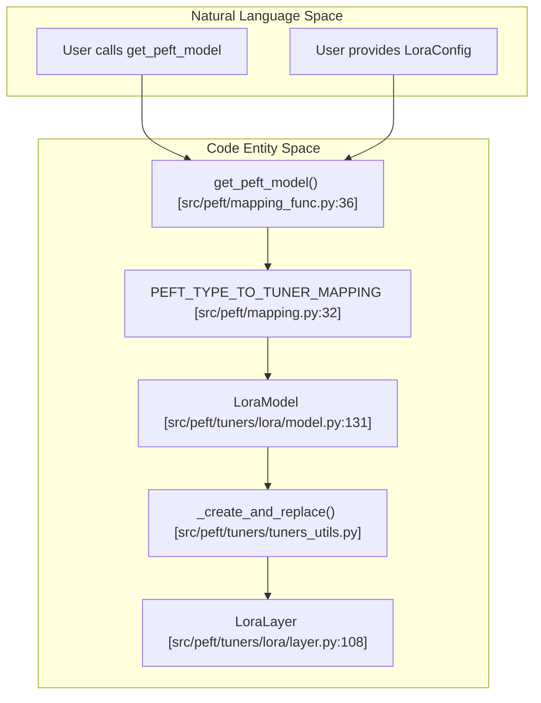
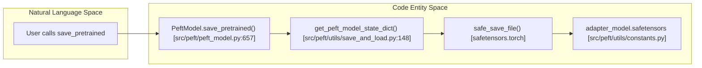

<!-- source: DeepWiki mcp.deepwiki.com · repo huggingface/peft · page 7 Glossary · fetched 2026-10-26 -->

# Glossary

Relevant source files

The following files were used as context for generating this wiki page:

- [.pre-commit-config.yaml](.pre-commit-config.yaml)
- [docs/source/_toctree.yml](docs/source/_toctree.yml)
- [pyproject.toml](pyproject.toml)
- [setup.py](setup.py)
- [src/peft/__init__.py](src/peft/__init__.py)
- [src/peft/mapping.py](src/peft/mapping.py)
- [src/peft/peft_model.py](src/peft/peft_model.py)
- [src/peft/tuners/__init__.py](src/peft/tuners/__init__.py)
- [src/peft/tuners/adalora/layer.py](src/peft/tuners/adalora/layer.py)
- [src/peft/tuners/adalora/model.py](src/peft/tuners/adalora/model.py)
- [src/peft/tuners/ia3/layer.py](src/peft/tuners/ia3/layer.py)
- [src/peft/tuners/ia3/model.py](src/peft/tuners/ia3/model.py)
- [src/peft/tuners/loha/layer.py](src/peft/tuners/loha/layer.py)
- [src/peft/tuners/loha/model.py](src/peft/tuners/loha/model.py)
- [src/peft/tuners/lokr/layer.py](src/peft/tuners/lokr/layer.py)
- [src/peft/tuners/lokr/model.py](src/peft/tuners/lokr/model.py)
- [src/peft/tuners/lora/__init__.py](src/peft/tuners/lora/__init__.py)
- [src/peft/tuners/lora/arrow.py](src/peft/tuners/lora/arrow.py)
- [src/peft/tuners/lora/config.py](src/peft/tuners/lora/config.py)
- [src/peft/tuners/lora/layer.py](src/peft/tuners/lora/layer.py)
- [src/peft/tuners/lora/model.py](src/peft/tuners/lora/model.py)
- [src/peft/tuners/lora/variants.py](src/peft/tuners/lora/variants.py)
- [src/peft/tuners/lycoris_utils.py](src/peft/tuners/lycoris_utils.py)
- [src/peft/tuners/tuners_utils.py](src/peft/tuners/tuners_utils.py)
- [src/peft/utils/__init__.py](src/peft/utils/__init__.py)
- [src/peft/utils/constants.py](src/peft/utils/constants.py)
- [src/peft/utils/other.py](src/peft/utils/other.py)
- [src/peft/utils/peft_types.py](src/peft/utils/peft_types.py)
- [src/peft/utils/save_and_load.py](src/peft/utils/save_and_load.py)
- [tests/conftest.py](tests/conftest.py)
- [tests/test_custom_models.py](tests/test_custom_models.py)
- [tests/test_decoder_models.py](tests/test_decoder_models.py)
- [tests/test_encoder_decoder_models.py](tests/test_encoder_decoder_models.py)
- [tests/test_feature_extraction_models.py](tests/test_feature_extraction_models.py)
- [tests/test_initialization.py](tests/test_initialization.py)
- [tests/test_lora_variants.py](tests/test_lora_variants.py)
- [tests/test_seq_classifier.py](tests/test_seq_classifier.py)
- [tests/test_tuners_utils.py](tests/test_tuners_utils.py)
- [tests/testing_common.py](tests/testing_common.py)

This glossary defines codebase-specific terms, jargon, abbreviations, and domain concepts used within the PEFT library. It provides technical definitions and maps these concepts to specific classes and implementation files to assist onboarding engineers and contributors.

---

## 1. Core Architecture Terms

### PeftModel
The primary wrapper class that encapsulates a base `torch.nn.Module` (typically a Hugging Face Transformer) and manages one or more adapters. It handles the routing of data through adapter layers and provides high-level APIs for saving and loading.
*   **Implementation:** `PeftModel` in [src/peft/peft_model.py:120-144]()
*   **Key Methods:** `from_pretrained` [src/peft/peft_model.py:382-385](), `save_pretrained` [src/peft/peft_model.py:657-660]()

### BaseTuner
The abstract base class for all PEFT method implementations (e.g., `LoraModel`, `AdaLoraModel`). It defines the infrastructure for injecting adapter layers into a base model's architecture via target module matching and layer replacement.
*   **Implementation:** `BaseTuner` in [src/peft/tuners/tuners_utils.py:32-35]()
*   **Key Logic:** `_create_and_replace` (internal to subclasses) used to swap base layers with adapter-wrapped versions.

### BaseTunerLayer
A mixin or base class for individual adapter layers (e.g., `LoraLayer`). It tracks adapter-specific metadata like rank (`r`), scaling, and active adapter names.
*   **Implementation:** `BaseTunerLayer` in [src/peft/tuners/tuners_utils.py:108-126]()
*   **Attributes:** `active_adapter`, `merged_adapters`, `disable_adapters` [src/peft/tuners/lora/layer.py:128-152]()

### ModulesToSaveWrapper
A wrapper used to mark specific non-adapter modules (like a classification head or task-specific layers) as trainable and ensure they are included in the PEFT state dict during saving.
*   **Implementation:** `ModulesToSaveWrapper` in [src/peft/utils/other.py:48-48]() (referenced in [src/peft/peft_model.py:45-48]())

### TrainableTokensWrapper
A specialized wrapper for embedding layers that allows fine-tuning only a specific subset of token embeddings (indices) rather than the entire embedding matrix.
*   **Implementation:** `TrainableTokensWrapper` in [src/peft/utils/other.py:48-48]()

Sources: [src/peft/peft_model.py:120-144](), [src/peft/tuners/tuners_utils.py:32-35](), [src/peft/tuners/lora/layer.py:128-152](), [src/peft/utils/other.py:48-48]()

---

## 2. Adapter Lifecycle & State Management

| Term | Definition | Code Pointer |
| :--- | :--- | :--- |
| **Active Adapter** | The adapter currently being used in the forward pass. | `PeftModel.active_adapter` [src/peft/peft_model.py:135-135]() |
| **Merging** | The process of adding adapter weights into the base model weights to eliminate inference latency. | `LoraLayer.merge` [src/peft/tuners/lora/layer.py:603-603]() |
| **Unloading** | Removing the adapter infrastructure and returning the base model (optionally with merged weights). | `PeftModel.unload` [src/peft/peft_model.py:968-968]() |
| **Hotswap** | In-place replacement of adapter weights without re-initializing the model structure. | `hotswap_adapter` [src/peft/utils/hotswap.py:104-104]() |

### System Data Flow: Adapter Injection
This diagram bridges Natural Language Space to Code Entity Space, showing how `get_peft_model` transforms a standard model into a `PeftModel` by dispatching to specific tuners.

Sources: [src/peft/mapping_func.py:36-36](), [src/peft/mapping.py:32-32](), [src/peft/tuners/lora/model.py:131-131](), [src/peft/tuners/lora/layer.py:108-108]()

---

## 3. PEFT Methods & Jargon

PEFT supports over 30 parameter-efficient fine-tuning methodologies, categorized into families:

### LoRA Family
*   **LoRA (Low-Rank Adaptation):** Adapts models by adding two low-rank matrices ($A$ and $B$) in parallel to existing linear layers [src/peft/tuners/lora/model.py:131-135]().
*   **DoRA (Weight-Decomposed Low-Rank Adaptation):** Decomposes weights into magnitude and direction vectors [src/peft/tuners/lora/layer.py:128-152]().
*   **LoftQ:** A quantization-aware initialization method for LoRA [src/peft/utils/loftq_utils.py:43-44]().
*   **aLoRA (Activated LoRA):** Uses invocation tokens to trigger dynamic adapter paths [src/peft/tuners/lora/variants.py:42-43]().

### AdaLoRA and Dynamic Rank Allocation
*   **AdaLoRA:** Dynamically allocates parameter budget among weight matrices using SVD-based importance scoring and orthogonal regularization [src/peft/tuners/adalora/model.py:51-51]().

### Prompt Learning Methods
*   **Prefix Tuning:** Prepends trainable continuous vectors to the keys and values of the attention mechanism across all layers [src/peft/tuners/prefix_encoder.py:113-114]().
*   **P-Tuning:** Uses a reparameterized prompt encoder (such as an LSTM or MLP) to generate virtual token embeddings [src/peft/tuners/prompt_encoder.py:116-117]().
*   **Prompt Tuning:** Directly learns a set of virtual token embeddings prepended to the input sequence [src/peft/tuners/prompt_embedding.py:115-115]().

### Other Adapter Methods
Includes method families such as **IA3** [src/peft/tuners/ia3/model.py](), **LoHa / LoKr** [src/peft/tuners/loha/model.py](), **VeRA**, **OFT / BOFT** [src/peft/tuners/boft/](), and **FourierFT** [src/peft/tuners/fourierft/](), all registered in [src/peft/__init__.py:49-157]().

Sources: [src/peft/tuners/lora/model.py:131-135](), [src/peft/tuners/lora/layer.py:128-152](), [src/peft/utils/loftq_utils.py:43-44](), [src/peft/__init__.py:49-157]()

---

## 4. Quantization Backends

PEFT integrates with several quantization libraries to facilitate memory-efficient training (e.g., QLoRA):
*   **BitsAndBytes (bnb):** Supports 8-bit and 4-bit linear quantization with custom dispatchers in `src/peft/tuners/lora/model.py:32-33`.
*   **GPTQ / AWQ / AQLM / EETQ / HQQ / TorchAO / Transformer Engine:** Quantization backends integrated via dedicated dispatch and weight conversion modules [src/peft/tuners/lora/model.py:58-68]().
*   **prepare_model_for_kbit_training:** Utility function to prepare quantized base models for training by freezing weights, casting layer norms, and enabling gradient checkpointing [src/peft/utils/other.py:158-161]().

Sources: [src/peft/tuners/lora/model.py:32-68](), [src/peft/utils/other.py:158-161]()

---

## 5. Training & Serialization Concepts

### TaskType
An enumeration defining the downstream task architecture (e.g., `CAUSAL_LM`, `SEQ_2_SEQ_LM`, `SEQ_CLS`, `TOKEN_CLS`) used to configure appropriate model heads.
*   **Implementation:** `TaskType` in [src/peft/utils/peft_types.py:57-57]()

### PEFT State Dict
Unlike standard PyTorch state dicts, PEFT state dicts only contain the trainable adapter parameters and `modules_to_save`, significantly reducing artifact size.
*   **Function:** `get_peft_model_state_dict` in [src/peft/utils/save_and_load.py:148-162]()

### Weight Tying
A scenario where embedding and output projection layers share weight tensors. PEFT includes detection and warning logic to handle tied parameters safely during adapter injection and merging.
*   **Warning Logic:** `warn_msg_weight_tying` in [src/peft/tuners/tuners_utils.py:66-72]()

### Serialization Flow
This diagram bridges Natural Language Space to Code Entity Space, detailing how model states are extracted and serialized to disk.

Sources: [src/peft/peft_model.py:657-660](), [src/peft/utils/save_and_load.py:148-162](), [src/peft/utils/constants.py:53-55]()