# Page: Overview

# Overview

<details>
<summary>Relevant source files</summary>

The following files were used as context for generating this wiki page:

- [.pre-commit-config.yaml](.pre-commit-config.yaml)
- [README.md](README.md)
- [docs/source/_redirects.yml](docs/source/_redirects.yml)
- [docs/source/_toctree.yml](docs/source/_toctree.yml)
- [docs/source/developer_guides/memory_efficient_training.md](docs/source/developer_guides/memory_efficient_training.md)
- [docs/source/guides/peft_integrations.md](docs/source/guides/peft_integrations.md)
- [docs/source/index.md](docs/source/index.md)
- [docs/source/package_reference/auto_class.md](docs/source/package_reference/auto_class.md)
- [docs/source/quicktour.md](docs/source/quicktour.md)
- [examples/lora_dreambooth/lora_dreambooth_inference.ipynb](examples/lora_dreambooth/lora_dreambooth_inference.ipynb)
- [examples/lora_dreambooth/train_dreambooth.py](examples/lora_dreambooth/train_dreambooth.py)
- [examples/lora_ga_finetuning/README.md](examples/lora_ga_finetuning/README.md)
- [examples/lora_ga_finetuning/lora_ga_finetuning.py](examples/lora_ga_finetuning/lora_ga_finetuning.py)
- [examples/oft_dreambooth/oft_dreambooth_inference.ipynb](examples/oft_dreambooth/oft_dreambooth_inference.ipynb)
- [examples/oft_dreambooth/train_dreambooth.py](examples/oft_dreambooth/train_dreambooth.py)
- [examples/road_finetuning/README.md](examples/road_finetuning/README.md)
- [examples/stable_diffusion/train_dreambooth.py](examples/stable_diffusion/train_dreambooth.py)
- [pyproject.toml](pyproject.toml)
- [scripts/stale.py](scripts/stale.py)
- [setup.py](setup.py)
- [src/peft/__init__.py](src/peft/__init__.py)
- [src/peft/mapping.py](src/peft/mapping.py)
- [src/peft/tuners/__init__.py](src/peft/tuners/__init__.py)
- [src/peft/tuners/lora/arrow.py](src/peft/tuners/lora/arrow.py)
- [src/peft/tuners/lora/loraga.py](src/peft/tuners/lora/loraga.py)
- [src/peft/utils/peft_types.py](src/peft/utils/peft_types.py)
- [tests/conftest.py](tests/conftest.py)

</details>


## Purpose and Scope

This document provides a high-level introduction to the PEFT (Parameter-Efficient Fine-Tuning) library, explaining its purpose, architecture, and key components. It covers fundamental design patterns, supported fine-tuning methods, and integration points with the Hugging Face ecosystem.

As a parent overview page, this document keeps technical details high-level and delegates deep dives to child sections:
- For installation, quicktours, package entry points, and directory layout, see [Quickstart and Package Layout](#1.1).
- For documentation organization and doc-builder workflows, see [Documentation Site](#1.2).
- For fundamental abstractions, see [Core Architecture](#2).
- For method implementations, see [PEFT Methods](#3).
- For quantization and distributed training, see [Integration Features](#4).
- For practical scenarios, see [Example Applications](#5).
- For contributing and developer tasks, see [Developer Guides](#6).

Sources: [`setup.py:50-78`](), [`src/peft/__init__.py:15`](), [`README.md:22`]()

---

## What is PEFT

Parameter-Efficient Fine-Tuning (PEFT) enables efficient adaptation of large pretrained models to downstream tasks by fine-tuning only a small subset of parameters instead of all model weights [README.md:22](). PEFT methods introduce trainable adapter modules or parameters that typically represent 0.1% to 2% of the total model size, significantly reducing memory footprint, computational overhead, and storage requirements while retaining performance comparable to full fine-tuning [README.md:22]().

The library is defined in [`setup.py:50-78`]() with version tracking in [`src/peft/__init__.py:15`](). Supported methods span over 30 distinct paradigms registered via [`src/peft/utils/peft_types.py:19-104`]().

For details on getting started, the public API surface in [`src/peft/__init__.py`](), and package layout, see [Quickstart and Package Layout](#1.1). For details on documentation structure and the doc-builder toolchain, see [Documentation Site](#1.2).

Sources: [`README.md:22`](), [`setup.py:50-78`](), [`src/peft/__init__.py:15`](), [`src/peft/utils/peft_types.py:19-104`]()

---

## Core Architecture Overview

The PEFT library uses unified abstractions to wrap base models, manage configurations, and inject adapter layers in-place. 

### Diagram: PEFT Core Architecture Mapping
This diagram bridges the natural language conceptual space of PEFT core abstractions to their concrete code entities.

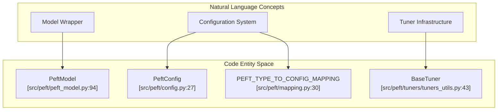
Sources: [`src/peft/peft_model.py:94`](), [`src/peft/config.py:27`](), [`src/peft/tuners/tuners_utils.py:43`](), [`src/peft/mapping.py:30`]()

For deep dives into `PeftModel`, base classes, configuration hierarchies, tuner layer injection (`_create_and_replace`), adapter lifecycle states, state management, and auxiliary wrappers, see [Core Architecture](#2).

---

## PEFT Methods Taxonomy

PEFT supports over 30 parameter-efficient fine-tuning methods categorized into low-rank adapters, soft prompting approaches, layer tuning, and orthogonal transformations.

### Diagram: PEFT Method Registration and Implementation Space
This diagram associates method family concepts with their concrete module paths and registration entry points.

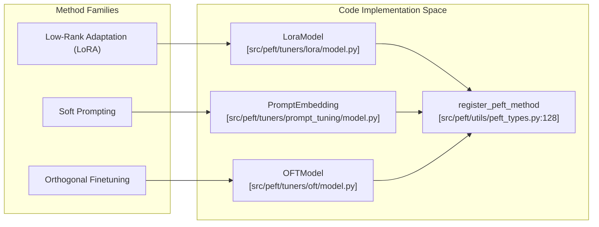
Sources: [`src/peft/utils/peft_types.py:128-203`](), [`src/peft/tuners/__init__.py:15-78`]()

For details on specific method implementations, initialization strategies, rank allocation, multi-adapter composition, and `PeftMixedModel`, see [PEFT Methods](#3).

---

## Integration Ecosystem and Benefits

PEFT integrates tightly with core ecosystem libraries to provide seamless training and inference workflows:
- **Quantization**: Support for BitsAndBytes (8/4-bit), GPTQ, AWQ, HQQ, and TorchAO backends (`[src/peft/utils/other.py:151]()`).
- **Distributed Training**: Integration with Megatron-LM, DeepSpeed, and FSDP (`[docs/source/_toctree.yml:17-21]()`).
- **Model Libraries**: Native compatibility with Hugging Face `transformers`, `diffusers`, and `accelerate` (`[README.md:24]()`).

For integration details, see [Integration Features](#4). For end-to-end code implementations across language models, vision, quantized training, and benchmarking suites, see [Example Applications](#5). For contributor workflows and testing frameworks, see [Developer Guides](#6).

Sources: [`README.md:24`](), [`src/peft/utils/other.py:151`](), [`docs/source/_toctree.yml:17-21`]()

---

# Page: Quickstart and Package Layout

# Quickstart and Package Layout

<details>
<summary>Relevant source files</summary>

The following files were used as context for generating this wiki page:

- [.pre-commit-config.yaml](.pre-commit-config.yaml)
- [docs/source/_redirects.yml](docs/source/_redirects.yml)
- [docs/source/_toctree.yml](docs/source/_toctree.yml)
- [docs/source/developer_guides/memory_efficient_training.md](docs/source/developer_guides/memory_efficient_training.md)
- [docs/source/guides/peft_integrations.md](docs/source/guides/peft_integrations.md)
- [docs/source/index.md](docs/source/index.md)
- [docs/source/package_reference/auto_class.md](docs/source/package_reference/auto_class.md)
- [docs/source/package_reference/cartridges.md](docs/source/package_reference/cartridges.md)
- [docs/source/package_reference/config.md](docs/source/package_reference/config.md)
- [docs/source/package_reference/hira.md](docs/source/package_reference/hira.md)
- [docs/source/package_reference/lora.md](docs/source/package_reference/lora.md)
- [docs/source/package_reference/lora_variant_monteclora.md](docs/source/package_reference/lora_variant_monteclora.md)
- [docs/source/package_reference/peft_model.md](docs/source/package_reference/peft_model.md)
- [docs/source/quicktour.md](docs/source/quicktour.md)
- [examples/lora_ga_finetuning/README.md](examples/lora_ga_finetuning/README.md)
- [examples/lora_ga_finetuning/lora_ga_finetuning.py](examples/lora_ga_finetuning/lora_ga_finetuning.py)
- [examples/road_finetuning/README.md](examples/road_finetuning/README.md)
- [pyproject.toml](pyproject.toml)
- [setup.py](setup.py)
- [src/peft/__init__.py](src/peft/__init__.py)
- [src/peft/mapping.py](src/peft/mapping.py)
- [src/peft/tuners/__init__.py](src/peft/tuners/__init__.py)
- [src/peft/tuners/lora/arrow.py](src/peft/tuners/lora/arrow.py)
- [src/peft/tuners/lora/loraga.py](src/peft/tuners/lora/loraga.py)
- [src/peft/utils/peft_types.py](src/peft/utils/peft_types.py)
- [tests/conftest.py](tests/conftest.py)

</details>


## Purpose and Scope
This page covers the foundational aspects of the Hugging Face PEFT (Parameter-Efficient Fine-Tuning) library. It details how to install the package, provides a quick tour using `get_peft_model`, examines the public API surface exposed in `src/peft/__init__.py`, explains the method registration and mapping mechanisms (`register_peft_method`, `PEFT_TYPE_TO_CONFIG_MAPPING`), and outlines the repository directory layout.

Sources: [`setup.py:1-95`](), [`src/peft/__init__.py:1-182`](), [`src/peft/mapping.py:1-45`](), [`src/peft/utils/peft_types.py:128-203`](), [`docs/source/quicktour.md:1-116`]()

---

## 1. Installation and Environment Setup

PEFT requires Python 3.10 or higher and depends on core libraries like PyTorch, Transformers, Accelerate, and Hugging Face Hub. You can install PEFT via PyPI or directly from source.

### Standard Installation
```bash
pip install peft
```

### Development Installation
To install PEFT for development with all testing and quality tools, clone the repository and install with editable mode:
```bash
git clone https://github.com/huggingface/peft.git
cd peft
pip install -e ".[test,dev]"
```

The package configuration (`setup.py`) defines key dependencies and optional extras (`quality`, `docs_specific`, `test`, `dev`) to ensure compatibility with various workflows [setup.py:20-80]().

Sources: [`setup.py:20-80`]()

---

## 2. Quicktour: Getting Started with `get_peft_model`

The core design pattern of PEFT involves creating a configuration object (e.g., `LoraConfig`) and wrapping an existing base model (typically from Hugging Face `transformers`) using `get_peft_model`. This process injects trainable adapter layers in-place while freezing the base model parameters [docs/source/quicktour.md:31-95]().

```python
from transformers import AutoModelForCausalLM
from peft import LoraConfig, TaskType, get_peft_model

# 1. Load base model
model = AutoModelForCausalLM.from_pretrained("meta-llama/Llama-3.2-1B")

# 2. Define PEFT configuration
peft_config = LoraConfig(
    task_type=TaskType.CAUSAL_LM,
    inference_mode=False,
    r=8,
    lora_alpha=32,
    lora_dropout=0.1,
    target_modules=["q_proj", "v_proj"]
)

# 3. Create trainable PEFT model
peft_model = get_peft_model(model, peft_config)
peft_model.print_trainable_parameters()
```

### Diagram: Initialization & Wrapping Flow (Natural Language to Code Entity Space)
This diagram maps abstract concepts of adapter configuration and model wrapping to their concrete implementation classes and functions in the codebase.

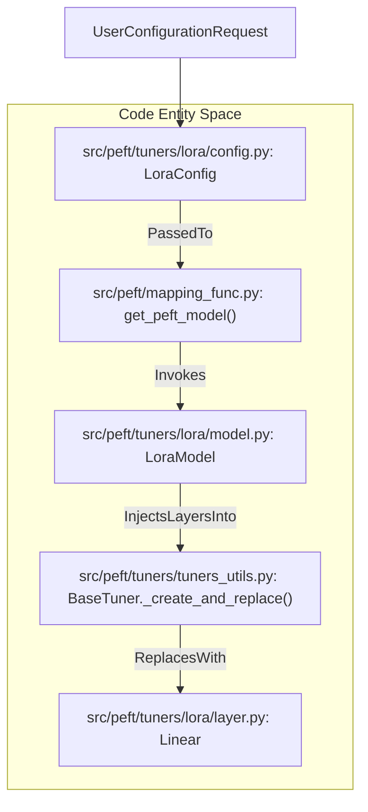
Sources: [`docs/source/quicktour.md:31-95`](), [`src/peft/__init__.py:33-48`](), [`src/peft/mapping.py:36-103`]()

---

## 3. Public API Surface (`src/peft/__init__.py`)

The public interface of PEFT is consolidated in `src/peft/__init__.py`. Importing `peft` exposes the primary abstraction classes, auto-loading utilities, mapping dicts, and individual tuner implementations [src/peft/__init__.py:17-182]().

Key components exported by the package include:
- **Auto Models**: `AutoPeftModel`, `AutoPeftModelForCausalLM`, etc. [src/peft/__init__.py:17-26]()
- **Base Models**: `PeftModel`, `PeftModelForCausalLM`, `PeftMixedModel` [src/peft/__init__.py:37-45]()
- **Configurations**: `PeftConfig`, `PromptLearningConfig`, and method-specific configs (`LoraConfig`, `AdaLoraConfig`, etc.) [src/peft/__init__.py:27-150]()
- **Mapping & Registration**: `PEFT_TYPE_TO_CONFIG_MAPPING`, `PEFT_TYPE_TO_TUNER_MAPPING`, `register_peft_method` [src/peft/__init__.py:29-35]()

Sources: [`src/peft/__init__.py:17-182`]()

---

## 4. Mapping and Registration System

PEFT uses a centralized registration and mapping architecture to associate string/enum-based method identifiers with their respective configuration classes, tuner models, and prefixes [src/peft/utils/peft_types.py:128-202](), [src/peft/mapping.py:29-35]().

### Registration Flow
When a new tuning method is initialized, it registers itself via `register_peft_method()` [src/peft/utils/peft_types.py:128-130](). This populates global dictionaries such as `PEFT_TYPE_TO_CONFIG_MAPPING` and `PEFT_TYPE_TO_TUNER_MAPPING` [src/peft/mapping.py:29-32]().

### Diagram: Registration and Configuration Mapping (Natural Language to Code Entity Space)
This diagram bridges registration concepts to the underlying dictionary data structures and utility functions.

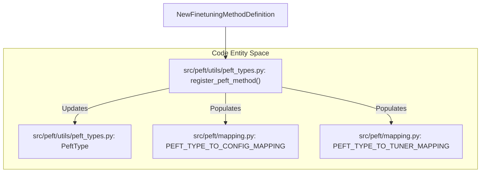

Sources: [`src/peft/utils/peft_types.py:128-203`](), [`src/peft/mapping.py:29-45`]()

---

## 5. Repository Directory Layout

The `peft` repository follows a structured layout separating core logic, tuners, utilities, and tests:

```text
peft/
├── src/
│   └── peft/
│       ├── __init__.py            # Public API exports
│       ├── auto.py                # AutoPeftModel implementations
│       ├── config.py              # Base configuration classes
│       ├── mapping.py             # Method mappings and adapter injection
│       ├── mapping_func.py        # get_peft_model factory function
│       ├── mixed_model.py         # PeftMixedModel for heterogeneous adapters
│       ├── peft_model.py          # PeftModel wrapper and task subclasses
│       ├── tuners/                # Implementation of individual PEFT methods
│       │   ├── lora/              # LoRA and variants (DoRA, PiSSA, LoftQ)
│       │   ├── adalora/           # AdaLoRA dynamic rank allocation
│       │   ├── prefix_tuning/     # Prefix tuning implementation
│       │   └── ...                # 30+ other tuner subdirectories
│       └── utils/                 # Serialization, quantization helpers, peft_types.py
├── tests/                         # Comprehensive unit and integration test suite
├── examples/                      # End-to-end task examples and scripts
└── setup.py                       # Package installation script
```

Sources: [`setup.py:1-95`](), [`src/peft/__init__.py:1-182`]()

---

# Page: Documentation Site

# Documentation Site

<details>
<summary>Relevant source files</summary>

The following files were used as context for generating this wiki page:

- [.github/workflows/build_docker_images.yml](.github/workflows/build_docker_images.yml)
- [.github/workflows/build_documentation.yml](.github/workflows/build_documentation.yml)
- [.github/workflows/build_pr_documentation.yml](.github/workflows/build_pr_documentation.yml)
- [.github/workflows/test-docker-build.yml](.github/workflows/test-docker-build.yml)
- [.github/workflows/trufflehog.yml](.github/workflows/trufflehog.yml)
- [.github/workflows/upload_pr_documentation.yml](.github/workflows/upload_pr_documentation.yml)
- [docs/Makefile](docs/Makefile)
- [docs/README.md](docs/README.md)
- [docs/source/package_reference/adalora.md](docs/source/package_reference/adalora.md)
- [docs/source/package_reference/ia3.md](docs/source/package_reference/ia3.md)
- [docs/source/package_reference/llama_adapter.md](docs/source/package_reference/llama_adapter.md)
- [docs/source/package_reference/loha.md](docs/source/package_reference/loha.md)
- [docs/source/package_reference/lokr.md](docs/source/package_reference/lokr.md)
- [docs/source/package_reference/multitask_prompt_tuning.md](docs/source/package_reference/multitask_prompt_tuning.md)
- [docs/source/package_reference/p_tuning.md](docs/source/package_reference/p_tuning.md)
- [docs/source/package_reference/prefix_tuning.md](docs/source/package_reference/prefix_tuning.md)
- [docs/source/package_reference/prompt_tuning.md](docs/source/package_reference/prompt_tuning.md)

</details>


This page details the organization, compilation pipeline, and contribution workflows for the PEFT documentation site. Powered by the Hugging Face `doc-builder` tool, the documentation source files reside in `docs/source/` and are automatically compiled and published via GitHub Actions upon merge into the main branch or on pull request updates.

---

## Directory Organization and Navigation (`_toctree.yml`)

The documentation source files are located in the `docs/source/` directory and comprise a mix of Markdown (`.md`), Markdown-extension (`.mdx`), and notebook files. The structural layout and sidebar navigation of the generated site are strictly governed by `docs/source/_toctree.yml`.

The repository categorizes documentation into distinct logical sections:
- **Get Started / Quickstart**: Installation and basic library usage.
- **Developer Guides**: Contribution workflows, code quality, testing infrastructure, and environment setup (`docs/README.md`) [docs/README.md:1-125]().
- **Package Reference & Methods**: Detailed API specifications and mathematical/algorithmic overviews for all 30+ supported parameter-efficient fine-tuning methods (e.g., LoRA, LoHa, LoKr, IA3, Prefix Tuning) [docs/source/package_reference/loha.md:1-90]().

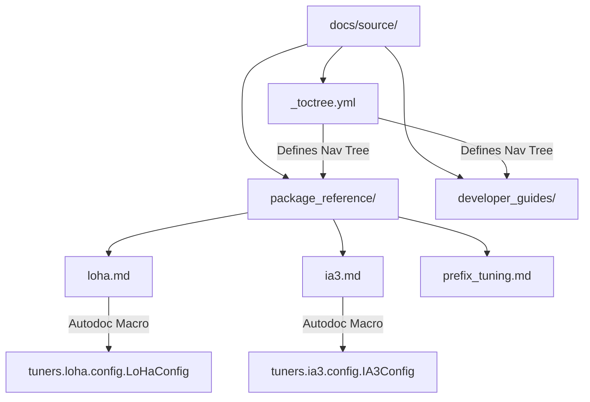
*Sources: [.github/workflows/build_documentation.yml:1-21](), [docs/README.md:82-128](), [docs/source/package_reference/loha.md:82-90]()*

---

## The Doc-Builder Pipeline and Local Preview

The PEFT documentation utilizes the `huggingface/doc-builder` package to convert Markdown files containing special macros (such as `[[autodoc]]`) into production-ready MDX and HTML output.

### Local Installation and Build
To generate the documentation locally, install the repository in editable mode with documentation dependencies, followed by the `doc-builder` package [docs/README.md:17-30]():

```bash
pip install -e ".[docs]"
pip install git+https://github.com/huggingface/doc-builder
```

To build the static HTML/MDX site into a temporary directory, run [docs/README.md:40-47]() [docs/README.md:61-71]():

```bash
doc-builder build peft docs/source/ --build_dir ~/tmp/test-build
```

To launch a live-reload preview server on `http://localhost:3000`:

```bash
doc-builder preview peft docs/source/
```

> [!NOTE]
> The `preview` process caches the tree structure. If you add a brand new Markdown file, you must update `docs/source/_toctree.yml` and restart the preview command [docs/README.md:76-80]().

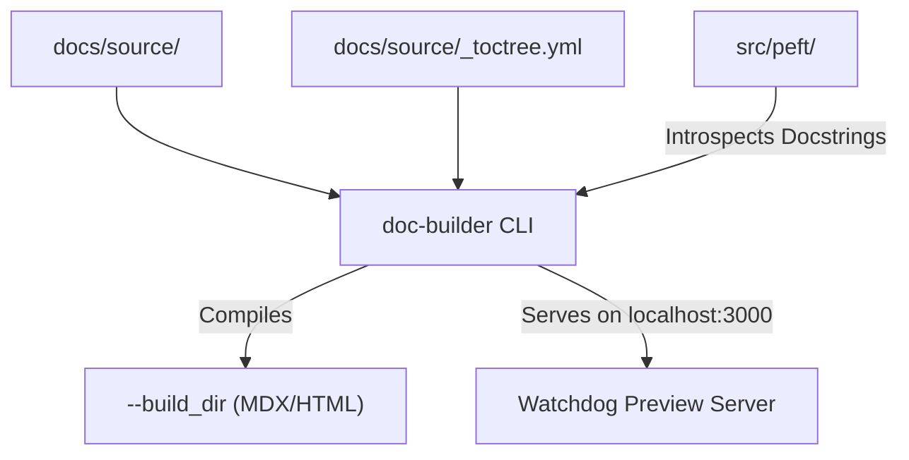
*Sources: [.github/workflows/build_documentation.yml:1-21](), [docs/README.md:17-74]()*

---

## CI/CD and Hosting Infrastructure

Documentation builds are fully automated using GitHub Actions workflows located in `.github/workflows/`. Three primary workflows govern the documentation lifecycle:

1. **Main Documentation Build (`build_documentation.yml`)**: Triggered on pushes to `main`, `doc-builder*`, or release branches. It invokes the reusable workflow from `huggingface/doc-builder` (`build_main_documentation.yml`) to compile and publish the documentation package to the Hugging Face hub [.github/workflows/build_documentation.yml:1-21]().
2. **PR Documentation Build (`build_pr_documentation.yml`)**: Triggered on pull requests, this action compiles the documentation for the specific PR branch SHA and outputs build reports [.github/workflows/build_pr_documentation.yml:1-18]().
3. **PR Documentation Upload (`upload_pr_documentation.yml`)**: Automatically posts a comment on the active PR with a link to the deployed staging documentation built specifically for that branch [.github/workflows/upload_pr_documentation.yml:1-18]().

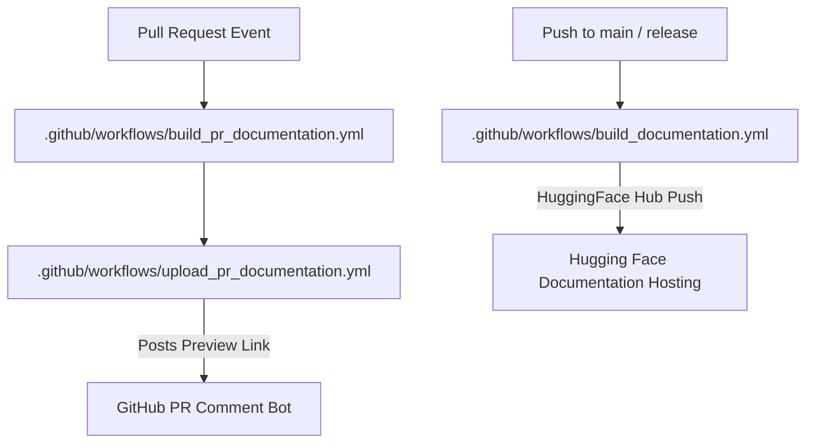
*Sources: [.github/workflows/build_documentation.yml:1-21](), [.github/workflows/build_pr_documentation.yml:1-18](), [.github/workflows/upload_pr_documentation.yml:1-18]()*

---

## Adding Documentation for a New Method

When implementing a new parameter-efficient fine-tuning method (e.g., a new tuner or configuration class), you must register and document it correctly to maintain API coverage and sidebar navigation.

### Step 1: Create the Documentation File
Create a new Markdown file under `docs/source/package_reference/<method_name>.md`. Follow the standard structure used across method references (such as `loha.md` or `ia3.md`), including math/paper references, conceptual explanations, code snippets, benchmark widgets, and `[[autodoc]]` directives pointing to your classes [docs/source/package_reference/loha.md:17-90]():

```markdown
# MyNewMethod

Low-Rank MyNewMethod description...

## Usage

```python
from peft import MyNewMethodConfig, get_peft_model
...
```

# API

## MyNewMethodConfig

[[autodoc]] tuners.mynewmethod.config.MyNewMethodConfig

## MyNewMethodModel

[[autodoc]] tuners.mynewmethod.model.MyNewMethodModel
```

### Step 2: Update the Toc-Tree
Open `docs/source/_toctree.yml` and add the filename (without extension) under the appropriate method family section so that the `doc-builder` includes it in the sidebar navigation tree [docs/README.md:82-88]().

### Step 3: Write Docstrings and Code Annotations
Docstrings in python files (`src/peft/tuners/mynewmethod/`) must follow the Google style guide (supported by Napoleon in sphinx/doc-builder) [docs/README.md:113-118]():

```python
def my_method_function(n_layers: int):
    """
    Args:
        n_layers (`int`):
            The number of layers of the model.
    """
```
Internal object cross-referencing in markdown or docstrings uses backtick syntax: `[`MyNewMethodConfig`]` or `[`~tuners.mynewmethod.config.MyNewMethodConfig`]` [docs/README.md:135-144]().

*Sources: [docs/README.md:82-168](), [docs/source/package_reference/loha.md:17-90]()*

---

# Page: Core Architecture

# Core Architecture

<details>
<summary>Relevant source files</summary>

The following files were used as context for generating this wiki page:

- [src/peft/peft_model.py](src/peft/peft_model.py)
- [src/peft/tuners/lora/__init__.py](src/peft/tuners/lora/__init__.py)
- [src/peft/tuners/lora/config.py](src/peft/tuners/lora/config.py)
- [src/peft/tuners/lora/layer.py](src/peft/tuners/lora/layer.py)
- [src/peft/tuners/lora/model.py](src/peft/tuners/lora/model.py)
- [src/peft/tuners/lora/variants.py](src/peft/tuners/lora/variants.py)
- [src/peft/tuners/tuners_utils.py](src/peft/tuners/tuners_utils.py)
- [src/peft/utils/__init__.py](src/peft/utils/__init__.py)
- [src/peft/utils/constants.py](src/peft/utils/constants.py)
- [src/peft/utils/other.py](src/peft/utils/other.py)
- [src/peft/utils/save_and_load.py](src/peft/utils/save_and_load.py)
- [tests/test_custom_models.py](tests/test_custom_models.py)
- [tests/test_decoder_models.py](tests/test_decoder_models.py)
- [tests/test_encoder_decoder_models.py](tests/test_encoder_decoder_models.py)
- [tests/test_feature_extraction_models.py](tests/test_feature_extraction_models.py)
- [tests/test_initialization.py](tests/test_initialization.py)
- [tests/test_lora_variants.py](tests/test_lora_variants.py)
- [tests/test_seq_classifier.py](tests/test_seq_classifier.py)
- [tests/test_tuners_utils.py](tests/test_tuners_utils.py)
- [tests/testing_common.py](tests/testing_common.py)

</details>


This document describes the fundamental design patterns and abstractions that enable PEFT's extensible architecture, including the wrapping pattern, configuration system, registry-based dispatch mechanism, and adapter injection process. This page provides a high-level overview of how PEFT integrates adapters into base models while maintaining compatibility with the Hugging Face ecosystem.

As a parent page, this overview outlines core concepts. For detailed information, see the respective child pages:
- PeftModel wrapper class, task-specific subclasses, and AutoPeftModel loading: see [PeftModel and Base Classes](#2.1)
- Configuration hierarchy, serialization, and registry dispatch: see [Configuration System](#2.2)
- BaseTuner/BaseTunerLayer interfaces and layer injection: see [Tuner Infrastructure](#2.3)
- Adapter states, lifecycle methods, and multi-adapter operations: see [Adapter Lifecycle Management](#2.4)
- State dictionary management, hotswapping, and cross-format conversion: see [State Management and Serialization](#2.5)
- Auxiliary training wrappers for non-adapter parameters: see [Auxiliary Training Wrappers](#2.6)

---

## Architectural Overview

PEFT uses a **wrapper pattern** where the `PeftModel` class wraps a base model (typically a `transformers.PreTrainedModel`) and adds adapter capabilities. The architecture is modular, extensible, and supports multiple concurrent adapter types.

### System Architecture Diagram

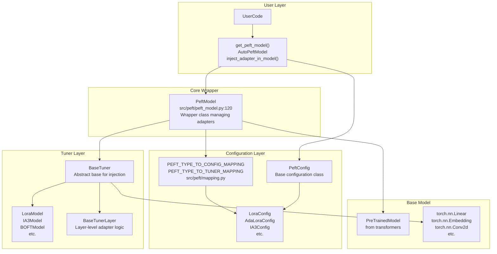
Sources: [src/peft/peft_model.py:120-150](), [src/peft/mapping.py:30-93](), [src/peft/__init__.py:17-152]()

---

## Core Architectural Sub-Topics

### 1. PeftModel and Base Classes
The `PeftModel` class serves as the primary container wrapping base pretrained models. It provides task-specific subclasses (`PeftModelForCausalLM`, `PeftModelForSequenceClassification`, etc.) and lifecycle methods like `from_pretrained` and `save_pretrained`.
For details, see [PeftModel and Base Classes](#2.1).
Sources: [src/peft/peft_model.py:120-200]()

### 2. Configuration System
PEFT manages hyperparameters through a configuration inheritance hierarchy rooted in `PeftConfig`, leveraging `PeftConfigMixin` for JSON serialization and forward compatibility. The global registry mappings (`PEFT_TYPE_TO_CONFIG_MAPPING`) link adapter types to their respective classes.
For details, see [Configuration System](#2.2).
Sources: [src/peft/config.py](), [src/peft/mapping.py:30-45]()

### 3. Tuner Infrastructure
The low-level mechanics of adapter injection are driven by `BaseTuner` and `BaseTunerLayer`. These abstract classes coordinate target module matching, layer replacement (`_create_and_replace`), and weight transformation across diverse methods including LoRA, IA3, and Lycoris tuners.
For details, see [Tuner Infrastructure](#2.3).
Sources: [src/peft/tuners/tuners_utils.py](), [src/peft/tuners/lora/model.py:131-180]()

### 4. Adapter Lifecycle Management
Adapters exist in multiple states—active, inactive, or merged into the base weights. Management utilities allow runtime toggling (`set_adapter`, `enable_adapters`, `disable_adapters`), multi-adapter mixing, deletion, and complete unloading.
For details, see [Adapter Lifecycle Management](#2.4).
Sources: [src/peft/peft_model.py:800-1100]()

### 5. State Management and Serialization
Serialization is optimized by saving only lightweight adapter parameters rather than full model weights via `get_peft_model_state_dict` and `set_peft_model_state_dict`. This subsystem also handles adapter name remapping, hotswapping (`hotswap_adapter`), and transformers weight format conversion.
For details, see [State Management and Serialization](#2.5).
Sources: [src/peft/utils/save_and_load.py:1-164]()

### 6. Auxiliary Training Wrappers
To support training non-adapter parameters alongside adapters, PEFT provides specialized wrappers like `ModulesToSaveWrapper` (for full fine-tuning of specific sub-modules) and `TrainableTokensWrapper` (for selective embedding token updates).
For details, see [Auxiliary Training Wrappers](#2.6).
Sources: [src/peft/utils/other.py:612-730](), [src/peft/peft_model.py:45-50]()

---

## Adapter Injection Flow

The following sequence diagram illustrates how adapters are initialized and injected into a base model via `get_peft_model`.

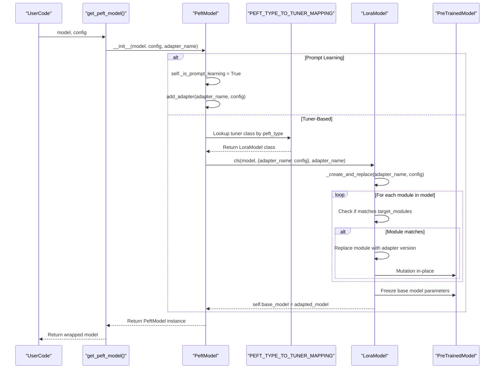
Sources: [src/peft/peft_model.py:126-151](), [src/peft/mapping.py:47-92]()

---

# Page: PeftModel and Base Classes

# PeftModel and Base Classes

<details>
<summary>Relevant source files</summary>

The following files were used as context for generating this wiki page:

- [src/peft/auto.py](src/peft/auto.py)
- [src/peft/config.py](src/peft/config.py)
- [src/peft/peft_model.py](src/peft/peft_model.py)
- [src/peft/utils/__init__.py](src/peft/utils/__init__.py)
- [src/peft/utils/constants.py](src/peft/utils/constants.py)
- [src/peft/utils/other.py](src/peft/utils/other.py)
- [src/peft/utils/save_and_load.py](src/peft/utils/save_and_load.py)
- [tests/test_auto.py](tests/test_auto.py)
- [tests/test_config.py](tests/test_config.py)
- [tests/test_decoder_models.py](tests/test_decoder_models.py)
- [tests/test_encoder_decoder_models.py](tests/test_encoder_decoder_models.py)
- [tests/test_feature_extraction_models.py](tests/test_feature_extraction_models.py)
- [tests/test_hub_features.py](tests/test_hub_features.py)
- [tests/test_lora_megatron.py](tests/test_lora_megatron.py)
- [tests/test_seq_classifier.py](tests/test_seq_classifier.py)
- [tests/testing_common.py](tests/testing_common.py)

</details>


## Overview

`PeftModel` is the central orchestrator class in the PEFT library (`src/peft/peft_model.py`). It wraps pre-trained models to add parameter-efficient fine-tuning capabilities through adapters. The class implements a **dual-path architecture**:

1. **Prompt Learning Path**: For methods like Prompt Tuning and Prefix Tuning, where the base model remains unchanged and trainable virtual prompts are prepended or injected into inputs/activations.
2. **Tuner-Based Path**: For methods like LoRA, AdaLoRA, and IA³, where adapter layers are injected into target modules via `BaseTuner` subclasses (`peft.tuners.tuners_utils.BaseTuner`).

Additionally, this page covers task-specific model subclasses, `AutoPeftModel` loading logic, adapter lifecycle management methods (`from_pretrained`, `save_pretrained`), and auxiliary wrappers (`AuxiliaryTrainingWrapper`, `ModulesToSaveWrapper`, `TrainableTokensWrapper`).

Sources:
- [src/peft/peft_model.py:120-152]()
- [src/peft/utils/other.py:45-48]()

---

## PeftModel Class Hierarchy

### Inheritance and Core Attributes

`PeftModel` inherits from `PushToHubMixin` and `torch.nn.Module`, enabling standard PyTorch module semantics and seamless Hugging Face Hub integration (`src/peft/peft_model.py`).

**Diagram: PeftModel Class Structure and Code Entities**

```mermaid
classDiagram
    class Module["torch.nn.Module"] {
        +forward()
        +parameters()
        +state_dict()
    }
    
    class PushToHubMixin {
        +push_to_hub()
    }
    
    class PeftModel {
        +torch.nn.Module base_model
        +dict peft_config
        +str active_adapter
        +list active_adapters
        +set special_peft_forward_args
        -_is_prompt_learning bool
        +__init__(model, peft_config, adapter_name)
        +save_pretrained(save_directory)
        +from_pretrained(model, model_id)
        +add_adapter(adapter_name, peft_config)
        +set_adapter(adapter_names)
        +delete_adapter(adapter_name)
        +merge_and_unload()
        +load_adapter(model_id, adapter_name)
        +get_nb_trainable_parameters()
        +enable_adapters()
        +disable_adapters()
    }
    
    class BaseTuner {
        +torch.nn.Module model
        +dict peft_config
        +str active_adapter
        +inject_adapter(adapter_name)
        +merge_adapter()
        +unmerge_adapter()
        +_mark_only_adapters_as_trainable()
    }
    
    Module <|-- PeftModel
    PushToHubMixin <|-- PeftModel
    BaseTuner <|-- LoraModel
    PeftModel *-- "base_model" : wraps
    BaseTuner <.. PeftModel : contains when tuner-based
```

**Key Attributes:**

| Attribute | Type | Purpose |
|-----------|------|---------|
| `base_model` | `torch.nn.Module` | The wrapped model (either original or tuner-wrapped) [src/peft/peft_model.py:138]() |
| `peft_config` | `dict[str, PeftConfig]` | Configuration for each adapter [src/peft/peft_model.py:139]() |
| `active_adapter` | `str` | Currently active adapter name [src/peft/peft_model.py:127]() |
| `_is_prompt_learning` | `bool` | Whether using prompt learning path [src/peft/peft_model.py:141]() |

Sources:
- [src/peft/peft_model.py:120-152]()

---

## Dual-Path Architecture

The core design of `PeftModel` implements two distinct paths based on the PEFT method type, determined at initialization time via `peft_config.is_prompt_learning`.

**Diagram: Initialization Flow and Code Entities**

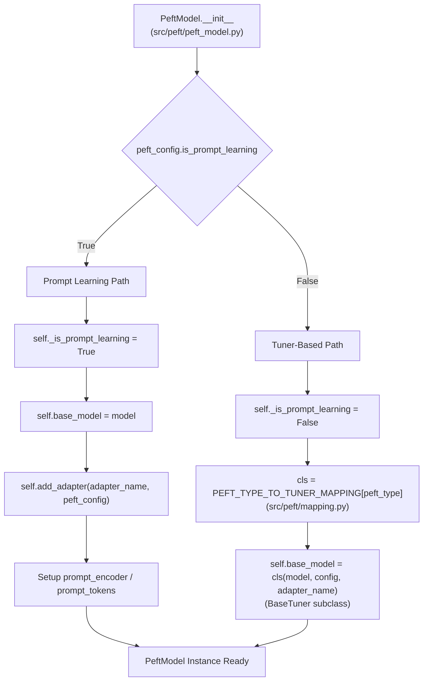

**Path Comparison:**

| Aspect | Prompt Learning Path | Tuner-Based Path |
|--------|---------------------|------------------|
| Base model modified? | No | Yes (adapter layers injected) |
| `_is_prompt_learning` | `True` | `False` |
| `base_model` type | Original `PreTrainedModel` | `BaseTuner` subclass |
| Trainable parameters | Prompt embeddings / virtual tokens | Adapter weights (`lora_A`, `lora_B`, etc.) |

Sources:
- [src/peft/peft_model.py:126-152]()
- [src/peft/mapping.py:31-52]()

---

## Task-Specific Model Variants and AutoPeftModel

`PeftModel` has specialized subclasses for different model tasks, enabling custom forward passes, classification heads, or sequence-to-sequence routing. These include `PeftModelForCausalLM`, `PeftModelForSeq2SeqLM`, `PeftModelForSequenceClassification`, `PeftModelForTokenClassification`, and `PeftModelForQuestionAnswering`.

The `AutoPeftModel` loading classes (`src/peft/auto.py`) inspect the configuration file (`adapter_config.json`) to automatically select the appropriate `PeftModel` task-specific subclass and instantiate it.

Sources:
- [src/peft/peft_model.py:39-41]()
- [src/peft/auto.py:1-50]()

---

## Adapter Lifecycle Operations

`PeftModel` provides unified lifecycle methods to manage adapters dynamically at runtime.

**Core Adapter Management Methods:**

| Method | Purpose | Code Reference |
|--------|---------|----------------|
| `add_adapter(adapter_name, peft_config)` | Inject or instantiate a new adapter | [src/peft/peft_model.py:145]() |
| `set_adapter(adapter_names)` | Switch active adapter(s) for inference/training | [src/peft/peft_model.py:172-181]() |
| `disable_adapters()` / `enable_adapters()` | Temporarily toggle adapter computation | [src/peft/peft_model.py:172-181]() |
| `merge_and_unload()` | Merge adapter weights into base weights and return base model | [src/peft/peft_model.py:37]() |

Sources:
- [src/peft/peft_model.py:154-189]()

---

## Prompt Learning Implementation

When `_is_prompt_learning=True`, `PeftModel` manages virtual prompts directly through `prompt_encoder` and `prompt_tokens`.

- **Prompt Tuning**: Uses `PromptEmbedding` to maintain trainable embedding tensors (`src/peft/__init__.py`).
- **Prefix Tuning / P-Tuning**: Uses `PromptEncoder` or `PrefixEncoder` MLPs to generate virtual activations injected into attention layers.

Sources:
- [src/peft/peft_model.py:116-145]()

---

## Saving and Loading (`save_pretrained` & `from_pretrained`)

### `save_pretrained`
The `save_pretrained(save_directory)` method serializes only the adapter weights and configuration, avoiding duplication of base model weights. It invokes `get_peft_model_state_dict` (`src/peft/utils/save_and_load.py`) to extract trainable adapter parameters and saves them as `adapter_model.safetensors` or `adapter_model.bin`, alongside `adapter_config.json`.

### `from_pretrained`
The classmethod `from_pretrained(model, model_id, ...)` loads adapter weights and configuration from a local directory or the Hugging Face Hub, instantiates the correct `PeftModel` subclass, and loads the state dict via `set_peft_model_state_dict` (`src/peft/utils/save_and_load.py`).

Sources:
- [src/peft/peft_model.py:53-70]()
- [src/peft/utils/save_and_load.py:83-89]()

---

## Advanced Features and Auxiliary Training Wrappers

PEFT provides specialized wrapper classes in `src/peft/utils/other.py` to handle modules that require full fine-tuning alongside parameter-efficient adapters.

**Diagram: Auxiliary Wrapper Hierarchy and Code Entities**

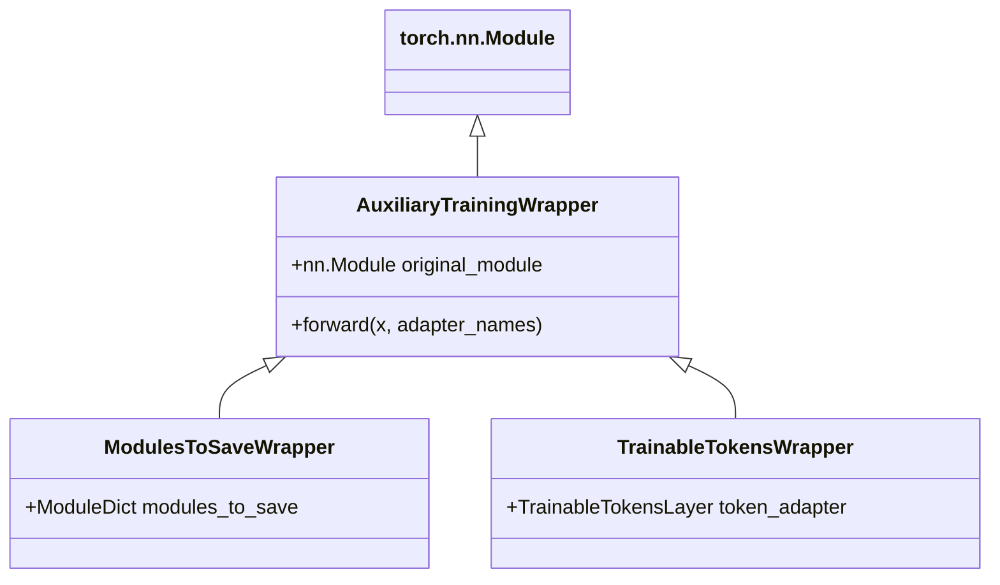

- **`ModulesToSaveWrapper`**: Wraps submodules specified via `modules_to_save` in `PeftConfig`, allowing full parameter updates for specific layers (e.g., classification heads).
- **`TrainableTokensWrapper`**: Manages trainable token embeddings alongside adapter layers.

Sources:
- [src/peft/utils/other.py:39-61]()
- [src/peft/peft_model.py:45-48]()

---

## Trainable Parameters Management

During initialization, `PeftModel` freezes base model parameters (`requires_grad = False`) and marks only adapter parameters or prompt encoder parameters as trainable via `_set_trainable` (`src/peft/utils/other.py`).

Sources:
- [src/peft/utils/other.py:61-70]()

---

# Page: Configuration System

# Configuration System

<details>
<summary>Relevant source files</summary>

The following files were used as context for generating this wiki page:

- [.pre-commit-config.yaml](.pre-commit-config.yaml)
- [docs/source/_toctree.yml](docs/source/_toctree.yml)
- [pyproject.toml](pyproject.toml)
- [setup.py](setup.py)
- [src/peft/__init__.py](src/peft/__init__.py)
- [src/peft/auto.py](src/peft/auto.py)
- [src/peft/config.py](src/peft/config.py)
- [src/peft/mapping.py](src/peft/mapping.py)
- [src/peft/tuners/__init__.py](src/peft/tuners/__init__.py)
- [src/peft/tuners/adalora/config.py](src/peft/tuners/adalora/config.py)
- [src/peft/tuners/boft/config.py](src/peft/tuners/boft/config.py)
- [src/peft/tuners/fourierft/config.py](src/peft/tuners/fourierft/config.py)
- [src/peft/tuners/hra/config.py](src/peft/tuners/hra/config.py)
- [src/peft/tuners/ia3/config.py](src/peft/tuners/ia3/config.py)
- [src/peft/tuners/loha/config.py](src/peft/tuners/loha/config.py)
- [src/peft/tuners/lokr/config.py](src/peft/tuners/lokr/config.py)
- [src/peft/tuners/lora/arrow.py](src/peft/tuners/lora/arrow.py)
- [src/peft/tuners/oft/config.py](src/peft/tuners/oft/config.py)
- [src/peft/tuners/vblora/config.py](src/peft/tuners/vblora/config.py)
- [src/peft/tuners/vera/config.py](src/peft/tuners/vera/config.py)
- [src/peft/utils/peft_types.py](src/peft/utils/peft_types.py)
- [tests/conftest.py](tests/conftest.py)
- [tests/test_auto.py](tests/test_auto.py)
- [tests/test_config.py](tests/test_config.py)
- [tests/test_hub_features.py](tests/test_hub_features.py)
- [tests/test_lora_megatron.py](tests/test_lora_megatron.py)

</details>


The Configuration System in PEFT (Parameter-Efficient Fine-Tuning) provides a structured architecture to define, serialize, version, and load parameters for diverse parameter-efficient fine-tuning techniques. This page details the configuration hierarchy, serialization mechanisms, forward compatibility handling, and the global registration/dispatch system.

## Overview and Scope

The configuration system handles the lifecycle of adapter parameters from initialization to serialization and runtime dispatch. It ensures that any adapter configuration can be uniquely identified, serialized to disk (`adapter_config.json`), shared via the Hugging Face Hub, and dynamically resolved to the correct tuner implementation class at runtime.

Sources: [src/peft/config.py:77-164](), [src/peft/mapping.py:28-44]()

## Configuration Hierarchy and `PeftConfigMixin`

All PEFT configuration classes inherit from `PeftConfigMixin`, which extends `PushToHubMixin` from the `transformers` library to support direct pushing and pulling from the Hugging Face Hub.

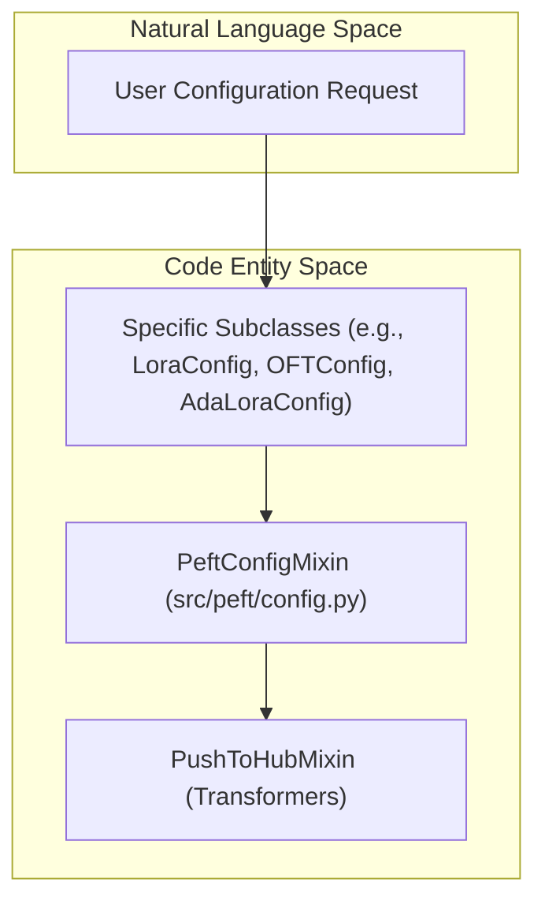
Sources: [src/peft/config.py:77-94](), [src/peft/tuners/oft/config.py:28-28]()

Key shared attributes initialized by `PeftConfigMixin.__post_init__`:
* `task_type`: An optional `TaskType` enum specifying the downstream model head (e.g., `CAUSAL_LM`, `SEQ_CLS`) [src/peft/config.py:88]().
* `peft_type`: A `PeftType` enum identifying the fine-tuning method [src/peft/config.py:89]().
* `auto_mapping`: Dictionary assisting in base model retrieval for custom architectures [src/peft/config.py:90-92]().
* `peft_version`: Library version tracker incorporating commit hashes for development builds [src/peft/config.py:93-124]().

Sources: [src/peft/config.py:77-124]()

## Forward Compatibility Handling

To prevent checkpoints generated with newer PEFT versions from crashing older client versions, PEFT employs `_check_and_remove_unused_kwargs`. When loading a configuration dictionary, this utility inspects the target class's `__init__` signature and strips any keyword arguments absent from the current signature [src/peft/config.py:37-50]().

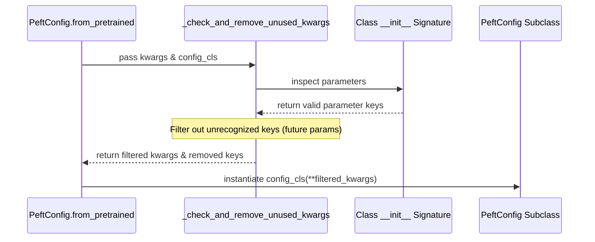
Sources: [src/peft/config.py:37-50](), [src/peft/config.py:166-174]()

Sources: [src/peft/config.py:37-50]()

## Registration and Dispatch System (`PEFT_TYPE_TO_CONFIG_MAPPING`)

PEFT maps string method identifiers and enums (`PeftType`) to their corresponding configuration classes, tuner implementations, and mixed-model classes via lookup dictionaries defined in `src/peft/mapping.py` and populated by `register_peft_method` [src/peft/utils/peft_types.py:128-202]().

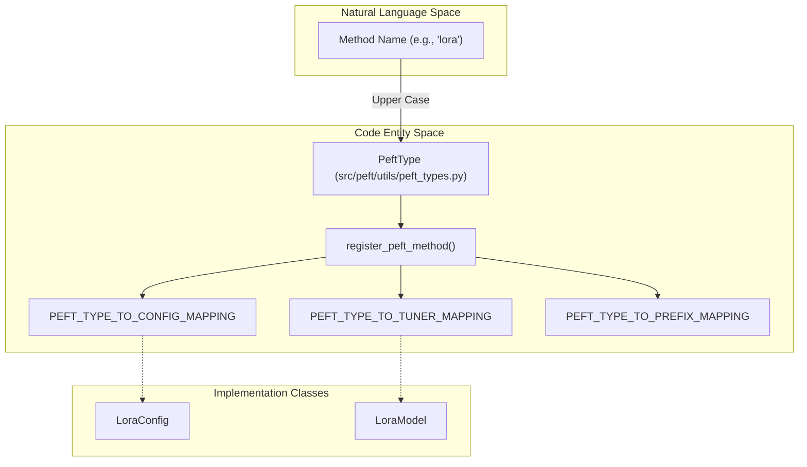
Sources: [src/peft/utils/peft_types.py:128-202](), [src/peft/mapping.py:28-34]()

### Global Mapping Tables

| Mapping Name | Code Entity | Purpose |
| :--- | :--- | :--- |
| `PEFT_TYPE_TO_CONFIG_MAPPING` | `dict[PeftType, type[PeftConfig]]` | Maps `PeftType` to configuration classes [src/peft/mapping.py:30]() |
| `PEFT_TYPE_TO_TUNER_MAPPING` | `dict[PeftType, type[BaseTuner]]` | Maps `PeftType` to tuner model implementations [src/peft/mapping.py:31]() |
| `PEFT_TYPE_TO_MIXED_MODEL_MAPPING` | `dict[PeftType, type[BaseTuner]]` | Maps methods compatible with `PeftMixedModel` [src/peft/mapping.py:32]() |
| `PEFT_TYPE_TO_PREFIX_MAPPING` | `dict[PeftType, str]` | Maps methods to state dict prefix strings [src/peft/mapping.py:33]() |

Sources: [src/peft/mapping.py:28-34](), [src/peft/utils/peft_types.py:128-202]()

## Configuration Serialization

Adapter configurations serialize to disk as `adapter_config.json` [src/peft/utils/other.py:19](). The serialization workflow converts complex types (such as `set` objects into JSON-compatible `list` structures) and saves them with sorted keys [src/peft/config.py:132-164]().

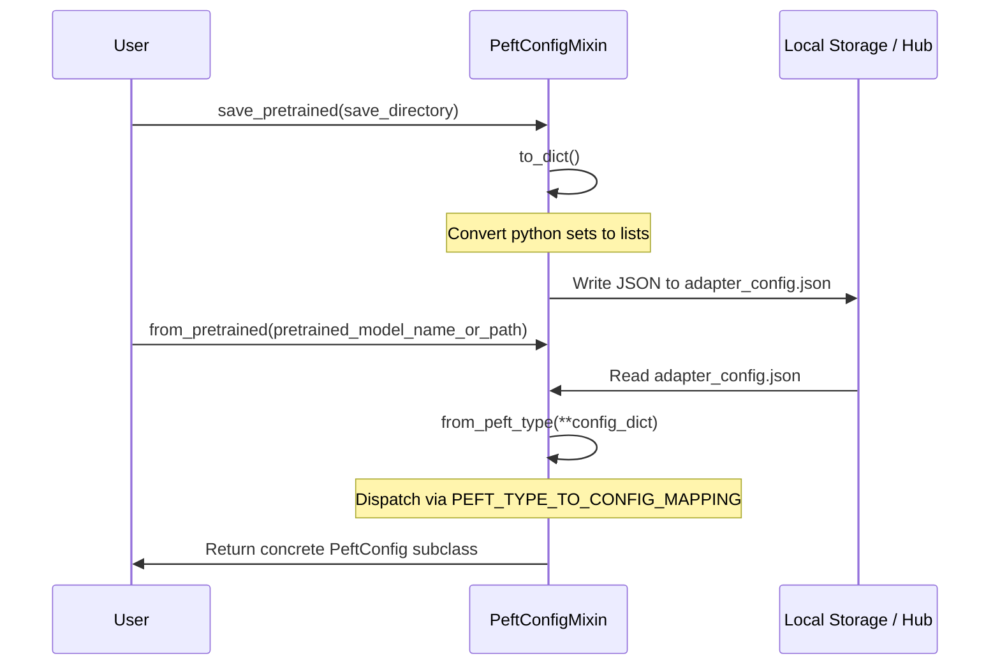
Sources: [src/peft/config.py:126-174](), [src/peft/utils/other.py:19]()

Key serialization methods:
* `to_dict()`: Serializes dataclass fields using `dataclasses.asdict` [src/peft/config.py:126-130]().
* `save_pretrained()`: Manages directory creation and outputs `adapter_config.json` [src/peft/config.py:132-164]().
* `from_peft_type()`: Factory method dispatching instantiation based on `peft_type` [src/peft/config.py:166-174]().

Sources: [src/peft/config.py:126-174]()

## Auto-Configuration (`AutoPeftModel`) and Security

The `AutoPeftModel` family uses the configuration to automatically infer the required base model class and downstream task wrapper [src/peft/auto.py:89-156](). 

To prevent arbitrary code execution vulnerabilities during dynamic module importing specified in `auto_mapping`, PEFT enforces an `import_allowlist` [src/peft/auto.py:55-74](). By default, only trusted libraries like `transformers`, `diffusers`, `lerobot`, and `megatron-core` are permitted to be dynamically imported [src/peft/auto.py:55-61]().

Sources: [src/peft/auto.py:55-156]()

## Runtime Configuration

PEFT separates persistent configuration from execution-specific parameters via runtime configuration classes (e.g., `LoraRuntimeConfig`) [src/peft/tuners/lora/config.py:315-334](). These settings control transient execution behavior, such as ephemeral offloading, and are intentionally omitted from disk serialization.

Sources: [src/peft/tuners/lora/config.py:315-334]()

---

# Page: Tuner Infrastructure

# Tuner Infrastructure

<details>
<summary>Relevant source files</summary>

The following files were used as context for generating this wiki page:

- [docs/source/developer_guides/low_level_api.md](docs/source/developer_guides/low_level_api.md)
- [src/peft/tuners/adalora/layer.py](src/peft/tuners/adalora/layer.py)
- [src/peft/tuners/adalora/model.py](src/peft/tuners/adalora/model.py)
- [src/peft/tuners/frod/model.py](src/peft/tuners/frod/model.py)
- [src/peft/tuners/ia3/layer.py](src/peft/tuners/ia3/layer.py)
- [src/peft/tuners/ia3/model.py](src/peft/tuners/ia3/model.py)
- [src/peft/tuners/loha/layer.py](src/peft/tuners/loha/layer.py)
- [src/peft/tuners/loha/model.py](src/peft/tuners/loha/model.py)
- [src/peft/tuners/lokr/layer.py](src/peft/tuners/lokr/layer.py)
- [src/peft/tuners/lokr/model.py](src/peft/tuners/lokr/model.py)
- [src/peft/tuners/lora/__init__.py](src/peft/tuners/lora/__init__.py)
- [src/peft/tuners/lora/config.py](src/peft/tuners/lora/config.py)
- [src/peft/tuners/lora/layer.py](src/peft/tuners/lora/layer.py)
- [src/peft/tuners/lora/model.py](src/peft/tuners/lora/model.py)
- [src/peft/tuners/lora/variants.py](src/peft/tuners/lora/variants.py)
- [src/peft/tuners/lycoris_utils.py](src/peft/tuners/lycoris_utils.py)
- [src/peft/tuners/pvera/model.py](src/peft/tuners/pvera/model.py)
- [src/peft/tuners/tinylora/model.py](src/peft/tuners/tinylora/model.py)
- [src/peft/tuners/tuners_utils.py](src/peft/tuners/tuners_utils.py)
- [src/peft/tuners/unilora/model.py](src/peft/tuners/unilora/model.py)
- [src/peft/tuners/vblora/model.py](src/peft/tuners/vblora/model.py)
- [src/peft/tuners/vera/model.py](src/peft/tuners/vera/model.py)
- [tests/test_custom_models.py](tests/test_custom_models.py)
- [tests/test_initialization.py](tests/test_initialization.py)
- [tests/test_lora_variants.py](tests/test_lora_variants.py)
- [tests/test_low_level_api.py](tests/test_low_level_api.py)
- [tests/test_tuners_utils.py](tests/test_tuners_utils.py)

</details>


## Purpose and Scope

The Tuner Infrastructure provides the foundational abstractions and mechanisms that enable parameter-efficient adapter injection into PyTorch models. This page details the `BaseTuner` and `BaseTunerLayer` interfaces, target module matching logic, the layer injection process via `_create_and_replace()`, the low-level `inject_adapter_in_model` API, and the generalization of tuner abstractions through `LycorisLayer` and `LycorisConfig`.

For information about the `PeftModel` wrapper that orchestrates tuner usage, see [PeftModel and Base Classes](2.1). For configuration management, see [Configuration System](2.2). For adapter lifecycle operations (activation, merging, etc.), see [Adapter Lifecycle Management](2.4).

Sources: [src/peft/tuners/tuners_utils.py:1-200](), [src/peft/tuners/lycoris_utils.py:1-60]()

---

## Core Abstractions

The tuner infrastructure is built on two abstract base classes that define the contract for all PEFT methods.

### BaseTuner Class

`BaseTuner` [src/peft/tuners/tuners_utils.py:221-1250]() is the abstract base class that all PEFT method implementations inherit from. It manages the injection of adapter layers into a base model and provides infrastructure for multi-adapter scenarios.

**Class Hierarchy:**

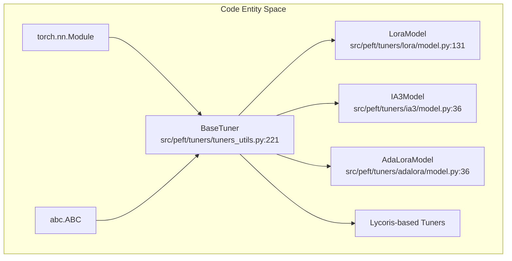

**Required Class Attributes:**

Each `BaseTuner` subclass must define specific class-level attributes [src/peft/tuners/lora/model.py:161-163]():

| Attribute | Type | Example | Description |
|-----------|------|---------|-------------|
| `prefix` | `str` | `"lora_"` | Unique prefix for adapter weight names in state_dict |
| `tuner_layer_cls` | `type[BaseTunerLayer]` | `LoraLayer` | The layer class used to wrap target modules |
| `target_module_mapping` | `dict[str, list[str]]` | `{"llama": ["q_proj", "v_proj"]}` | Default target modules per model architecture |

**Core Methods:**

| Method | Signature | Purpose |
|--------|-----------|---------|
| `__init__()` | `(model, peft_config, adapter_name)` | Initializes tuner and calls `inject_adapter()` |
| `inject_adapter()` | `(model, adapter_name, low_cpu_mem_usage, state_dict)` | Main entry point for adapter injection [src/peft/tuners/tuners_utils.py:698-977]() |
| `_prepare_adapter_config()` | `(peft_config, model_config) -> PeftConfig` | Prepares config, auto-infers target modules [src/peft/tuners/tuners_utils.py:333-370]() |
| `_create_and_replace()` | `(config, adapter_name, target, target_name, parent, key)` | Abstract method: creates adapter layer and replaces target [src/peft/tuners/tuners_utils.py:390-422]() |
| `_mark_only_adapters_as_trainable()` | `(model, adapter_name)` | Freezes base weights, enables adapter gradients [src/peft/tuners/tuners_utils.py:424-446]() |
| `merge_and_unload()` | `(progressbar, safe_merge, adapter_names)` | Merges adapters and returns unwrapped model [src/peft/tuners/tuners_utils.py:1081-1142]() |

Sources: [src/peft/tuners/tuners_utils.py:221-1250](), [src/peft/tuners/lora/model.py:131-163]()

### BaseTunerLayer Class

`BaseTunerLayer` [src/peft/tuners/tuners_utils.py:1252-1454]() is the abstract base class for adapter layers that wrap original model layers. It acts as a mixin that is combined with the base layer type (e.g., `nn.Linear`) to create adapter-enabled layers like `LoraLayer` [src/peft/tuners/lora/layer.py:108]() or `LycorisLayer` [src/peft/tuners/lycoris_utils.py:60]().

**Layer Composition Pattern:**

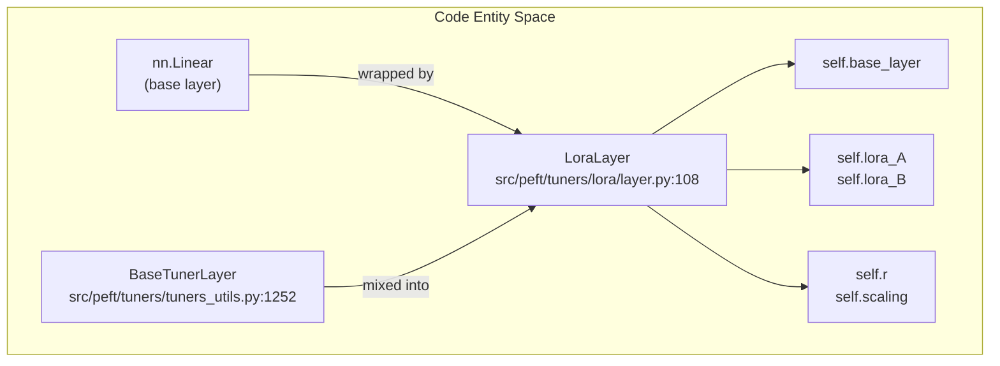

**Required Class Attributes:**

Subclasses must define these tuples to identify adapter parameters [src/peft/tuners/lora/layer.py:105-107]():

| Attribute | Type | Example | Purpose |
|-----------|------|---------|---------|
| `adapter_layer_names` | `tuple[str, ...]` | `("lora_A", "lora_B")` | Names of `nn.ModuleDict` containing adapter weights |
| `other_param_names` | `tuple[str, ...]` | `("r", "lora_alpha", "scaling")` | Names of other adapter metadata (scalars, dicts) |

**Core Methods:**

| Method | Purpose | Implementation |
|--------|---------|----------------|
| `get_base_layer()` | Recursively unwraps to find original layer | [src/peft/tuners/tuners_utils.py:1277-1287]() |
| `enable_adapters(enabled)` | Toggles adapter enable/disable | [src/peft/tuners/tuners_utils.py:1393-1409]() |
| `set_adapter(adapter_names)` | Sets active adapter(s) | [src/peft/tuners/tuners_utils.py:1411-1442]() |

Sources: [src/peft/tuners/tuners_utils.py:1252-1454](), [src/peft/tuners/lora/layer.py:103-138]()

---

## Target Module Matching

Target module matching determines which layers in the base model should be wrapped with adapters. This is controlled by the `target_modules` configuration parameter.

### Matching Logic

The core matching logic resides in `check_target_module_exists()` [src/peft/tuners/tuners_utils.py:1457-1523]():

**Diagram: `check_target_module_exists()` Logic Flow**

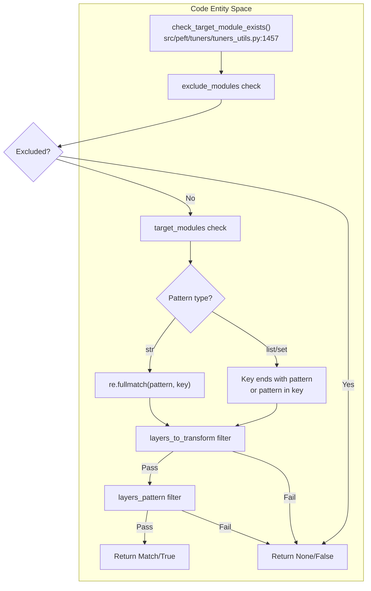

Sources: [src/peft/tuners/tuners_utils.py:1457-1523]()

### Architecture-Specific Defaults

The library provides default target modules for popular model architectures via mapping dictionaries (e.g., `TRANSFORMERS_MODELS_TO_LORA_TARGET_MODULES_MAPPING`).

Sources: [src/peft/utils/other.py:40-82](), [src/peft/tuners/tuners_utils.py:333-370]()

---

## Adapter Injection Mechanism & `_create_and_replace`

Adapter injection is the process of replacing target modules in the base model with adapter-wrapped versions.

### Injection Process Flow

**Diagram: `inject_adapter()` Execution Flow**

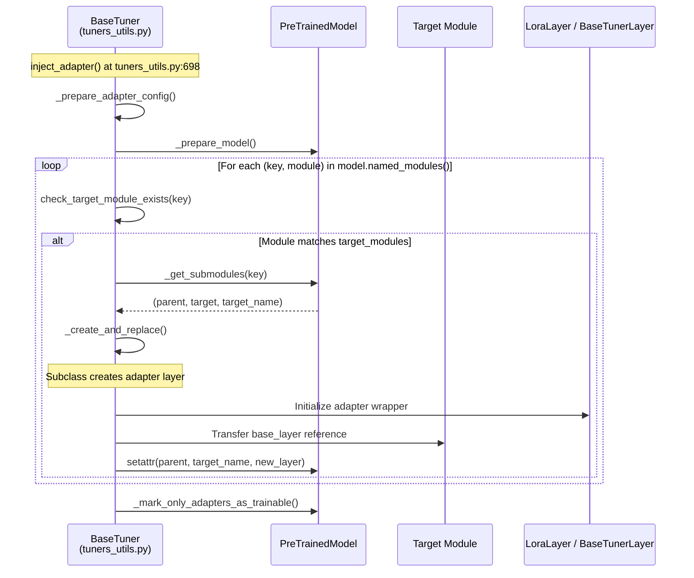

Sources: [src/peft/tuners/tuners_utils.py:698-977]()

### The `_create_and_replace()` Mechanism

The `_create_and_replace()` method is implemented by tuner subclasses (e.g., `LoraModel`, `IA3Model`, `AdaLoraModel`) to define how adapter layers are instantiated and inserted into the parent module. For example, in `IA3Model`, `_create_and_replace()` checks if a target module falls under `feedforward_modules` before invoking `_create_new_module()` [src/peft/tuners/ia3/model.py:153-176]().

Sources: [src/peft/tuners/tuners_utils.py:390-422](), [src/peft/tuners/ia3/model.py:153-176](), [src/peft/tuners/adalora/model.py:118-158]()

---

## Low-Level `inject_adapter_in_model` API

In addition to high-level model wrappers (`PeftModel`), PEFT exposes low-level functional APIs such as `inject_adapter_in_model` [src/peft/utils/other.py](). This function accepts an arbitrary `torch.nn.Module` and a `PeftConfig`, instantiates the corresponding tuner backend, and injects adapters directly without wrapping the model in a `PeftModel` instance.

As validated in low-level tests [tests/test_low_level_api.py:72-117](), `inject_adapter_in_model` supports direct injection for standard tuners like `LoraConfig`, `AdaLoraConfig`, and `IA3Config`, while rejecting shared-state tuners that require `get_peft_model`.

Sources: [tests/test_low_level_api.py:72-117](), [src/peft/utils/other.py]()

---

## LycorisTuner Generalization

To support advanced structural matrix adaptation techniques (such as LoHa, LoKr, and other LyCORIS variants), PEFT provides a generalized infrastructure layer in `src/peft/tuners/lycoris_utils.py` [src/peft/tuners/lycoris_utils.py:1-261]().

### Core LyCORIS Components

- **`LycorisConfig`** [src/peft/tuners/lycoris_utils.py:34-58](): Extends `PeftConfig` to include granular `rank_pattern` and `alpha_pattern` dictionaries for assigning layer-specific ranks and scaling factors.
- **`LycorisLayer`** [src/peft/tuners/lycoris_utils.py:60-176](): Extends `BaseTunerLayer` to manage multi-adapter weights, rank dropout (`rank_dropout`), module dropout (`module_dropout`), and safe weight merging (`merge` with `safe_merge=True`).

Sources: [src/peft/tuners/lycoris_utils.py:1-176]()

---

# Page: Adapter Lifecycle Management

# Adapter Lifecycle Management

<details>
<summary>Relevant source files</summary>

The following files were used as context for generating this wiki page:

- [docs/source/package_reference/glora.md](docs/source/package_reference/glora.md)
- [docs/source/package_reference/helpers.md](docs/source/package_reference/helpers.md)
- [docs/source/package_reference/lora_variant_bdlora.md](docs/source/package_reference/lora_variant_bdlora.md)
- [examples/KappaTune/README.md](examples/KappaTune/README.md)
- [examples/KappaTune/experiments_kappatune_peft.py](examples/KappaTune/experiments_kappatune_peft.py)
- [src/peft/helpers.py](src/peft/helpers.py)
- [src/peft/peft_model.py](src/peft/peft_model.py)
- [src/peft/utils/__init__.py](src/peft/utils/__init__.py)
- [src/peft/utils/constants.py](src/peft/utils/constants.py)
- [src/peft/utils/other.py](src/peft/utils/other.py)
- [src/peft/utils/save_and_load.py](src/peft/utils/save_and_load.py)
- [tests/test_decoder_models.py](tests/test_decoder_models.py)
- [tests/test_encoder_decoder_models.py](tests/test_encoder_decoder_models.py)
- [tests/test_feature_extraction_models.py](tests/test_feature_extraction_models.py)
- [tests/test_helpers.py](tests/test_helpers.py)
- [tests/test_seq_classifier.py](tests/test_seq_classifier.py)
- [tests/testing_common.py](tests/testing_common.py)

</details>


## Purpose and Scope

This document details how the PEFT library manages the complete lifecycle of adapters following their injection into a base model. It covers adapter states (`active`, `inactive`, `disabled`, `merged`), methods for controlling active adapters (`set_adapter`, `enable_adapters`, `disable_adapters`), multi-adapter workflows, adapter deletion and unloading (`delete_adapter`, `unload`, `merge_and_unload`), and signature/scaling utilities provided in `src/peft/helpers.py`.

For initial model wrapping and configuration, see [PeftModel and Base Classes](2.1) and [Configuration System](2.2). For serialization and state dictionary handling, see [State Management and Serialization](2.5).

Sources: [src/peft/peft_model.py:120-181](), [src/peft/helpers.py:1-50]()

---

## Adapter States

Adapters within a `PeftModel` can reside in several distinct states that dictate whether their parameters participate in the forward pass:

| State | Description | Affects Forward Pass | Activation Mechanism |
|-------|-------------|---------------------|----------------------|
| **Active** | Adapter is selected and executes during forward computation. | Yes | Selected via `set_adapter()` [src/peft/peft_model.py:848-885]() |
| **Inactive** | Adapter weights exist in memory but are deselected. | No | Can be activated via `set_adapter()` [src/peft/peft_model.py:848-885]() |
| **Disabled** | All adapters are temporarily bypassed via context flag `_adapters_disabled`. | No | Toggled via `disable_adapter()` context manager [src/peft/peft_model.py:958-983]() |
| **Merged** | Adapter weights are baked into the base model weights and removed. | Yes (permanently via base model) | Executed via `merge_and_unload()` [src/peft/peft_model.py:915-956]() |

Sources: [src/peft/peft_model.py:135-181](), [src/peft/peft_model.py:848-983]()

---

## Adapter State Machine

The following diagram bridges the conceptual adapter states to their corresponding code execution paths across `PeftModel` and `BaseTuner`.

Title: Adapter State Transitions and Code Mapping

```mermaid
stateDiagram-v2
    [*] --> Inactive : PeftModel.add_adapter
    Inactive --> Active : PeftModel.set_adapter
    Active --> Inactive : PeftModel.set_adapter(other)
    Active --> Disabled : PeftModel.disable_adapter
    Inactive --> Disabled : PeftModel.disable_adapter
    Disabled --> Active : PeftModel.enable_adapters(True)
    Disabled --> Inactive : PeftModel.enable_adapters(True)
    Active --> Merged : PeftModel.merge_and_unload
    Inactive --> [*] : PeftModel.delete_adapter
    Merged --> [*] : UnloadOrMergeComplete

    note right of Active
        Handled by BaseTunerLayer
        forward execution
    end note

    note right of Disabled
        Bypasses adapter layers
        via _adapters_disabled=True
    end note
end
```

Sources: [src/peft/peft_model.py:848-983](), [src/peft/tuners/tuners_utils.py:43]()

---

## Adapter Activation and Control

### Setting Active Adapters

The `set_adapter()` method on `PeftModel` modifies which adapters are currently evaluated during the forward pass [src/peft/peft_model.py:848-885](). It accepts either a single string or a sequence of strings representing adapter names.

```python
# Activate a single adapter
model.set_adapter("adapter_1")

# Activate multiple adapters sequentially
model.set_adapter(["adapter_1", "adapter_2"])
```

Internally, `set_adapter` validates the presence of the requested adapter names in `peft_config`, updates prompt-encoder states if applicable, and delegates to the underlying `BaseTuner` implementation to update active flags on each `BaseTunerLayer`.

### Status Properties

- `active_adapters`: Returns a list of strings representing the currently active adapter names [src/peft/peft_model.py:154-170]().
- `has_active_enabled_adapter`: Returns a boolean indicating whether at least one adapter is active and adapters are not globally disabled [src/peft/peft_model.py:172-181]().

Sources: [src/peft/peft_model.py:154-181](), [src/peft/peft_model.py:848-885]()

---

## Enabling and Disabling Adapters

### Context Manager Disabling

To temporarily evaluate a `PeftModel` using solely its base weights without altering the active adapter configuration, use the `disable_adapter()` context manager [src/peft/peft_model.py:958-983]().

```python
with model.disable_adapter():
    outputs = model(**inputs)
```

This sets `model._adapters_disabled = True` during context execution, ensuring tuner layers skip adapter computation [src/peft/peft_model.py:958-983]().

### Persistent Enable/Disable

The `enable_adapters()` method toggles the global enabled state across all tuner sub-modules via `_set_adapter_layers()` [src/peft/peft_model.py:987-1009]().

Sources: [src/peft/peft_model.py:958-1009]()

---

## Multi-Adapter Management

When multiple adapters are activated simultaneously via `set_adapter(["adapter_a", "adapter_b"])`, each compatible `BaseTunerLayer` executes the adapter forward passes in the specified sequence.

Title: Multi-Adapter Execution Flow

```mermaid
graph TD
    Input["Input Tensor"] --> Base["Base Model Weights Forward"]
    Base --> LayerA["BaseTunerLayer + adapter_a"]
    LayerA --> LayerB["BaseTunerLayer + adapter_b"]
    LayerB --> Output["Final Output Tensor"]
```

Sources: [src/peft/peft_model.py:848-885](), [src/peft/tuners/tuners_utils.py:43]()

---

## Deletion and Unloading

### Deleting Specific Adapters

The `delete_adapter(adapter_name)` method permanently purges an adapter from the model [src/peft/peft_model.py:887-900](). It removes weights from tuner layers, updates auxiliary wrappers such as `ModulesToSaveWrapper`, and deletes the entry from `peft_config`.

### Unloading and Merging

- `unload()`: Removes all PEFT wrappers and returns the raw base model without altering weight values [src/peft/peft_model.py:902-913]().
- `merge_and_unload()`: Permanently folds adapter weights into the base model weights, strips wrapper layers, and returns a standard `torch.nn.Module` [src/peft/peft_model.py:915-956]().

Title: Unload vs Merge Execution Architecture

```mermaid
graph TD
    PeftModelInstance["PeftModel"] --> CheckOp{Operation Type}
    CheckOp -->|unload| RemoveWrappers["Remove BaseTunerLayers / Return Base Model"]
    CheckOp -->|merge_and_unload| MergeWeights["Merge Adapter Tensors into Base Weights"]
    MergeWeights --> RemoveWrappers
```

Sources: [src/peft/peft_model.py:887-956]()

---

## Helpers Utilities (`src/peft/helpers.py`)

The `src/peft/helpers.py` module provides auxiliary utilities for managing PEFT model signatures and adapter scaling:

- `update_forward_signature(model)`: Synchronizes the `PeftModel.forward` method signature with the underlying base model's forward signature [src/peft/helpers.py:39-71]().
- `update_generate_signature(model)`: Updates `PeftModel.generate` to match the base model's generation signature [src/peft/helpers.py:73-112]().
- `update_signature(model, method="all")`: Convenience dispatcher for updating forward, generate, or both signatures [src/peft/helpers.py:114-147]().
- `check_if_peft_model(model_name_or_path)`: Inspects local paths or the Hugging Face Hub to verify if an artifact is a PEFT model configuration [src/peft/helpers.py:149-167]().
- `rescale_adapter_scale(model, multiplier)`: Context manager that temporarily scales LoRA adapter scaling factors by a multiplier [src/peft/helpers.py:171-]().

Sources: [src/peft/helpers.py:39-180]()

---

# Page: State Management and Serialization

# State Management and Serialization

<details>
<summary>Relevant source files</summary>

The following files were used as context for generating this wiki page:

- [docs/source/package_reference/hotswap.md](docs/source/package_reference/hotswap.md)
- [src/peft/peft_model.py](src/peft/peft_model.py)
- [src/peft/utils/__init__.py](src/peft/utils/__init__.py)
- [src/peft/utils/constants.py](src/peft/utils/constants.py)
- [src/peft/utils/hotswap.py](src/peft/utils/hotswap.py)
- [src/peft/utils/other.py](src/peft/utils/other.py)
- [src/peft/utils/save_and_load.py](src/peft/utils/save_and_load.py)
- [src/peft/utils/transformers_weight_conversion.py](src/peft/utils/transformers_weight_conversion.py)
- [tests/test_decoder_models.py](tests/test_decoder_models.py)
- [tests/test_encoder_decoder_models.py](tests/test_encoder_decoder_models.py)
- [tests/test_feature_extraction_models.py](tests/test_feature_extraction_models.py)
- [tests/test_integrations.py](tests/test_integrations.py)
- [tests/test_lora_conversion.py](tests/test_lora_conversion.py)
- [tests/test_seq_classifier.py](tests/test_seq_classifier.py)
- [tests/testing_common.py](tests/testing_common.py)

</details>


This page documents how PEFT manages adapter weights through serialization and deserialization. It covers the mechanisms for extracting adapter parameters from model state dictionaries, saving them to disk, loading them back into models, adapter name normalization, dynamic hotswapping via `hotswap_adapter`, lora conversion utilities, and cross-format compatibility handling via `transformers_weight_conversion.py`.

For information about the overall adapter lifecycle (add, delete, merge operations), see [Adapter Lifecycle Management](#2.4). For configuration persistence, see [Configuration System](#2.2).

## Overview

PEFT's state management system is designed around a key principle: **only adapter parameters are saved, not the base model weights**. This dramatically reduces storage requirements—a typical adapter checkpoint may be ~19MB compared to ~11GB for a full model. The system handles:

1. **State dict extraction** - Isolating adapter parameters from the full model state using `get_peft_model_state_dict` [src/peft/utils/save_and_load.py:148-162]().
2. **Adapter name normalization** - Removing adapter names from keys for portability during serialization and re-inserting them via `set_peft_model_state_dict` [src/peft/utils/save_and_load.py:564-601]().
3. **Multi-format persistence** - Supporting both `safetensors` and pickle formats, complete with tensor aliasing detection [src/peft/peft_model.py:302-344]().
4. **Hotswapping** - In-place replacement of weights via `src/peft/utils/hotswap.py` to avoid re-compilation in `torch.compile` scenarios [src/peft/utils/hotswap.py:14-80]().
5. **Cross-version compatibility** - Converting weights between different `transformers` versions via `src/peft/utils/transformers_weight_conversion.py` [src/peft/utils/transformers_weight_conversion.py:1-137]().

Title: "PEFT Save and Load Data Flow and Code Mapping"
```mermaid
graph TB
    subgraph "Save Path Space"
        Model["PeftModel<br/>(`src/peft/peft_model.py`)"]
        GetState["get_peft_model_state_dict()<br/>(`src/peft/utils/save_and_load.py`)"]
        RemoveName["_filter_state_dict_for_adapter_name()<br/>(`src/peft/utils/save_and_load.py`)"]
        SaveFile["safe_save_file() / torch.save()<br/>(safetensors)"]
        
        Model --> GetState
        GetState --> RemoveName
        RemoveName --> SaveFile
    end
    
    subgraph "Load Path Space"
        DiskFile["adapter_model.safetensors<br/>or adapter_model.bin"]
        LoadWeights["load_peft_weights()<br/>(`src/peft/utils/save_and_load.py`)"]
        AddName["_insert_adapter_name_into_state_dict()<br/>(`src/peft/utils/save_and_load.py`)"]
        SetState["set_peft_model_state_dict()<br/>(`src/peft/utils/save_and_load.py`)"]
        
        DiskFile --> LoadWeights
        LoadWeights --> AddName
        AddName --> SetState
    end
    
    subgraph "Storage Space"
        SafeTensors["adapter_model.safetensors"]
        PickleFile["adapter_model.bin"]
        ConfigFile["adapter_config.json"]
    end
    
    SaveFile --> SafeTensors
    SaveFile --> PickleFile
    SetState --> Model
```
Sources: [src/peft/peft_model.py:120-200](), [src/peft/utils/save_and_load.py:148-180](), [src/peft/utils/save_and_load.py:564-601]()

## State Dict Extraction (`get_peft_model_state_dict`)

The `get_peft_model_state_dict` function extracts only the trainable adapter parameters from a model's full state dict. This function is the core of the save path.

### Function Signature and Purpose

```python
def get_peft_model_state_dict(
    model, 
    state_dict=None, 
    adapter_name: str = "default",
    unwrap_compiled: bool = False, 
    save_embedding_layers: bool | Literal["auto"] = "auto",
)
```
[src/peft/utils/save_and_load.py:148-154]()

The function filters the model's state dict to include only:
- Adapter-specific parameters (e.g., `lora_A`, `lora_B`, `ia3_`, `boft_`).
- Auxiliary training modules (via `ModulesToSaveWrapper`, `TrainableTokensWrapper`) [src/peft/utils/save_and_load.py:231-246]().
- Optionally, embedding layers if they were modified.

Sources: [src/peft/utils/save_and_load.py:148-246](), [src/peft/peft_model.py:62-67]()

### Type-Specific Parameter Selection

Different PEFT types require different filtering logic. `get_peft_model_state_dict` uses the `PeftConfig` associated with the `adapter_name` to determine the extraction strategy.

| PEFT Type | Key Pattern | Additional Logic |
|-----------|-------------|------------------|
| **LORA/ADALORA** | `lora_` in key | Respects `bias` config (`none`/`all`/`lora_only`) [src/peft/utils/save_and_load.py:247-285]() |
| **BOFT** | `boft_` in key | Respects `bias` config |
| **ADAPTION_PROMPT** | Key ends with `adaption_*` | Direct pattern match |
| **Prompt Learning** | N/A | Returns prompt embeddings directly |
| **VERA** | `vera_` in key | Optionally saves `vera_A`/`vera_B` projections |
| **VBLORA** | `vblora_logits` in key | Can save topk weights for efficiency |

Sources: [src/peft/utils/save_and_load.py:247-350](), [src/peft/mapping.py:29-34]()

## Key Transformation and Adapter Names

PEFT models use the adapter name in parameter keys internally (e.g., `model.layer.0.lora_A.default.weight`). For serialization, these names are removed to make the checkpoints portable.

### Adapter Name Handling in State Dicts

Title: "Adapter Name Filtering and Insertion Flow"
```mermaid
graph LR
    subgraph "Internal State Dict Space"
        K1["q_proj.lora_A.default.weight"]
        K2["q_proj.lora_A.other.weight"]
    end
    
    subgraph "Transformation Functions"
        Filter["_filter_state_dict_for_adapter_name()<br/>(`src/peft/utils/save_and_load.py`)"]
        Strip["Strip Adapter Suffix/Infix"]
        Insert["_insert_adapter_name_into_state_dict()<br/>(`src/peft/utils/save_and_load.py`)"]
    end
    
    subgraph "Serialized / Target Space"
        K3["q_proj.lora_A.weight"]
        K4["q_proj.lora_A.default.weight"]
    end
    
    K1 --> Filter
    Filter --> Strip
    Strip --> K3
    K3 --> Insert
    Insert --> K4
```

- **Extraction Filtering**: `_filter_state_dict_for_adapter_name` removes keys belonging to unwanted adapters [src/peft/utils/save_and_load.py:131-145]().
- **Loading Insertion**: `set_peft_model_state_dict` performs the inverse via `_insert_adapter_name_into_state_dict`, inserting the target `adapter_name` into the keys of the loaded checkpoint before calling PyTorch's `model.load_state_dict` [src/peft/utils/save_and_load.py:564-601]().

Sources: [src/peft/utils/save_and_load.py:131-145](), [src/peft/utils/save_and_load.py:564-601]()

## Hotswapping Adapters (`hotswap_adapter`)

The `hotswap_adapter` mechanism allows for in-place replacement of adapter weights. This is particularly useful for inference servers using `torch.compile`, as it avoids triggering a re-compilation when switching between adapters of the same rank.

### Core Implementation
The logic resides in `src/peft/utils/hotswap.py`. It supports:
1. **Scaling Updates**: Updating LoRA scaling factors in-place using `_update_scaling` [src/peft/utils/hotswap.py:37-54]().
2. **Padding**: If ranks don't match, PEFT can pad the weights to a target rank via `_get_padded_linear` [src/peft/utils/hotswap.py:84-149]().
3. **Compiled Support**: `_convert_scalings_to_tensor` converts float scalings to tensors so they can be updated dynamically without breaking a compiled PyTorch graph [src/peft/utils/hotswap.py:57-81]().

Sources: [src/peft/utils/hotswap.py:14-150]()

## Transformers Weight Conversion (`transformers_weight_conversion.py`)

With recent updates in `transformers` v5, model architectures and key names undergo restructuring. PEFT provides `transformers_weight_conversion.py` to handle these transitions automatically during weight loading and mapping.

### Conversion Mechanisms
- **PeftConcatenate**: Handles fused weights in MoE (Mixtral) models. When base weights are fused, LoRA weights must be merged in a block-diagonal fashion via `_block_diag_3d` and `PeftConcatenate.convert` [src/peft/utils/transformers_weight_conversion.py:48-138]().
- **Conversion Operations**: Includes `FlattenDims` and `PermuteDims` subclasses of `ConversionOps` to reshape weights during the conversion pipeline [src/peft/utils/transformers_weight_conversion.py:144-200]().

Title: "Transformers Weight Conversion Pipeline"
```mermaid
graph TB
    subgraph "Legacy Checkpoint Space"
        OldKey["base_model.model.decoder.layers.0.fc1.lora_A.weight"]
    end
    
    subgraph "Conversion Code Entities"
        Mapping["get_checkpoint_conversion_mapping()<br/>(`transformers`)"]
        PeftConcat["PeftConcatenate<br/>(`src/peft/utils/transformers_weight_conversion.py`)"]
        Flatten["FlattenDims / PermuteDims<br/>(`src/peft/utils/transformers_weight_conversion.py`)"]
    end
    
    subgraph "New Model State Space"
        NewKey["base_model.model.layers.0.mlp.gate_proj.lora_A.weight"]
    end
    
    OldKey --> Mapping
    Mapping --> PeftConcat
    PeftConcat --> Flatten
    Flatten --> NewKey
```
Sources: [src/peft/utils/transformers_weight_conversion.py:1-138](), [src/peft/utils/transformers_weight_conversion.py:144-200]()

## Auxiliary Module Serialization

PEFT supports saving non-adapter parameters alongside adapters via `modules_to_save` and `trainable_token_indices`. These are managed by dedicated wrappers that integrate directly into the state dict workflow.

### ModulesToSaveWrapper and TrainableTokensWrapper
- **ModulesToSaveWrapper**: Wraps standard non-adapter layers (like a classifier head). Its internal logic ensures that only the parameters corresponding to the active adapter are saved [src/peft/utils/other.py:612-650]().
- **TrainableTokensWrapper**: Handles embedding layers where only specific token indices are marked as trainable [src/peft/utils/other.py:440-455]().

During `get_peft_model_state_dict`, the system iterates through these wrappers to extract the relevant weights [src/peft/utils/save_and_load.py:231-246]().

Sources: [src/peft/utils/other.py:612-723](), [src/peft/utils/save_and_load.py:231-246]()

## Storage Formats, Safetensors, and Aliasing

PEFT defaults to the `safetensors` format for serialization, providing improved security and loading speed.

### Tensor Aliasing Handling
`safetensors` does not permit multiple keys to point to the exact same memory address. PEFT's `save_pretrained` implementation detects aliasing using `id_tensor_storage` and clones shared tensors to ensure a valid serialization payload [src/peft/peft_model.py:302-344]().

```python
# Pointer map to detect aliasing
ptrs = collections.defaultdict(list)
for name, tensor in output_state_dict.items():
    ptrs[id_tensor_storage(tensor)].append(name)

# Clone all but the first reference for shared storage
shared_ptrs = {ptr: names for ptr, names in ptrs.items() if len(names) > 1}
for _, names in shared_ptrs.items():
    for shared_tensor_name in names[1:]:
        output_state_dict[shared_tensor_name] = output_state_dict[shared_tensor_name].clone()
```
[src/peft/peft_model.py:302-344]()

### Platform-Specific Normalization (e.g., Windows SHiRA)
On Windows platforms, `safetensors` can encounter serialization limitations with certain integer tensor types. PEFT automatically converts `shira_indices` to `float32` before saving on Windows systems and casts them back to integers upon loading [src/peft/utils/save_and_load.py:167-184]().

Sources: [src/peft/peft_model.py:302-344](), [src/peft/utils/save_and_load.py:167-184](), [src/peft/utils/save_and_load.py:464-562]()

---

# Page: Auxiliary Training Wrappers

# Auxiliary Training Wrappers

<details>
<summary>Relevant source files</summary>

The following files were used as context for generating this wiki page:

- [docs/source/developer_guides/custom_models.md](docs/source/developer_guides/custom_models.md)
- [docs/source/developer_guides/troubleshooting.md](docs/source/developer_guides/troubleshooting.md)
- [docs/source/package_reference/trainable_tokens.md](docs/source/package_reference/trainable_tokens.md)
- [src/peft/mixed_model.py](src/peft/mixed_model.py)
- [src/peft/tuners/c3a/config.py](src/peft/tuners/c3a/config.py)
- [src/peft/tuners/c3a/layer.py](src/peft/tuners/c3a/layer.py)
- [src/peft/tuners/mixed/model.py](src/peft/tuners/mixed/model.py)
- [src/peft/tuners/trainable_tokens/config.py](src/peft/tuners/trainable_tokens/config.py)
- [src/peft/tuners/trainable_tokens/layer.py](src/peft/tuners/trainable_tokens/layer.py)
- [src/peft/tuners/trainable_tokens/model.py](src/peft/tuners/trainable_tokens/model.py)
- [tests/test_mixed.py](tests/test_mixed.py)
- [tests/test_other.py](tests/test_other.py)
- [tests/test_trainable_tokens.py](tests/test_trainable_tokens.py)

</details>


## Purpose and Scope

The Auxiliary Training Wrappers system provides a mechanism for training model components that fall outside the standard PEFT adapter paradigm. While most PEFT methods modify layers through adapter injections (see [2.3]() for tuner infrastructure), certain components require different treatment, such as fully training a classification head or selectively updating specific embedding tokens. This system wraps such modules in specialized classes that handle their unique training, activation, and serialization requirements.

For information about standard PEFT adapters (LoRA, IA3, etc.), see [3](). For adapter lifecycle operations, see [2.4]().

Sources: [src/peft/utils/other.py:240-244](), [src/peft/peft_model.py:44-47]()

## System Architecture

The auxiliary wrapper system consists of a base abstraction and specialized implementations that integrate with the broader PEFT model management infrastructure:

```mermaid
graph TB
    subgraph "PEFT Core"
        PeftModel["PeftModel<br/>(peft_model.py)"]
        BaseTuner["BaseTuner<br/>(tuners_utils.py)"]
    end
    
    subgraph "Auxiliary Wrapper Hierarchy"
        AuxBase["AuxiliaryTrainingWrapper<br/>(utils/other.py:240-532)"]
        ModulesToSave["ModulesToSaveWrapper<br/>(utils/other.py:534-732)"]
        TrainableTokens["TrainableTokensWrapper<br/>(utils/other.py:734+)"]
        
        AuxBase --> ModulesToSave
        AuxBase --> TrainableTokens
    end
    
    subgraph "Original Model Components"
        Classifier["Classification Heads<br/>(e.g., model.classifier)"]
        Embeddings["Embedding Layers<br/>(e.g., model.embeddings)"]
        OtherModules["Other nn.Modules"]
    end
    
    PeftModel -->|"wraps via<br/>set_additional_trainable_modules"| AuxBase
    BaseTuner -->|"may create during<br/>inject_adapter"| AuxBase
    
    ModulesToSave -->|"wraps"| Classifier
    ModulesToSave -->|"can wrap"| OtherModules
    TrainableTokens -->|"wraps"| Embeddings
    
    Config["PeftConfig<br/>modules_to_save<br/>trainable_token_indices"]
    Config -.configures.-> ModulesToSave
    Config -.configures.-> TrainableTokens
```
Sources: [src/peft/utils/other.py:240-814](), [src/peft/peft_model.py:44](), [src/peft/utils/other.py:47-48]()

**Key Components:**

| Component | Location | Purpose |
|-----------|----------|---------|
| `AuxiliaryTrainingWrapper` | [src/peft/utils/other.py:240-532]() | Abstract base class defining interface for auxiliary wrappers |
| `ModulesToSaveWrapper` | [src/peft/utils/other.py:534-732]() | Wraps modules for full training (e.g., classification heads) |
| `TrainableTokensWrapper` | [src/peft/utils/other.py:734-814]() | Wraps embedding layers for selective token training |

Sources: [src/peft/utils/other.py:240-814](), [src/peft/peft_model.py:44](), [src/peft/utils/other.py:47-48]()

## AuxiliaryTrainingWrapper Base Class

### Core Abstraction

`AuxiliaryTrainingWrapper` is an abstract base class that provides the interface and common functionality for wrapping modules that require training behaviors tangential to standard PEFT adapters.

```mermaid
graph TB
    subgraph "AuxiliaryTrainingWrapper Interface"
        Init["__init__<br/>(module_to_save, adapter_name, **kwargs)"]
        
        subgraph "Abstract Methods"
            InitModules["init_modules<br/>(adapter_name, **kwargs)"]
            GetAvailable["_get_available_adapters<br/>() -> set[str]"]
            CheckSetAdapter["check_set_adapter<br/>(adapter_name) -> str | None"]
            DeleteAdapter["delete_adapter<br/>(adapter_name, new_active_adapters)"]
            StateDict["adapter_state_dict<br/>(adapter_name)"]
            StateDictMap["adapter_state_dict_load_map<br/>(adapter_name)"]
            UnloadMerge["unload_and_optionally_merge_module<br/>(merge, safe_merge, adapter_names)"]
        end
        
        subgraph "Concrete Methods"
            Forward["forward<br/>(x, *args, **kwargs)"]
            ForwardWrapped["_forward_wrapped<br/>(x, *args, **kwargs)"]
            ForwardMixed["_forward_wrapped_mixed_batch<br/>(x, active_adapter, *args, **kwargs)"]
            ForwardPassthrough["_forward_wrapped_passthrough<br/>(x, *args, **kwargs)"]
            EnableAdapters["enable_adapters<br/>(enabled: bool)"]
            SetAdapter["set_adapter<br/>(adapter_names)"]
            SetRequiresGrad["set_requires_grad<br/>(adapter_names, requires_grad)"]
        end
        
        subgraph "Properties"
            ActiveAdapter["active_adapter<br/>active_adapters"]
            DisableAdapters["disable_adapters"]
        end
        
        Init --> InitModules
        Forward --> ForwardWrapped
        Forward --> ForwardMixed
        Forward --> ForwardPassthrough
    end
    
    OriginalModule["original_module<br/>(wrapped nn.Module)"]
    Adapters["_adapters: set[str]<br/>(registered adapter names)"]
    ActiveAdapterState["_active_adapter: list[str]<br/>(currently active adapters)"]
    DisableState["_disable_adapters: bool"]
    
    AuxiliaryTrainingWrapper --> OriginalModule
    AuxiliaryTrainingWrapper --> Adapters
    AuxiliaryTrainingWrapper --> ActiveAdapterState
    AuxiliaryTrainingWrapper --> DisableState
```
Sources: [src/peft/utils/other.py:240-265](), [src/peft/utils/other.py:299-314]()

**Key Attributes:**

| Attribute | Type | Description |
|-----------|------|-------------|
| `original_module` | `nn.Module` | The wrapped module [src/peft/utils/other.py:246]() |
| `_active_adapter` | `list[str]` | Currently active adapter names [src/peft/utils/other.py:255]() |
| `_disable_adapters` | `bool` | Whether adapters are disabled [src/peft/utils/other.py:256]() |
| `_adapters` | `set[str]` | All registered adapter names [src/peft/utils/other.py:254]() |

Sources: [src/peft/utils/other.py:240-265](), [src/peft/utils/other.py:299-314]()

### Forward Pass Routing

The wrapper implements a routing mechanism that handles different adapter activation scenarios, including mixed-batch inference where different samples in a batch use different adapters.

| Method | Location | Purpose |
|--------|----------|---------|
| `forward` | [src/peft/utils/other.py:435-444]() | Entry point, routes to appropriate handler |
| `_forward_wrapped_passthrough` | [src/peft/utils/other.py:397-399]() | No adapter involved, use original module |
| `_forward_wrapped` | [src/peft/utils/other.py:389-390]() | Standard forward with active adapter |
| `_mixed_batch_forward` | [src/peft/utils/other.py:401-433]() | Handles mixed adapter batches by grouping samples |

Sources: [src/peft/utils/other.py:389-444]()

## ModulesToSaveWrapper

### Purpose and Use Cases

`ModulesToSaveWrapper` wraps modules that should be fully trained rather than adapted. The most common use case is classification heads in fine-tuning tasks where the head needs full training.

**Configuration:**
```python
config = LoraConfig(
    target_modules=["q_proj", "v_proj"],
    modules_to_save=["classifier"], # Wrapped in ModulesToSaveWrapper
)
```

Sources: [src/peft/utils/other.py:534-548](), [tests/test_seq_classifier.py:178-183]()

### Architecture

`ModulesToSaveWrapper` maintains a `ModuleDict` of copies of the original module, one for each adapter.

```mermaid
graph TB
    subgraph "ModulesToSaveWrapper Space"
        Wrapper["ModulesToSaveWrapper (utils/other.py)"]
        OrigMod["original_module (nn.Module)"]
        ModDict["modules_to_save (nn.ModuleDict)"]
        
        Wrapper --> OrigMod
        Wrapper --> ModDict
    end
    
    subgraph "Per-Adapter Copies"
        Adapter1["modules_to_save['default']"]
        Adapter2["modules_to_save['other']"]
        
        ModDict --> Adapter1
        ModDict --> Adapter2
    end
```
Sources: [src/peft/utils/other.py:534-548](), [src/peft/utils/other.py:599-603]()

**Key Constraint:** Unlike standard PEFT adapters which can be composed, `ModulesToSaveWrapper` only supports a single active adapter at a time [src/peft/utils/other.py:657-658]().

Sources: [src/peft/utils/other.py:534-548](), [src/peft/utils/other.py:599-603]()

### State Management

`ModulesToSaveWrapper` provides specialized state dict handling for loading and saving adapter-specific module weights.

| Method | Location | Purpose |
|--------|----------|---------|
| `adapter_state_dict` | [src/peft/utils/other.py:724-732]() | Extract adapter's module state dict |
| `adapter_state_dict_load_map` | [src/peft/utils/other.py:715-722]() | Map saved keys to load-time keys (e.g. adding prefix) |

Sources: [src/peft/utils/other.py:715-732]()

## TrainableTokensWrapper

### Purpose and Configuration

`TrainableTokensWrapper` enables selective training of specific embedding tokens while keeping the rest frozen. It is typically applied to embedding layers via `trainable_token_indices` in the config [src/peft/utils/other.py:734-738]().

### Architecture and Data Flow

```mermaid
graph TB
    subgraph "TrainableTokensWrapper (Code Entity)"
        Wrapper["TrainableTokensWrapper"]
        OrigEmbed["original_module (nn.Embedding)"]
        TokenLayer["token_adapter (TrainableTokensLayer)"]
        
        Wrapper --> OrigEmbed
        Wrapper --> TokenLayer
    end
    
    subgraph "Natural Language to Code Mapping"
        Frozen["Frozen Base Embeddings"] --> OrigEmbed
        Selective["Selective Token Deltas"] --> TokenLayer
    end
    
    subgraph "Data Flow"
        Input["input_ids"] --> OrigEmbed
        Input --> TokenLayer
        OrigEmbed -->|"Base Embeds"| Add["torch.add"]
        TokenLayer -->|"Token Deltas"| Add
        Add --> Output["Modified Embeddings"]
    end
```
Sources: [src/peft/utils/other.py:734-814](), [tests/test_trainable_tokens.py:27-28]()

The `TrainableTokensLayer` stores a `ParameterDict` called `trainable_tokens_delta` which contains the learned offsets for the selected token indices [src/peft/utils/other.py:734-814]().

Sources: [src/peft/utils/other.py:734-814](), [tests/test_trainable_tokens.py:27-28]()

## Integration with PeftModel

Auxiliary wrappers are injected into the model during the PEFT initialization process.

```mermaid
graph TD
    GetPeft["get_peft_model (peft_model.py)"]
    Inject["inject_adapter_in_model (mapping.py)"]
    SetTrainable["set_additional_trainable_modules (utils/other.py)"]
    
    GetPeft --> Inject
    Inject --> SetTrainable
    
    subgraph "Wrapping Logic"
        Match["Match modules_to_save or token_indices"]
        Create["Create ModulesToSaveWrapper or TrainableTokensWrapper"]
        Replace["Replace original module with wrapper in-place"]
        
        SetTrainable --> Match
        Match --> Create
        Create --> Replace
    end
```
Sources: [src/peft/peft_model.py:126-152](), [src/peft/mapping.py:47-92](), [src/peft/utils/other.py:1104-1178]()

**Attribute Delegation:** Auxiliary wrappers implement `__getattr__` to delegate attribute access to the currently active adapter's module, making the wrapper transparent to the rest of the model [src/peft/utils/other.py:329-351]().

Sources: [src/peft/peft_model.py:126-152](), [src/peft/mapping.py:47-92](), [src/peft/utils/other.py:1104-1178]()

## Serialization and State Dicts

When saving a PEFT model, `get_peft_model_state_dict` collects parameters from these wrappers.

| Wrapper | State Dict Key Pattern | Source |
|---------|------------------------|--------|
| `ModulesToSaveWrapper` | `modules_to_save.{adapter_name}.{key}` | [src/peft/utils/other.py:715-732]() |
| `TrainableTokensWrapper` | `token_adapter.{adapter_name}.trainable_tokens_delta.{adapter_name}` | [src/peft/utils/other.py:734-814]() |

During loading, `set_peft_model_state_dict` uses the wrapper's `adapter_state_dict_load_map` to route saved weights back into the correct internal modules [src/peft/utils/save_and_load.py:94-126]().

Sources: [src/peft/utils/save_and_load.py:94-165](), [src/peft/utils/other.py:715-732]()

---

# Page: PEFT Methods

# PEFT Methods

<details>
<summary>Relevant source files</summary>

The following files were used as context for generating this wiki page:

- [src/peft/tuners/adalora/layer.py](src/peft/tuners/adalora/layer.py)
- [src/peft/tuners/adalora/model.py](src/peft/tuners/adalora/model.py)
- [src/peft/tuners/ia3/layer.py](src/peft/tuners/ia3/layer.py)
- [src/peft/tuners/ia3/model.py](src/peft/tuners/ia3/model.py)
- [src/peft/tuners/loha/layer.py](src/peft/tuners/loha/layer.py)
- [src/peft/tuners/loha/model.py](src/peft/tuners/loha/model.py)
- [src/peft/tuners/lokr/layer.py](src/peft/tuners/lokr/layer.py)
- [src/peft/tuners/lokr/model.py](src/peft/tuners/lokr/model.py)
- [src/peft/tuners/lora/__init__.py](src/peft/tuners/lora/__init__.py)
- [src/peft/tuners/lora/config.py](src/peft/tuners/lora/config.py)
- [src/peft/tuners/lora/layer.py](src/peft/tuners/lora/layer.py)
- [src/peft/tuners/lora/model.py](src/peft/tuners/lora/model.py)
- [src/peft/tuners/lora/variants.py](src/peft/tuners/lora/variants.py)
- [src/peft/tuners/lycoris_utils.py](src/peft/tuners/lycoris_utils.py)
- [src/peft/tuners/tuners_utils.py](src/peft/tuners/tuners_utils.py)
- [tests/test_custom_models.py](tests/test_custom_models.py)
- [tests/test_initialization.py](tests/test_initialization.py)
- [tests/test_lora_variants.py](tests/test_lora_variants.py)
- [tests/test_tuners_utils.py](tests/test_tuners_utils.py)

</details>


The PEFT library implements over 30 parameter-efficient fine-tuning (PEFT) methods, enabling the adaptation of large pre-trained models by training only a small fraction of parameters or adding lightweight auxiliary structures. This page provides a high-level overview of the supported method families, their architectural categorization, and how they map to the codebase.

For deep technical details, implementation specifics, and advanced usage, refer to the child pages linked in each section below.

Sources:
- [src/peft/utils/peft_types.py:19-101]()
- [src/peft/mapping.py:29-50]()

## Method Families Overview

PEFT methods are categorized based on their underlying mathematical and structural approach to model modification—such as low-rank matrix decomposition, activation scaling, orthogonal transformations, prompt injection, or random-basis projections.

```mermaid
graph TB
    root["PeftType Enum <br/> src/peft/utils/peft_types.py"]
    
    root --> lora["LoRA Family <br/> src/peft/tuners/lora/"]
    root --> adalora["AdaLoRA & Dynamic Rank <br/> src/peft/tuners/adalora/"]
    root --> prompt["Prompt Learning <br/> src/peft/tuners/prompt_tuning/"]
    root --> lycoris["Orthogonal & LyCORIS <br/> src/peft/tuners/loha/"]
    root --> other["Other Adapters <br/> src/peft/tuners/ia3/"]
    
    lora --> lora1["LoraModel <br/> src/peft/tuners/lora/model.py"]
    loralora["AdaLoraModel <br/> src/peft/tuners/adalora/model.py"] --> adalora
    prompt --> prompt1["PromptEmbedding <br/> src/peft/tuners/prompt_tuning/model.py"]
    lycoris --> lyc1["LoHaModel <br/> src/peft/tuners/loha/model.py"]
    other --> other1["IA3Model <br/> src/peft/tuners/ia3/model.py"]
```

Sources:
- [src/peft/utils/peft_types.py:58-101]()
- [src/peft/tuners/lora/model.py:131-145]()
- [src/peft/tuners/adalora/model.py:36-50]()
- [src/peft/tuners/ia3/model.py:36-50]()

---

## 3.1. LoRA Family

The Low-Rank Adaptation (LoRA) family parameterizes weight updates by factorizing weight matrices into low-rank equivalents $\Delta W = B A$. PEFT provides a robust core implementation in `LoraModel` and `LoraLayer`, along with diverse initialization strategies (such as Gaussian, PiSSA, OLoRA, LoftQ, CORDA, Eva, and Lora-GA) and architectural variants (like DoRA, aLoRA, Arrow, QALoRA, KaSA, and BD-LoRA).

For complete details on layer implementations, initialization routines, and variants, see [LoRA Family](#3.1).

Sources:
- [src/peft/tuners/lora/model.py:131-163]()
- [src/peft/tuners/lora/layer.py:108-177]()
- [src/peft/tuners/lora/config.py:47-164]()

---

## 3.2. AdaLoRA and Dynamic Rank Allocation

AdaLoRA (`AdaLoraModel` and `AdaLoraLayer`) dynamically allocates parameter budgets across modules during training using parameter importance scoring via Singular Value Decomposition (SVD). Instead of keeping uniform ranks, AdaLoRA prunes less important triplet components (P, $\Lambda$, Q) from an initial rank `init_r` down to a target rank `target_r` under orthogonal regularization.

For details on the SVD parameterization, `RankAllocator`, and update integration, see [AdaLoRA and Dynamic Rank Allocation](#3.2).

Sources:
- [src/peft/tuners/adalora/model.py:36-96]()
- [src/peft/tuners/adalora/layer.py:1-50]()

---

## 3.3. Prompt Learning Methods

Prompt learning techniques keep the base model frozen while prepending or inserting learnable continuous vectors ("virtual tokens") into the input embeddings or hidden states across transformer layers. PEFT supports Prompt Tuning, Prefix Tuning, P-Tuning (via `PromptEncoder`), Multitask Prompt Tuning, and AdaptionPrompt (LLaMA-Adapter).

For details on virtual token initialization, prompt encoders, and layer insertion, see [Prompt Learning Methods](#3.3).

Sources:
- [src/peft/utils/peft_types.py:58-61]()
- [src/peft/mapping.py:29-45]()

---

## 3.4. Other Adapter Methods

Beyond LoRA and prompt learning, PEFT supports a wide collection of specialized adapter paradigms. This includes element-wise activation scaling (`IA3`), tensor-product low-rank factorization (`LoHa`, `LoKr`), random-basis projection (`VeRA`, `UniLoRA`, `VBLoRA`, `RandLoRA`), orthogonal/butterfly transformations (`OFT`, `BOFT`), and frequency/wavelet domain adaptation (`FourierFT`, `WaveFT`).

For details on these methods and their respective config and layer classes, see [Other Adapter Methods](#3.4).

Sources:
- [src/peft/utils/peft_types.py:65-100]()
- [src/peft/tuners/ia3/model.py:36-50]()
- [src/peft/tuners/lycoris_utils.py:34-60]()

---

## 3.5. Multi-Adapter Composition

PEFT enables combining and serving multiple heterogeneous adapters simultaneously through `PeftMixedModel`. It supports dynamic adapter switching (`set_adapter`), adapter merging and unloading (`merge_and_unload`), and advanced weight-merging arithmetic utilities such as task arithmetic, TIES, and DARE (`merge_utils`).

For details on multi-adapter routing and merging strategies, see [Multi-Adapter Composition](#3.5).

Sources:
- [src/peft/peft_model.py:1-100]()
- [src/peft/utils/merge_utils.py:1-50]()

---

## Method Registration and Mapping

PEFT dynamically connects configuration dataclasses to their corresponding tuner models using centralized mapping dictionaries (`PEFT_TYPE_TO_CONFIG_MAPPING` and `PEFT_TYPE_TO_TUNER_MAPPING`) initialized via `register_peft_method`.

```mermaid
graph LR
    subgraph "Mapping [src/peft/mapping.py]"
        cfg_map["PEFT_TYPE_TO_CONFIG_MAPPING"]
        tnr_map["PEFT_TYPE_TO_TUNER_MAPPING"]
    end

    subgraph "Definitions [src/peft/utils/peft_types.py]"
        ptype["PeftType Enum"]
        reg["register_peft_method()"]
    end

    subgraph "Implementations [src/peft/tuners/]"
        lora_cfg["LoraConfig"]
        lora_mod["LoraModel"]
        adalora_cfg["AdaLoraConfig"]
        adalora_mod["AdaLoraModel"]
    end

    reg --> ptype
    ptype --> cfg_map
    ptype --> tnr_map
    cfg_map -.-> lora_cfg
    cfg_map -.-> adalora_cfg
    tnr_map -.-> lora_mod
    tnr_map -.-> adalora_mod
```

Sources:
- [src/peft/utils/peft_types.py:125-200]()
- [src/peft/mapping.py:29-50]()

### Supported Methods Summary Table

| PeftType Enum | Configuration Class | Tuner / Model Class | Target Family |
| :--- | :--- | :--- | :--- |
| `LORA` | `LoraConfig` | `LoraModel` | LoRA Family |
| `ADALORA` | `AdaLoraConfig` | `AdaLoraModel` | AdaLoRA |
| `IA3` | `IA3Config` | `IA3Model` | Other Adapters |
| `PROMPT_TUNING` | `PromptTuningConfig` | `PromptEmbedding` | Prompt Learning |
| `PREFIX_TUNING` | `PrefixTuningConfig` | `PrefixEncoder` | Prompt Learning |
| `OFT` | `OFTConfig` | `OFTModel` | Orthogonal Methods |
| `LOHA` | `LoHaConfig` | `LoHaModel` | LyCORIS / LoRA-derived |
| `VERA` | `VeraConfig` | `VeraModel` | Random-basis Adapters |
| `XLORA` | `XLoraConfig` | `XLoraModel` | Mixture-of-Adapters |

Sources:
- [src/peft/utils/peft_types.py:58-101]()
- [src/peft/mapping.py:29-60]()

---

# Page: LoRA Family

# LoRA Family

<details>
<summary>Relevant source files</summary>

The following files were used as context for generating this wiki page:

- [examples/corda_finetuning/README.md](examples/corda_finetuning/README.md)
- [examples/corda_finetuning/corda_finetuning.py](examples/corda_finetuning/corda_finetuning.py)
- [examples/corda_finetuning/datautils.py](examples/corda_finetuning/datautils.py)
- [examples/corda_finetuning/preprocess.py](examples/corda_finetuning/preprocess.py)
- [examples/loftq_finetuning/LoftQ_weight_replacement.ipynb](examples/loftq_finetuning/LoftQ_weight_replacement.ipynb)
- [examples/loftq_finetuning/README.md](examples/loftq_finetuning/README.md)
- [examples/loftq_finetuning/quantize_save_load.py](examples/loftq_finetuning/quantize_save_load.py)
- [examples/loftq_finetuning/train_gsm8k_llama.py](examples/loftq_finetuning/train_gsm8k_llama.py)
- [examples/miss_finetuning/README.md](examples/miss_finetuning/README.md)
- [examples/miss_finetuning/miss_finetuning.py](examples/miss_finetuning/miss_finetuning.py)
- [requirements.txt](requirements.txt)
- [src/peft/tuners/lora/__init__.py](src/peft/tuners/lora/__init__.py)
- [src/peft/tuners/lora/config.py](src/peft/tuners/lora/config.py)
- [src/peft/tuners/lora/corda.py](src/peft/tuners/lora/corda.py)
- [src/peft/tuners/lora/eva.py](src/peft/tuners/lora/eva.py)
- [src/peft/tuners/lora/layer.py](src/peft/tuners/lora/layer.py)
- [src/peft/tuners/lora/model.py](src/peft/tuners/lora/model.py)
- [src/peft/tuners/lora/variants.py](src/peft/tuners/lora/variants.py)
- [src/peft/tuners/tuners_utils.py](src/peft/tuners/tuners_utils.py)
- [src/peft/utils/incremental_pca.py](src/peft/utils/incremental_pca.py)
- [src/peft/utils/loftq_utils.py](src/peft/utils/loftq_utils.py)
- [tests/test_custom_models.py](tests/test_custom_models.py)
- [tests/test_incremental_pca.py](tests/test_incremental_pca.py)
- [tests/test_initialization.py](tests/test_initialization.py)
- [tests/test_lora_variants.py](tests/test_lora_variants.py)
- [tests/test_tuners_utils.py](tests/test_tuners_utils.py)

</details>


This page provides a deep technical dive into Low-Rank Adaptation (LoRA) and its extensive ecosystem of variants implemented in the PEFT library. LoRA is the foundational parameter-efficient fine-tuning method that enables adaptation of large models by injecting trainable low-rank matrices into existing frozen layers.

## Overview of LoRA

LoRA reduces the number of trainable parameters by representing weight updates as products of low-rank matrices. Instead of fine-tuning the full weight matrix $W \in \mathbb{R}^{d \times k}$, LoRA adds a low-rank decomposition:

$$h = Wx + \Delta Wx = Wx + BAx$$

Where:
- $W$ is the frozen pre-trained weight matrix.
- $B \in \mathbb{R}^{d \times r}$ is a trainable matrix (initialized to zero).
- $A \in \mathbb{R}^{r \times k}$ is a trainable matrix (initialized with Kaiming uniform or Gaussian).
- $r \ll \min(d, k)$ is the rank.
- The output is scaled by $\alpha/r$ (standard) or $\alpha/\sqrt{r}$ (rsLoRA).

**Diagram: LoRA Data Flow and Code Mapping**
```mermaid
graph TD
    subgraph "Natural Language Space"
        Input["Input Activation X"]
        BaseW["Frozen Base Weights"]
        AdapterA["Trainable Matrix A"]
        AdapterB["Trainable Matrix B"]
        Scaling["Scaling Factor"]
        Output["Combined Output H"]
    end

    subgraph "Code Entity Space (src/peft/tuners/lora/layer.py)"
        X_tensor["x (torch.Tensor)"]
        BaseLayer["self.base_layer (nn.Module)"]
        LoraA["self.lora_A[adapter_name]"]
        LoraB["self.lora_B[adapter_name]"]
        ScaleVal["self.scaling[adapter_name]"]
        Fwd["LoraLayer.forward()"]
    end

    Input --> X_tensor
    BaseW --> BaseLayer
    AdapterA --> LoraA
    AdapterB --> LoraB
    Scaling --> ScaleVal
    
    X_tensor --> Fwd
    BaseLayer --> Fwd
    LoraA --> Fwd
    LoraB --> Fwd
    ScaleVal --> Fwd
    Fwd --> Output
```
Sources: [src/peft/tuners/lora/layer.py:108-177](), [src/peft/tuners/lora/model.py:131-178]()

## LoRA Architecture

The LoRA implementation follows a hierarchical structure where a central tuner manages specialized adapter layers.

**Diagram: LoRA Class Hierarchy**
```mermaid
classDiagram
    class BaseTuner {
        <<abstract>>
        +_create_and_replace()
    }
    class LoraModel {
        +prefix: str = "lora_"
        +tuner_layer_cls: LoraLayer
        +_prepare_model()
    }
    class LoraLayer {
        +lora_A: ModuleDict
        +lora_B: ModuleDict
        +scaling: Dict
        +lora_variant: Dict[str, LoraVariant]
        +update_layer()
    }
    class Linear {
        +forward()
    }
    class Conv2d {
        +forward()
    }
    class Embedding {
        +forward()
    }

    BaseTuner <|-- LoraModel
    LoraLayer <|-- Linear
    LoraLayer <|-- Conv2d
    LoraLayer <|-- Embedding
    LoraModel ..> LoraLayer : manages
```
Sources: [src/peft/tuners/lora/model.py:131-178](), [src/peft/tuners/lora/layer.py:108-177](), [src/peft/tuners/lora/layer.py:54-106]()

### Key Components
- **`LoraModel`**: Subclasses `BaseTuner`. It handles the injection logic by traversing the model and replacing target modules with LoRA-wrapped versions via `_create_and_replace` [src/peft/tuners/lora/model.py:131-178]().
- **`LoraLayer`**: A base mixin for all LoRA-compatible layers. It maintains `ModuleDict` containers for `lora_A` and `lora_B`, allowing for multi-adapter support on a single layer [src/peft/tuners/lora/layer.py:108-177]().
- **`LoraVariant`**: A strategy-pattern class that allows modular extension of LoRA behavior (e.g., DoRA, aLoRA) without subclassing the entire layer [src/peft/tuners/lora/layer.py:54-106]().

Sources: [src/peft/tuners/lora/model.py:131-178](), [src/peft/tuners/lora/layer.py:108-177](), [src/peft/tuners/lora/layer.py:54-106]()

## Initialization Strategies

LoRA's performance and convergence are highly sensitive to how $A$ and $B$ are initialized. PEFT supports a wide array of strategies via the `init_lora_weights` parameter in `LoraConfig` [src/peft/tuners/lora/config.py:1-263]().

| Strategy | Description | Key Function/Logic |
| :--- | :--- | :--- |
| **Default** | $A$ is Kaiming Uniform, $B$ is zeros. | `nn.init.kaiming_uniform_` [tests/test_initialization.py:130-152]() |
| **Gaussian** | $A$ is normal distribution, $B$ is zeros. | `nn.init.normal_` [tests/test_initialization.py:153-176]() |
| **PiSSA** | Uses SVD to initialize $A$ and $B$ from principal components. | `pissa_init` [src/peft/tuners/lora/layer.py:322-356]() |
| **OLoRA** | Uses QR decomposition for orthogonal initialization. | `olora_init` [src/peft/tuners/lora/layer.py:277-321]() |
| **LoftQ** | Quantization-aware initialization to minimize error. | `loftq_init` [src/peft/utils/loftq_utils.py:52-101]() |
| **CorDA** | Context-oriented decomposition using task-specific data. | `corda_init` [src/peft/tuners/lora/corda.py:1-70]() |
| **EVA** | Explained Variance Adaptation for data-driven rank allocation. | `initialize_lora_eva_weights` [src/peft/tuners/lora/eva.py:31-60]() |
| **LoRA-GA** | Gradient-informed initialization strategy. | `preprocess_loraga` [src/peft/tuners/lora/loraga.py:1-50]() |

Sources: [src/peft/tuners/lora/layer.py:277-356](), [src/peft/utils/loftq_utils.py:52-101](), [src/peft/tuners/lora/corda.py:1-70](), [tests/test_initialization.py:130-176]()

## LoRA Variants

PEFT implements several advanced variants of LoRA to address specific training and inference requirements.

### DoRA (Weight-Decomposed LoRA)
DoRA decomposes the weight update into magnitude and direction. It applies LoRA to the direction component while keeping a separate trainable magnitude vector.
- **Implementation**: Managed by `DoraLinearVariant` and `lora_magnitude_vector` [src/peft/tuners/lora/variants.py:138-160]().
- **Benefit**: Matches or exceeds full fine-tuning performance with LoRA efficiency.

### aLoRA (Activated LoRA)
aLoRA allows selective activation of LoRA based on specific "invocation tokens".
- **Logic**: Input tokens are scanned for invocation offsets, ensuring LoRA is only applied selectively [src/peft/tuners/lora/variants.py:38-137]().
- **Implementation**: Uses `ALoraLinearVariant` [src/peft/tuners/lora/variants.py:38-137]().

### Arrow
Arrow is a routing algorithm for combining multiple LoRA modules dynamically (MoE-style).
- **Components**: `ArrowConfig` and `ArrowLoraLinearLayer` [src/peft/tuners/lora/config.py:139-164](), [src/peft/tuners/lora/variants.py:38-137]().
- **Logic**: It builds prototypes of adapters and routes inputs to the top-k experts [src/peft/tuners/lora/variants.py:38-137]().

### VeLoRA
VeLoRA focuses on memory efficiency by using grouped sub-tokens and projection-based weight updates.
- **Config**: `VeloraConfig` defines `num_groups` and `init_type` [src/peft/tuners/lora/config.py:74-123]().
- **Implementation**: Uses `VeloraFunction` for custom backward passes [src/peft/tuners/lora/variants.py:34-35]().

### BD-LoRA (Block-Diagonal LoRA)
Designed for multi-GPU serving, BD-LoRA uses block-diagonal structures for $A$ or $B$ matrices to eliminate inter-GPU communication during the adapter forward pass.
- **Config**: `BdLoraConfig` specifies which modules are block-diagonal [src/peft/tuners/lora/config.py:1-263]().

### KaSA & QALoRA & Intruders
Other variants like KaSA (`KasaConfig`) [src/peft/tuners/lora/__init__.py:19-30]() and various specialized initializations are fully supported through configuration composition in `LoraConfig` [src/peft/tuners/lora/config.py:1-263]().

Sources: [src/peft/tuners/lora/config.py:74-164](), [src/peft/tuners/lora/variants.py:38-160](), [src/peft/tuners/lora/layer.py:108-177]()

## Layer Implementations

LoRA is implemented for several standard PyTorch layers and backends:

1. **Linear**: The most common target. Supports standard `nn.Linear` and `transformers.pytorch_utils.Conv1D` [src/peft/tuners/lora/layer.py:108-177]().
2. **Conv2d / Conv3d**: Implements LoRA for convolutional layers by using multidimensional convolutions for low-rank matrices [src/peft/tuners/lora/layer.py:108-177]().
3. **Embedding**: Adapts embedding weights by adding low-rank increments `lora_embedding_A` and `lora_embedding_B` [src/peft/tuners/lora/layer.py:108-177]().
4. **Quantized Layers**: Specialized dispatchers for `BitsAndBytes` (8-bit/4-bit), `GPTQ`, `AWQ`, and `HQQ` [src/peft/tuners/lora/model.py:58-68]().

**Diagram: Quantized LoRA Dispatch and Code Mapping**
```mermaid
graph TD
    subgraph "Natural Language Space"
    QInput["Quantized Model Target"]
    QModel["Quantization Backend"]
    QOutput["Dispatched LoRA Layer"]
    end

    subgraph "Code Entity Space (src/peft/tuners/lora/model.py)"
    DispatchDefault["dispatch_default()"]
    DispatchBNB["dispatch_transformer_engine / bitsandbytes"]
    DispatchGPTQ["dispatch_gptq()"]
    LayerClass8bit["Linear8bitLt / Linear4bit"]
    LayerClassGPTQ["GPTQLoraLinear"]
    end

    QInput --> DispatchDefault
    DispatchDefault -->|is bnb| DispatchBNB
    DispatchDefault -->|is gptq| DispatchGPTQ
    DispatchBNB --> LayerClass8bit
    DispatchGPTQ --> LayerClassGPTQ
    LayerClass8bit --> QOutput
    LayerClassGPTQ --> QOutput
```
Sources: [src/peft/tuners/lora/model.py:58-68](), [src/peft/tuners/lora/__init__.py:69-85]()

---

# Page: AdaLoRA and Dynamic Rank Allocation

# AdaLoRA and Dynamic Rank Allocation

<details>
<summary>Relevant source files</summary>

The following files were used as context for generating this wiki page:

- [examples/conditional_generation/multitask_prompt_tuning.ipynb](examples/conditional_generation/multitask_prompt_tuning.ipynb)
- [examples/conditional_generation/peft_adalora_seq2seq.py](examples/conditional_generation/peft_adalora_seq2seq.py)
- [examples/conditional_generation/peft_ia3_seq2seq.ipynb](examples/conditional_generation/peft_ia3_seq2seq.ipynb)
- [examples/conditional_generation/peft_lora_seq2seq.ipynb](examples/conditional_generation/peft_lora_seq2seq.ipynb)
- [examples/conditional_generation/peft_prefix_tuning_seq2seq.ipynb](examples/conditional_generation/peft_prefix_tuning_seq2seq.ipynb)
- [examples/conditional_generation/peft_prompt_tuning_seq2seq.ipynb](examples/conditional_generation/peft_prompt_tuning_seq2seq.ipynb)
- [examples/conditional_generation/peft_prompt_tuning_seq2seq_with_generate.ipynb](examples/conditional_generation/peft_prompt_tuning_seq2seq_with_generate.ipynb)
- [src/peft/tuners/adalora/layer.py](src/peft/tuners/adalora/layer.py)
- [src/peft/tuners/adalora/model.py](src/peft/tuners/adalora/model.py)
- [src/peft/tuners/ia3/layer.py](src/peft/tuners/ia3/layer.py)
- [src/peft/tuners/ia3/model.py](src/peft/tuners/ia3/model.py)
- [src/peft/tuners/loha/layer.py](src/peft/tuners/loha/layer.py)
- [src/peft/tuners/loha/model.py](src/peft/tuners/loha/model.py)
- [src/peft/tuners/lokr/layer.py](src/peft/tuners/lokr/layer.py)
- [src/peft/tuners/lokr/model.py](src/peft/tuners/lokr/model.py)
- [src/peft/tuners/lycoris_utils.py](src/peft/tuners/lycoris_utils.py)

</details>


## Purpose and Scope

This document details **AdaLoRA (Adaptive Low-Rank Adaptation)**, a sophisticated variant of LoRA that dynamically allocates the rank budget across different layers and modules during training based on importance scoring. Standard LoRA assigns a uniform fixed rank across all target modules regardless of their sensitivity or contribution to the downstream task. AdaLoRA addresses this inefficiency by parameterizing incremental weight matrices using a Singular Value Decomposition (SVD) form: $W = W_0 + B E A$, where $P$ (left singular vectors, `lora_B`), $E$ (singular values, `lora_E`), and $Q$ (right singular vectors, `lora_A`) are optimized jointly, and less important singular triplets are progressively pruned.

**Key Features:**
- **Dynamic Rank Allocation**: Automatically redistributes parameter budgets across layers over the course of training [src/peft/tuners/adalora/model.py:95]().
- **Importance-Based Pruning**: Computes importance scores via sensitivity metrics to prune redundant singular values through `RankAllocator` [src/peft/tuners/adalora/layer.py:465-470]().
- **SVD Decomposition**: Decomposes parameter updates into `lora_A` (right vectors), `lora_E` (singular values), and `lora_B` (left vectors) [src/peft/tuners/adalora/layer.py:37-50]().
- **Gradual Budget Reduction**: Transitions total rank from an initial configuration (`init_r`) down to a target average rank (`target_r`) [src/peft/tuners/adalora/model.py:128-157]().

Sources: [src/peft/tuners/adalora/model.py:36-96](), [src/peft/tuners/adalora/layer.py:37-91]()

---

## Configuration (`AdaLoraConfig`)

AdaLoRA is configured via `AdaLoraConfig`, which extends standard Lora configuration parameters with scheduling, importance smoothing, and regularization hyperparameters.

| Parameter | Type | Description |
|-----------|------|-------------|
| `init_r` | `int` | Initial rank for each incremental SVD matrix at the start of training. |
| `target_r` | `int` | Target average rank to reach after pruning concludes. |
| `tinit` | `int` | Warmup steps of initial fine-tuning before rank pruning starts. |
| `tfinal` | `int` | Step threshold defining the end of pruning and final fine-tuning phase. |
| `deltaT` | `int` | Interval (in steps) between successive rank budget allocation events. |
| `beta1` | `float` | Exponential moving average (EMA) decay factor for gradient magnitude smoothing. |
| `beta2` | `float` | Exponential moving average decay factor for uncertainty/variance smoothing. |
| `orth_reg_weight` | `float` | Regularization coefficient enforcing orthogonality constraints on $A$ and $B$. |
| `total_step` | `int` | Total number of training steps (required for schedule calculation). |

Sources: [src/peft/tuners/adalora/model.py:43-67](), [src/peft/tuners/adalora/layer.py:51-90]()

---

## Architecture Overview and Code Entity Mapping

AdaLoRA subclasses `LoraModel` and wraps linear or convolutional layers with `AdaLoraLayer` and `SVDLinear` implementations, injecting `lora_A`, `lora_E`, `lora_B`, and `ranknum` parameters into each adapted module [src/peft/tuners/adalora/model.py:36-37](), [src/peft/tuners/adalora/layer.py:37-50]().

```mermaid
graph TB
    subgraph "Model Integration Space (src/peft/tuners/adalora)"
        Model["AdaLoraModel\n(model.py)"] --> Allocator["RankAllocator\n(layer.py)"]
        Model --> SVDLayer["SVDLinear / SVDConv2d\n(layer.py)"]
    end

    subgraph "Parameter Structure Space (AdaLoraLayer)"
        SVDLayer --> LoraA["lora_A (ParameterDict)\nRight Singular Vectors"]
        SVDLayer --> LoraE["lora_E (ParameterDict)\nSingular Values (r x 1)"]
        SVDLayer --> LoraB["lora_B (ParameterDict)\nLeft Singular Vectors"]
        SVDLayer --> RankNum["ranknum (ParameterDict)\nDeterministic Rank Tracker"]
    end

    subgraph "Execution & Data Flow"
        Input["Tensor x"] --> Dropout["lora_dropout"]
        Dropout --> MatMul["Compute: (x @ lora_A.T * lora_E.T) @ lora_B.T"]
        MatMul --> Scale["Apply scaling / ranknum"]
        Scale --> Output["BaseLayer.forward(x) + Delta"]
    end

    LoraA --> MatMul
    LoraE --> MatMul
    LoraB --> MatMul
    RankNum --> Scale
```

Sources: [src/peft/tuners/adalora/model.py:36-96](), [src/peft/tuners/adalora/layer.py:37-91]()

---

## Dynamic Rank Allocation and `RankAllocator`

The core innovation of AdaLoRA is managed by the `RankAllocator` class, which monitors importance scores and adjusts mask structures dynamically during training [src/peft/tuners/adalora/model.py:95]().

### The `update_and_allocate` Workflow

During the training loop, the trainer calls `model.base_model.update_and_allocate(global_step)`, which delegates importance evaluation and rank pruning to the `RankAllocator` instance [src/peft/tuners/adalora/model.py:123]().

```mermaid
sequenceDiagram
    participant Trainer as Training Loop
    participant Model as AdaLoraModel
    participant Allocator as RankAllocator
    participant Layer as AdaLoraLayer (SVDLinear)

    Trainer->>Model: update_and_allocate(global_step)
    Model->>Allocator: update_and_allocate(global_step)
    
    alt Within Pruning Schedule (tinit <= step <= total_step - tfinal) and step % deltaT == 0
        Allocator->>Allocator: _get_importance()
        Note over Allocator: Compute gradient sensitivity magnitude
        Allocator->>Allocator: _update_ipt()
        Note over Allocator: Apply EMA smoothing (beta1, beta2)
        Allocator->>Allocator: _schedule_threshold(global_step)
        Note over Allocator: Calculate target rank budget for current step
        Allocator->>Layer: Update mask dictionary & ranknum values
    end
```

Sources: [src/peft/tuners/adalora/model.py:123](), [src/peft/tuners/adalora/layer.py:465-515]()

### Importance Scoring Mechanism
The importance $I_t$ of each singular triplet is computed using gradient information combined with exponential moving averages to capture stability and sensitivity:
1. **Sensitivity Calculation**: $s_t = | \nabla_{E} \mathcal{L} \odot E |$ [src/peft/tuners/adalora/layer.py:515]()
2. **EMA Smoothing**: 
   - Mean: $m_t = \beta_1 m_{t-1} + (1 - \beta_1) s_t$ [src/peft/tuners/adalora/layer.py:515]()
   - Variance: $v_t = \beta_2 v_{t-1} + (1 - \beta_2) s_t^2$ [src/peft/tuners/adalora/layer.py:515]()
3. **Score Metric**: $I_t = \frac{m_t}{\sqrt{v_t + \epsilon}}$ [src/peft/tuners/adalora/layer.py:515]()
4. **Pruning**: Triplet scores falling below the dynamically scheduled threshold have their corresponding entries in `lora_E` zeroed out via masking [src/peft/tuners/adalora/layer.py:515]().

Sources: [src/peft/tuners/adalora/layer.py:515]()

---

## Implementation Details

### Orthogonal Regularization
To preserve the orthogonality properties of the SVD factorization matrices $A$ and $B$, AdaLoRA incorporates an orthogonal regularization penalty into training:
$$\mathcal{L}_{\text{orth}} = \|A A^T - I\|_F^2 + \|B^T B - I\|_F^2$$
This encourages $A$ and $B$ to remain valid orthogonal bases throughout dynamic rank resizing [src/peft/tuners/adalora/layer.py:515]().

### Layer Variants and Code Mapping
AdaLoRA supports dense linear layers, 2D convolutions, and quantized backends through specialized SVD layer classes:

| Class Name | Base Layer Type | Implementation File |
|------------|-----------------|---------------------|
| `SVDLinear` | `torch.nn.Linear` | [src/peft/tuners/adalora/layer.py:99]() |
| `SVDConv2d` | `torch.nn.Conv2d` | [src/peft/tuners/adalora/layer.py:223]() |
| `SVDLinear8bitLt` | `bitsandbytes.nn.Linear8bitLt` | [src/peft/tuners/adalora/bnb.py:27]() |
| `SVDLinear4bit` | `bitsandbytes.nn.Linear4bit` | [src/peft/tuners/adalora/bnb.py:84]() |
| `SVDQuantLinear` | GPTQ Quantized Linear | [src/peft/tuners/adalora/gptq.py:20]() |

Sources: [src/peft/tuners/adalora/layer.py:99-223](), [src/peft/tuners/adalora/bnb.py:27-84](), [src/peft/tuners/adalora/gptq.py:20-50]()

---

## Training Workflow Example

The following script demonstrates setting up `AdaLoraConfig`, wrapping a sequence-to-sequence model, and invoking `update_and_allocate` during the training loop [examples/conditional_generation/peft_adalora_seq2seq.py:44-123]().

```python
import torch
from transformers import AutoModelForSeq2SeqLM
from peft import AdaLoraConfig, TaskType, get_peft_model

peft_config = AdaLoraConfig(
    init_r=12,
    target_r=8,
    beta1=0.85,
    beta2=0.85,
    tinit=200,
    tfinal=1000,
    deltaT=10,
    lora_alpha=32,
    lora_dropout=0.1,
    task_type=TaskType.SEQ_2_SEQ_LM,
    inference_mode=False,
    total_step=1000,
)

model = AutoModelForSeq2SeqLM.from_pretrained("facebook/bart-base")
model = get_peft_model(model, peft_config)

optimizer = torch.optim.AdamW(model.parameters(), lr=1e-3)

global_step = 0
for epoch in range(num_epochs):
    model.train()
    for batch in train_dataloader:
        outputs = model(**batch)
        loss = outputs.loss
        loss.backward()
        
        optimizer.step()
        
        # Dynamically update rank allocation based on importance scores
        model.base_model.update_and_allocate(global_step)
        
        optimizer.zero_grad()
        global_step += 1
```

Sources: [examples/conditional_generation/peft_adalora_seq2seq.py:44-125]()

---

# Page: Prompt Learning Methods

# Prompt Learning Methods

<details>
<summary>Relevant source files</summary>

The following files were used as context for generating this wiki page:

- [method_comparison/MetaMathQA/default_training_params.json](method_comparison/MetaMathQA/default_training_params.json)
- [method_comparison/MetaMathQA/experiments/prefixtuning/llama-3.2-3B-lr_0.005_zero_init/adapter_config.json](method_comparison/MetaMathQA/experiments/prefixtuning/llama-3.2-3B-lr_0.005_zero_init/adapter_config.json)
- [method_comparison/MetaMathQA/experiments/prefixtuning/llama-3.2-3B-lr_0.005_zero_init/training_params.json](method_comparison/MetaMathQA/experiments/prefixtuning/llama-3.2-3B-lr_0.005_zero_init/training_params.json)
- [method_comparison/MetaMathQA/experiments/prefixtuning/llama-3.2-3B-tokens50-init_prefix-lr_0.005/adapter_config.json](method_comparison/MetaMathQA/experiments/prefixtuning/llama-3.2-3B-tokens50-init_prefix-lr_0.005/adapter_config.json)
- [method_comparison/MetaMathQA/experiments/prefixtuning/llama-3.2-3B-tokens50-init_prefix-lr_0.005/training_params.json](method_comparison/MetaMathQA/experiments/prefixtuning/llama-3.2-3B-tokens50-init_prefix-lr_0.005/training_params.json)
- [src/peft/tuners/adaption_prompt/config.py](src/peft/tuners/adaption_prompt/config.py)
- [src/peft/tuners/adaption_prompt/layer.py](src/peft/tuners/adaption_prompt/layer.py)
- [src/peft/tuners/adaption_prompt/model.py](src/peft/tuners/adaption_prompt/model.py)
- [src/peft/tuners/adaption_prompt/utils.py](src/peft/tuners/adaption_prompt/utils.py)
- [src/peft/tuners/cpt/config.py](src/peft/tuners/cpt/config.py)
- [src/peft/tuners/multitask_prompt_tuning/config.py](src/peft/tuners/multitask_prompt_tuning/config.py)
- [src/peft/tuners/multitask_prompt_tuning/model.py](src/peft/tuners/multitask_prompt_tuning/model.py)
- [src/peft/tuners/p_tuning/config.py](src/peft/tuners/p_tuning/config.py)
- [src/peft/tuners/p_tuning/model.py](src/peft/tuners/p_tuning/model.py)
- [src/peft/tuners/prefix_tuning/config.py](src/peft/tuners/prefix_tuning/config.py)
- [src/peft/tuners/prefix_tuning/model.py](src/peft/tuners/prefix_tuning/model.py)
- [src/peft/tuners/prompt_tuning/config.py](src/peft/tuners/prompt_tuning/config.py)
- [src/peft/tuners/prompt_tuning/model.py](src/peft/tuners/prompt_tuning/model.py)
- [src/peft/tuners/randlora/__init__.py](src/peft/tuners/randlora/__init__.py)
- [src/peft/tuners/randlora/bnb.py](src/peft/tuners/randlora/bnb.py)
- [src/peft/tuners/randlora/config.py](src/peft/tuners/randlora/config.py)
- [tests/test_adaption_prompt.py](tests/test_adaption_prompt.py)
- [tests/test_cpt.py](tests/test_cpt.py)
- [tests/test_multitask_prompt_tuning.py](tests/test_multitask_prompt_tuning.py)
- [tests/test_stablediffusion.py](tests/test_stablediffusion.py)

</details>


This page details the prompt learning techniques available in PEFT, which add trainable "virtual tokens" to a model while keeping the original model parameters frozen. For other parameter-efficient methods like LoRA, see [LoRA Family](#3.1), or for methods like IA3, see [Other Adapter Methods](#3.4).

## Overview of Prompt Learning Methods

Prompt learning methods are parameter-efficient fine-tuning techniques that work by adding trainable embeddings (called "virtual tokens" or "soft prompts") to a model's inputs or hidden states. Unlike methods that modify the weights directly, prompt learning methods keep the original model frozen and only train a small number of additional parameters.

Key characteristics:
- Extremely parameter-efficient (typically <1% of the model's parameters).
- Preserve original model weights enabling easy adapter switching.
- Suitable for various NLP tasks, especially text generation and sequence classification.
- Different methods inject prompts at different locations in the model architecture (input vs. attention layers).

```mermaid
flowchart LR
    subgraph "NaturalLanguageSpace"
        I["InputTokens"]
        style I stroke-width:2px
    end
    
    subgraph "PromptLearningMethods"
        direction TB
        PT["PromptTuning<br>(Input embeddings)"]
        PFT["PrefixTuning<br>(All transformer layers)"]
        PTSM["P-Tuning<br>(Encoder-generated prompts)"]
        MPT["MultitaskPromptTuning<br>(Task-specific prompts)"]
        CPT["ContextAwarePromptTuning<br>(CPT)"]
        AP["AdaptionPrompt<br>(Layer-specific for LLaMA/GPT2)"]
    end
    
    I --> PT & PFT & PTSM & MPT & CPT & AP
    
    subgraph "CodeEntitySpace"
        PT --> PTC["PromptTuningConfig"]
        PFT --> PFTC["PrefixTuningConfig"]
        PTSM --> PEC["PromptEncoderConfig"]
        MPT --> MPTC["MultitaskPromptTuningConfig"]
        CPT --> CPTC["CPTConfig"]
        AP --> APC["AdaptionPromptConfig"]
        
        PTC & PFTC & PEC & MPTC & CPTC --> PLC["PromptLearningConfig"]
        PLC --> PC["PeftConfig"]
        style PC stroke-width:2px
    end
```

Sources: [src/peft/tuners/prompt_tuning/config.py:30-46](), [src/peft/tuners/prefix_tuning/config.py:27-44](), [src/peft/tuners/p_tuning/config.py:26-40](), [src/peft/tuners/multitask_prompt_tuning/config.py:29-45](), [src/peft/tuners/cpt/config.py:23-34](), [src/peft/tuners/adaption_prompt/config.py:25-33]()

## Prompt Learning Configuration Hierarchy

All prompt learning methods in PEFT inherit from the base `PromptLearningConfig` class (except `AdaptionPromptConfig` which inherits directly from `PeftConfig`), which provides common attributes and functionality.

```mermaid
classDiagram
    direction TB
    PeftConfig <|-- PromptLearningConfig
    PeftConfig <|-- AdaptionPromptConfig
    PromptLearningConfig <|-- PromptTuningConfig
    PromptLearningConfig <|-- PrefixTuningConfig
    PromptLearningConfig <|-- PromptEncoderConfig
    PromptTuningConfig <|-- MultitaskPromptTuningConfig
    PromptLearningConfig <|-- CPTConfig
    
    class PeftConfig {
        +task_type: TaskType
        +inference_mode: bool
        +peft_type: PeftType
    }
    class PromptLearningConfig {
        +num_virtual_tokens: int
        +token_dim: int
        +num_transformer_submodules: int
    }
    class PromptTuningConfig {
        +prompt_tuning_init: PromptTuningInit
        +prompt_tuning_init_text: str
        +tokenizer_name_or_path: str
    }
    class PrefixTuningConfig {
        +encoder_hidden_size: int
        +prefix_projection: bool
    }
    class CPTConfig {
        +cpt_token_ids: list[int]
        +opt_weighted_loss_type: str
        +opt_loss_decay_factor: float
    }
    class AdaptionPromptConfig {
        +target_modules: str
        +adapter_len: int
        +adapter_layers: int
    }
```

Sources: [src/peft/tuners/prompt_tuning/config.py:30-30](), [src/peft/tuners/prefix_tuning/config.py:27-27](), [src/peft/tuners/p_tuning/config.py:26-26](), [src/peft/tuners/cpt/config.py:23-34](), [src/peft/tuners/adaption_prompt/config.py:25-25]()

## Prompt Learning Methods in Detail

### Prompt Tuning

Prompt Tuning adds virtual tokens to the input embeddings. In PEFT, it's implemented through `PromptTuningConfig` [src/peft/tuners/prompt_tuning/config.py:30-30]() and `PromptEmbedding` [src/peft/tuners/prompt_tuning/model.py:25-27]().

Key features:
- **Initialization Strategies**: Controlled by `PromptTuningInit` [src/peft/tuners/prompt_tuning/config.py:23-26]().
    - `TEXT`: Initializes with specific text embeddings [src/peft/tuners/prompt_tuning/model.py:79-101]().
    - `SAMPLE_VOCAB`: Randomly samples tokens from the model's vocabulary [src/peft/tuners/prompt_tuning/model.py:68-77]().
    - `RANDOM`: Standard random initialization.
- **Implementation**: The `PromptEmbedding` class encodes indices into virtual token embeddings [src/peft/tuners/prompt_tuning/model.py:25-61]().

### Prefix Tuning

Prefix Tuning adds virtual tokens to the key and value states of every attention layer.

Key features:
- **Prefix Projection**: Can use a smaller MLP to project the prefix tokens if `prefix_projection` is True [src/peft/tuners/prefix_tuning/config.py:27-44]().
- **Virtual Tokens**: These tokens are prepended to the keys and values during the forward pass, effectively providing a "prefix" for the attention mechanism.

### P-Tuning

P-Tuning uses a `PromptEncoder` (typically an MLP or LSTM) to generate virtual token embeddings.

Key features:
- **Reparameterization**: Uses an encoder network to handle dependencies between virtual tokens [src/peft/tuners/p_tuning/config.py:26-40]().
- **Encoder Types**: Supports `MLP` and `LSTM` via `PromptEncoderConfig`.

### Multitask Prompt Tuning (MPT)

MPT extends prompt tuning for handling multiple tasks simultaneously using task-specific prompts via `MultitaskPromptEmbedding` [src/peft/tuners/multitask_prompt_tuning/model.py:28-30]().

Key features:
- **Task IDs**: Requires a `task_ids` input during the forward pass to select the appropriate prompt [src/peft/tuners/multitask_prompt_tuning/model.py:108-120]().
- **Initialization**: Can be initialized with task-specific text via `prompt_tuning_init_text` [tests/test_multitask_prompt_tuning.py:47-50]().

### Context-Aware Prompt Tuning (CPT)

Context-Aware Prompt Tuning (`CPTConfig`) extends prompt learning by incorporating token type masks, specialized weighted loss types (such as exponential decay via `opt_weighted_loss_type`), and format/input projection epsilons for causal language modeling tasks [src/peft/tuners/cpt/config.py:23-85]().

### Adaption Prompt (LLaMA-Adapter style)

Adaption Prompt is designed for LLaMA and GPT-2 architectures, replacing the top $L$ attention modules with `AdaptedAttention` layers [src/peft/tuners/adaption_prompt/model.py:27-32]().

Key features:
- **Injection Point**: Replaces attention modules (e.g., `self_attn` for Llama) [src/peft/tuners/adaption_prompt/config.py:50-72]().
- **Gating**: Uses a zero-initialized gating mechanism to ensure the model starts with the original behavior [src/peft/tuners/adaption_prompt/layer.py:55-60]().
- **Dynamic Swapping**: Manages active adapters by swapping `AdaptedAttention` modules in and out of the model hierarchy [src/peft/tuners/adaption_prompt/model.py:44-106]().
- **Query State Computation**: Requires custom logic to recompute query states since base transformer implementations often don't expose them [src/peft/tuners/adaption_prompt/utils.py:61-125]().

```mermaid
flowchart TD
    subgraph "AdaptionPromptWorkflow"
        APM["AdaptionPromptModel"]
        AA["AdaptedAttention"]
        BA["BaseAttentionModule"]
        CQ["llama_compute_query_states"]
    end

    APM -- "add_adapter" --> AA
    AA -- "wraps" --> BA
    AA -- "calls" --> CQ
    CQ -- "recomputes" --> Q["QueryStates"]
    Q -- "scaled by gate" --> Output
```

Sources: [src/peft/tuners/adaption_prompt/model.py:27-61](), [src/peft/tuners/adaption_prompt/utils.py:61-66](), [src/peft/tuners/adaption_prompt/config.py:50-72](), [src/peft/tuners/adaption_prompt/layer.py:55-60]()

## Initialization Strategies

Prompt learning methods rely heavily on how the `num_virtual_tokens` are initialized.

| Strategy | Description | Implementation |
| :--- | :--- | :--- |
| `RANDOM` | Standard random initialization. | Default in `PromptTuningConfig` [src/peft/tuners/prompt_tuning/config.py:48-51]() |
| `TEXT` | Uses an `AutoTokenizer` to convert text to IDs, then look up base model embeddings. | `PromptEmbedding.__init__` [src/peft/tuners/prompt_tuning/model.py:79-101]() |
| `SAMPLE_VOCAB` | Randomly picks token IDs from the base model's vocabulary. | `PromptEmbedding.__init__` [src/peft/tuners/prompt_tuning/model.py:68-77]() |

Sources: [src/peft/tuners/prompt_tuning/config.py:23-26](), [src/peft/tuners/prompt_tuning/model.py:63-102]()

## Transfer Learning Workflows

Multitask Prompt Tuning enables complex transfer learning workflows where a source prompt can be used to initialize task-specific prompts.

1. **Source Training**: Train a `PromptTuningConfig` on a large source dataset.
2. **Target Initialization**: Use the learned embeddings to initialize a `MultitaskPromptTuningConfig` [src/peft/tuners/multitask_prompt_tuning/model.py:28-68]().
3. **Fine-tuning**: Fine-tune only the task-specific components on the target datasets.

Sources: [tests/test_multitask_prompt_tuning.py:42-50](), [src/peft/tuners/multitask_prompt_tuning/model.py:28-60]()

## Data Flow in Adaption Prompt

The `AdaptionPromptModel` modifies the model's module tree by replacing standard attention layers with `AdaptedAttention`.

```mermaid
sequenceDiagram
    participant User
    participant Peft as "PeftModel (AdaptionPrompt)"
    participant Layer as "AdaptedAttention"
    participant Utils as "llama_compute_query_states"
    participant Base as "Original Attention"

    User->>Peft: forward(hidden_states)
    Peft->>Layer: forward(...)
    Layer->>Utils: compute_query_states(model, **kwargs)
    Utils-->>Layer: query_states (with rotary emb)
    Layer->>Layer: Apply gating & virtual tokens
    Layer->>Base: model.forward(hidden_states)
    Base-->>Layer: original_output
    Layer-->>Peft: original_output + prompt_effect
    Peft-->>User: Final Hidden States
```

Sources: [src/peft/tuners/adaption_prompt/model.py:124-142](), [src/peft/tuners/adaption_prompt/utils.py:61-125](), [src/peft/tuners/adaption_prompt/layer.py:151-164]()

---

# Page: Other Adapter Methods

# Other Adapter Methods

<details>
<summary>Relevant source files</summary>

The following files were used as context for generating this wiki page:

- [docs/source/package_reference/hra.md](docs/source/package_reference/hra.md)
- [docs/source/package_reference/osf.md](docs/source/package_reference/osf.md)
- [docs/source/package_reference/xlora.md](docs/source/package_reference/xlora.md)
- [examples/arrow_multitask/arrow_phi3_mini.py](examples/arrow_multitask/arrow_phi3_mini.py)
- [examples/arrow_multitask/requirements.txt](examples/arrow_multitask/requirements.txt)
- [examples/beft_finetuning/README.md](examples/beft_finetuning/README.md)
- [examples/beft_finetuning/beft_finetuning.py](examples/beft_finetuning/beft_finetuning.py)
- [examples/xlora/README.md](examples/xlora/README.md)
- [method_comparison/MetaMathQA/experiments/beft/llama-3.2-3B-target-v_proj/adapter_config.json](method_comparison/MetaMathQA/experiments/beft/llama-3.2-3B-target-v_proj/adapter_config.json)
- [src/peft/mapping_func.py](src/peft/mapping_func.py)
- [src/peft/tuners/adamss/config.py](src/peft/tuners/adamss/config.py)
- [src/peft/tuners/adamss/layer.py](src/peft/tuners/adamss/layer.py)
- [src/peft/tuners/adamss/utils.py](src/peft/tuners/adamss/utils.py)
- [src/peft/tuners/beft/__init__.py](src/peft/tuners/beft/__init__.py)
- [src/peft/tuners/beft/config.py](src/peft/tuners/beft/config.py)
- [src/peft/tuners/beft/layer.py](src/peft/tuners/beft/layer.py)
- [src/peft/tuners/beft/model.py](src/peft/tuners/beft/model.py)
- [src/peft/tuners/boft/layer.py](src/peft/tuners/boft/layer.py)
- [src/peft/tuners/boft/model.py](src/peft/tuners/boft/model.py)
- [src/peft/tuners/c3a/model.py](src/peft/tuners/c3a/model.py)
- [src/peft/tuners/deft/layer.py](src/peft/tuners/deft/layer.py)
- [src/peft/tuners/fourierft/layer.py](src/peft/tuners/fourierft/layer.py)
- [src/peft/tuners/fourierft/model.py](src/peft/tuners/fourierft/model.py)
- [src/peft/tuners/frod/layer.py](src/peft/tuners/frod/layer.py)
- [src/peft/tuners/gralora/config.py](src/peft/tuners/gralora/config.py)
- [src/peft/tuners/gralora/layer.py](src/peft/tuners/gralora/layer.py)
- [src/peft/tuners/hira/bnb.py](src/peft/tuners/hira/bnb.py)
- [src/peft/tuners/hira/config.py](src/peft/tuners/hira/config.py)
- [src/peft/tuners/hira/layer.py](src/peft/tuners/hira/layer.py)
- [src/peft/tuners/hira/model.py](src/peft/tuners/hira/model.py)
- [src/peft/tuners/hra/layer.py](src/peft/tuners/hra/layer.py)
- [src/peft/tuners/hra/model.py](src/peft/tuners/hra/model.py)
- [src/peft/tuners/ln_tuning/layer.py](src/peft/tuners/ln_tuning/layer.py)
- [src/peft/tuners/ln_tuning/model.py](src/peft/tuners/ln_tuning/model.py)
- [src/peft/tuners/lora/conversion.py](src/peft/tuners/lora/conversion.py)
- [src/peft/tuners/lora/intruders.py](src/peft/tuners/lora/intruders.py)
- [src/peft/tuners/miss/config.py](src/peft/tuners/miss/config.py)
- [src/peft/tuners/miss/layer.py](src/peft/tuners/miss/layer.py)
- [src/peft/tuners/oft/__init__.py](src/peft/tuners/oft/__init__.py)
- [src/peft/tuners/oft/layer.py](src/peft/tuners/oft/layer.py)
- [src/peft/tuners/oft/model.py](src/peft/tuners/oft/model.py)
- [src/peft/tuners/osf/config.py](src/peft/tuners/osf/config.py)
- [src/peft/tuners/osf/layer.py](src/peft/tuners/osf/layer.py)
- [src/peft/tuners/osf/utils.py](src/peft/tuners/osf/utils.py)
- [src/peft/tuners/peanut/layer.py](src/peft/tuners/peanut/layer.py)
- [src/peft/tuners/poly/layer.py](src/peft/tuners/poly/layer.py)
- [src/peft/tuners/poly/model.py](src/peft/tuners/poly/model.py)
- [src/peft/tuners/psoft/config.py](src/peft/tuners/psoft/config.py)
- [src/peft/tuners/psoft/layer.py](src/peft/tuners/psoft/layer.py)
- [src/peft/tuners/pvera/bnb.py](src/peft/tuners/pvera/bnb.py)
- [src/peft/tuners/pvera/config.py](src/peft/tuners/pvera/config.py)
- [src/peft/tuners/pvera/layer.py](src/peft/tuners/pvera/layer.py)
- [src/peft/tuners/randlora/layer.py](src/peft/tuners/randlora/layer.py)
- [src/peft/tuners/randlora/model.py](src/peft/tuners/randlora/model.py)
- [src/peft/tuners/shadow/layers.py](src/peft/tuners/shadow/layers.py)
- [src/peft/tuners/shadow/model.py](src/peft/tuners/shadow/model.py)
- [src/peft/tuners/shira/layer.py](src/peft/tuners/shira/layer.py)
- [src/peft/tuners/shira/mask_functions.py](src/peft/tuners/shira/mask_functions.py)
- [src/peft/tuners/shira/model.py](src/peft/tuners/shira/model.py)
- [src/peft/tuners/vblora/layer.py](src/peft/tuners/vblora/layer.py)
- [src/peft/tuners/vera/layer.py](src/peft/tuners/vera/layer.py)
- [src/peft/tuners/waveft/layer.py](src/peft/tuners/waveft/layer.py)
- [src/peft/tuners/waveft/model.py](src/peft/tuners/waveft/model.py)
- [src/peft/tuners/xlora/classifier.py](src/peft/tuners/xlora/classifier.py)
- [src/peft/tuners/xlora/layer.py](src/peft/tuners/xlora/layer.py)
- [src/peft/tuners/xlora/model.py](src/peft/tuners/xlora/model.py)
- [src/peft/utils/quantization_utils.py](src/peft/utils/quantization_utils.py)
- [tests/test_arrow.py](tests/test_arrow.py)
- [tests/test_boft.py](tests/test_boft.py)
- [tests/test_deft.py](tests/test_deft.py)
- [tests/test_lora_intruders.py](tests/test_lora_intruders.py)
- [tests/test_osf.py](tests/test_osf.py)
- [tests/test_quantization.py](tests/test_quantization.py)
- [tests/test_randlora.py](tests/test_randlora.py)
- [tests/test_shadow.py](tests/test_shadow.py)
- [tests/test_shira.py](tests/test_shira.py)
- [tests/test_xlora.py](tests/test_xlora.py)

</details>


## Purpose and Scope

This document covers PEFT adapter methods beyond the LoRA family and prompt learning approaches. These methods employ diverse mathematical mechanisms including learned scaling vectors, Hadamard product factorization, Kronecker product decomposition, orthogonal transformations, random projections, and mixture-of-experts gating.

These adapters inherit from base classes such as `BaseTuner` (`src/peft/tuners/tuners_utils.py`) and `BaseTunerLayer` (`src/peft/tuners/tuners_utils.py`), integrating into PEFT's layer injection and state dictionary management infrastructure.

## Adapter Methods Taxonomy & Code Mapping

The following diagram bridges natural language names for various adapter methods to their respective codebase classes and files:

```mermaid
graph TB
    subgraph "Scaling & Normalization"
        IA3["IA3Model<br/>src/peft/tuners/ia3/model.py"]
        LNTuning["LNTuningModel<br/>src/peft/tuners/ln_tuning/model.py"]
        TrainableTokens["TrainableTokensModel<br/>src/peft/tuners/trainable_tokens/model.py"]
    end

    subgraph "Factorization & Orthogonal"
        LoHa["LoHaModel<br/>src/peft/tuners/loha/model.py"]
        LoKr["LoKrModel<br/>src/peft/tuners/lokr/model.py"]
        OFT["OFTModel<br/>src/peft/tuners/oft/model.py"]
        BOFT["BOFTModel<br/>src/peft/tuners/boft/model.py"]
        PSOFT["psoft.OrthLayer<br/>src/peft/tuners/psoft/layer.py"]
    end

    subgraph "Random Projections & Structured"
        VeRA["VeraLayer<br/>src/peft/tuners/vera/layer.py"]
        pVeRA["PveraLayer<br/>src/peft/tuners/pvera/layer.py"]
        VBLoRA["VBLoRALayer<br/>src/peft/tuners/vblora/layer.py"]
        RandLoRA["RandLoraModel<br/>src/peft/tuners/randlora/model.py"]
    end

    subgraph "Advanced & Mixture Tuners"
        XLoRA["XLoraModel<br/>src/peft/tuners/xlora/model.py"]
        Poly["PolyModel<br/>src/peft/tuners/poly/model.py"]
        MiSS["MissLayer<br/>src/peft/tuners/miss/layer.py"]
        Shira["ShiraConfig<br/>src/peft/tuners/shira/layer.py"]
    end

    BaseTuner["BaseTuner<br/>src/peft/tuners/tuners_utils.py"]

    BaseTuner --> IA3
    BaseTuner --> LNTuning
    BaseTuner --> TrainableTokens
    BaseTuner --> LoHa
    BaseTuner --> LoKr
    BaseTuner --> OFT
    BaseTuner --> BOFT
    BaseTuner --> PSOFT
    BaseTuner --> VeRA
    BaseTuner --> pVeRA
    BaseTuner --> VBLoRA
    BaseTuner --> RandLoRA
    BaseTuner --> XLoRA
    BaseTuner --> Poly
    BaseTuner --> MiSS
    BaseTuner --> Shira

    style BaseTuner fill:#f9f9f9
```

**Sources:** `[src/peft/tuners/tuners_utils.py]()`, `[src/peft/tuners/ia3/model.py:36-71]()`, `[src/peft/tuners/ln_tuning/model.py:28-66]()`, `[src/peft/tuners/oft/model.py:44-98]()`, `[src/peft/tuners/boft/model.py:36-64]()`, `[src/peft/tuners/vera/layer.py:30-140]()`, `[src/peft/tuners/xlora/model.py:156-170]()`, `[src/peft/tuners/miss/layer.py:30-58]()`, `[src/peft/tuners/psoft/layer.py:31-65]()`

---

## Scaling and Multiplicative Methods

### IA3: Infused Adapter by Inhibiting and Amplifying Inner Activations

IA3 scales intermediate activations using multiplicative vectors rather than adding low-rank updates.
- **Feedforward layers**: Scales input activations before projection (`[src/peft/tuners/ia3/layer.py:28-71]()`).
- **Attention layers**: Scales output activations after projection (`[src/peft/tuners/ia3/model.py:36-71]()`).

```mermaid
graph LR
    subgraph "IA3ForwardFlow [src/peft/tuners/ia3/layer.py]"
        X["Tensor x"] --> Mul["Elementwise Multiply<br/>x * ia3_l"]
        Mul --> Base["BaseLayer Module<br/>base_layer(x)"]
        Base --> Out["Adapted Output"]
    end
```

**Sources:** `[src/peft/tuners/ia3/layer.py:28-71]()`, `[src/peft/tuners/ia3/model.py:36-71]()`

### LNTuning and TrainableTokens

- **LNTuning**: Tunes only layer normalization parameters (`LNTuningModel` in `[src/peft/tuners/ln_tuning/model.py:28-66]()`). It avoids adding new weight matrices by replacing or adapting LayerNorm modules (`[src/peft/tuners/ln_tuning/layer.py]()`).
- **TrainableTokens**: Restricts gradient updates to specific token embedding indices (`TrainableTokensModel` in `[src/peft/tuners/trainable_tokens/model.py:32-55]()`).

**Sources:** `[src/peft/tuners/ln_tuning/model.py:28-66]()`, `[src/peft/tuners/trainable_tokens/model.py:32-55]()`

---

## Factorization Methods: LoHa and LoKr

LoHa (Hadamard product adaptation) and LoKr (Kronecker product adaptation) decompose weight updates using advanced matrix products.
- **LoHa**: Computes the weight update as the Hadamard (element-wise) product of two pairs of low-rank matrices (`LoHaModel` in `[src/peft/tuners/loha/model.py]()`).
- **LoKr**: Uses Kronecker products to construct weight perturbations from smaller matrix components (`LoKrModel` in `[src/peft/tuners/lokr/model.py]()`).

**Sources:** `[src/peft/tuners/lycoris_utils.py:194-261]()`, `[src/peft/tuners/loha/layer.py:25-44]`, `[src/peft/tuners/lokr/layer.py:25-61]()`

---

## Random Projection and Vector-Based Methods

### VeRA, pVeRA, UniLoRA, VBLoRA, and RandLoRA

These methods rely on fixed or shared random projections to drastically reduce the trainable parameter count.

```mermaid
graph TB
    subgraph "VectorBasedTunerPipeline [src/peft/tuners/vera/layer.py]"
        Input["Input x"] --> Shared["Shared Random Buffers<br/>vera_A, vera_B"]
        Shared --> Scale["Trainable Scaling Vectors<br/>vera_lambda_d, vera_lambda_b"]
        Scale --> Delta["Delta Weight Output"]
    end
```

- **VeRA**: Shares frozen random matrices `vera_A` and `vera_B` across all layers while learning vector scaling parameters `vera_lambda_d` and `vera_lambda_b` (`[src/peft/tuners/vera/layer.py:30-140]()`, `[src/peft/tuners/vera/model.py:146-160]()`).
- **pVeRA**: Probabilistic or partitioned variant of VeRA (`[src/peft/tuners/pvera/layer.py]()`).
- **UniLoRA**: Unified low-rank adaptation using shared bases (`[src/peft/tuners/unilora/layer.py]()`).
- **VBLoRA**: Vector-based LoRA utilizing codebooks or compressed representations (`[src/peft/tuners/vblora/layer.py]()`).
- **RandLoRA**: Employs random subspace projections for low-rank updates (`[src/peft/tuners/randlora/layer.py:30-60]()`, `[src/peft/tuners/randlora/model.py]()`).

**Sources:** `[src/peft/tuners/vera/layer.py:30-140]()`, `[src/peft/tuners/vera/model.py:146-160]()`, `[src/peft/tuners/pvera/layer.py]()`, `[src/peft/tuners/vblora/layer.py]()`, `[src/peft/tuners/randlora/layer.py:30-60]()`

---

## Orthogonal Transformation Methods: OFT, BOFT, and pSOFT

Orthogonal fine-tuning methods constrain weight updates to orthogonal transformations, preserving hyperspherical norms.

```mermaid
graph LR
    subgraph "OrthogonalParametrization [src/peft/tuners/oft/layer.py]"
        Skew["SkewSymmetricMatrix<br/>_pytorch_skew_symmetric"] --> Cayley["CayleyParametrization<br/>_cayley_batch"]
        Cayley --> Orth["OrthogonalTransform R"]
    end
```

- **OFT**: Orthogonal Fine-Tuning using skew-symmetric matrices parameterized via the Cayley transform (`OFTModel` in `[src/peft/tuners/oft/model.py:44-98]()`, `[src/peft/tuners/oft/layer.py:73-158]()`).
- **BOFT**: Butterfly Orthogonal Fine-Tuning, representing orthogonal matrices via butterfly factorization for enhanced parameter scaling and CUDA acceleration (`FastBlockDiag` in `[src/peft/tuners/boft/layer.py:106-141]()`).
- **pSOFT**: Parameterized Soft/Structured Orthogonal Fine-Tuning (`psoft.OrthLayer` in `[src/peft/tuners/psoft/layer.py:31-65]()`).

**Sources:** `[src/peft/tuners/oft/model.py:44-98]()`, `[src/peft/tuners/oft/layer.py:73-158]()`, `[src/peft/tuners/boft/layer.py:106-141]()`, `[src/peft/tuners/psoft/layer.py:31-65]()`

---

## Specialized Tuners and Advanced Adaptations

PEFT supports a wide range of specialized architectures designed for specific regularization, structural constraints, or routing strategies.

| Method | Core Class & File | Mechanism & Description |
|---|---|---|
| **OSF** | `OsfLayer` (`[src/peft/tuners/osf/layer.py]()`) | Orthogonal Subspace Fine-tuning. |
| **MiSS / Bone** | `MissLayer` (`[src/peft/tuners/miss/layer.py:30-58]()`) | Minimal Subspace Search / Bone adapters. |
| **HRA** | `HraLayer` (`[src/peft/tuners/hra/layer.py]()`) | High-Rank / Hierarchical Residual Adaptation. |
| **FourierFT** | `FourierFTConfig` (`[src/peft/tuners/fourierft/layer.py]()`) | Fine-tuning model weights in the Fourier frequency domain. |
| **WaveFT** | `WaveFTLayer` (`[src/peft/tuners/waveft/layer.py]()`) | Wavelet-domain parameter adaptation. |
| **C3A** | `C3AModel` (`[src/peft/tuners/c3a/model.py]()`) | Context-aware cross-attention adapter. |
| **Shira** | `ShiraConfig` (`[src/peft/tuners/shira/layer.py]()`) | Structured hierarchical random adaptation (`[tests/test_quantization.py:195-197]()`). |
| **Shadow** | `ShadowModel` (`[src/peft/tuners/shadow/model.py]()`) | Shadow parameter tuning (`[src/peft/tuners/shadow/layers.py]()`). |
| **HiRA** | `HiraLayer` (`[src/peft/tuners/hira/layer.py]()`) | Hierarchical residual adapter (`[src/peft/tuners/hira/model.py]()`). |
| **DeLoRA** | `DeloraLayer` (`[src/peft/tuners/delora/layer.py]()`) | Decoupled Low-Rank Adaptation. |
| **FroD** | `FrodLayer` (`[src/peft/tuners/frod/layer.py]()`) | Frobenius-norm regularized adaptation. |
| **DeFT** | `DeftLayer` (`[src/peft/tuners/deft/layer.py]()`) | Decoupled Fine-Tuning. |
| **BEFT** | `BeftModel` (`[src/peft/tuners/beft/model.py]()`) | Balanced/Block-based Efficient Fine-Tuning. |
| **Poly** | `PolyModel` (`[src/peft/tuners/poly/model.py]()`) | Polytropic adapters for multi-expert routing. |
| **X-LoRA** | `XLoraModel` (`[src/peft/tuners/xlora/model.py:156-170]()`) | Mixture-of-Experts dynamic gating over multiple LoRA adapters (`[tests/test_xlora.py:51-144]()`). |

**Sources:** `[src/peft/tuners/miss/layer.py:30-58]()`, `[src/peft/tuners/xlora/model.py:156-170]()`, `[tests/test_xlora.py:51-144]()`, `[tests/test_quantization.py:195-197]()`, `[src/peft/tuners/shadow/model.py]()`, `[src/peft/tuners/beft/model.py]()`

---

# Page: Multi-Adapter Composition

# Multi-Adapter Composition

<details>
<summary>Relevant source files</summary>

The following files were used as context for generating this wiki page:

- [docs/source/developer_guides/model_merging.md](docs/source/developer_guides/model_merging.md)
- [docs/source/package_reference/merge_utils.md](docs/source/package_reference/merge_utils.md)
- [examples/multi_adapter_examples/Lora_Merging.ipynb](examples/multi_adapter_examples/Lora_Merging.ipynb)
- [examples/multi_adapter_examples/PEFT_Multi_LoRA_Inference.ipynb](examples/multi_adapter_examples/PEFT_Multi_LoRA_Inference.ipynb)
- [examples/multi_adapter_examples/multi_adapter_weighted_inference_diffusers.ipynb](examples/multi_adapter_examples/multi_adapter_weighted_inference_diffusers.ipynb)
- [examples/qalora_finetuning/README.md](examples/qalora_finetuning/README.md)
- [examples/qalora_finetuning/qalora_gptq_finetuning.py](examples/qalora_finetuning/qalora_gptq_finetuning.py)
- [src/peft/mixed_model.py](src/peft/mixed_model.py)
- [src/peft/tuners/mixed/model.py](src/peft/tuners/mixed/model.py)
- [src/peft/utils/merge_utils.py](src/peft/utils/merge_utils.py)
- [tests/test_mixed.py](tests/test_mixed.py)
- [tests/test_other.py](tests/test_other.py)

</details>


This page explains how to work with multiple adapters simultaneously in PEFT, including loading, switching, merging, and composing adapters for inference. For information about individual adapter methods, see [LoRA Family](#3.1), [Prompt Learning Methods](#3.3), and [Other Adapter Methods](#3.4).

## Overview

PEFT supports two types of multi-adapter composition:

**Homogeneous Adapters**: Multiple adapters of the same PEFT method (e.g., multiple LoRA adapters). Managed by `PeftModel`.

**Heterogeneous Adapters**: Mixing different PEFT methods (e.g., LoRA + LoHa + AdaLoRA). Requires `PeftMixedModel`.

Multi-adapter composition capabilities:
- Load and manage multiple adapters on a single base model.
- Switch between adapters dynamically at runtime.
- Merge multiple adapters into a single adapter using various strategies (TIES, DARE, linear).
- Use different adapters for different samples in the same batch (mixed-batch inference).
- Combine heterogeneous adapter types (LoRA, LoHa, LoKr, AdaLoRA, OFT, SHiRA).

The primary class for homogeneous multi-adapter management is `PeftModel` [src/peft/peft_model.py:72-102](). For heterogeneous adapter composition, use `PeftMixedModel` [src/peft/mixed_model.py:67-96]().

Sources: [src/peft/peft_model.py:72-176](), [src/peft/mixed_model.py:67-96](), [src/peft/tuners/mixed/model.py:36-55]()

## Loading Multiple Adapters (Homogeneous)

Title: "HomogeneousAdapterManagementArchitecture"
```mermaid
graph TB
    BaseModel[""Base Model<br/>(PreTrainedModel)""]
    PeftModel[""PeftModel<br/>(peft_model.py)""]
    Adapter1[""Adapter 'default'<br/>(LoraConfig)""]
    Adapter2[""Adapter 'task_a'<br/>(LoraConfig)""]
    Adapter3[""Adapter 'task_b'<br/>(LoraConfig)""]
    
    BaseModel --> PeftModel
    PeftModel --> Adapter1
    PeftModel --> Adapter2
    PeftModel --> Adapter3
    
    GetPeftModel[""get_peft_model()<br/>(mapping.py)""]
    AddAdapter[""add_adapter()<br/>(peft_model.py)""]
    LoadAdapter[""load_adapter()<br/>(peft_model.py)""]
    
    GetPeftModel --> Adapter1
    AddAdapter --> Adapter2
    LoadAdapter --> Adapter3
```

### Initial Adapter Creation
Use `get_peft_model()` to create a PEFT model with the first adapter:
```python
from peft import get_peft_model, LoraConfig

config = LoraConfig(r=8, target_modules=["q_proj", "v_proj"])
model = get_peft_model(base_model, config, adapter_name="default")
```

### Adding New Adapters
Use `add_adapter()` to add additional adapters with different configurations:
```python
config_task_a = LoraConfig(r=16, target_modules=["q_proj", "k_proj"])
model.add_adapter("task_a", config_task_a)
```

### Loading Saved Adapters
Use `load_adapter()` to load adapters from checkpoints:
```python
model.load_adapter("path/to/adapter", adapter_name="task_b")
```

The `peft_config` property is a dictionary mapping adapter names to their configurations, accessible via `model.peft_config["adapter_name"]` [src/peft/peft_model.py:115-116]().

Sources: [src/peft/peft_model.py:104-176](), [src/peft/mixed_model.py:115-116]()

## Heterogeneous Adapters (PeftMixedModel)

`PeftMixedModel` allows combining different types of adapters (e.g., LoRA and LoHa) on the same base model [src/peft/mixed_model.py:67-96](). It wraps a `MixedModel` tuner [src/peft/tuners/mixed/model.py:62-79]().

### Compatible Tuner Types
The `PeftMixedModel` validates incoming configs against `COMPATIBLE_TUNER_TYPES` [src/peft/mixed_model.py:57-65]():
- `PeftType.LORA`
- `PeftType.LOHA`
- `PeftType.LOKR`
- `PeftType.ADALORA`
- `PeftType.OFT`
- `PeftType.SHIRA`

These are defined in `src/peft/tuners/mixed/model.py` [src/peft/tuners/mixed/model.py:41]().

### Mixed Model Initialization
Initialize via `get_peft_model` with `mixed=True`:
```python
base_model = ...
peft_model = get_peft_model(base_model, lora_config, adapter_name="lora_v1", mixed=True)
peft_model.load_adapter(path_to_loha, "loha_v1")
peft_model.set_adapter(["lora_v1", "loha_v1"])  # Concurrent activation
```

Sources: [src/peft/mixed_model.py:57-105](), [src/peft/tuners/mixed/model.py:41-79](), [src/peft/mixed_model.py:67-96]()

## Adapter Activation and Switching

Title: "MultiAdapterStateManagement"
```mermaid
graph LR
    subgraph "PeftMixedModel / PeftModel"
        ActiveAdapters[""active_adapters property""]
        SetAdapter[""set_adapter() method""]
        DisableAdapters[""disable_adapter() context""]
    end
    
    subgraph "Internal State"
        Registry[""base_model.peft_config""]
        ActiveList[""base_model.active_adapters""]
    end
    
    SetAdapter -->|"Updates"| ActiveList
    ActiveAdapters -->|"Reads"| ActiveList
    DisableAdapters -->|"Sets active_adapters to []"| ActiveList
```

### Setting Active Adapters
The `set_adapter()` method controls which adapters are active. In mixed models, passing a list of adapter names allows concurrent execution of different tuner types [src/peft/mixed_model.py:83]().

### Disabling Adapters
Use `disable_adapter()` as a context manager to temporarily bypass all adapters and run the base model.

Sources: [src/peft/mixed_model.py:119-125](), [src/peft/tuners/mixed/model.py:319]()

## Weighted Adapter Merging Strategies

PEFT provides `add_weighted_adapter` to combine multiple adapters into a new one using advanced arithmetic [docs/source/developer_guides/model_merging.md:26-27]().

### Merging Strategies (`merge_utils`)
| Type | Description | Code Reference |
| :--- | :--- | :--- |
| `linear` | Simple weighted average of parameters. | [src/peft/utils/merge_utils.py:144-160]() |
| `ties` | TrIm, Elect, and Merge. Resolves sign conflicts. | [src/peft/utils/merge_utils.py:185-218]() |
| `dare_linear` | Drop And REscale combined linearly. | [src/peft/utils/merge_utils.py:219-245]() |
| `dare_ties` | Drop And REscale combined with TIES. | [src/peft/utils/merge_utils.py:246-268]() |
| `task_arithmetic` | Adds weighted deltas to the base model. | [src/peft/utils/merge_utils.py:144-160]() |
| `magnitude_prune` | Prunes small values before weighted sum. | [src/peft/utils/merge_utils.py:163-182]() |

### Implementation Details
Merging involves manipulating task tensors (delta weights):
- **Pruning**: `prune` supports `magnitude` or `random` methods [src/peft/utils/merge_utils.py:75-101]().
- **Majority Sign**: `calculate_majority_sign_mask` determines the consensus direction for TIES [src/peft/utils/merge_utils.py:103-126]().
- **Disjoint Merge**: Combines non-conflicting parameters based on majority sign [src/peft/utils/merge_utils.py:128-142]().

### Usage Example
```python
model.add_weighted_adapter(
    adapters=["norobots", "adcopy", "sql"],
    weights=[2.0, 0.3, 0.7],
    adapter_name="merged",
    combination_type="ties",
    density=0.2,
)
```

Sources: [src/peft/utils/merge_utils.py:1-268](), [docs/source/developer_guides/model_merging.md:21-88](), [examples/multi_adapter_examples/Lora_Merging.ipynb:52-60]()

## Merge and Unload Operations

To eliminate inference latency, adapters can be merged directly into the base model weights.

- `merge_and_unload()`: Merges active adapters into the base weights and returns the clean base model instance [src/peft/mixed_model.py:203-216]().
- `unload()`: Returns the base model without merging adapter weights [src/peft/mixed_model.py:236-243]().

### Quantization Considerations
When merging with quantized models (e.g., QALoRA/GPTQ), the model is typically dequantized, merged, and re-quantized if required [examples/qalora_finetuning/README.md:124-133](). Utilities handle various backends like HQQ, TorchAO, and BitsAndBytes during weight conversions [src/peft/utils/integrations.py:58-92]().

Sources: [src/peft/mixed_model.py:203-243](), [src/peft/utils/integrations.py:58-92](), [examples/qalora_finetuning/README.md:124-133]()

---

# Page: Integration Features

# Integration Features

<details>
<summary>Relevant source files</summary>

The following files were used as context for generating this wiki page:

- [docker/peft-gpu/Dockerfile](docker/peft-gpu/Dockerfile)
- [docs/source/developer_guides/quantization.md](docs/source/developer_guides/quantization.md)
- [examples/loftq_finetuning/int8_correction.py](examples/loftq_finetuning/int8_correction.py)
- [src/peft/import_utils.py](src/peft/import_utils.py)
- [src/peft/tuners/tinylora/layer.py](src/peft/tuners/tinylora/layer.py)
- [src/peft/utils/integrations.py](src/peft/utils/integrations.py)
- [tests/test_common_gpu.py](tests/test_common_gpu.py)
- [tests/test_gpu_examples.py](tests/test_gpu_examples.py)
- [tests/testing_utils.py](tests/testing_utils.py)
- [tests/training/lora_tp.py](tests/training/lora_tp.py)

</details>


## Purpose and Scope

This document provides a high-level overview of PEFT's integration capabilities with external quantization backends, distributed training frameworks, model libraries across the Hugging Face ecosystem, and specialized optimizers. PEFT bridges core adapter mechanisms with these external libraries to enable parameter-efficient fine-tuning across diverse hardware configurations, from single consumer GPUs to multi-node clusters.

For detailed implementation guides and technical specifications, refer to the child pages:
- Quantization-specific backends and initialization, see [Quantization Support](#4.1)
- Distributed training strategies, tensor parallelism, and device maps, see [Distributed Training](#4.2)
- Model ecosystem integrations (Transformers, Diffusers, Accelerate, `torch.compile`), see [Model Library Integration](#4.3)
- Specialized optimizers for PEFT methods, see [Optimizers](#4.4)

Sources: [src/peft/import_utils.py:35-190](), [src/peft/utils/integrations.py:1-58]()

## Integration Architecture Overview

PEFT's integration architecture connects high-level user workflows (Natural Language Space) to low-level execution components and runtime utilities (Code Entity Space). The system detects available third-party libraries lazily and dispatches base layers to specialized tuner wrappers.

```mermaid
graph TB
    subgraph "Natural Language Space"
        Quant["Quantization Backends"]
        Dist["Distributed Training"]
        Libs["Model Ecosystem"]
    end
    
    subgraph "Code Entity Space"
        ImportUtils["src/peft/import_utils.py"]
        Integrations["src/peft/utils/integrations.py"]
        BNBLayer["peft.tuners.lora.bnb.Linear8bitLt"]
        GPTQLayer["peft.tuners.lora.gptq.GPTQLoraLinear"]
        TPTest["tests/training/lora_tp.py"]
    end
    
    Quant --> ImportUtils
    ImportUtils --> BNBLayer
    ImportUtils --> GPTQLayer
    Dist --> Integrations
    Dist --> TPTest
```

Sources: [src/peft/import_utils.py:48-178](), [src/peft/utils/integrations.py:52-76](), [tests/training/lora_tp.py:56-66]()

## Quantization Support

PEFT integrates with multiple quantization libraries to support memory-efficient training workflows like QLoRA. Integration is handled via lazy availability checks in `src/peft/import_utils.py` and weight dequantization helpers in `src/peft/utils/integrations.py`.

Supported backends include:
- **bitsandbytes**: 8-bit and 4-bit precision via classes like `Linear8bitLt` and `Linear4bit` [src/peft/import_utils.py:48-61](), [tests/test_common_gpu.py:74-88]()
- **GPTQModel**: GPTQ quantization integration [src/peft/import_utils.py:64-98]()
- **AQLM & AWQ & HQQ & EETQ**: Low-bit quantization backends [src/peft/import_utils.py:124-136]()
- **TorchAO**: PyTorch native tensor subclass quantization backends [src/peft/import_utils.py:144-177]()

```mermaid
graph LR
    subgraph "Detection Layer"
        IU["src/peft/import_utils.py"] --> CheckBNB["is_bnb_available()"]
        IU --> CheckGPTQ["is_gptqmodel_available()"]
        IU --> CheckAO["is_torchao_available()"]
    end
    subgraph "Execution Layer"
        CheckBNB --> BNBModule["peft.tuners.lora.bnb"]
        CheckGPTQ --> GPTQModule["peft.tuners.lora.gptq"]
        CheckAO --> Dequant["dequantize_module_weight()"]
    end
```

For complete setup guides, `prepare_model_for_kbit_training`, and LoftQ initialization, see [Quantization Support](#4.1).

Sources: [src/peft/import_utils.py:48-177](), [src/peft/utils/integrations.py:79-114](), [tests/test_common_gpu.py:74-88]()

## Distributed Training Integration

PEFT supports multi-GPU and distributed training frameworks, enabling sharded execution and tensor parallelism for large language models.

- **Megatron-LM & Transformers TP**: Tensor parallelism is supported via custom linear layers like `LoraParallelLinear` that split weight matrices across tensor parallel ranks [tests/training/lora_tp.py:56-85]()
- **DeepSpeed**: Integration supports Zero-3 offloading and parameter gathering via `gather_params_ctx` [src/peft/utils/integrations.py:60-76]()
- **FSDP**: Fully Sharded Data Parallel integration uses `fsdp_auto_wrap_policy` to correctly shard PEFT model parameters [tests/test_gpu_examples.py:106-107]()

For detailed distributed training configurations, launch scripts, and device mapping helpers, see [Distributed Training](#4.2).

Sources: [src/peft/utils/integrations.py:30-76](), [tests/training/lora_tp.py:56-85]()

## Model Library Integration

PEFT is natively integrated across the Hugging Face ecosystem to streamline loading, saving, and inference optimization:

- **Transformers**: Native support for `add_adapter`, `load_adapter`, and `PeftModel` wrappers [tests/test_common_gpu.py:49-57]()
- **Diffusers**: Integration for Stable Diffusion and Flux fine-tuning adapters
- **Hotswap & torch.compile**: Dynamic adapter swapping utilities (`hotswap_adapter`) designed to operate efficiently under compiled execution graphs [tests/test_gpu_examples.py:104-106]()

For library-specific integration APIs, see [Model Library Integration](#4.3).

Sources: [tests/test_gpu_examples.py:104-106](), [tests/test_common_gpu.py:49-57]()

## Optimizers

PEFT supports custom optimizer utilities tailored for parameter-efficient training dynamics:
- **LoraPlus**: Applies differential learning rates to LoRA $A$ and $B$ matrices to improve convergence rates.
- **LoraFA**: Freezes the $A$ matrix after initialization, updating only the $B$ matrix to reduce memory overhead.
- **Riemannian LoRA**: Optimizes parameters on Riemannian manifolds.

For configuration details and integration with standard training loops, see [Optimizers](#4.4).

Sources: [docs/source/_toctree.yml:1-10]()

---

# Page: Quantization Support

# Quantization Support

<details>
<summary>Relevant source files</summary>

The following files were used as context for generating this wiki page:

- [docker/peft-gpu/Dockerfile](docker/peft-gpu/Dockerfile)
- [docs/source/developer_guides/quantization.md](docs/source/developer_guides/quantization.md)
- [docs/source/package_reference/vera.md](docs/source/package_reference/vera.md)
- [examples/loftq_finetuning/LoftQ_weight_replacement.ipynb](examples/loftq_finetuning/LoftQ_weight_replacement.ipynb)
- [examples/loftq_finetuning/README.md](examples/loftq_finetuning/README.md)
- [examples/loftq_finetuning/int8_correction.py](examples/loftq_finetuning/int8_correction.py)
- [examples/loftq_finetuning/quantize_save_load.py](examples/loftq_finetuning/quantize_save_load.py)
- [examples/loftq_finetuning/train_gsm8k_llama.py](examples/loftq_finetuning/train_gsm8k_llama.py)
- [examples/sequence_classification/FourierFT.ipynb](examples/sequence_classification/FourierFT.ipynb)
- [examples/sequence_classification/IA3.ipynb](examples/sequence_classification/IA3.ipynb)
- [examples/sequence_classification/LoRA-torchao-8bit-dynamic-activation.ipynb](examples/sequence_classification/LoRA-torchao-8bit-dynamic-activation.ipynb)
- [examples/sequence_classification/LoRA-torchao-8bit.ipynb](examples/sequence_classification/LoRA-torchao-8bit.ipynb)
- [examples/sequence_classification/VBLoRA.ipynb](examples/sequence_classification/VBLoRA.ipynb)
- [examples/sequence_classification/VeRA.ipynb](examples/sequence_classification/VeRA.ipynb)
- [requirements.txt](requirements.txt)
- [src/peft/import_utils.py](src/peft/import_utils.py)
- [src/peft/tuners/adalora/bnb.py](src/peft/tuners/adalora/bnb.py)
- [src/peft/tuners/adalora/gptq.py](src/peft/tuners/adalora/gptq.py)
- [src/peft/tuners/ia3/bnb.py](src/peft/tuners/ia3/bnb.py)
- [src/peft/tuners/lora/aqlm.py](src/peft/tuners/lora/aqlm.py)
- [src/peft/tuners/lora/awq.py](src/peft/tuners/lora/awq.py)
- [src/peft/tuners/lora/bnb.py](src/peft/tuners/lora/bnb.py)
- [src/peft/tuners/lora/eetq.py](src/peft/tuners/lora/eetq.py)
- [src/peft/tuners/lora/gptq.py](src/peft/tuners/lora/gptq.py)
- [src/peft/tuners/lora/hqq.py](src/peft/tuners/lora/hqq.py)
- [src/peft/tuners/lora/torchao.py](src/peft/tuners/lora/torchao.py)
- [src/peft/tuners/lora/tp_layer.py](src/peft/tuners/lora/tp_layer.py)
- [src/peft/tuners/tinylora/layer.py](src/peft/tuners/tinylora/layer.py)
- [src/peft/utils/integrations.py](src/peft/utils/integrations.py)
- [src/peft/utils/loftq_utils.py](src/peft/utils/loftq_utils.py)
- [tests/test_common_gpu.py](tests/test_common_gpu.py)
- [tests/test_gpu_examples.py](tests/test_gpu_examples.py)
- [tests/testing_utils.py](tests/testing_utils.py)
- [tests/training/lora_tp.py](tests/training/lora_tp.py)

</details>


Quantization is a critical technique for reducing the memory footprint and accelerating inference of large language models (LLMs). PEFT provides robust support for training quantized models using parameter-efficient methods, enabling fine-tuning of large models that would otherwise be impractical due to memory constraints. This page documents how PEFT integrates with various quantization backends, allowing users to combine the benefits of weight compression with efficient fine-tuning.

## Overview of Quantization Backends

PEFT integrates with several quantization libraries to enable fine-tuning of compressed models. The library uses a dispatch mechanism to automatically wrap quantized layers with adapter logic based on import availability checks (`src/peft/import_utils.py`) [src/peft/import_utils.py:48-176]().

| Quantization Method | Bit Widths | Implementation Module / Class | Check Function |
|---------------------|------------|--------------------------------|----------------|
| **BitsAndBytes** | 8-bit, 4-bit | `peft.tuners.lora.bnb.Linear8bitLt`, `Linear4bit` | `is_bnb_available()`, `is_bnb_4bit_available()` [src/peft/import_utils.py:48-61]() |
| **GPTQ** | 2-8 bit | `peft.tuners.lora.gptq.GPTQLoraLinear` [src/peft/tuners/lora/gptq.py:26-36]() | `is_gptqmodel_available()` [src/peft/import_utils.py:64-99]() |
| **AQLM** | 2-bit+ | `peft.tuners.lora.aqlm` | `is_aqlm_available()` [src/peft/import_utils.py:124-125]() |
| **EETQ** | 8-bit | `peft.tuners.lora.eetq` | `is_eetq_available()` [src/peft/import_utils.py:129-130]() |
| **HQQ** | Various | `peft.tuners.lora.hqq` | `is_hqq_available()` [src/peft/import_utils.py:134-135]() |
| **torchao** | int8, int4 | `peft.tuners.lora.torchao.TorchaoLoraLinear` | `is_torchao_available()` [src/peft/import_utils.py:144-165]() |
| **Transformer Engine** | FP8 | `peft.tuners.lora.te` | `is_te_available()` [tests/test_gpu_examples.py:96-96]() |

### Diagram: Quantization Backend Discovery to Code Entities

```mermaid
flowchart TD
    A["UserConfiguration"] --> B["peft.get_peft_model()"]
    B --> C{"Check Backend Availability"}
    C -->|is_bnb_available| D["peft.import_utils.is_bnb_available()"]
    C -->|is_gptqmodel_available| E["peft.import_utils.is_gptqmodel_available()"]
    C -->|is_torchao_available| F["peft.import_utils.is_torchao_available()"]
    D --> G["peft.tuners.lora.bnb.Linear8bitLt"]
    E --> H["peft.tuners.lora.gptq.GPTQLoraLinear"]
    F --> I["peft.tuners.lora.torchao.TorchaoLoraLinear"]
```

Sources:
- [src/peft/import_utils.py:48-176]()
- [src/peft/tuners/lora/gptq.py:26-36]()

---

## Preparing Quantized Models (`prepare_model_for_kbit_training`)

Before wrapping a quantized model with `get_peft_model`, users must call `prepare_model_for_kbit_training` [docs/source/developer_guides/quantization.md:59-65](). This helper function handles several preprocessing tasks for low-precision training:

1. **Gradient Checkpointing**: Enables gradient checkpointing via `model.gradient_checkpointing_enable()` to save memory.
2. **LayerNorm Casting**: Casts normalization layers to `float32` for numerical stability during backpropagation.
3. **Output Requires Grad**: Attaches a hook or sets `requires_grad=True` on the model outputs to ensure gradients flow correctly through frozen quantized weights.

### Example: QLoRA Setup
```python
import torch
from transformers import BitsAndBytesConfig, AutoModelForCausalLM
from peft import prepare_model_for_kbit_training, LoraConfig, get_peft_model

bnb_config = BitsAndBytesConfig(
    load_in_4bit=True,
    bnb_4bit_quant_type="nf4",
    bnb_4bit_compute_dtype=torch.bfloat16
)

model = AutoModelForCausalLM.from_pretrained("mistralai/Mistral-7B-v0.1", quantization_config=bnb_config)
model = prepare_model_for_kbit_training(model)

config = LoraConfig(r=16, lora_alpha=32, target_modules="all-linear", task_type="CAUSAL_LM")
model = get_peft_model(model, config)
```

Sources:
- [docs/source/developer_guides/quantization.md:32-92]()
- [tests/test_common_gpu.py:112-156]()

---

## Quantized Layer Implementations and Dispatch Mechanisms

PEFT matches base model linear layers to specialized quantized tuner classes using `dispatch_*` functions [src/peft/tuners/lora/bnb.py:35-183](), [src/peft/tuners/lora/gptq.py:113-133]().

### Diagram: Quantization Dispatch Data Flow

```mermaid
flowchart TD
    A["Base Model Module"] --> B["BaseTuner._create_and_replace()"]
    B --> C{"Check Layer Type & Config"}
    C -->|BitsAndBytes 8-bit| D["dispatch_bnb_8bit()"]
    C -->|BitsAndBytes 4-bit| E["dispatch_bnb_4bit()"]
    C -->|GPTQModel BaseQuantLinear| F["dispatch_gptq()"]
    C -->|TorchAO Subclass| G["dispatch_torchao()"]
    D --> H["peft.tuners.lora.bnb.Linear8bitLt"]
    E --> I["peft.tuners.lora.bnb.Linear4bit"]
    F --> J["peft.tuners.lora.gptq.GPTQLoraLinear"]
    G --> K["peft.tuners.lora.torchao.TorchaoLoraLinear"]
```

### BitsAndBytes (8-bit and 4-bit)
- `Linear8bitLt`: Wraps `bnb.nn.Linear8bitLt`. Handles forward passes with mixed precision and facilitates dequantization during weight merging [src/peft/tuners/lora/bnb.py:35-136]().
- `Linear4bit`: Wraps `bnb.nn.Linear4bit`. Manages 4-bit quantization states (`Params4bit`) and computes adapter contributions using the appropriate compute dtype.

### GPTQ and AWQ
- `GPTQLoraLinear`: Interacts with `gptqmodel.nn_modules.qlinear.BaseQuantLinear`. It preserves `target.qweight` and delegates base computations to the quantized linear module while adding adapter outputs [src/peft/tuners/lora/gptq.py:26-106](). Merging is generally unsupported due to high dequantization loss and computational cost.
- `AwqLoraLinear`: Implements equivalent delta-forward logic for AWQ-quantized weights.

### TorchAO
- `TorchaoLoraLinear`: Integrates with `torchao` tensor subclasses. It utilizes `get_apply_tensor_subclass` callbacks to handle re-quantization after adapter state manipulation [src/peft/tuners/lora/torchao.py:29-168]().

Sources:
- [src/peft/tuners/lora/bnb.py:35-183]()
- [src/peft/tuners/lora/gptq.py:26-133]()
- [src/peft/utils/integrations.py:79-114]()

---

## LoftQ Initialization

LoftQ (Low-rank Adaptation-aware Fine-tuning) minimizes quantization error by alternating between low-bit quantization and low-rank matrix decomposition via Singular Value Decomposition (SVD) [src/peft/utils/loftq_utils.py:35-123]().

### Implementation Workflow
1. **Config-driven**: Passing `init_lora_weights="loftq"` in `LoraConfig`.
2. **In-place Replacement**: Applying `replace_lora_weights_loftq()` on an already instantiated quantized PEFT model [docs/source/developer_guides/quantization.md:113-127]().

```python
from peft import replace_lora_weights_loftq
from transformers import BitsAndBytesConfig, AutoModelForCausalLM
from peft import LoraConfig, get_peft_model

bnb_config = BitsAndBytesConfig(load_in_4bit=True)
base_model = AutoModelForCausalLM.from_pretrained("facebook/opt-350m", quantization_config=bnb_config)
lora_config = LoraConfig(task_type="CAUSAL_LM", r=16)
peft_model = get_peft_model(base_model, lora_config)
replace_lora_weights_loftq(peft_model)
```

Sources:
- [src/peft/utils/loftq_utils.py:35-123]()
- [docs/source/developer_guides/quantization.md:96-127]()

---

## Merging and Unmerging with Quantized Weights

Merging adapters into quantized base weights (such as bitsandbytes 8-bit or 4-bit) requires dequantization, addition of the LoRA delta matrix, and subsequent re-quantization [src/peft/tuners/lora/bnb.py:77-164]().

### Dequantization and Merge Flow (`dequantize_bnb_weight`)
1. **Dequantize Base Weight**: `dequantize_bnb_weight()` transforms `Params4bit` or `Int8Params` back into a high-precision floating-point tensor using scaling factors (`SCB`) [src/peft/utils/integrations.py:116-143]().
2. **Compute Delta**: The adapter delta weight `(lora_B @ lora_A) * scaling` is added to the dequantized tensor [src/peft/tuners/lora/bnb.py:112-113]().
3. **Re-quantize**: The combined tensor is packed back into the low-precision container (e.g., `bnb.nn.Int8Params`) [src/peft/tuners/lora/bnb.py:122-124]().

> **Warning**: Merging quantized weights is lossy due to rounding errors during re-quantization. PEFT raises a warning when merge/unmerge operations are invoked on quantized layers [src/peft/tuners/lora/bnb.py:99-101]().

Sources:
- [src/peft/tuners/lora/bnb.py:77-164]()
- [src/peft/utils/integrations.py:79-143]()

---

# Page: Distributed Training

# Distributed Training

<details>
<summary>Relevant source files</summary>

The following files were used as context for generating this wiki page:

- [Makefile](Makefile)
- [docker/peft-cpu/Dockerfile](docker/peft-cpu/Dockerfile)
- [docs/source/accelerate/deepspeed.md](docs/source/accelerate/deepspeed.md)
- [docs/source/accelerate/fsdp.md](docs/source/accelerate/fsdp.md)
- [examples/sft/README.md](examples/sft/README.md)
- [examples/sft/requirements_xpu.txt](examples/sft/requirements_xpu.txt)
- [examples/sft/train.py](examples/sft/train.py)
- [examples/sft/utils.py](examples/sft/utils.py)
- [scripts/log_reports.py](scripts/log_reports.py)
- [src/peft/auto.py](src/peft/auto.py)
- [src/peft/config.py](src/peft/config.py)
- [src/peft/tuners/adalora/bnb.py](src/peft/tuners/adalora/bnb.py)
- [src/peft/tuners/adalora/gptq.py](src/peft/tuners/adalora/gptq.py)
- [src/peft/tuners/ia3/bnb.py](src/peft/tuners/ia3/bnb.py)
- [src/peft/tuners/lora/aqlm.py](src/peft/tuners/lora/aqlm.py)
- [src/peft/tuners/lora/awq.py](src/peft/tuners/lora/awq.py)
- [src/peft/tuners/lora/bnb.py](src/peft/tuners/lora/bnb.py)
- [src/peft/tuners/lora/eetq.py](src/peft/tuners/lora/eetq.py)
- [src/peft/tuners/lora/gptq.py](src/peft/tuners/lora/gptq.py)
- [src/peft/tuners/lora/hqq.py](src/peft/tuners/lora/hqq.py)
- [src/peft/tuners/lora/tp_layer.py](src/peft/tuners/lora/tp_layer.py)
- [tests/test_auto.py](tests/test_auto.py)
- [tests/test_config.py](tests/test_config.py)
- [tests/test_hub_features.py](tests/test_hub_features.py)
- [tests/test_lora_megatron.py](tests/test_lora_megatron.py)
- [tests/training/deepspeed_config.yaml](tests/training/deepspeed_config.yaml)
- [tests/training/fsdp2_config.yaml](tests/training/fsdp2_config.yaml)
- [tests/training/fsdp_config.yaml](tests/training/fsdp_config.yaml)
- [tests/training/training.py](tests/training/training.py)

</details>


This page explains how to use PEFT with distributed training frameworks to fine-tune large language models efficiently. While PEFT methods already reduce memory usage by making only a small subset of parameters trainable, distributed training becomes necessary when working with very large models (billions of parameters) or when seeking to increase training throughput.

The document focuses on three main distributed training paradigms supported by PEFT, alongside multi-GPU device maps and the testing/training harness configurations:
1. **Megatron-LM** Tensor Parallelism via specialized layers (`LoraParallelLinear`).
2. **DeepSpeed** with ZeRO optimization (`gather_params_ctx`, `deepspeed_config.yaml`).
3. **PyTorch Fully Sharded Data Parallel (FSDP / FSDP2)** integration.
4. **Device Mapping Strategies** and multi-GPU patterns.
5. **Tests and Training Harness Configs** (`tests/training/`).

---

## Overview of Distributed Training with PEFT

Distributed training in PEFT shards model parameters, gradients, and optimizer states across multiple devices. PEFT provides specialized integration utilities to ensure that adapter parameters are handled correctly within these complex distributed environments.

### Distributed Training Architecture

```mermaid
flowchart TB
    subgraph "PeftModel Infrastructure"
        PeftModel["PeftModel<br/>[src/peft/peft_model.py]"]
        BaseTuner["BaseTuner<br/>[src/peft/tuners/tuners_utils.py]"]
    end
    
    subgraph "DeepSpeed Integration"
        gather_params_ctx["gather_params_ctx()<br/>[src/peft/utils/integrations.py:44-55]"]
        check_deepspeed["check_deepspeed_zero3_enabled()<br/>[src/peft/utils/integrations.py:35-40]"]
    end
    
    subgraph "FSDP Integration"
        fsdp_auto_wrap["fsdp_auto_wrap_policy()<br/>[src/peft/utils/other.py]"]
        DequantFSDP["dequantize_module_weight<br/>(FSDP Edge Case)<br/>[src/peft/utils/integrations.py:74-79]"]
    end
    
    subgraph "Megatron-LM Integration"
        LoraParallel["LoraParallelLinear<br/>[src/peft/tuners/lora/tp_layer.py:40]"]
        BackendRow["backend.RowParallelLinear"]
        BackendCol["backend.ColumnParallelLinear"]
    end
    
    PeftModel --> BaseTuner
    BaseTuner --> gather_params_ctx
    BaseTuner --> fsdp_auto_wrap
    BaseTuner --> LoraParallel
    
    gather_params_ctx --> check_deepspeed
    LoraParallel --> BackendRow
    LoraParallel --> BackendCol
```

Sources: [src/peft/utils/integrations.py:35-55](), [src/peft/tuners/lora/tp_layer.py:40-104](), [src/peft/utils/integrations.py:74-79]()

---

## Megatron-LM Tensor Parallelism

PEFT supports Megatron-LM style tensor parallelism through the `LoraParallelLinear` class [src/peft/tuners/lora/tp_layer.py:40](). This allows LoRA adapters to be applied to models that have already been partitioned using Column or Row parallelism.

### LoraParallelLinear Implementation
The `LoraParallelLinear` class detects whether the base layer is a `RowParallelLinear` or `ColumnParallelLinear` and adjusts the LoRA matrices accordingly [src/peft/tuners/lora/tp_layer.py:73-97]():

- **RowParallelLinear**: LoRA matrix `lora_A` is split into rows (`backend.RowParallelLinear`), while `lora_B` remains a complete linear layer [src/peft/tuners/lora/tp_layer.py:137-146]().
- **ColumnParallelLinear**: LoRA matrix `lora_A` is a complete linear layer, while `lora_B` is split into columns (`backend.ColumnParallelLinear`) [src/peft/tuners/lora/tp_layer.py:148-156]().

Allowed module namespaces are verified via `get_default_module_allowlist()` [src/peft/tuners/lora/tp_layer.py:33-38]().

```mermaid
flowchart LR
    subgraph "LoraParallelLinear Logic"
        BaseLayer["Base Layer"]
        IsRow{"is_parallel_a?<br>(RowParallelLinear)"}
        RowLogic["Split lora_A into Rows<br>lora_B is Dense Linear"]
        ColLogic["Split lora_B into Columns<br>lora_A is Dense Linear"]
    end
    
    BaseLayer --> IsRow
    IsRow -->|Yes| RowLogic
    IsRow -->|No| ColLogic
```

### Precision and Initialization
In Megatron configurations, LoRA parameters are forced to 32-bit precision (`torch.float32`) to prevent overflow during parallel accumulation [src/peft/tuners/lora/tp_layer.py:134-135](). Initialization methods such as `init_method` are drawn directly from the `megatron_config` [src/peft/tuners/lora/tp_layer.py:77-81]().

Sources: [src/peft/tuners/lora/tp_layer.py:33-156]()

---

## DeepSpeed and FSDP Integration

[DeepSpeed](https://www.deepspeed.ai/) uses the Zero Redundancy Optimizer (ZeRO) to shard optimizer states (ZeRO-1), gradients (ZeRO-2), and parameters (ZeRO-3) [docs/source/accelerate/deepspeed.md:7](). PEFT is fully compatible with these stages, including QLoRA workflows.

### ZeRO-3 Parameter Gathering
In ZeRO-3, parameters are sharded across all GPUs. When PEFT needs to perform operations on the full weight (e.g., during initialization or merging), it must "gather" these shards. PEFT uses a specialized context manager, `gather_params_ctx` [src/peft/utils/integrations.py:44-55]():

```python
def gather_params_ctx(param, modifier_rank: Optional[int] = 0, fwd_module: torch.nn.Module = None):
    if not check_deepspeed_zero3_enabled():
        yield
        return
    import deepspeed
    with deepspeed.zero.GatheredParameters(param, modifier_rank=modifier_rank, fwd_module=fwd_module):
        yield
```

Key call sites for this context manager include:
- **LoRA Initialization**: During `pissa_init`, `corda_init`, `olora_init`, and `loftq_init` in `LoraParallelLinear` [src/peft/tuners/lora/tp_layer.py:167-178]().

### PyTorch FSDP Support
Fully Sharded Data Parallel (FSDP and FSDP2) shards model states similarly to ZeRO-3. A critical requirement for PEFT + FSDP is the `fsdp_auto_wrap_policy`, which ensures that trainable adapter parameters and frozen base parameters are wrapped in separate FSDP units [docs/source/accelerate/fsdp.md:146-154]().

When saving models trained with FSDP, the state dict type must be set to `FULL_STATE_DICT` before calling `save_model()` [examples/sft/train.py:142-144]():
```python
if trainer.is_fsdp_enabled:
    trainer.accelerator.state.fsdp_plugin.set_state_dict_type("FULL_STATE_DICT")
trainer.save_model()
```

Sources: [docs/source/accelerate/deepspeed.md:7](), [src/peft/utils/integrations.py:44-55](), [src/peft/tuners/lora/tp_layer.py:167-178](), [examples/sft/train.py:142-144]()

---

## Device Mapping Strategies

PEFT includes utilities to handle complex device placements across multiple GPUs during inference and sharded training.

### Layer and Cache Device Mapping
- **`get_layer_device_map(model)`**: Derives the device map for model layers, handling cases where layers are sharded or offloaded to CPU or disk [src/peft/utils/integrations.py:137-162]().
- **`map_cache_to_layer_device_map(model, cache)`**: Ensures that KV caches reside on the exact same device as their corresponding transformer layers, avoiding cross-device transfer latency [src/peft/utils/integrations.py:167-190]().

Sources: [src/peft/utils/integrations.py:137-190]()

---

## Tests and Training Harness Configs

The PEFT test suite contains a dedicated `tests/training/` harness used to validate distributed training setups via Accelerate launcher configurations [Makefile:66-76]().

### Harness Configuration Files
- **`tests/training/deepspeed_config.yaml`**: Configures ZeRO Stage-3 distributed training parameters.
- **`tests/training/fsdp_config.yaml`**: Configures PyTorch FSDP wrapping and mixed-precision policies.
- **`tests/training/fsdp2_config.yaml`**: Configures PyTorch FSDP2 (fully sharded data parallel v2) workflows.
- **`tests/training/tp_config.yaml`**: Configures Tensor Parallelism integration tests (`lora_tp.py`).

### Makefile Training Targets
Distributed training scripts are validated locally and in CI via Makefile targets [Makefile:66-76]():
```make
tests_training:
	accelerate launch --config_file tests/training/deepspeed_config.yaml tests/training/training.py
	accelerate launch --config_file tests/training/fsdp_config.yaml tests/training/training.py
	accelerate launch --config_file tests/training/fsdp2_config.yaml tests/training/training.py
	accelerate launch --config_file tests/training/tp_config.yaml tests/training/lora_tp.py
```

Sources: [Makefile:66-76](), [tests/training/deepspeed_config.yaml:1-22](), [tests/training/fsdp_config.yaml:1-25]()

---

## Summary of Distributed Training Patterns

| Feature | DeepSpeed ZeRO-3 | PyTorch FSDP / FSDP2 | Megatron-LM |
| :--- | :--- | :--- | :--- |
| **Sharding Level** | Optimizer, Grads, Params | Optimizer, Grads, Params | Tensor-level (TP) |
| **PEFT Adapter Handling** | `gather_params_ctx` | `fsdp_auto_wrap_policy` | `LoraParallelLinear` |
| **Quantization** | QLoRA Compatible | QLoRA Compatible | Experimental |
| **Harness Config** | `deepspeed_config.yaml` | `fsdp_config.yaml` / `fsdp2_config.yaml` | `tp_config.yaml` |

Sources: [docs/source/accelerate/deepspeed.md:42-50](), [Makefile:66-76](), [src/peft/tuners/lora/tp_layer.py:77-81]()

---

# Page: Model Library Integration

# Model Library Integration

<details>
<summary>Relevant source files</summary>

The following files were used as context for generating this wiki page:

- [docs/source/developer_guides/torch_compile.md](docs/source/developer_guides/torch_compile.md)
- [docs/source/package_reference/hotswap.md](docs/source/package_reference/hotswap.md)
- [src/peft/tuners/adaption_prompt/config.py](src/peft/tuners/adaption_prompt/config.py)
- [src/peft/tuners/adaption_prompt/layer.py](src/peft/tuners/adaption_prompt/layer.py)
- [src/peft/tuners/adaption_prompt/model.py](src/peft/tuners/adaption_prompt/model.py)
- [src/peft/tuners/adaption_prompt/utils.py](src/peft/tuners/adaption_prompt/utils.py)
- [src/peft/tuners/multitask_prompt_tuning/config.py](src/peft/tuners/multitask_prompt_tuning/config.py)
- [src/peft/tuners/p_tuning/config.py](src/peft/tuners/p_tuning/config.py)
- [src/peft/utils/hotswap.py](src/peft/utils/hotswap.py)
- [src/peft/utils/transformers_weight_conversion.py](src/peft/utils/transformers_weight_conversion.py)
- [tests/__init__.py](tests/__init__.py)
- [tests/test_adaption_prompt.py](tests/test_adaption_prompt.py)
- [tests/test_gptqmodel.py](tests/test_gptqmodel.py)
- [tests/test_integrations.py](tests/test_integrations.py)
- [tests/test_multitask_prompt_tuning.py](tests/test_multitask_prompt_tuning.py)
- [tests/test_stablediffusion.py](tests/test_stablediffusion.py)
- [tests/test_torch_compile.py](tests/test_torch_compile.py)
- [tests/test_vision_models.py](tests/test_vision_models.py)

</details>


This page documents how PEFT integrates with different model libraries in the Hugging Face ecosystem and beyond. PEFT provides primary integration patterns including the `get_peft_model` wrapper approach, the native `add_adapter` API for Transformers models, and specialized mechanisms like `hotswap_adapter` with `torch.compile` support. It also covers integrations with Diffusers, timm, Accelerate, and TRL.

## Integration Overview

PEFT integrates with multiple libraries across the machine learning ecosystem, each with specific integration patterns and capabilities.

**PEFT Library Integration Ecosystem**

```mermaid
graph TB
    subgraph "PEFTCore"
        PEFT["PeftModel<br/>src/peft/peft_model.py"]
        Hotswap["hotswap_adapter<br/>src/peft/utils/hotswap.py"]
    end
    
    subgraph "ModelLibraries"
        Transformers["Transformers<br/>add_adapter()<br/>load_adapter()"]
        Diffusers["Diffusers<br/>StableDiffusionPipeline<br/>tests/test_stablediffusion.py"]
        Timm["timm<br/>PyTorch Image Models<br/>tests/test_vision_models.py"]
        Custom["Custom Models<br/>nn.Module"]
    end
    
    subgraph "TrainingAndRLHF"
        TRL["TRL<br/>SFTTrainer<br/>DPOTrainer"]
        Accelerate["Accelerate<br/>init_empty_weights<br/>src/peft/utils/integrations.py"]
    end
    
    PEFT --> Transformers
    PEFT --> Diffusers
    PEFT --> Timm
    PEFT --> Custom
    PEFT --> TRL
    
    Hotswap -.->|"torch.compile support"| Transformers
    Accelerate -.->|"Memory Efficient Init"| PEFT
```

Sources: [src/peft/peft_model.py:33-33](), [src/peft/utils/hotswap.py:32-34](), [src/peft/utils/integrations.py:29-30](), [tests/test_stablediffusion.py:48-79](), [tests/test_vision_models.py:31-41]()

## Integration Approaches

### 1. Wrapper Pattern: `get_peft_model()`
The traditional PEFT approach wraps a base model with a `PeftModel` class. This pattern is required for Diffusers, timm models, and custom architectures. It exposes model lifecycle methods like `save_pretrained` and `from_pretrained` [tests/test_adaption_prompt.py:55-57]().

### 2. Native API: `add_adapter()` (Transformers only)
Transformers models feature native PEFT support through the `add_adapter()` API [tests/test_low_level_api.py:178-185](). This modifies the model in-place without requiring an outer wrapper class.

### 3. Dynamic Hotswapping: `hotswap_adapter()`
For low-latency adapter switching environments (e.g., production inference servers), PEFT provides `hotswap_adapter`. Unlike `set_adapter`, which toggles between pre-loaded modules, `hotswap_adapter` replaces weights in-place within existing layers.

**Dynamic Hotswap Mechanism**
```mermaid
sequenceDiagram
    participant App as "Application"
    participant Hotswap as "hotswap_adapter()"
    participant Model as "Compiled PeftModel"
    
    App->>Hotswap: new_adapter_state_dict, adapter_name
    Note over Hotswap: Validate config compatibility
    Hotswap->>Model: Update scaling tensors
    Hotswap->>Model: Copy new weights into existing buffers
    Note over Model: No Re-compilation!
    Model-->>App: Ready for Inference
```
Sources: [src/peft/utils/hotswap.py:36-80]()

## Transformers Integration

Transformers provides seamless integration through native adapter management APIs.

### Key Integration Methods
| Method | File Reference | Description |
|--------|----------------|-------------|
| `add_adapter` | [tests/test_low_level_api.py:184-184]() | Injects adapter layers into a Transformers model in-place. |
| `load_adapter` | [src/peft/utils/save_and_load.py:29-29]() | Loads saved adapter weights into a specific adapter slot. |
| `set_adapter` | [src/peft/peft_model.py:24-24]() | Sets the active adapter(s) for the forward execution pass. |

### Weight Conversion for Transformers v5+
PEFT includes `transformers_weight_conversion.py` to handle complex cross-format weight mappings, such as converting per-expert LoRA weights into block-diagonal merged formats for Mixture-of-Experts (MoE) architectures like Mixtral [src/peft/utils/transformers_weight_conversion.py:65-100]().

Sources: [src/peft/utils/transformers_weight_conversion.py:202-205]()

## Diffusers Integration

Diffusers pipelines, such as `StableDiffusionPipeline`, contain multiple independent sub-models (UNet and Text Encoder) that require separate adapter configurations.

**Stable Diffusion Adapter Structure**
```mermaid
flowchart TD
    SD["StableDiffusionPipeline"] --> UNet["UNet2DConditionModel"]
    SD --> TE["CLIPTextModel"]
    
    UNet --> UNetLora["UNet LoraConfig<br/>target: to_k, to_q, to_v..."]
    TE --> TELora["Text Encoder LoraConfig<br/>target: k_proj, q_proj..."]
    
    UNetLora -.->|"inject_adapter_in_model"| UNet
    TELora -.->|"inject_adapter_in_model"| TE
```
Sources: [tests/test_stablediffusion.py:48-79]()

### Supported Tuners in Diffusers
PEFT supports various tuning configurations for Diffusion pipelines, including `LoraConfig`, `LoHaConfig`, `LoKrConfig`, `OFTConfig`, `BOFTConfig`, and `HRAConfig` [tests/test_stablediffusion.py:25-37]().

## Timm Integration

PEFT integrates with `timm` (PyTorch Image Models) by targeting convolutional and linear layers within vision backbones. Using `get_peft_model()`, vision models (such as ResNet or Vision Transformers) can be adapted while freezing the base backbone parameters.

- **Targeting Vision Layers**: Convolutional layers (`nn.Conv2d`) and linear projection layers are targeted via `LoraConfig(target_modules=["convolution"])` or similar module name patterns [tests/test_vision_models.py:47-60]().
- **Normalization and Classifiers**: Vision workflows frequently require fine-tuning normalization layers or classification heads via `modules_to_save` alongside the primary adapter weights [tests/test_vision_models.py:47-60]().

Sources: [tests/test_vision_models.py:31-60]()

## Accelerate & Distributed Integration

PEFT leverages `Accelerate` features for efficient model initialization and memory handling, particularly for large models that exceed single-device memory limits.

- **Empty Weight Initialization**: The `init_empty_weights` context manager permits instant model instantiation on the `meta` device without allocating host or device memory [tests/test_integrations.py:48-55]().
- **Skip Init on Device**: The `skip_init_on_device` decorator prevents parameters from being moved to the meta device when executing inside initialization contexts, ensuring they remain on CPU or target devices as requested [tests/test_integrations.py:57-65]().

Sources: [src/peft/utils/integrations.py:29-30](), [tests/test_integrations.py:29-30]()

## TRL (RLHF) Integration

PEFT serves as a foundational component in `TRL` (Transformers Reinforcement Learning) workflows for Supervised Fine-Tuning (SFT) and Direct Preference Optimization (DPO).

- **Supervised Fine-Tuning**: `SFTTrainer` wraps models with PEFT configurations to optimize memory consumption during instruction tuning.
- **Preference Optimization**: DPOTrainer interacts directly with `PeftModel` instances to update adapter weights while keeping base model parameters frozen.

Sources: [tests/test_helpers.py:20-29]()

## Dynamic Hotswapping with `torch.compile`

When deploying models compiled with `torch.compile`, changing adapters via standard model mutation triggers costly graph recompilations. PEFT solves this using `hotswap_adapter` in combination with tensor-backed scaling factors (`_convert_scalings_to_tensor`) [src/peft/utils/hotswap.py:57-81]().

- **Scaling Conversion**: `_convert_scalings_to_tensor` transforms scalar scaling multipliers into PyTorch tensors residing on the correct device [src/peft/utils/hotswap.py:57-81]().
- **In-Place Weight Replacement**: New adapter weights are copied directly into pre-existing buffers and padded dynamically if ranks differ (`_get_padded_linear`) [src/peft/utils/hotswap.py:84-149](), bypassing graph invalidation.

Sources: [src/peft/utils/hotswap.py:36-149]()

## Helper Utilities for Integrations

PEFT provides signature restoration and scaling helpers to bridge user-facing interfaces with internal model structures.

### Signature Updating
When wrapping base models, `PeftModel` can obscure original `forward` or `generate` signatures. PEFT provides reflection utilities to restore them:
- `update_forward_signature`: Updates `model.forward` to include parent class arguments [src/peft/helpers.py:38-70]().
- `update_generate_signature`: Updates `model.generate` to include parent class arguments [src/peft/helpers.py:72-111]().
- `update_signature`: Unified wrapper for both signature types [src/peft/helpers.py:113-146]().

### Scale Rescaling
The `rescale_adapter_scale` context manager enables temporary adjustment of LoRA multipliers during inference passes without altering the stored weights [src/peft/helpers.py:169-186]().

Sources: [src/peft/helpers.py:15-186]()

---

# Page: Optimizers

# Optimizers

<details>
<summary>Relevant source files</summary>

The following files were used as context for generating this wiki page:

- [examples/lorafa_finetune/README.md](examples/lorafa_finetune/README.md)
- [examples/lorafa_finetune/lorafa_finetuning.py](examples/lorafa_finetune/lorafa_finetuning.py)
- [method_comparison/MetaMathQA/experiments/lora/llama-3.2-3B-rank32-riemannian/adapter_config.json](method_comparison/MetaMathQA/experiments/lora/llama-3.2-3B-rank32-riemannian/adapter_config.json)
- [method_comparison/MetaMathQA/experiments/lora/llama-3.2-3B-rank32-riemannian/training_params.json](method_comparison/MetaMathQA/experiments/lora/llama-3.2-3B-rank32-riemannian/training_params.json)
- [src/peft/optimizers/__init__.py](src/peft/optimizers/__init__.py)
- [src/peft/optimizers/lorafa.py](src/peft/optimizers/lorafa.py)
- [src/peft/optimizers/loraplus.py](src/peft/optimizers/loraplus.py)
- [src/peft/optimizers/riemannian.py](src/peft/optimizers/riemannian.py)
- [src/peft/tuners/waveft/waverec2d.py](src/peft/tuners/waveft/waverec2d.py)
- [tests/test_lorafa.py](tests/test_lorafa.py)
- [tests/test_loraplus.py](tests/test_loraplus.py)
- [tests/test_riemannian_lora.py](tests/test_riemannian_lora.py)

</details>


The PEFT library provides specialized optimizer utilities located in `src/peft/optimizers/__init__.py` [src/peft/optimizers/__init__.py:1-20]() designed to enhance the training efficiency and performance of LoRA-based models. These utilities implement advanced optimization strategies: LoraPlus (differential learning rates), LoraFA (frozen-A memory efficiency), and Riemannian LoRA (Riemannian-preconditioned updates).

---

## LoraPlus

LoraPlus implements the strategy described in [Efficient Low Rank Adaptation of Large Models](https://huggingface.co/papers/2402.12354). It addresses the sub-optimal nature of using a single learning rate for both LoRA $A$ and $B$ matrices by applying a higher learning rate to the $B$ matrix.

### Implementation Details
The `create_loraplus_optimizer` function [src/peft/optimizers/loraplus.py:32-59]() acts as a factory that wraps a standard `torch.optim.Optimizer`. It partitions the model's trainable parameters into four distinct groups to apply differential learning rates and weight decay settings:

1.  **Group A**: Contains `lora_A` parameters. These use the base learning rate `lr` [src/peft/optimizers/loraplus.py:63-88]().
2.  **Group B**: Contains `lora_B` parameters and parameters with `ndim == 1` (like biases) that are subject to weight decay. These use `lr * loraplus_lr_ratio` [src/peft/optimizers/loraplus.py:81-85]().
3.  **Group B (No Decay)**: Similar to Group B but for parameters excluded from weight decay (e.g., specific biases). These also use the increased learning rate `lr * loraplus_lr_ratio` [src/peft/optimizers/loraplus.py:81-85]().
4.  **Embedding**: LoRA adapters applied to `nn.Embedding` layers. These can be assigned a specific `loraplus_lr_embedding` (defaulting to `1e-6`) [src/peft/optimizers/loraplus.py:79-80]().

### Integration with 8-bit Optimizers
When using `bitsandbytes` 8-bit optimizers (e.g., `AdamW8bit`), `create_loraplus_optimizer` automatically registers module overrides to ensure embedding weights are optimized in 32-bit for stability [src/peft/optimizers/loraplus.py:116-125]().

Sources:
- `src/peft/optimizers/loraplus.py` [32-125]()
- `src/peft/optimizers/__init__.py` [1-20]()

---

## LoraFA (Frozen-A)

LoRA-FA (Low-Rank Adaptation with Frozen-A) is a memory-efficient variant that freezes the $A$ matrix after initialization, reducing the memory overhead required to store activations for the backward pass [examples/lorafa_finetune/README.md:1-5]().

### Functional Workflow
The `create_lorafa_optimizer` utility and `LoraFAOptimizer` class [src/peft/optimizers/lorafa.py:34-80]() automate the process of setting `requires_grad = False` for all `lora_A` parameters while ensuring `lora_B` remains trainable.

### Data Flow for LoRA-FA Initialization
This diagram illustrates how the optimizer factory configures parameter groups and freezes adapter matrices.

**LoRA-FA Configuration Flow**
```mermaid
graph TD
    PeftModel["PeftModel"] -->|Passed to| CreateLoraFA["create_lorafa_optimizer"]
    CreateLoraFA -->|Identifies| LoraParams["NamedParameters"]
    LoraParams -->|Freezes A matrix| ParamA["lora_A.requires_grad = False"]
    LoraParams -->|Keeps B trainable| ParamB["lora_B.requires_grad = True"]
    ParamA -->|Managed by| Optimizer["LoraFAOptimizer"]
    ParamB -->|Managed by| Optimizer
```
Sources:
- `src/peft/optimizers/lorafa.py` [34-118]()
- `examples/lorafa_finetune/README.md` [1-51]()
- `tests/test_lorafa.py` [112-161]()

---

## Riemannian LoRA Optimizer

The Riemannian LoRA optimizer, introduced via `create_riemannian_optimizer` and supported by `_RiemannianPreconditioner` [src/peft/optimizers/riemannian.py:56-157](), implements Riemannian preconditioning for LoRA weights [Riemannian Preconditioned LoRA for Fine-Tuning Foundation Models](https://huggingface.co/papers/2402.02347).

### Preconditioning Mechanics
For every matched `(lora_A, lora_B)` parameter pair collected by `_collect_lora_pairs` [src/peft/optimizers/riemannian.py:29-53](), Euclidean gradients are rescaled on each optimizer step:
- $g_A$ is preconditioned by $(B^\top B + \text{reg} \cdot I_r)^{-1}$ [src/peft/optimizers/riemannian.py:98-101]()
- $g_B$ is preconditioned by $(AA^\top + \text{reg} \cdot I_r)^{-1}$ [src/peft/optimizers/riemannian.py:104-107]()

A damping factor `reg` is added to the diagonal before inversion using `_damped_inverse` to ensure numerical stability [src/peft/optimizers/riemannian.py:77-82](). Non-LoRA parameters are updated unchanged by the underlying base optimizer class (`optimizer_cls`) [src/peft/optimizers/riemannian.py:110-144]().

Sources:
- `src/peft/optimizers/riemannian.py` [29-157]()
- `tests/test_riemannian_lora.py` [61-125]()

---

## Integration with Training Loops

All specialized PEFT optimizers (`create_loraplus_optimizer`, `create_lorafa_optimizer`, and `create_riemannian_optimizer`) are designed to integrate seamlessly with standard PyTorch training loops and Hugging Face `Trainer` instances [examples/lorafa_finetune/lorafa_finetuning.py:143-156]().

### Optimizer Code Mapping
This diagram maps the high-level optimizer abstractions to their corresponding codebase entities.

**Optimizer Code Mapping**
```mermaid
graph TD
    Model["PeftModel"] -->|LoraPlus Config| CreateLoraPlus["create_loraplus_optimizer"]
    Model -->|LoraFA Config| CreateLoraFA["create_lorafa_optimizer"]
    Model -->|Riemannian Config| CreateRiemannian["create_riemannian_optimizer"]
    CreateRiemannian -->|Collects Pairs| CollectPairs["_collect_lora_pairs"]
    CreateRiemannian -->|Applies Precond| Preconditioner["_RiemannianPreconditioner"]
    CreateLoraFA -->|Returns Optimizer| LoraFAOpt["LoraFAOptimizer"]
```
Sources:
- `src/peft/optimizers/__init__.py` [1-20]()
- `src/peft/optimizers/loraplus.py` [32-59]()
- `src/peft/optimizers/lorafa.py` [34-80]()
- `src/peft/optimizers/riemannian.py` [29-53,110-157]()

### Usage Example: LoRA-FA with Trainer
```python
from peft import LoraConfig, get_peft_model
from peft.optimizers import create_lorafa_optimizer
from transformers import Trainer

# 1. Initialize PEFT model
config = LoraConfig(r=16, lora_alpha=32)
peft_model = get_peft_model(model, config)

# 2. Create LoRA-FA optimizer
optimizer = create_lorafa_optimizer(
    model=peft_model, 
    r=16, 
    lora_alpha=32, 
    lr=7e-5
)

# 3. Pass optimizer tuple to Trainer
trainer = Trainer(
    model=peft_model,
    optimizers=(optimizer, None),
    ...
)
```
Sources:
- `examples/lorafa_finetune/README.md` [9-49]()
- `examples/lorafa_finetune/lorafa_finetuning.py` [143-156]()

---

# Page: Example Applications

# Example Applications

<details>
<summary>Relevant source files</summary>

The following files were used as context for generating this wiki page:

- [README.md](README.md)
- [examples/boft_dreambooth/boft_dreambooth.md](examples/boft_dreambooth/boft_dreambooth.md)
- [examples/deft_finetuning/deft_finetuning.py](examples/deft_finetuning/deft_finetuning.py)
- [examples/delora_finetuning/delora_finetuning.py](examples/delora_finetuning/delora_finetuning.py)
- [examples/ephemeral_gpu_offloading/load_with_dora.py](examples/ephemeral_gpu_offloading/load_with_dora.py)
- [examples/eva_finetuning/README.md](examples/eva_finetuning/README.md)
- [examples/eva_finetuning/eva_finetuning.py](examples/eva_finetuning/eva_finetuning.py)
- [examples/eva_finetuning/eva_finetuning_multi_accelerator.py](examples/eva_finetuning/eva_finetuning_multi_accelerator.py)
- [examples/eva_finetuning/utils.py](examples/eva_finetuning/utils.py)
- [examples/lora_dreambooth/lora_dreambooth_inference.ipynb](examples/lora_dreambooth/lora_dreambooth_inference.ipynb)
- [examples/lora_dreambooth/train_dreambooth.py](examples/lora_dreambooth/train_dreambooth.py)
- [examples/oft_dreambooth/oft_dreambooth_inference.ipynb](examples/oft_dreambooth/oft_dreambooth_inference.ipynb)
- [examples/oft_dreambooth/train_dreambooth.py](examples/oft_dreambooth/train_dreambooth.py)
- [examples/randlora_finetuning/README.md](examples/randlora_finetuning/README.md)
- [examples/randlora_finetuning/qrandlora_finetuning.ipynb](examples/randlora_finetuning/qrandlora_finetuning.ipynb)
- [examples/randlora_finetuning/randlora_finetuning.py](examples/randlora_finetuning/randlora_finetuning.py)
- [examples/stable_diffusion/inc_flux_lora_hpu.py](examples/stable_diffusion/inc_flux_lora_hpu.py)
- [examples/stable_diffusion/train_dreambooth.py](examples/stable_diffusion/train_dreambooth.py)
- [examples/xlora/xlora_inference_mistralrs.py](examples/xlora/xlora_inference_mistralrs.py)
- [method_comparison/MetaMathQA/experiments/randlora/llama-3.2-3B-default/adapter_config.json](method_comparison/MetaMathQA/experiments/randlora/llama-3.2-3B-default/adapter_config.json)
- [scripts/stale.py](scripts/stale.py)

</details>


This page provides an overview of how PEFT (Parameter-Efficient Fine-Tuning) methods are applied across different model types and training scenarios. It serves as a high-level entry point to practical implementations, ranging from large language models to diffusion frameworks, including specialized workflows like quantization and distributed training. For deep technical details, see the child pages linked throughout.

## Common Usage Patterns

PEFT enables efficient fine-tuning by wrapping standard `torch.nn.Module` architectures. The library provides a unified interface for injecting adapters, managing trainable parameters, and serializing results.

```mermaid
graph TD
    subgraph "NaturalLanguageSpace"
        Task["FineTuningTask"]
        Data["DatasetInput"]
    end

    subgraph "CodeEntitySpace"
        Config["LoraConfig"]
        BaseModel["AutoModelForCausalLM"]
        GetPeft["get_peft_model()"]
        PeftMod["PeftModel"]
        Save["PeftModel.save_pretrained()"]
    end

    Task --> Config
    Data --> Task
    BaseModel --> GetPeft
    Config --> GetPeft
    GetPeft --> PeftMod
    PeftMod --> Save
```
Sources: [examples/conditional_generation/peft_adalora_seq2seq.py:43-62](), [examples/causal_language_modeling/peft_lora_clm_accelerate_ds_zero3_offload.py:111-114]()

The standard workflow across all applications involves:
1.  **Configuration**: Defining a `PeftConfig` subclass (e.g., `LoraConfig`, `AdaLoraConfig`, `PromptTuningConfig`) [examples/conditional_generation/peft_adalora_seq2seq.py:44-57]().
2.  **Injection**: Using `get_peft_model(model, peft_config)` to wrap the base model and inject adapter layers [examples/conditional_generation/peft_adalora_seq2seq.py:60]().
3.  **Training**: Optimizing only the parameters identified by the PEFT method [examples/conditional_generation/peft_adalora_seq2seq.py:61]().
4.  **Persistence**: Saving only the adapter weights via `save_pretrained()` [examples/conditional_generation/peft_adalora_seq2seq.py:162]().

Sources: [examples/conditional_generation/peft_adalora_seq2seq.py:43-62](), [examples/causal_language_modeling/peft_lora_clm_accelerate_ds_zero3_offload.py:111-114]()

---

## Language Model Fine-tuning

PEFT is extensively used for both Causal LM (decoder-only) and Seq2Seq (encoder-decoder) architectures. Examples demonstrate task-specific adaptation for sentiment analysis, classification, and conditional generation using `LoraConfig`, `AdaLoraConfig`, and `IA3Config`.

*   **Causal LM**: Fine-tuning models like BLOOM or OPT for text classification by appending labels to input sequences [examples/causal_language_modeling/peft_lora_clm_accelerate_ds_zero3_offload.py:141-167]().
*   **Seq2Seq**: Using methods like LoRA, AdaLoRA, or IA3 on models like T5 and BART for conditional generation tasks [examples/conditional_generation/peft_adalora_seq2seq.py:15-16]().
*   **Prompt Learning**: Implementing `PromptTuningConfig` or `PrefixTuningConfig` to add virtual tokens to the input space [examples/causal_language_modeling/peft_prompt_tuning_clm.ipynb:23-29]().

For end-to-end examples including dataset preparation, training loops, and evaluation, see **[Language Model Fine-tuning](#5.1)**.

Sources: [examples/causal_language_modeling/peft_lora_clm_accelerate_ds_zero3_offload.py:141-167](), [examples/conditional_generation/peft_adalora_seq2seq.py:15-16]()

---

## Vision and Diffusion Models

Beyond text, PEFT is applied to vision transformers and image generation models. This significantly reduces the VRAM required to personalize diffusion models or fine-tune vision-language models.

*   **Stable Diffusion**: Personalizing image generation via DreamBooth or ControlNet using `LoraConfig`, `OFTConfig`, or `BOFTConfig` [examples/lora_dreambooth/train_dreambooth.py:41-51](), [examples/oft_dreambooth/train_dreambooth.py:41-43]().
*   **Vision Transformers**: Applying orthogonal methods like `HRAConfig` or rank-based methods like `LoraConfig` to ViT backbones.

For details on vision and diffusion tasks, adapter conversion scripts, and hyperparameter setups, see **[Vision and Diffusion Models](#5.2)**.

Sources: [examples/lora_dreambooth/train_dreambooth.py:41-51](), [examples/oft_dreambooth/train_dreambooth.py:41-43]()

---

## Quantized Training Workflows

One of the most powerful applications of PEFT is **QLoRA**, which combines 4-bit or 8-bit quantization with low-rank adapters via `BitsAndBytesConfig` and `prepare_model_for_kbit_training()`. This allows training models with billions of parameters on consumer-grade hardware.

```mermaid
graph TD
    subgraph "NaturalLanguageSpace"
        TargetApp["LowVRAMConsumerHardware"]
    end

    subgraph "CodeEntitySpace"
        BB["BitsAndBytesConfig"]
        Prep["prepare_model_for_kbit_training()"]
        Lora["LoraConfig"]
        Final["get_peft_model()"]
    end

    TargetApp --> BB
    BB --> Prep
    Prep --> Lora
    Lora --> Final
```
Sources: [examples/randlora_finetuning/randlora_finetuning.py:58-72](), [examples/eva_finetuning/README.md:74-87]()

Examples demonstrate how to use `BitsAndBytesConfig` to load models in low precision before injecting PEFT adapters, alongside LoftQ initialization and QALoRA integration. For step-by-step guides on memory optimization, see **[Quantized Training Workflows](#5.3)**.

Sources: [examples/randlora_finetuning/randlora_finetuning.py:58-72](), [examples/eva_finetuning/README.md:74-87]()

---

## Advanced Training Techniques

PEFT supports complex training scenarios beyond simple single-adapter fine-tuning:

*   **Distributed Training**: Integration with `Accelerate`, `DeepSpeed` (ZeRO-3), and `FSDP` using `fsdp_auto_wrap_policy` [examples/conditional_generation/peft_lora_seq2seq_accelerate_fsdp.py:11-15, 81-82]().
*   **Dynamic Rank Allocation**: Using `AdaLoraConfig` and the `update_and_allocate` method to dynamically adjust adapter ranks during training [examples/conditional_generation/peft_adalora_seq2seq.py:123]().
*   **Multi-Adapter Composition**: Composition of multiple adapters using `add_weighted_adapter()` for task arithmetic, TIES, or DARE merging [examples/lora_dreambooth/lora_dreambooth_inference.ipynb:145-150]().
*   **LayerNorm Tuning**: Fine-tuning only the LayerNorm parameters using `LNTuningConfig` [examples/causal_language_modeling/peft_ln_tuning_clm.ipynb:24-26]().

For details on distributed setups, ephemeral GPU offloading, mixed-batch inference with `adapter_names`, and advanced adapter manipulation, see **[Advanced Training Techniques](#5.4)**.

Sources: [examples/conditional_generation/peft_lora_seq2seq_accelerate_fsdp.py:11-15](), [examples/lora_dreambooth/lora_dreambooth_inference.ipynb:145-150]()

---

## Method Comparison Benchmarks

To evaluate the efficacy and overhead of various PEFT algorithms, the library includes a structured benchmarking suite (`method_comparison/`). 

*   **MetaMathQA Suite**: Includes benchmark runners (`run.py`, `data.py`, `utils.py`) structured under `experiments/` and `results/` layouts to assess mathematical reasoning across models like Llama.
*   **Image Generation Benchmarks**: Performance evaluations for Flux and Stable Diffusion adapter variants.
*   **Text Generation Benchmarks**: Throughput and latency suites for measuring inference overhead with active adapters.
*   **Gradio Applications**: Interactive demo apps (`app.py`, `peft-shop`) deployed to Hugging Face Spaces for visual inspection and multi-adapter experimentation.

For detailed benchmark setups and evaluation metrics, see **[Method Comparison Benchmarks](#5.5)**.

Sources: [method_comparison/MetaMathQA/experiments/randlora/llama-3.2-3B-default/adapter_config.json:1-10]()

---

# Page: Language Model Fine-tuning

# Language Model Fine-tuning

<details>
<summary>Relevant source files</summary>

The following files were used as context for generating this wiki page:

- [docker/README.md](docker/README.md)
- [docs/source/package_reference/boft.md](docs/source/package_reference/boft.md)
- [docs/source/package_reference/layernorm_tuning.md](docs/source/package_reference/layernorm_tuning.md)
- [examples/boft_controlnet/boft_controlnet.md](examples/boft_controlnet/boft_controlnet.md)
- [examples/causal_language_modeling/peft_ln_tuning_clm.ipynb](examples/causal_language_modeling/peft_ln_tuning_clm.ipynb)
- [examples/causal_language_modeling/peft_lora_clm_accelerate_ds_zero3_offload.py](examples/causal_language_modeling/peft_lora_clm_accelerate_ds_zero3_offload.py)
- [examples/causal_language_modeling/peft_prefix_tuning_clm.ipynb](examples/causal_language_modeling/peft_prefix_tuning_clm.ipynb)
- [examples/causal_language_modeling/peft_prompt_tuning_clm.ipynb](examples/causal_language_modeling/peft_prompt_tuning_clm.ipynb)
- [examples/conditional_generation/multitask_prompt_tuning.ipynb](examples/conditional_generation/multitask_prompt_tuning.ipynb)
- [examples/conditional_generation/peft_adalora_seq2seq.py](examples/conditional_generation/peft_adalora_seq2seq.py)
- [examples/conditional_generation/peft_ia3_seq2seq.ipynb](examples/conditional_generation/peft_ia3_seq2seq.ipynb)
- [examples/conditional_generation/peft_lora_seq2seq.ipynb](examples/conditional_generation/peft_lora_seq2seq.ipynb)
- [examples/conditional_generation/peft_lora_seq2seq_accelerate_ds_zero3_offload.py](examples/conditional_generation/peft_lora_seq2seq_accelerate_ds_zero3_offload.py)
- [examples/conditional_generation/peft_lora_seq2seq_accelerate_fsdp.py](examples/conditional_generation/peft_lora_seq2seq_accelerate_fsdp.py)
- [examples/conditional_generation/peft_prefix_tuning_seq2seq.ipynb](examples/conditional_generation/peft_prefix_tuning_seq2seq.ipynb)
- [examples/conditional_generation/peft_prompt_tuning_seq2seq.ipynb](examples/conditional_generation/peft_prompt_tuning_seq2seq.ipynb)
- [examples/conditional_generation/peft_prompt_tuning_seq2seq_with_generate.ipynb](examples/conditional_generation/peft_prompt_tuning_seq2seq_with_generate.ipynb)
- [examples/feature_extraction/peft_lora_embedding_semantic_search.py](examples/feature_extraction/peft_lora_embedding_semantic_search.py)
- [examples/feature_extraction/peft_lora_embedding_semantic_similarity_inference.ipynb](examples/feature_extraction/peft_lora_embedding_semantic_similarity_inference.ipynb)
- [examples/feature_extraction/requirements.txt](examples/feature_extraction/requirements.txt)
- [examples/olora_finetuning/README.md](examples/olora_finetuning/README.md)
- [examples/olora_finetuning/olora_finetuning.py](examples/olora_finetuning/olora_finetuning.py)
- [examples/pissa_finetuning/README.md](examples/pissa_finetuning/README.md)
- [examples/pissa_finetuning/pissa_finetuning.py](examples/pissa_finetuning/pissa_finetuning.py)
- [examples/pissa_finetuning/preprocess.py](examples/pissa_finetuning/preprocess.py)
- [examples/sequence_classification/LoRA.ipynb](examples/sequence_classification/LoRA.ipynb)
- [examples/sequence_classification/P_Tuning.ipynb](examples/sequence_classification/P_Tuning.ipynb)
- [examples/sequence_classification/Prompt_Tuning.ipynb](examples/sequence_classification/Prompt_Tuning.ipynb)
- [examples/sequence_classification/prefix_tuning.ipynb](examples/sequence_classification/prefix_tuning.ipynb)
- [examples/token_classification/peft_lora_ner.ipynb](examples/token_classification/peft_lora_ner.ipynb)
- [examples/token_classification/peft_lora_token_cls.ipynb](examples/token_classification/peft_lora_token_cls.ipynb)
- [src/peft/tuners/ln_tuning/__init__.py](src/peft/tuners/ln_tuning/__init__.py)

</details>


This document covers the example scripts and notebooks that demonstrate fine-tuning language models using PEFT (Parameter-Efficient Fine-Tuning) methods. These examples provide practical implementations for causal language models, sequence-to-sequence tasks, sequence/token classification, and feature extraction using various PEFT techniques including LoRA, AdaLoRA, IA3, Prompt Tuning, Prefix Tuning, PiSSA, and OLoRA.

For vision and diffusion model examples, see [Vision and Diffusion Models](#5.2). For advanced techniques like embedding expansion and mixed-batch inference, see [Advanced Training Techniques](#5.4).

## Overview of Example Structure

All language model fine-tuning examples follow a consistent workflow pattern, differing primarily in their PEFT configuration, model architecture (encoder-decoder vs. decoder-only), and distributed training setup.

```mermaid
graph TB
    subgraph "Common Workflow Pattern"
        Config["PEFT Configuration<br/>(LoraConfig, AdaLoraConfig, etc.)"]
        BaseModel["Load Base Model<br/>(AutoModelForCausalLM or<br/>AutoModelForSeq2SeqLM)"]
        PeftModel["Apply PEFT<br/>get_peft_model(model, config)"]
        Dataset["Load & Preprocess Dataset<br/>(datasets library)"]
        Collator["Data Collator<br/>(default_data_collator)"]
        DataLoader["DataLoader Creation"]
        Optimizer["Optimizer Setup<br/>(AdamW)"]
        Scheduler["LR Scheduler<br/>(get_linear_schedule_with_warmup)"]
        TrainLoop["Training Loop<br/>(forward, backward, optimizer.step)"]
        Eval["Evaluation Loop<br/>(generate or forward pass)"]
        Save["Save Adapter<br/>(save_pretrained)"]
    end
    
    Config --> PeftModel
    BaseModel --> PeftModel
    Dataset --> Collator
    Collator --> DataLoader
    DataLoader --> TrainLoop
    PeftModel --> TrainLoop
    Optimizer --> TrainLoop
    Scheduler --> TrainLoop
    TrainLoop --> Eval
    Eval --> Save
```

**Sources:** [examples/causal_language_modeling/peft_lora_clm_accelerate_ds_zero3_offload.py:110-381](), [examples/conditional_generation/peft_lora_seq2seq_accelerate_ds_zero3_offload.py:104-333](), [examples/conditional_generation/peft_adalora_seq2seq.py:43-162]()

## PEFT Method Examples

### LoRA Family (LoRA, PiSSA, OLoRA)

**Causal Language Modeling with LoRA and DeepSpeed Zero-3**
The `peft_lora_clm_accelerate_ds_zero3_offload.py` script demonstrates LoRA fine-tuning on causal language models with DeepSpeed Zero-3 memory optimization. It uses the BLOOMZ-7B1 model on the Twitter complaints classification dataset.

**Sources:** [examples/causal_language_modeling/peft_lora_clm_accelerate_ds_zero3_offload.py:112-114]()

**PiSSA (Principal Singular values and Singular vectors Adaptation)**
PiSSA factorizes a weight matrix $W$ using SVD and initializes trainable matrices $A$ and $B$ from principal singular components, while freezing a residual matrix $W^{res}$. It converges faster than standard LoRA and reduces quantization error. You can use fast SVD initialization via `init_lora_weights="pissa_niter_4"` [examples/pissa_finetuning/README.md:18](), and convert trained PiSSA adapters back to standard LoRA via `save_pretrained` with weight conversion options [examples/pissa_finetuning/README.md:75]().

**Sources:** [examples/pissa_finetuning/README.md:3-77]()

**OLoRA (Orthonormal Low Rank Adaptation)**
OLoRA applies QR decomposition to original weights, decomposing them into $\mathbf{Q}$ and $\mathbf{R}$ matrices to initialize $\mathbf{A}$ and $\mathbf{B}$. Specify `init_lora_weights="olora"` in your `LoraConfig` [examples/olora_finetuning/README.md:18]().

**Sources:** [examples/olora_finetuning/README.md:4-31]()

### AdaLoRA Fine-tuning

AdaLoRA (Adaptive LoRA) dynamically allocates the parameter budget among weight matrices based on importance scores. The `peft_adalora_seq2seq.py` script demonstrates this on `facebook/bart-base` using the `twitter-financial-news-sentiment` dataset.

```mermaid
graph LR
    subgraph "AdaLoRA Lifecycle"
        Init["AdaLoraConfig<br/>init_r=12, target_r=8"]
        Update["model.base_model.update_and_allocate(step)"]
        Regularize["SVD-based orthogonal regularization"]
    end
    
    Init --> Update
    Update --> Regularize
```

Key AdaLoRA parameters:
- `init_r`: Initial rank for the matrices [examples/conditional_generation/peft_adalora_seq2seq.py:45]().
- `target_r`: Target average rank after pruning [examples/conditional_generation/peft_adalora_seq2seq.py:46]().
- `tinit` / `tfinal`: Steps to start/stop the adaptive pruning [examples/conditional_generation/peft_adalora_seq2seq.py:49-50]().
- `update_and_allocate(global_step)`: Must be called inside the training loop to perform rank updates [examples/conditional_generation/peft_adalora_seq2seq.py:123]().

**Sources:** [examples/conditional_generation/peft_adalora_seq2seq.py:44-57](), [examples/conditional_generation/peft_adalora_seq2seq.py:123]()

### IA3 Fine-tuning

IA3 (Infused Adaptive Inverse-Inner-Aggregation) scales internal activations with learned vectors. The `peft_ia3_seq2seq.ipynb` notebook demonstrates this on T5 models, achieving extremely low trainable parameter counts (typically <0.01%).

**Sources:** [examples/conditional_generation/peft_ia3_seq2seq.ipynb]()

### Prompt and Prefix Tuning

Both methods involve learnable virtual tokens.
- **Prompt Tuning**: Adds learnable embeddings to the input sequence [examples/causal_language_modeling/peft_prompt_tuning_clm.ipynb:23-29]().
- **Prefix Tuning**: Prepends learnable prefixes to the hidden states of every transformer layer [examples/causal_language_modeling/peft_prefix_tuning_clm.ipynb:23]().

**Sources:** [examples/causal_language_modeling/peft_prompt_tuning_clm.ipynb:23-29](), [examples/causal_language_modeling/peft_prefix_tuning_clm.ipynb:23]()

### Sequence/Token Classification and Feature Extraction

- **Token Classification**: Fine-tuning models like LayoutLM or BERT for named entity recognition (NER) or form understanding using `AutoModelForTokenClassification` with LoRA [examples/token_classification/peft_lora_token_cls.ipynb](), [examples/token_classification/peft_lora_ner.ipynb]()
- **Feature Extraction**: Training sentence embedding models for semantic search and similarity using `AutoModelForSentenceEmbedding` wrappers around `AutoModel` with LoRA [examples/feature_extraction/peft_lora_embedding_semantic_search.py:36-169]()

**Sources:** [examples/token_classification/peft_lora_token_cls.ipynb](), [examples/token_classification/peft_lora_ner.ipynb](), [examples/feature_extraction/peft_lora_embedding_semantic_search.py:36-169]()

## Distributed Training Integration

### DeepSpeed ZeRO-3

DeepSpeed ZeRO-3 partitions model parameters across GPUs. In PEFT, this requires specific handling for generation during evaluation.

| Feature | Configuration |
| :--- | :--- |
| **Stage 3 Compatibility** | Compatible with LoRA and QLoRA [docs/source/accelerate/deepspeed.md:15-19]() |
| **Generation** | Requires `synced_gpus=True` in Stage 3 [examples/causal_language_modeling/peft_lora_clm_accelerate_ds_zero3_offload.py:288-290]() |
| **Offloading** | Supports offloading optimizer and parameters to CPU/NVMe [docs/source/accelerate/deepspeed.md:45-46]() |

**Sources:** [docs/source/accelerate/deepspeed.md:15-19](), [examples/causal_language_modeling/peft_lora_clm_accelerate_ds_zero3_offload.py:288-290]()

### Fully Sharded Data Parallel (FSDP)

FSDP requires a specific auto-wrap policy to ensure that trainable PEFT parameters are not sharded in a way that breaks gradient computation.

```python
if getattr(trainer.accelerator.state, "fsdp_plugin", None):
    from peft.utils.other import fsdp_auto_wrap_policy
    fsdp_plugin = trainer.accelerator.state.fsdp_plugin
    fsdp_plugin.auto_wrap_policy = fsdp_auto_wrap_policy(trainer.model)
```

**Sources:** [docs/source/accelerate/fsdp.md:149-154](), [examples/conditional_generation/peft_lora_seq2seq_accelerate_fsdp.py:81-82]()

## Dataset Preparation patterns

### Financial Phrasebank and Twitter Sentiment
Datasets like `financial_phrasebank` or `twitter-financial-news-sentiment` are often mapped to natural language labels (e.g., "Bearish", "Bullish") for Seq2Seq or Causal LM tasks.

```python
# Label mapping example
classes = dataset["train"].features["label"].names
dataset = dataset.map(
    lambda x: {"text_label": [classes[label] for label in x["label"]]},
    batched=True,
)
```

**Sources:** [examples/conditional_generation/peft_adalora_seq2seq.py:32-40](), [examples/conditional_generation/peft_lora_seq2seq.ipynb:93-97]()

## Summary of Example Files

| File | Method | Model Type | Task / Dataset |
| :--- | :--- | :--- | :--- |
| `peft_adalora_seq2seq.py` | AdaLoRA | Seq2Seq | Financial Sentiment |
| `peft_lora_clm_accelerate_ds_zero3_offload.py` | LoRA | Causal LM | Twitter Complaints |
| `peft_lora_embedding_semantic_search.py` | LoRA | Feature Extraction | Semantic Search |
| `peft_prompt_tuning_clm.ipynb` | Prompt Tuning | Causal LM | Twitter Complaints |
| `peft_ia3_seq2seq.ipynb` | IA3 | Seq2Seq | Financial Sentiment |

**Sources:** [examples/conditional_generation/peft_adalora_seq2seq.py](), [examples/causal_language_modeling/peft_lora_clm_accelerate_ds_zero3_offload.py](), [examples/feature_extraction/peft_lora_embedding_semantic_search.py]()

---

# Page: Vision and Diffusion Models

# Vision and Diffusion Models

<details>
<summary>Relevant source files</summary>

The following files were used as context for generating this wiki page:

- [examples/boft_controlnet/eval.py](examples/boft_controlnet/eval.py)
- [examples/boft_controlnet/requirements.txt](examples/boft_controlnet/requirements.txt)
- [examples/boft_controlnet/test_controlnet.py](examples/boft_controlnet/test_controlnet.py)
- [examples/boft_controlnet/test_controlnet.sh](examples/boft_controlnet/test_controlnet.sh)
- [examples/boft_controlnet/train_controlnet.py](examples/boft_controlnet/train_controlnet.py)
- [examples/boft_controlnet/utils/light_controlnet.py](examples/boft_controlnet/utils/light_controlnet.py)
- [examples/boft_controlnet/utils/pipeline_controlnet.py](examples/boft_controlnet/utils/pipeline_controlnet.py)
- [examples/boft_controlnet/utils/tracemalloc.py](examples/boft_controlnet/utils/tracemalloc.py)
- [examples/boft_controlnet/utils/unet_2d_condition.py](examples/boft_controlnet/utils/unet_2d_condition.py)
- [examples/boft_dreambooth/dreambooth_inference.ipynb](examples/boft_dreambooth/dreambooth_inference.ipynb)
- [examples/boft_dreambooth/requirements.txt](examples/boft_dreambooth/requirements.txt)
- [examples/boft_dreambooth/train_dreambooth.py](examples/boft_dreambooth/train_dreambooth.py)
- [examples/boft_dreambooth/utils/tracemalloc.py](examples/boft_dreambooth/utils/tracemalloc.py)
- [examples/hra_dreambooth/a_purple_qwe_backpack.png](examples/hra_dreambooth/a_purple_qwe_backpack.png)
- [examples/hra_dreambooth/dreambooth_inference.ipynb](examples/hra_dreambooth/dreambooth_inference.ipynb)
- [examples/hra_dreambooth/requirements.txt](examples/hra_dreambooth/requirements.txt)
- [examples/hra_dreambooth/train_dreambooth.py](examples/hra_dreambooth/train_dreambooth.py)
- [examples/hra_dreambooth/train_dreambooth.sh](examples/hra_dreambooth/train_dreambooth.sh)
- [examples/hra_dreambooth/utils/__init__.py](examples/hra_dreambooth/utils/__init__.py)
- [examples/hra_dreambooth/utils/args_loader.py](examples/hra_dreambooth/utils/args_loader.py)
- [examples/hra_dreambooth/utils/dataset.py](examples/hra_dreambooth/utils/dataset.py)
- [examples/hra_dreambooth/utils/tracemalloc.py](examples/hra_dreambooth/utils/tracemalloc.py)
- [examples/image_classification/README.md](examples/image_classification/README.md)
- [examples/image_classification/image_classification_peft_lora.ipynb](examples/image_classification/image_classification_peft_lora.ipynb)
- [examples/image_classification/image_classification_timm_peft_lora.ipynb](examples/image_classification/image_classification_timm_peft_lora.ipynb)
- [examples/lora_dreambooth/convert_kohya_ss_sd_lora_to_peft.py](examples/lora_dreambooth/convert_kohya_ss_sd_lora_to_peft.py)
- [examples/lora_dreambooth/convert_peft_sd_lora_to_kohya_ss.py](examples/lora_dreambooth/convert_peft_sd_lora_to_kohya_ss.py)
- [examples/multilayer_perceptron/README.md](examples/multilayer_perceptron/README.md)
- [examples/multilayer_perceptron/multilayer_perceptron_lora.ipynb](examples/multilayer_perceptron/multilayer_perceptron_lora.ipynb)
- [examples/semantic_segmentation/README.md](examples/semantic_segmentation/README.md)
- [examples/semantic_segmentation/semantic_segmentation_peft_lora.ipynb](examples/semantic_segmentation/semantic_segmentation_peft_lora.ipynb)
- [examples/stable_diffusion/convert_sd_adapter_to_peft.py](examples/stable_diffusion/convert_sd_adapter_to_peft.py)

</details>


## Purpose and Scope
This page documents the application of Parameter-Efficient Fine-Tuning (PEFT) methods—including LoRA, BOFT, HRA, OFT, LoHa, and LoKr—to vision transformers, image classification/segmentation pipelines, and diffusion models (such as DreamBooth and ControlNet). It details memory efficiency, architectural adaptations, training workflows, and adapter conversion utilities for interoperability with external tools like `kohya_ss` and Stable Diffusion WebUIs.

---

## 1. Diffusers Integration and Diffusion Models

PEFT integrates directly with the [Diffusers](https://huggingface.co/docs/diffusers) library to enable memory-efficient fine-tuning of diffusion models like Stable Diffusion. The iterative denoising process requires substantial GPU memory, making parameter-efficient methods crucial for consumer hardware.

### Architecture and Data Flow

The following diagram bridges the natural language conceptual space of diffusion adaptation to the concrete Python classes and functions in the codebase.

```mermaid
graph TB
    subgraph "NaturalLanguageSpace"
        NS_SD["Stable Diffusion Pipeline"]
        NS_UNET["UNet & Text Encoder Adaptation"]
        NS_CONF["Orthogonal & Rank-based Configs"]
    end

    subgraph "CodeEntitySpace"
        CE_PIPE["StableDiffusionPipeline"]
        CE_UNET["UNet2DConditionModel"]
        CE_TEXT["CLIPTextModel"]
        CE_GPM["get_peft_model()"]
        CE_CONF["LoraConfig / BOFTConfig / OFTConfig / HRAConfig"]
        CE_PM["PeftModel"]
    end

    NS_SD --> CE_PIPE
    NS_UNET --> CE_UNET
    NS_UNET --> CE_TEXT
    NS_CONF --> CE_CONF

    CE_PIPE --> CE_UNET
    CE_PIPE --> CE_TEXT
    CE_UNET --> CE_GPM
    CE_TEXT --> CE_GPM
    CE_CONF --> CE_GPM
    CE_GPM --> CE_PM
```
Sources: [examples/lora_dreambooth/train_dreambooth.py:10-50](), [tests/test_stablediffusion.py:25-50]()

### DreamBooth, ControlNet, and Orthogonal Tuners
Diffusion pipelines target specific sub-modules within the `UNet2DConditionModel` and `CLIPTextModel`.
- **UNet Target Modules**: Typically mapped to attention projection layers such as `["to_q", "to_v", "query", "value"]` [examples/lora_dreambooth/train_dreambooth.py:49]().
- **Text Encoder Target Modules**: Typically mapped to `["q_proj", "v_proj"]` [examples/lora_dreambooth/train_dreambooth.py:50]().
- **Advanced Tuners**: Beyond standard LoRA, diffusion models leverage orthogonal parameterization. For instance, ControlNet and DreamBooth models can be fine-tuned using Butterfly Orthogonal Fine-Tuning (`BOFTConfig`) [tests/test_stablediffusion.py:171-197](), Orthogonal Fine-Tuning (`OFTConfig`) [tests/test_stablediffusion.py:141-169](), and Householder Reflection Adaptation (`HRAConfig`) [tests/test_stablediffusion.py:199-221]() as executed in controlnet test harnesses [examples/boft_controlnet/test_controlnet.py:78-82]().

Sources: [examples/lora_dreambooth/train_dreambooth.py:41-55](), [tests/test_stablediffusion.py:141-221](), [examples/boft_controlnet/test_controlnet.py:75-85]()

---

## 2. Adapter Format Conversion Scripts (`kohya_ss` and Stable Diffusion)

PEFT provides dedicated conversion scripts to interoperate with community training frameworks like `kohya_ss/sd-scripts` and WebUI checkpoints.

### Conversion Utilities
- `examples/lora_dreambooth/convert_kohya_ss_sd_lora_to_peft.py`: Parses `kohya_ss` safetensors checkpoints, extracts ranks, alphas, and down/up projection weights (`lora_down`, `lora_up`), and constructs a native `LoraConfig` and `PeftModel` state dict for both UNet and text encoder [examples/lora_dreambooth/convert_kohya_ss_sd_lora_to_peft.py:39-175]().
- `examples/lora_dreambooth/convert_peft_sd_lora_to_kohya_ss.py`: Translates a PEFT-trained Stable Diffusion LoRA model back into the `kohya_ss` naming convention (`lora_unet`, `lora_te`, `lora_down`, `lora_up`, and `.alpha` keys) for WebUI usage [examples/lora_dreambooth/convert_peft_sd_lora_to_kohya_ss.py:19-100]().
- `examples/stable_diffusion/convert_sd_adapter_to_peft.py`: Extends conversion support to higher-order adapter families like `LoHaConfig` and `LoKrConfig`, processing Hadamard product and Kronecker product weights (`hada_w1_a`, `hada_w2_b`, `lokr_w1`, etc.) [examples/stable_diffusion/convert_sd_adapter_to_peft.py:32-180]().

Sources: [examples/lora_dreambooth/convert_kohya_ss_sd_lora_to_peft.py:1-175](), [examples/lora_dreambooth/convert_peft_sd_lora_to_kohya_ss.py:1-100](), [examples/stable_diffusion/convert_sd_adapter_to_peft.py:1-180]()

---

## 3. Vision Transformers and Image Classification/Segmentation

PEFT supports vision backbones from both `transformers` (e.g., ViT, SegFormer) and `timm` (e.g., PoolFormer) for image classification and semantic segmentation tasks [examples/image_classification/README.md:1-15]().

### Vision Model Architecture

```mermaid
graph LR
    subgraph "NaturalLanguageSpace"
        NS_VIS["Vision Transformers & SegFormer"]
        NS_TARGET["Convolutional & Classifier Adaptation"]
    end

    subgraph "CodeEntitySpace"
        CE_MODEL["AutoModelForImageClassification"]
        CE_TIMM["timm.create_model()"]
        CE_SEG["SegformerImageProcessor"]
        CE_LORA["LoraConfig"]
        CE_LOHA["LoHaConfig"]
        CE_LOKR["LoKrConfig"]
    end

    NS_VIS --> CE_MODEL
    NS_VIS --> CE_TIMM
    NS_VIS --> CE_SEG
    NS_TARGET --> CE_LORA

    CE_MODEL --> CE_LORA
    CE_TIMM --> CE_LOHA
    CE_TIMM --> CE_LOKR
```
Sources: [examples/image_classification/image_classification_peft_lora.ipynb:1-15](), [examples/image_classification/image_classification_timm_peft_lora.ipynb:100-135](), [tests/test_vision_models.py:24-60]()

### Implementation Details and Target Modules
- **Convolutional Layers**: In addition to linear self-attention projections, vision models often require adapting 2D convolutional layers (`Conv2d`). PEFT matches these via `target_modules` configurations [tests/test_vision_models.py:47-53]().
- **Modules to Save**: Classification heads and normalization layers are frequently fully fine-tuned alongside adapters using the `modules_to_save` parameter, ensuring correct serialization of tensors like `classifier` and normalization stats [tests/test_vision_models.py:47-53]().
- **BatchNorm Handling**: When training vision models with `BatchNorm` layers, PEFT correctly tracks `running_mean` and `running_var` inside `ModulesToSaveWrapper` to preserve statistical stability across saving and reloading cycles [tests/test_vision_models.py:109-160]().

Sources: [tests/test_vision_models.py:47-160]()

---

## 4. Advanced Adaptation Techniques

### AdaptionPrompt (LLaMA-Adapter)
For vision-language and causal models requiring prefix/prompt injection into attention blocks, PEFT provides `AdaptionPromptConfig` and `AdaptedAttention` layers [src/peft/tuners/adaption_prompt/config.py](), [src/peft/tuners/adaption_prompt/layer.py](). These modules recompute query states via `llama_compute_query_states` to inject virtual prompt tokens efficiently [src/peft/tuners/adaption_prompt/utils.py:61-125]().

### Quantization and Compilation
Large vision encoders and diffusion UNets can combine PEFT with quantization backends (`bitsandbytes`, `GPTQ`, `AWQ`) using `prepare_model_for_kbit_training` [tests/test_gptqmodel.py:85-106](). Furthermore, core tuners maintain compatibility with `torch.compile` for accelerated training and inference [tests/test_torch_compile.py:65-93]().

Sources: [src/peft/tuners/adaption_prompt/model.py:25-40](), [tests/test_gptqmodel.py:85-106](), [tests/test_torch_compile.py:65-93]()

---

# Page: Quantized Training Workflows

# Quantized Training Workflows

<details>
<summary>Relevant source files</summary>

The following files were used as context for generating this wiki page:

- [docs/source/developer_guides/model_merging.md](docs/source/developer_guides/model_merging.md)
- [docs/source/package_reference/merge_utils.md](docs/source/package_reference/merge_utils.md)
- [examples/fp4_finetuning/finetune_fp4_opt_bnb_peft.py](examples/fp4_finetuning/finetune_fp4_opt_bnb_peft.py)
- [examples/int8_training/Finetune_flan_t5_large_bnb_peft.ipynb](examples/int8_training/Finetune_flan_t5_large_bnb_peft.ipynb)
- [examples/int8_training/Finetune_opt_bnb_peft.ipynb](examples/int8_training/Finetune_opt_bnb_peft.ipynb)
- [examples/int8_training/config.yaml](examples/int8_training/config.yaml)
- [examples/int8_training/fine_tune_blip2_int8.py](examples/int8_training/fine_tune_blip2_int8.py)
- [examples/int8_training/peft_adalora_whisper_large_training.py](examples/int8_training/peft_adalora_whisper_large_training.py)
- [examples/int8_training/peft_bnb_whisper_large_v2_training.ipynb](examples/int8_training/peft_bnb_whisper_large_v2_training.ipynb)
- [examples/int8_training/requirements.txt](examples/int8_training/requirements.txt)
- [examples/loftq_finetuning/LoftQ_weight_replacement.ipynb](examples/loftq_finetuning/LoftQ_weight_replacement.ipynb)
- [examples/loftq_finetuning/README.md](examples/loftq_finetuning/README.md)
- [examples/loftq_finetuning/quantize_save_load.py](examples/loftq_finetuning/quantize_save_load.py)
- [examples/loftq_finetuning/train_gsm8k_llama.py](examples/loftq_finetuning/train_gsm8k_llama.py)
- [examples/qalora_finetuning/README.md](examples/qalora_finetuning/README.md)
- [examples/qalora_finetuning/qalora_gptq_finetuning.py](examples/qalora_finetuning/qalora_gptq_finetuning.py)
- [requirements.txt](requirements.txt)
- [src/peft/utils/loftq_utils.py](src/peft/utils/loftq_utils.py)

</details>


## Purpose and Scope

This page provides step-by-step guides for training PEFT adapters on quantized models, enabling fine-tuning of large language models on consumer hardware. The focus is on practical QLoRA (Quantized LoRA) workflows combining 4-bit/8-bit quantization with LoRA adapters, including `BitsAndBytesConfig` setup, LoftQ fine-tuning scripts, QALoRA integration, and memory optimization strategies.

For detailed information about quantization integration mechanisms and supported libraries, see page 4.1 (Quantization Support). For general language model fine-tuning without quantization, see page 5.1 (Language Model Fine-tuning).

**Key workflows covered:**
- QLoRA (4-bit/FP4) training on single GPU (consumer hardware focus)
- 8-bit LoRA training for better accuracy-memory tradeoff
- Multi-GPU quantized training with device mapping
- Memory optimization techniques (gradient checkpointing, double quantization)
- Alternative backends (GPTQ, AQLM, EETQ, HQQ, torchao)
- LoftQ initialization and fine-tuning (`src/peft/utils/loftq_utils.py:53-100]`, `examples/loftq_finetuning/train_gsm8k_llama.py`)
- QALoRA and GPTQ workflows (`examples/qalora_finetuning/qalora_gptq_finetuning.py`)

**Sources:** [docs/source/developer_guides/quantization.md:1-295](), [tests/test_gpu_examples.py:240-394](), [src/peft/utils/loftq_utils.py:53-100]()

## Prerequisites and Environment Setup

### Required Dependencies

Quantized training requires specific libraries depending on the quantization backend:

| Quantization Backend | Library | Installation | Bits Supported |
|---------------------|---------|--------------|----------------|
| bitsandbytes | `bitsandbytes` | `pip install bitsandbytes` | 4-bit, 8-bit |
| GPTQ | `gptqmodel` (recommended) or `auto-gptq` | `pip install gptqmodel` | 2-8 bit |
| AQLM | `aqlm` | `pip install aqlm>=1.0.2` | 2-bit |
| EETQ | `eetq` | `pip install eetq` | 8-bit |
| HQQ | `hqq` | `pip install hqq` | 2-8 bit |
| torchao | `torchao` | `pip install torchao>=0.16.0` | int8, int4 |

PEFT checks library availability using `is_bnb_available()`, `is_gptqmodel_available()`, and related functions in [src/peft/import_utils.py:36-149](). The primary focus of this guide is bitsandbytes, which provides the most mature integration with PEFT.

### Hardware Requirements for Consumer Hardware

**Memory Requirements by Quantization Level**

```mermaid
graph LR
    subgraph "7B Parameter Model Memory"
        FP16["FP16 Full Precision<br/>~14 GB VRAM"]
        INT8["8-bit Quantization<br/>~7 GB VRAM"]
        INT4["4-bit Quantization<br/>~3.5 GB VRAM"]
    end
    
    subgraph "Consumer GPU Recommendations"
        RTX3090["RTX 3090 (24GB)<br/>4-bit: 13B models<br/>8-bit: 7B models"]
        RTX4090["RTX 4090 (24GB)<br/>4-bit: 13B models<br/>8-bit: 7B models"]
        A100["A100 (40GB)<br/>4-bit: 30B+ models<br/>8-bit: 13B models"]
    end
    
    INT4 --> RTX3090
    INT4 --> RTX4090
    INT8 --> RTX3090
    INT8 --> RTX4090
    INT4 --> A100
    INT8 --> A100
```

The test suite validates quantized training on single GPU setups ([tests/test_gpu_examples.py:279-336]()) and multi-GPU configurations ([tests/test_gpu_examples.py:396-456]()).

**Sources:** [tests/test_gpu_examples.py:240-456](), [docs/source/developer_guides/quantization.md:19-28]()

## QLoRA Workflow: 4-bit Training on Consumer Hardware

QLoRA (Quantized Low-Rank Adaptation) enables training large models on consumer GPUs by quantizing the base model to 4-bit precision while keeping adapter parameters in higher precision.

### QLoRA Training Pipeline

**QLoRA Training Flow with Code Entity Mapping**

```mermaid
graph TB
    subgraph "Step 1: Configure Quantization"
        BnBConfig["BitsAndBytesConfig<br/>load_in_4bit=True<br/>bnb_4bit_quant_type='nf4'<br/>bnb_4bit_use_double_quant=True"]
    end
    
    subgraph "Step 2: Load Quantized Model"
        AutoModel["AutoModelForCausalLM.from_pretrained<br/>quantization_config=<br/>device_map='auto'"]
        Linear4bit["Results in:<br/>bnb.nn.Linear4bit layers"]
    end
    
    subgraph "Step 3: Prepare for Training"
        PrepareKbit["prepare_model_for_kbit_training<br/>Enables gradients on embeddings<br/>Freezes base model weights"]
    end
    
    subgraph "Step 4: Configure LoRA"
        LoraConfig["LoraConfig<br/>r=16, lora_alpha=32<br/>target_modules=['q_proj', 'v_proj']"]
    end
    
    subgraph "Step 5: Wrap with PEFT"
        GetPeftModel["get_peft_model<br/>Injects LoRA adapters"]
        LoraLinear4bit["Creates:<br/>LoraLinear4bit layers"]
    end
    
    subgraph "Step 6: Train"
        TrainingArgs["TrainingArguments<br/>fp16=True<br/>gradient_accumulation_steps=4"]
        Trainer["Trainer.train<br/>model.config.use_cache=False"]
    end
    
    BnBConfig --> AutoModel
    AutoModel --> Linear4bit
    Linear4bit --> PrepareKbit
    PrepareKbit --> LoraConfig
    LoraConfig --> GetPeftModel
    GetPeftModel --> LoraLinear4bit
    LoraLinear4bit --> TrainingArgs
    TrainingArgs --> Trainer
```

### Implementation Steps

1. **Configure BitsAndBytesConfig**: Set `load_in_4bit=True` and `bnb_4bit_quant_type="nf4"` for optimal precision-to-bits ratio [examples/fp4_finetuning/finetune_fp4_opt_bnb_peft.py:50-57]().
2. **Load Base Model**: Pass the config to `from_pretrained` [examples/fp4_finetuning/finetune_fp4_opt_bnb_peft.py:47-59]().
3. **Prepare Model**: Call `prepare_model_for_kbit_training(model)` to enable gradient checkpointing compatibility and freeze base weights [src/peft/utils/integrations.py:53-88]().
4. **Inject Adapters**: Use `get_peft_model(model, lora_config)` to wrap quantized layers with `LoraLinear4bit` [examples/fp4_finetuning/finetune_fp4_opt_bnb_peft.py:117]().
5. **Training Loop**: Ensure `model.config.use_cache = False` to prevent forward pass errors during training [examples/fp4_finetuning/finetune_fp4_opt_bnb_peft.py:153]().

**Sources:** [docs/source/developer_guides/quantization.md:32-94](), [examples/fp4_finetuning/finetune_fp4_opt_bnb_peft.py:47-154]()

## LoftQ Initialization and Fine-Tuning Workflows

LoftQ (Low-Rank Adaptation-Aware Quantization) initializes LoRA weights to minimize quantization error, improving performance on quantized models [src/peft/utils/loftq_utils.py:15-16]().

### LoftQ Architecture and Data Flow

```mermaid
graph TB
    subgraph "High-Precision Input"
        Weight["torch.Tensor / nn.Parameter<br/>W (FP32/FP16)"]
    end
    
    subgraph "Alternating Optimization Loop [src/peft/utils/loftq_utils.py:53-100]"
        Quantize["Quantization Step<br/>bnb.nn.Params4bit / Int8Params"]
        Dequantize["Dequantization Step<br/>bnb.functional.dequantize_4bit"]
        Residual["Compute Residual<br/>res = weight - dequantized_weight"]
        SVD["Low-Rank Decomposition<br/>_low_rank_decomposition(res)"]
    end
    
    subgraph "Output Artifacts"
        QuantW["Quantized Backbone Weight"]
        LoraA["LoRA Adapter R"]
        LoraB["LoRA Adapter L"]
    end
    
    Weight --> Quantize
    Quantize --> Dequantize
    Dequantize --> Residual
    Residual --> SVD
    SVD --> QuantW
    SVD --> LoraA
    SVD --> LoraB
```

There are two primary ways to apply LoftQ:
1. **Initialization during model creation**: Configure `LoftQConfig` within `LoraConfig` via `quantize_save_load.py` [examples/loftq_finetuning/quantize_save_load.py:143-155]().
2. **On-the-fly replacement**: Use `replace_lora_weights_loftq` on an existing PEFT model [examples/loftq_finetuning/README.md:142-144]().

### LoftQ Fine-Tuning Script Example

To train a LoftQ-initialized model (such as Llama-2 on GSM8K), use the provided example training script [examples/loftq_finetuning/train_gsm8k_llama.py:107-126]():

```sh
python train_gsm8k_llama.py \
    --model_name_or_path LoftQ/Llama-2-13b-hf-4bit-64rank \
    --output_dir exp_results/gsm8k/llama-2-13b/bit4-rank64/lr1e-4 \
    --learning_rate 1e-4  \
    --weight_decay 0.1 \
    --lr_scheduler_type cosine \
    --num_warmup_steps 100 \
    --seed 202 \
    --dataset_name gsm8k \
    --dataset_config main \
    --pad_to_max_length \
    --max_source_length 128 \
    --max_target_length 256 \
    --num_train_epochs 5 \
    --per_device_train_batch_size 4 \
    --per_device_eval_batch_size 4 \
    --gradient_accumulation_steps 4 \
    --with_tracking \
    --report_to tensorboard
```

**Sources:** [examples/loftq_finetuning/README.md:1-144](), [src/peft/utils/loftq_utils.py:1-123](), [examples/loftq_finetuning/quantize_save_load.py:1-193]()

## QALoRA with GPTQ

QALoRA combines group-wise vector quantization with low-rank adaptation. When working with pre-quantized GPTQ backbones, QALoRA inserts quantization-aware adapters that compensate for quantization loss during backpropagation.

```mermaid
graph TB
    subgraph "GPTQ Quantized Backbone"
        GPTQModel["AutoModelForCausalLM<br/>quantization_config=GPTQConfig(load_in_4bit=True)"]
    end
    
    subgraph "QALoRA Setup"
        QALoraConfig["LoraConfig / QALoraConfig<br/>Targeting GPTQ linear layers"]
        Inject["get_peft_model(gptq_model, qalora_config)"]
    end
    
    subgraph "Training Execution"
        Trainer["Trainer.train()<br/>Updates QALoRA parameters while keeping GPTQ base fixed"]
    end
    
    GPTQModel --> Inject
    QALoraConfig --> Inject
    Inject --> Trainer
```

For practical scripts and configuration patterns, refer to `examples/qalora_finetuning/qalora_gptq_finetuning.py` and `examples/qalora_finetuning/README.md`.

**Sources:** [examples/qalora_finetuning/README.md](), [examples/qalora_finetuning/qalora_gptq_finetuning.py]()

## Multi-GPU Quantized Training

Multi-GPU training with quantized models requires `device_map="auto"` or explicit device mapping to ensure tied weights (like embeddings and language model heads) remain on the same device.

### Device Mapping with Tied Weights

```mermaid
graph TB
    subgraph "GPU_0"
        embed_tokens["model.decoder.embed_tokens"]
        layers_0_15["model.decoder.layers[0:16]"]
        lm_head["lm_head (tied)"]
    end
    
    subgraph "GPU_1"
        layers_16_31["model.decoder.layers[16:32]"]
        final_norm["model.decoder.final_layer_norm"]
    end
    
    embed_tokens --> layers_0_15
    layers_0_15 --> layers_16_31
    layers_16_31 --> final_norm
    final_norm --> lm_head
```

Manual device maps for models like OPT-6.7B ensure that `model.decoder.embed_tokens` and `lm_head` are both on `device: 0` [tests/testing_utils.py:48-131]().

**Sources:** [tests/test_gpu_examples.py:396-456](), [tests/testing_utils.py:48-131]()

## Memory Optimization Strategies

| Technique | Implementation | Impact |
|-----------|----------------|--------|
| **Gradient Checkpointing** | `model.gradient_checkpointing_enable()` | Reduces activation memory by recomputing during backward pass [tests/test_gpu_examples.py:471-472](). |
| **Double Quantization** | `bnb_4bit_use_double_quant=True` | Quantizes quantization constants, saving ~0.4 bits/param [examples/fp4_finetuning/finetune_fp4_opt_bnb_peft.py:55](). |
| **8-bit Optimizer** | `optim="paged_adamw_8bit"` | Offloads optimizer states to CPU/RAM when VRAM is full [examples/int8_training/peft_bnb_whisper_large_v2_training.ipynb](). |
| **Compute Dtype** | `bnb_4bit_compute_dtype=torch.bfloat16` | Faster computation and better stability on supported hardware [examples/loftq_finetuning/README.md:30](). |

**Sources:** [docs/source/developer_guides/quantization.md:17-65](), [tests/test_gpu_examples.py:459-603](), [examples/fp4_finetuning/finetune_fp4_opt_bnb_peft.py:50-57]()

## Example: Training Whisper-Large-V2 with 8-bit AdaLoRA

AdaLoRA can be combined with 8-bit quantization for adaptive rank allocation during training.

```python
from peft import AdaLoraConfig, get_peft_model
from transformers import WhisperForConditionalGeneration, BitsAndBytesConfig

model = WhisperForConditionalGeneration.from_pretrained(
    "openai/whisper-large-v2",
    quantization_config=BitsAndBytesConfig(load_in_8bit=True),
    device_map="auto"
)

config = AdaLoraConfig(
    init_r=12,
    target_r=8,
    beta1=0.85,
    beta2=0.85,
    tinit=200,
    tfinal=1000,
    deltaT=10,
    task_type="SEQ_2_SEQ_LM"
)

model = get_peft_model(model, config)
# Training loop must call model.update_and_allocate(step)
```

Implementation details for AdaLoRA rank updates and importance scoring are found in [tests/test_gpu_examples.py:459-603]().

**Sources:** [examples/int8_training/peft_adalora_whisper_large_training.py:43-200](), [tests/test_gpu_examples.py:459-603]()

---

# Page: Advanced Training Techniques

# Advanced Training Techniques

<details>
<summary>Relevant source files</summary>

The following files were used as context for generating this wiki page:

- [docs/source/accelerate/deepspeed.md](docs/source/accelerate/deepspeed.md)
- [docs/source/accelerate/fsdp.md](docs/source/accelerate/fsdp.md)
- [docs/source/package_reference/lora_conversion.md](docs/source/package_reference/lora_conversion.md)
- [docs/source/package_reference/randlora.md](docs/source/package_reference/randlora.md)
- [examples/alora_finetuning/README.md](examples/alora_finetuning/README.md)
- [examples/alora_finetuning/alora_finetuning.py](examples/alora_finetuning/alora_finetuning.py)
- [examples/boft_dreambooth/boft_dreambooth.md](examples/boft_dreambooth/boft_dreambooth.md)
- [examples/causal_language_modeling/peft_lora_clm_with_additional_tokens.ipynb](examples/causal_language_modeling/peft_lora_clm_with_additional_tokens.ipynb)
- [examples/deft_finetuning/deft_finetuning.py](examples/deft_finetuning/deft_finetuning.py)
- [examples/delora_finetuning/README.md](examples/delora_finetuning/README.md)
- [examples/delora_finetuning/delora_finetuning.py](examples/delora_finetuning/delora_finetuning.py)
- [examples/dora_finetuning/QDoRA_finetuning.ipynb](examples/dora_finetuning/QDoRA_finetuning.ipynb)
- [examples/dora_finetuning/README.md](examples/dora_finetuning/README.md)
- [examples/dora_finetuning/dora_finetuning.py](examples/dora_finetuning/dora_finetuning.py)
- [examples/ephemeral_gpu_offloading/load_with_dora.py](examples/ephemeral_gpu_offloading/load_with_dora.py)
- [examples/eva_finetuning/README.md](examples/eva_finetuning/README.md)
- [examples/eva_finetuning/eva_finetuning.py](examples/eva_finetuning/eva_finetuning.py)
- [examples/eva_finetuning/eva_finetuning_multi_accelerator.py](examples/eva_finetuning/eva_finetuning_multi_accelerator.py)
- [examples/eva_finetuning/utils.py](examples/eva_finetuning/utils.py)
- [examples/randlora_finetuning/README.md](examples/randlora_finetuning/README.md)
- [examples/randlora_finetuning/qrandlora_finetuning.ipynb](examples/randlora_finetuning/qrandlora_finetuning.ipynb)
- [examples/randlora_finetuning/randlora_finetuning.py](examples/randlora_finetuning/randlora_finetuning.py)
- [examples/sft/README.md](examples/sft/README.md)
- [examples/sft/requirements_xpu.txt](examples/sft/requirements_xpu.txt)
- [examples/sft/run_peft.sh](examples/sft/run_peft.sh)
- [examples/sft/run_peft_deepspeed.sh](examples/sft/run_peft_deepspeed.sh)
- [examples/sft/run_peft_fsdp.sh](examples/sft/run_peft_fsdp.sh)
- [examples/sft/run_peft_fsdp_gptq.sh](examples/sft/run_peft_fsdp_gptq.sh)
- [examples/sft/run_peft_multigpu.sh](examples/sft/run_peft_multigpu.sh)
- [examples/sft/run_peft_qlora_deepspeed_stage3.sh](examples/sft/run_peft_qlora_deepspeed_stage3.sh)
- [examples/sft/run_peft_qlora_fsdp.sh](examples/sft/run_peft_qlora_fsdp.sh)
- [examples/sft/run_unsloth_peft.sh](examples/sft/run_unsloth_peft.sh)
- [examples/sft/train.py](examples/sft/train.py)
- [examples/sft/utils.py](examples/sft/utils.py)
- [examples/stable_diffusion/inc_flux_lora_hpu.py](examples/stable_diffusion/inc_flux_lora_hpu.py)
- [examples/xlora/xlora_inference_mistralrs.py](examples/xlora/xlora_inference_mistralrs.py)
- [method_comparison/MetaMathQA/experiments/randlora/llama-3.2-3B-default/adapter_config.json](method_comparison/MetaMathQA/experiments/randlora/llama-3.2-3B-default/adapter_config.json)
- [src/peft/tuners/delora/config.py](src/peft/tuners/delora/config.py)
- [src/peft/tuners/delora/model.py](src/peft/tuners/delora/model.py)
- [tests/test_mapping.py](tests/test_mapping.py)

</details>


This page documents specialized training optimizations, distributed execution backends, multitask transfer learning, adapter composition, and supervised fine-tuning (SFT) workflows using DeepSpeed and FSDP within the PEFT ecosystem.

---

## 1. Training Optimizations and Distributed Scaling

### Gradient Checkpointing & Mixed-Precision
Gradient checkpointing trades compute for memory by recomputing activations during the backward pass rather than storing all intermediate tensors. In PEFT training loops (such as `examples/sft/train.py`), gradient checkpointing is configured via the Transformers/TRL integration [examples/sft/train.py:103-108]():
```python
model.config.use_cache = not training_args.gradient_checkpointing
if training_args.gradient_checkpointing:
    training_args.gradient_checkpointing_kwargs = {"use_reentrant": model_args.use_reentrant}
```
Automatic Mixed Precision (AMP) via `torch.amp.autocast` and `GradScaler` further optimizes memory consumption and throughput.

### DeepSpeed Integration (ZeRO Stage 3)
DeepSpeed enables scaling massive models (such as Llama-70B) across multiple GPUs and nodes by sharding optimizer states, gradients, and parameters (ZeRO-3). 

```mermaid
graph TB
    subgraph "Natural Language Space"
        DS3["DeepSpeed ZeRO-3 Distributed Training"]
        Init["deepspeed.zero.Init Context"]
    end

    subgraph "Code Entity Space"
        ConfigFile["configs/deepspeed_config.yaml"]
        TrainScript["examples/sft/train.py"]
        LaunchScript["examples/sft/run_peft_deepspeed.sh"]
    end

    DS3 --> ConfigFile
    Init --> TrainScript
    ConfigFile --> LaunchScript
```
*Figure 1: Mapping DeepSpeed distributed training concepts to PEFT launch artifacts.*

**Sources:** [docs/source/accelerate/deepspeed.md:25-78](), [examples/sft/train.py:103-108]()

---

## 2. Multitask and Transfer Prompt Tuning (MTPT)

Multitask Prompt Tuning (MTPT) extends standard prompt tuning by factoring task-specific virtual prompt representations into low-rank matrices, enabling zero-shot and few-shot transfer across multiple tasks.

### Architecture and Data Flow

```mermaid
graph TB
    subgraph "Natural Language Space"
        InputBatch["Batch of Input Sequences & Task IDs"]
        TaskPrompt["Task-Specific Virtual Tokens"]
    end

    subgraph "Code Entity Space"
        SharedEmbed["MultitaskPromptTuningModel.prompt_embeddings"]
        TaskCols["prefix_task_cols"]
        TaskRows["prefix_task_rows"]
        SelectFn["torch.index_select"]
    end

    InputBatch --> SelectFn
    SharedEmbed --> TaskPrompt
    TaskCols --> SelectFn
    TaskRows --> SelectFn
    SelectFn --> TaskPrompt
```
*Figure 2: Bridging multitask prompt injection concepts to `MultitaskPromptTuningModel` code structures.*

**Sources:** [src/peft/tuners/multitask_prompt_tuning/model.py:28-121]()

### Transfer Initialization Strategies
MTPT configurations support initialization strategies defined in `MultitaskPromptTuningConfig` (`src/peft/tuners/multitask_prompt_tuning/config.py`):
- `AVERAGE_SOURCE_TASKS`: Averages parameter weights across all source task matrices.
- `EXACT_SOURCE_TASK`: Copies weights from a designated source task.
- `ONLY_SOURCE_SHARED`: Initializes using only shared prompt embeddings.

**Sources:** [src/peft/tuners/multitask_prompt_tuning/config.py:23-34](), [src/peft/tuners/multitask_prompt_tuning/model.py:59-107]()

---

## 3. Adapter Composition, Merging, and Mixed-Batch Inference

### Weighted Adapter Merging
Adapters can be dynamically combined using arithmetic operations or advanced merging algorithms (`task_arithmetic`, `ties`, `dare`) via `add_weighted_adapter`. This is particularly useful in multi-domain diffusion and language models where stylistic adapters are blended.

### Dynamic Scaling Context Manager
The `rescale_adapter_scale` utility allows temporary scaling of adapter multipliers during inference without modifying underlying weights [src/peft/helpers.py:170-181]():
```python
from peft.helpers import rescale_adapter_scale

with rescale_adapter_scale(model, multiplier=0.5):
    outputs = model(**inputs)
```

**Sources:** [src/peft/helpers.py:170-184](), [docs/source/package_reference/helpers.md:14-17]()

---

## 4. Ephemeral GPU Offloading

Ephemeral GPU offloading temporarily transfers model layers or adapter weights to host CPU memory or alternative accelerators during inactive execution phases, minimizing peak VRAM utilization. This is especially critical when running high-rank adaptations or combining quantization backends (like `bitsandbytes`) with memory-intensive tuner layers such as DoRA or RandLoRA.

**Sources:** [examples/ephemeral_gpu_offloading/load_with_dora.py](), [examples/dora_finetuning/dora_finetuning.py:51-68]()

---

## 5. Supervised Fine-Tuning (SFT) with DeepSpeed and FSDP Launch Scripts

PEFT integrates with 🤗 Accelerate to launch distributed SFT jobs using DeepSpeed and Fully Sharded Data Parallel (FSDP).

### DeepSpeed Launch Configuration
The training script `examples/sft/train.py` [examples/sft/train.py:1-156]() is launched using the Accelerate CLI and a ZeRO-3 configuration file (`examples/sft/configs/deepspeed_config.yaml`) [docs/source/accelerate/deepspeed.md:54-78]():
```bash
accelerate launch --config_file "configs/deepspeed_config.yaml" train.py \
--model_name_or_path "meta-llama/Llama-2-70b-hf" \
--use_peft_lora True \
--lora_r 8 \
--lora_alpha 16 \
--lora_target_modules "all-linear"
```

### FSDP Configuration and Auto-Wrapping
When using FSDP, PEFT provides automatic wrapping policies to segregate trainable adapter parameters from frozen base model weights [docs/source/accelerate/fsdp.md:146-154]():
```python
if getattr(trainer.accelerator.state, "fsdp_plugin", None):
    from peft.utils.other import fsdp_auto_wrap_policy
    fsdp_plugin = trainer.accelerator.state.fsdp_plugin
    fsdp_plugin.auto_wrap_policy = fsdp_auto_wrap_policy(trainer.model)
```

**Sources:** [docs/source/accelerate/deepspeed.md:54-123](), [docs/source/accelerate/fsdp.md:32-154](), [examples/sft/train.py:123-145]()

---

# Page: Method Comparison Benchmarks

# Method Comparison Benchmarks

<details>
<summary>Relevant source files</summary>

The following files were used as context for generating this wiki page:

- [.github/workflows/deploy_peft_shop_app.yml](.github/workflows/deploy_peft_shop_app.yml)
- [method_comparison/MetaMathQA/Makefile](method_comparison/MetaMathQA/Makefile)
- [method_comparison/MetaMathQA/README.md](method_comparison/MetaMathQA/README.md)
- [method_comparison/MetaMathQA/data.py](method_comparison/MetaMathQA/data.py)
- [method_comparison/MetaMathQA/experiments/full-finetuning/llama-3.2-3B-lr_0.00001/training_params.json](method_comparison/MetaMathQA/experiments/full-finetuning/llama-3.2-3B-lr_0.00001/training_params.json)
- [method_comparison/MetaMathQA/results/adalora--llama-3.2-3B-rank32.json](method_comparison/MetaMathQA/results/adalora--llama-3.2-3B-rank32.json)
- [method_comparison/MetaMathQA/results/adaptionprompt--llama-3.2-3B-lr_0.0005.json](method_comparison/MetaMathQA/results/adaptionprompt--llama-3.2-3B-lr_0.0005.json)
- [method_comparison/MetaMathQA/results/boft--llama-3.2-3B-default.json](method_comparison/MetaMathQA/results/boft--llama-3.2-3B-default.json)
- [method_comparison/MetaMathQA/results/fourierft--llama-3.2-3B-default.json](method_comparison/MetaMathQA/results/fourierft--llama-3.2-3B-default.json)
- [method_comparison/MetaMathQA/results/fourierft--llama-3.2-3B-n_frequency-5000.json](method_comparison/MetaMathQA/results/fourierft--llama-3.2-3B-n_frequency-5000.json)
- [method_comparison/MetaMathQA/results/ia3--llama-3.2-3B-default.json](method_comparison/MetaMathQA/results/ia3--llama-3.2-3B-default.json)
- [method_comparison/MetaMathQA/results/ia3--llama-3.2-3B-lr_0.001.json](method_comparison/MetaMathQA/results/ia3--llama-3.2-3B-lr_0.001.json)
- [method_comparison/MetaMathQA/results/ln_tuning--llama-3.2-3B-default.json](method_comparison/MetaMathQA/results/ln_tuning--llama-3.2-3B-default.json)
- [method_comparison/MetaMathQA/results/loha--llama-3.2-3B-rank32.json](method_comparison/MetaMathQA/results/loha--llama-3.2-3B-rank32.json)
- [method_comparison/MetaMathQA/results/lora--llama-3.2-3B-rank32-dora.json](method_comparison/MetaMathQA/results/lora--llama-3.2-3B-rank32-dora.json)
- [method_comparison/MetaMathQA/run.py](method_comparison/MetaMathQA/run.py)
- [method_comparison/MetaMathQA/utils.py](method_comparison/MetaMathQA/utils.py)
- [method_comparison/__init__.py](method_comparison/__init__.py)
- [method_comparison/app.py](method_comparison/app.py)
- [method_comparison/app_embed.py](method_comparison/app_embed.py)
- [method_comparison/image-gen/README.md](method_comparison/image-gen/README.md)
- [method_comparison/image-gen/evaluate.py](method_comparison/image-gen/evaluate.py)
- [method_comparison/image-gen/experiments/adamss/flux2-klein-default/adapter_config.json](method_comparison/image-gen/experiments/adamss/flux2-klein-default/adapter_config.json)
- [method_comparison/image-gen/run.py](method_comparison/image-gen/run.py)
- [method_comparison/image-gen/utils.py](method_comparison/image-gen/utils.py)
- [method_comparison/peft-shop/.gitignore](method_comparison/peft-shop/.gitignore)
- [method_comparison/peft-shop/README.md](method_comparison/peft-shop/README.md)
- [method_comparison/peft-shop/app.py](method_comparison/peft-shop/app.py)
- [method_comparison/peft-shop/requirements.txt](method_comparison/peft-shop/requirements.txt)
- [method_comparison/processing.py](method_comparison/processing.py)
- [method_comparison/requirements-app.txt](method_comparison/requirements-app.txt)
- [method_comparison/sanitizer.py](method_comparison/sanitizer.py)
- [method_comparison/test_sanitizer.py](method_comparison/test_sanitizer.py)
- [method_comparison/text_generation_benchmark/README.md](method_comparison/text_generation_benchmark/README.md)
- [method_comparison/text_generation_benchmark/cancelled_results/.gitkeep](method_comparison/text_generation_benchmark/cancelled_results/.gitkeep)
- [method_comparison/text_generation_benchmark/configs/prompts.json](method_comparison/text_generation_benchmark/configs/prompts.json)
- [method_comparison/text_generation_benchmark/data.py](method_comparison/text_generation_benchmark/data.py)
- [method_comparison/text_generation_benchmark/default_benchmark_params.json](method_comparison/text_generation_benchmark/default_benchmark_params.json)
- [method_comparison/text_generation_benchmark/experiments/lora/lora_r8/adapter_config.json](method_comparison/text_generation_benchmark/experiments/lora/lora_r8/adapter_config.json)
- [method_comparison/text_generation_benchmark/results/.gitkeep](method_comparison/text_generation_benchmark/results/.gitkeep)
- [method_comparison/text_generation_benchmark/run.py](method_comparison/text_generation_benchmark/run.py)
- [method_comparison/text_generation_benchmark/run_base.py](method_comparison/text_generation_benchmark/run_base.py)
- [method_comparison/text_generation_benchmark/temporary_results/.gitkeep](method_comparison/text_generation_benchmark/temporary_results/.gitkeep)
- [method_comparison/text_generation_benchmark/utils.py](method_comparison/text_generation_benchmark/utils.py)
- [scripts/generate_method_capabilities.py](scripts/generate_method_capabilities.py)
- [src/peft/tuners/adamss/model.py](src/peft/tuners/adamss/model.py)
- [src/peft/tuners/lora/dora.py](src/peft/tuners/lora/dora.py)

</details>


This page documents the `method_comparison/` suite within the PEFT codebase [method_comparison/__init__.py](). This suite provides reproducible, version-controlled benchmarks to evaluate parameter-efficient fine-tuning (PEFT) methods across different modalities—including mathematical reasoning (MetaMathQA), image generation (Flux DreamBooth), and high-throughput text generation—while tracking memory consumption, training throughput, checkpoint sizes, and model degradation/forgetting.

Sources:
- `method_comparison/__init__.py`

---

## 1. MetaMathQA Benchmark Suite (`method_comparison/MetaMathQA/`)

The MetaMathQA benchmarking framework evaluates language models on mathematical reasoning tasks [method_comparison/MetaMathQA/README.md:1-15]. It trains models on the [MetaMathQA](https://huggingface.co/datasets/meta-math/MetaMathQA) dataset and validates/tests generalization on [GSM8K](https://huggingface.co/datasets/openai/gsm8k) [method_comparison/MetaMathQA/README.md:7-13].

### Architecture & Data Flow

```mermaid
graph TD
    subcode ["Code Entity Space"]
        A["MetaMathQA/run.py:train"] --> B["MetaMathQA/data.py:get_train_valid_test_datasets"]
        A --> C["MetaMathQA/utils.py:get_optimizer_and_scheduler"]
        A --> D["MetaMathQA/run.py:evaluate"]
        D --> E["MetaMathQA/utils.py:get_accuracy"]
    end

    subnl ["Natural Language Space"]
        Dataset --> Tokenizer --> BucketIterator --> TrainingLoop --> GSM8K_Eval
    end

    Dataset -.-> B
    B -.-> Tokenizer
    Tokenizer -.-> BucketIterator
    BucketIterator -.-> TrainingLoop
    TrainingLoop -.-> GSM8K_Eval
```

### Key Components

- **Runner (`run.py`)**: Handles the training lifecycle, step execution, gradient scaling (`DummyGradScaler` or PyTorch `GradScaler`), and evaluation sweeps [method_comparison/MetaMathQA/run.py:34-181]. It enforces sequence-length capping via `get_generation_config` to prevent runaway memory inflation during generation [method_comparison/MetaMathQA/run.py:71-81, method_comparison/MetaMathQA/README.md:83-88].
- **Data Pipeline (`data.py`)**: Implements `BucketIterator` which groups samples into length-sorted buckets (scaled by `BUCKET_FACTOR`) to minimize padding overhead while mitigating sequential training bias [method_comparison/MetaMathQA/run.py:39, method_comparison/MetaMathQA/README.md:89-94].
- **Configuration & Utilities (`utils.py`)**: Defines the `TrainConfig` dataclass covering model identifiers, optimization hyperparameters, data types (`float32`, `float16`, `bfloat16`, `int8`, `int4`), and learning rate schedules [method_comparison/MetaMathQA/utils.py:70-116].

Sources:
- `method_comparison/MetaMathQA/run.py:34-181`
- `method_comparison/MetaMathQA/utils.py:70-116`
- `method_comparison/MetaMathQA/README.md:1-94`

---

## 2. Image Generation Benchmark (`method_comparison/image-gen/`)

The image generation benchmark extends the comparative framework to DreamBooth-style fine-tuning using diffusion pipelines [method_comparison/image-gen/README.md:1-12].

### Pipeline Structure

```mermaid
graph TD
    subcode ["Code Entity Space"]
        A["image-gen/run.py:main"] --> B["image-gen/utils.py:get_pipeline"]
        B --> C["image-gen/run.py:precompute_prompt_caches"]
        B --> D["image-gen/run.py:precompute_latent_cache"]
        A --> E["image-gen/evaluate.py:evaluate_checkpoint"]
        E --> F["image-gen/utils.py:get_dino_encoder"]
    end

    subnl ["Natural Language Space"]
        DiffusersPipeline --> PromptCaching --> VAEEncoding --> TrainingStep --> DINOv2Evaluation
    end

    DiffusersPipeline -.-> B
    PromptCaching -.-> C
    VAEEncoding -.-> D
    TrainingStep -.-> A
    DINOv2Evaluation -.-> F
```

### Key Modules
- **Base Model**: Built around `black-forest-labs/FLUX.2-klein-base-4B` and configured via `TrainConfig` [method_comparison/image-gen/README.md:16, method_comparison/image-gen/utils.py:64-142].
- **Prompt & Latent Caching (`run.py`)**: Precomputes text embeddings and VAE latents in a single pass to allow memory-efficient text encoder offloading during training iterations [method_comparison/image-gen/run.py:100-164].
- **Evaluation (`evaluate.py`)**: Computes objective quality via `DINOv2` cosine similarity against reference images and measures prompt drift on unrelated strings [method_comparison/image-gen/evaluate.py:71-158, method_comparison/image-gen/README.md:7-12].

Sources:
- `method_comparison/image-gen/run.py:100-164`
- `method_comparison/image-gen/evaluate.py:71-158`
- `method_comparison/image-gen/utils.py:64-142`
- `method_comparison/image-gen/README.md:1-61`

---

## 3. Text Generation Benchmark (`method_comparison/text_generation_benchmark/`)

Located under `method_comparison/text_generation_benchmark/`, this module benchmarks inference latency, throughput (tokens per second), and memory overhead for diverse PEFT methods applied to causal language models. It consumes base configuration files (`default_benchmark_params.json`), experiment suites under `experiments/`, and evaluates outputs using scripts `run.py` and `run_base.py`.

Sources:
- `method_comparison/text_generation_benchmark/default_benchmark_params.json`
- `method_comparison/text_generation_benchmark/run.py`

---

## 4. Experiments and Results Layout

Both benchmarking suites utilize a decoupled directory structure separating experiment specifications from computed artifacts:

```mermaid
graph TD
    subcode ["Code Entity Space"]
        A["experiments/<peft-method>/<experiment-name>/adapter_config.json"] --> B["run.py"]
        A --> C["training_params.json"]
        B --> D["results/<experiment_name>.json"]
        B --> E["temporary_results/"]
        B --> F["cancelled_results/"]
    end

    subnl ["Natural Language Space"]
        ExperimentConfig --> BenchmarkRunner --> ResultArtifacts
    end

    ExperimentConfig -.-> A
    BenchmarkRunner -.-> B
    ResultArtifacts -.-> D
```

- **`experiments/`**: Contains subdirectories for each PEFT method family (`lora`, `adalora`, `ia3`, `boft`, etc.). Each experiment folder holds an `adapter_config.json` and optional `training_params.json` override [method_comparison/MetaMathQA/README.md:17-21].
- **`results/`**: Stores JSON outputs containing structured telemetry, system configuration, hardware metadata, and task-specific metrics [method_comparison/processing.py:66-107].

Sources:
- `method_comparison/MetaMathQA/README.md:17-21`
- `method_comparison/processing.py:66-107`

---

## 5. Gradio Apps & HF Spaces Deployment

The benchmark results are visualized via interactive Gradio applications deployed to Hugging Face Spaces [method_comparison/app.py:15, .github/workflows/deploy_peft_shop_app.yml:1-79].

### Architecture of the App & Deployment

```mermaid
graph TD
    subcode ["Code Entity Space"]
        A[".github/workflows/deploy_peft_shop_app.yml"] --> B["scripts/generate_method_capabilities.py"]
        B --> C["method_comparison/peft-shop/app.py"]
        C --> D["method_comparison/app.py"]
        D --> E["method_comparison/processing.py"]
    end

    subnl ["Natural Language Space"]
        GitHubWorkflow --> CapabilityProbe --> DataAggregation --> GradioDashboard --> HFSpaceDeployment
    end

    GitHubWorkflow -.-> A
    CapabilityProbe -.-> B
    DataAggregation -.-> C
    GradioDashboard -.-> D
    HFSpaceDeployment -.-> E
```

### Key Files and Scripts
- **`processing.py`**: Preprocesses raw experiment JSON reports, normalizes metrics across tasks (`MetaMathQA`, `image-gen`), computes Pareto frontiers, and sorts experimental configurations [method_comparison/processing.py:66-156].
- **`app.py` & `peft-shop/`**: Provides interactive Plotly-driven Pareto frontier charts, tabular data views, CSV exporters, and dynamic capability explorers [method_comparison/app.py:49-144].
- **`deploy_peft_shop_app.yml`**: Automated GitHub Actions workflow triggered on pushes or via monthly cron schedules. It provisions a CPU-only environment, builds dynamic method capabilities (`generate_method_capabilities.py`), compiles the dataset wrapper (`data.json`), and forcefully syncs the application directory to the `peft-internal-testing/PEFT-shop` Hugging Face Space [.github/workflows/deploy_peft_shop_app.yml:1-79].

Sources:
- `method_comparison/app.py:15-144`
- `method_comparison/processing.py:66-156`
- `.github/workflows/deploy_peft_shop_app.yml:1-79`

---

# Page: Developer Guides

# Developer Guides

<details>
<summary>Relevant source files</summary>

The following files were used as context for generating this wiki page:

- [.ai/AGENTS.md](.ai/AGENTS.md)
- [.ai/skills/peft-method-changes/SKILL.md](.ai/skills/peft-method-changes/SKILL.md)
- [.github/PULL_REQUEST_TEMPLATE.md](.github/PULL_REQUEST_TEMPLATE.md)
- [.github/workflows/triage_prs.yml](.github/workflows/triage_prs.yml)
- [AGENTS.md](AGENTS.md)
- [CLAUDE.md](CLAUDE.md)
- [docs/source/developer_guides/contributing.md](docs/source/developer_guides/contributing.md)
- [docs/source/install.md](docs/source/install.md)
- [scripts/triage_prs.py](scripts/triage_prs.py)
- [tests/README.md](tests/README.md)

</details>


This section provides resources for developers who want to contribute to PEFT, extend its functionality, or integrate it into their own projects. It covers the development workflow, testing infrastructure, code quality standards, and guidance for adding new PEFT methods. 

As a PARENT page, this document provides a high-level overview. For deep technical details, refer to the child sections linked below.

## Overview

The PEFT development ecosystem bridges source contributions, local test suites, automated CI/CD pipelines, and rigorous code quality standards. The following diagram illustrates the interaction between developer tools, testing layers, and CI workflows.

### Development Ecosystem Overview

```mermaid
graph TB
    subgraph "Development Environment"
        Source["Source Installation<br/>pip install -e .[test]"]
        PreCommit["pre-commit hooks<br/>.pre-commit-config.yaml"]
        Ruff["ruff<br/>Linting + Formatting"]
    end
    
    subgraph "Testing Infrastructure"
        Makefile["Makefile<br/>test, quality, style targets"]
        PytestTests["pytest<br/>tests/ directory"]
        CommonTester["PeftCommonTester<br/>Base test class"]
    end
    
    subgraph "CI/CD & Governance"
        PRWorkflow["tests.yml<br/>PR validation"]
        TriageWorkflow["triage_prs.py<br/>Issue approval check"]
        NightlyWorkflow["nightly.yml<br/>GPU regression"]
    end
    
    Source --> PreCommit
    PreCommit --> Ruff
    Source --> Makefile
    Makefile --> PytestTests
    PytestTests --> CommonTester
    PreCommit --> PRWorkflow
    TriageWorkflow --> PRWorkflow
    Makefile --> NightlyWorkflow
```

**Sources:** [docs/source/developer_guides/contributing.md:31-92](), [.ai/AGENTS.md:46-52](), [.github/workflows/triage_prs.yml:50-72]()

---

## 6.1 Installation and Setup

Setting up a local environment for PEFT development requires cloning the repository and performing an editable installation with test dependencies [docs/source/developer_guides/contributing.md:37-67](). PEFT supports Python 3.9+ across PyPI and source distribution channels [docs/source/install.md:19-29]().

For detailed instructions on setting up virtual environments, CUDA support on special architectures, and Docker images (`peft-cpu`, `peft-gpu`), see [Installation and Setup](#6.1).

**Sources:** [docs/source/install.md:19-64](), [docs/source/developer_guides/contributing.md:31-67]()

---

## 6.2 Testing Framework

PEFT utilizes a comprehensive testing architecture centered around `PeftCommonTester` in `tests/testing_common.py`, which parametrizes validation across multiple adapter methods and model types [tests/README.md:7-15](). Tests are categorized into common matrix tests, cross-cutting features (`test_config.py`, `test_initialization.py`), method-specific files (`test_<method>.py`), and GPU/quantization suites [tests/README.md:18-28]().

For detailed information on test suite organization, skip logic (`require_*` decorators), regression testing with `--regression`, and running tests locally via `Makefile`, see [Testing Framework](#6.2).

**Sources:** [tests/README.md:1-80]()

---

## 6.3 CI/CD Infrastructure

The CI/CD pipeline automates validation through GitHub Actions workflows including `tests.yml`, `nightly.yml`, `torch_compile_tests.yml`, and docker build actions [docs/source/developer_guides/contributing.md:73-116](). Additionally, automated governance scripts such as `scripts/triage_prs.py` enforce issue approval policies for pull requests [.github/workflows/triage_prs.yml:68-72]().

For detailed documentation on self-hosted GPU runners (`aws-g6-4xlarge-plus`), model caching, PR triage automation, and reporting scripts, see [CI/CD Infrastructure](#6.3).

**Sources:** [.github/workflows/triage_prs.yml:50-72](), [scripts/triage_prs.py:1-58]()

---

## 6.4 Contributing New PEFT Methods

Adding a new parameter-efficient fine-tuning method to PEFT requires implementing a configuration class inheriting from `PeftConfig`, a tuner class subclassing `BaseTuner`, specific layer implementations, and proper registration in `src/peft/utils/mapping.py` and `src/peft/__init__.py`. Contributors must also follow backward-compatibility guidelines as outlined in `.ai/skills/peft-method-changes/SKILL.md`.

For a step-by-step implementation guide, configuration serialization rules, and required test coverage, see [Contributing New PEFT Methods](#6.4).

**Sources:** [.ai/skills/peft-method-changes/SKILL.md:1-60]()

---

## 6.5 Code Quality and Standards

Code contributions must adhere to strict formatting and linting standards enforced by `ruff` and `pre-commit` hooks [docs/source/developer_guides/contributing.md:78-102](). Developers should execute `make style` to format code and `make quality` to check linting and documentation consistency [docs/source/developer_guides/contributing.md:83-93](). AI-assisted contributions are subject to mandatory accountability policies defined in `.ai/AGENTS.md` [.ai/AGENTS.md:3-19]().

For details on doc-builder conventions, Makefile targets, and contribution workflows, see [Code Quality and Standards](#6.5).

**Sources:** [docs/source/developer_guides/contributing.md:73-102](), [.ai/AGENTS.md:1-53]()

---

## 6.6 Troubleshooting

Developing and extending PEFT can sometimes introduce complex edge cases related to quantization backend compatibility, weight merging/unmerging errors, state dict serialization across versions, device mapping, and `torch.compile` tracing. 

For common development issues and their respective solutions, see [Troubleshooting](#6.6).

**Sources:** [tests/README.md:26-35](), [.ai/skills/peft-method-changes/SKILL.md:43-84]()

---

# Page: Installation and Setup

# Installation and Setup

<details>
<summary>Relevant source files</summary>

The following files were used as context for generating this wiki page:

- [.ai/AGENTS.md](.ai/AGENTS.md)
- [.ai/skills/peft-method-changes/SKILL.md](.ai/skills/peft-method-changes/SKILL.md)
- [.github/PULL_REQUEST_TEMPLATE.md](.github/PULL_REQUEST_TEMPLATE.md)
- [.github/workflows/build_docker_images.yml](.github/workflows/build_docker_images.yml)
- [.github/workflows/build_documentation.yml](.github/workflows/build_documentation.yml)
- [.github/workflows/build_pr_documentation.yml](.github/workflows/build_pr_documentation.yml)
- [.github/workflows/test-docker-build.yml](.github/workflows/test-docker-build.yml)
- [.github/workflows/triage_prs.yml](.github/workflows/triage_prs.yml)
- [.github/workflows/trufflehog.yml](.github/workflows/trufflehog.yml)
- [.github/workflows/upload_pr_documentation.yml](.github/workflows/upload_pr_documentation.yml)
- [AGENTS.md](AGENTS.md)
- [CLAUDE.md](CLAUDE.md)
- [Makefile](Makefile)
- [docker/peft-cpu/Dockerfile](docker/peft-cpu/Dockerfile)
- [docs/source/developer_guides/contributing.md](docs/source/developer_guides/contributing.md)
- [docs/source/install.md](docs/source/install.md)
- [scripts/log_reports.py](scripts/log_reports.py)
- [scripts/triage_prs.py](scripts/triage_prs.py)
- [tests/README.md](tests/README.md)
- [tests/training/deepspeed_config.yaml](tests/training/deepspeed_config.yaml)
- [tests/training/fsdp2_config.yaml](tests/training/fsdp2_config.yaml)
- [tests/training/fsdp_config.yaml](tests/training/fsdp_config.yaml)
- [tests/training/training.py](tests/training/training.py)

</details>


This page provides comprehensive instructions for installing and setting up the PEFT (Parameter-Efficient Fine-Tuning) library. It covers installation methods, hardware-specific configurations, Docker images, and development environment setup for both users and developers.

## 1. Installation Methods

PEFT can be installed through several methods depending on your requirements for stability or access to cutting-edge features.

### 1.1 Standard Installation from PyPI

For most users, installing the stable release from PyPI is recommended [docs/source/install.md:23-29]():

```bash
pip install peft
```

### 1.2 CUDA Windows Arm64

For systems with PyTorch CUDA on Windows Arm64 (such as NVIDIA RTX Spark laptops), install PyTorch from the NVIDIA PyPI index first [docs/source/install.md:31-46]():

```bash
nvidia-smi
pip install torch --index-url https://pypi.nvidia.com/nvtorch_oot_nightly
pip install peft
```

### 1.3 Installation from Source

To access the latest features and bug fixes that haven't been released yet [docs/source/install.md:48-54]():

```bash
pip install git+https://github.com/huggingface/peft
```

### 1.4 Editable Installation for Development

For contributors or users who want to modify the source code, use an editable installation with test dependencies [docs/source/install.md:56-63](), [.github/workflows/build_docker_images.yml:41-43]()]:

```bash
git clone https://github.com/huggingface/peft
cd peft
pip install -e ".[test]"
```

Sources: [docs/source/install.md:19-64](), [docker/peft-cpu/Dockerfile:35-35]()

## 2. Dependencies and Requirements

### 2.1 Core Requirements

PEFT is tested on **Python 3.9+** [docs/source/install.md:19-19]() and relies on modern deep learning libraries.

| Requirement | Purpose |
|-------------|---------|
| Python >=3.9 | Language runtime and execution [docs/source/install.md:19-19]() |
| PyTorch | Deep learning tensor framework |
| transformers | Model architecture integration [docker/peft-cpu/Dockerfile:33-33]() |
| accelerate | Distributed training and hardware dispatch [docker/peft-cpu/Dockerfile:34-34]() |
| safetensors | Fast and safe weight serialization |
| huggingface_hub | Model repository downloads and uploads |

### 2.2 Optional and Test Dependencies

Development and testing environments install extra requirements specified via `.[test]` [docs/source/install.md:62-62](), which include testing frameworks (`pytest`), dataset utilities (`datasets`), and diffusion components (`diffusers`).

Sources: [docs/source/install.md:19-19](), [docker/peft-cpu/Dockerfile:27-36]()

## 3. Docker Environments

PEFT provides official Docker configurations maintained and built via automated workflows (`build_docker_images.yml`) to ensure reproducible environments across CPU and GPU hardware targets [.github/workflows/build_docker_images.yml:1-87]().

### 3.1 Docker Image Variants

The repository maintains specialized Dockerfiles for different compute backends:

| Image Name | Context / Dockerfile | Purpose |
|------------|----------------------|---------|
| `huggingface/peft-cpu` | `docker/peft-cpu` [.github/workflows/build_docker_images.yml:41-43]() | CPU-only runtime, testing, and development [docker/peft-cpu/Dockerfile:1-46]() |
| `huggingface/peft-gpu` | `docker/peft-gpu` [.github/workflows/build_docker_images.yml:76-78]() | GPU training with CUDA and quantization support |

### 3.2 Building and Running Docker Containers

To build the CPU image locally using Docker Buildx or standard build commands:

```bash
docker build -c docker/peft-cpu -t huggingface/peft-cpu .
```

Sources: [.github/workflows/build_docker_images.yml:1-87](), [docker/peft-cpu/Dockerfile:1-46]()

## 4. Architecture and System Integration

The installation process configures the environment and dependencies needed to map user intent down to instantiated tuner layers and backend execution models.

### 4.1 Natural Language to Code Entity Mapping

The following diagram bridges conceptual installation requests to internal code structures.

**PEFT Setup Flow**
```mermaid
flowchart TD
    subgraph "Natural Language Space"
        UserReq[""I want to fine-tune Llama with LoRA""]
        ConfigReq[""Configure rank and alpha""]
    end

    subgraph "Code Entity Space"
        UserReq --> get_peft_model["get_peft_model()"]
        ConfigReq --> LoraConfig["LoraConfig"]
        
        get_peft_model --> PeftModel["PeftModel"]
        LoraConfig --> PEFT_TYPE_TO_CONFIG_MAPPING["PEFT_TYPE_TO_CONFIG_MAPPING"]
        
        PeftModel --> BaseTuner["BaseTuner"]
        BaseTuner --> LoraModel["LoraModel"]
    end
```
Sources: [docs/source/install.md:19-64](), [docker/peft-cpu/Dockerfile:27-36]()

### 4.2 Dependency Graph and Data Flow

This diagram illustrates how installation packages interact during model initialization and training.

**Component Interaction**
```mermaid
graph LR
    subgraph "External Libraries"
        T[transformers]
        A[accelerate]
    end

    subgraph "PEFT Core"
        PM["PeftModel"]
        PTM["PEFT_TYPE_TO_TUNER_MAPPING"]
        Setup["pip install peft[test]"]
    end

    Setup --> PM
    T --> PM
    A --> PM
    PTM --> PM
```
Sources: [docs/source/install.md:62-62](), [docker/peft-cpu/Dockerfile:33-35]()

## 5. Development Environment and Quality Assurance

Developers contributing to PEFT should set up a local editable environment and utilize the `Makefile` for code quality and test execution [docs/source/install.md:56-63](), [Makefile:1-76]().

### 5.1 Quality and Style Checks

The codebase uses `ruff` for linting and formatting, along with `doc-builder` for documentation verification [Makefile:8-19]():

```bash
# Run quality checks across source, tests, examples, and docs
make quality

# Format source code automatically
make style
```

### 5.2 Running Tests Locally

The test suite can be invoked via `pytest` targets defined in the `Makefile` [Makefile:20-65]():

```bash
# Run unit tests across 3 workers
make test

# Run common GPU decoder model tests
make tests_common_gpu
```

Sources: [Makefile:1-76](), [docs/source/developer_guides/contributing.md:33-116](), [.ai/AGENTS.md:58-79]()

---

# Page: Testing Framework

# Testing Framework

<details>
<summary>Relevant source files</summary>

The following files were used as context for generating this wiki page:

- [Makefile](Makefile)
- [docker/peft-cpu/Dockerfile](docker/peft-cpu/Dockerfile)
- [docker/peft-gpu/Dockerfile](docker/peft-gpu/Dockerfile)
- [docs/source/developer_guides/quantization.md](docs/source/developer_guides/quantization.md)
- [examples/loftq_finetuning/int8_correction.py](examples/loftq_finetuning/int8_correction.py)
- [scripts/log_reports.py](scripts/log_reports.py)
- [src/peft/import_utils.py](src/peft/import_utils.py)
- [src/peft/peft_model.py](src/peft/peft_model.py)
- [src/peft/tuners/tinylora/layer.py](src/peft/tuners/tinylora/layer.py)
- [src/peft/utils/__init__.py](src/peft/utils/__init__.py)
- [src/peft/utils/constants.py](src/peft/utils/constants.py)
- [src/peft/utils/integrations.py](src/peft/utils/integrations.py)
- [src/peft/utils/other.py](src/peft/utils/other.py)
- [src/peft/utils/save_and_load.py](src/peft/utils/save_and_load.py)
- [tests/regression/__init__.py](tests/regression/__init__.py)
- [tests/regression/test_regression.py](tests/regression/test_regression.py)
- [tests/test_common_gpu.py](tests/test_common_gpu.py)
- [tests/test_decoder_models.py](tests/test_decoder_models.py)
- [tests/test_encoder_decoder_models.py](tests/test_encoder_decoder_models.py)
- [tests/test_feature_extraction_models.py](tests/test_feature_extraction_models.py)
- [tests/test_gpu_examples.py](tests/test_gpu_examples.py)
- [tests/test_seq_classifier.py](tests/test_seq_classifier.py)
- [tests/testing_common.py](tests/testing_common.py)
- [tests/testing_utils.py](tests/testing_utils.py)
- [tests/training/deepspeed_config.yaml](tests/training/deepspeed_config.yaml)
- [tests/training/fsdp2_config.yaml](tests/training/fsdp2_config.yaml)
- [tests/training/fsdp_config.yaml](tests/training/fsdp_config.yaml)
- [tests/training/lora_tp.py](tests/training/lora_tp.py)
- [tests/training/training.py](tests/training/training.py)

</details>


The PEFT testing framework ensures the reliability, correctness, and cross-backend compatibility of over 30 parameter-efficient fine-tuning methods across diverse model architectures (Causal LM, Seq2Seq, Vision, and Audio) and quantization backends (BitsAndBytes, GPTQ, AWQ, TorchAO, etc.). It relies on centralized base tester classes, rigorous parameterization grids, automatic hardware detection, and targeted regression suites.

Sources: [tests/testing_common.py:112-125](), [tests/test_common_gpu.py:90-94]()

## Core Testing Architecture

The foundation of the test suite is `PeftCommonTester`, which defines a standardized set of validation methods for every PEFT method and model combination. Subclasses implement specific architectures (e.g., decoder-only models, seq2seq models) while inheriting shared validation logic for adapter attributes, serialization, configuration integrity, and state-dict roundtrips.

| Feature | Code Entity | Description |
| :--- | :--- | :--- |
| **Common Base Suite** | `PeftCommonTester` (`tests/testing_common.py`) | Provides standard tests for model wrapping, attributes, and save/load cycles [tests/testing_common.py:112-125](). |
| **Config Validation** | `check_config_json` (`tests/testing_common.py`) | Asserts that `adapter_config.json` is correctly written with proper base model references [tests/testing_common.py:149-158](). |
| **Model Card Check** | `check_modelcard` (`tests/testing_common.py`) | Verifies that `README.md` includes correct library tags (`peft`, `lora`) [tests/testing_common.py:129-148](). |

### Code Entity Mapping: Test Infrastructure

```mermaid
graph TD
    subgraph "Natural Language Space"
        CommonSuite["Common Test Suite"]
        DecoderTests["Decoder Model Tests"]
        GPUCommonTests["GPU Common Tests"]
    end

    subgraph "Code Entity Space"
        PeftCommonTester["PeftCommonTester (tests/testing_common.py)"]
        TestDecoderModels["TestDecoderModels (tests/test_decoder_models.py)"]
        PeftGPUCommonTests["PeftGPUCommonTests (tests/test_common_gpu.py)"]
        
        PeftCommonTester -->|Inherited by| TestDecoderModels
        PeftGPUCommonTests -->|Runs on| GPUHardware["GPU Runtime Environment"]
    end

    CommonSuite -.-> PeftCommonTester
    DecoderTests -.-> TestDecoderModels
    GPUCommonTests -.-> PeftGPUCommonTests
```
Sources: [tests/testing_common.py:112-125](), [tests/test_decoder_models.py:70-75](), [tests/test_common_gpu.py:90-94]()

## Test Parameterization across Methods and Models

To prevent combinatoric explosion while achieving exhaustive test coverage, the test suite uses `pytest` and `parameterized` decorators.

### Configuration Grids
Model test suites define `ALL_CONFIGS`, an extensive list pairing configuration classes (such as `LoraConfig`, `AdaLoraConfig`, `BOFTConfig`, `IA3Config`, `VeraConfig`, etc.) with dictionary keyword arguments covering both default and edge-case initializations (e.g., `init_weights=True` vs `init_weights=False`) [tests/test_decoder_models.py:100-253]().

Similarly, model architectures are parameterized across lists such as `PEFT_DECODER_MODELS_TO_TEST` and `PEFT_ENCODER_DECODER_MODELS_TO_TEST`, pulling small, fast-loading testing weights from internal Hugging Face repositories (`peft-internal-testing/`, `trl-internal-testing/`) [tests/test_decoder_models.py:79-86](), [tests/test_encoder_decoder_models.py:64-67]().

Sources: [tests/test_decoder_models.py:79-253](), [tests/test_encoder_decoder_models.py:64-73]()

## Skip and Compatibility Logic

Because different PEFT tuner families have distinct architectural constraints (e.g., prompt learning methods do not support weight merging; certain tuners do not support `Conv1D` layers or adapter deletion), the testing framework utilizes explicit guard and skip functions.

*   **Merging Support:** `_skip_if_merging_not_supported` intercepts tests attempting adapter merging on incompatible configurations like `PromptLearningConfig`, `LilyConfig`, or `ShadowConfig` [tests/testing_common.py:83-97]().
*   **Weighted Composition:** `_skip_if_adding_weighted_adapters_not_supported` ensures multi-adapter arithmetic tests only run on supported methods like `LoraConfig` and `IA3Config` [tests/testing_common.py:99-102]().
*   **Conv1D Compatibility:** `_skip_if_conv1d_not_supported` skips non-supporting methods when testing architectures utilizing `Conv1D` layers (such as GPT-2) [tests/testing_common.py:104-110]().

Sources: [tests/testing_common.py:83-110]()

## GPU Tests and Quantization Backends

Tests requiring hardware acceleration are isolated via pytest markers (`@pytest.mark.single_gpu_tests`, `@pytest.mark.multi_gpu_tests`, `@require_bitsandbytes`) and helper decorators from `tests/testing_utils.py`.

The `PeftGPUCommonTests` class in `tests/test_common_gpu.py` executes end-to-end integration tests on GPU backends, verifying:
*   BitsAndBytes 8-bit (`BitsAndBytesConfig(load_in_8bit=True)`) and 4-bit integration with LoRA and VeRA layers (`LoraLinear8bitLt`, `LoraLinear4bit`) [tests/test_common_gpu.py:109-197]().
*   Automatic device mapping and memory cleanup via `clear_device_cache(garbage_collection=True)` in `tearDown` [tests/test_common_gpu.py:101-108]().
*   Advanced tuner runtime offloading (e.g., `FrodConfig(runtime_offload_base_weight=True)`) [tests/test_gpu_examples.py:160-175]().

Sources: [tests/test_common_gpu.py:90-197](), [tests/test_gpu_examples.py:160-175]()

## Regression and State-Dict Tests

Regression tests located under `tests/regression/` prevent the re-introduction of historical bugs and ensure stability across updates to upstream dependencies like `transformers` and `accelerate`.

Additionally, serialization and state-dict validation utilities are explicitly tested to catch malformed exports. For example, `_validate_lora_adapter_state_dict` in `src/peft/utils/save_and_load.py` inspects exported tensors before disk writes, issuing warnings if 1-D or zero-sized `lora_A` / `lora_B` parameters indicate ungathered DeepSpeed ZeRO-3 or FSDP shards [src/peft/utils/save_and_load.py:48-94]().

Sources: [src/peft/utils/save_and_load.py:48-94]()

## Data Flow in a Typical Test

The following sequence diagram outlines the execution flow when running parameterized PEFT model tests.

### Code Entity Mapping: Test Execution Flow

```mermaid
sequenceDiagram
    participant PT as pytest
    participant TC as TestDecoderModels (test_decoder_models.py)
    participant PMG as get_peft_model (mapping.py)
    participant PCT as PeftCommonTester (testing_common.py)

    PT->>TC: Run test with (model_id, config_cls)
    TC->>PMG: Instantiate base model & call get_peft_model()
    TC->>TC: Execute forward pass / training step
    TC->>PCT: Invoke check_config_json(tmp_dirname, model)
    PCT->>PCT: Verify adapter_config.json & base_model_name_or_path
    TC->>PCT: Invoke check_modelcard(tmp_dirname, model)
    PCT->>PCT: Assert README.md contains peft library tags
```
Sources: [tests/test_decoder_models.py:70-90](), [src/peft/mapping.py:47-53](), [tests/testing_common.py:129-158]()

## Running Tests Locally via Makefile Targets

Developers can execute tests locally using `pytest` directly or through standard `Makefile` targets. The utility function `infer_device()` in `src/peft/utils/other.py` automatically detects CUDA, MPS, XPU, NPU, or CPU runtimes [src/peft/utils/other.py:144-155]().

Common commands:
```bash
# Run code quality and style checks
make quality
make style

# Run core CPU test suites
pytest tests/test_decoder_models.py

# Run GPU-specific integration tests
pytest tests/test_common_gpu.py
```

Sources: [src/peft/utils/other.py:144-155](), [tests/test_common_gpu.py:90-94]()

---

# Page: CI/CD Infrastructure

# CI/CD Infrastructure

<details>
<summary>Relevant source files</summary>

The following files were used as context for generating this wiki page:

- [.github/ISSUE_TEMPLATE/bug-report.yml](.github/ISSUE_TEMPLATE/bug-report.yml)
- [.github/ISSUE_TEMPLATE/feature-request.yml](.github/ISSUE_TEMPLATE/feature-request.yml)
- [.github/workflows/build_docker_images.yml](.github/workflows/build_docker_images.yml)
- [.github/workflows/build_documentation.yml](.github/workflows/build_documentation.yml)
- [.github/workflows/build_pr_documentation.yml](.github/workflows/build_pr_documentation.yml)
- [.github/workflows/deploy_method_comparison_app.yml](.github/workflows/deploy_method_comparison_app.yml)
- [.github/workflows/integrations_tests.yml](.github/workflows/integrations_tests.yml)
- [.github/workflows/nightly.yml](.github/workflows/nightly.yml)
- [.github/workflows/stale.yml](.github/workflows/stale.yml)
- [.github/workflows/test-docker-build.yml](.github/workflows/test-docker-build.yml)
- [.github/workflows/tests-main.yml](.github/workflows/tests-main.yml)
- [.github/workflows/tests.yml](.github/workflows/tests.yml)
- [.github/workflows/torch_compile_tests.yml](.github/workflows/torch_compile_tests.yml)
- [.github/workflows/trufflehog.yml](.github/workflows/trufflehog.yml)
- [.github/workflows/upload_pr_documentation.yml](.github/workflows/upload_pr_documentation.yml)
- [.github/workflows/zizmor.yaml](.github/workflows/zizmor.yaml)
- [.github/zizmor.yml](.github/zizmor.yml)
- [Makefile](Makefile)
- [docker/peft-cpu/Dockerfile](docker/peft-cpu/Dockerfile)
- [scripts/log_reports.py](scripts/log_reports.py)
- [tests/training/deepspeed_config.yaml](tests/training/deepspeed_config.yaml)
- [tests/training/fsdp2_config.yaml](tests/training/fsdp2_config.yaml)
- [tests/training/fsdp_config.yaml](tests/training/fsdp_config.yaml)
- [tests/training/training.py](tests/training/training.py)

</details>


## Purpose and Scope

This document describes PEFT's continuous integration and continuous deployment (CI/CD) infrastructure, including GitHub Actions workflows, Docker images, self-hosted GPU runners, test execution strategies, and reporting mechanisms. For information about the test framework itself and test patterns, see [Testing Framework](#6.2). For contributing guidelines and code quality standards, see [Code Quality and Standards](#6.5).

## Workflow Overview

PEFT's CI/CD system consists of several GitHub Actions workflows that handle different testing scenarios and infrastructure maintenance tasks. These workflows coordinate to ensure code quality, validate functionality across hardware configurations, and maintain up-to-date Docker images.

```mermaid
graph TB
    subgraph "PR & Main Workflows"
        tests["tests.yml<br/>Every PR + main push<br/>Ubuntu + Windows<br/>Python 3.10-3.13"]
        testdocker["test-docker-build.yml<br/>On Dockerfile changes<br/>Validates build"]
        docbuild["build_documentation.yml<br/>Builds docs on main/release"]
        prdoc["build_pr_documentation.yml<br/>Builds docs for PRs"]
    end
    
    subgraph "Scheduled Workflows"
        nightly["nightly.yml<br/>Daily 02:00 UTC<br/>Single + Multi GPU<br/>Slow tests"]
        docker["build_docker_images.yml<br/>Daily 01:00 UTC<br/>peft-cpu + peft-gpu"]
        stale["stale.yml<br/>Daily 15:00 UTC<br/>Close stale issues"]
    end
    
    subgraph "On-Demand Workflows"
        compile["torch_compile_tests.yml<br/>workflow_dispatch<br/>Torch compile validation"]
        integrations["integrations_tests.yml<br/>workflow_dispatch<br/>Transformers + Diffusers"]
    end
    
    subgraph "Continuous Workflows"
        testsmain["tests-main.yml<br/>On main push<br/>Test vs transformers main"]
        trufflehog["trufflehog.yml<br/>Every push<br/>Secret scanning"]
        zizmor["zizmor.yaml<br/>Security analysis"]
        deploy_app["deploy_method_comparison_app.yml<br/>Deploy to Spaces on main push"]
    end
    
    subgraph "Infrastructure"
        ghrunners["GitHub Runners<br/>ubuntu-latest<br/>windows-latest"]
        selfhosted["Self-Hosted Runners<br/>aws-g6-4xlarge-plus<br/>aws-g6-12xlarge-plus"]
        dockerhub["Docker Hub<br/>huggingface/peft-cpu<br/>huggingface/peft-gpu"]
        spaces["HF Spaces<br/>PEFT-method-comparison"]
    end
    
    tests --> ghrunners
    testdocker --> ghrunners
    testsmain --> ghrunners
    integrations --> ghrunners
    zizmor --> ghrunners
    
    nightly --> selfhosted
    compile --> selfhosted
    
    docker --> dockerhub
    nightly -.uses.-> dockerhub
    compile -.uses.-> dockerhub
    
    deploy_app --> spaces
    stale --> ghrunners
    trufflehog --> ghrunners
```

**Sources:** [.github/workflows/tests.yml](), [.github/workflows/nightly.yml](), [.github/workflows/build_docker_images.yml](), [.github/workflows/torch_compile_tests.yml](), [.github/workflows/tests-main.yml](), [.github/workflows/integrations_tests.yml](), [.github/workflows/test-docker-build.yml](), [.github/workflows/stale.yml](), [.github/workflows/trufflehog.yml](), [.github/workflows/deploy_method_comparison_app.yml](), [.github/workflows/build_documentation.yml]()

## Primary Test Workflow (tests.yml)

The `tests.yml` workflow is the main CI pipeline that runs on every pull request and push to main. It executes a matrix of test configurations across multiple Python versions and operating systems.

### Workflow Configuration

| Parameter | Values |
|-----------|--------|
| **Trigger** | Push to main (except docs), Pull requests (except docs) |
| **Python versions** | 3.10, 3.11, 3.12, 3.13 |
| **Operating systems** | ubuntu-latest, windows-latest |
| **Total matrix jobs** | 8 (4 Python × 2 OS) |
| **Dependencies** | CPU-only PyTorch via `pip install -e .[test]` |

**Sources:** [.github/workflows/tests.yml:3-14](), [.github/workflows/tests.yml:46-51]()

### Job Stages

```mermaid
graph LR
    quality["check_code_quality<br/>Python 3.11<br/>ruff + doc-builder"]
    tests["tests<br/>Matrix: 4 Python × 2 OS"]
    
    quality --> tests
    
    subgraph "tests job steps"
        direction TB
        space["Make space<br/>Remove Java/.NET/Swift"]
        cache["Restore model cache<br/>HF_HOME/hub"]
        setup["Install dependencies<br/>pip install -e .[test]"]
        pytest["Run pytest<br/>make test"]
        clean["Clean cache<br/>ci_clean_cache.py"]
        save["Save model cache<br/>Ubuntu 3.10 only"]
        
        space --> cache
        cache --> setup
        setup --> pytest
        pytest --> clean
        clean --> save
    end
    
    tests -.contains.-> space
```

**Sources:** [.github/workflows/tests.yml:22-41](), [.github/workflows/tests.yml:42-169]()

### Disk Space Management

Ubuntu runners have limited disk space (~14GB free). The workflow removes unnecessary pre-installed software to make room for the model cache and test execution:

- **Removed components:** Java JDKs, .NET SDKs, Swift toolchain, Haskell (GHC), Julia, Android SDKs, Chromium, Azure CLI, PowerShell, CodeQL toolcache [ .github/workflows/tests.yml:66-97 ]().
- **Implementation:** The `df -h` command is used before and after cleanup to monitor space [ .github/workflows/tests.yml:64-99 ]().

**Sources:** [.github/workflows/tests.yml:56-99]()

### Model Cache Strategy

PEFT uses GitHub Actions cache to persist downloaded Hugging Face models across runs. This significantly reduces test execution time and bandwidth usage.

| Cache Parameter | Value |
|----------------|-------|
| **Cache path** | `${{ env.HF_HOME }}/hub/**` (excludes `.pyc` files) |
| **Cache key** | `model-cache-${{ github.run_id }}` |
| **Restore keys** | `model-cache-` (prefix matching) |
| **Cross-OS** | Enabled via `enableCrossOsArchive: true` |
| **Update strategy** | Only Ubuntu 3.10 job updates cache on every run |

The cache cleaning script `scripts/ci_clean_cache.py` runs before saving to remove old model versions and prevent cache bloat [ .github/workflows/tests.yml:158-161 ]().

**Sources:** [.github/workflows/tests.yml:16-17](), [.github/workflows/tests.yml:100-112](), [.github/workflows/tests.yml:158-169]()

## Nightly GPU Testing (nightly.yml)

The nightly workflow runs comprehensive GPU tests daily at 02:00 UTC on self-hosted AWS runners. This workflow validates PEFT's quantization integrations and distributed training capabilities.

### GPU Runner Configuration

| Runner Type | GPUs | Use Case |
|-------------|------|----------|
| **aws-g6-4xlarge-plus** | 1× L4 (24GB) | Single-GPU tests [ .github/workflows/nightly.yml:21-25 ]() |
| **aws-g6-12xlarge-plus** | 4× L4 (96GB total) | Multi-GPU tests (uses 2 GPUs) [ .github/workflows/nightly.yml:89-93 ]() |
| **Container image** | `huggingface/peft-gpu:latest` | Pre-built with all quantization libraries |
| **Container options** | `--gpus all --shm-size "16gb"` | Full GPU access, large shared memory |

**Sources:** [.github/workflows/nightly.yml:21-28](), [.github/workflows/nightly.yml:89-96]()

### Test Execution Flow

```mermaid
graph TB
    subgraph "Single GPU Job (aws-g6-4xlarge-plus)"
        sg1["tests_common_gpu<br/>decoder + encoder-decoder<br/>+ gptqmodel tests"]
        sg2["tests_examples_single_gpu<br/>End-to-end examples"]
        sg3["tests_core_single_gpu<br/>LoRA/VeRA/IA3<br/>with quantization"]
        sg4["tests_regression<br/>Regression test suite"]
        sg5["Generate Report<br/>log_reports.py"]
        
        sg1 --> sg2
        sg2 --> sg3
        sg3 --> sg4
        sg4 --> sg5
    end
    
    subgraph "Multi GPU Job (aws-g6-12xlarge-plus)"
        mg1["tests_common_gpu<br/>Same as single GPU"]
        mg2["tests_examples_multi_gpu<br/>Multi-GPU examples"]
        mg3["tests_core_multi_gpu<br/>Multi-GPU core tests"]
        mg4["tests_training<br/>DeepSpeed/FSDP/TP"]
        mg5["Generate Report<br/>log_reports.py"]
        
        mg1 --> mg2
        mg2 --> mg3
        mg3 --> mg4
        mg4 --> mg5
    end
```

**Sources:** [.github/workflows/nightly.yml:42-75](), [.github/workflows/nightly.yml:110-142]()

## Makefile Test Targets

The `Makefile` provides standardized test targets used by both CI workflows and local development. All test targets conditionally generate `--report-log` files when `IS_GITHUB_CI` is set [ Makefile:20 ]().

### Core Test Targets

| Target | Description | Markers | Log File |
|--------|-------------|---------|----------|
| `test` | Standard test suite (CPU) | None | `ci_tests.log` |
| `tests_common_gpu` | Decoder + encoder-decoder models | None | `common_decoder.log`, `common_encoder_decoder.log`, `gptqmodel_gpu.log` |
| `tests_core_single_gpu` | Single GPU core tests | `single_gpu_tests` | `core_single_gpu.log` |
| `tests_core_multi_gpu` | Multi GPU core tests | `multi_gpu_tests` | `core_multi_gpu.log` |
| `tests_examples_single_gpu` | Single GPU examples | `single_gpu_tests` | `single_gpu_examples.log` |
| `tests_examples_multi_gpu` | Multi GPU examples | `multi_gpu_tests` | `multi_gpu_examples.log` |
| `tests_regression` | Regression test suite | `--regression` | `regression_tests.log` |
| `tests_torch_compile` | Torch compile compatibility | None | `compile_tests.log` |
| `tests_training` | Distributed training tests | None | N/A (Accelerate launch) |

**Sources:** [Makefile:19-76]()

### Distributed Training Targets

The `tests_training` target validates advanced training configurations using `accelerate launch`:
- **DeepSpeed:** Tests standard, 4-bit, and 8-bit quantization [ Makefile:66-69 ]().
- **FSDP:** Tests standard and 4-bit quantization [ Makefile:70-71 ]().
- **FSDP2:** Tests standard, 4-bit, and specific target module/parameter configurations [ Makefile:72-74 ]().
- **Tensor Parallelism (TP):** Validates LoRA TP support [ Makefile:76 ]().

**Sources:** [Makefile:65-76]()

## Docker Images

PEFT maintains two Docker images that are rebuilt daily at 01:00 UTC via `build_docker_images.yml` [ .github/workflows/build_docker_images.yml:7 ](). These images provide consistent test environments with all dependencies pre-installed.

### peft-gpu Image

The GPU image is built using `docker/peft-gpu/Dockerfile` and includes comprehensive quantization library support.

**Installed libraries:**
- **Core:** `transformers`, `accelerate`, `peft[test]`
- **Quantization:** `bitsandbytes`, `auto-gptq`, `autoawq`, `eetq`, `aqlm[gpu]`, `hqq`, `torchao`, `fbgemm-gpu-genai`

**Sources:** [.github/workflows/build_docker_images.yml:73-79]()

### peft-cpu Image

The CPU image is lighter weight, built using `docker/peft-cpu/Dockerfile` with only essential dependencies:

- **Core:** `transformers`, `accelerate`, `peft[test]`

**Sources:** [.github/workflows/build_docker_images.yml:38-44]()

## Security Scanning: Trufflehog & Zizmor

PEFT integrates automated security auditing into its repository workflows:
- **Trufflehog (`trufflehog.yml`):** Runs on every push with a full commit history fetch (`fetch-depth: 0`) to detect accidental secret or API key leaks [ .github/workflows/trufflehog.yml:1-18 ]().
- **Zizmor (`zizmor.yaml`):** Static analysis tool dedicated to auditing GitHub Actions workflow security configurations for common misconfigurations and privilege escalation vectors.

**Sources:** [.github/workflows/trufflehog.yml:1-18]()

## Test Reporting and Monitoring

### log_reports.py Script

The `scripts/log_reports.py` script processes pytest JSON log files and generates formatted reports for GitHub Actions summary and Slack notifications.

#### Implementation Details

The script parses log files generated by `pytest-reportlog`. It extracts the `nodeid` and `outcome` to identify failed tests.

- **Slack Integration:** Uses `slack_sdk` to post to specific channels defined by `SLACK_API_TOKEN` [ .github/workflows/nightly.yml:13 ]().
- **Table Formatting:** Uses the `tabulate` library to create a grid of failed tests for the GitHub Step Summary [ nightly.yml:73-74 ]().

**Sources:** [scripts/log_reports.py:1-144](), [.github/workflows/nightly.yml:70-75]()

## Documentation Workflows

PEFT uses the Hugging Face `doc-builder` for documentation generation and deployment.

- **Main Build:** `build_documentation.yml` builds the documentation on every push to `main` or release branches [ .github/workflows/build_documentation.yml:4-9 ]().
- **PR Previews:** `build_pr_documentation.yml` and `upload_pr_documentation.yml` coordinate to build and host documentation previews for every pull request [ .github/workflows/build_pr_documentation.yml:1-19 ](), [ .github/workflows/upload_pr_documentation.yml:1-19 ]().

**Sources:** [.github/workflows/build_documentation.yml](), [.github/workflows/build_pr_documentation.yml](), [.github/workflows/upload_pr_documentation.yml]()

## App Deployment (Method Comparison)

The `deploy_method_comparison_app.yml` workflow automatically deploys the Gradio-based "method comparison" application to Hugging Face Spaces when changes are pushed to the `method_comparison/` directory [ .github/workflows/deploy_method_comparison_app.yml:4-9 ]().

- **Spaces Target:** Deploys to `PEFT-method-comparison` and `PEFT-method-comparison-embed` [ .github/workflows/deploy_method_comparison_app.yml:44, 58 ]().
- **Mechanism:** Uses `git push -f` to the Space's remote repository [ .github/workflows/deploy_method_comparison_app.yml:47, 61 ]().

**Sources:** [.github/workflows/deploy_method_comparison_app.yml:1-61]()

---

# Page: Contributing New PEFT Methods

# Contributing New PEFT Methods

<details>
<summary>Relevant source files</summary>

The following files were used as context for generating this wiki page:

- [.ai/AGENTS.md](.ai/AGENTS.md)
- [.ai/skills/peft-method-changes/SKILL.md](.ai/skills/peft-method-changes/SKILL.md)
- [.github/PULL_REQUEST_TEMPLATE.md](.github/PULL_REQUEST_TEMPLATE.md)
- [.github/workflows/triage_prs.yml](.github/workflows/triage_prs.yml)
- [.pre-commit-config.yaml](.pre-commit-config.yaml)
- [AGENTS.md](AGENTS.md)
- [CLAUDE.md](CLAUDE.md)
- [docs/source/_toctree.yml](docs/source/_toctree.yml)
- [docs/source/developer_guides/contributing.md](docs/source/developer_guides/contributing.md)
- [docs/source/install.md](docs/source/install.md)
- [docs/source/package_reference/adalora.md](docs/source/package_reference/adalora.md)
- [docs/source/package_reference/ia3.md](docs/source/package_reference/ia3.md)
- [docs/source/package_reference/llama_adapter.md](docs/source/package_reference/llama_adapter.md)
- [docs/source/package_reference/loha.md](docs/source/package_reference/loha.md)
- [docs/source/package_reference/lokr.md](docs/source/package_reference/lokr.md)
- [docs/source/package_reference/multitask_prompt_tuning.md](docs/source/package_reference/multitask_prompt_tuning.md)
- [docs/source/package_reference/p_tuning.md](docs/source/package_reference/p_tuning.md)
- [docs/source/package_reference/prefix_tuning.md](docs/source/package_reference/prefix_tuning.md)
- [docs/source/package_reference/prompt_tuning.md](docs/source/package_reference/prompt_tuning.md)
- [pyproject.toml](pyproject.toml)
- [scripts/triage_prs.py](scripts/triage_prs.py)
- [setup.py](setup.py)
- [src/peft/__init__.py](src/peft/__init__.py)
- [src/peft/mapping.py](src/peft/mapping.py)
- [src/peft/tuners/__init__.py](src/peft/tuners/__init__.py)
- [src/peft/tuners/adalora/__init__.py](src/peft/tuners/adalora/__init__.py)
- [src/peft/tuners/adaption_prompt/__init__.py](src/peft/tuners/adaption_prompt/__init__.py)
- [src/peft/tuners/hra/__init__.py](src/peft/tuners/hra/__init__.py)
- [src/peft/tuners/ia3/__init__.py](src/peft/tuners/ia3/__init__.py)
- [src/peft/tuners/loha/__init__.py](src/peft/tuners/loha/__init__.py)
- [src/peft/tuners/lokr/__init__.py](src/peft/tuners/lokr/__init__.py)
- [src/peft/tuners/lora/arrow.py](src/peft/tuners/lora/arrow.py)
- [src/peft/tuners/multitask_prompt_tuning/__init__.py](src/peft/tuners/multitask_prompt_tuning/__init__.py)
- [src/peft/tuners/prefix_tuning/__init__.py](src/peft/tuners/prefix_tuning/__init__.py)
- [src/peft/tuners/prompt_tuning/__init__.py](src/peft/tuners/prompt_tuning/__init__.py)
- [src/peft/utils/peft_types.py](src/peft/utils/peft_types.py)
- [tests/README.md](tests/README.md)
- [tests/conftest.py](tests/conftest.py)

</details>


This guide provides a step-by-step technical walkthrough for implementing new parameter-efficient fine-tuning (PEFT) methods in the library. It covers the complete process from defining configuration classes and tuner infrastructure to registering the method in the PEFT ecosystem, adding documentation, writing examples, and implementing comprehensive tests.

**Scope**: This document focuses on the implementation mechanics for adding adapter-based PEFT methods (e.g., LoRA, AdaLoRA, IA3) as well as prompt-learning and layer-tuning methods. For general contribution guidelines including code quality standards, see [6.5 Code Quality and Standards](). For testing patterns, see [6.2 Testing Framework]().

---

## 1. Prerequisites and Planning

Before writing any code for a new PEFT method, you must follow the upstream contribution and agentic governance policies outlined in `.ai/AGENTS.md` and `docs/source/developer_guides/contributing.md`.

1. **Verify novelty and coordination**: Check `src/peft/tuners/__init__.py` [src/peft/tuners/__init__.py:15-78]() and `src/peft/utils/peft_types.py` [src/peft/utils/peft_types.py:19-105]() to ensure the method is not already implemented. Open an issue on GitHub and obtain explicit maintainer approval before submitting a pull request (PR).
2. **Select a reference method**: Identify an existing PEFT method with similar architectural characteristics to use as a structural template:
   - Low-rank methods: reference `LoraModel` [src/peft/tuners/lora/model.py:88-164]() and `LoraLayer`.
   - Orthogonal / unitary methods: reference `BOFTModel` [src/peft/tuners/boft/model.py:1-100]() or `OFTModel`.
   - Prompt-learning methods: reference `PromptEmbedding` [src/peft/tuners/prompt_tuning/__init__.py:1-23]() or `PrefixEncoder`.

Sources: [src/peft/tuners/__init__.py:15-78](), [src/peft/utils/peft_types.py:19-105](), [docs/source/developer_guides/contributing.md:21-30]()

---

## 2. Architecture Overview and Code Mapping

PEFT uses a modular architecture where configuration parameters, model orchestration (`BaseTuner`), and layer-level modifications (`BaseTunerLayer`) are cleanly decoupled and registered via mapping registries.

**Diagram: Natural Language to Code Entity Mapping**
```mermaid
graph TB
    subgraph "Natural Language Space"
    Config[""Configuration Class""]
    Tuner[""Tuner Orchestrator""]
    Layer[""Adapter Layer""]
    Registry[""Method Registration""]
    end

    subgraph "Code Entity Space"
    PeftConfig["PeftConfig<br/>src/peft/config.py"]
    BaseTuner["BaseTuner<br/>src/peft/tuners/tuners_utils.py"]
    BaseTunerLayer["BaseTunerLayer<br/>src/peft/tuners/tuners_utils.py"]
    RegFunc["register_peft_method<br/>src/peft/utils/peft_types.py"]
    Mappings["PEFT_TYPE_TO_CONFIG_MAPPING<br/>PEFT_TYPE_TO_TUNER_MAPPING<br/>src/peft/mapping.py"]
    end

    Config --> PeftConfig
    Tuner --> BaseTuner
    Layer --> BaseTunerLayer
    Registry --> RegFunc
    RegFunc --> Mappings
```

Sources: [src/peft/config.py:27-30](), [src/peft/tuners/tuners_utils.py:32-150](), [src/peft/mapping.py:29-45](), [src/peft/utils/peft_types.py:128-202]()

---

## 3. Step-by-Step Implementation Guide

### Step 1: Add `PeftType` Enum Entry
Every PEFT method must have a unique enum member defined in `PeftType`.

- **File**: `src/peft/utils/peft_types.py` [src/peft/utils/peft_types.py:19-105]()
- **Implementation**: Add your method name in uppercase string format.

```python
class PeftType(str, enum.Enum):
    # ... existing entries ...
    YOUR_METHOD = "YOUR_METHOD"
```

Sources: [src/peft/utils/peft_types.py:19-105]()

### Step 2: Create Configuration Class
The configuration class stores all hyperparameters and serialization logic. It must inherit from `PeftConfig`.

- **File**: `src/peft/tuners/your_method/config.py` (or integrated within the tuner module package).
- **Implementation**: Define dataclass fields and set `self.peft_type = PeftType.YOUR_METHOD` in `__post_init__`.

```python
@dataclass
class YourMethodConfig(PeftConfig):
    r: int = field(default=8, metadata={"help": "Adapter rank"})
    target_modules: Optional[Union[list[str], str]] = field(default=None, metadata={"help": "Target modules"})

    def __post_init__(self):
        self.peft_type = PeftType.YOUR_METHOD
        super().__post_init__()
```

Sources: [src/peft/config.py:27-30](), [src/peft/mapping.py:36-45]()

### Step 3: Implement Tuner Class
The tuner orchestrates adapter injection across the base model modules. It subclasses `BaseTuner`.

- **File**: `src/peft/tuners/your_method/model.py`
- **Implementation**: Override `_create_and_replace` to identify target modules and replace them with custom adapter layers, and implement `_mark_only_adapters_as_trainable`.

**Diagram: Tuner Injection Flow**
```mermaid
graph TB
    subgraph "Tuner Orchestration"
    Init["YourMethodModel.__init__"] --> Check["Validate Config & Model"]
    Check --> Inject["_create_and_replace()"]
    Inject --> Freeze["_mark_only_adapters_as_trainable()"]
    end
```

Sources: [src/peft/tuners/tuners_utils.py:32-250](), [src/peft/mapping.py:47-103]()

### Step 4: Implement Layer Classes
Custom adapter layers wrap base model layers and inject trainable parameters. They inherit from `BaseTunerLayer` and standard PyTorch modules (`torch.nn.Module`).

- **File**: `src/peft/tuners/your_method/layer.py`
- **Implementation**: Maintain `base_layer`, handle a `nn.ModuleDict` for multi-adapter support, and implement `update_layer`.

Sources: [src/peft/tuners/tuners_utils.py:77-120]()

### Step 5: Register the Method
Register your configuration and model classes using `register_peft_method`.

- **File**: `src/peft/tuners/your_method/__init__.py`
- **Implementation**: Call `register_peft_method` with lower-case name, config class, and model class.

```python
from peft.utils import register_peft_method
from .config import YourMethodConfig
from .model import YourMethodModel

register_peft_method(
    name="your_method",
    config_cls=YourMethodConfig,
    model_cls=YourMethodModel,
)
```

Sources: [src/peft/utils/peft_types.py:128-202](), [src/peft/mapping.py:29-45]()

### Step 6: Expose in Package Public API
Export your config and model classes in the root and tuner package initializers.

- **Files**: `src/peft/__init__.py` [src/peft/__init__.py:17-157]() and `src/peft/tuners/__init__.py` [src/peft/tuners/__init__.py:15-78]()
- **Implementation**: Import and add classes to `__all__`.

Sources: [src/peft/__init__.py:17-157](), [src/peft/tuners/__init__.py:15-78]()

---

## 4. Documentation, Examples, and Tests

### Documentation Site Integration
Add a markdown documentation page for your method under `docs/source/package_reference/your_method.md` and reference it in `docs/source/_toctree.yml` under the appropriate adapter category [docs/source/_toctree.yml:43-152](). Run `make quality` to verify that all public API symbols are fully documented.

Sources: [docs/source/_toctree.yml:43-152](), [docs/source/developer_guides/contributing.md:73-94]()

### Test Suite Implementation
1. **Config Tests**: Add your config class to `ALL_CONFIG_CLASSES` in `tests/test_config.py`.
2. **Unit & Functional Tests**: Create `tests/test_your_method.py` leveraging `PeftCommonTester` to validate forward passes, saving, loading, merging, and unmerging [tests/README.md:1-50]().
3. **Hardware-Specific Tests**: If the implementation requires CUDA kernels or specialized hardware, add corresponding test hooks in `tests/test_gpu_examples.py` or `tests/test_common_gpu.py`.

Sources: [tests/README.md:1-50](), [docs/source/developer_guides/contributing.md:111-116]()

---

## 5. Agent Guidance & AI-Assisted Contribution Policy

If you are contributing using AI tools, you must adhere strictly to `.ai/AGENTS.md` and `.ai/skills/peft-method-changes/SKILL.md`:
- **Human Accountability**: Pure code-agent PRs are strictly prohibited. A human submitter must understand and defend the code end-to-end, review every line, and execute tests.
- **Mandatory PR Requirements**: PR descriptions must link to an approved issue, state the AI assistance used, and list the exact `pytest` commands executed along with their pass/fail status.
- **Test Selection**: Run localized unit tests for your method instead of executing the entire test suite, ensuring selectors do not deselect 100% of the tests (e.g., `pytest tests/ -k your_method`).

Sources: [.ai/AGENTS.md:3-80](), [.ai/skills/peft-method-changes/SKILL.md:1-25]()

---

# Page: Code Quality and Standards

# Code Quality and Standards

<details>
<summary>Relevant source files</summary>

The following files were used as context for generating this wiki page:

- [.ai/AGENTS.md](.ai/AGENTS.md)
- [.ai/skills/peft-method-changes/SKILL.md](.ai/skills/peft-method-changes/SKILL.md)
- [.github/PULL_REQUEST_TEMPLATE.md](.github/PULL_REQUEST_TEMPLATE.md)
- [.github/workflows/triage_prs.yml](.github/workflows/triage_prs.yml)
- [.pre-commit-config.yaml](.pre-commit-config.yaml)
- [AGENTS.md](AGENTS.md)
- [CLAUDE.md](CLAUDE.md)
- [Makefile](Makefile)
- [docker/peft-cpu/Dockerfile](docker/peft-cpu/Dockerfile)
- [docs/source/_toctree.yml](docs/source/_toctree.yml)
- [docs/source/developer_guides/contributing.md](docs/source/developer_guides/contributing.md)
- [docs/source/install.md](docs/source/install.md)
- [pyproject.toml](pyproject.toml)
- [scripts/log_reports.py](scripts/log_reports.py)
- [scripts/triage_prs.py](scripts/triage_prs.py)
- [setup.py](setup.py)
- [src/peft/__init__.py](src/peft/__init__.py)
- [src/peft/mapping.py](src/peft/mapping.py)
- [src/peft/tuners/__init__.py](src/peft/tuners/__init__.py)
- [src/peft/tuners/lora/arrow.py](src/peft/tuners/lora/arrow.py)
- [src/peft/utils/peft_types.py](src/peft/utils/peft_types.py)
- [tests/README.md](tests/README.md)
- [tests/conftest.py](tests/conftest.py)
- [tests/training/deepspeed_config.yaml](tests/training/deepspeed_config.yaml)
- [tests/training/fsdp2_config.yaml](tests/training/fsdp2_config.yaml)
- [tests/training/fsdp_config.yaml](tests/training/fsdp_config.yaml)
- [tests/training/training.py](tests/training/training.py)

</details>


This page documents the code quality standards, tooling, and enforcement mechanisms used in the PEFT codebase. It covers linting, formatting, documentation standards, testing requirements, and the development workflow. For information about the broader testing infrastructure and CI/CD pipelines, see [6.3](). For guidance on contributing new PEFT methods, see [6.4]().

## Purpose and Scope

PEFT maintains code quality through automated tooling that enforces consistent formatting, catches common errors, validates documentation standards, and ensures test coverage. All contributions must pass these quality checks before being merged. This page explains:

- The quality tools used (`ruff`, `doc-builder`, `pytest`)
- How to run quality checks locally via `Makefile`
- Configuration of linting and formatting rules
- Pre-commit hooks for automatic validation
- How quality standards are enforced in CI/CD

Sources: [Makefile:1-17](), [pyproject.toml:6-68](), [.pre-commit-config.yaml:1-13]()

## Quality Tools Overview

PEFT uses a streamlined set of modern quality tools:

| Tool | Purpose | Configuration File | Usage |
|------|---------|-------------------|-------|
| **ruff** | Linting and code formatting (replaces black, isort, flake8) | [pyproject.toml:6-46]() | Code style, import sorting, error detection |
| **doc-builder** | Documentation style validation | [Makefile:11]() | Line length, doc formatting |
| **pytest** | Test execution and coverage | [pyproject.toml:47-68]() | Unit tests, integration tests |
| **pre-commit** | Git hook automation | [.pre-commit-config.yaml:1-13]() | Automatic pre-commit checks |

Sources: [Makefile:1-17](), [pyproject.toml:6-68](), [.pre-commit-config.yaml:1-13]()

## Quality Tools Architecture

The following diagram bridges the developer workflow with the underlying code entities and scripts that enforce standards.

### Quality Enforcement Workflow
```mermaid
graph TB
    subgraph "Developer Space"
        Dev["Developer writes code"]
        Commit["git commit command"]
    end
    
    subgraph "Local Enforcement (Code Space)"
        PreCommit[".pre-commit-config.yaml"]
        Makefile["Makefile Targets"]
        Ruff["ruff (pyproject.toml)"]
        DocBuilder["doc-builder (scripts)"]
    end
    
    subgraph "CI/CD (Execution Space)"
        TestsYML["tests.yml workflow"]
        LogReports["scripts/log_reports.py"]
        Pytest["pytest (pyproject.toml)"]
    end
    
    Dev --> Commit
    Commit --> PreCommit
    PreCommit --> Ruff
    
    Makefile -- "quality/style" --> Ruff
    Makefile -- "quality/style" --> DocBuilder
    Makefile -- "test" --> Pytest
    
    TestsYML --> Makefile
    Pytest -- "report-log" --> LogReports
```

Sources: [Makefile:1-21](), [.pre-commit-config.yaml:1-13](), [scripts/log_reports.py:1-15](), [pyproject.toml:6-25]()

## Linting and Formatting with Ruff

### Configuration and Rules

PEFT uses `ruff` version `==0.16.4` [setup.py:25](), [pyproject.toml:10](). The configuration is centralized in `pyproject.toml`.

- **Target Version**: Python 3.10 [pyproject.toml:7]().
- **Line Length**: 119 characters [pyproject.toml:8]().
- **Linting Rules**: Extends selection with Complexity (`C`), PEP8 errors (`E`/`F`), Import sorting (`I`), Pyupgrade upgrades (`UP`), and Pytest assertions (`PT009`) [pyproject.toml:15-25]().
- **Exclusions**: Jupyter notebooks and markdown files are excluded from ruff checks [pyproject.toml:9]().

### Running Quality Checks

The `Makefile` defines two primary targets for quality control:

1.  **`make quality`**: Runs checks on all files without making changes [Makefile:8-11]().
    - `ruff check $(check_dirs)`
    - `ruff format --check $(check_dirs)`
    - `doc-builder style src/peft tests docs/source --max_len 119 --check_only`
    - `./scripts/check_doc_coverage.py`
2.  **`make style`**: Automatically fixes linting issues and formats code [Makefile:15-18]().
    - `ruff check --fix $(check_dirs)`
    - `ruff format $(check_dirs)`
    - `doc-builder style src/peft tests docs/source --max_len 119`

The `check_dirs` include `src`, `tests`, `examples`, `docs`, `scripts`, and `docker` [Makefile:3]().

Sources: [Makefile:3-18](), [pyproject.toml:6-46](), [setup.py:21-27]()

## Documentation Standards

### doc-builder

PEFT uses `hf-doc-builder` [setup.py:23]() to maintain documentation quality. It enforces a strict 119-character line length limit [Makefile:11]().

### API Reference and Mapping

Documentation quality is tied to the internal mapping system that defines how methods are exposed. The `PeftType` enum and registration functions ensure consistency between the code and the documentation structure.

### Method Registration System
```mermaid
graph LR
    subgraph "Natural Language (Methods)"
        LoRA["LoRA"]
        AdaLoRA["AdaLoRA"]
        IA3["IA3"]
    end

    subgraph "Code Entities (src/peft/utils/peft_types.py)"
        Enum["class PeftType(str, enum.Enum)"]
        RegFunc["register_peft_method()"]
    end

    subgraph "Mapping Logic (src/peft/mapping.py)"
        ConfigMap["PEFT_TYPE_TO_CONFIG_MAPPING"]
        TunerMap["PEFT_TYPE_TO_TUNER_MAPPING"]
    end

    LoRA --> Enum
    AdaLoRA --> Enum
    IA3 --> Enum
    Enum --> RegFunc
    RegFunc --> ConfigMap
    RegFunc --> TunerMap
```

Sources: [src/peft/utils/peft_types.py:19-105](), [src/peft/utils/peft_types.py:128-202](), [src/peft/mapping.py:30-32]()

## Testing Standards

### Test Execution

Tests are executed using `pytest`. The `Makefile` provides specialized targets for different hardware and library combinations:

- **General Tests**: `make test` runs unit tests with 3 parallel workers and generates report logs under GitHub CI [Makefile:20-21]().
- **GPU Tests**: Targets like `tests_common_gpu` and `tests_core_single_gpu` filter tests using markers [Makefile:29-43]().
- **Integration Tests**: `tests_torch_compile.py` and `tests_regression` validate core features and compile compatibility [Makefile:60-64]().
- **Quantization Tests**: Specialized targets for `bitsandbytes` (e.g., `tests_core_single_gpu_bnb`) [Makefile:50-54]().

### Regression and CI Reporting

- **Regression**: `make tests_regression` runs tests located in `tests/regression/` to prevent old bugs from reappearing [Makefile:60-61]().
- **CI Logging**: In GitHub CI environments, tests use the `--report-log` flag [Makefile:21](). The `scripts/log_reports.py` script parses these log files to identify failed node IDs, durations, and post notifications to Slack [scripts/log_reports.py:30-46]().

Sources: [Makefile:20-76](), [scripts/log_reports.py:1-144](), [pyproject.toml:47-68]()

## Pre-commit Hooks

PEFT uses `pre-commit` to automate quality enforcement at the point of commit.

Configured Hooks [.pre-commit-config.yaml:1-13]():
1.  **ruff**: Runs with `--fix` to resolve linting issues automatically [.pre-commit-config.yaml:5-7]().
2.  **ruff-format**: Ensures code follows formatting standards [.pre-commit-config.yaml:8]().
3.  **check-merge-conflict**: Prevents committing files with unresolved conflicts [.pre-commit-config.yaml:12]().
4.  **check-yaml**: Validates the syntax of YAML files [.pre-commit-config.yaml:13]().

These hooks ensure that the `quality` and `style` standards defined in the `Makefile` are met before code reaches the remote repository.

Sources: [.pre-commit-config.yaml:1-13]()

## Contribution Guidelines

### Dependency Management

New features or quality tools should be added to `setup.py` under the appropriate `extras_require` category:
- `quality`: For linting and formatting tools (`ruff`, `black`, `hf-doc-builder`, `griffe`) [setup.py:21-27]().
- `docs_specific`: For documentation building tools [setup.py:28-32]().
- `test`: For testing frameworks and datasets [setup.py:34-46]().

### Release Checklist

The library maintains a strict release process documented in `setup.py` [setup.py:97-118]():
1.  Update version in `src/peft/__init__.py` [src/peft/__init__.py:15]() and `setup.py` [setup.py:18]().
2.  Address all `# TODO` items in the codebase [setup.py:99]().
3.  Verify package installation via `twine` and `testpypi` [setup.py:106-113]().
4.  Tag the release in git and update release notes on GitHub [setup.py:101-116]().

Sources: [setup.py:18-46](), [setup.py:97-118](), [src/peft/__init__.py:15]()

---

# Page: Troubleshooting

# Troubleshooting

<details>
<summary>Relevant source files</summary>

The following files were used as context for generating this wiki page:

- [docs/source/developer_guides/custom_models.md](docs/source/developer_guides/custom_models.md)
- [docs/source/developer_guides/torch_compile.md](docs/source/developer_guides/torch_compile.md)
- [docs/source/developer_guides/troubleshooting.md](docs/source/developer_guides/troubleshooting.md)
- [docs/source/package_reference/trainable_tokens.md](docs/source/package_reference/trainable_tokens.md)
- [src/peft/tuners/c3a/config.py](src/peft/tuners/c3a/config.py)
- [src/peft/tuners/c3a/layer.py](src/peft/tuners/c3a/layer.py)
- [src/peft/tuners/trainable_tokens/config.py](src/peft/tuners/trainable_tokens/config.py)
- [src/peft/tuners/trainable_tokens/layer.py](src/peft/tuners/trainable_tokens/layer.py)
- [src/peft/tuners/trainable_tokens/model.py](src/peft/tuners/trainable_tokens/model.py)
- [tests/__init__.py](tests/__init__.py)
- [tests/test_gptqmodel.py](tests/test_gptqmodel.py)
- [tests/test_torch_compile.py](tests/test_torch_compile.py)
- [tests/test_trainable_tokens.py](tests/test_trainable_tokens.py)
- [tests/test_vision_models.py](tests/test_vision_models.py)

</details>


This wiki page covers common issues and resolutions encountered when using the Parameter-Efficient Fine-Tuning (PEFT) library. It provides technical details on diagnosing and resolving problems related to package versions, data types, target module matching, quantization compatibility, merge/unmerge operations, device mapping, forward compatibility, custom models, and `torch.compile` considerations.

Sources: [docs/source/developer_guides/troubleshooting.md:17-20]()

## Package Versions and Dtype-Related Issues

### Environment and Package Mismatches

Examples and advanced features frequently depend on recent package versions. If unexpected errors occur, verify and update the core stack:

```bash
python -m pip install -U peft transformers accelerate torch
```

Installing from the latest source repository ensures access to recent bug fixes:

```bash
python -m pip install git+https://github.com/huggingface/peft
```

Sources: [docs/source/developer_guides/troubleshooting.md:21-41]()

### FP16 Gradient Unscaling and Adapter Precision

When loading a base model with `dtype=torch.float16` and training using automatic mixed precision (AMP) (e.g. `fp16=True` in 🤗 Transformers [`~transformers.Trainer`]), a `ValueError: Attempting to unscale FP16 gradients` may occur. Trainable parameters should not use half-precision under AMP. 

To resolve this, cast trainable parameters to float32 or utilize [`~utils.cast_mixed_precision_params`]:

```python
from peft import cast_mixed_precision_params, get_peft_model

peft_model = get_peft_model(...)
cast_mixed_precision_params(peft_model, dtype=torch.float16)
```

Alternatively, starting from PEFT v0.12.0, adapter weights are automatically promoted to `torch.float32`. To disable this behavior and use half-precision adapters, pass `autocast_adapter_dtype=False` to [`~get_peft_model`], [`~PeftModel.from_pretrained`], or [`~PeftModel.load_adapter`].

Sources: [docs/source/developer_guides/troubleshooting.md:42-78]()

```mermaid
graph TD
    A["Load Base Model (fp16)"] --> B["Apply get_peft_model()"]
    B --> C{"Check autocast_adapter_dtype"}
    C -->|True (Default)| D["Promote adapter to torch.float32"]
    C -->|False| E["Keep adapter in half-precision"]
    D --> F["Compatible with AMP Trainer"]
    E --> G["Lower memory, risk of overflow"]
```

Sources: [docs/source/developer_guides/troubleshooting.md:42-93]()

## Training Health and Target Module Matching

If training loss decreases normally but model performance does not improve, inspect whether trainable parameters are actually updating using `torch.allclose()`.

### Missing Target Modules in Hybrid Architectures

With hybrid architectures like Mamba, Jamba, or NemotronH, layer naming conventions differ from standard Transformers. If some configured `target_modules` do not exist, PEFT silently skips them without raising an error, leaving large portions of the model frozen.

To diagnose, check the trainable parameter breakdown:

```python
model.print_trainable_parameters()
print(model.get_layer_status())
```

Sources: [docs/source/developer_guides/troubleshooting.md:94-140]()

## Quantization Compatibility

When employing quantized base models (such as BitsAndBytes 8-bit/4-bit, GPTQ, AWQ, or HQQ), ensure that [`prepare_model_for_kbit_training`] is invoked on the base model *before* passing it to [`get_peft_model`].

```python
from transformers import AutoModelForCausalLM, BitsAndBytesConfig
from peft import prepare_model_for_kbit_training, get_peft_model, LoraConfig

model = AutoModelForCausalLM.from_pretrained(model_id, quantization_config=BitsAndBytesConfig(load_in_4bit=True))
model = prepare_model_for_kbit_training(model)
config = LoraConfig(task_type="CAUSAL_LM")
peft_model = get_peft_model(model, config)
```

For LoftQ initialization, target all linear layers using `target_modules="all-linear"` to achieve optimal initialization quality.

```mermaid
classDiagram
    class AutoModelForCausalLM {
        +from_pretrained()
    }
    class QuantizationUtils {
        +prepare_model_for_kbit_training()
    }
    class PeftModel {
        +get_peft_model()
    }
    AutoModelForCausalLM --> QuantizationUtils : "Loaded with BitsAndBytes / GPTQ"
    QuantizationUtils --> PeftModel : "Prepares frozen base layers"
```

Sources: [tests/test_gptqmodel.py:70-96](), [docs/source/developer_guides/troubleshooting.md:1-20]()

## Merge, Unmerge, and Device Mapping Errors

When merging adapters into the base model weight matrices (`model.merge_and_unload()`), check for NaN outputs or device placement mismatches. 

- **Device Mapping**: When using `device_map="auto"` or `device_map="balanced"`, ensure that adapter layers are injected *after* device placement or that hooks are correctly synchronized across devices.
- **Modules to Save**: Layers like classification heads (`classifier`, `score`) must be declared under `modules_to_save` in the tuner configuration to ensure they are properly tracked, serialized, and restored during adapter loading.

Sources: [tests/test_vision_models.py:46-60](), [tests/test_gptqmodel.py:91-105]()

## Custom Models and Mixed Adapters

### Applying PEFT to Custom Architectures

When working with non-Transformer models (such as `timm` vision models or custom `torch.nn.Module` networks like multi-layer perceptrons), inspect module names via `named_modules()` to explicitly define `target_modules`:

```python
print([(n, type(m)) for n, m in custom_model.named_modules()])
```

Configure `LoraConfig` with exact module paths:

```python
from peft import LoraConfig

config = LoraConfig(
    target_modules=["seq.0", "seq.2"],
    modules_to_save=["seq.4"],
)
```

Sources: [docs/source/developer_guides/custom_models.md:55-88]()

### Mixed Adapters

When utilizing `PeftMixedModel` to combine heterogeneous adapters (e.g., LoRA and LoHa simultaneously), ensure that underlying target layers share compatible tensor shapes and are registered in `COMPATIBLE_TUNER_TYPES`.

Sources: [docs/source/developer_guides/troubleshooting.md:1-20]()

## torch.compile Considerations

While `torch.compile` accelerates training and inference for many PEFT configurations (including AdaLora, BOFT, IA³, LoHa, LoKr, DoRA, and standard LoRA), PEFT's dynamic nature can occasionally trigger graph breaks or recompilations.

### Best Practices for torch.compile

1. **Compile after loading**: When loading multiple adapters via `model.load_adapter()` or `model.add_adapter()`, invoke `torch.compile` *after* all adapters have been loaded.
2. **Unsupported dynamic structures**: Frequent hotswapping or dynamic switching of adapter names during a compiled region may induce recompilations unless tensors are pre-allocated or wrapped.
3. **Test suite validation**: Consult `tests/test_torch_compile.py` for comprehensive test cases demonstrating verified compiler compatibility across different adapter families.

```mermaid
flowchart TD
    A["Initialize Base Model"] --> B["Load Adapters / load_adapter()"]
    B --> C["Apply torch.compile(model)"]
    C --> D["Execute Compiled Training / Inference"]
    D --> E{"Switch Adapters / hotswap"}
    E -->|At Runtime| F["Potential Graph Break / Recompilation"]
```

Sources: [docs/source/developer_guides/torch_compile.md:1-70](), [tests/test_torch_compile.py:65-93]()

Sources: [docs/source/developer_guides/troubleshooting.md:1-512](), [tests/test_torch_compile.py:1-115](), [docs/source/developer_guides/custom_models.md:1-103]()

---

# Page: Glossary

# Glossary

<details>
<summary>Relevant source files</summary>

The following files were used as context for generating this wiki page:

- [.pre-commit-config.yaml](.pre-commit-config.yaml)
- [docs/source/_toctree.yml](docs/source/_toctree.yml)
- [pyproject.toml](pyproject.toml)
- [setup.py](setup.py)
- [src/peft/__init__.py](src/peft/__init__.py)
- [src/peft/mapping.py](src/peft/mapping.py)
- [src/peft/peft_model.py](src/peft/peft_model.py)
- [src/peft/tuners/__init__.py](src/peft/tuners/__init__.py)
- [src/peft/tuners/adalora/layer.py](src/peft/tuners/adalora/layer.py)
- [src/peft/tuners/adalora/model.py](src/peft/tuners/adalora/model.py)
- [src/peft/tuners/ia3/layer.py](src/peft/tuners/ia3/layer.py)
- [src/peft/tuners/ia3/model.py](src/peft/tuners/ia3/model.py)
- [src/peft/tuners/loha/layer.py](src/peft/tuners/loha/layer.py)
- [src/peft/tuners/loha/model.py](src/peft/tuners/loha/model.py)
- [src/peft/tuners/lokr/layer.py](src/peft/tuners/lokr/layer.py)
- [src/peft/tuners/lokr/model.py](src/peft/tuners/lokr/model.py)
- [src/peft/tuners/lora/__init__.py](src/peft/tuners/lora/__init__.py)
- [src/peft/tuners/lora/arrow.py](src/peft/tuners/lora/arrow.py)
- [src/peft/tuners/lora/config.py](src/peft/tuners/lora/config.py)
- [src/peft/tuners/lora/layer.py](src/peft/tuners/lora/layer.py)
- [src/peft/tuners/lora/model.py](src/peft/tuners/lora/model.py)
- [src/peft/tuners/lora/variants.py](src/peft/tuners/lora/variants.py)
- [src/peft/tuners/lycoris_utils.py](src/peft/tuners/lycoris_utils.py)
- [src/peft/tuners/tuners_utils.py](src/peft/tuners/tuners_utils.py)
- [src/peft/utils/__init__.py](src/peft/utils/__init__.py)
- [src/peft/utils/constants.py](src/peft/utils/constants.py)
- [src/peft/utils/other.py](src/peft/utils/other.py)
- [src/peft/utils/peft_types.py](src/peft/utils/peft_types.py)
- [src/peft/utils/save_and_load.py](src/peft/utils/save_and_load.py)
- [tests/conftest.py](tests/conftest.py)
- [tests/test_custom_models.py](tests/test_custom_models.py)
- [tests/test_decoder_models.py](tests/test_decoder_models.py)
- [tests/test_encoder_decoder_models.py](tests/test_encoder_decoder_models.py)
- [tests/test_feature_extraction_models.py](tests/test_feature_extraction_models.py)
- [tests/test_initialization.py](tests/test_initialization.py)
- [tests/test_lora_variants.py](tests/test_lora_variants.py)
- [tests/test_seq_classifier.py](tests/test_seq_classifier.py)
- [tests/test_tuners_utils.py](tests/test_tuners_utils.py)
- [tests/testing_common.py](tests/testing_common.py)

</details>


This glossary defines codebase-specific terms, jargon, abbreviations, and domain concepts used within the PEFT library. It provides technical definitions and maps these concepts to specific classes and implementation files to assist onboarding engineers and contributors.

---

## 1. Core Architecture Terms

### PeftModel
The primary wrapper class that encapsulates a base `torch.nn.Module` (typically a Hugging Face Transformer) and manages one or more adapters. It handles the routing of data through adapter layers and provides high-level APIs for saving and loading.
*   **Implementation:** `PeftModel` in [src/peft/peft_model.py:120-144]()
*   **Key Methods:** `from_pretrained` [src/peft/peft_model.py:382-385](), `save_pretrained` [src/peft/peft_model.py:657-660]()

### BaseTuner
The abstract base class for all PEFT method implementations (e.g., `LoraModel`, `AdaLoraModel`). It defines the infrastructure for injecting adapter layers into a base model's architecture via target module matching and layer replacement.
*   **Implementation:** `BaseTuner` in [src/peft/tuners/tuners_utils.py:32-35]()
*   **Key Logic:** `_create_and_replace` (internal to subclasses) used to swap base layers with adapter-wrapped versions.

### BaseTunerLayer
A mixin or base class for individual adapter layers (e.g., `LoraLayer`). It tracks adapter-specific metadata like rank (`r`), scaling, and active adapter names.
*   **Implementation:** `BaseTunerLayer` in [src/peft/tuners/tuners_utils.py:108-126]()
*   **Attributes:** `active_adapter`, `merged_adapters`, `disable_adapters` [src/peft/tuners/lora/layer.py:128-152]()

### ModulesToSaveWrapper
A wrapper used to mark specific non-adapter modules (like a classification head or task-specific layers) as trainable and ensure they are included in the PEFT state dict during saving.
*   **Implementation:** `ModulesToSaveWrapper` in [src/peft/utils/other.py:48-48]() (referenced in [src/peft/peft_model.py:45-48]())

### TrainableTokensWrapper
A specialized wrapper for embedding layers that allows fine-tuning only a specific subset of token embeddings (indices) rather than the entire embedding matrix.
*   **Implementation:** `TrainableTokensWrapper` in [src/peft/utils/other.py:48-48]()

Sources: [src/peft/peft_model.py:120-144](), [src/peft/tuners/tuners_utils.py:32-35](), [src/peft/tuners/lora/layer.py:128-152](), [src/peft/utils/other.py:48-48]()

---

## 2. Adapter Lifecycle & State Management

| Term | Definition | Code Pointer |
| :--- | :--- | :--- |
| **Active Adapter** | The adapter currently being used in the forward pass. | `PeftModel.active_adapter` [src/peft/peft_model.py:135-135]() |
| **Merging** | The process of adding adapter weights into the base model weights to eliminate inference latency. | `LoraLayer.merge` [src/peft/tuners/lora/layer.py:603-603]() |
| **Unloading** | Removing the adapter infrastructure and returning the base model (optionally with merged weights). | `PeftModel.unload` [src/peft/peft_model.py:968-968]() |
| **Hotswap** | In-place replacement of adapter weights without re-initializing the model structure. | `hotswap_adapter` [src/peft/utils/hotswap.py:104-104]() |

### System Data Flow: Adapter Injection
This diagram bridges Natural Language Space to Code Entity Space, showing how `get_peft_model` transforms a standard model into a `PeftModel` by dispatching to specific tuners.

```mermaid
graph TD
    subgraph "Natural Language Space"
        User["User calls get_peft_model"]
        Config["User provides LoraConfig"]
    end

    subgraph "Code Entity Space"
        User --> GPM["get_peft_model() [src/peft/mapping_func.py:36]"]
        Config --> GPM
        GPM --> Mapping["PEFT_TYPE_TO_TUNER_MAPPING [src/peft/mapping.py:32]"]
        Mapping --> LoraM["LoraModel [src/peft/tuners/lora/model.py:131]"]
        LoraM --> Inject["_create_and_replace() [src/peft/tuners/tuners_utils.py]"]
        Inject --> Layer["LoraLayer [src/peft/tuners/lora/layer.py:108]"]
    end
```
Sources: [src/peft/mapping_func.py:36-36](), [src/peft/mapping.py:32-32](), [src/peft/tuners/lora/model.py:131-131](), [src/peft/tuners/lora/layer.py:108-108]()

---

## 3. PEFT Methods & Jargon

PEFT supports over 30 parameter-efficient fine-tuning methodologies, categorized into families:

### LoRA Family
*   **LoRA (Low-Rank Adaptation):** Adapts models by adding two low-rank matrices ($A$ and $B$) in parallel to existing linear layers [src/peft/tuners/lora/model.py:131-135]().
*   **DoRA (Weight-Decomposed Low-Rank Adaptation):** Decomposes weights into magnitude and direction vectors [src/peft/tuners/lora/layer.py:128-152]().
*   **LoftQ:** A quantization-aware initialization method for LoRA [src/peft/utils/loftq_utils.py:43-44]().
*   **aLoRA (Activated LoRA):** Uses invocation tokens to trigger dynamic adapter paths [src/peft/tuners/lora/variants.py:42-43]().

### AdaLoRA and Dynamic Rank Allocation
*   **AdaLoRA:** Dynamically allocates parameter budget among weight matrices using SVD-based importance scoring and orthogonal regularization [src/peft/tuners/adalora/model.py:51-51]().

### Prompt Learning Methods
*   **Prefix Tuning:** Prepends trainable continuous vectors to the keys and values of the attention mechanism across all layers [src/peft/tuners/prefix_encoder.py:113-114]().
*   **P-Tuning:** Uses a reparameterized prompt encoder (such as an LSTM or MLP) to generate virtual token embeddings [src/peft/tuners/prompt_encoder.py:116-117]().
*   **Prompt Tuning:** Directly learns a set of virtual token embeddings prepended to the input sequence [src/peft/tuners/prompt_embedding.py:115-115]().

### Other Adapter Methods
Includes method families such as **IA3** [src/peft/tuners/ia3/model.py](), **LoHa / LoKr** [src/peft/tuners/loha/model.py](), **VeRA**, **OFT / BOFT** [src/peft/tuners/boft/](), and **FourierFT** [src/peft/tuners/fourierft/](), all registered in [src/peft/__init__.py:49-157]().

Sources: [src/peft/tuners/lora/model.py:131-135](), [src/peft/tuners/lora/layer.py:128-152](), [src/peft/utils/loftq_utils.py:43-44](), [src/peft/__init__.py:49-157]()

---

## 4. Quantization Backends

PEFT integrates with several quantization libraries to facilitate memory-efficient training (e.g., QLoRA):
*   **BitsAndBytes (bnb):** Supports 8-bit and 4-bit linear quantization with custom dispatchers in `src/peft/tuners/lora/model.py:32-33`.
*   **GPTQ / AWQ / AQLM / EETQ / HQQ / TorchAO / Transformer Engine:** Quantization backends integrated via dedicated dispatch and weight conversion modules [src/peft/tuners/lora/model.py:58-68]().
*   **prepare_model_for_kbit_training:** Utility function to prepare quantized base models for training by freezing weights, casting layer norms, and enabling gradient checkpointing [src/peft/utils/other.py:158-161]().

Sources: [src/peft/tuners/lora/model.py:32-68](), [src/peft/utils/other.py:158-161]()

---

## 5. Training & Serialization Concepts

### TaskType
An enumeration defining the downstream task architecture (e.g., `CAUSAL_LM`, `SEQ_2_SEQ_LM`, `SEQ_CLS`, `TOKEN_CLS`) used to configure appropriate model heads.
*   **Implementation:** `TaskType` in [src/peft/utils/peft_types.py:57-57]()

### PEFT State Dict
Unlike standard PyTorch state dicts, PEFT state dicts only contain the trainable adapter parameters and `modules_to_save`, significantly reducing artifact size.
*   **Function:** `get_peft_model_state_dict` in [src/peft/utils/save_and_load.py:148-162]()

### Weight Tying
A scenario where embedding and output projection layers share weight tensors. PEFT includes detection and warning logic to handle tied parameters safely during adapter injection and merging.
*   **Warning Logic:** `warn_msg_weight_tying` in [src/peft/tuners/tuners_utils.py:66-72]()

### Serialization Flow
This diagram bridges Natural Language Space to Code Entity Space, detailing how model states are extracted and serialized to disk.

```mermaid
graph LR
    subgraph "Natural Language Space"
        UserSave["User calls save_pretrained"]
    end

    subgraph "Code Entity Space"
        UserSave --> PM["PeftModel.save_pretrained() [src/peft/peft_model.py:657]"]
        PM --> GSD["get_peft_model_state_dict() [src/peft/utils/save_and_load.py:148]"]
        GSD --> Safe["safe_save_file() [safetensors.torch]"]
        Safe --> Weights["adapter_model.safetensors [src/peft/utils/constants.py]"]
    end
```
Sources: [src/peft/peft_model.py:657-660](), [src/peft/utils/save_and_load.py:148-162](), [src/peft/utils/constants.py:53-55]()