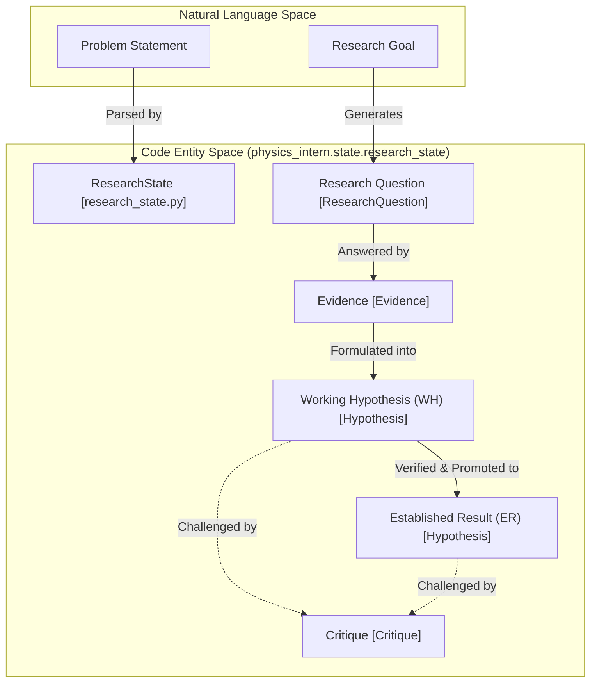
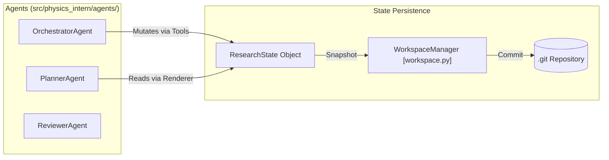

<!-- source: DeepWiki mcp.deepwiki.com · repo huggingface/physics-intern · page 1 PhysicsIntern Overview · fetched 2026-10-26 -->

# PhysicsIntern Overview

Relevant source files

The following files were used as context for generating this wiki page:

- [CLAUDE.md](CLAUDE.md)
- [DOCUMENTATION.md](DOCUMENTATION.md)
- [README.md](README.md)
- [tests/test_orchestrator_tools.py](tests/test_orchestrator_tools.py)

PhysicsIntern is a multi-agent scaffolding system designed for autonomous scientific research in mathematics and theoretical physics. It translates high-level natural language physics problems into verified solutions through an iterative research lifecycle involving analytical derivations, code execution, and adversarial review.

The system is built on the principle that no single agent call carries conversation history; instead, a structured **ResearchState** acts as the single source of truth, from which fresh contexts are rendered for each agent call [CLAUDE.md:32-34]().

### Research Modes
PhysicsIntern supports two primary operational modes:
*   **Multi-Agent Pipeline (Default):** A sophisticated orchestration of nine specialized agent roles (e.g., Researcher, Computer, Reviewer, Critic) that collaborate via a shared state [README.md:11-11]().
*   **Autophysicist:** A lightweight, single-agent research loop where a "Research Manager" dispatches ephemeral sub-agents and manages its own internal memory [README.md:9-9]().

For details on setting up the environment and running your first problem, see [Getting Started](#1.1).

---

### System Architecture and Data Flow

The system bridges natural language problem descriptions with structured scientific data through a continuous loop. The **PhysicsIntern Engine** manages the transitions between agent roles and ensures the **ResearchState** remains consistent.

#### From Language to Research Entities
The following diagram maps high-level research concepts to their corresponding classes and file structures within the codebase.

**Research Concept to Code Entity Mapping**

Sources: [src/physics_intern/state/research_state.py:1-200](), [README.md:11-13]()

---

### Major Subsystems

#### 1. The Multi-Agent Pipeline
The core of PhysicsIntern is a loop of nine specialized agents. This system is designed to prevent "hallucination drift" by requiring adversarial review of every hypothesis.

*   **Exploration:** The `SurveyorAgent` maps the initial landscape, followed by the `PlannerAgent` which sets the strategy [README.md:11-11]().
*   **Execution:** The `OrchestratorAgent` dispatches tasks to the `ResearcherAgent` (derivations) and `ComputerAgent` (Python execution) [README.md:11-11]().
*   **Verification:** The `ReviewerAgent` provides adversarial checks, while the `AdjudicatorAgent` handles challenges to established results [README.md:11-11]().

#### 2. State and Workspace Management
The `ResearchState` is persisted to disk using a `WorkspaceManager`. Every iteration is captured as a git commit, and snapshots are rendered into human-readable Markdown files (`RESEARCH_STATE.md`, `EVIDENCE_LOG.md`, etc.) [CLAUDE.md:32-33]().

**Agent-State Interaction Model**

Sources: [src/physics_intern/workspace.py:1-50](), [CLAUDE.md:32-41]()

#### 3. LLM Provider Layer
PhysicsIntern abstracts model interactions through an `LLMProvider` layer, supporting Anthropic, OpenAI, Google Gemini, and local vLLM instances. It handles tool-calling transformations and implements exponential backoff for retries [README.md:15-15](), [DOCUMENTATION.md:22-22]().

---

### Problem Definitions and Tiers
Problems are defined in YAML format and categorized into tiers based on difficulty:
*   **Tier 1/2:** Standard physics and math problems.
*   **CritPt:** A specialized benchmark challenge index for complex theoretical physics [README.md:52-52]().

For more information on how to define or extend problems, see [Problem Definitions](#1.2).

---

### Comparison with Baselines
The system includes several baseline modes to evaluate the effectiveness of the multi-agent scaffolding:
*   **One-Shot:** A single LLM call [DOCUMENTATION.md:107-109]().
*   **Two-Step:** Mimics the CritPt benchmark's derivation-then-population flow [DOCUMENTATION.md:130-132]().
*   **RSA (Recursive Self-Aggregation):** Generates multiple candidates and aggregates them over several rounds [DOCUMENTATION.md:14-14]().

For details on running these evaluations, see [Baseline Modes and Evaluation](#7).

---

### Child Pages
*   **[Getting Started](#1.1)**: Installation, CLI usage, and configuration.
*   **[Problem Definitions](#1.2)**: YAML schema, tiering, and the CritPt benchmark.

---

