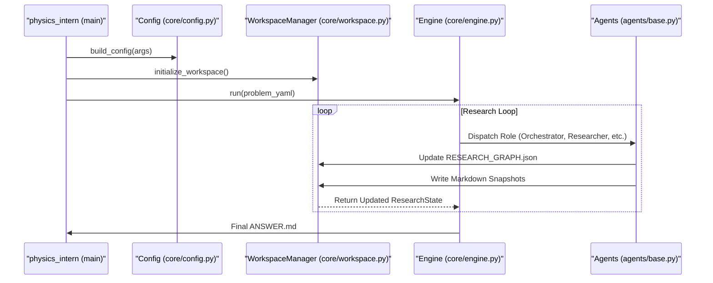

<!-- source: DeepWiki mcp.deepwiki.com · repo huggingface/physics-intern · page 1.1 Getting Started · fetched 2026-10-26 -->

# Getting Started

<details>
<summary>Relevant source files</summary>

The following files were used as context for generating this wiki page:

- [.github/workflows/testing.yml](.github/workflows/testing.yml)
- [.gitignore](.gitignore)
- [.pre-commit-config.yaml](.pre-commit-config.yaml)
- [README.md](README.md)
- [pyproject.toml](pyproject.toml)
- [tests/test_config.py](tests/test_config.py)
- [uv.lock](uv.lock)

</details>


This page covers the installation, environment configuration, and execution of the **PhysicsIntern** multi-agent research system. It provides a technical guide for setting up the local environment, understanding the configuration hierarchy, and running an initial physics research problem.

## Installation

PhysicsIntern requires **Python 3.12+** and uses `uv` for dependency management and environment isolation [README.md:19-21]().

### Local Environment Setup
To install the core system and testing dependencies:
```bash
# Clone and sync dependencies
uv sync --extra testing
```

### Provider-Specific Extras
Depending on the LLM backends you intend to use, install the corresponding optional dependencies [README.md:23-27]():
*   **OpenAI**: `uv sync --extra openai`
*   **Google Gemini**: `uv sync --extra google`
*   **HuggingFace**: `uv sync --extra huggingface`
*   **All Providers**: `uv sync --extra all-providers`

### GPU/Slurm Cluster Setup
For serving local models (e.g., DeepSeek V4) via vLLM on Linux-based GPU clusters, use the `local` extra [README.md:29-30](). This includes optimized kernels like `deep-gemm` [pyproject.toml:34-40]().
```bash
uv sync --extra local
```

**Sources:** [README.md:19-30](), [pyproject.toml:17-40]()

---

## Environment Variables

Authentication for LLM providers is managed via environment variables or a `.env` file [README.md:51-57]().

| Variable | Provider |
| :--- | :--- |
| `ANTHROPIC_API_KEY` | Anthropic |
| `OPENAI_API_KEY` | OpenAI |
| `GOOGLE_API_KEY` | Google Gemini (default) |
| `HF_TOKEN` | HuggingFace Inference Providers |

**Sources:** [README.md:60-67]()

---

## Configuration System

PhysicsIntern uses a hierarchical configuration resolution strategy managed by the `build_config` function [tests/test_config.py:18-19]().

### Configuration Hierarchy
The system resolves settings in the following order of precedence (highest to lowest):
1.  **CLI Flags**: Arguments passed directly to the `physics_intern` command [README.md:82-83]().
2.  **User Config File**: A YAML file provided via `--config FILE` [README.md:79]().
3.  **Global Defaults**: Hardcoded values in `config.default.yaml` [README.md:82]().

### Key Configuration Files
*   **`config.default.yaml`**: The single source of truth for default parameters such as `max_iterations`, `critic_every_n`, and `sympy_timeout_seconds` [tests/test_config.py:32-45]().
*   **`models.yaml`**: A registry of supported LLMs. Crucially, `max_tokens` (output limit) is sourced from this file based on the selected model, rather than from the general config [tests/test_config.py:46-48]().

### Data Flow: Config Resolution
The following diagram illustrates how the `Config` object is instantiated and how it interacts with the model registry.

**Config and Model Resolution Flow**
```mermaid
graph TD
    subgraph "Input_Sources"
        [CLI_Args] --> [build_config]
        [User_YAML] --> [load_config_yaml]
        [config.default.yaml] --> [DEFAULTS]
    end

    [load_config_yaml] -- "Filtered by _YAML_CONFIG_FIELDS" --> [build_config]
    [DEFAULTS] --> [build_config]

    subgraph "Logic_Space"
        [build_config] -- "1. Merge sources" --> [Config_Object]
        [Config_Object] -- "2. Lookup model key" --> [models.yaml]
        [models.yaml] -- "3. Return max_output_tokens" --> [Config_Object]
    end

    [Config_Object] -- "Initialize" --> [Engine]
```
**Sources:** [tests/test_config.py:13-19](), [tests/test_config.py:31-48](), [tests/test_config.py:124-153]()

---

## CLI Usage

The primary entry point is the `physics_intern` command, registered via `pyproject.toml` [pyproject.toml:43]().

### Command Syntax
```bash
physics_intern [problem.yaml] [options]
```

### Common Options
| Option | Description |
| :--- | :--- |
| `--model MODEL` | LLM model key (resolved via `models.yaml`) [README.md:74](). |
| `--max-iterations N` | Maximum number of agent loop iterations [README.md:76](). |
| `--workspace-dir DIR` | Custom path for research artifacts [README.md:77](). |
| `--resume DIR` | Resumes an interrupted research session from a workspace [README.md:78](). |
| `--replay DIR` | Replays the console log from a workspace without running the LLM [README.md:75](). |

**Sources:** [README.md:70-80](), [pyproject.toml:42-47]()

---

## Running Your First Problem

To run a research task, provide a problem definition YAML. The system defaults to a quantum error correction problem if no file is specified [README.md:72-73]().

### Execution Example
```bash
# Run a specific problem with a specific model
uv run physics_intern problems/critpt/quantum_error_correction_main.yaml --model gemini-3-flash-preview
```

### Data Flow: Execution Lifecycle
When a problem starts, the `main` entry point initializes the `WorkspaceManager` and the `Engine`. The `Engine` then orchestrates the research lifecycle across different agent roles.

**Research Execution Flow**

**Sources:** [README.md:51-53](), [README.md:11-13](), [pyproject.toml:43]()

---

## Development and Testing

The project enforces code quality through `ruff` and `pytest` [README.md:86-91]().

### Quality Checks
```bash
# Linting and Formatting
uv run ruff check tests src scripts serve
uv run ruff format --check tests src scripts serve

# Run Tests with Coverage
uv run python -m pytest ./tests/ --cov=physics_intern
```
Coverage is enforced at a **75%** threshold for core package code [README.md:94](), [pyproject.toml:75-76]().

**Sources:** [README.md:86-101](), [pyproject.toml:55-79]()

---

