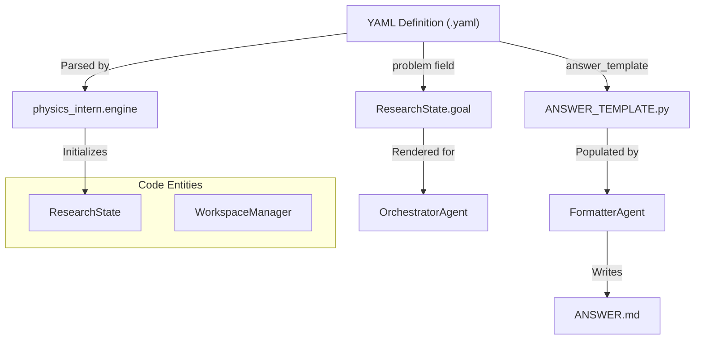
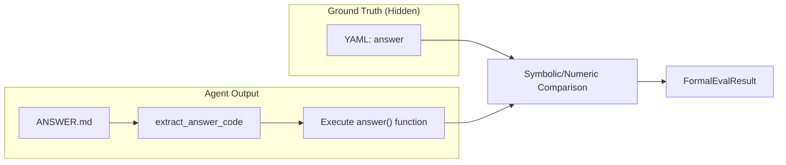

<!-- source: DeepWiki mcp.deepwiki.com · repo huggingface/physics-intern · page 1.2 Problem Definitions · fetched 2026-10-26 -->

# Problem Definitions

<details>
<summary>Relevant source files</summary>

The following files were used as context for generating this wiki page:

- [problems/critpt/challenge_index.json](problems/critpt/challenge_index.json)
- [problems/critpt/quantum_error_correction_main.yaml](problems/critpt/quantum_error_correction_main.yaml)
- [problems/tier1/berry_phase_spin.yaml](problems/tier1/berry_phase_spin.yaml)
- [problems/tier1/casimir_effect.yaml](problems/tier1/casimir_effect.yaml)
- [problems/tier1/chandrasekhar_limit.yaml](problems/tier1/chandrasekhar_limit.yaml)
- [problems/tier1/hawking_temperature.yaml](problems/tier1/hawking_temperature.yaml)
- [problems/tier1/hydrogen_fine_structure.yaml](problems/tier1/hydrogen_fine_structure.yaml)
- [problems/tier1/ising_1d_transfer_matrix.yaml](problems/tier1/ising_1d_transfer_matrix.yaml)
- [problems/tier2/thomas_fermi.yaml](problems/tier2/thomas_fermi.yaml)

</details>


PhysicsIntern problems are structured as self-contained YAML files that provide the problem statement, a ground-truth answer for evaluation, and a Python-based answer template. These definitions guide the agents' research objectives and standardize the output format required for automated scoring.

## YAML Schema and Structure

Each problem definition follows a specific YAML schema. The system uses these files to initialize the `ResearchState` and to provide the `FormatterAgent` with the necessary structure to produce a final `ANSWER.md`.

### Key Components

| Field | Description |
| :--- | :--- |
| `problem` | A detailed Markdown string describing the physical system, parameters, and the specific question to be solved [problems/critpt/quantum_error_correction_main.yaml:1-17](). |
| `answer` | The ground-truth value. This can be a numerical float [problems/tier2/thomas_fermi.yaml:13]() or a symbolic SymPy expression [problems/tier1/hawking_temperature.yaml:14](). |
| `answer_template` | A Python code block defining an `answer()` function. Agents must populate this template in the final workspace [problems/tier1/casimir_effect.yaml:18-44](). |

### The Answer Template Convention
The `answer_template` serves as a contract between the agentic system and the evaluation pipeline. It typically uses `sympy` for symbolic problems to ensure mathematical equivalence can be checked regardless of algebraic form [problems/tier1/berry_phase_spin.yaml:18-43]().

```python
import sympy as sp

def answer(params):
    # ------------------ FILL IN YOUR RESULTS BELOW ------------------
    result = ... 
    # ---------------------------------------------------------------
    return result
```

## The Tier System

Problems are categorized into three tiers based on complexity and the depth of research required.

*   **Tier 1 (Standard/Textbook):** Problems involving standard formulas or derivations found in graduate-level physics (e.g., Hawking Temperature, Casimir Effect) [problems/tier1/hawking_temperature.yaml:1-10](), [problems/tier1/casimir_effect.yaml:1-12]().
*   **Tier 2 (Intermediate):** Problems requiring solid domain knowledge and often numerical computation (e.g., Thomas-Fermi model) [problems/tier2/thomas_fermi.yaml:1-10]().
*   **CritPt (Research-Level):** The "Critical Path" benchmark. These are multi-step, cross-domain challenges often requiring heavy computation or derivation of cutting-edge results [problems/critpt/challenge_index.json:4-5]().

## CritPt Benchmark Challenge Index

The `critpt` directory contains a `challenge_index.json` which acts as a registry for the benchmark. This index maps numeric IDs to problem summaries and difficulty ratings (1-5) [problems/critpt/challenge_index.json:6-11]().

### Data Flow: From YAML to Agent Workspace

The following diagram illustrates how a problem definition is ingested and transformed into the operational environment for the agents.

**Problem Ingestion and Initialization**

Sources: [problems/critpt/quantum_error_correction_main.yaml:1-47](), [problems/tier1/hawking_temperature.yaml:1-44]()

## Implementation Details

### Symbolic vs. Numerical Problems
The system distinguishes between problems requiring a symbolic expression and those requiring a numerical constant. 

1.  **Symbolic:** Uses `sp.symbols` within the `answer_template` to define variables like $\hbar$, $c$, or $G$ [problems/tier1/hawking_temperature.yaml:19-21]().
2.  **Numerical:** The `answer()` function returns a `float`, often requiring the agent to use `scipy` or `numpy` within its internal research steps to solve ODEs or perform integrations [problems/tier2/thomas_fermi.yaml:15-32]().

### Data Flow for Evaluation
The `answer` field in the YAML is never shown to the agents. It is reserved for the `Evaluation` subsystem to compare against the agent-generated code in `ANSWER.md`.

**Validation Flow**

Sources: [problems/tier1/hydrogen_fine_structure.yaml:13-15](), [problems/tier1/ising_1d_transfer_matrix.yaml:13-15]()

### Challenge Index Structure
The `challenge_index.json` provides metadata used for batch running and reporting. It allows the runner to select specific subsets of the 70 research-level challenges based on difficulty or topic [problems/critpt/challenge_index.json:1-11]().

| ID | Difficulty | Summary Snippet |
| :--- | :--- | :--- |
| 1 | 5 | Holographic Weyl anomaly in 8D [problems/critpt/challenge_index.json:8-11]() |
| 2 | 5 | Stochastic bacterial growth rate [problems/critpt/challenge_index.json:13-16]() |
| 6 | 4 | Twisted bilayer MoTe2 Chern numbers [problems/critpt/challenge_index.json:33-36]() |
| 15 | 4 | Noisy spin-1 AKLT chain string order [problems/critpt/challenge_index.json:78-81]() |

Sources: [problems/critpt/challenge_index.json:1-154]()

---

